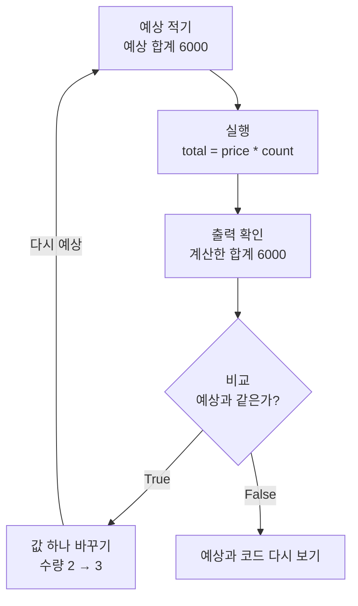
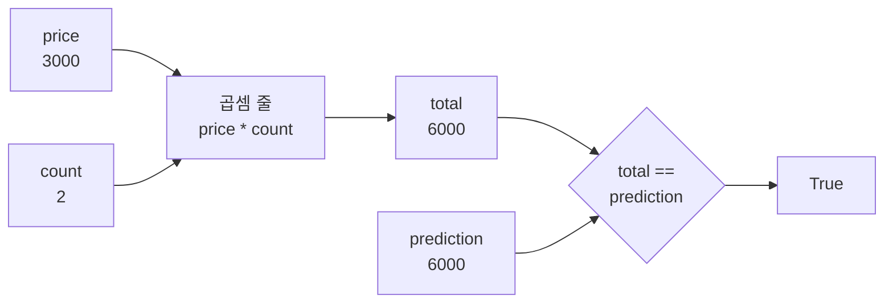
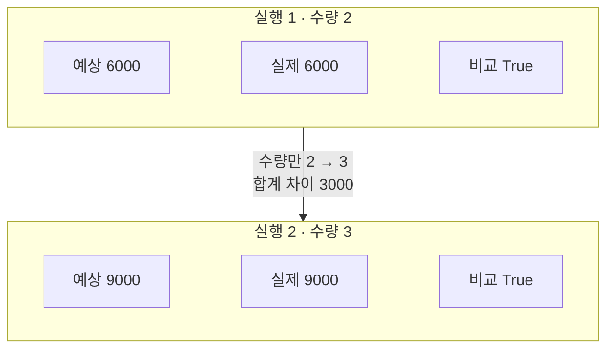
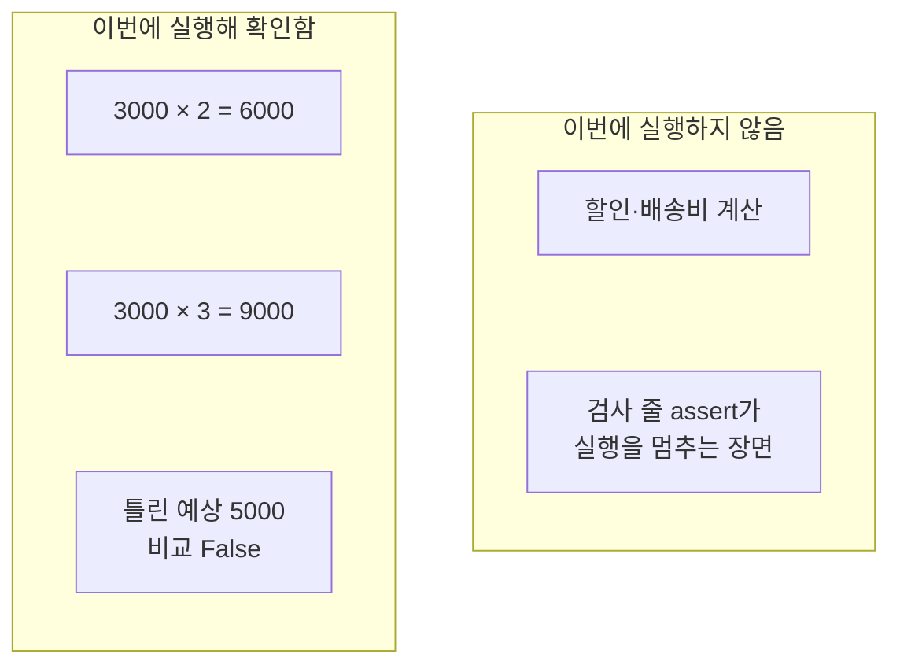

# 01-과정-지도와-학습-규칙

## _src 본문 (HTML 원본)

```html
<!--meta: 강의 1h | 실습 0h | 코드 Jupyter Notebook | 새 용어 7 -->
<h2 id="b1"><span class="no">1</span>학습 목표</h2>
<div class="goal"><ul><li>과정의 여덟 Part가 이어지는 순서와 지금 배우는 Part 1의 자리를 말할 수 있습니다.</li><li>실행 전에 결과를 예상하고, 실제 출력과 비교해 맞는지 확인할 수 있습니다.</li><li>값 하나만 바꾼 두 실행을 기록하고, 확인한 것과 확인하지 않은 것을 나눠 적을 수 있습니다.</li></ul></div>
<h2 id="b2"><span class="no">2</span>이 내용을 배우는 이유</h2>
<p>프로그램을 실행하면 화면에 숫자나 문장이 나타납니다. 그 값이 맞는지 판단하려면 실행 전에 무엇을 기대했는지 알아야 합니다.</p>
<p>3000원짜리 상품 두 개의 합계는 6000원입니다. 프로그램이 오류 없이 3002를 출력했다면 계산이 틀린 것입니다. <b>실행이 오류 없이 마무리된 것과 원하는 값을 얻은 것은 따로 확인</b>해야 합니다.</p>
<p>이 과정은 뒤로 갈수록 긴 프로그램을 다룹니다. 결과가 예상과 다를 때 어디부터 살펴볼지 알려면 비교하는 습관이 먼저 필요합니다. 그래서 첫 절에서 이 습관부터 연습합니다.</p>
<p><strong>이 절의 질문</strong> — 실행 전에 적은 예상과 실제 출력을 어떻게 비교할까요?</p>
<h2 id="b3"><span class="no">3</span>앞에서 배운 내용</h2>
<p>이 절은 과정의 첫 학습입니다. 프로그래밍 경험은 필요하지 않습니다. 파일을 내려받고 폴더에서 찾을 수 있으면 시작할 수 있습니다.</p>
<p>아직 실행 도구가 없다면 지금은 본문과 저장된 출력을 읽습니다. 2절에서 편집기를 설치하고, 3절에서 Python 실행 환경을 준비합니다. 그 뒤에 이 절의 노트북으로 돌아와 직접 실행합니다.</p>
<p>노트북 파일은 이름이 <code>.ipynb</code>로 끝납니다. 설명 칸과 코드 칸이 나뉘어 보이면 제대로 열린 것입니다. 중괄호와 따옴표만 가득 보이면 텍스트 편집기로 열린 상태이므로 2절의 확장 설치를 확인합니다.</p>
<p>교재 페이지는 설명을 읽고 코드를 복사하는 곳입니다. 페이지의 복사 버튼은 코드를 실행하지 않습니다.</p>
<h2 id="b4"><span class="no">4</span>핵심 개념</h2>
<h3>비유로 시작하기</h3>
<p>가게 계산대에서 머그컵 두 개를 계산한다고 해 봅니다. 계산하기 전에 메모장에 합계를 먼저 적어 둡니다.</p>
<p>영수증을 받으면 메모와 나란히 놓고 비교합니다. 금액이 다르면 수량과 단가 중 어디가 달라졌는지 영수증을 다시 봅니다.</p>
<p>프로그램도 같습니다. 메모에 적은 금액이 예상값이고, 영수증이 실행 결과입니다.</p>
{{img:01-5-메모와-영수증|계산대 뒤의 사람이 머그컵 두 개를 그린 메모장과 영수증을 양손에 들고, 점선 화살표를 따라 두 종이를 비교하는 삽화|메모에 적어 둔 예상과 영수증을 나란히 놓고 비교합니다. 프로그램에서는 예상값과 실행 결과를 비교합니다.}}
<p><strong>그림 읽기</strong> — 왼쪽 메모장에는 사기 전에 적어 둔 머그컵 두 개가 있습니다. 이것이 실행 전에 적은 예상입니다. 오른쪽 영수증은 실행 결과입니다. 점선 화살표를 따라 두 종이를 비교합니다. 계산대의 머그컵 두 개는 이 절의 수량 2에 해당합니다.</p>
<h3>이 절에서 쓰는 말</h3>
<table><thead><tr><th>용어</th><th>뜻</th><th>이 절에서 보이는 모습</th></tr></thead><tbody>
<tr><td>프로그램(program)</td><td>컴퓨터가 할 일을 순서대로 적은 것</td><td>단가와 수량을 곱해 합계를 출력하는 노트북 셀들</td></tr>
<tr><td>셀(cell)</td><td>노트북에서 설명이나 코드를 담는 한 칸</td><td>코드 셀 11개를 위에서부터 차례로 실행</td></tr>
<tr><td>입력(input)</td><td>계산에 넣는 값</td><td>단가 3000, 수량 2</td></tr>
<tr><td>출력(output)</td><td>실행한 뒤 화면에 보이는 값</td><td><code>계산한 합계: 6000</code></td></tr>
<tr><td>검증(verification)</td><td>결과가 미리 정한 조건에 맞는지 확인하는 일</td><td>계산한 합계가 예상 합계와 같은지 비교</td></tr>
<tr><td>목록(list)</td><td>값 여러 개를 순서대로 담는 자료</td><td>Part 여덟 개를 담은 <code>course_map</code></td></tr>
<tr><td>반복문(for)</td><td>목록의 값마다 같은 줄을 한 번씩 실행하는 문장</td><td>과정 지도를 번호와 함께 한 줄씩 출력</td></tr>
</tbody></table>
<h3>저장과 비교</h3>
<p>등호 하나 <code>=</code>는 오른쪽 값을 왼쪽 이름에 저장합니다. 예를 들어 <code>price = 3000</code>을 실행하면 이름 price에 3000이 저장됩니다.</p>
<p>등호 두 개 <code>==</code>는 두 값이 같은지 묻습니다. 같으면 참을 뜻하는 <code>True</code>, 다르면 거짓을 뜻하는 <code>False</code>가 나옵니다.</p>
<p>값을 저장해도 화면에는 아무것도 나타나지 않습니다. 확인할 값은 <code>print()</code> 함수로 출력합니다. 이름 뒤에 괄호를 붙여 부르는 기능을 함수라고 합니다. 함수가 계산해 내놓는 값을 반환값이라고 합니다. 이름과 값의 규칙은 Ch 2에서 자세히 배웁니다.</p>
<h3>학습 순서</h3>
<p>이 교재의 실습은 이 순서를 기본으로 따릅니다. 예상을 적고, 실행하고, 출력을 확인하고, 비교합니다. 비교가 맞으면 값 하나를 바꿔 다시 예상합니다.</p>
{{mermaid:01-1-학습-순서|예상 적기, 실행, 출력 확인, 비교, 값 하나 바꾸기로 이어지고 비교가 거짓이면 예상과 코드를 다시 보는 흐름도|학습 순서. 비교가 True이면 값 하나를 바꿔 다시 예상하고, False이면 예상과 코드를 다시 봅니다.}}
<p><strong>도식 읽기</strong> — 위에서 아래로 읽습니다. 파란 상자는 우리가 하는 행동이고, 노란 상자는 결과를 확인하는 행동입니다. 회색 상자는 비교가 거짓일 때 이어지는 단계입니다.</p>
<p>이 절의 첫 실행에서는 예상 합계 6000과 계산한 합계 6000을 비교해 True를 얻었습니다. 그다음 수량을 2에서 3으로 바꾸고 다시 예상 적기 단계로 이어졌습니다.</p>
<h3>과정 지도</h3>
<p>과정은 Part 여덟 개와 프로젝트 두 번으로 이루어집니다. 아래 표는 커리큘럼 v6의 순서를 옮긴 것입니다.</p>
<table><thead><tr><th>구간</th><th>챕터</th><th>주차</th><th>하는 일</th></tr></thead><tbody>
<tr><td>Part 1 개발 기반</td><td>Ch 1~5</td><td>W1~W3</td><td>코드를 읽고 쓰는 힘을 만듭니다. 지금 이 구간에 있습니다.</td></tr>
<tr><td>Part 2 LangChain과 프롬프트</td><td>Ch 6~8</td><td>W3~W4</td><td>Ch 6에서 모델 API를 처음 호출합니다.</td></tr>
<tr><td>Part 3 RAG</td><td>Ch 9~12</td><td>W4~W7</td><td>문서 검색과 답변 생성을 완성하고, 측정한 뒤 검색 품질을 조정합니다.</td></tr>
<tr><td>Part 4 그래프·평가·안정화</td><td>Ch 13~16</td><td>W7~W8</td><td>처리 흐름을 그래프로 옮기고 평가와 안정화를 더합니다.</td></tr>
<tr><td>중간 프로젝트</td><td>—</td><td>W9~W10</td><td>Part 3~4에서 배운 검색 기반 답변(순수 RAG)을 프로젝트로 만듭니다.</td></tr>
<tr><td>Part 5 Agent 입문</td><td>Ch 17~20</td><td>W11~W12</td><td>프레임워크 없이 에이전트의 반복 구조를 먼저 만듭니다.</td></tr>
<tr><td>Part 6 Agent 개발</td><td>Ch 21~29</td><td>W12~W15</td><td>프레임워크로 에이전트를 만들고 평가합니다.</td></tr>
<tr><td>Part 7 서비스화와 배포</td><td>Ch 30~34</td><td>W15~W17</td><td>에이전트를 서비스로 만들어 배포합니다.</td></tr>
<tr><td>Part 8 AI 페어 개발</td><td>Ch 35~41</td><td>W18~W20</td><td>AI 코딩 도구와 함께 빈 저장소에서 배포까지 다시 만듭니다.</td></tr>
<tr><td>최종 통합 프로젝트</td><td>—</td><td>W21~W24</td><td>배운 내용을 모아 프로젝트를 완성합니다.</td></tr>
</tbody></table>
<p>도구 이름을 지금 외울 필요는 없습니다. 이 장에는 모델이 나오지 않습니다. 이 장의 예제는 숫자와 파일, 개발 도구만 씁니다.</p>
<p>노트북에서는 같은 과정 지도를 목록에 담아 출력합니다. 목록에는 Part 여덟 개만 넣고 프로젝트 두 번은 넣지 않았습니다.</p>
<h2 id="b5"><span class="no">5</span>실행 예제</h2>
<p>노트북은 Python 버전을 확인한 뒤 과정 지도를 출력합니다. 그다음 상품 합계를 예상하고, 계산하고, 비교합니다.</p>
<p>모델을 부르지 않으므로 API 키가 필요 없고 비용도 들지 않습니다. 계산 셀의 출력 숫자는 다시 실행해도 같습니다.</p>
<p>셀은 위에서 아래로 순서대로 실행합니다. 앞 셀에서 저장한 값을 뒤 셀이 쓰기 때문입니다. 중간 셀만 실행하면 필요한 이름이 없다는 오류가 날 수 있습니다.</p>
{{notebook:01-과정-지도와-학습-규칙}}
<p class="look"><b>확인할 점</b> — 첫 비교에서 <code>True</code>, 틀린 예상 5000과의 비교에서 <code>False</code>가 나왔는지 봅니다. 마지막 기록 두 줄의 실제 값이 6000과 9000인지도 확인합니다.</p>
<h3>값이 흐르는 순서</h3>
<p>첫 번째 계산에서 이름에 저장한 값이 어떻게 비교까지 이어지는지 한 그림으로 모았습니다.</p>
{{mermaid:01-2-값-흐름|price 3000과 count 2가 곱셈 줄로 들어가 total 6000이 되고, prediction 6000과 비교해 True가 나오는 흐름도|첫 번째 계산의 값 흐름. 곱셈 결과 total 6000과 예상 prediction 6000이 비교 상자에서 만나 True가 나옵니다.}}
<p><strong>도식 읽기</strong> — 왼쪽에서 오른쪽으로 읽습니다. 초록 상자는 이름에 저장된 값, 파란 상자는 계산하는 줄, 노란 상자는 비교입니다.</p>
<p>단가 price 3000과 수량 count 2가 곱셈 줄로 들어가 total 6000이 됩니다. 아래쪽의 prediction 6000은 우리가 먼저 적어 둔 값입니다. 두 값이 마름모에서 만나 True가 나옵니다.</p>
<h2 id="b6"><span class="no">6</span>실험 결과 해석</h2>
<p>같은 단가에 수량만 바꿔 두 번 실행했습니다. 두 실행 모두 예상 합계와 실제 합계가 같았습니다.</p>
{{mermaid:01-3-두-실행-비교|실행 1은 수량 2로 예상 6000·실제 6000·비교 True, 실행 2는 수량 3으로 예상 9000·실제 9000·비교 True임을 위아래로 비교한 그림|수량만 바꾼 두 실행. 합계 차이 3000은 단가와 같습니다.}}
<p>실행 1은 수량 2로 합계 6000이었습니다. 실행 2는 수량 3으로 합계 9000이었습니다. 두 합계의 차이는 3000으로 단가와 같습니다.</p>
<p>바꾼 값이 수량 하나뿐이므로 합계가 달라진 원인을 수량이라고 말할 수 있습니다. 단가와 수량을 함께 바꿨다면 어느 값 때문에 달라졌는지 따로 확인해야 합니다.</p>
<p>틀린 예상 5000과 비교한 셀에서는 False가 나왔습니다. 비교가 거짓이면 예상과 코드 중 한쪽을 다시 봅니다. 이번에는 예상이 틀렸고 코드는 그대로였습니다.</p>
<h3>확인한 범위</h3>
{{mermaid:01-4-확인한-범위|이번에 실행해 확인한 세 가지와 이번에 실행하지 않은 두 가지를 두 칸으로 나눈 그림|왼쪽 칸은 노트북에서 실제로 실행한 계산입니다. 오른쪽 칸은 이번에 실행하지 않은 경우입니다.}}
<p>왼쪽 칸의 세 상자는 노트북에서 실제로 실행한 계산입니다. 오른쪽 칸의 회색 상자 두 개는 이번에 실행하지 않았습니다.</p>
<p>이 결과만으로 모든 계산 프로그램이 맞다고 말할 수는 없습니다. 할인이나 배송비가 붙는 계산은 실행하지 않았습니다. 검사 줄 assert가 거짓 조건에서 실행을 멈추는 장면도 이번에는 보지 않았습니다.</p>
<p>코드가 틀려 합계가 달라지는 경우는 4절에서 실제로 실행합니다. 같은 입력으로 잘못된 연산의 결과를 관찰하고 수정합니다.</p>
<h2 id="b7"><span class="no">7</span>주의할 점과 실무 메모</h2>
<ul><li>실행 기록에는 바꾼 입력, 예상, 실제 출력을 함께 적습니다. 「잘 됨」 대신 「수량 2, 예상 6000, 실제 6000」처럼 씁니다.</li>
<li>노트북에 저장된 출력은 교재를 만들 때 실행한 기록입니다. 출력이 보인다고 내 컴퓨터에서 실행된 것은 아닙니다. 직접 실행해 셀 왼쪽에 실행 번호가 새로 붙는지 확인합니다.</li>
<li>셀을 뒤섞인 순서로 실행해 값이 예상과 다르게 남았다면, 노트북을 처음부터 다시 실행합니다. VS Code 노트북 화면 위쪽의 Restart와 Run All 버튼을 씁니다. 이 화면 조작은 교재 실행 검증에 포함하지 않았습니다.</li>
<li>오류가 나면 마지막 오류 메시지와 실행한 셀을 기록합니다. 이미 확인한 정상 셀을 여러 곳 한꺼번에 고치지 않습니다.</li>
<li>Python 버전의 마지막 숫자는 컴퓨터마다 다를 수 있습니다. 교재 실행에서는 3.12.13이 나왔습니다. 3.12로 시작하면 이 과정의 기준에 맞습니다.</li></ul>
<h2 id="b8"><span class="no">8</span>정리와 다음 절</h2>
<ul><li>실행 전에 입력과 예상 결과를 먼저 적습니다.</li><li>실행 뒤에는 <code>==</code> 비교나 검사 줄 <code>assert</code>로 예상과 출력을 맞춰 봅니다.</li><li>값 하나만 바꾸고 같은 순서를 반복하면 결과가 달라진 원인을 말할 수 있습니다.</li></ul>
<p><strong>다음 학습과 이어지는 지점</strong> — 2절에서는 이 순서를 내 컴퓨터에서 실행하도록 편집기와 터미널을 준비합니다. 이번에 남긴 예상값과 실제값 기록은 4절에서 계산 오류를 찾을 때 다시 씁니다.</p>
<h2 id="b9"><span class="no">9</span>복습 문제</h2><details class="quiz"><summary>문제와 해설</summary>
<p class="quiz-q">1. 이 절의 첫 계산에서 입력과 출력은 각각 무엇인가요? · 기초</p><p class="quiz-a"><b>해설</b> — 단가 3000과 수량 2가 입력입니다. 화면에 출력한 합계 6000이 출력입니다. 계산에 넣은 값과 화면에 보인 값을 나눠 봅니다.</p>
<p class="quiz-q">2. 등호 하나 <code>=</code>와 등호 두 개 <code>==</code>는 어떻게 다른가요? · 기초</p><p class="quiz-a"><b>해설</b> — 등호 하나는 오른쪽 값을 왼쪽 이름에 저장합니다. 등호 두 개는 두 값이 같은지 비교하고 True나 False를 만듭니다.</p>
<p class="quiz-q">3. 오류 없이 3002가 출력되면 올바른 합계인가요? · 적용</p><p class="quiz-a"><b>해설</b> — 아닙니다. 상품 두 개의 합계는 6000이어야 합니다. 예상 6000과 비교하면 False가 나옵니다. 실행이 오류 없이 마무리됐는지와 값이 맞는지는 따로 확인합니다.</p>
<p class="quiz-q">4. 단가는 그대로 두고 수량을 4로 바꾸면 어떤 합계를 예상하나요? · 적용</p><p class="quiz-a"><b>해설</b> — 3000원짜리 4개이므로 12000을 예상합니다. 이 값은 실행 전에 적는 예상입니다. 노트북에서 직접 바꿔 실행하고 비교합니다.</p>
<p class="quiz-q">5. 두 번 확인한 결과로 할인 계산도 맞다고 말할 수 있나요? · 분석</p><p class="quiz-a"><b>해설</b> — 말할 수 없습니다. 할인이 붙는 계산은 실행하지 않았습니다. 할인 규칙과 예상값을 정한 별도 사례를 실행해야 합니다.</p>
</details>
<h2 id="b10"><span class="no">10</span>참고 자료</h2>
<ul><li><a href="../../../커리큘럼_v6.html">과정 커리큘럼 v6</a> · 프로젝트 제공 자료 · 확인 2026-09-16 · Part 구성과 주차</li><li><a href="https://docs.python.org/3.12/tutorial/introduction.html">Python 3.12 입문: 수와 계산</a> · 확인 2026-09-16 · 계산 예제는 이 교재에서 작성했습니다.</li></ul>
```

## 노트북 셀 (순서대로)

### [0] markdown {'html': 'skip'}

# 과정 지도와 학습 규칙

**이 노트북에서 할 일**

1. 과정 지도를 출력해 지금 배우는 Ch 1이 어디에 있는지 확인합니다.
2. 상품 합계를 먼저 예상하고, 컴퓨터가 계산한 값과 비교합니다.
3. 수량 하나만 바꿔 다시 예상하고 비교한 뒤 실행 기록을 남깁니다.

**준비물** — API 키 불필요. 데이터 파일도 없습니다. 모델 호출은 0번이고 비용은 들지 않습니다.
실행 시간은 1분 이내입니다. Python 3.12 커널에서 첫 셀부터 순서대로 실행합니다.

### [1] markdown {'html': 'skip'}

## 오늘 볼 그림


위에서 아래로 읽습니다. 파란 상자는 우리가 하는 행동이고, 노란 상자는 결과를 확인하는 행동입니다.
비교 결과가 `True`이면 값 하나를 바꾸고 다시 예상 적기 상자로 이어집니다.

### [2] markdown {}

## 1. 준비

이 절은 설치할 패키지가 없습니다. 첫 셀은 노트북을 실행하는 Python 버전을 확인합니다.
셀을 고른 뒤 `Shift+Enter`를 누르면 그 셀이 실행되고 다음 셀로 넘어갑니다.
실행 도구를 준비하는 방법은 2절과 3절에서 배웁니다.

첫 줄의 `import`는 Python에 들어 있는 기능 묶음을 불러오는 줄입니다. 자세한 뜻은 Ch 2에서 배웁니다.
이름 뒤에 괄호를 붙여 부르는 기능을 함수라고 합니다. 함수가 계산해 내놓는 값을 반환값이라고 합니다.
따옴표로 감싼 글을 문자열이라고 합니다.

### [3] code {'execution': {'iopub.execute_input': '2026-09-16T03:21:07.721428Z', 'iopub.status.busy': '2026-09-16T03:21:07.721277Z', 'iopub.status.idle': '2026-09-16T03:21:07.729545Z', 'shell.execute_reply': '2026-09-16T03:21:07.728901Z'}, 'lesson_role': 'setup', 'upgrade_allow': ['stdlib-import']}

```python
# 이 노트북을 실행하는 Python 버전을 확인합니다
import platform

# python_version()은 "3.12.13" 같은 버전 문자열을 반환합니다
python_version = platform.python_version()
is_python_312 = python_version.startswith("3.12")
print("Python 버전:", python_version)
print("3.12 버전인가:", is_python_312)
```

출력:
```
Python 버전: 3.12.13
3.12 버전인가: True

```

### [4] markdown {}

**결과 읽기** — Python 버전이 3.12로 시작하고 `True`가 보이면 준비가 된 것입니다.
버전의 마지막 숫자는 컴퓨터마다 다를 수 있습니다.

### [5] markdown {}

## 2. 과정 지도 출력하기

과정 전체는 Part 여덟 개로 나뉩니다. 각 Part의 이름과 챕터 범위를 목록에 담아 출력합니다.
목록(list)은 값 여러 개를 순서대로 담는 자료입니다. 장보기 메모에 살 것을 한 줄씩 적는 모습과 비슷합니다.
아래 셀에서는 대괄호 `[ ]` 안에 문자열 여덟 개를 쉼표로 나눠 넣습니다.

### [6] code {'execution': {'iopub.execute_input': '2026-09-16T03:21:07.731075Z', 'iopub.status.busy': '2026-09-16T03:21:07.730935Z', 'iopub.status.idle': '2026-09-16T03:21:07.733466Z', 'shell.execute_reply': '2026-09-16T03:21:07.732906Z'}}

```python
# 과정의 Part 여덟 개를 순서대로 목록에 담습니다
course_map = [
    "Part 1 개발 기반 · Ch 1~5",
    "Part 2 LangChain과 프롬프트 · Ch 6~8",
    "Part 3 RAG · Ch 9~12",
    "Part 4 그래프·평가·안정화 · Ch 13~16",
    "Part 5 Agent 입문 · Ch 17~20",
    "Part 6 Agent 개발 · Ch 21~29",
    "Part 7 서비스화와 배포 · Ch 30~34",
    "Part 8 AI 페어 개발 · Ch 35~41",
]
# len()은 목록에 든 값의 개수를 반환합니다
print("Part 수:", len(course_map))
```

출력:
```
Part 수: 8

```

### [7] markdown {}

**결과 읽기** — Part 수가 `8`입니다. 목록에 넣은 문자열 개수와 같습니다.

다음 셀은 목록의 값을 앞에서부터 하나씩 꺼내 번호와 함께 출력합니다.
반복문 `for`는 목록의 값마다 들여 쓴 줄을 한 번씩 실행합니다.
번호는 1에서 시작해 한 줄을 출력할 때마다 1씩 늘립니다.

### [8] code {'execution': {'iopub.execute_input': '2026-09-16T03:21:07.734688Z', 'iopub.status.busy': '2026-09-16T03:21:07.734573Z', 'iopub.status.idle': '2026-09-16T03:21:07.737099Z', 'shell.execute_reply': '2026-09-16T03:21:07.736579Z'}}

```python
# 목록의 값을 하나씩 꺼내 번호와 함께 출력합니다
number = 1
for part in course_map:
    print(number, part)
    # 다음 줄에 쓸 번호를 1 늘립니다
    number = number + 1
```

출력:
```
1 Part 1 개발 기반 · Ch 1~5
2 Part 2 LangChain과 프롬프트 · Ch 6~8
3 Part 3 RAG · Ch 9~12
4 Part 4 그래프·평가·안정화 · Ch 13~16
5 Part 5 Agent 입문 · Ch 17~20
6 Part 6 Agent 개발 · Ch 21~29
7 Part 7 서비스화와 배포 · Ch 30~34
8 Part 8 AI 페어 개발 · Ch 35~41

```

### [9] markdown {}

**결과 읽기** — 첫 줄은 `1 Part 1 개발 기반 · Ch 1~5`입니다. 지금 배우는 Ch 1이 이 구간에 있습니다.
마지막 줄은 `8 Part 8 AI 페어 개발 · Ch 35~41`입니다.
모델을 처음 호출하는 곳은 Part 2의 Ch 6입니다. Part 1에서는 모델을 부르지 않습니다.

### [10] markdown {}

## 3. 결과를 먼저 예상하기

가게에서 3000원짜리 상품 2개를 산다고 해 봅니다. 계산하기 전에 합계를 먼저 적습니다.
머릿속으로 곱하면 6000원입니다.
아래 셀의 등호 `=`는 오른쪽 값을 왼쪽 이름에 저장합니다. 이름은 단가 `price`, 수량 `count`, 예상 합계 `prediction` 세 개입니다.

### [11] code {'execution': {'iopub.execute_input': '2026-09-16T03:21:07.738296Z', 'iopub.status.busy': '2026-09-16T03:21:07.738182Z', 'iopub.status.idle': '2026-09-16T03:21:07.741447Z', 'shell.execute_reply': '2026-09-16T03:21:07.740922Z'}}

```python
# 계산하기 전에 단가, 수량, 예상 합계를 적습니다
price = 3000
count = 2
prediction = 6000
print("단가:", price)
print("수량:", count)
print("예상 합계:", prediction)
```

출력:
```
단가: 3000
수량: 2
예상 합계: 6000

```

### [12] markdown {}

**결과 읽기** — 단가 `3000`, 수량 `2`, 예상 합계 `6000`이 출력됐습니다.
아직 곱셈은 하지 않았습니다. 예상 합계는 우리가 손으로 적은 값입니다.

### [13] markdown {}

## 4. 실행하고 출력 확인하기

이제 컴퓨터가 합계를 계산합니다. 곱셈 기호는 `*`입니다.
식 `price * count`는 저장해 둔 단가와 수량을 곱합니다. 계산한 값은 `total`이라는 이름에 저장합니다.

### [14] code {'execution': {'iopub.execute_input': '2026-09-16T03:21:07.742642Z', 'iopub.status.busy': '2026-09-16T03:21:07.742537Z', 'iopub.status.idle': '2026-09-16T03:21:07.744803Z', 'shell.execute_reply': '2026-09-16T03:21:07.744396Z'}}

```python
# 단가와 수량을 곱해 실제 합계를 계산합니다
total = price * count
print("계산한 합계:", total)
```

출력:
```
계산한 합계: 6000

```

### [15] markdown {}

**결과 읽기** — 계산한 합계가 `6000`입니다.
셀이 오류 없이 실행됐다는 사실만으로는 부족합니다. 이 값이 우리가 원한 값인지 다음 셀에서 비교합니다.

### [16] markdown {}

## 5. 예상과 비교하기

두 값이 같은지 묻는 기호는 등호 두 개 `==`입니다. 등호 하나는 저장, 등호 두 개는 비교입니다.
비교 결과는 참을 뜻하는 `True`나 거짓을 뜻하는 `False` 중 하나입니다.

### [17] code {'execution': {'iopub.execute_input': '2026-09-16T03:21:07.745879Z', 'iopub.status.busy': '2026-09-16T03:21:07.745745Z', 'iopub.status.idle': '2026-09-16T03:21:07.748250Z', 'shell.execute_reply': '2026-09-16T03:21:07.747437Z'}}

```python
# 계산한 합계와 예상 합계가 같은지 비교합니다
same = total == prediction
print("예상과 같은가:", same)
```

출력:
```
예상과 같은가: True

```

### [18] markdown {}

**결과 읽기** — `True`가 나왔습니다. 계산한 합계와 예상 합계가 모두 6000이라는 뜻입니다.

예상을 잘못 적으면 어떻게 될까요? 수량을 잘못 세어 5000원으로 예상했다고 해 봅니다.
실행 전에 먼저 예상합니다. 계산한 합계는 그대로 6000이므로 `False`가 나올 것입니다.

### [19] code {'execution': {'iopub.execute_input': '2026-09-16T03:21:07.749404Z', 'iopub.status.busy': '2026-09-16T03:21:07.749279Z', 'iopub.status.idle': '2026-09-16T03:21:07.751625Z', 'shell.execute_reply': '2026-09-16T03:21:07.751153Z'}}

```python
# 틀리게 적은 예상과 계산한 합계를 비교합니다
wrong_prediction = 5000
wrong_same = total == wrong_prediction
print("틀린 예상:", wrong_prediction)
print("예상과 같은가:", wrong_same)
```

출력:
```
틀린 예상: 5000
예상과 같은가: False

```

### [20] markdown {}

**결과 읽기** — 틀린 예상 `5000`과 비교하자 `False`가 나왔습니다.
비교가 거짓이면 예상과 코드 중 한쪽이 틀린 것입니다. 이번에는 예상을 틀리게 적었고 코드는 그대로입니다.

### [21] markdown {}

## 6. 검사 줄 넣기

출력에서 `True`를 눈으로 찾는 대신 검사 줄을 넣을 수 있습니다.
검사 줄은 `assert` 뒤에 조건을 적습니다. 조건이 참이면 아무것도 출력하지 않고 다음 줄로 넘어갑니다.
조건이 거짓이면 실행을 멈추고 `AssertionError` 오류를 보여 줍니다. 그래서 검사 뒤에 확인용 문장을 한 줄 출력합니다.

### [22] code {'execution': {'iopub.execute_input': '2026-09-16T03:21:07.753057Z', 'iopub.status.busy': '2026-09-16T03:21:07.752971Z', 'iopub.status.idle': '2026-09-16T03:21:07.755083Z', 'shell.execute_reply': '2026-09-16T03:21:07.754545Z'}}

```python
# 합계가 예상과 다르면 이 줄에서 실행을 멈춥니다
assert total == prediction
print("검사 통과, 합계:", total)
```

출력:
```
검사 통과, 합계: 6000

```

### [23] markdown {}

**결과 읽기** — `검사 통과, 합계: 6000`이 출력됐습니다. 검사 줄에서 멈추지 않고 다음 줄까지 실행됐다는 뜻입니다.
조건이 거짓이라 실행이 멈추는 장면은 이번에 실행하지 않았습니다.

### [24] markdown {}

## 7. 값 하나만 바꿔 보기

단가는 그대로 두고 수량만 2에서 3으로 바꿉니다. 이번에도 실행 전에 예상부터 적습니다.
3000원짜리 3개이므로 예상 합계는 9000원입니다.
바꾼 값은 새 이름 `new_count`에 담습니다. 앞에서 쓴 `count` 값은 비교를 위해 그대로 둡니다.

### [25] code {'execution': {'iopub.execute_input': '2026-09-16T03:21:07.755946Z', 'iopub.status.busy': '2026-09-16T03:21:07.755863Z', 'iopub.status.idle': '2026-09-16T03:21:07.758280Z', 'shell.execute_reply': '2026-09-16T03:21:07.757904Z'}}

```python
# 수량만 3으로 바꾸고, 계산 전에 새 예상 합계를 적습니다
new_count = 3
new_prediction = 9000
print("단가:", price)
print("바꾼 수량:", new_count)
print("새 예상 합계:", new_prediction)
```

출력:
```
단가: 3000
바꾼 수량: 3
새 예상 합계: 9000

```

### [26] markdown {}

**결과 읽기** — 단가 `3000`은 그대로이고, 바꾼 수량은 `3`, 새 예상 합계는 `9000`입니다.

같은 곱셈으로 새 합계를 계산하고 새 예상과 비교합니다.

### [27] code {'execution': {'iopub.execute_input': '2026-09-16T03:21:07.759098Z', 'iopub.status.busy': '2026-09-16T03:21:07.759017Z', 'iopub.status.idle': '2026-09-16T03:21:07.761343Z', 'shell.execute_reply': '2026-09-16T03:21:07.760741Z'}}

```python
# 같은 곱셈으로 새 합계를 계산하고 예상과 비교합니다
new_total = price * new_count
new_same = new_total == new_prediction
print("새 합계:", new_total)
print("예상과 같은가:", new_same)
```

출력:
```
새 합계: 9000
예상과 같은가: True

```

### [28] markdown {}

**결과 읽기** — 새 합계는 `9000`이고 비교 결과는 `True`입니다.
두 실행에서 바꾼 값은 수량 하나뿐입니다. 그래서 합계가 달라진 원인을 수량이라고 말할 수 있습니다.

### [29] markdown {}

## 8. 실행 기록 남기기

두 번의 실행을 기록으로 남깁니다. 기록에는 바꾼 입력, 예상, 실제 출력을 함께 적습니다.
「잘 됨」만 적으면 무엇이 맞았는지 나중에 알 수 없습니다. 두 합계의 차이도 계산해 둡니다.

### [30] code {'execution': {'iopub.execute_input': '2026-09-16T03:21:07.762507Z', 'iopub.status.busy': '2026-09-16T03:21:07.762417Z', 'iopub.status.idle': '2026-09-16T03:21:07.765247Z', 'shell.execute_reply': '2026-09-16T03:21:07.764832Z'}}

```python
# 두 번의 실행을 수량·예상·실제 값으로 기록합니다
difference = new_total - total
print("실행 1 | 수량", count, "| 예상", prediction, "| 실제", total)
print("실행 2 | 수량", new_count, "| 예상", new_prediction, "| 실제", new_total)
print("두 합계의 차이:", difference)
```

출력:
```
실행 1 | 수량 2 | 예상 6000 | 실제 6000
실행 2 | 수량 3 | 예상 9000 | 실제 9000
두 합계의 차이: 3000

```

### [31] markdown {}

**결과 읽기** — 실행 1은 `수량 2 | 예상 6000 | 실제 6000`입니다. 실행 2는 `수량 3 | 예상 9000 | 실제 9000`입니다.
두 합계의 차이는 `3000`으로 단가와 같습니다. 이번 두 실행에서는 수량이 1 늘자 합계가 단가만큼 늘었습니다.

## 정리

- 실행 전에 입력과 예상 결과를 먼저 적습니다.
- 실행 뒤에는 `==` 비교나 검사 줄 `assert`로 예상과 출력을 맞춰 봅니다.
- 값 하나만 바꾸고 같은 순서를 반복하면 결과가 달라진 원인을 말할 수 있습니다.

이번에 확인한 계산은 단가 3000에 수량 2와 3을 곱한 두 경우입니다. 할인이나 배송비가 붙는 계산은 실행하지 않았습니다.
다음 절에서는 편집기와 터미널을 준비합니다.

## 그림

### 01-1-학습-순서.mmd



- 설명 대상 문장: 예상을 적고, 실행하고, 출력을 확인하고, 비교합니다. 비교가 맞으면 값 하나를 바꿔 다시 예상합니다.
- 캡션: 학습 순서. 비교가 True이면 값 하나를 바꿔 다시 예상하고, False이면 예상과 코드를 다시 봅니다.
- 읽는 법: 위에서 아래로 읽습니다. 파란 상자는 우리가 하는 행동(예상 적기, 실행, 값 하나 바꾸기), 노란 상자는 결과를 확인하는 행동(출력 확인, 비교)입니다. 회색 상자는 비교가 거짓일 때 이어지는 단계입니다. 첫 실행은 예상 6000과 계산한 합계 6000이 같아 True 화살표를 따라갔습니다.
- alt: 예상 적기, 실행, 출력 확인, 비교, 값 하나 바꾸기로 이어지고 비교가 거짓이면 예상과 코드를 다시 보는 흐름도

### 01-2-값-흐름.mmd



- 설명 대상 문장: 식 `price * count`는 저장해 둔 단가와 수량을 곱합니다. 계산한 값은 `total`이라는 이름에 저장합니다.
- 캡션: 첫 번째 계산의 값 흐름. 곱셈 결과 total 6000과 예상 prediction 6000이 비교 상자에서 만나 True가 나옵니다.
- 읽는 법: 왼쪽에서 오른쪽으로 읽습니다. 초록 상자는 이름에 저장된 값, 파란 상자는 계산하는 줄, 노란 상자는 비교입니다. price 3000과 count 2가 곱셈 줄로 들어가 total 6000이 되고, 아래쪽 prediction 6000과 마름모에서 만나 True가 됩니다.
- alt: price 3000과 count 2가 곱셈 줄로 들어가 total 6000이 되고, prediction 6000과 비교해 True가 나오는 흐름도

### 01-3-두-실행-비교.mmd



- 설명 대상 문장: 두 실행에서 바꾼 값은 수량 하나뿐입니다. 그래서 합계가 달라진 원인을 수량이라고 말할 수 있습니다.
- 캡션: 수량만 바꾼 두 실행. 합계 차이 3000은 단가와 같습니다.
- 읽는 법: 위 칸이 실행 1, 아래 칸이 실행 2입니다. 같은 자리의 상자끼리 비교합니다. 예상과 실제가 6000에서 9000으로 함께 바뀌었고, 비교는 두 번 모두 True입니다. 화살표 라벨이 두 실행 사이에서 바꾼 값(수량 2 → 3)과 합계 차이 3000입니다.
- alt: 실행 1은 수량 2로 예상 6000·실제 6000·비교 True, 실행 2는 수량 3으로 예상 9000·실제 9000·비교 True임을 위아래로 비교한 그림

### 01-4-확인한-범위.mmd



- 설명 대상 문장: 이번에 확인한 계산은 단가 3000에 수량 2와 3을 곱한 두 경우입니다. 할인이나 배송비가 붙는 계산은 실행하지 않았습니다.
- 캡션: 왼쪽 칸은 노트북에서 실제로 실행한 계산입니다. 오른쪽 칸은 이번에 실행하지 않은 경우입니다.
- 읽는 법: 왼쪽 칸의 노란 상자 세 개는 노트북 출력으로 확인한 결과입니다(6000, 9000, 틀린 예상 5000과의 비교 False). 오른쪽 칸의 회색 상자 두 개(할인·배송비 계산, 검사 줄 assert가 실행을 멈추는 장면)는 이번에 실행하지 않아 결론에 넣지 않습니다.
- alt: 이번에 실행해 확인한 세 가지와 이번에 실행하지 않은 두 가지를 두 칸으로 나눈 그림

### 01-5-메모와-영수증.prompt.md

# 삽화 — 01-5 메모와 영수증

- 상태: 2026-09-16 생성·검수 통과(1회 생성, 탈락 0). 모델 nano_banana_pro(서버 표기 nano_banana_2), 16:9, 2k(2752×1536), 2크레딧. job d1d64c06-db13-4abb-8aea-e594ca9d5621. 교재 파일은 폭 1100px로 줄여 저장.
- 검수 메모: 메모장(머그컵 두 개 그림) → 점선 화살표 → 영수증 순서로 비교 관계가 읽힘. 계산대의 머그컵 두 개가 수량과 맞음. 인물이 앞치마를 입어 손님보다 점원처럼 보이므로 본문·캡션은 「사람」으로 적음(관계 판독에는 영향 없음).
- 설명 대상 문장: 프로그램도 같습니다. 메모에 적은 금액이 예상값이고, 영수증이 실행 결과입니다.
- 넣을 자리: 01절 핵심 개념 「비유로 시작하기」 단락 바로 아래
- 구성 요소와 배치(왼쪽 → 오른쪽): ① 메모장(머그컵 두 개 스케치) ② 계산대 위 같은 머그컵 두 개 ③ 영수증(짧은 줄 두 개). 메모장에서 영수증으로 점선 화살표.
- 시선 순서: 메모장 → 점선 화살표 → 영수증 → 계산대의 머그컵 두 개
- 대응: 메모장 = 실행 전에 적은 예상(prediction), 영수증 = 실행 결과(total), 머그컵 두 개 = 수량 2

## 프롬프트

Simple flat educational illustration, white background, limited soft palette, clean outlines, plain everyday objects, no text, no letters, no numbers, no logos.
One shopper stands behind a plain wooden shop counter, facing the viewer, arms raised to chest height. Left to right: (1) in the shopper's left hand, a small open notepad whose page shows only a tiny simple sketch of two identical mugs; (2) on the counter in front of the shopper, exactly two identical light blue mugs standing side by side; (3) in the shopper's right hand, a short white paper receipt showing only two identical short gray bars. The notepad and the receipt are held at the same height, clearly side by side, and the shopper's eyes look toward the receipt. A thin dashed curved arrow goes from the notepad to the receipt to show they are being compared. Nothing else on the counter. No cash register, no monitors, no screens, no signs, no price tags, no writing, no shelves.

