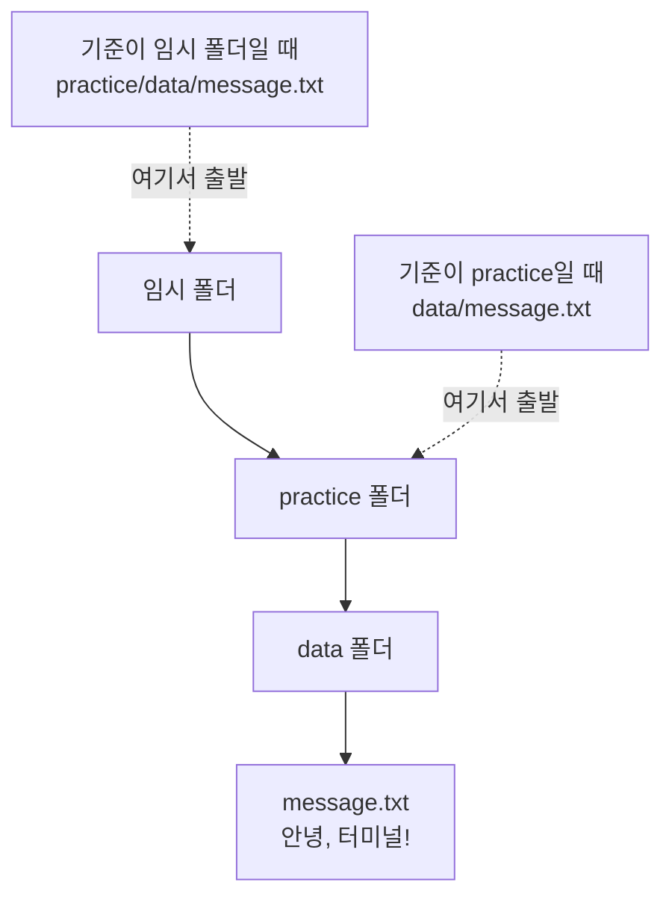
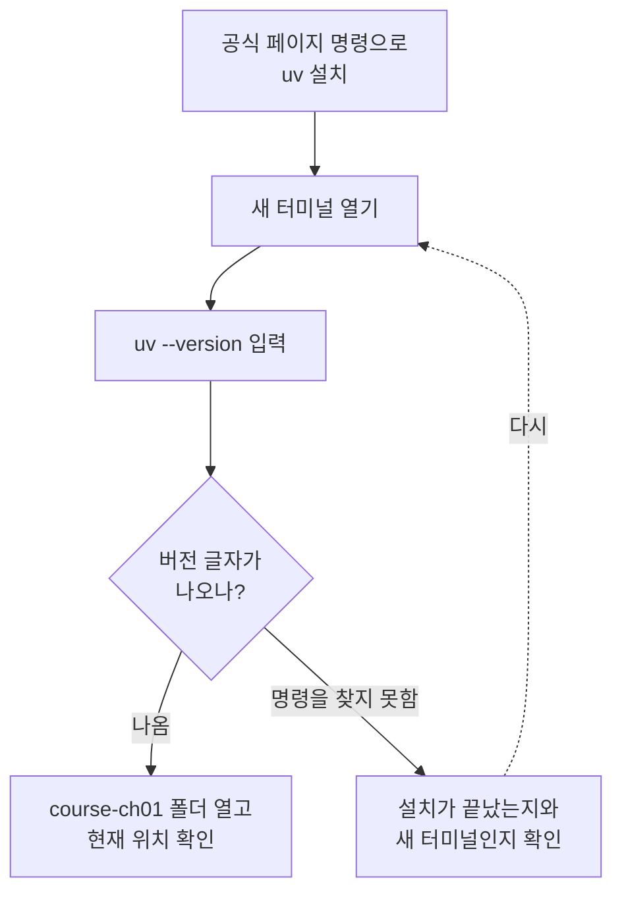
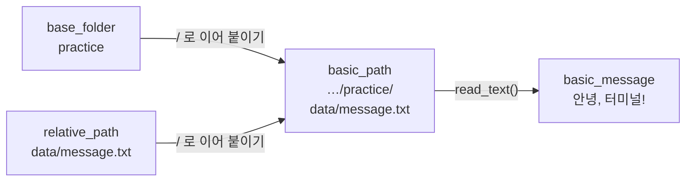
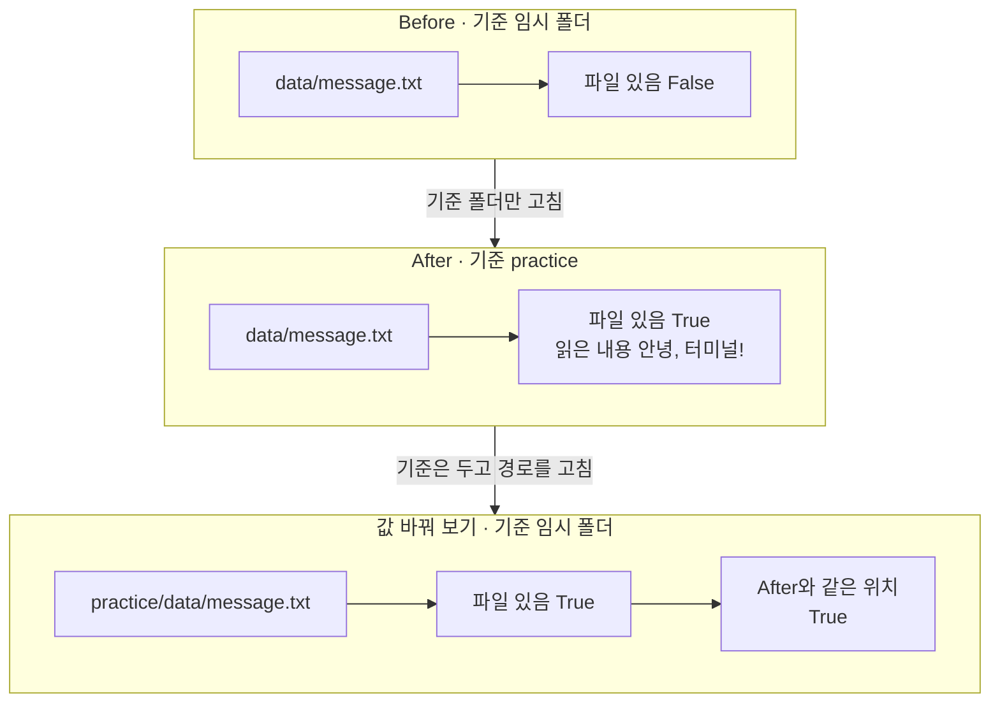

# 02-도구-설치와-터미널

## _src 본문 (HTML 원본)

```html
<!--meta: 강의 1h | 실습 0.5h | 코드 Jupyter Notebook | 새 용어 7 -->
<h2 id="b1"><span class="no">1</span>학습 목표</h2>
<div class="goal"><ul><li>내 운영체제에 맞는 VS Code와 uv 설치 안내를 찾고, 새 터미널에서 설치를 확인할 수 있습니다.</li><li>VS Code에서 연습 폴더를 열고, 터미널에서 현재 위치와 파일 목록을 확인할 수 있습니다.</li><li>같은 상대 경로가 기준 폴더에 따라 다른 곳을 가리키는 이유를 말하고, 기준 폴더를 고쳐 파일을 읽을 수 있습니다.</li></ul></div>
<h2 id="b2"><span class="no">2</span>이 내용을 배우는 이유</h2>
<p>파일을 분명히 만들었는데 프로그램이 「파일이 없다」고 할 때가 있습니다. 파일 이름이 맞아도 찾기 시작한 폴더가 다르면 이런 일이 생깁니다.</p>
<p>도구 설치도 비슷합니다. 앱 아이콘이 생겼다고 터미널에서 명령이 바로 되는 것은 아닙니다. 새 터미널에서 명령을 입력해 응답이 오는지 확인해야 합니다.</p>
<p>이 절에서는 도구를 설치하고, 파일을 찾기 시작하는 폴더를 확인합니다. 3절부터 입력하는 명령은 모두 이 두 가지 위에서 실행됩니다.</p>
<p><strong>이 절의 질문</strong> — 파일이 있는데도 「찾을 수 없다」는 결과가 나오는 이유는 무엇일까요?</p>
<h2 id="b3"><span class="no">3</span>앞에서 배운 내용</h2>
<p>1절에서는 실행 전에 예상을 적고 실제 출력과 비교했습니다. 이번에는 「어느 폴더에서 어떤 파일을 찾는가」를 먼저 예상하고 확인합니다.</p>
<p>노트북은 3절에서 Python 실행 환경을 준비한 뒤에 실행할 수 있습니다. 지금은 설치와 터미널 안내를 먼저 따라 하고, 노트북은 저장된 출력을 읽습니다. 3절을 마치면 이 절로 돌아와 직접 실행합니다.</p>
<p>노트북은 임시 폴더에 연습 파일을 직접 만듭니다. 내 문서나 다른 프로젝트의 파일은 바꾸지 않습니다.</p>
<h2 id="b4"><span class="no">4</span>핵심 개념</h2>
<h3>비유로 시작하기</h3>
<p>친구가 「책상 맨 위 서랍에 편지가 있어」라고 알려 줍니다. 친구 방 책상의 서랍을 열면 편지가 있습니다. 내 방 책상의 서랍을 열면 비어 있습니다.</p>
<p>설명은 같지만 출발한 방이 달랐습니다. 파일을 찾을 때도 어느 폴더에서 출발하는지가 먼저 정해져야 합니다.</p>
{{img:02-5-서랍-편지|같은 책상이 놓인 두 방 중 왼쪽 초록 방 서랍에는 편지가 있고, 오른쪽 노란 방에서는 사람이 서랍 그림 메모를 들고 빈 서랍 옆에 서 있는 삽화|같은 설명을 따라 서랍을 열어도 출발한 방에 따라 편지가 있기도 하고 없기도 합니다.}}
<p><strong>그림 읽기</strong> — 두 방에는 똑같은 책상이 하나씩 있습니다. 왼쪽 초록 방의 서랍에는 편지가 있습니다. 오른쪽 노란 방의 사람은 서랍 그림이 있는 메모대로 열었지만 서랍이 비어 있습니다. 방은 기준 폴더, 메모의 「맨 위 서랍」은 상대 경로, 편지는 파일에 해당합니다.</p>
<h3>이 절에서 쓰는 말</h3>
<table><thead><tr><th>용어</th><th>뜻</th><th>이 절에서 보이는 모습</th></tr></thead><tbody>
<tr><td>편집기(editor)</td><td>파일 내용을 열고 고치는 앱</td><td>VS Code에서 연습 폴더 열기</td></tr>
<tr><td>터미널(terminal)</td><td>글자로 명령을 입력하고 결과를 읽는 창</td><td>VS Code의 Terminal → New Terminal</td></tr>
<tr><td>셸(shell)</td><td>터미널에 입력한 명령을 해석해 실행하는 프로그램</td><td>Windows는 PowerShell, macOS는 zsh, 대부분의 Linux는 bash</td></tr>
<tr><td>현재 작업 폴더(current working directory)</td><td>명령이 파일을 찾기 시작하는 폴더</td><td><code>pwd</code>나 <code>Get-Location</code>으로 확인</td></tr>
<tr><td>경로(path)</td><td>폴더와 파일의 위치를 글자로 적은 값</td><td><code>practice/data/message.txt</code></td></tr>
<tr><td>절대 경로(absolute path)</td><td>드라이브나 맨 위 폴더부터 전부 적은 경로</td><td>사람마다 사용자 폴더 이름이 달라 교재에서는 쓰지 않음</td></tr>
<tr><td>상대 경로(relative path)</td><td>기준 폴더에서 출발해 나머지 길만 적은 경로</td><td>practice 기준의 <code>data/message.txt</code></td></tr>
</tbody></table>
<h3>도구를 설치하고 확인하기</h3>
<p>이번 장에서 쓰는 도구는 네 가지입니다. 설치 파일은 아래 표의 공식 안내에서 받습니다.</p>
<table><thead><tr><th>도구</th><th>이번 장에서 할 일</th><th>공식 설치 안내</th></tr></thead><tbody><tr><td>VS Code</td><td>폴더·코드·노트북을 열고 실행합니다.</td><td><a href="https://code.visualstudio.com/docs/getstarted/overview">운영체제별 VS Code 설치</a></td></tr><tr><td>uv</td><td>Python과 프로젝트별 실행 환경을 준비합니다(3절).</td><td><a href="https://docs.astral.sh/uv/getting-started/installation/">uv 설치</a></td></tr><tr><td>Git</td><td>프로젝트 파일의 상태를 확인합니다(5절).</td><td><a href="https://git-scm.com/book/en/v2/Getting-Started-Installing-Git">Git 설치</a></td></tr><tr><td>Docker Desktop</td><td>앱과 실행 서버의 준비 상태를 확인합니다(5절).</td><td><a href="https://docs.docker.com/desktop/setup/install/windows-install/">Windows</a> · <a href="https://docs.docker.com/desktop/setup/install/mac-install/">macOS</a> · <a href="https://docs.docker.com/desktop/setup/install/linux/">Linux</a></td></tr></tbody></table>
<p>VS Code 설치 페이지에서 내 운영체제에 맞는 설치 파일을 고릅니다. macOS라면 내 컴퓨터가 Apple silicon인지 Intel인지도 확인합니다.</p>
<p>설치가 끝나면 VS Code를 엽니다. 왼쪽 확장(Extensions) 화면에서 Microsoft가 만든 Python 확장과 Jupyter 확장을 설치합니다. Python Debugger 확장도 함께 설치됐는지 확인합니다. 확장은 편집기에 기능을 더할 뿐이고, Python 실행 환경은 3절에서 준비합니다.</p>
<p>설치 도구 uv는 공식 페이지의 독립 설치기(Standalone installer) 항목을 봅니다. 내 운영체제 탭의 명령을 복사해 붙여 넣습니다. 붙여 넣는 곳은 Windows의 PowerShell, macOS와 Linux의 터미널입니다.</p>
<p>설치가 끝나면 열려 있던 터미널을 닫고 새 터미널을 엽니다. 이미 열린 창은 새로 설치한 명령의 위치를 모를 수 있기 때문입니다. 새 터미널에서 <code>uv --version</code>을 입력하고 버전 글자가 나오는지 봅니다.</p>
<p>명령을 찾지 못했다는 메시지가 나오면 Python 코드의 문제가 아닙니다. 설치가 끝났는지, 새 터미널을 열었는지를 먼저 확인합니다.</p>
{{mermaid:02-2-설치-확인-순서|uv 설치, 새 터미널 열기, uv --version 입력, 버전 글자 확인으로 이어지고, 나오면 폴더를 열고 못 찾으면 설치와 새 터미널을 확인한 뒤 다시 터미널을 여는 흐름도|설치 확인 순서. 버전 글자가 나오면 폴더를 열고, 명령을 찾지 못하면 설치와 새 터미널 여부를 확인합니다.}}
<p><strong>도식 읽기</strong> — 위에서 아래로 읽습니다. 파란 상자는 우리가 하는 행동이고, 노란 마름모는 확인입니다. 「명령을 찾지 못함」 화살표는 회색 상자로 가고, 점선을 따라 새 터미널 열기로 돌아갑니다.</p>
<p>이 순서는 설치 화면 조작이라 교재 실행 검증에 포함하지 않았습니다. 설치 화면과 메뉴 이름은 운영체제와 버전에 따라 다를 수 있습니다.</p>
<p>나머지 두 도구인 Git과 Docker Desktop도 표의 공식 페이지에서 받습니다. 설치 조건이 더 많은 Docker Desktop은 5절에서 자세히 봅니다. 이 절의 경로 실습에는 Docker가 필요 없으므로 준비가 늦어도 진행할 수 있습니다.</p>
<h3>폴더를 열고 터미널에서 위치 확인하기</h3>
<ol><li>파일 탐색기나 Finder에서 연습용 빈 폴더 <code>course-ch01</code>을 만듭니다.</li><li>VS Code에서 File → Open Folder를 골라 이 폴더를 엽니다. 왼쪽 파일 목록 맨 위에 폴더 이름이 보이는지 확인합니다.</li><li>Terminal → New Terminal을 고릅니다. 터미널 패널에 보이는 셸 이름이 PowerShell, zsh, bash 중 하나인지 확인합니다.</li><li>현재 위치를 확인하는 명령을 입력합니다. 명령은 PowerShell에서 <code>Get-Location</code>, macOS와 Linux에서 <code>pwd</code>입니다. 출력의 마지막 폴더 이름이 <code>course-ch01</code>인지 읽습니다.</li><li>폴더 안의 파일 목록을 확인합니다. 명령은 PowerShell에서 <code>Get-ChildItem</code>, macOS와 Linux에서 <code>ls</code>입니다. 방금 만든 빈 폴더라면 파일이 하나도 보이지 않는 것이 정상입니다.</li></ol>
<p>다른 위치가 나오면 <code>cd</code> 뒤에 이동할 폴더 경로를 적어 옮겨 갑니다. 경로에 빈칸이 있으면 따옴표로 감쌉니다. 경로를 짐작해 적기보다 파일 탐색기에서 위치를 먼저 확인합니다.</p>
<p>터미널 맨 앞에 보이는 사용자 이름이나 <code>$</code>, <code>%</code>, <code>&gt;</code> 같은 표시는 명령에 넣지 않습니다. 셸이 입력을 기다린다는 표시입니다.</p>
<h3>기준 폴더와 상대 경로</h3>
<p>경로에는 두 가지 방식이 있습니다. 절대 경로는 드라이브나 맨 위 폴더부터 전부 적습니다. 상대 경로는 기준 폴더에서 출발해 나머지 길만 적습니다.</p>
<p>「두 번째 골목에서 왼쪽」이라는 길 안내는 지금 서 있는 곳에 따라 다른 집을 가리킵니다. 상대 경로도 같습니다. 노트북에서는 같은 파일을 두 기준 폴더에서 적어 봅니다.</p>
{{mermaid:02-1-폴더와-기준|임시 폴더 안에 practice, data, message.txt가 차례로 들어 있고, 기준이 임시 폴더이면 practice/data/message.txt, 기준이 practice이면 data/message.txt로 출발하는 구조도|폴더 구조와 두 기준 폴더. 기준이 practice이면 data/message.txt, 기준이 임시 폴더이면 practice/data/message.txt로 같은 파일에 닿습니다.}}
<p><strong>도식 읽기</strong> — 위에서 아래로 읽습니다. 초록 상자는 폴더와 파일이고, 실선 화살표는 「안에 들어 있다」는 뜻입니다. 임시 폴더 안에 practice, 그 안에 data, 그 안에 message.txt가 있습니다.</p>
<p>파란 상자 두 개는 기준 폴더를 고른 경우이고, 점선이 출발 폴더를 가리킵니다. 기준이 practice이면 <code>data/message.txt</code>로 충분합니다. 기준이 한 칸 위인 임시 폴더이면 <code>practice/data/message.txt</code>로 한 칸 더 적어야 합니다.</p>
<p>터미널에서는 현재 작업 폴더가 이 기준 폴더입니다. 수업 파일은 사람마다 사용자 폴더 이름이 달라서 절대 경로 대신 상대 경로로 적습니다.</p>
<h2 id="b5"><span class="no">5</span>실행 예제</h2>
<p>노트북은 임시 폴더 안에 practice 폴더, data 폴더, message.txt 파일을 차례로 만듭니다. 그다음 같은 파일을 두 기준 폴더에서 본 경로로 적어 비교합니다. 마지막으로 practice를 기준으로 파일을 읽습니다.</p>
<p>코드에서 경로 뒤의 슬래시 <code>/</code>는 나눗셈이 아닙니다. 폴더 경로 뒤에 폴더나 파일 이름을 한 칸 이어 붙입니다.</p>
<p>점 뒤에 이름과 괄호를 붙여 부르는 기능을 메서드(method)라고 합니다. 리모컨마다 누를 수 있는 버튼이 정해져 있듯, 값마다 쓸 수 있는 메서드가 정해져 있습니다. 예를 들어 <code>project.mkdir()</code> 줄은 경로 <code>project</code> 위치에 폴더를 만듭니다.</p>
<table><thead><tr><th>메서드</th><th>하는 일</th><th>노트북에서 본 결과</th></tr></thead><tbody>
<tr><td><code>mkdir()</code></td><td>경로 위치에 폴더를 만듭니다</td><td>practice 폴더가 만들기 전 <code>False</code>, 만든 뒤 <code>True</code></td></tr>
<tr><td><code>is_dir()</code> · <code>is_file()</code></td><td>그 위치에 폴더나 파일이 있는지 True/False로 알려 줍니다</td><td>message.txt 파일이 있는가 <code>True</code></td></tr>
<tr><td><code>write_text()</code></td><td>글을 파일에 저장합니다</td><td>message.txt에 「안녕, 터미널!」 저장</td></tr>
<tr><td><code>relative_to()</code></td><td>기준 폴더에서 파일까지의 경로를 알려 줍니다</td><td><code>data/message.txt</code>, <code>practice/data/message.txt</code></td></tr>
<tr><td><code>read_text()</code></td><td>파일 안의 글을 읽습니다</td><td><code>안녕, 터미널!</code></td></tr>
</tbody></table>
{{notebook:02-도구-설치와-터미널|example}}
<p class="look"><b>확인할 점</b> — 두 기준에서 본 경로가 <code>data/message.txt</code>와 <code>practice/data/message.txt</code>로 다른지 봅니다. 기준 폴더 practice에서 읽은 내용이 <code>안녕, 터미널!</code>인지도 확인합니다.</p>
<h3>파일을 읽는 순서</h3>
<p>마지막 셀에서 이름에 저장한 값이 어떻게 파일 내용까지 이어지는지 한 그림으로 모았습니다.</p>
{{mermaid:02-3-읽기-흐름|base_folder practice와 relative_path data/message.txt가 슬래시로 이어져 basic_path가 되고, read_text()로 읽어 basic_message에 안녕, 터미널!이 담기는 흐름도|정상 읽기의 값 흐름. practice와 data/message.txt를 이어 붙인 경로에서 안녕, 터미널!을 읽습니다.}}
<p><strong>도식 읽기</strong> — 왼쪽에서 오른쪽으로 읽습니다. 초록 상자는 모두 이름에 저장된 값입니다.</p>
<p>기준 폴더 base_folder와 상대 경로 relative_path가 슬래시로 이어져 basic_path가 됩니다. 이 경로를 read_text()로 읽어 basic_message에 글을 담습니다. basic_path 앞부분의 임시 폴더 위치는 실행마다 달라서 「…」로 줄였습니다.</p>
<h2 id="b6"><span class="no">6</span>일부러 실패해 보기</h2>
<p>Before에서는 기준 폴더를 practice보다 한 칸 위인 임시 폴더로 잡습니다. 터미널을 한 칸 위 폴더에서 연 상황과 같습니다. After에서는 기준 폴더만 practice로 고칩니다.</p>
<p>상대 경로 <code>data/message.txt</code>와 파일 내용은 두 경우 모두 같습니다. 파일이 있는지는 True/False로 확인합니다. 실제로 읽을 때 나는 오류는 「원리 더 알아보기」 셀에서 봅니다. 그 셀의 <code>try</code>·<code>except</code> 문법은 Ch 2에서 배웁니다.</p>
{{notebook:02-도구-설치와-터미널|failure}}
<p>Before에서는 파일 확인 결과가 False였습니다. 실제로 읽자 FileNotFoundError 오류가 났습니다. 파일은 그대로 있었고, 요청한 위치에서 찾지 못했을 뿐입니다.</p>
<p>After에서는 기준 폴더 하나만 고쳤는데 파일 확인이 True가 됐습니다. 읽은 내용도 저장한 글과 같았습니다.</p>
{{mermaid:02-4-기준-비교|Before는 기준 임시 폴더와 data/message.txt로 파일 확인 False, After는 기준 practice로 True와 안녕, 터미널!, 값 바꿔 보기는 기준 임시 폴더와 practice/data/message.txt로 True이며 After와 같은 위치임을 위아래로 비교한 그림|기준 폴더와 상대 경로를 바꾼 세 실행. Before만 파일을 찾지 못했고, After와 값 바꿔 보기는 같은 파일에 닿았습니다.}}
<p><strong>도식 읽기</strong> — 위 칸부터 Before, After, 값 바꿔 보기 순서입니다. 칸 제목이 기준 폴더이고, 초록 상자가 상대 경로입니다. 빨간 상자는 Before에만 있고 False입니다. 노란 상자는 모두 True입니다.</p>
<p>값 바꿔 보기에서는 기준을 임시 폴더로 둔 채 상대 경로를 <code>practice/data/message.txt</code>로 늘렸습니다. 이번에도 파일을 찾았고, After와 같은 위치였습니다. 이번 실습에서는 기준 폴더를 고친 방법과 경로를 고친 방법이 같은 파일에 닿았습니다.</p>
<p>이번에 실행하지 않은 것도 있습니다. 설치 화면, VS Code 메뉴, 터미널 명령 입력은 교재 실행 검증에 포함하지 않았습니다. 노트북 출력은 슬래시(/)로 경로를 적는 환경에서 실행했고, Windows의 출력 모양은 확인하지 않았습니다.</p>
<h2 id="b7"><span class="no">7</span>주의할 점과 실무 메모</h2>
<ul><li>파일 이름의 대소문자와 확장자를 확인합니다. Windows에서 확장자를 숨기면 <code>hello.py.txt</code> 파일을 <code>hello.py</code>로 착각할 수 있습니다.</li>
<li>운영체제마다 대소문자를 구분하는 방식이 다를 수 있습니다. 내 컴퓨터에서 우연히 열렸다고 대소문자를 섞어 쓰지 않습니다.</li>
<li>설치 안내는 내 운영체제 탭의 것만 따릅니다. Windows용 명령을 macOS 터미널에 그대로 입력하지 않습니다.</li>
<li>「파일이 없다」는 결과가 나오면 파일을 지우거나 새로 만들기 전에 요청한 경로부터 읽습니다. 맞는 폴더로 옮겨 가는 것만으로 해결되는지 먼저 확인합니다.</li>
<li>노트북에서는 터미널의 현재 작업 폴더 대신 변수 <code>base_folder</code>를 기준 폴더로 썼습니다. 노트북이 실행되는 폴더는 편집기에 연 폴더와 다를 수 있으니, 코드에서는 기준 폴더를 분명히 정합니다.</li></ul>
<h2 id="b8"><span class="no">8</span>정리와 다음 절</h2>
<ul><li>편집기는 파일을 고치는 앱이고, 터미널은 명령을 입력하는 창입니다. 설치한 뒤에는 새 터미널에서 명령이 응답하는지 확인합니다.</li><li>상대 경로는 기준 폴더에서 출발합니다. 기준 폴더가 바뀌면 같은 경로도 다른 곳을 가리킵니다.</li><li>파일을 찾지 못하면 기준 폴더와 파일 이름을 함께 확인합니다. 파일이 있다는 확인 뒤에는 내용도 읽어 봅니다.</li></ul>
<p><strong>다음 학습과 이어지는 지점</strong> — 3절에서는 교재가 준비한 실습 폴더를 내려받아 Python 3.12 실행 환경을 준비합니다. 그 폴더 안의 <code>.venv</code>를 찾을 때도 이번에 배운 경로 확인 방법을 씁니다.</p>
<h2 id="b9"><span class="no">9</span>복습 문제</h2><details class="quiz"><summary>문제와 해설</summary>
<p class="quiz-q">1. 터미널과 셸은 어떻게 다른가요? · 기초</p><p class="quiz-a"><b>해설</b> — 터미널은 명령을 입력하고 결과를 읽는 창입니다. 셸은 입력한 명령을 해석해 실행하는 프로그램입니다. 이 절에서는 Windows의 PowerShell과 macOS의 zsh를 기준으로 설명했습니다.</p>
<p class="quiz-q">2. uv를 설치했는데 <code>uv --version</code> 명령을 찾지 못하면 무엇부터 확인하나요? · 적용</p><p class="quiz-a"><b>해설</b> — 설치가 끝났는지와 새 터미널을 열었는지 확인합니다. 설치 전에 열어 둔 창은 새로 설치한 명령의 위치를 모를 수 있습니다.</p>
<p class="quiz-q">3. Before에서 파일 확인 결과가 False였던 이유는 무엇인가요? · 적용</p><p class="quiz-a"><b>해설</b> — 기준 폴더가 practice보다 한 칸 위인 임시 폴더였기 때문입니다. 임시 폴더 바로 아래에는 data 폴더가 없습니다. 파일은 practice 안에 그대로 있었습니다.</p>
<p class="quiz-q">4. 기준 폴더가 임시 폴더일 때 message.txt를 읽으려면 상대 경로를 어떻게 적나요? · 적용</p><p class="quiz-a"><b>해설</b> — <code>practice/data/message.txt</code>로 적습니다. 노트북의 값 바꿔 보기 셀에서 이 경로의 파일 확인 결과가 True였습니다.</p>
<p class="quiz-q">5. 파일 확인 결과가 True이면 원하는 파일이라고 말할 수 있나요? · 분석</p><p class="quiz-a"><b>해설</b> — 말할 수 없습니다. 같은 이름의 다른 파일일 수도 있습니다. After에서처럼 내용을 읽어 저장한 글과 비교해야 합니다.</p>
</details>
<h2 id="b10"><span class="no">10</span>참고 자료</h2>
<ul><li><a href="https://code.visualstudio.com/docs/getstarted/overview">VS Code 설치 안내</a> · <a href="https://code.visualstudio.com/docs/terminal/basics">통합 터미널</a> · 확인 2026-09-09 · 메뉴 이름은 설치 버전에 따라 다를 수 있습니다.</li><li><a href="https://docs.astral.sh/uv/getting-started/installation/">uv 공식 설치 안내</a> · 확인 2026-09-09</li><li><a href="https://docs.python.org/3.12/library/pathlib.html">Python 3.12 pathlib</a> · <a href="https://docs.python.org/3.12/library/tempfile.html">tempfile</a> · 확인 2026-09-16 · 예제는 이 교재에서 작성했습니다.</li></ul>
```

## 노트북 셀 (순서대로)

### [0] markdown {'html': 'skip'}

# 도구 설치와 터미널

**이 노트북에서 할 일**

1. 임시 폴더 안에 `practice/data/message.txt` 파일을 만듭니다.
2. 기준 폴더 `practice`에서 상대 경로 `data/message.txt`로 파일을 읽습니다.
3. 기준 폴더를 한 칸 위로 잘못 잡아 실패를 보고, 기준 폴더만 고쳐 다시 읽습니다.

**준비물** — API 키 불필요. 데이터 파일도 없습니다. 노트북이 임시 폴더에 연습 파일을 직접 만듭니다.
모델 호출은 0번이고 비용은 들지 않습니다. 실행 시간은 1분 이내입니다.

프로그램 설치는 교재 본문을 따라 직접 합니다. 이 노트북은 설치 명령을 실행하지 않습니다.

### [1] markdown {'html': 'skip'}

## 오늘 볼 그림


위에서 아래로 읽습니다. 초록 상자는 폴더와 파일이고, 파란 상자는 기준 폴더를 고른 두 경우입니다.
기준이 practice이면 `data/message.txt`로 파일에 닿습니다. 기준이 임시 폴더이면 `practice/data/message.txt`가 필요합니다.

### [2] markdown {}

## 1. 준비

이 절은 설치할 패키지가 없습니다. 이번에는 Python에 처음부터 들어 있는 기능 두 가지를 불러옵니다.
하나는 경로를 다루는 `Path`이고, 다른 하나는 임시 폴더를 만드는 `tempfile`입니다.
1절에서 본 불러오기 줄(`import`)로 이미 있는 기능을 이 노트북에서 쓸 수 있게 가져옵니다.

### [3] code {'execution': {'iopub.execute_input': '2026-09-16T03:21:12.549445Z', 'iopub.status.busy': '2026-09-16T03:21:12.549240Z', 'iopub.status.idle': '2026-09-16T03:21:12.553582Z', 'shell.execute_reply': '2026-09-16T03:21:12.552858Z'}, 'lesson_role': 'setup', 'upgrade_allow': ['stdlib-import']}

```python
# 경로를 다루는 Path와 임시 폴더를 만드는 tempfile을 불러옵니다
import tempfile
from pathlib import Path

print("불러오기 완료")
```

출력:
```
불러오기 완료

```

### [4] markdown {}

**결과 읽기** — `불러오기 완료`가 보이면 다음 셀로 넘어갑니다.

### [5] markdown {}

## 2. 연습용 폴더 만들기

내 문서를 건드리지 않도록 임시 폴더에서 연습합니다. 임시 폴더는 연습이 끝나면 지워도 되는 빈 폴더입니다.

코드 `tempfile.TemporaryDirectory()`를 부르면 새 임시 폴더가 만들어집니다. 만든 폴더의 위치는 `.name`에 글자로 들어 있습니다.
이 글자를 `Path()`에 넣으면 경로를 다루는 값이 됩니다. 이 값을 `workspace`라는 이름에 저장합니다.

### [6] code {'execution': {'iopub.execute_input': '2026-09-16T03:21:12.554911Z', 'iopub.status.busy': '2026-09-16T03:21:12.554741Z', 'iopub.status.idle': '2026-09-16T03:21:12.557899Z', 'shell.execute_reply': '2026-09-16T03:21:12.557371Z'}, 'upgrade_allow': ['stdlib-import']}

```python
# 연습용 임시 폴더를 만들고 그 위치를 경로 값으로 바꿉니다
temporary_folder = tempfile.TemporaryDirectory()
# .name에는 임시 폴더의 위치가 글자로 들어 있습니다
workspace = Path(temporary_folder.name)
# is_dir()은 그 위치에 폴더가 있으면 True, 없으면 False를 반환합니다
print("임시 폴더가 있는가:", workspace.is_dir())
```

출력:
```
임시 폴더가 있는가: True

```

### [7] markdown {}

**결과 읽기** — `True`가 나왔습니다. 임시 폴더가 만들어졌다는 뜻입니다.
임시 폴더의 이름은 실행할 때마다 달라서 출력하지 않았습니다.

점 뒤에 이름과 괄호를 붙여 부르는 기능을 메서드(method)라고 합니다. 앞 셀의 `is_dir()`이 메서드입니다.

이번에는 임시 폴더 안에 `practice` 폴더를 만듭니다. 이 폴더가 연습 프로젝트 폴더 역할을 합니다.
경로 뒤의 슬래시 `/`는 나눗셈이 아닙니다. 폴더 경로 뒤에 이름을 한 칸 이어 붙입니다.

### [8] code {'execution': {'iopub.execute_input': '2026-09-16T03:21:12.559181Z', 'iopub.status.busy': '2026-09-16T03:21:12.559055Z', 'iopub.status.idle': '2026-09-16T03:21:12.561809Z', 'shell.execute_reply': '2026-09-16T03:21:12.561357Z'}, 'upgrade_allow': ['stdlib-import']}

```python
# 임시 폴더 안에 practice 폴더를 만듭니다
project = workspace / "practice"
print("만들기 전 practice 폴더가 있는가:", project.is_dir())
# mkdir()은 경로에 해당하는 폴더를 실제로 만듭니다
project.mkdir()
print("만든 뒤 practice 폴더가 있는가:", project.is_dir())
```

출력:
```
만들기 전 practice 폴더가 있는가: False
만든 뒤 practice 폴더가 있는가: True

```

### [9] markdown {}

**결과 읽기** — 만들기 전에는 `False`, 만든 뒤에는 `True`입니다.
경로를 이어 붙인 줄만으로는 폴더가 생기지 않았습니다. 메서드 `mkdir()`을 부른 뒤에 폴더가 생겼습니다.

폴더 `practice` 안에 `data` 폴더를 만들고, 그 안에 글 파일 `message.txt`를 저장합니다.
메서드 `write_text()`는 글을 파일에 저장합니다.
괄호 안에 넣어 메서드에 건네는 값을 인자라고 합니다. 인자 `encoding="utf-8"`은 한글을 저장하고 읽는 규칙입니다.

### [10] code {'execution': {'iopub.execute_input': '2026-09-16T03:21:12.563102Z', 'iopub.status.busy': '2026-09-16T03:21:12.562954Z', 'iopub.status.idle': '2026-09-16T03:21:12.565653Z', 'shell.execute_reply': '2026-09-16T03:21:12.565308Z'}, 'upgrade_allow': ['stdlib-import']}

```python
# practice 안에 data 폴더를 만들고 message.txt 파일에 글을 저장합니다
data_folder = project / "data"
data_folder.mkdir()
message_file = data_folder / "message.txt"
# write_text()는 글을 파일에 저장합니다. 읽을 때도 같은 utf-8 규칙을 씁니다
message_file.write_text("안녕, 터미널!", encoding="utf-8")
# is_file()은 그 위치에 파일이 있으면 True, 없으면 False를 반환합니다
print("message.txt 파일이 있는가:", message_file.is_file())
```

출력:
```
message.txt 파일이 있는가: True

```

### [11] markdown {}

**결과 읽기** — `True`입니다. 임시 폴더 안에 practice, data, message.txt가 차례로 들어 있습니다.

### [12] markdown {}

## 3. 두 기준 폴더에서 본 경로

상대 경로(relative path)는 기준 폴더에서 출발해 파일까지 가는 길입니다.
「두 번째 골목에서 왼쪽」이라는 설명이 서 있는 곳에 따라 다른 집을 가리키는 것과 같습니다.
메서드 `relative_to()`에 기준 폴더를 넣으면 그 폴더에서 파일까지의 경로를 반환합니다.
같은 파일을 practice와 임시 폴더, 두 곳을 기준으로 적어 봅니다.

### [13] code {'execution': {'iopub.execute_input': '2026-09-16T03:21:12.566556Z', 'iopub.status.busy': '2026-09-16T03:21:12.566467Z', 'iopub.status.idle': '2026-09-16T03:21:12.568726Z', 'shell.execute_reply': '2026-09-16T03:21:12.568328Z'}, 'upgrade_allow': ['stdlib-import']}

```python
# 같은 파일을 두 기준 폴더에서 본 상대 경로를 비교합니다
# relative_to(기준 폴더)는 기준 폴더에서 파일까지의 경로를 반환합니다
from_project = message_file.relative_to(project)
from_workspace = message_file.relative_to(workspace)
print("practice에서 본 경로:", from_project)
print("임시 폴더에서 본 경로:", from_workspace)
```

출력:
```
practice에서 본 경로: data/message.txt
임시 폴더에서 본 경로: practice/data/message.txt

```

### [14] markdown {}

**결과 읽기** — practice에서 보면 `data/message.txt`입니다. 한 칸 위인 임시 폴더에서 보면 `practice/data/message.txt`입니다.
파일은 하나인데 기준 폴더에 따라 적는 길이 다릅니다.
교재 출력은 슬래시(/)로 경로를 적는 환경에서 실행했습니다. Windows에서는 역슬래시로 보일 수 있습니다.

### [15] markdown {}

## 4. 기준 폴더에서 파일 읽기

이제 기준 폴더와 상대 경로를 이어 파일을 읽습니다.
터미널에서는 현재 작업 폴더가 기준 폴더입니다. 1절의 `price`처럼 값을 저장한 이름을 변수라고 합니다.
이 노트북에서는 변수 `base_folder`가 그 역할을 합니다.
메서드 `read_text()`는 파일 안의 글을 읽어 문자열로 반환합니다.

### [16] code {'execution': {'iopub.execute_input': '2026-09-16T03:21:12.569620Z', 'iopub.status.busy': '2026-09-16T03:21:12.569531Z', 'iopub.status.idle': '2026-09-16T03:21:12.573096Z', 'shell.execute_reply': '2026-09-16T03:21:12.572608Z'}, 'upgrade_allow': ['stdlib-import']}

```python
# 기준 폴더 practice에 상대 경로 data/message.txt를 이어 파일을 읽습니다
relative_path = Path("data/message.txt")
base_folder = project
basic_path = base_folder / relative_path
# read_text()는 파일 안의 글을 문자열로 반환합니다
basic_message = basic_path.read_text(encoding="utf-8")
print("기준 폴더:", base_folder.name)
print("상대 경로:", relative_path)
print("읽은 내용:", basic_message)
```

출력:
```
기준 폴더: practice
상대 경로: data/message.txt
읽은 내용: 안녕, 터미널!

```

### [17] markdown {}

**결과 읽기** — 기준 폴더 `practice`에서 `data/message.txt`를 따라가 `안녕, 터미널!`을 읽었습니다.
앞에서 저장한 글과 같습니다.

### [18] markdown {'lesson_part': 'before'}

## Before: 기준 폴더를 한 칸 위로 잡은 경우

터미널을 practice가 아니라 그 위 폴더에서 연 상황입니다. 상대 경로는 그대로 `data/message.txt`를 씁니다.
실행 전에 예상합니다. 임시 폴더 바로 아래에는 data 폴더가 없으므로 파일도 찾지 못할 것입니다.
두 경로 값이 같은 위치인지는 등호 두 개 `==`로 비교합니다.

### [19] code {'execution': {'iopub.execute_input': '2026-09-16T03:21:12.573965Z', 'iopub.status.busy': '2026-09-16T03:21:12.573878Z', 'iopub.status.idle': '2026-09-16T03:21:12.576334Z', 'shell.execute_reply': '2026-09-16T03:21:12.575960Z'}, 'lesson_part': 'before', 'upgrade_allow': ['stdlib-import']}

```python
# Before: 기준 폴더를 한 칸 위인 임시 폴더로 잘못 잡습니다
wrong_base = workspace
wrong_path = wrong_base / relative_path
print("기준 폴더가 practice인가:", wrong_base == project)
print("그 위치에 파일이 있는가:", wrong_path.is_file())
```

출력:
```
기준 폴더가 practice인가: False
그 위치에 파일이 있는가: False

```

### [20] markdown {'lesson_part': 'before'}

**결과 읽기** — 두 줄 모두 `False`입니다. 기준 폴더가 practice가 아닙니다.
그래서 이어 붙인 위치에 파일이 없습니다. 파일은 지워지지 않았고, 요청한 위치에서 찾지 못했을 뿐입니다.

### [21] markdown {'lesson_part': 'before'}

### 원리 더 알아보기 — 실제로 읽으면 나오는 오류

파일이 없는 위치를 읽으면 오류가 나고 셀 실행이 멈춥니다.
아래 셀은 멈추지 않고 오류 이름만 보려고 `try`와 `except`를 씁니다. 이 문법은 Ch 2에서 배우므로 지금은 출력만 읽습니다.

### [22] code {'execution': {'iopub.execute_input': '2026-09-16T03:21:12.577161Z', 'iopub.status.busy': '2026-09-16T03:21:12.577082Z', 'iopub.status.idle': '2026-09-16T03:21:12.579149Z', 'shell.execute_reply': '2026-09-16T03:21:12.578822Z'}, 'lesson_level': 'deep-dive', 'lesson_part': 'before', 'upgrade_allow': ['stdlib-import']}

```python
# 원리 더 알아보기: 잘못된 위치의 파일을 실제로 읽어 오류 이름을 확인합니다
try:
    wrong_path.read_text(encoding="utf-8")
    print("오류 없이 읽었습니다")
except FileNotFoundError as error:
    print("오류 이름:", type(error).__name__)
    print("찾지 못한 파일 이름:", Path(error.filename).name)
```

출력:
```
오류 이름: FileNotFoundError
찾지 못한 파일 이름: message.txt

```

### [23] markdown {'lesson_part': 'before'}

**결과 읽기** — 오류 이름은 `FileNotFoundError`이고, 찾지 못한 파일은 `message.txt`입니다.
이 오류는 요청한 위치에 그 파일이 없다는 뜻입니다. 컴퓨터 어디에도 없다는 뜻은 아닙니다.

### [24] markdown {'lesson_part': 'after'}

## After: 기준 폴더만 practice로 고치기

상대 경로는 그대로 두고 기준 폴더만 practice로 고칩니다. 파일은 새로 만들지 않습니다.
실행 전에 예상합니다. 이번에는 두 줄 모두 `True`가 나올 것입니다.

### [25] code {'execution': {'iopub.execute_input': '2026-09-16T03:21:12.579938Z', 'iopub.status.busy': '2026-09-16T03:21:12.579865Z', 'iopub.status.idle': '2026-09-16T03:21:12.581784Z', 'shell.execute_reply': '2026-09-16T03:21:12.581417Z'}, 'lesson_part': 'after', 'upgrade_allow': ['stdlib-import']}

```python
# After: 기준 폴더만 practice로 고치고 같은 상대 경로를 씁니다
right_base = project
right_path = right_base / relative_path
print("기준 폴더가 practice인가:", right_base == project)
print("그 위치에 파일이 있는가:", right_path.is_file())
```

출력:
```
기준 폴더가 practice인가: True
그 위치에 파일이 있는가: True

```

### [26] markdown {'lesson_part': 'after'}

**결과 읽기** — 두 줄 모두 `True`입니다. 앞의 Before와 달라진 것은 기준 폴더 하나뿐입니다.

파일이 있다는 것만으로는 원하는 파일인지 알 수 없습니다. 같은 이름의 다른 파일일 수도 있습니다.
다음 셀에서 내용을 읽고 처음 저장한 글과 비교합니다.

### [27] code {'execution': {'iopub.execute_input': '2026-09-16T03:21:12.582549Z', 'iopub.status.busy': '2026-09-16T03:21:12.582486Z', 'iopub.status.idle': '2026-09-16T03:21:12.584380Z', 'shell.execute_reply': '2026-09-16T03:21:12.584015Z'}, 'lesson_part': 'after', 'upgrade_allow': ['stdlib-import']}

```python
# 고친 경로로 파일을 읽고 처음 저장한 글과 같은지 비교합니다
right_message = right_path.read_text(encoding="utf-8")
same = right_message == "안녕, 터미널!"
print("읽은 내용:", right_message)
print("저장한 글과 같은가:", same)
# 같지 않으면 이 줄에서 실행을 멈춥니다
assert same
```

출력:
```
읽은 내용: 안녕, 터미널!
저장한 글과 같은가: True

```

### [28] markdown {'lesson_part': 'after'}

**결과 읽기** — 읽은 내용은 `안녕, 터미널!`이고 비교 결과는 `True`입니다. 검사 줄 `assert`에서 멈추지 않았습니다.

### [29] markdown {'lesson_part': 'after'}

## 값 바꿔 보기: 기준은 그대로, 상대 경로를 길게

이번에는 다른 쪽을 고쳐 봅니다. 기준 폴더는 임시 폴더 그대로 두고, 상대 경로 앞에 practice를 붙입니다.
실행 전에 예상합니다. 임시 폴더에서 본 경로는 `practice/data/message.txt`였으므로 파일을 찾을 것입니다.
마지막 줄은 이 경로가 After의 경로와 같은 위치인지 비교합니다.

### [30] code {'execution': {'iopub.execute_input': '2026-09-16T03:21:12.585150Z', 'iopub.status.busy': '2026-09-16T03:21:12.585080Z', 'iopub.status.idle': '2026-09-16T03:21:12.587072Z', 'shell.execute_reply': '2026-09-16T03:21:12.586713Z'}, 'lesson_part': 'after', 'upgrade_allow': ['stdlib-import']}

```python
# 기준은 임시 폴더 그대로 두고, 상대 경로를 practice부터 적습니다
longer_path = Path("practice/data/message.txt")
workspace_path = workspace / longer_path
print("상대 경로:", longer_path)
print("그 위치에 파일이 있는가:", workspace_path.is_file())
print("After 경로와 같은 위치인가:", workspace_path == right_path)
```

출력:
```
상대 경로: practice/data/message.txt
그 위치에 파일이 있는가: True
After 경로와 같은 위치인가: True

```

### [31] markdown {'lesson_part': 'after'}

**결과 읽기** — 파일 확인 결과가 `True`입니다. After 경로와 같은 위치인지도 `True`입니다.
기준 폴더와 상대 경로를 이으면 실제 위치가 정해집니다. 이번에는 두 방법 모두 같은 파일에 닿았습니다.

### [32] markdown {'lesson_part': 'after'}

## 5. 임시 폴더 정리하기

연습이 끝났으므로 임시 폴더를 지웁니다. 메서드 `cleanup()`은 임시 폴더와 그 안의 파일을 함께 지웁니다.
이 노트북이 만든 임시 폴더만 지우고, 다른 폴더는 건드리지 않습니다.

### [33] code {'execution': {'iopub.execute_input': '2026-09-16T03:21:12.587799Z', 'iopub.status.busy': '2026-09-16T03:21:12.587729Z', 'iopub.status.idle': '2026-09-16T03:21:12.596070Z', 'shell.execute_reply': '2026-09-16T03:21:12.595527Z'}, 'lesson_part': 'after', 'upgrade_allow': ['stdlib-import']}

```python
# 연습용 임시 폴더를 지우고 남아 있는지 확인합니다
temporary_folder.cleanup()
print("임시 폴더가 남아 있는가:", workspace.is_dir())
```

출력:
```
임시 폴더가 남아 있는가: False

```

### [34] markdown {'lesson_part': 'after'}

**결과 읽기** — `False`입니다. 임시 폴더와 안의 파일이 지워졌습니다.

## 정리

- 상대 경로는 기준 폴더에서 출발합니다. 같은 `data/message.txt`도 기준 폴더에 따라 찾는 곳이 달라집니다.
- 기준 폴더가 한 칸 위일 때는 파일을 찾지 못했습니다. 기준 폴더만 고치자 저장한 글을 그대로 읽었습니다.
- 파일이 있는지 확인한 뒤 내용도 읽어 원하는 파일인지 확인합니다.

프로그램 설치와 터미널 명령 입력은 이 노트북에서 실행하지 않았습니다.
다음 절에서는 교재가 준비한 실습 폴더에 Python 3.12 실행 환경을 준비합니다.

## 그림

### 02-1-폴더와-기준.mmd



- 설명 대상 문장: 같은 파일도 기준 폴더가 바뀌면 상대 경로가 달라집니다.
- 캡션: 폴더 구조와 두 기준 폴더. 기준이 practice이면 data/message.txt, 기준이 임시 폴더이면 practice/data/message.txt로 같은 파일에 닿습니다.
- 읽는 법: 위에서 아래로 읽습니다. 초록 상자는 폴더와 파일이고, 실선 화살표는 「안에 들어 있다」는 뜻입니다. 파란 상자는 기준 폴더를 고른 두 경우이고, 점선이 출발하는 폴더를 가리킵니다. 출발 폴더가 한 칸 위일수록 적어야 할 경로가 한 칸 길어집니다.
- alt: 임시 폴더 안에 practice, data, message.txt가 차례로 들어 있고, 기준이 임시 폴더이면 practice/data/message.txt, 기준이 practice이면 data/message.txt로 출발하는 구조도

### 02-2-설치-확인-순서.mmd



- 설명 대상 문장: 새 터미널에서 `uv --version`을 입력해 버전 글자가 나오는지 봅니다.
- 캡션: 설치 확인 순서. 버전 글자가 나오면 폴더를 열고, 명령을 찾지 못하면 설치와 새 터미널 여부를 확인합니다.
- 읽는 법: 위에서 아래로 읽습니다. 파란 상자는 우리가 하는 행동, 노란 마름모는 확인입니다. 「명령을 찾지 못함」 화살표는 회색 상자로 가고, 점선을 따라 새 터미널 열기로 돌아갑니다. 이 순서는 설치 화면 조작이라 교재 실행 검증에 포함하지 않았습니다.
- alt: uv 설치, 새 터미널 열기, uv --version 입력, 버전 글자 확인으로 이어지고, 나오면 폴더를 열고 못 찾으면 설치와 새 터미널을 확인한 뒤 다시 터미널을 여는 흐름도

### 02-3-읽기-흐름.mmd



- 설명 대상 문장: 기준 폴더와 상대 경로를 이어 파일을 읽습니다.
- 캡션: 정상 읽기의 값 흐름. practice와 data/message.txt를 이어 붙인 경로에서 안녕, 터미널!을 읽습니다.
- 읽는 법: 왼쪽에서 오른쪽으로 읽습니다. 초록 상자는 모두 이름에 저장된 값입니다. 왼쪽 두 값이 슬래시로 이어져 basic_path가 되고, read_text()를 거쳐 basic_message에 글이 담깁니다. basic_path 앞부분의 임시 폴더 위치는 실행마다 달라 「…」로 줄였습니다.
- alt: base_folder practice와 relative_path data/message.txt가 슬래시로 이어져 basic_path가 되고, read_text()로 읽어 basic_message에 안녕, 터미널!이 담기는 흐름도

### 02-4-기준-비교.mmd



- 설명 대상 문장: 기준 폴더만 고치자 저장한 글을 그대로 읽었습니다.
- 캡션: 기준 폴더와 상대 경로를 바꾼 세 실행. Before만 파일을 찾지 못했고, After와 값 바꿔 보기는 같은 파일에 닿았습니다.
- 읽는 법: 위 칸부터 Before, After, 값 바꿔 보기 순서입니다. 칸 제목이 기준 폴더, 초록 상자가 상대 경로, 오른쪽 상자가 확인 결과입니다. Before의 빨간 상자만 False이고, 나머지 노란 상자는 모두 True입니다. 칸 사이 화살표 라벨이 앞 칸에서 바꾼 것입니다.
- alt: Before는 기준 임시 폴더와 data/message.txt로 파일 확인 False, After는 기준 practice로 True와 안녕, 터미널!, 값 바꿔 보기는 기준 임시 폴더와 practice/data/message.txt로 True이며 After와 같은 위치임을 위아래로 비교한 그림

### 02-5-서랍-편지.prompt.md

# 삽화 — 02-5 서랍과 편지

- 상태: 2026-09-16 생성·검수 통과(2회 생성, 탈락 1). 모델 nano_banana_pro(서버 표기 nano_banana_2), 16:9, 2k(2752×1536), 회당 2크레딧(합계 4크레딧). 채택 job ebaa4664-3170-44af-931d-61002fbb503b. 교재 파일은 폭 1100px로 줄여 저장.
- 1차 탈락: job e25cf47c-5571-42d6-8b30-073877ccbb44. 왼쪽에 서랍 없는 책상이 하나 더 그려져 「방마다 같은 책상 하나」 대응이 깨졌고, 칸막이 한 장이라 두 방으로 읽히지 않았음. 2차 프롬프트에서 「방 상자 두 개·벽 색 구분·책상은 전체에 정확히 두 개」를 명시.
- 검수 메모(2차): 초록 벽 방과 노란 벽 방에 같은 책상이 하나씩 있음. 왼쪽 서랍에만 편지가 반쯤 나와 있고 오른쪽 서랍은 비어 있음. 오른쪽 사람이 서랍을 파랗게 칠한 책상 스케치 메모를 들고 곤란한 표정. 사람 시선이 서랍보다 정면을 향하지만 「같은 설명, 다른 출발 방 → 결과가 다름」 관계는 읽힘.
- 설명 대상 문장: 설명은 같지만 출발한 방이 달랐습니다. 파일을 찾을 때도 어느 폴더에서 출발하는지가 먼저 정해져야 합니다.
- 넣을 자리: 02절 핵심 개념 「비유로 시작하기」 단락 바로 아래
- 구성 요소와 배치(왼쪽 → 오른쪽): ① 초록 벽 방: 책상, 열린 서랍의 편지 ② 노란 벽 방: 같은 책상, 빈 서랍, 메모(서랍 스케치)를 든 사람
- 시선 순서: 오른쪽 사람의 메모 → 빈 서랍 → 왼쪽 방 서랍의 편지
- 대응: 방 = 기준 폴더, 메모의 「맨 위 서랍」 = 상대 경로, 편지 = 파일(message.txt), 빈 서랍 = 파일을 찾지 못한 Before

## 프롬프트(채택본)

Simple flat educational illustration, white background, limited soft palette, clean outlines, plain everyday objects, no text, no letters, no numbers, no logos.
Two separate small rooms drawn like two open dollhouse boxes placed side by side with a clear white gap between them. Each room box has its own pale back wall and its own floor; the left room box has a pale green back wall and the right room box has a pale yellow back wall. There are exactly two desks in the whole picture: exactly one plain wooden desk in the center of each room, both desks identical in shape, size and position, each with a single top drawer pulled open toward the viewer. Left room: no person; one white envelope is clearly sticking halfway out of the open drawer. Right room: the open drawer is visibly empty inside; one person stands next to this desk, looking down into the empty drawer with a puzzled expression, holding a small paper note whose only content is a tiny simple sketch of a desk with its drawer colored light blue. Nothing else anywhere. No other furniture, no extra desks, no chairs, no monitors, no screens, no computers, no windows, no doors, no shelves, no posters, no lamps, no writing.

