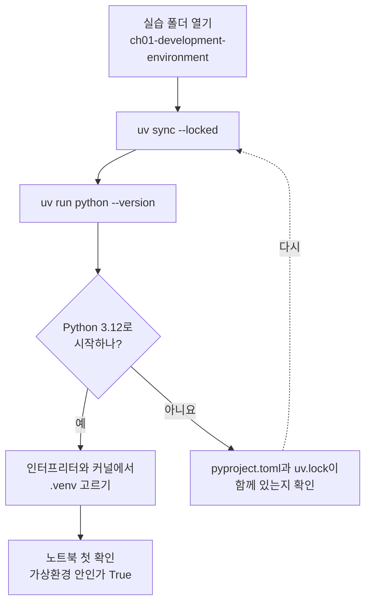
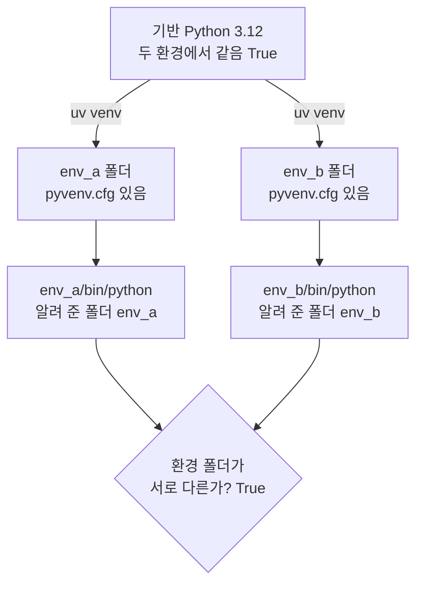
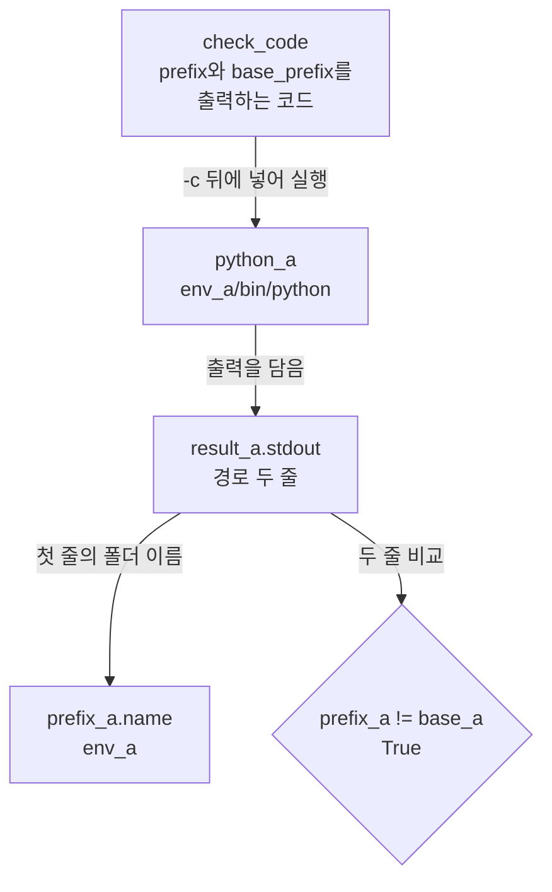
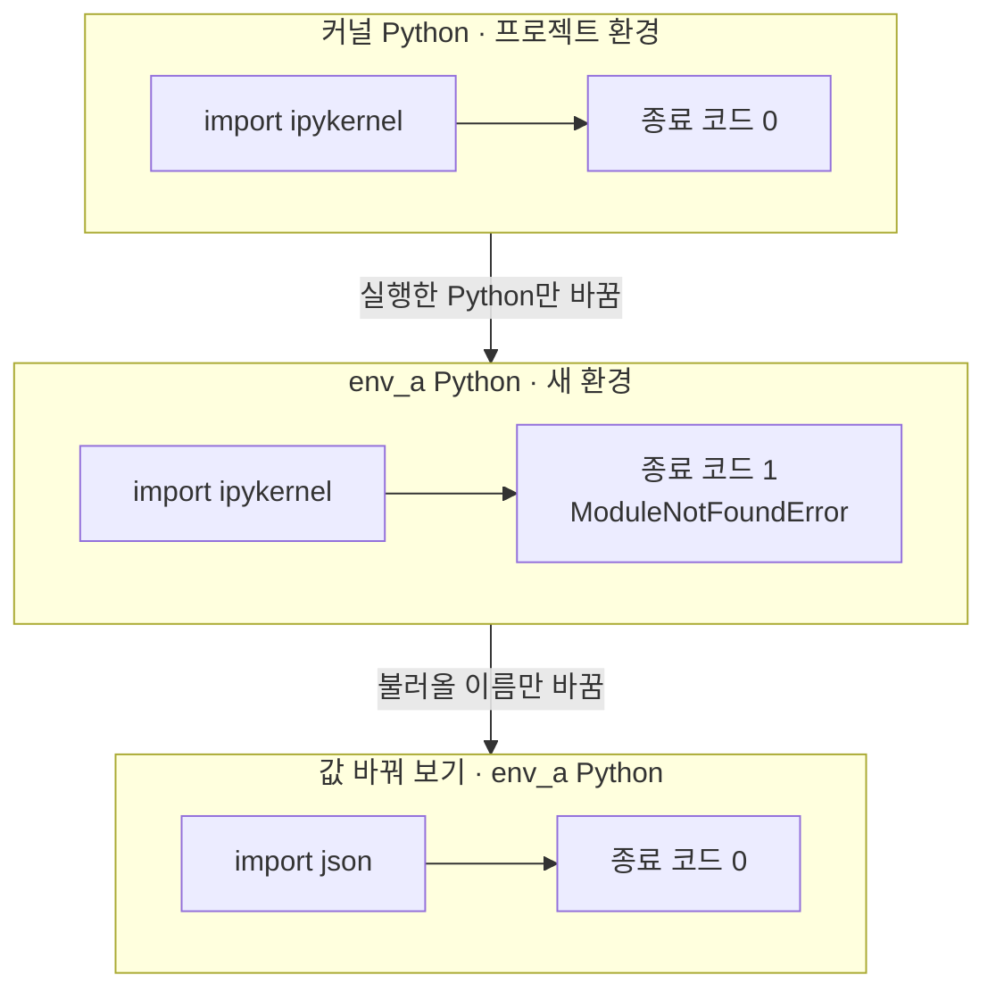

# 03-Python과-가상환경

## _src 본문 (HTML 원본)

```html
<!--meta: 강의 1h | 실습 1h | 코드 Jupyter Notebook | 새 용어 8 -->
<h2 id="b1"><span class="no">1</span>학습 목표</h2>
<div class="goal"><ul><li>터미널과 노트북에서 실습 폴더가 쓰는 Python이 3.12인지 확인할 수 있습니다.</li><li>명령 <code>uv sync --locked</code>로 환경을 준비하고, VS Code에서 인터프리터와 커널을 고를 수 있습니다.</li><li>두 가상환경의 폴더와 불러오기 결과를 비교해, 가상환경이 나누는 것을 말할 수 있습니다.</li></ul></div>
<h2 id="b2"><span class="no">2</span>이 내용을 배우는 이유</h2>
<p>같은 노트북을 다른 컴퓨터에서 열었더니 「그런 모듈이 없다」는 오류가 날 수 있습니다. 코드가 같아도 실행한 Python과 설치된 패키지가 다르면 이런 일이 생깁니다.</p>
<p>2절에서는 같은 상대 경로도 기준 폴더에 따라 다른 곳을 가리켰습니다. 코드도 비슷합니다. 어느 Python으로 실행하느냐에 따라 불러올 수 있는 패키지가 달라집니다.</p>
<p>이 과정은 챕터마다 실습 폴더를 따로 두고, 폴더마다 실행 환경을 준비합니다. 이 절에서 그 준비 방법과 확인 방법을 익힙니다.</p>
<p><strong>이 절의 질문</strong> — 두 가상환경이 서로 나뉘어 있다는 것을 어떻게 확인할까요?</p>
<h2 id="b3"><span class="no">3</span>앞에서 배운 내용</h2>
<p>1절에서는 실행 전에 예상을 적고 출력과 비교했습니다. 2절에서는 uv를 설치하고 새 터미널에서 <code>uv --version</code>으로 확인했습니다. 같은 파일도 기준 폴더에 따라 상대 경로가 달라진다는 것도 봤습니다.</p>
<p>이번 절은 세 가지를 모두 이어 씁니다. 두 환경의 결과를 먼저 예상하고 출력과 비교합니다. 노트북은 2절처럼 임시 폴더에서 연습하고, <code>relative_to()</code>로 경로를 짧게 출력합니다.</p>
<p>실습 폴더는 <a href="../../downloads/ch01-practice.zip" download>노트북과 실습 파일 묶음</a> 안의 <code>labs/part1/ch01-development-environment</code>입니다. 2절에서 만든 빈 연습 폴더 <code>course-ch01</code>과는 다른 폴더입니다. 안에 <code>pyproject.toml</code>, <code>uv.lock</code>, <code>notebooks</code>가 있는지 확인합니다.</p>
<p>이 장은 모델을 부르지 않으므로 API 키가 필요 없습니다. 준비 명령이 Python과 패키지를 내려받을 수 있어 인터넷 연결은 필요할 수 있습니다.</p>
<h2 id="b4"><span class="no">4</span>핵심 개념</h2>
<h3>비유로 시작하기</h3>
<p>학교 복도에 똑같은 사물함이 한 줄로 서 있습니다. 학생마다 자기 칸에 자기 준비물을 넣습니다. 한 칸에 넣은 붓은 옆 칸에서 꺼낼 수 없습니다.</p>
<p>칸은 따로지만 벽과 바닥은 함께 씁니다. 가상환경도 같습니다. 환경마다 패키지를 넣는 자리는 따로이고, 컴퓨터와 기반 Python은 함께 씁니다.</p>
{{img:03-5-사물함|한 벽에 한 줄로 선 사물함 중 가운데 두 칸이 열려 있고, 왼쪽 칸에는 붓 통과 팔레트가 있으며 오른쪽 칸은 비어 있는 삽화|한 줄로 선 사물함에서 칸마다 넣어 둔 물건이 따로 있습니다. 가상환경도 환경마다 패키지를 넣는 자리가 따로 있습니다.}}
<p><strong>그림 읽기</strong> — 한 벽에 같은 사물함이 한 줄로 서 있고, 가운데 두 칸만 열려 있습니다. 왼쪽 칸에는 붓 통과 팔레트가 있고, 오른쪽 칸은 비어 있습니다. 사물함 줄은 기반 Python, 칸은 환경 폴더, 붓은 설치한 패키지에 해당합니다. 오른쪽 빈 칸은 노트북에서 새로 만든 환경 <code>env_a</code>와 같습니다.</p>
<h3>이 절에서 쓰는 말</h3>
<table><thead><tr><th>용어</th><th>뜻</th><th>이 절에서 보이는 모습</th></tr></thead><tbody>
<tr><td>인터프리터(interpreter)</td><td>Python 코드를 읽고 실행하는 프로그램</td><td>환경 안의 실행 파일 <code>env_a/bin/python</code></td></tr>
<tr><td>모듈(module)</td><td><code>import</code> 뒤에 적어 불러오는 Python 기능 묶음 한 단위</td><td><code>json</code>, <code>sys</code>, <code>ipykernel</code></td></tr>
<tr><td>패키지(package)</td><td>따로 설치해서 쓰는 Python 기능 묶음</td><td>노트북 실행 도구 <code>ipykernel</code></td></tr>
<tr><td>표준 라이브러리(standard library)</td><td>Python과 함께 설치되어 따로 설치하지 않는 기능</td><td>모듈 <code>json</code>, <code>sys</code>, <code>subprocess</code></td></tr>
<tr><td>가상환경(virtual environment)</td><td>프로젝트마다 패키지 설치 자리를 나눈 환경 폴더</td><td>실습 폴더의 <code>.venv</code>, 연습용 <code>env_a</code>·<code>env_b</code></td></tr>
<tr><td>의존성(dependency)</td><td>프로젝트를 실행하는 데 필요한 다른 패키지</td><td><code>pyproject.toml</code>에 적힌 <code>ipykernel==7.3.0</code></td></tr>
<tr><td>잠금 파일(lockfile)</td><td>실제로 고른 패키지 버전을 모두 적어 둔 파일</td><td>실습 폴더의 <code>uv.lock</code></td></tr>
<tr><td>커널(kernel)</td><td>노트북 셀을 실행하고 변수를 기억하는 프로그램</td><td>노트북 오른쪽 위에서 고르는 <code>.venv</code></td></tr>
</tbody></table>
<h3>실습 폴더의 세 가지</h3>
<p>실습 폴더를 열면 환경과 관련된 이름이 세 개 보입니다. 앞의 두 파일은 교재가 준비해 두었고, <code>.venv</code> 폴더는 내 컴퓨터에서 명령으로 만듭니다.</p>
<table><thead><tr><th>파일 또는 폴더</th><th>담긴 내용</th><th>학생이 할 일</th></tr></thead><tbody>
<tr><td><code>pyproject.toml</code></td><td>필요한 Python 버전(<code>==3.12.*</code>)과 패키지 목록</td><td>읽기만 하고 고치지 않습니다.</td></tr>
<tr><td><code>uv.lock</code></td><td>실제로 고른 패키지 버전 전체</td><td>직접 편집하지 않습니다.</td></tr>
<tr><td><code>.venv</code></td><td>이 컴퓨터에서 쓰는 실행 환경</td><td>준비 명령을 실행한 뒤 생겼는지 봅니다.</td></tr>
</tbody></table>
<p>설정 파일과 잠금 파일은 함께 나눠 쓰고, <code>.venv</code>는 컴퓨터마다 새로 만듭니다. 환경 폴더 안의 설정 파일에는 그 컴퓨터의 Python 위치가 적혀 있기 때문입니다. Python 공식 문서도 가상환경을 옮기거나 복사하지 말고 새로 만들라고 안내합니다.</p>
<h3>가상환경이 나누는 것</h3>
<p>가상환경 안에서 실행한 Python은 두 위치를 압니다. 하나는 지금 쓰는 환경 폴더이고, 값 <code>sys.prefix</code>에 들어 있습니다. 다른 하나는 그 환경을 만든 기반 Python의 위치이고, 값 <code>sys.base_prefix</code>에 들어 있습니다.</p>
<p>두 위치가 다르면 가상환경 안에서 실행 중입니다. 노트북에서는 임시 폴더에 환경 <code>env_a</code>와 <code>env_b</code>를 만들고, 각 환경의 Python에게 두 위치를 물어봅니다.</p>
{{mermaid:03-2-두-환경|기반 Python 3.12에서 uv venv로 env_a와 env_b 두 환경 폴더를 만들고, 각 환경의 Python이 알려 준 환경 폴더가 서로 다른지 비교하는 구조도|같은 기반 Python에서 만든 두 환경. 각 환경의 Python은 env_a와 env_b라는 서로 다른 환경 폴더를 알려 줍니다.}}
<p><strong>도식 읽기</strong> — 위에서 아래로 읽습니다. 초록 상자는 폴더와 실행 파일이고, 노란 마름모는 비교입니다. 맨 위 기반 Python에서 <code>uv venv</code> 화살표 두 개가 두 환경 폴더로 갑니다.</p>
<p>환경 폴더마다 설정 파일 <code>pyvenv.cfg</code>와 그 환경의 Python 실행 파일이 생깁니다. 두 Python이 알려 준 환경 폴더는 <code>env_a</code>와 <code>env_b</code>로 달랐고, 마름모의 비교 결과는 True입니다.</p>
<p>가상환경은 컴퓨터 전체를 나누지 않습니다. 사물함 칸이 같은 벽을 쓰듯, 두 환경은 같은 운영체제와 같은 파일을 함께 씁니다. 그래서 믿을 수 없는 코드를 안전하게 실행해 주는 장치로 보지 않습니다.</p>
<h2 id="b5"><span class="no">5</span>실행 예제</h2>
<h3>노트북을 열기 전에 한 번 준비합니다</h3>
<ol><li>VS Code에서 실습 폴더 <code>labs/part1/ch01-development-environment</code>를 엽니다. 2절처럼 Terminal → New Terminal로 새 터미널을 엽니다.</li><li>터미널에서 <code>uv sync --locked</code>를 입력합니다. 설치가 끝나고 다시 명령을 입력할 수 있는 상태가 될 때까지 기다립니다.</li><li>명령 <code>uv run python --version</code>을 입력합니다. 출력이 <code>Python 3.12</code>로 시작하는지 봅니다. 마지막 숫자는 컴퓨터마다 다를 수 있습니다.</li><li>명령 팔레트를 열고 <code>Python: Select Interpreter</code>를 고릅니다. 명령 팔레트는 Windows·Linux에서 <code>Ctrl+Shift+P</code>, macOS에서 <code>Cmd+Shift+P</code>로 엽니다. 목록에서 실습 폴더의 <code>.venv</code>를 고릅니다.</li><li>폴더 <code>notebooks</code>에서 이 절의 노트북을 엽니다. 오른쪽 위 Select Kernel에서도 같은 <code>.venv</code>를 고릅니다.</li><li>첫 코드 셀을 고르고 <code>Shift+Enter</code>를 누릅니다. 1절과 2절의 노트북도 이 환경에서 실행할 수 있습니다.</li></ol>
{{mermaid:03-1-준비-순서|실습 폴더 열기, uv sync --locked, uv run python --version, Python 3.12 확인으로 이어지고, 맞으면 인터프리터와 커널에서 .venv를 고른 뒤 노트북에서 가상환경 안인가 True를 확인하고, 아니면 pyproject.toml과 uv.lock을 확인하고 다시 준비하는 흐름도|노트북을 열기 전 준비 순서. Python 3.12로 시작하는 버전이 나오면 인터프리터와 커널에서 .venv를 고릅니다.}}
<p><strong>도식 읽기</strong> — 위에서 아래로 읽습니다. 파란 상자는 우리가 하는 행동이고, 노란 마름모와 노란 상자는 확인입니다. 「아니요」 화살표는 회색 상자로 가고, 점선을 따라 준비 명령으로 돌아갑니다.</p>
<p>회색 상자는 터미널이 실습 폴더에서 열렸는지, 곧 두 파일이 보이는 폴더인지 확인하는 단계입니다. 이 분기는 이번에 실행하지 않았습니다.</p>
<p>명령 <code>uv sync --locked</code>는 잠금 파일에 적힌 버전으로 <code>.venv</code>를 맞춥니다. 옵션 <code>--locked</code>는 <code>uv.lock</code>을 고치지 않고 그대로 쓸 수 있는지 확인합니다. 잠금 파일을 고쳐야 하는 상황이면 명령이 멈춥니다. 이 멈춤 장면은 이번에 실행하지 않았습니다.</p>
<p>명령 <code>uv run</code>은 뒤에 적은 명령을 실습 폴더의 환경에서 실행합니다. 그래서 환경을 켜는 활성화 명령을 따로 입력하지 않아도 됩니다. 교재 검증 환경(2026-09-16, uv 0.12.3)에서 <code>uv sync --locked</code>는 오류 없이 끝났고, <code>uv run python --version</code>은 <code>Python 3.12.13</code>을 출력했습니다.</p>
<p>터미널에 <code>python</code>만 입력하면 컴퓨터에 따라 다른 Python이 실행될 수 있습니다. 교재의 터미널 예제는 <code>uv run</code>을 붙여 환경을 분명히 정합니다. 인터프리터와 커널을 고르는 VS Code 화면은 교재 실행 검증에 포함하지 않았고, 메뉴 이름은 버전에 따라 다를 수 있습니다.</p>
<h3>노트북에서 두 환경을 만들어 비교합니다</h3>
<p>노트북은 이 노트북의 Python을 먼저 확인합니다. 그다음 임시 폴더에 <code>env_a</code>와 <code>env_b</code>를 만들고, 각 환경의 Python에게 환경 폴더를 묻습니다. 마지막으로 같은 불러오기 코드를 커널의 Python과 <code>env_a</code>의 Python에서 실행해 결과를 비교합니다.</p>
<p>노트북에서 다른 프로그램을 실행할 때는 명령 조각을 목록에 담습니다. 터미널의 <code>uv venv --python 3.12 env_a</code>는 목록 <code>[uv_path, "venv", "--python", "3.12", env_a]</code>와 같은 뜻입니다. 띄어 쓴 조각마다 목록의 값 하나가 됩니다.</p>
<table><thead><tr><th>이름</th><th>하는 일</th><th>노트북에서 본 결과</th></tr></thead><tbody>
<tr><td><code>shutil.which()</code></td><td>명령의 위치를 찾고, 없으면 <code>None</code>을 줍니다</td><td>uv를 찾았는가 <code>True</code></td></tr>
<tr><td><code>subprocess.run()</code></td><td>목록에 담은 명령을 실행합니다</td><td>env_a 폴더가 있는가 <code>True</code></td></tr>
<tr><td><code>sys.prefix</code> · <code>sys.base_prefix</code></td><td>환경 폴더와 기반 Python의 위치입니다</td><td>env_a의 Python이 알려 준 폴더 <code>env_a</code></td></tr>
<tr><td><code>sys.executable</code></td><td>지금 노트북을 실행하는 Python 실행 파일입니다</td><td>커널 Python에서 <code>import ipykernel</code> 실행</td></tr>
<tr><td><code>returncode</code></td><td>실행이 끝난 상태 번호입니다. 보통 0이 성공입니다</td><td>커널 <code>0</code>, env_a <code>1</code></td></tr>
</tbody></table>
{{notebook:03-Python과-가상환경}}
<p class="look"><b>확인할 점</b> — 두 환경이 알려 준 폴더 이름이 <code>env_a</code>와 <code>env_b</code>로 다른지 봅니다. 불러오기 실험에서 커널은 종료 코드 0, env_a는 종료 코드 1인지도 확인합니다.</p>
<h3>환경 폴더를 묻는 셀의 값 흐름</h3>
<p>노트북 7번 항목에서 env_a의 Python이 출력한 글자가 폴더 이름과 비교 결과로 바뀌는 순서를 모았습니다.</p>
{{mermaid:03-3-값-흐름|check_code를 python_a env_a/bin/python에 넣어 실행하고, result_a.stdout의 경로 두 줄에서 prefix_a.name env_a와 prefix_a != base_a True를 얻는 흐름도|env_a에게 환경 폴더를 묻는 셀의 값 흐름. 출력 두 줄에서 폴더 이름 env_a와 가상환경 여부 True를 얻습니다.}}
<p><strong>도식 읽기</strong> — 위에서 아래로 읽습니다. 초록 상자는 이름에 저장된 값이고, 노란 마름모는 비교입니다.</p>
<p>코드 글자 check_code를 옵션 <code>-c</code> 뒤에 넣어 env_a의 Python으로 실행합니다. 출력된 경로 두 줄은 result_a.stdout에 담깁니다. 왼쪽 아래는 첫 줄의 마지막 폴더 이름 <code>env_a</code>이고, 오른쪽 아래는 두 줄을 비교한 결과 True입니다.</p>
<h2 id="b6"><span class="no">6</span>실험 결과 해석</h2>
<p>두 환경의 Python은 서로 다른 환경 폴더를 알려 줬습니다. 기반 Python 폴더는 두 환경에서 같았습니다. 같은 기반 Python에서 환경 폴더만 따로 만든 것입니다.</p>
<p>불러오기 실험은 설치 자리가 나뉘는지 봤습니다. 커널의 환경에는 <code>ipykernel</code>이 설치되어 있어 종료 코드가 0이었습니다. 새로 만든 env_a에서는 종료 코드 1과 함께 <code>ModuleNotFoundError: No module named 'ipykernel'</code>가 나왔습니다.</p>
{{mermaid:03-4-불러오기-비교|커널 Python에서 import ipykernel은 종료 코드 0, env_a Python에서 import ipykernel은 종료 코드 1과 ModuleNotFoundError, env_a Python에서 import json은 종료 코드 0임을 위아래로 비교한 그림|세 번의 불러오기. 커널 Python은 ipykernel을 불러왔고, env_a는 ipykernel만 실패하고 json은 불러왔습니다.}}
<p><strong>도식 읽기</strong> — 위 칸부터 커널 Python, env_a Python, 값 바꿔 보기 순서입니다. 초록 상자는 실행한 코드이고, 오른쪽 상자는 종료 코드입니다. 빨간 상자는 env_a의 <code>import ipykernel</code> 한 곳뿐입니다. 칸 사이 화살표 라벨이 앞 칸에서 바꾼 것입니다.</p>
<p>첫 두 칸 사이에서는 실행한 Python만 바꿨고, 불러오기 코드는 같았습니다. 그래서 결과가 달라진 원인을 실행한 환경이라고 말할 수 있습니다. 1절에서 값 하나만 바꿔 원인을 찾은 방법과 같습니다.</p>
<p>값 바꿔 보기에서는 불러올 이름만 표준 라이브러리 <code>json</code>으로 바꿨습니다. 아무 패키지도 설치하지 않은 env_a에서도 종료 코드가 0이었습니다. 표준 라이브러리는 기반 Python에 들어 있고, 따로 설치하는 패키지만 환경마다 나뉩니다.</p>
<p>이번에 실행하지 않은 것도 있습니다. 두 환경에 같은 패키지의 다른 버전을 설치하는 실험은 하지 않았습니다. 그래서 버전 충돌을 재현했거나 해결했다고 말하지 않습니다. 노트북 출력은 Linux에서 실행했고, Windows의 <code>Scripts</code> 경로 출력은 확인하지 않았습니다.</p>
<h2 id="b7"><span class="no">7</span>주의할 점과 실무 메모</h2>
<ul><li>패키지를 설치했는데 노트북에서 찾지 못하면 먼저 커널을 확인합니다. 패키지를 설치한 환경과 커널이 고른 환경이 같아야 합니다.</li>
<li>인터프리터를 골랐다고 노트북 커널까지 바뀌었다고 보지 않습니다. 노트북의 첫 확인 셀에서 가상환경 안인지 <code>True</code>를 봅니다.</li>
<li><code>.venv</code> 폴더를 다른 컴퓨터로 복사하지 않습니다. 설정 파일과 잠금 파일을 옮기고, 그 컴퓨터에서 <code>uv sync --locked</code>로 새로 만듭니다.</li>
<li>실습 폴더를 옮기거나 이름을 바꿨다면 새 위치에서 환경을 다시 준비하고 커널도 다시 고릅니다.</li>
<li>커널을 다시 시작하면 셀에서 만든 변수가 사라집니다. 이때는 첫 셀부터 다시 실행합니다. 커널 다시 시작 화면은 교재 실행 검증에 포함하지 않았습니다.</li></ul>
<h2 id="b8"><span class="no">8</span>정리와 다음 절</h2>
<ul><li>실습 폴더는 <code>uv sync --locked</code>로 준비하고, 인터프리터와 커널에서 각각 <code>.venv</code>를 고릅니다.</li><li>가상환경 안의 Python은 자기 환경 폴더를 알려 줍니다. 두 환경은 기반 Python을 함께 쓰고 환경 폴더는 따로 있었습니다.</li><li>따로 설치한 패키지는 설치한 환경에서만 불러옵니다. 표준 라이브러리는 새 환경에서도 불러왔습니다.</li></ul>
<p><strong>다음 학습과 이어지는 지점</strong> — 4절에서는 오늘 준비한 실습 폴더의 환경으로 첫 스크립트 <code>hello.py</code>를 실행합니다. 1절의 단가 3000과 수량 2 계산을 파일로 옮기고, 합계가 틀린 줄을 디버거로 찾습니다.</p>
<h2 id="b9"><span class="no">9</span>복습 문제</h2><details class="quiz"><summary>문제와 해설</summary>
<p class="quiz-q">1. 값 <code>sys.prefix</code>와 <code>sys.base_prefix</code>가 다르면 무엇을 뜻하나요? · 기초</p><p class="quiz-a"><b>해설</b> — 가상환경 안에서 실행 중이라는 뜻입니다. 앞의 값은 지금 쓰는 환경 폴더이고, 뒤의 값은 그 환경을 만든 기반 Python의 위치입니다.</p>
<p class="quiz-q">2. 인터프리터로 <code>.venv</code>를 골랐는데 노트북에서 패키지를 찾지 못합니다. 무엇을 확인하나요? · 적용</p><p class="quiz-a"><b>해설</b> — 노트북 오른쪽 위의 커널이 같은 <code>.venv</code>인지 확인합니다. 인터프리터와 노트북 커널은 따로 고릅니다.</p>
<p class="quiz-q">3. 새 컴퓨터에 <code>.venv</code> 폴더만 복사하면 충분한가요? · 적용</p><p class="quiz-a"><b>해설</b> — 충분하지 않습니다. 환경 폴더에는 원래 컴퓨터의 Python 위치가 적혀 있습니다. 설정 파일 <code>pyproject.toml</code>과 <code>uv.lock</code>을 옮기고, 새 컴퓨터에서 <code>uv sync --locked</code>로 만듭니다.</p>
<p class="quiz-q">4. 커널에서는 <code>import ipykernel</code>이 성공했는데 env_a에서는 종료 코드 1이 나왔습니다. 이유는 무엇인가요? · 적용</p><p class="quiz-a"><b>해설</b> — 패키지 <code>ipykernel</code>은 커널의 환경에만 설치되어 있고, 새로 만든 env_a에는 설치하지 않았기 때문입니다. 오류 마지막 줄의 <code>ModuleNotFoundError</code>가 그 모듈을 찾지 못했다는 뜻입니다.</p>
<p class="quiz-q">5. 이번 결과로 패키지 버전 충돌을 해결했다고 말할 수 있나요? · 분석</p><p class="quiz-a"><b>해설</b> — 말할 수 없습니다. 환경 폴더가 나뉘는 것과 설치한 패키지를 다른 환경에서 불러오지 못하는 것만 확인했습니다. 같은 패키지의 다른 버전을 두 환경에 설치하는 실험은 실행하지 않았습니다.</p>
</details>
<h2 id="b10"><span class="no">10</span>참고 자료</h2>
<ul><li><a href="https://docs.astral.sh/uv/guides/projects/">uv 프로젝트 안내</a> · <a href="https://docs.astral.sh/uv/concepts/projects/layout/">프로젝트 파일 구성</a> · 확인 2026-09-09</li><li>uv 0.12.3의 <code>uv sync --help</code>, <code>uv venv --help</code> · 확인 2026-09-16 · 옵션 설명의 근거입니다.</li><li><a href="https://docs.python.org/3.12/library/venv.html">Python 3.12 venv</a> · <a href="https://docs.python.org/3.12/library/sys.html">sys</a> · <a href="https://docs.python.org/3.12/library/subprocess.html">subprocess</a> · 확인 2026-09-16 · 예제는 교재에서 작성</li><li><a href="https://code.visualstudio.com/docs/python/environments">VS Code Python 환경</a> · <a href="https://code.visualstudio.com/docs/datascience/jupyter-kernel-management">노트북 커널 선택</a> · 확인 2026-09-09 · 메뉴 이름은 버전마다 다를 수 있습니다.</li></ul>
```

## 노트북 셀 (순서대로)

### [0] markdown {'html': 'skip'}

# Python과 가상환경

**이 노트북에서 할 일**

1. 이 노트북을 실행하는 Python의 버전과 가상환경 여부를 확인합니다.
2. 임시 폴더에 가상환경 `env_a`와 `env_b`를 만들고, 두 환경의 폴더를 비교합니다.
3. 프로젝트 환경에 설치된 패키지를 새 환경에서 불러와 보고, 설치 자리가 나뉘는지 확인합니다.

**준비물** — API 키 불필요. 데이터 파일도 없습니다. 노트북이 임시 폴더에 연습용 환경을 직접 만듭니다.
모델 호출은 0번이고 비용은 들지 않습니다. 실행 시간은 1분 이내입니다.

2절에서 설치한 uv 명령이 필요합니다. 컴퓨터에 Python 3.12가 없으면 uv가 내려받으므로 인터넷 연결이 필요할 수 있습니다.

노트북을 열기 전에 교재 본문의 준비 순서를 먼저 따라 합니다. 커널은 실습 폴더의 `.venv`를 고릅니다.

### [1] markdown {'html': 'skip'}

## 오늘 볼 그림


위에서 아래로 읽습니다. 초록 상자는 폴더와 실행 파일이고, 노란 마름모는 비교입니다.
같은 기반 Python에서 만든 두 환경이지만 환경 폴더는 `env_a`와 `env_b`로 따로 있습니다.

### [2] markdown {}

## 1. 준비

이 절도 설치할 패키지가 없습니다. 이번에도 Python에 처음부터 들어 있는 기능만 여섯 가지 불러옵니다.
코드에서 `import` 뒤에 적어 불러오는 Python 기능 묶음 한 단위를 모듈(module)이라고 합니다.
모듈 `platform`은 1절에서 버전을 확인할 때 썼습니다. 모듈 `tempfile`과 경로 기능 `Path`는 2절에서 임시 폴더를 만들 때 썼습니다.

새로 쓰는 것은 셋입니다. 모듈 `sys`는 실행 중인 Python의 정보를 알려 줍니다.
모듈 `shutil`은 명령의 위치를 찾고, 모듈 `subprocess`는 노트북 안에서 다른 프로그램을 실행합니다.

### [3] code {'execution': {'iopub.execute_input': '2026-09-16T03:21:13.866015Z', 'iopub.status.busy': '2026-09-16T03:21:13.865779Z', 'iopub.status.idle': '2026-09-16T03:21:13.872341Z', 'shell.execute_reply': '2026-09-16T03:21:13.871310Z'}, 'lesson_role': 'setup', 'upgrade_allow': ['stdlib-import']}

```python
# 이 절에서 쓰는 Python 기본 기능을 불러옵니다
import platform
import shutil
import subprocess
import sys
import tempfile
from pathlib import Path

print("불러오기 완료")
```

출력:
```
불러오기 완료

```

### [4] markdown {}

**결과 읽기** — `불러오기 완료`가 보이면 다음 셀로 넘어갑니다.

### [5] markdown {}

## 2. 이 노트북의 Python 확인하기

1절에서 본 버전 확인을 다시 하고, 이번에는 가상환경 안인지도 확인합니다.
값 `sys.prefix`는 지금 쓰는 환경 폴더의 위치입니다. 값 `sys.base_prefix`는 그 환경을 만든 기반 Python의 위치입니다.
가상환경 안에서 실행하면 두 위치가 다릅니다. 기호 `!=`는 두 값이 다른지 묻고, 다르면 `True`를 만듭니다.

### [6] code {'execution': {'iopub.execute_input': '2026-09-16T03:21:13.873794Z', 'iopub.status.busy': '2026-09-16T03:21:13.873618Z', 'iopub.status.idle': '2026-09-16T03:21:13.877558Z', 'shell.execute_reply': '2026-09-16T03:21:13.876775Z'}, 'upgrade_allow': ['stdlib-import']}

```python
# 이 노트북을 실행하는 Python의 버전과 가상환경 여부를 확인합니다
python_version = platform.python_version()
is_python_312 = python_version.startswith("3.12")
print("Python 버전:", python_version)
print("3.12 버전인가:", is_python_312)
# 환경 폴더와 기반 Python 폴더가 다르면 가상환경 안에서 실행 중입니다
kernel_in_venv = sys.prefix != sys.base_prefix
print("가상환경 안에서 실행 중인가:", kernel_in_venv)
```

출력:
```
Python 버전: 3.12.13
3.12 버전인가: True
가상환경 안에서 실행 중인가: True

```

### [7] markdown {}

**결과 읽기** — Python 버전은 `3.12.13`이고, 3.12 버전인지와 가상환경 안인지 모두 `True`입니다.
위치 자체는 사람마다 달라서 출력하지 않았습니다.
가상환경 안인지가 `False`로 나오면 오른쪽 위 커널 선택에서 실습 폴더의 `.venv`를 다시 고릅니다.

### [8] markdown {}

## 3. uv 명령 찾기

노트북에서 uv 명령을 실행하려면 먼저 uv가 어디 있는지 알아야 합니다.
함수 `shutil.which()`는 이 노트북의 Python이 찾을 수 있는 명령의 위치를 글자로 반환합니다. 찾지 못하면 값이 없다는 뜻의 `None`을 반환합니다.
검사 줄 `assert`는 1절에서 배웠습니다. 명령 uv를 찾지 못하면 뒤의 셀이 실패하므로 여기서 먼저 멈춥니다.

설치 전에 열어 둔 VS Code에서는 새 터미널에서 uv가 되어도 노트북이 찾지 못할 수 있습니다. 이때는 VS Code를 다시 엽니다.
이 경우는 이번에 실행하지 않았습니다.

### [9] code {'execution': {'iopub.execute_input': '2026-09-16T03:21:13.878738Z', 'iopub.status.busy': '2026-09-16T03:21:13.878640Z', 'iopub.status.idle': '2026-09-16T03:21:13.881276Z', 'shell.execute_reply': '2026-09-16T03:21:13.880818Z'}, 'upgrade_allow': ['stdlib-import']}

```python
# 2절에서 설치한 uv 명령이 어디 있는지 찾습니다
uv_path = shutil.which("uv")
# 위치를 찾았으면 uv_path는 None이 아닙니다
found_uv = uv_path is not None
print("uv를 찾았는가:", found_uv)
# 찾지 못했다면 여기서 멈추고, 2절의 설치 확인 순서를 다시 봅니다
assert found_uv
```

출력:
```
uv를 찾았는가: True

```

### [10] markdown {}

**결과 읽기** — `True`입니다. 노트북에서도 uv 명령을 찾았습니다. 검사 줄에서 멈추지 않았습니다.
찾은 위치는 컴퓨터마다 달라서 출력하지 않았습니다.

### [11] markdown {}

## 4. 연습용 폴더와 환경 이름 정하기

2절처럼 내 문서를 건드리지 않도록 임시 폴더에서 연습합니다.
임시 폴더 `workspace` 안에 두 환경 폴더 `env_a`와 `env_b`의 경로를 정합니다.
2절에서 봤듯이 경로를 이어 붙이기만 해서는 폴더가 생기지 않습니다.

### [12] code {'execution': {'iopub.execute_input': '2026-09-16T03:21:13.882465Z', 'iopub.status.busy': '2026-09-16T03:21:13.882234Z', 'iopub.status.idle': '2026-09-16T03:21:13.886259Z', 'shell.execute_reply': '2026-09-16T03:21:13.885794Z'}, 'upgrade_allow': ['stdlib-import']}

```python
# 2절처럼 연습용 임시 폴더를 만들고, 두 환경 폴더의 경로를 정합니다
temporary_folder = tempfile.TemporaryDirectory()
workspace = Path(temporary_folder.name)
env_a = workspace / "env_a"
env_b = workspace / "env_b"
# 경로만 정했으므로 아직 두 폴더는 없습니다
print("env_a 폴더가 있는가:", env_a.is_dir())
print("env_b 폴더가 있는가:", env_b.is_dir())
```

출력:
```
env_a 폴더가 있는가: False
env_b 폴더가 있는가: False

```

### [13] markdown {}

**결과 읽기** — 두 줄 모두 `False`입니다. 아직 환경 폴더를 만들지 않았습니다.

### [14] markdown {}

## 5. 가상환경 두 개 만들기

가상환경을 만드는 명령은 `uv venv`입니다. 터미널이라면 `uv venv --python 3.12 --no-project env_a`처럼 입력합니다.
노트북에서는 명령 조각을 목록에 차례로 담아 함수 `subprocess.run()`에 넣습니다.

옵션 `--python 3.12`는 Python 버전을 정합니다. 옵션 `--no-project`는 프로젝트 설정을 읽지 않고 환경만 만들게 합니다.
옵션 `--quiet`는 진행 메시지를 줄입니다. 인자 `check=True`는 명령이 실패하면 셀 실행도 멈추게 합니다.

### [15] code {'execution': {'iopub.execute_input': '2026-09-16T03:21:13.887386Z', 'iopub.status.busy': '2026-09-16T03:21:13.887279Z', 'iopub.status.idle': '2026-09-16T03:21:13.962314Z', 'shell.execute_reply': '2026-09-16T03:21:13.961877Z'}, 'upgrade_allow': ['stdlib-import']}

```python
# uv venv 명령으로 env_a 폴더에 Python 3.12 가상환경을 만듭니다
# 목록의 첫 값은 실행할 프로그램이고, 나머지는 터미널에서 띄어 쓰던 명령 조각입니다
command_a = [uv_path, "venv", "--python", "3.12", "--no-project", "--quiet", env_a]
# subprocess.run()은 목록의 명령을 실행합니다. check=True이면 실패할 때 멈춥니다
subprocess.run(command_a, check=True)
# pyvenv.cfg는 가상환경을 만들 때 환경 폴더에 생기는 설정 파일입니다
config_a = env_a / "pyvenv.cfg"
print("env_a 폴더가 있는가:", env_a.is_dir())
print("pyvenv.cfg 파일이 있는가:", config_a.is_file())
```

출력:
```
env_a 폴더가 있는가: True
pyvenv.cfg 파일이 있는가: True

```

### [16] markdown {}

**결과 읽기** — 두 줄 모두 `True`입니다. 명령을 실행한 뒤 env_a 폴더와 설정 파일 pyvenv.cfg가 생겼습니다.

같은 명령에서 폴더 이름만 바꿔 env_b를 만듭니다. 실행 전에 예상합니다. 이번에도 두 줄 모두 `True`가 나올 것입니다.

### [17] code {'execution': {'iopub.execute_input': '2026-09-16T03:21:13.963176Z', 'iopub.status.busy': '2026-09-16T03:21:13.963091Z', 'iopub.status.idle': '2026-09-16T03:21:14.005837Z', 'shell.execute_reply': '2026-09-16T03:21:14.005419Z'}, 'upgrade_allow': ['stdlib-import']}

```python
# 같은 명령에서 폴더만 env_b로 바꿔 가상환경을 하나 더 만듭니다
command_b = [uv_path, "venv", "--python", "3.12", "--no-project", "--quiet", env_b]
subprocess.run(command_b, check=True)
config_b = env_b / "pyvenv.cfg"
print("env_b 폴더가 있는가:", env_b.is_dir())
print("pyvenv.cfg 파일이 있는가:", config_b.is_file())
```

출력:
```
env_b 폴더가 있는가: True
pyvenv.cfg 파일이 있는가: True

```

### [18] markdown {}

**결과 읽기** — 예상대로 두 줄 모두 `True`입니다. 임시 폴더 안에 환경 폴더가 두 개 생겼습니다.

### [19] markdown {}

## 6. 환경마다 들어 있는 Python 찾기

가상환경 폴더 안에는 그 환경에서 쓰는 Python 실행 파일이 있습니다.
위치는 운영체제마다 다릅니다. 운영체제가 macOS나 Linux이면 `bin/python`, Windows이면 `Scripts/python.exe`입니다.

값 `sys.platform`은 Windows에서 `"win32"`입니다. 여러 줄 `if/else`로 운영체제에 맞는 위치를 고릅니다.
경로는 2절의 `relative_to()`로 임시 폴더 기준만 출력합니다.

### [20] code {'execution': {'iopub.execute_input': '2026-09-16T03:21:14.006581Z', 'iopub.status.busy': '2026-09-16T03:21:14.006517Z', 'iopub.status.idle': '2026-09-16T03:21:14.008849Z', 'shell.execute_reply': '2026-09-16T03:21:14.008436Z'}, 'upgrade_allow': ['stdlib-import']}

```python
# 운영체제에 맞게 두 환경 안의 Python 실행 파일 위치를 정합니다
if sys.platform == "win32":
    python_a = env_a / "Scripts" / "python.exe"
    python_b = env_b / "Scripts" / "python.exe"
else:
    python_a = env_a / "bin" / "python"
    python_b = env_b / "bin" / "python"
# 임시 폴더 위치는 실행마다 달라서 임시 폴더 기준 경로만 출력합니다
print("env_a의 Python:", python_a.relative_to(workspace))
print("env_b의 Python:", python_b.relative_to(workspace))
print("env_a의 Python 파일이 있는가:", python_a.is_file())
print("env_b의 Python 파일이 있는가:", python_b.is_file())
```

출력:
```
env_a의 Python: env_a/bin/python
env_b의 Python: env_b/bin/python
env_a의 Python 파일이 있는가: True
env_b의 Python 파일이 있는가: True

```

### [21] markdown {}

**결과 읽기** — 경로는 `env_a/bin/python`과 `env_b/bin/python`이고, 두 파일 모두 `True`입니다.
교재 출력은 macOS·Linux 방식의 경로입니다. Windows에서는 실행하지 않았고, `Scripts` 폴더 경로가 나올 것으로 봅니다.

### [22] markdown {}

## 7. env_a의 Python에게 환경 폴더 묻기

이제 env_a의 Python을 직접 실행해 `sys.prefix`와 `sys.base_prefix`를 출력하게 합니다.
옵션 `-c`는 뒤에 적은 글자를 Python 코드로 실행합니다. 글자 안의 `\n`은 줄바꿈이므로 세 줄짜리 코드가 됩니다.

인자 `capture_output=True`는 출력을 화면 대신 실행 결과에 담습니다. 인자 `text=True`는 그 출력을 글자로 읽게 합니다.
담긴 출력은 결과의 `stdout`에 있고, 메서드 `splitlines()`가 줄마다 나눠 목록으로 만듭니다.

### [23] code {'execution': {'iopub.execute_input': '2026-09-16T03:21:14.009482Z', 'iopub.status.busy': '2026-09-16T03:21:14.009406Z', 'iopub.status.idle': '2026-09-16T03:21:14.028100Z', 'shell.execute_reply': '2026-09-16T03:21:14.027735Z'}, 'upgrade_allow': ['stdlib-import']}

```python
# env_a의 Python을 실행해 환경 폴더와 기반 Python 폴더를 한 줄씩 출력하게 합니다
check_code = "import sys\nprint(sys.prefix)\nprint(sys.base_prefix)"
run_a = [python_a, "-c", check_code]
result_a = subprocess.run(run_a, capture_output=True, text=True, check=True)
# 출력의 첫 줄은 환경 폴더, 둘째 줄은 기반 Python 폴더입니다
lines_a = result_a.stdout.splitlines()
prefix_a = Path(lines_a[0])
base_a = Path(lines_a[1])
a_in_venv = prefix_a != base_a
# 전체 경로는 사람마다 달라서 마지막 폴더 이름만 출력합니다
print("env_a Python이 알려 준 환경 폴더:", prefix_a.name)
print("env_a는 가상환경인가:", a_in_venv)
```

출력:
```
env_a Python이 알려 준 환경 폴더: env_a
env_a는 가상환경인가: True

```

### [24] markdown {}

**결과 읽기** — env_a의 Python이 알려 준 환경 폴더 이름은 `env_a`입니다. 가상환경인지는 `True`입니다.
노트북 커널이 아니라 env_a 안의 Python이 자기 환경 폴더를 알려 준 결과입니다.

같은 코드를 env_b의 Python에서 실행합니다. 실행 전에 예상합니다. 환경 폴더 이름은 `env_b`로 나올 것입니다.

### [25] code {'execution': {'iopub.execute_input': '2026-09-16T03:21:14.029023Z', 'iopub.status.busy': '2026-09-16T03:21:14.028946Z', 'iopub.status.idle': '2026-09-16T03:21:14.076260Z', 'shell.execute_reply': '2026-09-16T03:21:14.075837Z'}, 'upgrade_allow': ['stdlib-import']}

```python
# 같은 코드를 env_b의 Python에서 실행합니다
run_b = [python_b, "-c", check_code]
result_b = subprocess.run(run_b, capture_output=True, text=True, check=True)
lines_b = result_b.stdout.splitlines()
prefix_b = Path(lines_b[0])
base_b = Path(lines_b[1])
b_in_venv = prefix_b != base_b
print("env_b Python이 알려 준 환경 폴더:", prefix_b.name)
print("env_b는 가상환경인가:", b_in_venv)
```

출력:
```
env_b Python이 알려 준 환경 폴더: env_b
env_b는 가상환경인가: True

```

### [26] markdown {}

**결과 읽기** — 환경 폴더 이름은 예상대로 `env_b`이고, 가상환경인지도 `True`입니다.

### [27] markdown {}

## 8. 두 환경 비교하기

두 환경의 폴더와 기반 Python 폴더를 비교합니다.
실행 전에 예상합니다. 환경 폴더는 서로 다를 것입니다. 두 환경을 같은 `--python 3.12` 명령으로 만들었으므로 기반 Python 폴더는 같을 것입니다.

### [28] code {'execution': {'iopub.execute_input': '2026-09-16T03:21:14.077021Z', 'iopub.status.busy': '2026-09-16T03:21:14.076947Z', 'iopub.status.idle': '2026-09-16T03:21:14.078861Z', 'shell.execute_reply': '2026-09-16T03:21:14.078551Z'}}

```python
# 두 환경의 환경 폴더와 기반 Python 폴더를 각각 비교합니다
different_prefix = prefix_a != prefix_b
same_base = base_a == base_b
print("환경 폴더가 서로 다른가:", different_prefix)
print("기반 Python 폴더가 같은가:", same_base)
# 환경 폴더가 같다면 두 환경이 나뉘지 않은 것이므로 여기서 멈춥니다
assert different_prefix
```

출력:
```
환경 폴더가 서로 다른가: True
기반 Python 폴더가 같은가: True

```

### [29] markdown {}

**결과 읽기** — 두 줄 모두 `True`입니다. 기반 Python은 하나를 함께 쓰고, 환경 폴더는 따로 있습니다.
이번 실행에서 확인한 것은 폴더 위치입니다. 패키지가 따로 설치되는지는 다음 실험에서 확인합니다.

### [30] markdown {}

## 실험: 프로젝트 환경의 패키지를 새 환경에서 불러오기

이 노트북 커널의 환경에는 노트북 실행 도구 `ipykernel` 패키지가 설치되어 있습니다. 실습 폴더의 `pyproject.toml`에 적힌 패키지입니다.
새로 만든 env_a에는 아무 패키지도 설치하지 않았습니다.
실행 전에 예상합니다. 커널의 Python에서는 불러오기가 성공하고, env_a의 Python에서는 실패할 것입니다.

값 `sys.executable`은 지금 노트북을 실행하는 Python 실행 파일입니다. 실패해도 결과를 보려고 이번에는 `check=True`를 넣지 않습니다.
실행 결과의 `returncode`는 프로그램이 끝난 상태를 알려 주는 번호(종료 코드)입니다. 보통 0이면 성공이고, 0이 아니면 실패입니다.

### [31] code {'execution': {'iopub.execute_input': '2026-09-16T03:21:14.079657Z', 'iopub.status.busy': '2026-09-16T03:21:14.079580Z', 'iopub.status.idle': '2026-09-16T03:21:14.188769Z', 'shell.execute_reply': '2026-09-16T03:21:14.188314Z'}, 'upgrade_allow': ['stdlib-import']}

```python
# 같은 불러오기 코드를 커널의 Python과 env_a의 Python에서 각각 실행합니다
import_code = "import ipykernel"
kernel_command = [sys.executable, "-c", import_code]
env_a_command = [python_a, "-c", import_code]
kernel_run = subprocess.run(kernel_command, capture_output=True, text=True)
env_a_run = subprocess.run(env_a_command, capture_output=True, text=True)
# returncode는 보통 0이면 성공, 0이 아니면 실패입니다
print("커널 Python 종료 코드:", kernel_run.returncode)
print("env_a Python 종료 코드:", env_a_run.returncode)
```

출력:
```
커널 Python 종료 코드: 0
env_a Python 종료 코드: 1

```

### [32] markdown {}

**결과 읽기** — 커널 Python의 종료 코드는 `0`, env_a Python의 종료 코드는 `1`입니다. 예상대로 env_a에서만 실패했습니다.

실패한 이유는 오류 메시지에 있습니다. 오류 메시지는 실행 결과의 `stderr`에 담깁니다.
여러 줄 중 마지막 줄에 오류 이름과 내용이 나옵니다. 인덱스 `[-1]`은 목록의 마지막 값을 고릅니다.

### [33] code {'execution': {'iopub.execute_input': '2026-09-16T03:21:14.189944Z', 'iopub.status.busy': '2026-09-16T03:21:14.189744Z', 'iopub.status.idle': '2026-09-16T03:21:14.191854Z', 'shell.execute_reply': '2026-09-16T03:21:14.191432Z'}, 'upgrade_allow': ['stdlib-import']}

```python
# env_a에서 난 오류 메시지를 줄마다 나누고 마지막 줄을 읽습니다
error_lines = env_a_run.stderr.splitlines()
last_error = error_lines[-1]
print("env_a 오류 마지막 줄:", last_error)
```

출력:
```
env_a 오류 마지막 줄: ModuleNotFoundError: No module named 'ipykernel'

```

### [34] markdown {}

**결과 읽기** — 마지막 줄은 `ModuleNotFoundError: No module named 'ipykernel'`입니다.
패키지를 설치하면 그 안의 모듈을 불러올 수 있습니다. 새로 만든 env_a에는 `ipykernel` 패키지를 설치하지 않아 같은 이름의 모듈을 찾지 못했습니다.

### [35] markdown {}

## 값 바꿔 보기: 표준 라이브러리 불러오기

불러올 이름만 `ipykernel`에서 `json`으로 바꿔 env_a에서 다시 실행합니다.
모듈 `json`은 Python과 함께 오는 표준 라이브러리입니다. 따로 설치하지 않아도 들어 있습니다.
실행 전에 예상합니다. 이번에는 env_a에서도 종료 코드 0이 나올 것입니다.

### [36] code {'execution': {'iopub.execute_input': '2026-09-16T03:21:14.192597Z', 'iopub.status.busy': '2026-09-16T03:21:14.192520Z', 'iopub.status.idle': '2026-09-16T03:21:14.210291Z', 'shell.execute_reply': '2026-09-16T03:21:14.209907Z'}, 'upgrade_allow': ['stdlib-import']}

```python
# 불러올 이름만 표준 라이브러리 json으로 바꿔 env_a에서 다시 실행합니다
json_code = "import json"
json_command = [python_a, "-c", json_code]
json_run = subprocess.run(json_command, capture_output=True, text=True)
print("실행한 코드:", json_code)
print("env_a Python 종료 코드:", json_run.returncode)
```

출력:
```
실행한 코드: import json
env_a Python 종료 코드: 0

```

### [37] markdown {}

**결과 읽기** — 종료 코드는 `0`입니다. 아무 패키지도 설치하지 않은 env_a에서도 `import json`은 성공했습니다.
표준 라이브러리는 기반 Python에 들어 있습니다. 따로 설치하는 패키지만 환경마다 나뉩니다.

### [38] markdown {}

## 9. 임시 폴더 정리하기

연습이 끝났으므로 2절처럼 `cleanup()`으로 임시 폴더를 지웁니다. 안에 만든 두 가상환경도 함께 지워집니다.
실습 폴더의 `.venv`는 이 임시 폴더 밖에 있으므로 지워지지 않습니다.

### [39] code {'execution': {'iopub.execute_input': '2026-09-16T03:21:14.211080Z', 'iopub.status.busy': '2026-09-16T03:21:14.210997Z', 'iopub.status.idle': '2026-09-16T03:21:14.213355Z', 'shell.execute_reply': '2026-09-16T03:21:14.212887Z'}, 'upgrade_allow': ['stdlib-import']}

```python
# 연습용 임시 폴더와 그 안의 두 가상환경을 함께 지웁니다
temporary_folder.cleanup()
print("임시 폴더가 남아 있는가:", workspace.is_dir())
```

출력:
```
임시 폴더가 남아 있는가: False

```

### [40] markdown {}

**결과 읽기** — `False`입니다. 임시 폴더와 env_a, env_b가 지워졌습니다.

## 정리

- 가상환경 안에서 실행한 Python은 자기 환경 폴더(`sys.prefix`)를 알려 줍니다. 두 환경은 서로 다른 폴더를 알려 줬습니다.
- 두 환경은 같은 기반 Python을 함께 썼습니다. 표준 라이브러리 `json`은 새 환경에서도 불러왔습니다.
- 커널 환경에 설치된 `ipykernel`은 env_a에서 불러오지 못했습니다. 패키지는 설치한 환경에서만 쓸 수 있습니다.

패키지의 서로 다른 버전을 두 환경에 설치하는 실험은 이번에 실행하지 않았습니다.
다음 절에서는 이 실습 폴더의 환경으로 첫 스크립트 `hello.py`를 실행합니다.

## 그림

### 03-1-준비-순서.mmd



- 설명 대상 문장: 터미널에서 `uv sync --locked`를 실행해 프로젝트 환경을 준비합니다.
- 캡션: 노트북을 열기 전 준비 순서. Python 3.12로 시작하는 버전이 나오면 인터프리터와 커널에서 .venv를 고릅니다.
- 읽는 법: 위에서 아래로 읽습니다. 파란 상자는 우리가 하는 행동, 노란 마름모와 노란 상자는 확인입니다. 「아니요」 화살표는 회색 상자로 가고, 점선을 따라 uv sync --locked로 돌아갑니다. 교재 검증 환경에서 uv run python --version은 Python 3.12.13을 출력했습니다. VS Code 화면 조작과 「아니요」 분기는 실행하지 않았습니다.
- alt: 실습 폴더 열기, uv sync --locked, uv run python --version, Python 3.12 확인으로 이어지고, 맞으면 인터프리터와 커널에서 .venv를 고른 뒤 노트북에서 가상환경 안인가 True를 확인하고, 아니면 pyproject.toml과 uv.lock을 확인하고 다시 준비하는 흐름도

### 03-2-두-환경.mmd



- 설명 대상 문장: 두 환경은 같은 기반 Python을 함께 쓰지만, 환경 폴더는 따로 있습니다.
- 캡션: 같은 기반 Python에서 만든 두 환경. 각 환경의 Python은 env_a와 env_b라는 서로 다른 환경 폴더를 알려 줍니다.
- 읽는 법: 위에서 아래로 읽습니다. 초록 상자는 폴더와 실행 파일이고, 노란 마름모는 비교입니다. 맨 위 기반 Python에서 uv venv 화살표 두 개가 env_a와 env_b 폴더로 갑니다. 각 폴더 안의 Python이 알려 준 환경 폴더 이름을 마름모에서 비교해 True가 나옵니다.
- alt: 기반 Python 3.12에서 uv venv로 env_a와 env_b 두 환경 폴더를 만들고, 각 환경의 Python이 알려 준 환경 폴더가 서로 다른지 비교하는 구조도

### 03-3-값-흐름.mmd



- 설명 대상 문장: env_a의 Python을 직접 실행해 환경 폴더와 기반 Python 폴더를 출력하게 합니다.
- 캡션: env_a에게 환경 폴더를 묻는 셀의 값 흐름. 출력 두 줄에서 폴더 이름 env_a와 가상환경 여부 True를 얻습니다.
- 읽는 법: 위에서 아래로 읽습니다. 초록 상자는 이름에 저장된 값이고, 노란 마름모는 비교입니다. check_code를 -c 뒤에 넣어 env_a의 Python으로 실행하면 경로 두 줄이 result_a.stdout에 담깁니다. 왼쪽 아래는 첫 줄의 폴더 이름, 오른쪽 아래는 두 줄을 비교한 결과입니다.
- alt: check_code를 python_a env_a/bin/python에 넣어 실행하고, result_a.stdout의 경로 두 줄에서 prefix_a.name env_a와 prefix_a != base_a True를 얻는 흐름도

### 03-4-불러오기-비교.mmd



- 설명 대상 문장: 패키지는 설치한 환경에서만 불러올 수 있습니다.
- 캡션: 세 번의 불러오기. 커널 Python은 ipykernel을 불러왔고, env_a는 ipykernel만 실패하고 json은 불러왔습니다.
- 읽는 법: 위 칸부터 커널 Python, env_a Python, 값 바꿔 보기 순서입니다. 초록 상자는 실행한 코드, 오른쪽 상자는 종료 코드입니다. 빨간 상자는 env_a의 ipykernel 불러오기 한 곳뿐이고 종료 코드 1입니다. 칸 사이 화살표 라벨이 앞 칸에서 바꾼 것입니다.
- alt: 커널 Python에서 import ipykernel은 종료 코드 0, env_a Python에서 import ipykernel은 종료 코드 1과 ModuleNotFoundError, env_a Python에서 import json은 종료 코드 0임을 위아래로 비교한 그림

### 03-5-사물함.prompt.md

# 삽화 — 03-5 사물함

- 상태: 2026-09-16 생성·검수 통과(1회 생성, 탈락 0). 모델 nano_banana_pro(서버 표기 nano_banana_2), 16:9, 2k(2752×1536), 2크레딧(생성 전 잔액 2968). 채택 job d21acc1d-6f9a-463a-bad2-aa24c51de148. 교재 파일은 폭 1100px로 줄여 저장.
- 검수 메모: 연회색 벽 앞에 같은 모양의 하늘색 사물함이 한 줄로 서 있고 가운데 두 칸만 열려 있음. 왼쪽 칸 선반에 붓 통과 팔레트, 오른쪽 칸 선반은 비어 있음. 숫자·이름표·화면 없음. 「같은 줄(같은 벽·바닥), 칸마다 내용물 따로, 새 칸은 비어 있음」 관계가 그림만으로 읽혀 채택. 오른쪽 열린 문이 옆 칸 일부를 가림(관계 판독에는 영향 없음).
- 설명 대상 문장: 칸은 따로지만 벽과 바닥은 함께 씁니다. 가상환경도 환경마다 패키지를 넣는 자리가 따로 있습니다.
- 넣을 자리: 03절 핵심 개념 「비유로 시작하기」 단락 바로 아래
- 구성 요소와 배치(왼쪽 → 오른쪽): 닫힌 사물함 → 열린 칸(붓 통·팔레트) → 열린 빈 칸 → 닫힌 사물함. 모두 한 벽·한 바닥
- 시선 순서: 가운데 열린 두 칸 → 왼쪽 칸의 붓 → 오른쪽 빈 선반 → 양옆으로 이어진 같은 사물함 줄
- 대응: 사물함 줄·벽·바닥 = 한 컴퓨터와 기반 Python, 칸 = 환경 폴더, 붓 = 설치한 패키지(ipykernel), 빈 칸 = 새로 만든 env_a

## 프롬프트(채택본)

Simple flat educational illustration, white background, limited soft palette, clean outlines, plain everyday objects, no text, no letters, no numbers, no logos.
A school hallway seen straight from the front: one long pale grey wall with a single straight row of six identical pale blue metal lockers standing side by side on one shared light wooden floor. All locker doors are closed except the two lockers in the middle, which stand right next to each other and have their doors swung wide open so their insides are fully visible. Left open locker: inside on its shelf is one glass jar full of paintbrushes and a small paint palette. Right open locker: completely empty inside, just bare metal walls and an empty shelf. The two open lockers are exactly the same size and shape. No people. Nothing else anywhere. No numbers on lockers, no name tags, no labels, no locks with digits, no windows, no doors to other rooms, no posters, no signs, no monitors, no screens, no benches, no writing.

