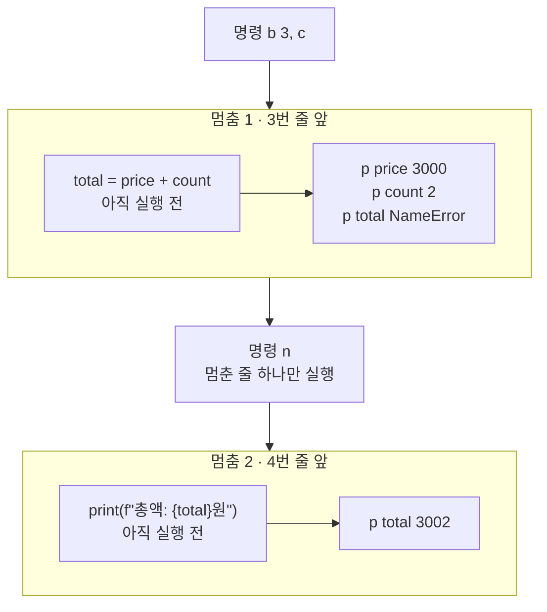
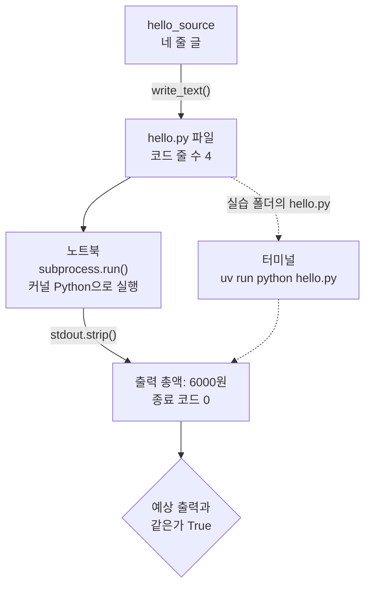
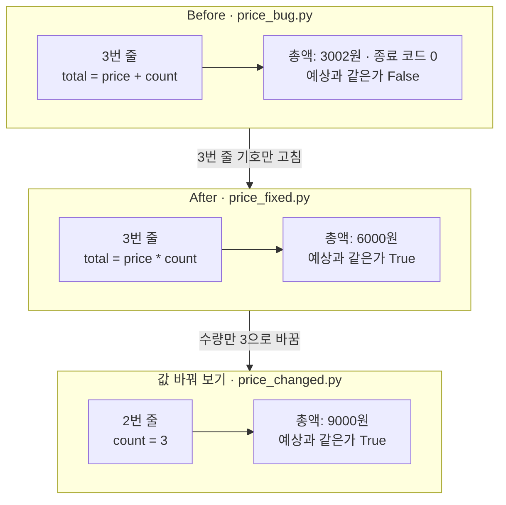
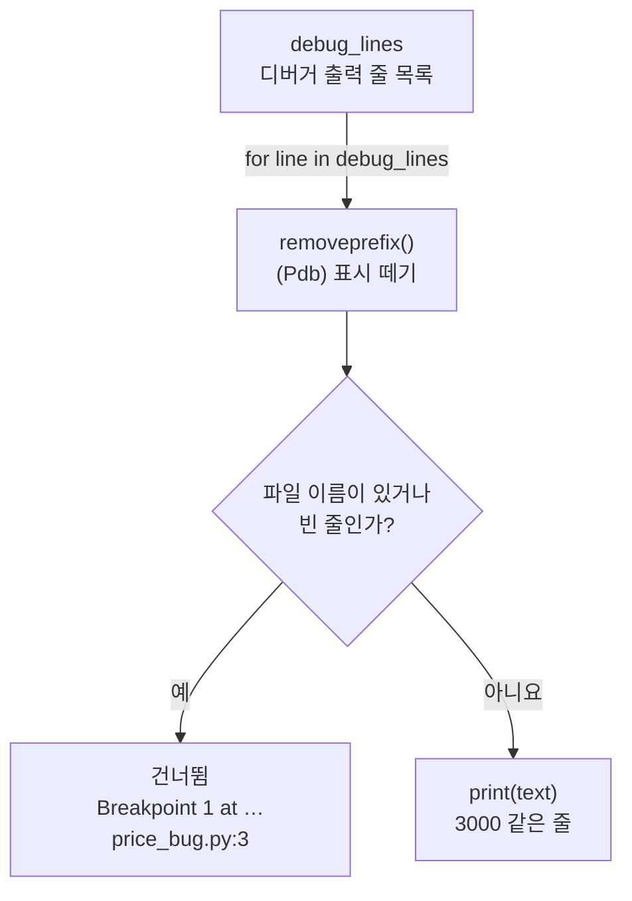

# 04-첫-스크립트와-디버거

## _src 본문 (HTML 원본)

```html
<!--meta: 강의 1h | 실습 1h | 코드 Jupyter Notebook | 새 용어 6 -->
<h2 id="b1"><span class="no">1</span>학습 목표</h2>
<div class="goal"><ul><li>코드를 <code>.py</code> 파일로 저장하고, 실습 폴더에서 <code>uv run python hello.py</code>로 실행할 수 있습니다.</li><li>오류 없이 끝났지만 틀린 출력을 예상 출력과 비교해 찾아낼 수 있습니다.</li><li>디버거로 줄 앞에서 멈춰 값을 확인하고, 틀린 계산 줄을 찾아 고칠 수 있습니다.</li></ul></div>
<h2 id="b2"><span class="no">2</span>이 내용을 배우는 이유</h2>
<p>1절 복습 문제에 「오류 없이 3002가 출력되면 올바른 합계인가요?」가 있었습니다. 프로그램은 멈추지 않았지만 합계는 틀린 경우입니다.</p>
<p>오류 메시지가 나면 문제가 생긴 줄을 알려 줍니다. 틀린 값만 나오고 멈추지 않으면 어느 줄이 틀렸는지 알 수 없습니다. 이럴 때 한 줄씩 멈춰 값을 보는 도구가 디버거입니다.</p>
<p>노트북 셀은 조금씩 실험할 때 편합니다. 여러 번 다시 실행할 코드는 파일로 저장합니다. 이 절에서는 파일 저장, 실행, 디버거 사용을 차례로 익힙니다.</p>
<p><strong>이 절의 질문</strong> — 오류 메시지 없이 틀린 값이 나올 때, 틀린 줄을 어떻게 찾을까요?</p>
<h2 id="b3"><span class="no">3</span>앞에서 배운 내용</h2>
<p>1절에서는 단가 3000과 수량 2로 합계 6000을 먼저 예상하고, 계산 결과와 <code>==</code>로 비교했습니다. 이번 절도 같은 계산을 씁니다. 예상은 출력 모양 그대로 <code>총액: 6000원</code>으로 적어 비교합니다.</p>
<p>2절에서는 기준 폴더에 따라 같은 파일도 찾는 곳이 달라진다는 것을 봤습니다. 터미널에서 <code>hello.py</code>를 실행할 때도 현재 작업 폴더가 실습 폴더여야 합니다.</p>
<p>3절에서는 실습 폴더에 <code>.venv</code>를 준비하고, 인터프리터와 커널에서 골랐습니다. 노트북에서 커널의 Python(<code>sys.executable</code>)으로 다른 코드를 실행하고 종료 코드를 읽는 방법도 봤습니다. 이번 노트북은 그 방법으로 스크립트를 실행합니다.</p>
<p>노트북은 2절·3절처럼 임시 폴더 <code>workspace</code>에서 연습하고, 마지막에 <code>cleanup()</code>으로 지웁니다. 이 장은 모델을 부르지 않으므로 API 키가 필요 없습니다.</p>
<h2 id="b4"><span class="no">4</span>핵심 개념</h2>
<h3>비유로 시작하기</h3>
<p>요리를 순서대로 했는데 맛이 이상하다고 해 봅니다. 불이 나거나 그릇이 깨지지는 않았습니다. 이럴 때는 단계마다 멈춰 그릇 안을 들여다봅니다.</p>
<p>셋째 단계 앞에서 멈추면 앞의 두 그릇은 이미 채워져 있습니다. 셋째 그릇은 아직 비어 있습니다. 멈춘 단계는 아직 하지 않은 단계이기 때문입니다.</p>
{{img:04-5-그릇-멈춤|조리대 위에 흰 그릇 네 개가 한 줄로 놓여 있고, 앞의 두 그릇에는 밀가루와 달걀이 있으며, 빨간 동그라미 스티커가 붙은 셋째 그릇 앞에서 요리사가 숟가락을 든 채 멈춰 앞 그릇들을 들여다보는 삽화|셋째 단계 앞에서 멈추면 앞의 두 그릇은 채워져 있고 셋째 그릇은 비어 있습니다. 디버거도 멈춘 줄을 아직 실행하지 않았습니다.}}
<p><strong>그림 읽기</strong> — 조리대 위 그릇 네 개를 왼쪽부터 읽습니다. 첫째 그릇에는 밀가루, 둘째 그릇에는 달걀 두 개가 있습니다. 셋째 그릇 앞에는 빨간 점이 있고, 그릇은 비어 있으며 옆의 설탕 병은 닫혀 있습니다. 사람은 숟가락을 든 채 멈춰 앞 그릇들을 봅니다.</p>
<p>그릇은 스크립트의 줄에 해당합니다. 밀가루는 1번 줄의 price, 달걀 두 개는 2번 줄의 count입니다. 빨간 점은 중단점이고, 빈 셋째 그릇은 아직 만들어지지 않은 total입니다. 중단점은 VS Code에서도 빨간 점으로 보입니다.</p>
<h3>이 절에서 쓰는 말</h3>
<table><thead><tr><th>용어</th><th>뜻</th><th>이 절에서 보이는 모습</th></tr></thead><tbody>
<tr><td>스크립트(script)</td><td>Python 코드를 순서대로 적어 저장한 파일</td><td>실습 폴더의 <code>hello.py</code></td></tr>
<tr><td>확장자(extension)</td><td>파일 종류를 알려 주는 이름 끝부분</td><td><code>hello.py</code>의 <code>.py</code></td></tr>
<tr><td>논리 오류(logic error)</td><td>문법은 맞는데 원하는 결과가 나오지 않는 잘못</td><td>오류 없이 끝났지만 <code>총액: 3002원</code></td></tr>
<tr><td>디버거(debugger)</td><td>프로그램을 원하는 줄에서 멈추고 값을 보여 주는 도구</td><td>노트북의 <code>pdb</code>, VS Code의 Python Debugger</td></tr>
<tr><td>중단점(breakpoint)</td><td>디버거가 멈출 줄에 붙이는 표시</td><td>명령 <code>b 3</code>, VS Code 줄 번호 옆 빨간 점</td></tr>
<tr><td>한 줄 실행(step over)</td><td>멈춘 줄 하나만 실행하고 다음 줄 앞에서 다시 멈추는 조작</td><td>명령 <code>n</code>, VS Code의 F10</td></tr>
</tbody></table>
<h3>스크립트 파일 hello.py</h3>
<p>스크립트는 코드를 파일로 저장한 것입니다. 요리책에 적어 둔 순서처럼 몇 번이고 같은 순서로 다시 실행할 수 있습니다. 실습 폴더의 <code>hello.py</code>에는 1절 셀과 같은 계산이 네 줄로 들어 있습니다.</p>
<table><thead><tr><th>줄</th><th>코드</th><th>하는 일</th></tr></thead><tbody>
<tr><td>1</td><td><code>price = 3000</code></td><td>단가 3000을 저장합니다</td></tr>
<tr><td>2</td><td><code>count = 2</code></td><td>수량 2를 저장합니다</td></tr>
<tr><td>3</td><td><code>total = price * count</code></td><td>단가와 수량을 곱해 합계를 저장합니다</td></tr>
<tr><td>4</td><td><code>print(f"총액: {total}원")</code></td><td>합계를 글 속에 넣어 출력합니다</td></tr>
</tbody></table>
<p>4번 줄의 <code>f"총액: {total}원"</code>은 글 속 중괄호 자리에 <code>total</code> 값을 넣습니다. 글 앞의 <code>f</code>가 이 뜻을 알립니다. 그래서 출력은 <code>총액: 6000원</code>입니다.</p>
<h3>디버거가 멈추는 자리</h3>
<p>디버거는 프로그램을 원하는 줄에서 멈추고, 그때까지 만들어진 값을 보여 줍니다. 비유에서 단계마다 멈춰 그릇을 들여다보는 일입니다. 노트북에서는 Python에 들어 있는 디버거 <code>pdb</code>를 씁니다.</p>
<p>중단점을 둔 줄에서 멈추면 그 줄은 아직 실행 전입니다. 노트북에서 3번 줄에 중단점을 두자, 멈춘 자리에서 <code>total</code>은 없다는 메시지가 나왔습니다. 한 줄 실행 명령 <code>n</code> 뒤에 다시 보자 <code>3002</code>가 나왔습니다.</p>
{{mermaid:04-1-멈춘-줄|디버거에 b 3과 c를 넣어 3번 줄 앞에서 멈추고, price 3000과 count 2는 보이지만 total은 아직 없으며, n으로 한 줄 실행한 뒤 total 3002를 보는 흐름도|디버거가 멈춘 두 자리. 3번 줄 앞에서는 total이 아직 없고, 한 줄 실행 뒤에 틀린 합계 3002가 보입니다.}}
<p><strong>도식 읽기</strong> — 위에서 아래로 읽습니다. 파란 상자는 디버거에 넣은 명령이고, 초록 상자는 멈춘 줄(아직 실행 전)입니다. 노란 상자는 <code>p</code> 명령으로 본 값이고, 빨간 상자는 틀린 합계입니다.</p>
<p>멈춤 1은 3번 줄 앞입니다. 값 price 3000과 count 2는 이미 있지만 total은 NameError입니다. 명령 <code>n</code>으로 3번 줄 하나만 실행하면 4번 줄 <code>print</code> 앞의 멈춤 2가 됩니다. 이때 본 total 3002가 틀린 줄을 알려 줍니다.</p>
<h2 id="b5"><span class="no">5</span>실행 예제</h2>
<h3>터미널에서 hello.py 실행하기</h3>
<ol><li>VS Code에서 3절에 준비한 실습 폴더 <code>labs/part1/ch01-development-environment</code>를 엽니다.</li><li>왼쪽 파일 목록에서 <code>hello.py</code>를 열고, 위 표의 네 줄과 같은지 봅니다.</li><li>Terminal → New Terminal로 새 터미널을 엽니다. 2절의 <code>pwd</code>나 <code>Get-Location</code>으로 마지막 폴더 이름이 실습 폴더인지 봅니다.</li><li>명령 <code>uv run python hello.py</code>를 입력합니다.</li><li>출력이 <code>총액: 6000원</code>인지 확인합니다.</li></ol>
<p>명령 <code>uv run</code>은 3절에서 본 대로 실습 폴더의 환경에서 뒤의 명령을 실행합니다. 교재 검증 환경(2026-09-16, uv 0.12.3)에서 이 명령은 <code>총액: 6000원</code>을 출력했습니다.</p>
<p>실습 폴더 안의 <code>notebooks</code> 폴더에서 같은 명령을 입력하면 파일을 찾지 못합니다. 교재 검증 환경에서는 <code>can't open file</code>로 시작하는 메시지와 종료 코드 2가 나왔습니다. 2절에서 본 기준 폴더 문제와 같습니다.</p>
<p>편집기에서 파일을 고쳤다면 저장한 뒤에 실행합니다. 터미널은 저장된 파일을 읽기 때문입니다. VS Code 화면 조작은 이번에 실행하지 않았습니다.</p>
<h3>노트북에서 저장하고 실행하기</h3>
<p>노트북은 임시 폴더에 <code>hello.py</code>와 같은 네 줄을 저장합니다. 그다음 커널의 Python으로 파일을 실행하고, 출력을 예상 <code>총액: 6000원</code>과 비교합니다. 이번 절에서 새로 쓰는 기능은 아래 표와 같습니다.</p>
<table><thead><tr><th>이름</th><th>하는 일</th><th>노트북에서 본 결과</th></tr></thead><tbody>
<tr><td>큰따옴표 세 개 <code>"""</code></td><td>여러 줄 글을 줄바꿈까지 그대로 담습니다</td><td>코드 줄 수 <code>4</code></td></tr>
<tr><td><code>strip()</code></td><td>글 앞뒤의 줄바꿈과 빈칸을 떼어 냅니다</td><td>스크립트 출력 <code>총액: 6000원</code></td></tr>
<tr><td><code>replace()</code></td><td>앞 글을 찾아 뒤 글로 바꾼 새 글을 만듭니다</td><td><code>*</code>를 <code>+</code>로 바꾼 <code>price_bug.py</code></td></tr>
<tr><td><code>removeprefix()</code></td><td>글 맨 앞의 정한 글자를 떼어 냅니다</td><td>디버거 출력의 <code>(Pdb)</code> 표시 제거</td></tr>
<tr><td><code>python -m pdb</code></td><td>파일을 디버거 안에서 시작합니다</td><td>디버거 종료 코드 <code>0</code></td></tr>
</tbody></table>
{{mermaid:04-2-저장-실행|hello_source 네 줄 글을 write_text()로 hello.py 파일에 저장하고, 노트북은 subprocess.run()으로, 터미널은 uv run python hello.py로 실행해 출력 총액: 6000원과 종료 코드 0을 얻은 뒤 예상 출력과 같은가 True를 확인하는 흐름도|스크립트를 저장하고 실행하는 두 길. 노트북과 터미널 모두 총액: 6000원을 출력했습니다.}}
<p><strong>도식 읽기</strong> — 위에서 아래로 읽습니다. 초록 상자는 이름에 저장한 값과 파일이고, 파란 상자는 실행하는 곳입니다. 노란 마름모는 예상과의 비교입니다.</p>
<p>실선은 노트북 셀이 실제로 한 순서입니다. 점선은 실습 폴더의 <code>hello.py</code>를 터미널에서 실행하는 길입니다. 두 길 모두 출력 <code>총액: 6000원</code>과 종료 코드 0에 닿았습니다.</p>
{{notebook:04-첫-스크립트와-디버거|example}}
<p class="look"><b>확인할 점</b> — 코드 줄 수가 <code>4</code>이고 3번 줄이 <code>total = price * count</code>인지 봅니다. 스크립트 출력 <code>총액: 6000원</code>이 예상과 같아 <code>True</code>인지도 확인합니다.</p>
<h2 id="b6"><span class="no">6</span>일부러 실패해 보기</h2>
<p>Before에서는 3번 줄의 <code>*</code>를 <code>+</code>로 잘못 적은 <code>price_bug.py</code>를 실행합니다. 출력을 예상과 비교한 뒤, 디버거로 3번 줄 앞에서 멈춰 값을 봅니다.</p>
<p>After에서는 기호를 다시 <code>*</code>로 고칩니다. 같은 디버거 명령 여덟 개를 그대로 넣어 Before와 비교합니다. 노트북은 명령을 키보드 대신 인자 <code>input</code>으로 넣습니다.</p>
<table><thead><tr><th>디버거 명령</th><th>하는 일</th><th>VS Code에서 비슷한 조작</th></tr></thead><tbody>
<tr><td><code>b 3</code></td><td>3번 줄에 중단점을 둡니다</td><td>3번 줄 번호 왼쪽 여백 누르기</td></tr>
<tr><td><code>c</code></td><td>중단점까지 실행합니다</td><td>F5(디버깅 시작·계속)</td></tr>
<tr><td><code>p price</code></td><td>이름의 지금 값을 출력합니다</td><td>VARIABLES 목록에서 값 읽기</td></tr>
<tr><td><code>n</code></td><td>멈춘 줄 하나만 실행합니다</td><td>F10(Step Over)</td></tr>
<tr><td><code>q</code></td><td>디버거를 끝냅니다</td><td>Shift+F5(Stop)</td></tr>
</tbody></table>
{{notebook:04-첫-스크립트와-디버거|failure}}
<p>노트북 Before의 출력은 <code>총액: 3002원</code>이었고 종료 코드는 0이었습니다. 오류 없이 끝났지만 예상과 같은지는 False였습니다. 이것이 논리 오류입니다.</p>
<p>디버거는 3번 줄 앞에서 멈췄습니다. 이때 price는 3000, count는 2였고, total은 <code>NameError</code>로 아직 없었습니다. 명령 <code>n</code>으로 3번 줄을 실행한 뒤 total은 3002였습니다. 입력 두 값은 맞았으므로 틀린 줄은 3번 줄입니다.</p>
<p>디버거 출력에는 파일 위치가 적힌 줄도 섞여 있습니다. 위치는 사람마다 달라서 노트북은 반복문으로 그런 줄을 건너뛰었습니다.</p>
{{mermaid:04-4-출력-고르기|debug_lines 목록의 줄마다 removeprefix()로 (Pdb) 표시를 떼고, 파일 이름이 있거나 빈 줄이면 Breakpoint 1 at …price_bug.py:3 줄처럼 건너뛰고 아니면 3000처럼 출력하는 흐름도|디버거 출력을 고르는 반복문. 파일 이름이 든 줄과 빈 줄은 건너뛰고, 나머지 줄만 출력합니다.}}
<p><strong>도식 읽기</strong> — 위에서 아래로 읽습니다. 반복문 <code>for</code>가 목록의 줄을 하나씩 꺼내고, 파란 상자에서 입력 표시 <code>(Pdb)</code>를 뗍니다. 노란 마름모가 파일 이름이 있거나 빈 줄인지 묻습니다.</p>
<p>「예」 쪽 회색 상자는 출력하지 않고 건너뛴 줄입니다. 실패가 아니어서 빨간색을 쓰지 않았습니다. 「아니요」 쪽 초록 상자는 <code>3000</code>처럼 화면에 출력한 줄입니다.</p>
<p>After에서는 3번 줄 기호 하나만 고쳤고, 출력이 <code>총액: 6000원</code>으로 예상과 같았습니다. 같은 디버거 명령으로 보니 3번 줄 앞의 total은 여전히 없었고, 한 줄 실행 뒤에는 6000이었습니다.</p>
{{mermaid:04-3-기호-비교|Before는 3번 줄 total = price + count로 총액: 3002원과 종료 코드 0, 예상과 같은가 False이고, After는 total = price * count로 총액: 6000원 True, 값 바꿔 보기는 2번 줄 count = 3으로 총액: 9000원 True임을 위아래로 비교한 그림|기호와 수량을 하나씩 바꾼 세 실행. Before만 종료 코드 0으로 끝났는데도 예상과 달랐습니다.}}
<p><strong>도식 읽기</strong> — 위 칸부터 Before, After, 값 바꿔 보기 순서입니다. 칸 제목은 실행한 파일이고, 초록 상자는 바꾼 줄입니다. 빨간 상자는 Before의 3002원 한 곳뿐이고, 노란 상자는 예상과 같았던 결과입니다.</p>
<p>칸 사이 화살표 라벨이 앞 칸에서 바꾼 것입니다. 두 칸 Before와 After 사이에는 3번 줄 기호만 바꿨으므로, 합계가 달라진 원인을 그 기호라고 말할 수 있습니다. 값 바꿔 보기에서 수량을 3으로 바꾸자 1절과 같은 <code>총액: 9000원</code>이 나왔습니다.</p>
<h3>VS Code에서 같은 장면 찾아보기</h3>
<p>노트북의 디버거 출력을 VS Code 화면에서도 찾아볼 수 있습니다. 아래 순서는 VS Code 공식 문서를 따른 안내이고, 이번에 실행하지 않았습니다. 메뉴 이름과 단축키는 버전과 키보드 설정에 따라 다를 수 있습니다.</p>
<ol><li>실습 폴더의 <code>hello.py</code> 3번 줄에서 <code>*</code>를 <code>+</code>로 바꾸고 저장합니다.</li><li>3번 줄 번호 왼쪽 여백을 눌러 빨간 점(중단점)을 만듭니다.</li><li>편집기 오른쪽 위 실행 단추 옆 화살표에서 <code>Python Debugger: Debug Python File</code>을 고릅니다. 단축키 F5를 누르고 목록에서 <code>Python File</code>을 골라도 됩니다.</li><li>멈추면 왼쪽 Run and Debug 화면의 VARIABLES 목록에서 <code>price</code>와 <code>count</code>를 읽습니다. 목록에 <code>total</code>이 있는지도 봅니다.</li><li>단축키 F10을 한 번 누른 뒤 <code>total</code> 값을 다시 읽습니다.</li><li>Shift+F5로 디버깅을 멈추고, 3번 줄을 다시 <code>*</code>로 고쳐 저장합니다.</li></ol>
<p>VS Code 문서에 따르면 디버거는 3절에서 고른 인터프리터 <code>.venv</code>를 씁니다. 멈춘 줄에서 <code>total</code>이 보이지 않는지는 노트북의 <code>pdb</code>로만 확인했습니다. 화면에서 직접 해 보고 노트북 결과와 비교합니다.</p>
<h2 id="b7"><span class="no">7</span>주의할 점과 실무 메모</h2>
<ul><li>종료 코드 0은 오류 없이 끝났다는 뜻입니다. 답이 맞다는 뜻은 아니므로 출력을 예상과 비교합니다.</li>
<li>편집기에서 고친 뒤에는 저장하고 실행합니다. 저장하지 않은 내용은 터미널에서 실행한 파일에 들어 있지 않습니다.</li>
<li>터미널에서 파일을 찾지 못하면 코드보다 현재 폴더를 먼저 봅니다. 교재 검증에서는 <code>notebooks</code> 폴더에서 실행해 <code>can't open file</code> 메시지를 봤습니다.</li>
<li>디버거가 멈춘 줄은 아직 실행 전입니다. 그 줄이 만드는 값은 한 줄 실행 뒤에 확인합니다.</li>
<li>입력 값부터 차례로 봅니다. 앞의 값이 맞으면 틀린 값이 처음 생긴 줄이 고칠 곳입니다.</li>
<li>연습으로 바꾼 <code>hello.py</code>는 곱셈 <code>*</code>로 고쳐 저장해 둡니다. 나중에 다시 실행해도 <code>총액: 6000원</code>이 나와야 합니다.</li></ul>
<h2 id="b8"><span class="no">8</span>정리와 다음 절</h2>
<ul><li>스크립트는 코드를 저장한 파일입니다. 실습 폴더에서 <code>uv run python hello.py</code>로 실행해 <code>총액: 6000원</code>을 봤습니다.</li><li>덧셈으로 잘못 적은 스크립트는 종료 코드 0으로 끝났지만 출력 3002원은 예상과 달랐습니다.</li><li>디버거는 중단점 줄 앞에서 멈췄습니다. 한 줄 실행 뒤에 본 total로 틀린 3번 줄을 찾아 고쳤습니다.</li></ul>
<p><strong>다음 학습과 이어지는 지점</strong> — 5절에서는 Git으로 파일의 변경 상태를 확인하고, Docker의 준비 상태를 점검합니다. 이번 절처럼 파일을 만든 뒤 무엇이 달라졌는지 확인하는 순서를 이어 갑니다.</p>
<h2 id="b9"><span class="no">9</span>복습 문제</h2><details class="quiz"><summary>문제와 해설</summary>
<p class="quiz-q">1. 파일 이름 <code>hello.py</code>에서 <code>.py</code>는 무엇을 알려 주나요? · 기초</p><p class="quiz-a"><b>해설</b> — 확장자입니다. 이 파일이 Python 코드를 저장한 스크립트라는 것을 편집기와 사람에게 알려 줍니다.</p>
<p class="quiz-q">2. 스크립트가 종료 코드 0으로 끝나고 <code>총액: 3002원</code>을 출력했습니다. 올바른 결과인가요? · 적용</p><p class="quiz-a"><b>해설</b> — 아닙니다. 종료 코드 0은 오류 없이 끝났다는 뜻일 뿐입니다. 예상 <code>총액: 6000원</code>과 비교하면 False이므로 논리 오류가 있습니다.</p>
<p class="quiz-q">3. 3번 줄에 중단점을 두고 멈췄을 때 <code>p total</code>이 <code>NameError</code>를 낸 이유는 무엇인가요? · 적용</p><p class="quiz-a"><b>해설</b> — 멈춘 3번 줄을 아직 실행하지 않았기 때문입니다. 한 줄 실행 명령 <code>n</code>으로 3번 줄을 실행한 뒤에는 total이 3002로 보였습니다.</p>
<p class="quiz-q">4. 터미널에서 <code>uv run python hello.py</code>를 입력했더니 <code>can't open file</code>이 나왔습니다. 무엇부터 확인하나요? · 적용</p><p class="quiz-a"><b>해설</b> — 현재 작업 폴더가 <code>hello.py</code>가 있는 실습 폴더인지 확인합니다. 교재 검증에서는 <code>notebooks</code> 폴더에서 실행했을 때 이 메시지가 나왔습니다.</p>
<p class="quiz-q">5. 노트북의 <code>pdb</code> 결과만으로 VS Code 화면에서도 똑같이 보인다고 말할 수 있나요? · 분석</p><p class="quiz-a"><b>해설</b> — 말할 수 없습니다. 이번에 실행한 것은 노트북의 <code>pdb</code>뿐이고, VS Code 화면 조작은 실행하지 않았습니다. 화면에서 직접 해 보고 두 결과를 비교합니다.</p>
</details>
<h2 id="b10"><span class="no">10</span>참고 자료</h2>
<ul><li><a href="https://docs.python.org/3.12/library/pdb.html">Python 3.12 pdb</a> · <a href="https://docs.python.org/3.12/library/stdtypes.html#string-methods">문자열 메서드</a> · 확인 2026-09-16 · 예제는 교재에서 작성</li><li><a href="https://code.visualstudio.com/docs/python/debugging">VS Code Python 디버깅</a> · 확인 2026-09-16 · 파일 디버깅과 인터프리터 기준</li><li><a href="https://code.visualstudio.com/docs/debugtest/debugging">VS Code 디버깅 기본</a> · 확인 2026-09-16 · 중단점, F5·F10·Shift+F5, VARIABLES</li></ul>
```

## 노트북 셀 (순서대로)

### [0] markdown {'html': 'skip'}

# 첫 스크립트와 디버거

**이 노트북에서 할 일**

1. 실습 폴더의 `hello.py`와 같은 네 줄을 파일로 저장하고 실행해, 출력을 예상과 비교합니다.
2. 곱셈 기호 하나를 덧셈으로 바꾼 스크립트가 오류 없이 틀린 합계를 내는 것을 봅니다.
3. 디버거로 3번 줄 앞에서 멈춰 값을 보고, 기호를 고친 뒤 같은 명령으로 다시 확인합니다.

**준비물** — API 키 불필요. 데이터 파일도 없습니다. 노트북이 임시 폴더에 스크립트를 직접 만듭니다.
모델 호출은 0번이고 비용은 들지 않습니다. 실행 시간은 1분 이내입니다.

커널은 3절에서 준비한 실습 폴더의 `.venv`를 고릅니다. VS Code 화면에서 디버거를 쓰는 방법은 교재 본문에 있습니다.

### [1] markdown {'html': 'skip'}

## 오늘 볼 그림


위에서 아래로 읽습니다. 파란 상자는 디버거에 넣은 명령이고, 초록 상자는 멈춘 줄(아직 실행 전)입니다.
노란 상자는 값을 확인한 결과이고, 빨간 상자는 틀린 합계 `3002`입니다.
멈춘 줄은 아직 실행 전이라서 한 줄 실행 명령 `n` 뒤에야 `total`이 생깁니다.

### [2] markdown {}

## 1. 준비

이 절도 설치할 패키지가 없습니다. 3절에서 쓴 기본 기능 네 가지를 다시 불러옵니다.
모듈 `subprocess`는 노트북 안에서 다른 프로그램을 실행하고, 모듈 `sys`는 실행 중인 Python의 정보를 알려 줍니다.
모듈 `tempfile`과 경로 기능 `Path`는 2절처럼 임시 폴더와 경로를 다룹니다.

### [3] code {'execution': {'iopub.execute_input': '2026-09-16T03:21:15.396511Z', 'iopub.status.busy': '2026-09-16T03:21:15.396314Z', 'iopub.status.idle': '2026-09-16T03:21:15.400377Z', 'shell.execute_reply': '2026-09-16T03:21:15.400076Z'}, 'lesson_role': 'setup', 'upgrade_allow': ['stdlib-import']}

```python
# 이 절에서 쓰는 Python 기본 기능을 불러옵니다
import subprocess
import sys
import tempfile
from pathlib import Path

print("불러오기 완료")
```

출력:
```
불러오기 완료

```

### [4] markdown {}

**결과 읽기** — `불러오기 완료`가 보이면 다음 셀로 넘어갑니다.

### [5] markdown {}

## 2. 연습용 폴더와 파일 이름 정하기

2절·3절처럼 내 문서를 건드리지 않도록 임시 폴더 `workspace`에서 연습합니다.

이 노트북은 스크립트 파일 네 개를 씁니다. 이번 셀은 먼저 세 개의 경로를 정합니다.
바른 계산 `hello.py`, 틀린 계산 `price_bug.py`, 고친 계산 `price_fixed.py`입니다.
값 바꿔 보기의 `price_changed.py`는 그 셀에서 정합니다. 경로만 정하므로 파일은 아직 없습니다.

### [6] code {'execution': {'iopub.execute_input': '2026-09-16T03:21:15.401291Z', 'iopub.status.busy': '2026-09-16T03:21:15.401208Z', 'iopub.status.idle': '2026-09-16T03:21:15.403450Z', 'shell.execute_reply': '2026-09-16T03:21:15.403148Z'}, 'upgrade_allow': ['stdlib-import']}

```python
# 연습용 임시 폴더를 만들고, 스크립트 파일 세 개의 경로를 정합니다
temporary_folder = tempfile.TemporaryDirectory()
workspace = Path(temporary_folder.name)
hello_file = workspace / "hello.py"
bug_file = workspace / "price_bug.py"
fixed_file = workspace / "price_fixed.py"
# 경로만 정했으므로 세 파일 모두 아직 없습니다
print("hello.py가 있는가:", hello_file.is_file())
print("price_bug.py가 있는가:", bug_file.is_file())
print("price_fixed.py가 있는가:", fixed_file.is_file())
```

출력:
```
hello.py가 있는가: False
price_bug.py가 있는가: False
price_fixed.py가 있는가: False

```

### [7] markdown {}

**결과 읽기** — 세 줄 모두 `False`입니다. 아직 파일을 저장하지 않았습니다.

### [8] markdown {}

## 3. 스크립트 파일 저장하기

스크립트(script)는 Python 코드를 순서대로 적어 저장한 파일입니다. 실습 폴더의 `hello.py`에는 네 줄이 있습니다.
여러 줄 글은 큰따옴표 세 개 `"""`로 시작하고 끝냅니다. 그 사이의 줄바꿈도 글에 그대로 들어갑니다.

마지막 줄의 `f"총액: {total}원"`은 글 속 중괄호 자리에 `total` 값을 넣습니다.
메서드 `write_text()`는 2절에서 글을 파일에 저장할 때 썼습니다.

### [9] code {'execution': {'iopub.execute_input': '2026-09-16T03:21:15.404824Z', 'iopub.status.busy': '2026-09-16T03:21:15.404740Z', 'iopub.status.idle': '2026-09-16T03:21:15.407242Z', 'shell.execute_reply': '2026-09-16T03:21:15.406904Z'}, 'upgrade_allow': ['stdlib-import']}

```python
# 실습 폴더의 hello.py와 같은 네 줄을 글로 적어 파일에 저장합니다
hello_source = """price = 3000
count = 2
total = price * count
print(f"총액: {total}원")
"""
hello_file.write_text(hello_source, encoding="utf-8")
# splitlines()로 줄을 나눠 코드가 몇 줄인지 셉니다
hello_lines = hello_source.splitlines()
print("hello.py가 있는가:", hello_file.is_file())
print("코드 줄 수:", len(hello_lines))
print("3번 줄:", hello_lines[2])
```

출력:
```
hello.py가 있는가: True
코드 줄 수: 4
3번 줄: total = price * count

```

### [10] markdown {}

**결과 읽기** — 파일이 있는지는 `True`, 코드 줄 수는 `4`입니다.
3번 줄은 `total = price * count`입니다. 뒤에서 디버거를 멈출 줄이 이 3번 줄입니다.

목록 번호는 0부터 세므로 `[2]`가 세 번째 줄입니다.

### [11] markdown {}

## 4. 스크립트 실행하기

터미널에서는 실습 폴더에서 `uv run python hello.py`로 실행합니다. 노트북에서는 3절처럼 커널의 Python으로 실행합니다.
값 `sys.executable`은 이 노트북을 실행하는 Python이고, 함수 `subprocess.run()`에 명령 목록을 넣어 실행합니다.

출력 글 끝에는 줄바꿈이 붙어 있습니다. 메서드 `strip()`은 글 앞뒤의 줄바꿈과 빈칸을 떼어 낸 글을 반환합니다.

### [12] code {'execution': {'iopub.execute_input': '2026-09-16T03:21:15.407979Z', 'iopub.status.busy': '2026-09-16T03:21:15.407915Z', 'iopub.status.idle': '2026-09-16T03:21:15.429402Z', 'shell.execute_reply': '2026-09-16T03:21:15.429083Z'}, 'upgrade_allow': ['stdlib-import']}

```python
# 노트북을 실행하는 Python으로 hello.py를 실행하고 출력을 담습니다
hello_command = [sys.executable, hello_file]
hello_run = subprocess.run(hello_command, capture_output=True, text=True, check=True)
# 출력 끝의 줄바꿈을 떼어 낸 글만 남깁니다
hello_output = hello_run.stdout.strip()
print("스크립트 출력:", hello_output)
print("종료 코드:", hello_run.returncode)
```

출력:
```
스크립트 출력: 총액: 6000원
종료 코드: 0

```

### [13] markdown {}

**결과 읽기** — 스크립트 출력은 `총액: 6000원`이고, 종료 코드는 `0`입니다.
3절에서 봤듯이 종료 코드 0은 프로그램이 오류 없이 끝났다는 뜻입니다.

### [14] markdown {}

## 5. 출력을 예상과 비교하기

1절에서 단가 3000원짜리 2개의 합계를 6000원으로 예상했습니다.
이번에는 그 예상을 출력 모양 그대로 `총액: 6000원`으로 적고, 등호 두 개 `==`로 비교합니다.
검사 줄 `assert`는 비교 결과가 거짓이면 실행을 멈춥니다.

### [15] code {'execution': {'iopub.execute_input': '2026-09-16T03:21:15.430330Z', 'iopub.status.busy': '2026-09-16T03:21:15.430258Z', 'iopub.status.idle': '2026-09-16T03:21:15.432235Z', 'shell.execute_reply': '2026-09-16T03:21:15.431917Z'}}

```python
# 1절의 예상 합계 6000을 출력 모양으로 적고 실제 출력과 비교합니다
expected_output = "총액: 6000원"
hello_same = hello_output == expected_output
print("예상 출력:", expected_output)
print("예상과 같은가:", hello_same)
# 예상과 다르면 여기서 멈춥니다
assert hello_same
```

출력:
```
예상 출력: 총액: 6000원
예상과 같은가: True

```

### [16] markdown {}

**결과 읽기** — 예상과 같은지는 `True`입니다. 검사 줄에서 멈추지 않았습니다.
이 스크립트는 오류 없이 끝났고, 출력도 예상과 같았습니다.

### [17] markdown {'lesson_part': 'before'}

## Before: 곱셈 기호를 덧셈으로 잘못 적은 스크립트

3번 줄의 `*`를 `+`로 잘못 적은 상황입니다. 나머지 세 줄은 그대로입니다.
메서드 `replace()`는 앞에 넣은 글을 찾아 뒤에 넣은 글로 바꾼 새 글을 반환합니다.

실행 전에 예상합니다. 3000 더하기 2이므로 `총액: 3002원`이 나올 것입니다.
숫자끼리 더하는 것은 틀린 문법이 아니므로 종료 코드는 0일 것입니다.

### [18] code {'execution': {'iopub.execute_input': '2026-09-16T03:21:15.432861Z', 'iopub.status.busy': '2026-09-16T03:21:15.432794Z', 'iopub.status.idle': '2026-09-16T03:21:15.444259Z', 'shell.execute_reply': '2026-09-16T03:21:15.443907Z'}, 'lesson_part': 'before', 'upgrade_allow': ['stdlib-import']}

```python
# hello.py의 곱셈 기호만 덧셈으로 바꾼 스크립트를 저장하고 실행합니다
bug_source = hello_source.replace("price * count", "price + count")
bug_file.write_text(bug_source, encoding="utf-8")
# hello.py와 같은 방법으로 실행하고 출력을 담습니다
bug_command = [sys.executable, bug_file]
bug_run = subprocess.run(bug_command, capture_output=True, text=True, check=True)
bug_output = bug_run.stdout.strip()
print("스크립트 출력:", bug_output)
print("종료 코드:", bug_run.returncode)
```

출력:
```
스크립트 출력: 총액: 3002원
종료 코드: 0

```

### [19] markdown {'lesson_part': 'before'}

**결과 읽기** — 예상대로 출력은 `총액: 3002원`이고, 종료 코드는 `0`입니다.
프로그램은 오류 메시지 없이 끝났습니다. 종료 코드만 보면 문제가 없어 보입니다.

다음 셀에서 이 출력을 앞의 예상 출력과 비교합니다.

### [20] code {'execution': {'iopub.execute_input': '2026-09-16T03:21:15.445003Z', 'iopub.status.busy': '2026-09-16T03:21:15.444933Z', 'iopub.status.idle': '2026-09-16T03:21:15.446606Z', 'shell.execute_reply': '2026-09-16T03:21:15.446280Z'}, 'lesson_part': 'before'}

```python
# 틀린 스크립트의 출력을 같은 예상 출력과 비교합니다
bug_same = bug_output == expected_output
print("예상 출력:", expected_output)
print("예상과 같은가:", bug_same)
```

출력:
```
예상 출력: 총액: 6000원
예상과 같은가: False

```

### [21] markdown {'lesson_part': 'before'}

**결과 읽기** — 예상과 같은지는 `False`입니다. 오류 없이 끝났지만 합계가 틀렸습니다.
이렇게 문법은 맞는데 원하는 결과가 나오지 않는 잘못을 논리 오류(logic error)라고 합니다.
오류 메시지가 없으니 어느 줄이 틀렸는지도 알려 주지 않습니다. 디버거로 한 줄씩 멈춰 찾아봅니다.

### [22] markdown {'lesson_part': 'before'}

## 디버거에 넣을 명령 적기

디버거(debugger)는 프로그램을 원하는 줄에서 멈추고 그때까지 만들어진 값을 보여 주는 도구입니다.
이 노트북은 Python에 들어 있는 디버거 `pdb`를 씁니다. 사람이 키보드로 명령을 한 줄씩 입력하는 도구입니다.

이번에 쓸 명령은 다섯 종류입니다. 명령 `b 3`은 3번 줄에 중단점(멈출 표시)을 두고, `c`는 중단점까지 실행합니다.
명령 `p price`는 그 이름의 지금 값을 출력합니다. 명령 `n`은 멈춘 줄 하나만 실행하고, `q`는 디버거를 끝냅니다.

### [23] code {'execution': {'iopub.execute_input': '2026-09-16T03:21:15.447359Z', 'iopub.status.busy': '2026-09-16T03:21:15.447287Z', 'iopub.status.idle': '2026-09-16T03:21:15.449134Z', 'shell.execute_reply': '2026-09-16T03:21:15.448845Z'}, 'lesson_part': 'before', 'upgrade_allow': ['stdlib-import']}

```python
# 디버거에 차례로 입력할 명령 여덟 개를 적습니다
debug_commands = """b 3
c
p price
p count
p total
n
p total
q
"""
# 줄마다 나눠 목록으로 확인합니다
command_lines = debug_commands.splitlines()
print("명령 수:", len(command_lines))
print("명령 목록:", command_lines)
```

출력:
```
명령 수: 8
명령 목록: ['b 3', 'c', 'p price', 'p count', 'p total', 'n', 'p total', 'q']

```

### [24] markdown {'lesson_part': 'before'}

**결과 읽기** — 명령 수는 `8`입니다. 목록 순서는 `'b 3', 'c', 'p price', 'p count', 'p total', 'n', 'p total', 'q'`입니다.
값 `total`을 두 번 봅니다. 한 번은 3번 줄 앞에서, 한 번은 한 줄 실행 명령 `n` 뒤에서 봅니다.

실행 전에 예상합니다. 3번 줄 앞에서는 아직 그 줄을 실행하지 않았으므로 `total`이 없을 것입니다.

### [25] markdown {'lesson_part': 'before'}

## 디버거 안에서 틀린 스크립트 실행하기

명령 `python -m pdb 파일`은 그 파일을 디버거 안에서 시작합니다. 첫 줄 앞에서 멈추고 명령을 기다립니다.
노트북에서는 사람이 입력하는 대신 인자 `input`에 명령 글을 넣습니다. 적어 둔 명령이 한 줄씩 차례로 들어갑니다.

### [26] code {'execution': {'iopub.execute_input': '2026-09-16T03:21:15.449783Z', 'iopub.status.busy': '2026-09-16T03:21:15.449717Z', 'iopub.status.idle': '2026-09-16T03:21:15.474955Z', 'shell.execute_reply': '2026-09-16T03:21:15.474563Z'}, 'lesson_part': 'before', 'upgrade_allow': ['stdlib-import']}

```python
# price_bug.py를 디버거 안에서 시작하고, 적어 둔 명령을 입력으로 넣습니다
debug_command = [sys.executable, "-m", "pdb", bug_file]
# input에 넣은 글은 키보드로 치는 대신 디버거에 한 줄씩 들어갑니다
debug_run = subprocess.run(debug_command, input=debug_commands, capture_output=True, text=True)
print("디버거 종료 코드:", debug_run.returncode)
```

출력:
```
디버거 종료 코드: 0

```

### [27] markdown {'lesson_part': 'before'}

**결과 읽기** — 디버거 종료 코드는 `0`입니다. 명령 `q`까지 받고 디버거가 끝났습니다.

디버거가 출력한 글은 `stdout`에 담겼습니다. 다음 셀에서 한 줄씩 읽습니다.
줄 앞에는 입력을 기다린다는 표시 `(Pdb) `가 붙어 있어서, 메서드 `removeprefix()`로 떼어 냅니다.
파일 위치가 적힌 줄은 사람마다 달라서 뺍니다. 연산자 `in`은 앞의 글이 뒤의 글 안에 있으면 `True`를 만듭니다.

### [28] code {'execution': {'iopub.execute_input': '2026-09-16T03:21:15.475643Z', 'iopub.status.busy': '2026-09-16T03:21:15.475575Z', 'iopub.status.idle': '2026-09-16T03:21:15.477427Z', 'shell.execute_reply': '2026-09-16T03:21:15.477078Z'}, 'lesson_part': 'before', 'upgrade_allow': ['stdlib-import']}

```python
# 디버거 출력을 한 줄씩 읽고, 파일 위치가 적힌 줄과 빈 줄은 빼고 출력합니다
debug_lines = debug_run.stdout.splitlines()
for line in debug_lines:
    # 줄 앞의 입력 표시를 떼어 냅니다
    text = line.removeprefix("(Pdb) ")
    # 파일 이름이 들어 있으면 위치가 적힌 줄입니다
    has_location = bug_file.name in text
    if not has_location and text != "":
        print(text)
```

출력:
```
-> price = 3000
-> total = price + count
3000
2
*** NameError: name 'total' is not defined
-> print(f"총액: {total}원")
3002

```

### [29] markdown {'lesson_part': 'before'}

**결과 읽기** — 화살표 `->` 뒤의 글은 디버거가 멈춘 줄입니다. 처음에는 `-> price = 3000`인 1번 줄 앞에서 멈췄습니다.
명령 `c` 뒤에는 `-> total = price + count`인 3번 줄 앞에서 멈췄습니다.

그다음 세 줄은 `p` 명령의 답입니다. 값 price는 `3000`, count는 `2`입니다.
값 total은 `*** NameError: name 'total' is not defined`로, 아직 없다고 나왔습니다. 3번 줄을 아직 실행하지 않았기 때문입니다.

명령 `n` 뒤에는 4번 줄 앞에서 멈췄고, 다시 본 total은 `3002`입니다.
입력 두 값은 맞았고, 3번 줄을 지나자 틀린 값이 생겼습니다. 틀린 줄은 3번 줄입니다.

걸러 낸 원문 줄에는 `Breakpoint 1 at …price_bug.py:3`처럼 파일 위치가 들어 있습니다.
이 줄은 교재 환경의 기기 셸에서 따로 확인했습니다.

### [30] markdown {'lesson_part': 'after'}

## After: 덧셈 기호를 곱셈으로 고치기

틀린 줄을 찾았으므로 3번 줄의 `+`만 `*`로 고칩니다. 단가와 수량은 그대로 둡니다.
실행 전에 예상합니다. 이번에는 `총액: 6000원`이 나오고 예상과 같을 것입니다.

### [31] code {'execution': {'iopub.execute_input': '2026-09-16T03:21:15.478027Z', 'iopub.status.busy': '2026-09-16T03:21:15.477966Z', 'iopub.status.idle': '2026-09-16T03:21:15.489530Z', 'shell.execute_reply': '2026-09-16T03:21:15.489191Z'}, 'lesson_part': 'after', 'upgrade_allow': ['stdlib-import']}

```python
# 3번 줄의 덧셈 기호만 곱셈으로 고친 스크립트를 저장하고 실행합니다
fixed_source = bug_source.replace("price + count", "price * count")
fixed_file.write_text(fixed_source, encoding="utf-8")
fixed_command = [sys.executable, fixed_file]
fixed_run = subprocess.run(fixed_command, capture_output=True, text=True, check=True)
fixed_output = fixed_run.stdout.strip()
# 고친 출력을 같은 예상 출력과 비교합니다
fixed_same = fixed_output == expected_output
print("스크립트 출력:", fixed_output)
print("예상과 같은가:", fixed_same)
assert fixed_same
```

출력:
```
스크립트 출력: 총액: 6000원
예상과 같은가: True

```

### [32] markdown {'lesson_part': 'after'}

**결과 읽기** — 스크립트 출력은 `총액: 6000원`, 예상과 같은지는 `True`입니다.
앞의 Before와 달라진 것은 3번 줄의 기호 하나뿐입니다.

고친 스크립트에도 같은 디버거 명령 여덟 개를 넣어 봅니다.
실행 전에 예상합니다. 3번 줄 앞에서는 여전히 total이 없고, 한 줄 실행 뒤에는 `6000`이 보일 것입니다.

### [33] code {'execution': {'iopub.execute_input': '2026-09-16T03:21:15.490251Z', 'iopub.status.busy': '2026-09-16T03:21:15.490171Z', 'iopub.status.idle': '2026-09-16T03:21:15.516413Z', 'shell.execute_reply': '2026-09-16T03:21:15.516033Z'}, 'lesson_part': 'after', 'upgrade_allow': ['stdlib-import']}

```python
# 고친 스크립트에도 같은 디버거 명령을 넣어 실행합니다
fixed_debug_command = [sys.executable, "-m", "pdb", fixed_file]
fixed_debug_run = subprocess.run(fixed_debug_command, input=debug_commands, capture_output=True, text=True)
# 앞과 같은 방법으로 파일 위치가 적힌 줄과 빈 줄은 빼고 출력합니다
fixed_debug_lines = fixed_debug_run.stdout.splitlines()
for line in fixed_debug_lines:
    text = line.removeprefix("(Pdb) ")
    has_location = fixed_file.name in text
    if not has_location and text != "":
        print(text)
```

출력:
```
-> price = 3000
-> total = price * count
3000
2
*** NameError: name 'total' is not defined
-> print(f"총액: {total}원")
6000

```

### [34] markdown {'lesson_part': 'after'}

**결과 읽기** — 멈춘 3번 줄이 이번에는 `-> total = price * count`입니다. 값 price와 count는 `3000`과 `2`로 같습니다.
3번 줄 앞에서 total은 이번에도 `*** NameError: name 'total' is not defined`입니다.
명령 `n`으로 한 줄 실행한 뒤의 total은 `6000`입니다. 같은 명령으로 본 값이 3002에서 6000으로 바뀌었습니다.

### [35] markdown {'lesson_part': 'after'}

## 값 바꿔 보기: 수량을 3으로

1절처럼 고친 스크립트에서 수량만 2에서 3으로 바꿉니다. 새 예상 출력은 `총액: 9000원`입니다.
실행 전에 예상합니다. 곱셈으로 고쳤으므로 예상과 같다는 `True`가 나올 것입니다.

### [36] code {'execution': {'iopub.execute_input': '2026-09-16T03:21:15.517148Z', 'iopub.status.busy': '2026-09-16T03:21:15.517082Z', 'iopub.status.idle': '2026-09-16T03:21:15.527925Z', 'shell.execute_reply': '2026-09-16T03:21:15.527531Z'}, 'lesson_part': 'after', 'upgrade_allow': ['stdlib-import']}

```python
# 고친 스크립트에서 수량만 3으로 바꾼 파일을 저장하고 실행합니다
changed_source = fixed_source.replace("count = 2", "count = 3")
changed_file = workspace / "price_changed.py"
changed_file.write_text(changed_source, encoding="utf-8")
changed_command = [sys.executable, changed_file]
changed_run = subprocess.run(changed_command, capture_output=True, text=True, check=True)
changed_output = changed_run.stdout.strip()
# 1절의 새 예상 합계 9000을 출력 모양으로 적어 비교합니다
changed_expected = "총액: 9000원"
changed_same = changed_output == changed_expected
print("스크립트 출력:", changed_output)
print("예상과 같은가:", changed_same)
```

출력:
```
스크립트 출력: 총액: 9000원
예상과 같은가: True

```

### [37] markdown {'lesson_part': 'after'}

**결과 읽기** — 스크립트 출력은 `총액: 9000원`이고, 예상과 같은지는 `True`입니다.
1절에서 셀로 계산한 9000과 같습니다. 고친 3번 줄은 수량을 바꿔도 단가와 수량을 곱했습니다.

### [38] markdown {'lesson_part': 'after'}

## 6. 임시 폴더 정리하기

연습이 끝났으므로 2절처럼 `cleanup()`으로 임시 폴더를 지웁니다. 안에 만든 스크립트 네 개도 함께 지워집니다.
실습 폴더의 `hello.py`는 이 임시 폴더 밖에 있으므로 지워지지 않습니다.

### [39] code {'execution': {'iopub.execute_input': '2026-09-16T03:21:15.528645Z', 'iopub.status.busy': '2026-09-16T03:21:15.528578Z', 'iopub.status.idle': '2026-09-16T03:21:15.530445Z', 'shell.execute_reply': '2026-09-16T03:21:15.530104Z'}, 'lesson_part': 'after', 'upgrade_allow': ['stdlib-import']}

```python
# 연습용 임시 폴더와 그 안의 스크립트 파일을 함께 지웁니다
temporary_folder.cleanup()
print("임시 폴더가 남아 있는가:", workspace.is_dir())
```

출력:
```
임시 폴더가 남아 있는가: False

```

### [40] markdown {'lesson_part': 'after'}

**결과 읽기** — `False`입니다. 임시 폴더와 스크립트 네 개가 지워졌습니다.

## 정리

- 스크립트는 코드를 저장한 파일입니다. 저장한 `hello.py`를 실행해 `총액: 6000원`을 얻었습니다.
- 덧셈으로 잘못 적은 스크립트는 종료 코드 0으로 끝났지만, 출력 3002원은 예상과 달랐습니다.
- 디버거는 중단점 줄 앞에서 멈췄습니다. 한 줄 실행 뒤에 본 total로 틀린 줄을 찾고 고쳤습니다.

VS Code 화면의 중단점과 변수 창은 이 노트북에서 실행하지 않았습니다. 교재 본문의 순서대로 직접 해 봅니다.
다음 절에서는 Git으로 파일의 변경 상태를 확인하고, Docker의 준비 상태를 점검합니다.

## 그림

### 04-1-멈춘-줄.mmd



- 설명 대상 문장: 프로그램은 중단점 줄을 실행하기 직전에 멈춥니다.
- 캡션: 디버거가 멈춘 두 자리. 3번 줄 앞에서는 total이 아직 없고, 한 줄 실행 뒤에 틀린 합계 3002가 보입니다.
- 읽는 법: 위에서 아래로 읽습니다. 파란 상자는 디버거에 넣은 명령, 초록 상자는 멈춘 줄(아직 실행 전), 노란 상자는 p 명령으로 본 값입니다. 멈춤 1에서 price 3000과 count 2는 있지만 total은 NameError입니다. 명령 n 뒤의 멈춤 2에서 본 total 3002만 빨간 상자입니다.
- alt: 디버거에 b 3과 c를 넣어 3번 줄 앞에서 멈추고, price 3000과 count 2는 보이지만 total은 아직 없으며, n으로 한 줄 실행한 뒤 total 3002를 보는 흐름도

### 04-2-저장-실행.mmd



- 설명 대상 문장: 노트북은 임시 폴더에 hello.py와 같은 네 줄을 저장하고, 커널의 Python으로 실행해 출력을 예상과 비교합니다.
- 캡션: 스크립트를 저장하고 실행하는 두 길. 노트북과 터미널 모두 총액: 6000원을 출력했습니다.
- 읽는 법: 위에서 아래로 읽습니다. 초록 상자는 이름에 저장한 값과 파일, 파란 상자는 실행하는 곳, 노란 마름모는 비교입니다. 실선은 노트북 셀이 실제로 한 순서입니다. 점선은 실습 폴더의 hello.py를 터미널에서 실행한 길이고, 교재 검증 환경에서 같은 출력을 확인했습니다.
- alt: hello_source 네 줄 글을 write_text()로 hello.py 파일에 저장하고, 노트북은 subprocess.run()으로, 터미널은 uv run python hello.py로 실행해 출력 총액: 6000원과 종료 코드 0을 얻은 뒤 예상 출력과 같은가 True를 확인하는 흐름도

### 04-3-기호-비교.mmd



- 설명 대상 문장: 앞의 Before와 달라진 것은 3번 줄의 기호 하나뿐입니다.
- 캡션: 기호와 수량을 하나씩 바꾼 세 실행. Before만 종료 코드 0으로 끝났는데도 예상과 달랐습니다.
- 읽는 법: 위 칸부터 Before, After, 값 바꿔 보기 순서입니다. 칸 제목은 실행한 파일이고, 초록 상자는 바꾼 줄입니다. 빨간 상자는 Before의 3002원 한 곳뿐이고, 노란 상자는 예상과 같았던 결과입니다. 칸 사이 화살표 라벨이 앞 칸에서 바꾼 것입니다.
- alt: Before는 3번 줄 total = price + count로 총액: 3002원과 종료 코드 0, 예상과 같은가 False이고, After는 total = price * count로 총액: 6000원 True, 값 바꿔 보기는 2번 줄 count = 3으로 총액: 9000원 True임을 위아래로 비교한 그림

### 04-4-출력-고르기.mmd



- 설명 대상 문장: 파일 위치가 적힌 줄은 사람마다 달라서 뺍니다.
- 캡션: 디버거 출력을 고르는 반복문. 파일 이름이 든 줄과 빈 줄은 건너뛰고, 나머지 줄만 출력합니다.
- 읽는 법: 위에서 아래로 읽습니다. 목록의 줄마다 입력 표시 (Pdb)를 떼고 마름모에서 묻습니다. 「예」이면 회색 상자처럼 건너뛰고, 「아니요」이면 3000 같은 줄을 출력합니다. 회색 상자는 실패가 아니라 출력하지 않은 줄입니다.
- alt: debug_lines 목록의 줄마다 removeprefix()로 (Pdb) 표시를 떼고, 파일 이름이 있거나 빈 줄이면 Breakpoint 1 at …price_bug.py:3 줄처럼 건너뛰고 아니면 3000처럼 출력하는 흐름도

### 04-5-그릇-멈춤.prompt.md

# 삽화 — 04-5 그릇 앞에서 멈춤

- 상태: 2026-09-16 생성·검수 통과(1회 생성, 탈락 0). 모델 nano_banana_pro(서버 표기 nano_banana_2), 16:9, 2k(2752×1536), 2크레딧(생성 전 잔액 2966). 채택 job a5c874ba-4014-414f-99ca-60373d2ba0ae. 교재 파일은 폭 1100px로 줄여 저장.
- 검수 메모: 나무 조리대 위에 같은 흰 그릇 네 개가 한 줄. 첫째 그릇 밀가루, 둘째 그릇 달걀 두 개, 셋째 그릇은 위로 올라온 내용물이 없고 앞 조리대에 빨간 동그라미 스티커, 옆에 뚜껑 닫힌 설탕 병, 넷째 그릇 비어 있음. 앞치마 입은 사람이 셋째 그릇 뒤에서 나무 숟가락을 든 채 멈춰 고개를 기울여 그릇 쪽을 봄. 글자·숫자·화면·불 없음. 「앞 단계는 채워짐, 멈춘 단계는 아직 비어 있음, 빨간 점 = 멈춘 자리」가 그림만으로 읽혀 채택. 정면 시점이라 셋째 그릇 안쪽은 테두리까지만 보임(내용물이 위로 올라오지 않아 빈 그릇으로 읽힘).
- 설명 대상 문장: 셋째 단계 앞에서 멈추면 앞의 두 그릇은 이미 채워져 있습니다. 셋째 그릇은 아직 비어 있습니다.
- 넣을 자리: 04절 핵심 개념 「비유로 시작하기」 단락 바로 아래
- 구성 요소와 배치(왼쪽 → 오른쪽): 밀가루 그릇 → 달걀 두 개 그릇 → 빈 그릇(앞에 빨간 점, 옆에 닫힌 설탕 병, 뒤에 멈춘 사람) → 빈 그릇
- 시선 순서: 빨간 점 → 빈 셋째 그릇과 닫힌 설탕 병 → 멈춘 사람의 숟가락 → 채워진 첫째·둘째 그릇
- 대응: 그릇 = 스크립트의 줄, 밀가루 = 1번 줄 price 3000, 달걀 두 개 = 2번 줄 count 2, 빈 셋째 그릇 = 아직 없는 total, 닫힌 설탕 병 = 아직 실행하지 않은 3번 줄, 빨간 점 = 중단점, 멈춘 사람 = 디버거로 값을 보는 학생

## 프롬프트(채택본)

Simple flat educational illustration, white background, limited soft palette, clean outlines, plain everyday objects, no text, no letters, no numbers, no logos.
A long plain light wooden kitchen counter seen straight from the front. On the counter stand exactly four identical round white mixing bowls in one straight row from left to right, evenly spaced, all the same size. The first bowl on the left is filled with white flour. The second bowl holds two whole brown eggs. The third bowl is completely empty, and one small bright red round sticker dot sits flat on the counter directly in front of the third bowl. Right beside the third bowl stands one closed glass jar of sugar with its lid still on, not yet poured. The fourth bowl on the right is completely empty. One cook in a plain apron stands behind the counter right at the third bowl, holding a wooden spoon still in the air, pausing, and leaning sideways to look carefully into the first two filled bowls. Nothing else. No stove, no oven, no fire, no smoke, no recipe card, no paper, no book, no monitors, no screens, no clock, no shelves, no windows, no writing.

