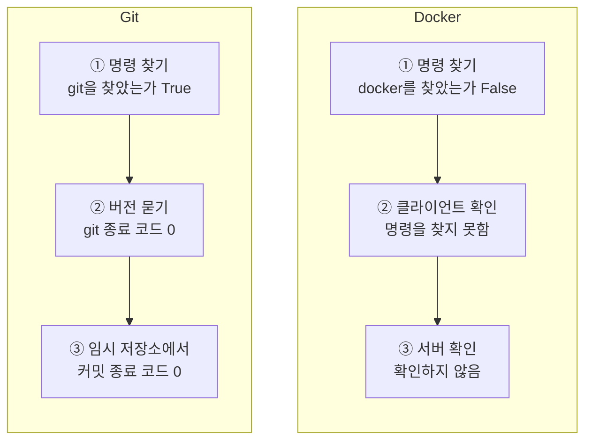
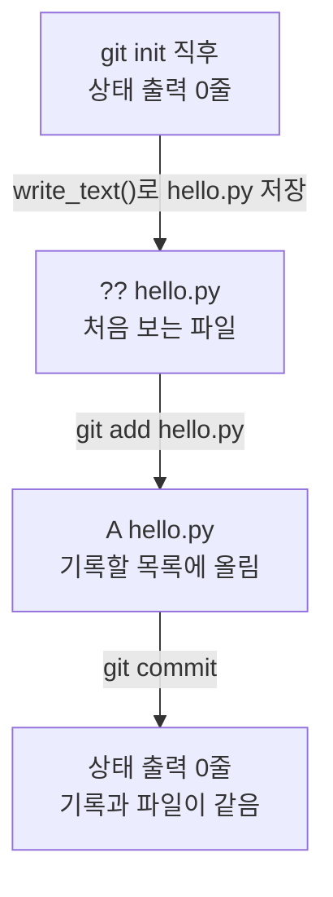
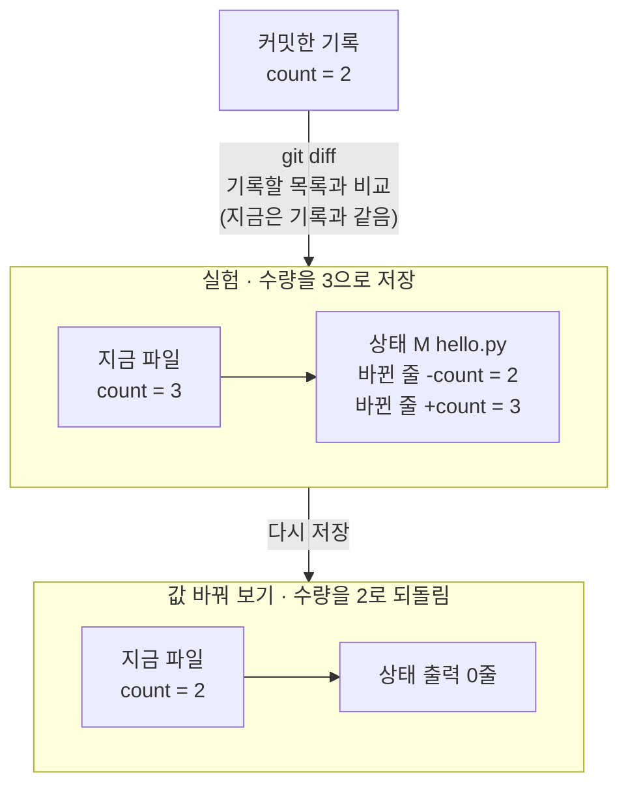
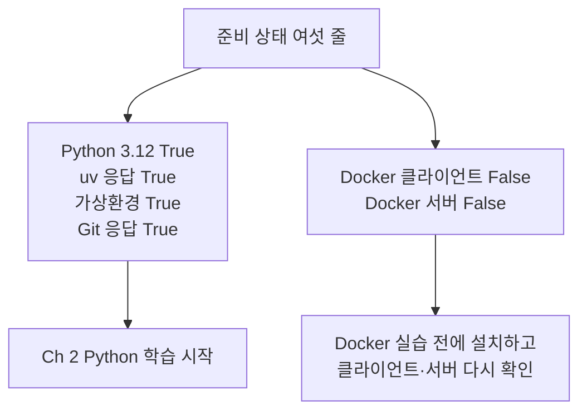

# 05-Git과-Docker-준비

## _src 본문 (HTML 원본)

```html
<!--meta: 강의 1h | 실습 0.5h | 코드 Jupyter Notebook | 새 용어 7 -->
<h2 id="b1"><span class="no">1</span>학습 목표</h2>
<div class="goal"><ul><li>명령을 찾은 것, 버전 질문에 응답한 것, 실제 작업이 된 것을 따로 확인할 수 있습니다.</li><li>임시 저장소에서 <code>git status --short</code>의 표시 <code>??</code>·<code>A</code>·<code>M</code>을 읽고 달라진 것을 말할 수 있습니다.</li><li>Docker 클라이언트와 서버를 나눠 확인하고, 운영체제별 공식 설치 페이지를 찾을 수 있습니다.</li><li>여섯 가지 준비 상태를 보고 Ch 2 전에 보완할 도구를 고를 수 있습니다.</li></ul></div>
<h2 id="b2"><span class="no">2</span>이 내용을 배우는 이유</h2>
<p>4절의 <code>hello.py</code>는 파일 하나였습니다. 앞으로는 여러 파일을 고치고, 고치기 전 모습과 비교할 일이 많아집니다. 이때 파일의 변경을 기록해 두는 도구가 Git입니다.</p>
<p>뒤의 과정에서는 다른 컴퓨터에서도 같은 조건으로 프로그램을 실행해야 합니다. 이때 쓰는 도구가 Docker입니다. 이 절에서는 두 도구를 깊이 쓰지 않고, 쓸 준비가 됐는지를 확인합니다.</p>
<p>2절에서 앱 아이콘이 생겼다고 터미널 명령이 바로 되는 것은 아니라고 했습니다. 명령을 찾았어도 실제 일을 할 준비가 안 됐을 수 있습니다. 그래서 확인을 단계로 나눕니다.</p>
<p><strong>이 절의 질문</strong> — 명령을 찾은 것과 실제로 쓸 준비가 된 것을 어떻게 구분할까요?</p>
<h2 id="b3"><span class="no">3</span>앞에서 배운 내용</h2>
<p>1절에서는 실행 전에 예상을 적고 출력과 비교했습니다. 이 절도 명령을 실행할 때마다 결과를 먼저 예상합니다.</p>
<p>2절의 설치 표에서 Git과 Docker Desktop을 소개했습니다. 새 터미널에서 명령이 응답하는지 보는 방법도 배웠습니다. 노트북은 2절처럼 임시 폴더 <code>workspace</code>에서 연습하고, 마지막에 <code>cleanup()</code>으로 지웁니다.</p>
<p>3절에서는 함수 <code>shutil.which()</code>로 uv를 찾고, <code>subprocess.run()</code>으로 다른 프로그램을 실행했습니다. 종료 코드 <code>returncode</code>가 0이면 오류 없이 끝났다는 것도 봤습니다. 이번에는 같은 방법으로 git과 docker를 실행합니다.</p>
<p>4절에서는 <code>hello.py</code> 네 줄을 저장하고, 수량만 3으로 바꿔 다시 실행했습니다. 이번에는 같은 네 줄을 Git 저장소에 기록합니다. 그다음 같은 수량 변경을 Git이 알아채는지 봅니다. 이 장은 모델을 부르지 않으므로 API 키가 필요 없습니다.</p>
<h2 id="b4"><span class="no">4</span>핵심 개념</h2>
<h3>비유로 시작하기</h3>
<p>리모컨이 손에 있다고 TV가 켜지는 것은 아닙니다. 버튼을 눌러도 전원 플러그가 빠져 있으면 화면은 까만 채로 있습니다. 리모컨이 있는지와 TV가 켜질 수 있는지는 따로 확인해야 합니다.</p>
{{img:05-5-리모컨-플러그|의자에 앉은 사람이 리모컨 버튼을 눌러 TV를 향하지만, TV 화면은 까맣게 꺼져 있고 TV 전원 플러그는 벽의 빈 콘센트 옆 바닥에 빠져 있는 삽화|리모컨이 있어도 플러그가 빠진 TV는 켜지지 않습니다. 명령을 찾은 것과 일을 할 준비가 된 것은 다릅니다.}}
<p><strong>그림 읽기</strong> — 왼쪽 사람이 의자에 앉아 리모컨 버튼을 누르며 오른쪽 TV를 향합니다. TV 화면은 까맣게 꺼져 있습니다. TV 뒤로 내려온 전선의 플러그는 바닥에 빠져 있고, 벽의 콘센트는 비어 있습니다.</p>
<p>리모컨은 우리가 입력하는 <code>docker</code> 명령, 곧 클라이언트에 해당합니다. TV 본체는 요청을 받아 실제 일을 하는 서버입니다. 빠진 플러그는 아직 시작하지 않은 Docker Desktop 앱에 해당합니다.</p>
<p>Git 역시 같은 순서로 확인합니다. 명령을 찾고, 버전 질문에 응답하는지 보고, 작은 실제 작업까지 해 봅니다.</p>
<h3>이 절에서 쓰는 말</h3>
<table><thead><tr><th>용어</th><th>뜻</th><th>이 절에서 보이는 모습</th></tr></thead><tbody>
<tr><td>Git</td><td>파일의 변경을 기록하고 비교하는 프로그램</td><td>명령 <code>git</code>, 응답 <code>git version 2.34.1</code></td></tr>
<tr><td>저장소(repository)</td><td>Git이 변경을 기록하는 폴더</td><td><code>git init</code> 뒤에 생긴 <code>.git</code> 폴더</td></tr>
<tr><td>커밋(commit)</td><td>지금 파일의 모습을 저장소에 한 번 기록하는 일</td><td><code>git commit</code> 종료 코드 <code>0</code></td></tr>
<tr><td>GitHub</td><td>Git 저장소를 인터넷에 올려 함께 쓰는 서비스</td><td>이 절에서는 쓰지 않습니다</td></tr>
<tr><td>Docker</td><td>프로그램과 실행 조건을 묶어 같은 조건으로 실행하게 돕는 도구</td><td>명령 <code>docker</code>, 이 교재 환경에서는 찾지 못함</td></tr>
<tr><td>클라이언트(client)</td><td>사용자의 명령을 받아 서버에 요청하는 쪽</td><td><code>docker --version</code>이 확인하는 쪽</td></tr>
<tr><td>데몬(daemon)</td><td>뒤에서 계속 실행되며 요청을 받아 일을 하는 서버 프로그램</td><td><code>docker version</code>의 Server 정보를 보내는 쪽</td></tr>
</tbody></table>
<h3>확인을 세 단계로 나눕니다</h3>
<p>도구 하나가 준비됐는지는 세 단계로 확인합니다. 첫째, 함수 <code>shutil.which()</code>로 명령의 위치를 찾습니다. 둘째, 찾은 명령에 버전을 물어 종료 코드 0이 나오는지 봅니다. 셋째, 그 도구로 작은 실제 작업을 해 봅니다.</p>
<p>앞 단계를 통과해야 다음 단계를 확인할 수 있습니다. 명령을 찾지 못하면 버전을 물을 수도 없습니다. 이번 노트북에서 Git은 세 단계를 모두 통과했고, Docker는 첫 단계에서 멈췄습니다.</p>
{{mermaid:05-1-준비-단계|Git 칸은 명령 찾기 True, 버전 질문 종료 코드 0, 임시 저장소 커밋 종료 코드 0으로 세 단계를 통과하고, Docker 칸은 명령 찾기 False, 클라이언트 확인 명령을 찾지 못함, 서버 확인하지 않음으로 끝나는 두 칸 흐름도|도구 준비를 세 단계로 나눠 확인한 결과. Git은 세 단계를 통과했고, Docker는 명령 찾기에서 멈췄습니다.}}
<p><strong>도식 읽기</strong> — 왼쪽 칸은 Git, 오른쪽 칸은 Docker이고, 두 칸 모두 위에서 아래로 읽습니다. 노란 상자는 확인을 통과한 결과이고, 빨간 상자는 준비되지 않은 결과입니다. 회색 상자는 앞 단계에서 멈춰 확인하지 않은 단계입니다.</p>
<p>왼쪽 칸의 셋째 상자가 실제 작업입니다. 임시 저장소에서 커밋 종료 코드 0을 얻었습니다. 오른쪽 칸은 docker를 찾았는지가 False여서, 클라이언트 확인도 「명령을 찾지 못함」으로 끝났습니다.</p>
<h3>파일 상태 표시 읽기</h3>
<p>명령 <code>git status --short</code>는 저장소에서 달라진 파일을 한 줄에 하나씩 보여 줍니다. 줄 앞의 짧은 표시가 파일의 상태입니다. 달라진 파일이 없으면 아무것도 출력하지 않습니다.</p>
<table><thead><tr><th>표시</th><th>뜻</th><th>노트북에서 나온 때</th></tr></thead><tbody>
<tr><td><code>??</code></td><td>Git이 처음 보는 파일(untracked)</td><td><code>hello.py</code>를 저장한 직후</td></tr>
<tr><td><code>A</code></td><td>기록할 목록에 새로 올린 파일(added)</td><td><code>git add hello.py</code> 뒤</td></tr>
<tr><td><code>M</code></td><td>기록한 뒤 내용이 바뀐 파일(modified)</td><td>수량을 3으로 바꿔 저장한 뒤</td></tr>
<tr><td>출력 없음</td><td>표시할 파일이 없음</td><td><code>git init</code> 직후, 커밋 뒤, 수량을 2로 되돌린 뒤</td></tr>
</tbody></table>
<p>공식 문서에 따르면 표시는 두 글자 자리입니다. 앞 글자는 기록할 목록의 상태이고, 뒤 글자는 폴더에 있는 파일의 상태입니다. 그래서 표시 <code>A</code> 뒤에는 빈칸이 둘 있습니다. 표시 <code>M</code> 앞 빈칸 하나는 노트북이 <code>strip()</code>으로 떼어 냈고, 기기 셸에서 따로 확인했습니다. 이 절에서는 글자 하나만 읽어도 충분합니다.</p>
<h3>클라이언트와 서버로 나뉘는 Docker</h3>
<p>Docker 도구는 두 부분으로 일합니다. 우리가 입력하는 <code>docker</code> 명령은 클라이언트입니다. 요청을 받아 실제 일을 하는 쪽은 서버입니다. 뒤에서 계속 실행되는 프로그램이라 데몬이라고도 부릅니다.</p>
<p>명령 <code>docker --version</code>은 클라이언트만 확인합니다. 공식 문서에 따르면 명령 <code>docker version</code>은 Client 구역과 Server 구역을 함께 보여 줍니다. 서버 구역의 정보는 서버가 실행 중이어야 받을 수 있습니다.</p>
<p>이 교재 환경에는 docker 명령이 없어서, 클라이언트와 서버에게 묻는 명령을 실행하지 못했습니다. 두 명령이 Docker 설치 컴퓨터에서 내는 출력은 이번에 실행하지 않았습니다. 그래서 출력 모양을 교재에 싣지 않았습니다.</p>
<h2 id="b5"><span class="no">5</span>실행 예제</h2>
<p>노트북은 세 부분으로 되어 있습니다. 명령 찾기와 버전 확인, 임시 Git 저장소 실습, Docker 확인과 준비 상태 모으기입니다. 준비 셀을 뺀 코드 셀은 13개이고, 모두 1분 안에 끝납니다.</p>
<h3>명령 찾기와 버전 확인</h3>
<p>명령 찾기 셀은 git, uv, docker의 위치를 찾고, 찾았는지만 True나 False로 출력합니다. 위치는 사람마다 달라서 출력하지 않습니다. 명령 git을 찾지 못하면 검사 줄 <code>assert</code>에서 멈춥니다. 이 절의 저장소 실습에 Git이 꼭 필요하기 때문입니다.</p>
<p>이 교재 환경에서는 git과 uv가 True, docker가 False였습니다. 이어서 git과 uv에 버전을 물었고, 두 종료 코드 모두 0이었습니다. 응답 글은 <code>git version 2.34.1</code>이었습니다. 내 컴퓨터에서는 번호가 달라도 괜찮습니다.</p>
<h3>임시 저장소에서 기록하기</h3>
<p>저장소 실습은 네 번의 작업으로 이어집니다. 작업마다 같은 상태 명령 <code>git status --short</code>를 다시 실행해 표시를 비교합니다. 인자 <code>cwd=workspace</code>는 git을 임시 폴더에서 실행하게 합니다.</p>
<table><thead><tr><th>순서</th><th>한 일</th><th>명령</th><th>상태 출력</th></tr></thead><tbody>
<tr><td>1</td><td>폴더를 저장소로 만듭니다</td><td><code>git init</code></td><td>0줄</td></tr>
<tr><td>2</td><td>4절의 <code>hello.py</code> 네 줄을 저장합니다</td><td><code>write_text()</code></td><td><code>?? hello.py</code></td></tr>
<tr><td>3</td><td>기록할 목록에 올립니다</td><td><code>git add hello.py</code></td><td><code>A  hello.py</code></td></tr>
<tr><td>4</td><td>기록을 만듭니다</td><td><code>git commit</code></td><td>0줄</td></tr>
</tbody></table>
{{mermaid:05-2-상태-변화|git init 직후 상태 출력 0줄에서 write_text()로 hello.py를 저장하면 ?? hello.py, git add hello.py 뒤 A hello.py, git commit 뒤 다시 상태 출력 0줄이 되는 흐름도|같은 hello.py의 상태 표시 변화. 저장하면 ??, 목록에 올리면 A, 커밋하면 0줄입니다.}}
<p><strong>도식 읽기</strong> — 위에서 아래로 읽습니다. 노란 상자는 그때의 상태 출력이고, 화살표 라벨은 그 사이에 실행한 명령입니다. 같은 <code>hello.py</code>의 표시가 저장 뒤 <code>??</code>, 목록에 올린 뒤 <code>A</code>로 바뀝니다. 커밋 뒤에는 다시 0줄입니다.</p>
<p>커밋 명령에는 옵션 <code>-c</code>로 이름 <code>user.name=Ch1 Student</code>와 전자우편 <code>user.email=student@example.com</code>을 넣었습니다. 커밋할 때 Git은 만든 사람을 함께 적기 때문입니다. 옵션 <code>-c</code>는 그 명령 한 번에만 쓰이므로 내 컴퓨터의 설정은 바뀌지 않습니다.</p>
<p>기록마다 붙는 번호(커밋 해시)와 날짜는 실행할 때마다 달라서 노트북에 출력하지 않았습니다.</p>
<h3>Docker 확인과 준비 상태</h3>
<p>Docker 확인은 여러 줄 <code>if/else</code>로 두 경우를 나눕니다. 클라이언트 셀은 명령을 찾지 못하면 「명령을 찾지 못함」만 출력하고, 찾았다면 버전을 묻습니다. 서버 셀은 클라이언트가 준비됐을 때만 <code>docker version</code>으로 서버 버전을 묻습니다.</p>
<p>이 교재 환경에서는 클라이언트 셀의 <code>if</code> 아래 줄과 서버 셀의 <code>else</code> 아래 줄만 실행되었습니다. 버전을 묻는 줄은 두 셀 모두 이번에 실행하지 않았습니다. 마지막 셀은 3절의 Python 확인과 함께 여섯 가지 준비 상태를 출력합니다.</p>
{{notebook:05-Git과-Docker-준비}}
<p class="look"><b>확인할 점</b> — 상태 출력이 <code>?? hello.py</code>, <code>A  hello.py</code>, 0줄 순서로 바뀌는지 봅니다. 커밋 종료 코드가 <code>0</code>인지도 봅니다. Docker 두 셀이 <code>False</code>여도 노트북이 끝까지 실행되는지 확인합니다.</p>
<h2 id="b6"><span class="no">6</span>실험 결과 해석</h2>
<p>실험에서는 커밋한 뒤 <code>hello.py</code>의 수량만 2에서 3으로 바꿨습니다. 상태 출력은 <code>M hello.py</code>였습니다. 기록할 목록과 파일을 비교하는 <code>git diff</code>에서는 <code>-count = 2</code>와 <code>+count = 3</code> 두 줄이 골라졌습니다. 커밋한 뒤 <code>git add</code>를 하지 않아 목록은 기록과 같았습니다. 네 줄 중 바꾼 한 줄만 나온 것입니다.</p>
<p>값 바꿔 보기에서는 수량을 다시 2로 저장했습니다. 파일을 한 번 더 저장했지만 상태 출력은 0줄이었습니다. 이번 실행에서 Git은 저장했는지가 아니라, 내용이 기록과 같은지로 판단했습니다.</p>
{{mermaid:05-3-기록-비교|커밋한 기록 count = 2와 비교해, 수량을 3으로 저장한 파일은 상태 M hello.py와 바뀐 줄 -count = 2, +count = 3이 나오고, 수량을 2로 되돌린 파일은 상태 출력 0줄이 되는 비교 그림|기록과 지금 파일의 비교. 수량이 기록과 다를 때만 M 표시와 바뀐 줄이 나왔습니다.}}
<p><strong>도식 읽기</strong> — 위에서 아래로 읽습니다. 맨 위 초록 상자는 커밋한 기록이고, 두 칸 안의 초록 상자는 그때 저장한 파일입니다. 노란 상자는 기록과 파일을 비교한 결과입니다.</p>
<p>가운데 칸은 파일이 기록과 달라 <code>M</code> 표시와 바뀐 줄 두 개가 나왔습니다. 아래 칸은 파일이 기록과 같아져 상태 출력이 0줄입니다. 두 칸 사이에서 바꾼 것은 수량 값 하나뿐입니다. 1절과 4절에서 값 하나만 바꿔 결과를 비교한 방법과 같습니다.</p>
<h3>여섯 가지 준비 상태 읽기</h3>
<p>마지막 셀은 여섯 가지 준비 상태를 모았습니다. 이 교재 환경에서는 Python 3.12, uv 응답, 가상환경, Git 응답이 <code>True</code>였습니다. Docker 클라이언트와 Docker 서버는 <code>False</code>였습니다.</p>
{{mermaid:05-4-여섯-항목|준비 상태 여섯 줄 중 Python 3.12, uv 응답, 가상환경, Git 응답 True는 Ch 2 Python 학습 시작으로, Docker 클라이언트 False와 Docker 서버 False는 Docker 실습 전 설치와 다시 확인으로 이어지는 흐름도|여섯 가지 준비 상태와 다음 행동. 위 네 줄이 True이면 Ch 2를 시작하고, Docker 두 줄은 따로 보완합니다.}}
<p><strong>도식 읽기</strong> — 위에서 아래로 읽습니다. 왼쪽 노란 상자는 준비된 네 가지이고, 오른쪽 빨간 상자는 준비되지 않은 두 가지입니다. 맨 위 파란 상자는 마지막 셀이 출력한 여섯 줄이고, 맨 아래 파란 상자는 각 결과 뒤에 할 행동입니다.</p>
<table><thead><tr><th>항목</th><th>확인하는 질문</th><th>False일 때 할 일</th></tr></thead><tbody>
<tr><td>Python 3.12</td><td>커널이 Python 3.12인가?</td><td>3절 순서로 커널을 다시 고릅니다</td></tr>
<tr><td>uv 응답</td><td>uv가 버전 질문에 응답하는가?</td><td>2절 설치 안내를 따르고 새 터미널을 엽니다</td></tr>
<tr><td>가상환경</td><td>커널이 가상환경 안에서 실행 중인가?</td><td>3절처럼 커널에서 실습 폴더의 <code>.venv</code>를 고릅니다</td></tr>
<tr><td>Git 응답</td><td>git이 버전 질문에 응답하는가?</td><td>2절 설치 표의 Git 설치 페이지를 봅니다</td></tr>
<tr><td>Docker 클라이언트</td><td>docker 명령을 찾고, 버전 질문에 응답하는가?</td><td>운영체제별 Docker Desktop 설치 페이지를 봅니다</td></tr>
<tr><td>Docker 서버</td><td>서버가 버전 질문에 응답하는가?</td><td>Docker Desktop 앱을 시작하고 다시 확인합니다</td></tr>
</tbody></table>
<p>한 줄이 <code>True</code>라고 다른 줄의 준비를 대신하지 않습니다. 위 네 줄이 모두 <code>True</code>이면 Ch 2의 Python 학습을 시작할 수 있습니다. Docker 두 줄만 <code>False</code>라면 Ch 2는 진행하고, Docker를 쓰는 뒤쪽 실습 전에 보완합니다.</p>
<p>이 결과는 도구 준비 상태일 뿐, 실력 점수가 아닙니다. GitHub 로그인, 인터넷 연결, Docker 이미지 내려받기와 컨테이너 실행은 이번에 실행하지 않았습니다.</p>
<h3>운영체제별 Docker Desktop 설치 조건</h3>
<p>운영체제별 Docker Desktop 설치 조건은 제품이 바뀌면 달라질 수 있습니다. 설치 전에 참고 자료의 운영체제별 공식 페이지를 엽니다. 2026-09-16에 확인한 주요 조건은 아래 표와 같습니다.</p>
<table><thead><tr><th>운영체제</th><th>공식 페이지에서 확인할 것</th></tr></thead><tbody>
<tr><td>Windows</td><td>WSL 2 버전, 하드웨어 가상화 켜기, 지원하는 Windows 10·11 빌드, 메모리 8GB 이상</td></tr>
<tr><td>macOS</td><td>칩에 맞는 설치 파일(Apple silicon 또는 Intel), 지원하는 macOS 버전(현재와 이전 두 버전), 메모리 4GB 이상</td></tr>
<tr><td>Linux</td><td>KVM 가상화, QEMU 5.2 이상, systemd, 지원 배포판과 데스크톱 환경, 메모리 4GB 이상</td></tr>
</tbody></table>
<p>회사나 학교 컴퓨터는 설치 권한이나 가상화 설정이 관리 정책으로 막혀 있을 수 있습니다. 공식 페이지는 큰 조직의 상업적 사용에 유료 구독이 필요하다고 안내합니다. 이 교재는 조직별 사용 조건을 판정하지 않으므로, 설치 전에 자기 환경의 규칙을 확인합니다.</p>
<h3>A/B 트랙 자가진단</h3>
<p>아래 여섯 과제는 Ch 2를 시작할 학습 경로를 고르는 비공식 자가진단입니다. 도구 준비 상태와는 따로 봅니다. 답을 보지 않고 해 본 뒤, 어떻게 답했는지 한두 문장으로 적습니다.</p>
<ol>
<li>코드 <code>price = 3000</code>, <code>count = 2</code>, <code>total = price * count</code>를 읽고 출력할 합계를 예상합니다.</li>
<li>값 <code>count</code>만 4로 바꾸면 어느 값이 달라지는지 말하고, 결과를 확인합니다.</li>
<li>명령 <code>uv run python hello.py</code>가 파일 <code>hello.py</code>를 어느 폴더에서 찾는지 설명합니다.</li>
<li>디버거가 3번 줄 앞에서 멈췄을 때 <code>total</code>이 아직 없는 이유를 설명합니다.</li>
<li>전에 직접 만든 함수가 있다면 입력과 반환값을 예로 설명합니다. 없다면 「아직 경험 없음」이라고 적습니다.</li>
<li>전에 예외 처리나 자동 테스트를 작성한 적이 있다면 한 사례를 설명합니다. 없다면 「아직 경험 없음」이라고 적습니다.</li>
</ol>
<p><strong>B 트랙 권장</strong> — 1~4번을 혼자 해내고, 5~6번에서 실제로 만든 경험을 구체적으로 설명할 수 있는 경우입니다. 이때는 Ch 2의 확장 과제를 함께 합니다.</p>
<p><strong>A 트랙 권장</strong> — B 트랙 조건을 하나라도 채우지 못한 경우입니다. 기초 경로에서 Ch 2의 변수, 조건문, 함수를 차례로 배웁니다. 1~4번은 했지만 5~6번 경험이 없다면, A 트랙에서 익힌 뒤 확장 과제를 골라도 됩니다.</p>
<p>이 기준은 교육기관의 공식 배치 기준이 아니라, 이 절이 제안하는 학습 안내입니다. 첫 주 실습 뒤 맞지 않으면 트랙을 다시 고를 수 있습니다. 공식 배치 기준은 첫 주에 강사가 안내합니다.<!-- [[미정: Ch 1 A/B 트랙 공식 배치 기준]] 확정되면 이 문장을 바꿉니다 --></p>
<details><summary>자가진단 답안과 판단 근거</summary>
<p>1번의 합계는 6000이고, 출력은 <code>총액: 6000원</code>입니다. 2번에서 <code>count = 4</code>로 바꾸면 단가는 그대로이고 합계는 12000이 됩니다. 3번은 터미널의 현재 작업 폴더에서 찾습니다. 2절과 4절에서 본 내용입니다.</p>
<p>4번은 멈춘 줄을 아직 실행하지 않았기 때문입니다. 한 줄 실행 명령 <code>n</code> 뒤에야 <code>total</code>이 생깁니다. 5~6번은 정답이 없습니다. 경험이 없다는 답도 그대로 적으면 되고, 실패로 보지 않습니다.</p>
</details>
<h2 id="b7"><span class="no">7</span>주의할 점과 실무 메모</h2>
<ul><li>실제 프로젝트 폴더에서 <code>git init</code>을 시험하지 않습니다. 노트북처럼 임시 폴더에서 연습합니다.</li>
<li>내 컴퓨터의 Git과 인터넷 서비스 GitHub는 다릅니다. 명령 <code>git init</code>과 <code>git commit</code>은 내 컴퓨터에만 기록하고, GitHub로 보내지 않습니다.</li>
<li>폴더 <code>.git</code>은 직접 고치거나 지우지 않습니다. 저장소의 기록이 이 폴더 안에 들어 있습니다.</li>
<li>이름 설정이 없는 컴퓨터에서 <code>-c</code> 없이 커밋하면 실패할 수 있습니다. 교재 환경의 기기 셸에서는 종료 코드 128과 <code>Author identity unknown</code>이 나왔습니다. 이 장면은 노트북에 넣지 않았고, 이름을 저장소에 적는 방법은 Ch 3에서 배웁니다.</li>
<li>명령 <code>docker --version</code>이 응답해도 서버가 준비됐다고 보지 않습니다. 서버 확인은 따로 합니다.</li>
<li>명령 <code>git diff</code>는 기록할 목록과 지금 파일을 비교합니다. <code>git add</code> 뒤에는 목록이 파일과 같아져 0줄이 나옵니다. 이 장면은 교재 환경의 기기 셸에서 확인했고, 노트북에는 넣지 않았습니다.</li>
<li>설치 조건은 설치 직전에 공식 페이지에서 다시 봅니다. 교재 표는 2026-09-16에 확인한 내용입니다.</li></ul>
<h2 id="b8"><span class="no">8</span>정리와 다음 절</h2>
<ul><li>명령 찾기, 버전 응답, 실제 작업은 따로 확인합니다. 이 교재 환경에서 Git은 세 단계를 모두 통과했습니다.</li><li>상태 표시 <code>??</code>는 처음 보는 파일, <code>A</code>는 기록할 목록에 올린 파일, <code>M</code>은 기록 뒤 바뀐 파일입니다. 내용이 기록과 같으면 0줄입니다.</li><li>Docker 확인은 클라이언트와 서버를 따로 합니다. 이 교재 환경에서는 명령을 찾지 못해 두 항목 모두 <code>False</code>였습니다.</li></ul>
<p><strong>다음 학습과 이어지는 지점</strong> — 6절 실습에서는 1~5절에서 배운 확인을 한 점검표로 모아 새 연습 폴더를 점검합니다. 이번 절의 <code>git status --short</code>와 docker 찾기가 점검표의 두 칸이 됩니다. 커밋은 Ch 3에서, 이미지와 컨테이너는 Docker를 다루는 뒤쪽 챕터에서 다시 다룹니다.</p>
<h2 id="b9"><span class="no">9</span>복습 문제</h2><details class="quiz"><summary>문제와 해설</summary>
<p class="quiz-q">1. 명령 <code>git init</code>을 실행하면 파일이 GitHub에 올라가나요? · 기초</p><p class="quiz-a"><b>해설</b> — 아닙니다. 폴더를 내 컴퓨터의 Git 저장소로 만들 뿐입니다. 노트북에서도 <code>.git</code> 폴더가 생겼을 뿐, 인터넷으로 보낸 것은 없습니다.</p>
<p class="quiz-q">2. 새로 저장한 파일 앞에 <code>??</code>가 붙었습니다. 무슨 뜻인가요? · 적용</p><p class="quiz-a"><b>해설</b> — 처음 보는 파일이라는 뜻입니다. 파일을 발견했지만 아직 기록할 목록에 올리지 않았습니다. 노트북에서는 <code>git add</code> 뒤에 <code>A</code>로 바뀌었습니다.</p>
<p class="quiz-q">3. 커밋한 뒤 파일을 다시 저장했는데 상태 출력이 0줄입니다. 이유는 무엇인가요? · 적용</p><p class="quiz-a"><b>해설</b> — 저장한 내용이 기록과 같기 때문입니다. 노트북에서 수량을 3으로 바꿨을 때는 <code>M hello.py</code>였고, 다시 2로 되돌리자 0줄이었습니다.</p>
<p class="quiz-q">4. 명령 <code>docker --version</code>은 응답하는데 <code>docker version</code>에 서버 정보가 없습니다. 무엇을 하나요? · 적용</p><p class="quiz-a"><b>해설</b> — 클라이언트는 준비됐지만 서버에게서 응답을 받지 못한 상태입니다. Docker Desktop 앱을 시작한 뒤 서버 확인을 다시 합니다.</p>
<p class="quiz-q">5. 이번 노트북 결과만으로 Docker 서버가 응답할 때의 출력 모양을 설명할 수 있나요? · 분석</p><p class="quiz-a"><b>해설</b> — 설명할 수 없습니다. 이 교재 환경에서는 docker 명령을 찾지 못해, 서버에게 묻는 줄을 실행하지 않았습니다. 확인한 것은 명령을 찾지 못했을 때 노트북이 <code>False</code>를 표시하고 끝까지 실행된다는 점까지입니다.</p>
</details>
<h2 id="b10"><span class="no">10</span>참고 자료</h2>
<ul><li><a href="https://git-scm.com/book/en/v2/Getting-Started-Installing-Git">Git 설치</a> · <a href="https://git-scm.com/docs/git-status">git-status 짧은 형식</a>(문서 표시 2.53.0) · <a href="https://git-scm.com/docs/git">git -c 옵션</a> · 확인 2026-09-16</li><li><a href="https://docs.docker.com/reference/cli/docker/version/">docker version</a> · 확인 2026-09-16 · Client·Server 구역과 서버 버전 형식</li><li><a href="https://docs.docker.com/desktop/setup/install/windows-install/">Docker Desktop Windows 설치</a> · <a href="https://docs.docker.com/desktop/setup/install/mac-install/">Mac 설치</a> · <a href="https://docs.docker.com/desktop/setup/install/linux/">Linux 설치</a> · 확인 2026-09-16</li><li><a href="https://docs.python.org/3.12/library/shutil.html#shutil.which">Python 3.12 shutil.which</a> · <a href="https://docs.python.org/3.12/library/subprocess.html">subprocess</a> · 확인 2026-09-16 · 예제는 교재에서 작성</li></ul>
```

## 노트북 셀 (순서대로)

### [0] markdown {'html': 'skip'}

# Git과 Docker 준비

**이 노트북에서 할 일**

1. 명령 git·uv·docker를 찾고, 찾은 명령이 버전 질문에 응답하는지 확인합니다.
2. 임시 폴더를 Git 저장소로 만들고, 4절의 `hello.py`를 저장·기록·수정하며 상태 출력이 바뀌는 것을 봅니다.
3. Docker의 클라이언트와 서버를 따로 확인하고, 여섯 가지 준비 상태를 한곳에 모읍니다.

**준비물** — API 키 불필요. 데이터 파일도 없습니다. 노트북이 임시 폴더에 저장소를 직접 만듭니다.
모델 호출은 0번이고 비용은 들지 않습니다. 실행 시간은 1분 이내입니다.

2절에서 설치한 Git이 필요합니다. 노트북은 Docker가 없어도 끝까지 실행되고, 없다는 결과를 그대로 보여 줍니다.
커널은 3절에서 준비한 실습 폴더의 `.venv`를 고릅니다.

### [1] markdown {'html': 'skip'}

## 오늘 볼 그림


왼쪽 칸은 Git, 오른쪽 칸은 Docker이고, 두 칸 모두 위에서 아래로 읽습니다.
노란 상자는 확인을 통과한 결과이고, 빨간 상자는 준비되지 않은 결과입니다. 회색 상자는 확인하지 않은 단계입니다.
앞 단계를 통과해야 다음 단계를 확인합니다. 이 교재 환경에서는 Git이 세 단계를 모두 통과했고, Docker는 첫 단계에서 멈췄습니다.

### [2] markdown {}

## 1. 준비

이 절도 설치할 패키지가 없습니다. 3절과 4절에서 쓴 기본 기능 여섯 가지를 다시 불러옵니다.
모듈 `shutil`은 명령의 위치를 찾고, 모듈 `subprocess`는 노트북 안에서 다른 프로그램을 실행합니다.
모듈 `platform`과 `sys`는 실행 중인 Python의 정보를, 모듈 `tempfile`과 경로 기능 `Path`는 임시 폴더와 경로를 다룹니다.

### [3] code {'execution': {'iopub.execute_input': '2026-09-16T03:21:21.202200Z', 'iopub.status.busy': '2026-09-16T03:21:21.201812Z', 'iopub.status.idle': '2026-09-16T03:21:21.208447Z', 'shell.execute_reply': '2026-09-16T03:21:21.207309Z'}, 'lesson_role': 'setup', 'upgrade_allow': ['stdlib-import']}

```python
# 이 절에서 쓰는 Python 기본 기능을 불러옵니다
import platform
import shutil
import subprocess
import sys
import tempfile
from pathlib import Path

print("불러오기 완료")
```

출력:
```
불러오기 완료

```

### [4] markdown {}

**결과 읽기** — `불러오기 완료`가 보이면 다음 셀로 넘어갑니다.

### [5] markdown {}

## 2. 명령 찾기

3절에서 함수 `shutil.which()`로 uv 명령의 위치를 찾았습니다. 찾지 못하면 값이 없다는 뜻의 `None`을 반환합니다.
이번에는 같은 방법으로 명령 세 개 git, uv, docker를 찾습니다.

실행 전에 예상합니다. 2절에서 설치한 git과 uv는 찾을 것입니다. 명령 docker는 컴퓨터마다 다릅니다.
명령 git은 이 노트북의 뒤쪽 셀에 꼭 필요해서, 찾지 못하면 검사 줄 `assert`에서 멈춥니다.

### [6] code {'execution': {'iopub.execute_input': '2026-09-16T03:21:21.210254Z', 'iopub.status.busy': '2026-09-16T03:21:21.210093Z', 'iopub.status.idle': '2026-09-16T03:21:21.214594Z', 'shell.execute_reply': '2026-09-16T03:21:21.213547Z'}, 'upgrade_allow': ['stdlib-import']}

```python
# 명령 git, uv, docker가 어디 있는지 찾습니다
git_path = shutil.which("git")
uv_path = shutil.which("uv")
docker_path = shutil.which("docker")
# 위치는 사람마다 달라서 찾았는지만 출력합니다
print("git을 찾았는가:", git_path is not None)
print("uv를 찾았는가:", uv_path is not None)
print("docker를 찾았는가:", docker_path is not None)
# git을 찾지 못했다면 여기서 멈추고, 2절의 설치 표를 다시 봅니다
assert git_path is not None
```

출력:
```
git을 찾았는가: True
uv를 찾았는가: True
docker를 찾았는가: False

```

### [7] markdown {}

**결과 읽기** — git과 uv는 `True`, docker는 `False`입니다. 검사 줄에서 멈추지 않았습니다.
이 교재 환경에는 Docker가 설치되어 있지 않습니다. 셋째 줄은 Docker를 설치한 컴퓨터에서 `True`로 나올 것입니다.

위치를 찾은 것은 첫 단계일 뿐입니다. 다음 셀에서 찾은 명령이 실제로 응답하는지 봅니다.

### [8] markdown {}

## 3. 버전을 물어 응답 확인하기

2절에서 새 터미널에 `uv --version`을 입력해 설치를 확인했습니다. 노트북에서도 같은 질문을 git과 uv에게 합니다.
3절처럼 함수 `subprocess.run()`에 명령 목록을 넣고, 종료 코드 `returncode`를 읽습니다. 종료 코드 0은 오류 없이 끝났다는 뜻입니다.

메서드 `strip()`은 4절에서 봤듯이 출력 끝의 줄바꿈을 떼어 냅니다.

### [9] code {'execution': {'iopub.execute_input': '2026-09-16T03:21:21.216207Z', 'iopub.status.busy': '2026-09-16T03:21:21.216067Z', 'iopub.status.idle': '2026-09-16T03:21:21.232484Z', 'shell.execute_reply': '2026-09-16T03:21:21.231672Z'}, 'upgrade_allow': ['stdlib-import']}

```python
# git과 uv에게 버전을 물어 실제로 응답하는지 확인합니다
git_version_command = [git_path, "--version"]
git_version_run = subprocess.run(git_version_command, capture_output=True, text=True)
uv_version_command = [uv_path, "--version"]
uv_version_run = subprocess.run(uv_version_command, capture_output=True, text=True)
# 종료 코드가 0이면 응답한 것으로 봅니다
git_ready = git_version_run.returncode == 0
uv_ready = uv_version_run.returncode == 0
print("git 종료 코드:", git_version_run.returncode)
print("git 응답:", git_version_run.stdout.strip())
print("uv 종료 코드:", uv_version_run.returncode)
```

출력:
```
git 종료 코드: 0
git 응답: git version 2.34.1
uv 종료 코드: 0

```

### [10] markdown {}

**결과 읽기** — git 종료 코드는 `0`이고, 응답은 `git version 2.34.1`입니다. uv 종료 코드도 `0`입니다.
버전 번호는 이 교재 환경의 값입니다. 내 컴퓨터에서는 다른 번호가 나와도 괜찮습니다.

명령 위치를 찾았고, 버전 질문에도 응답했습니다. 이제 Git으로 실제 작업을 해 봅니다.

### [11] markdown {}

## 4. 임시 폴더를 Git 저장소로 만들기

저장소(repository)는 Git이 파일의 변경을 기록하는 폴더입니다. 명령 `git init`은 지금 폴더를 저장소로 만듭니다.
실제 프로젝트를 건드리지 않도록 2절처럼 임시 폴더 `workspace`에서 연습합니다.

인자 `cwd`는 명령을 실행할 폴더입니다. 노트북 폴더가 아니라 `workspace`에서 git을 실행하게 합니다.
명령 `git status --short`는 저장소에서 달라진 파일을 한 줄에 하나씩 짧게 보여 줍니다.
실행 전에 예상합니다. 아직 파일이 없으므로 상태 출력은 0줄일 것입니다.

### [12] code {'execution': {'iopub.execute_input': '2026-09-16T03:21:21.233741Z', 'iopub.status.busy': '2026-09-16T03:21:21.233613Z', 'iopub.status.idle': '2026-09-16T03:21:21.244284Z', 'shell.execute_reply': '2026-09-16T03:21:21.243620Z'}, 'upgrade_allow': ['stdlib-import']}

```python
# 연습용 임시 폴더를 만들고, 그 폴더에서 git init을 실행합니다
temporary_folder = tempfile.TemporaryDirectory()
workspace = Path(temporary_folder.name)
init_command = [git_path, "init"]
init_run = subprocess.run(init_command, cwd=workspace, capture_output=True, text=True)
# git init은 폴더 안에 기록용 폴더 .git을 만듭니다
git_folder = workspace / ".git"
print("git init 종료 코드:", init_run.returncode)
print(".git 폴더가 있는가:", git_folder.is_dir())
# 같은 폴더에서 짧은 상태를 보고, 출력이 몇 줄인지 셉니다
status_command = [git_path, "status", "--short"]
empty_status = subprocess.run(status_command, cwd=workspace, capture_output=True, text=True)
empty_lines = empty_status.stdout.splitlines()
print("상태 출력 줄 수:", len(empty_lines))
```

출력:
```
git init 종료 코드: 0
.git 폴더가 있는가: True
상태 출력 줄 수: 0

```

### [13] markdown {}

**결과 읽기** — git init 종료 코드는 `0`이고, `.git` 폴더가 있는지는 `True`입니다.
상태 출력 줄 수는 `0`입니다. 저장소는 생겼지만 아직 달라진 파일이 없습니다.

폴더 `.git`은 이름이 점으로 시작해서 파일 목록에서 숨겨질 수 있습니다. 이 폴더는 직접 고치지 않습니다.

### [14] markdown {}

## 5. hello.py를 저장하고 상태 보기

4절의 `hello.py`와 같은 네 줄을 저장소 폴더에 저장합니다. 4절처럼 큰따옴표 세 개로 여러 줄 글을 적습니다.
실행 전에 예상합니다. 새 파일이 생겼으므로 상태 출력에 `hello.py`가 나올 것입니다.

### [15] code {'execution': {'iopub.execute_input': '2026-09-16T03:21:21.245543Z', 'iopub.status.busy': '2026-09-16T03:21:21.245434Z', 'iopub.status.idle': '2026-09-16T03:21:21.250352Z', 'shell.execute_reply': '2026-09-16T03:21:21.249890Z'}, 'upgrade_allow': ['stdlib-import']}

```python
# 4절의 hello.py와 같은 네 줄을 저장소 폴더에 저장합니다
hello_source = """price = 3000
count = 2
total = price * count
print(f"총액: {total}원")
"""
hello_file = workspace / "hello.py"
hello_file.write_text(hello_source, encoding="utf-8")
# 앞 셀과 같은 상태 명령을 다시 실행합니다
new_status = subprocess.run(status_command, cwd=workspace, capture_output=True, text=True)
print("상태 출력:", new_status.stdout.strip())
```

출력:
```
상태 출력: ?? hello.py

```

### [16] markdown {}

**결과 읽기** — 상태 출력은 `?? hello.py`입니다. 예상대로 파일 이름이 나왔습니다.
물음표 두 개 `??`는 Git이 처음 보는 파일이라는 표시입니다. 파일을 발견했지만 아직 기록 대상은 아닙니다.

### [17] markdown {}

## 6. 기록할 파일로 올리기

명령 `git add 파일이름`은 그 파일을 다음 기록에 넣을 목록에 올립니다. 아직 기록을 만든 것은 아닙니다.
3절처럼 인자 `check=True`를 넣어, 명령이 실패하면 셀도 멈추게 합니다.
실행 전에 예상합니다. 상태 출력 앞의 표시가 `??`에서 다른 글자로 바뀔 것입니다.

### [18] code {'execution': {'iopub.execute_input': '2026-09-16T03:21:21.251389Z', 'iopub.status.busy': '2026-09-16T03:21:21.251303Z', 'iopub.status.idle': '2026-09-16T03:21:21.256675Z', 'shell.execute_reply': '2026-09-16T03:21:21.256237Z'}, 'upgrade_allow': ['stdlib-import']}

```python
# git add로 hello.py를 다음 기록에 넣을 목록에 올립니다
add_command = [git_path, "add", "hello.py"]
subprocess.run(add_command, cwd=workspace, check=True)
# 목록에 올린 뒤의 상태를 봅니다
added_status = subprocess.run(status_command, cwd=workspace, capture_output=True, text=True)
print("상태 출력:", added_status.stdout.strip())
```

출력:
```
상태 출력: A  hello.py

```

### [19] markdown {}

**결과 읽기** — 상태 출력은 `A  hello.py`입니다. 글자 `A`는 기록할 목록에 새로 올린(added) 파일이라는 표시입니다.
같은 파일인데 표시가 `??`에서 `A`로 바뀌었습니다. 이제 이 파일은 기록할 준비를 마쳤습니다.

### [20] markdown {}

## 7. 기록 만들기

커밋(commit)은 지금 파일의 모습을 저장소에 한 번 기록하는 일입니다. 명령은 `git commit -m "메시지"`입니다.
커밋할 때 Git은 만든 사람의 이름과 전자우편을 함께 적습니다. 이 설정이 없으면 컴퓨터에 따라 커밋이 실패합니다.

그래서 옵션 `-c`로 이번 명령에만 쓸 이름과 전자우편을 넣습니다. 내 컴퓨터의 Git 설정은 바뀌지 않습니다.
옵션 `--quiet`는 안내 메시지를 줄입니다. 실행 전에 예상합니다. 기록한 뒤에는 달라진 파일이 없으니 상태 출력이 0줄일 것입니다.

### [21] code {'execution': {'iopub.execute_input': '2026-09-16T03:21:21.257729Z', 'iopub.status.busy': '2026-09-16T03:21:21.257644Z', 'iopub.status.idle': '2026-09-16T03:21:21.265014Z', 'shell.execute_reply': '2026-09-16T03:21:21.264569Z'}, 'upgrade_allow': ['stdlib-import']}

```python
# 이번 명령에만 쓸 이름과 전자우편을 -c로 넣고 커밋을 만듭니다
name_setting = "user.name=Ch1 Student"
email_setting = "user.email=student@example.com"
commit_command = [
    git_path, "-c", name_setting, "-c", email_setting,
    "commit", "--quiet", "-m", "hello.py 첫 기록",
]
commit_run = subprocess.run(commit_command, cwd=workspace, capture_output=True, text=True)
# 기록한 뒤의 상태가 몇 줄인지 셉니다
committed_status = subprocess.run(status_command, cwd=workspace, capture_output=True, text=True)
committed_lines = committed_status.stdout.splitlines()
print("커밋 종료 코드:", commit_run.returncode)
print("상태 출력 줄 수:", len(committed_lines))
```

출력:
```
커밋 종료 코드: 0
상태 출력 줄 수: 0

```

### [22] markdown {}

**결과 읽기** — 커밋 종료 코드는 `0`이고, 상태 출력 줄 수는 `0`입니다.
파일은 그대로 있지만, 지금 파일이 방금 만든 기록과 같아서 표시할 것이 없습니다.

기록마다 붙는 번호(커밋 해시)는 실행할 때마다 달라서 출력하지 않았습니다.

### [23] markdown {}

## 실험: 기록한 뒤 수량을 3으로 바꾸기

4절의 값 바꿔 보기처럼 `hello.py`의 수량만 2에서 3으로 바꿔 저장합니다. 메서드 `replace()`는 4절에서 썼습니다.
실행 전에 예상합니다. 기록과 파일이 달라졌으므로 상태 출력에 `hello.py`가 다시 나올 것입니다. 표시는 `??`나 `A`가 아닐 것입니다.

### [24] code {'execution': {'iopub.execute_input': '2026-09-16T03:21:21.265946Z', 'iopub.status.busy': '2026-09-16T03:21:21.265873Z', 'iopub.status.idle': '2026-09-16T03:21:21.269289Z', 'shell.execute_reply': '2026-09-16T03:21:21.268902Z'}, 'upgrade_allow': ['stdlib-import']}

```python
# 4절의 값 바꿔 보기처럼 수량만 3으로 바꿔 같은 파일에 저장합니다
changed_source = hello_source.replace("count = 2", "count = 3")
hello_file.write_text(changed_source, encoding="utf-8")
# 바꾼 뒤의 상태를 봅니다
changed_status = subprocess.run(status_command, cwd=workspace, capture_output=True, text=True)
print("상태 출력:", changed_status.stdout.strip())
```

출력:
```
상태 출력: M hello.py

```

### [25] markdown {}

**결과 읽기** — 상태 출력은 `M hello.py`입니다. 글자 `M`은 기록한 뒤에 내용이 바뀐(modified) 파일이라는 표시입니다.
노트북은 `strip()`으로 앞 빈칸을 떼어 출력에는 보이지 않습니다. 원래 출력의 빈칸은 교재 환경의 기기 셸에서 따로 확인했습니다.

어느 줄이 바뀌었는지는 상태 출력에 없습니다. 다음 셀에서 기록과 지금 파일을 줄 단위로 비교합니다.

### [26] markdown {}

## 기록과 지금 파일 비교하기

명령 `git diff`는 기록할 목록과 지금 파일을 비교해 다른 줄을 보여 줍니다.
커밋한 뒤 `git add`를 하지 않아 목록이 마지막 기록과 같으므로, 이번에는 기록과 파일을 비교한 결과와 같습니다.
목록 쪽에만 있던 줄은 앞에 `-`가, 지금 파일에만 있는 줄은 앞에 `+`가 붙습니다.

출력에는 파일 이름을 적은 `---`와 `+++` 줄도 섞여 있습니다. 4절에서 디버거 출력을 고를 때처럼 반복문과 조건으로 그 줄을 뺍니다.
메서드 `startswith()`는 글이 괄호 속 글자로 시작하면 `True`를 만듭니다. 연산자 `or`는 둘 중 하나라도 `True`이면 `True`를 만듭니다.

### [27] code {'execution': {'iopub.execute_input': '2026-09-16T03:21:21.270072Z', 'iopub.status.busy': '2026-09-16T03:21:21.269995Z', 'iopub.status.idle': '2026-09-16T03:21:21.273422Z', 'shell.execute_reply': '2026-09-16T03:21:21.272988Z'}, 'upgrade_allow': ['stdlib-import']}

```python
# 기록할 목록(지금은 마지막 기록과 같음)과 지금 파일을 비교하고, 바뀐 줄만 골라 출력합니다
diff_command = [git_path, "diff"]
diff_run = subprocess.run(diff_command, cwd=workspace, capture_output=True, text=True)
diff_lines = diff_run.stdout.splitlines()
for line in diff_lines:
    # ---와 +++로 시작하는 줄은 파일 이름을 적은 줄이라 뺍니다
    is_file_name = line.startswith("---") or line.startswith("+++")
    is_changed = line.startswith("-") or line.startswith("+")
    if is_changed and not is_file_name:
        print(line)
```

출력:
```
-count = 2
+count = 3

```

### [28] markdown {}

**결과 읽기** — 두 줄이 나왔습니다. 첫 줄 `-count = 2`는 기록에 있던 줄이고, 둘째 줄 `+count = 3`은 지금 파일의 줄입니다.
네 줄 중 수량 줄 하나만 바뀌었다는 것을 Git이 찾아 줬습니다. 1절부터 해 온 「예상과 출력 비교」를 이번에는 Git이 목록(지금은 마지막 기록과 같음)과 파일 사이에서 했습니다.

### [29] markdown {}

## 값 바꿔 보기: 수량을 다시 2로

이번에는 수량을 다시 2로 되돌려 저장합니다. 파일을 한 번 더 저장했으니 저장한 시각은 기록 때와 다릅니다.
실행 전에 예상합니다. 저장 시각이 아니라 내용을 Git이 비교한다면, 기록과 내용이 같아져 상태 출력이 0줄일 것입니다.

### [30] code {'execution': {'iopub.execute_input': '2026-09-16T03:21:21.274540Z', 'iopub.status.busy': '2026-09-16T03:21:21.274466Z', 'iopub.status.idle': '2026-09-16T03:21:21.278217Z', 'shell.execute_reply': '2026-09-16T03:21:21.277911Z'}, 'upgrade_allow': ['stdlib-import']}

```python
# 처음 기록한 네 줄 글로 다시 저장하고 상태를 봅니다
hello_file.write_text(hello_source, encoding="utf-8")
restored_status = subprocess.run(status_command, cwd=workspace, capture_output=True, text=True)
restored_lines = restored_status.stdout.splitlines()
print("상태 출력 줄 수:", len(restored_lines))
```

출력:
```
상태 출력 줄 수: 0

```

### [31] markdown {}

**결과 읽기** — 상태 출력 줄 수는 `0`입니다. 파일을 다시 저장했지만 내용이 기록과 같아서 바뀐 파일로 표시되지 않았습니다.
이번 실행에서 Git은 파일 내용을 기준으로 달라졌는지 판단했습니다.

### [32] markdown {}

## 8. Docker 클라이언트 확인하기

Docker 도구는 프로그램과 실행 조건을 묶어, 다른 컴퓨터에서도 같은 조건으로 실행하게 돕습니다. 두 부분으로 나뉩니다.
우리가 입력하는 `docker` 명령은 클라이언트(client)입니다. 요청을 받아 실제 일을 하는 쪽은 서버, 곧 데몬(daemon)입니다.

앞의 셀에서 docker 명령을 찾지 못했으면 버전을 물을 수 없습니다. 여러 줄 `if/else`로 두 경우를 나눕니다.
실행 전에 예상합니다. 이 교재 환경은 docker를 찾지 못했으므로 `if` 아래 줄이 실행될 것입니다.

### [33] code {'execution': {'iopub.execute_input': '2026-09-16T03:21:21.279031Z', 'iopub.status.busy': '2026-09-16T03:21:21.278959Z', 'iopub.status.idle': '2026-09-16T03:21:21.281003Z', 'shell.execute_reply': '2026-09-16T03:21:21.280631Z'}, 'upgrade_allow': ['stdlib-import']}

```python
# docker 명령을 찾았을 때만 클라이언트에게 버전을 묻습니다
docker_client_ready = False
if docker_path is None:
    print("Docker 클라이언트: 명령을 찾지 못함")
else:
    client_command = [docker_path, "--version"]
    client_run = subprocess.run(client_command, capture_output=True, text=True)
    docker_client_ready = client_run.returncode == 0
    print("Docker 클라이언트 종료 코드:", client_run.returncode)
    print("Docker 클라이언트 응답:", client_run.stdout.strip())
print("Docker 클라이언트가 준비됐는가:", docker_client_ready)
```

출력:
```
Docker 클라이언트: 명령을 찾지 못함
Docker 클라이언트가 준비됐는가: False

```

### [34] markdown {}

**결과 읽기** — `Docker 클라이언트: 명령을 찾지 못함`이 나왔고, 준비됐는지는 `False`입니다.
명령을 찾지 못해서 `else` 아래 줄은 이번에 실행하지 않았습니다. 그 줄은 Docker를 설치한 컴퓨터에서 실행되어 종료 코드와 버전을 출력할 것입니다.

### [35] markdown {}

## 9. Docker 서버 확인하기

클라이언트가 응답해도 서버가 실행 중인지는 따로 확인해야 합니다. 명령 `docker version`은 클라이언트 정보와 서버 정보를 함께 보여 줍니다.
옵션 `--format` 뒤의 글은 그중 서버 버전만 고르라는 뜻입니다. 코드는 종료 코드가 0이고 버전 글이 비어 있지 않을 때만 서버가 응답했다고 봅니다.

클라이언트가 준비되지 않았다면 서버에게 물을 방법이 없습니다. 실행 전에 예상합니다. 이번에는 확인하지 않는다는 줄이 나올 것입니다.

### [36] code {'execution': {'iopub.execute_input': '2026-09-16T03:21:21.281693Z', 'iopub.status.busy': '2026-09-16T03:21:21.281620Z', 'iopub.status.idle': '2026-09-16T03:21:21.283707Z', 'shell.execute_reply': '2026-09-16T03:21:21.283311Z'}, 'upgrade_allow': ['stdlib-import']}

```python
# 클라이언트가 준비됐을 때만 서버(데몬)에게 버전을 묻습니다
docker_server_ready = False
if docker_client_ready:
    server_command = [docker_path, "version", "--format", "{{.Server.Version}}"]
    server_run = subprocess.run(server_command, capture_output=True, text=True)
    server_version = server_run.stdout.strip()
    # 종료 코드가 0이고 버전 글이 비어 있지 않아야 서버가 응답한 것입니다
    docker_server_ready = server_run.returncode == 0 and server_version != ""
    print("Docker 서버 종료 코드:", server_run.returncode)
else:
    print("Docker 서버: 클라이언트가 준비되지 않아 확인하지 않음")
print("Docker 서버가 준비됐는가:", docker_server_ready)
```

출력:
```
Docker 서버: 클라이언트가 준비되지 않아 확인하지 않음
Docker 서버가 준비됐는가: False

```

### [37] markdown {}

**결과 읽기** — `Docker 서버: 클라이언트가 준비되지 않아 확인하지 않음`이 나왔고, 준비됐는지는 `False`입니다.
서버에게 버전을 묻는 `if` 아래 줄은 이번에 실행하지 않았습니다. 설치한 컴퓨터에서 서버 칸이 `False`이면 Docker Desktop 앱이 켜져 있는지 봅니다. 앱이 꺼진 상태의 출력은 이번에 실행하지 않았습니다.

### [38] markdown {}

## 10. 여섯 가지 준비 상태 모으기

지금까지 확인한 값과 3절에서 본 Python 확인을 한곳에 모읍니다. 여섯 줄은 서로 다른 질문의 답입니다.
값 `sys.prefix`와 `sys.base_prefix`가 다르면 커널이 가상환경 안에서 실행 중입니다. 3절에서 쓴 비교입니다.

이 목록은 다음 학습 전에 보완할 도구를 고르는 자가 점검입니다. 성적이 아닙니다.

### [39] code {'execution': {'iopub.execute_input': '2026-09-16T03:21:21.284343Z', 'iopub.status.busy': '2026-09-16T03:21:21.284285Z', 'iopub.status.idle': '2026-09-16T03:21:21.286341Z', 'shell.execute_reply': '2026-09-16T03:21:21.285918Z'}, 'upgrade_allow': ['stdlib-import']}

```python
# Python 버전과 가상환경 여부를 3절과 같은 방법으로 다시 확인합니다
python_version = platform.python_version()
is_python_312 = python_version.startswith("3.12")
kernel_in_venv = sys.prefix != sys.base_prefix
# 여섯 가지 준비 상태를 한곳에 출력합니다
print("Python 3.12:", is_python_312)
print("uv 응답:", uv_ready)
print("커널이 가상환경 안:", kernel_in_venv)
print("Git 응답:", git_ready)
print("Docker 클라이언트:", docker_client_ready)
print("Docker 서버:", docker_server_ready)
```

출력:
```
Python 3.12: True
uv 응답: True
커널이 가상환경 안: True
Git 응답: True
Docker 클라이언트: False
Docker 서버: False

```

### [40] markdown {}

**결과 읽기** — 위의 네 줄 Python 3.12, uv 응답, 가상환경, Git 응답은 모두 `True`입니다. 아래 두 줄 Docker 클라이언트와 서버는 `False`입니다.
이 교재 환경은 Ch 2의 Python 학습을 시작할 수 있습니다. 뒤쪽의 Docker 실습 전에는 설치부터 하고 서버까지 다시 확인해야 합니다.

### [41] markdown {}

## 11. 임시 폴더 정리하기

연습이 끝났으므로 2절처럼 `cleanup()`으로 임시 폴더를 지웁니다. 안에 만든 저장소와 `hello.py`도 함께 지워집니다.
실습 폴더의 `hello.py`는 이 임시 폴더 밖에 있으므로 지워지지 않습니다.

### [42] code {'execution': {'iopub.execute_input': '2026-09-16T03:21:21.287093Z', 'iopub.status.busy': '2026-09-16T03:21:21.287025Z', 'iopub.status.idle': '2026-09-16T03:21:21.289151Z', 'shell.execute_reply': '2026-09-16T03:21:21.288866Z'}, 'upgrade_allow': ['stdlib-import']}

```python
# 연습용 임시 폴더와 그 안의 Git 저장소를 함께 지웁니다
temporary_folder.cleanup()
print("임시 폴더가 남아 있는가:", workspace.is_dir())
```

출력:
```
임시 폴더가 남아 있는가: False

```

### [43] markdown {}

**결과 읽기** — `False`입니다. 임시 폴더와 그 안의 저장소가 지워졌습니다.

## 정리

- 명령을 찾는 것, 버전 질문에 응답하는 것, 실제 작업이 되는 것은 따로 확인했습니다. Git 확인은 세 단계를 모두 통과했습니다.
- Git 상태 출력은 `??` → `A` → 0줄 → `M` → 0줄로 바뀌었습니다. 명령 `git diff`는 바뀐 줄 `-count = 2`와 `+count = 3`을 보여 줬습니다.
- 이 교재 환경에서 docker는 명령을 찾지 못해 클라이언트와 서버 모두 `False`였습니다.

Docker 설치 컴퓨터의 클라이언트·서버 출력은 이번에 실행하지 않았습니다. 교재 본문의 설치 조건 표를 보고 내 컴퓨터에서 확인합니다.
다음 절 6절 실습에서는 1~5절의 확인을 한 점검표로 모아 새 연습 폴더를 점검합니다.

## 그림

### 05-1-준비-단계.mmd



- 설명 대상 문장: 도구 하나가 준비됐는지는 세 단계로 확인합니다.
- 캡션: 도구 준비를 세 단계로 나눠 확인한 결과. Git은 세 단계를 통과했고, Docker는 명령 찾기에서 멈췄습니다.
- 읽는 법: 왼쪽 칸은 Git, 오른쪽 칸은 Docker이고, 두 칸 모두 위에서 아래로 읽습니다. 노란 상자는 통과한 확인 결과, 빨간 상자는 준비되지 않은 결과, 회색 상자는 앞 단계에서 멈춰 확인하지 않은 단계입니다. 왼쪽 셋째 상자의 커밋 종료 코드 0이 실제 작업까지 된 증거입니다.
- alt: Git 칸은 명령 찾기 True, 버전 질문 종료 코드 0, 임시 저장소 커밋 종료 코드 0으로 세 단계를 통과하고, Docker 칸은 명령 찾기 False, 클라이언트 확인 명령을 찾지 못함, 서버 확인하지 않음으로 끝나는 두 칸 흐름도

### 05-2-상태-변화.mmd



- 설명 대상 문장: 작업마다 같은 상태 명령 git status --short를 다시 실행해 표시를 비교합니다.
- 캡션: 같은 hello.py의 상태 표시 변화. 저장하면 ??, 목록에 올리면 A, 커밋하면 0줄입니다.
- 읽는 법: 위에서 아래로 읽습니다. 노란 상자는 그때의 상태 출력이고, 화살표 라벨은 그 사이에 실행한 명령입니다. 둘째 상자의 ??가 셋째 상자에서 A로 바뀌고, 커밋 뒤 넷째 상자는 다시 0줄입니다.
- alt: git init 직후 상태 출력 0줄에서 write_text()로 hello.py를 저장하면 ?? hello.py, git add hello.py 뒤 A hello.py, git commit 뒤 다시 상태 출력 0줄이 되는 흐름도

### 05-3-기록-비교.mmd



- 설명 대상 문장: 이번 실행에서 Git은 저장했는지가 아니라, 내용이 기록과 같은지로 판단했습니다.
- 캡션: 기록과 지금 파일의 비교. 수량이 기록과 다를 때만 M 표시와 바뀐 줄이 나왔습니다.
- 읽는 법: 위에서 아래로 읽습니다. 맨 위 초록 상자는 커밋한 기록 count = 2, 두 칸 안의 초록 상자는 그때 저장한 파일, 노란 상자는 비교 결과입니다. 가운데 칸(count = 3)은 M hello.py와 바뀐 줄 두 개, 아래 칸(count = 2)은 상태 출력 0줄입니다.
- alt: 커밋한 기록 count = 2와 비교해, 수량을 3으로 저장한 파일은 상태 M hello.py와 바뀐 줄 -count = 2, +count = 3이 나오고, 수량을 2로 되돌린 파일은 상태 출력 0줄이 되는 비교 그림

### 05-4-여섯-항목.mmd



- 설명 대상 문장: 위 네 줄이 모두 True이면 Ch 2의 Python 학습을 시작할 수 있습니다.
- 캡션: 여섯 가지 준비 상태와 다음 행동. 위 네 줄이 True이면 Ch 2를 시작하고, Docker 두 줄은 따로 보완합니다.
- 읽는 법: 위에서 아래로 읽습니다. 왼쪽 노란 상자는 준비된 네 가지(Python 3.12, uv 응답, 가상환경, Git 응답), 오른쪽 빨간 상자는 준비되지 않은 Docker 클라이언트와 서버입니다. 맨 아래 파란 상자는 각 결과 뒤에 할 행동입니다.
- alt: 준비 상태 여섯 줄 중 Python 3.12, uv 응답, 가상환경, Git 응답 True는 Ch 2 Python 학습 시작으로, Docker 클라이언트 False와 Docker 서버 False는 Docker 실습 전 설치와 다시 확인으로 이어지는 흐름도

### 05-5-리모컨-플러그.prompt.md

# 삽화 — 05-5 리모컨과 빠진 플러그

- 상태: 2026-09-16 생성·검수 통과(1회 생성, 탈락 0). 모델 nano_banana_pro(서버 표기 nano_banana_2), 16:9, 2k(2752×1536), 2크레딧. 채택 job 11d6768e-3e24-435b-9000-91cf6d5475b1. 교재 파일은 폭 1100px로 줄여 저장.
- 검수 메모: 왼쪽 나무 의자에 앉은 사람이 리모컨 버튼을 누르며 오른쪽을 향하고, 표정은 갸웃. 오른쪽 낮은 나무 장 위 TV 화면은 짙은 회색으로 꺼져 있음. TV 뒤에서 내려온 검은 전선의 플러그가 바닥에 놓여 있고, 오른쪽 벽 아래 콘센트는 비어 있음. 글자·숫자·다른 화면·신호 표시 없음. 「리모컨은 눌렀지만 플러그가 빠져 TV가 켜지지 않음」이 그림만으로 읽혀 채택. 플러그와 콘센트 사이 거리는 짧지만 플러그가 바닥에 따로 놓여 빠진 상태로 보임.
- 설명 대상 문장: 리모컨이 손에 있다고 TV가 켜지는 것은 아닙니다. 버튼을 눌러도 전원 플러그가 빠져 있으면 화면은 까만 채로 있습니다.
- 넣을 자리: 05절 핵심 개념 「비유로 시작하기」 단락 바로 아래
- 구성 요소와 배치(왼쪽 → 오른쪽): 의자에 앉아 리모컨을 누르는 사람 → 낮은 장 위의 꺼진 TV → TV 뒤로 내려온 전선과 바닥의 빠진 플러그 → 벽의 빈 콘센트
- 시선 순서: 리모컨을 누르는 손 → 꺼진 TV 화면 → 바닥의 빠진 플러그와 빈 콘센트
- 대응: 리모컨 = docker 명령(클라이언트), TV 본체 = 서버(데몬), 빠진 플러그 = 시작하지 않은 Docker Desktop 앱, 꺼진 화면 = 서버 응답 없음

## 프롬프트(채택본)

Simple flat educational illustration, white background, limited soft palette, clean outlines, plain everyday objects, no text, no letters, no numbers, no logos.
A plain living room corner seen from the side at eye level. On the left, one person sits on a simple wooden chair, holding a small TV remote control in one outstretched hand and pressing its button, pointing it toward the right, with a slightly puzzled face. On the right, one plain television sits on a low wooden cabinet. The television screen is completely dark and blank, turned off. The television's power cord runs down from the back of the television, and its plug lies clearly unplugged on the floor, a short visible gap away from an empty wall socket at the bottom of the wall. The empty wall socket and the loose plug on the floor are large and easy to see. Nothing else. No other screens, no monitors, no phones, no computers, no lamps, no pictures on the wall, no windows, no shelves, no plants, no clock, no signal waves, no lightning symbols, no writing.

