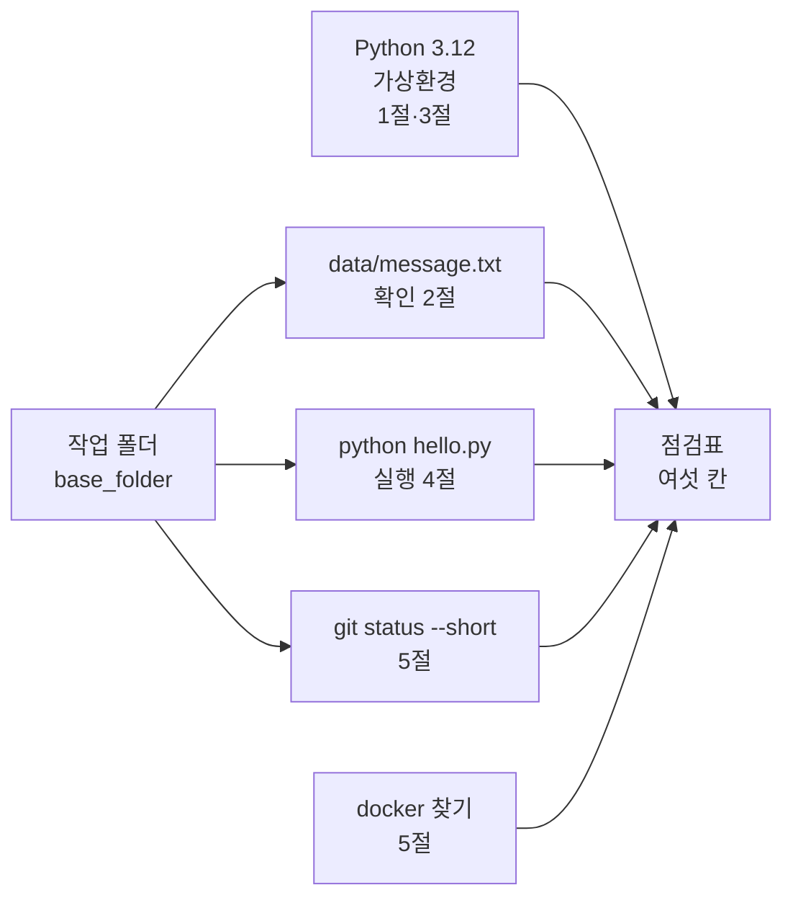
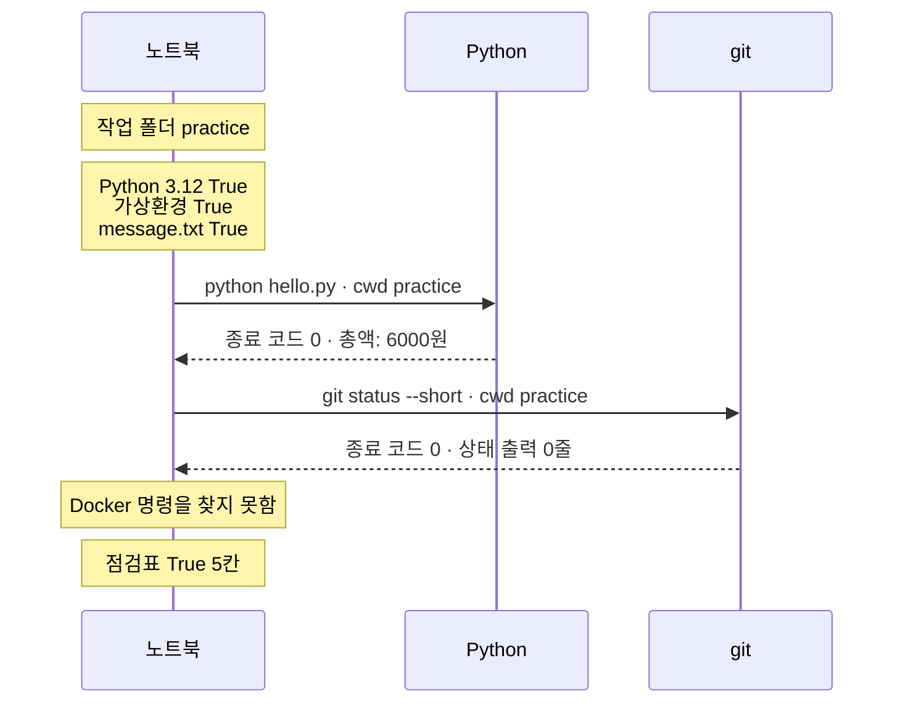
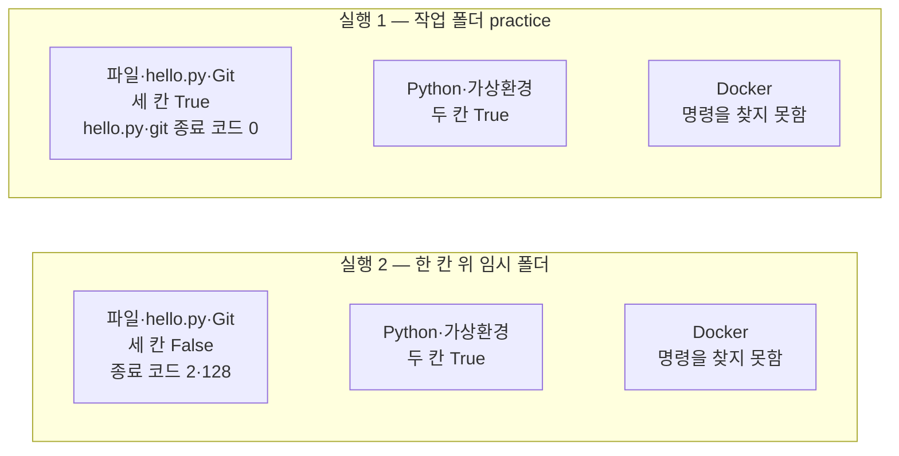

# 06-개발환경-실습

## _src 본문 (HTML 원본)

```html
<!--meta: 실습 30분 | 코드 Jupyter Notebook | 새 용어 0개 -->
<h2 id="b1"><span class="no">1</span>학습 목표</h2>
<div class="goal"><ul><li>1~5절에서 배운 확인 여섯 가지를 한 점검표로 모으는 과정을 따라갈 수 있습니다.</li><li>점검표에서 통과하지 못한 칸을 찾고, 그 이유를 종료 코드와 오류 메시지에서 읽을 수 있습니다.</li><li>작업 폴더 하나를 바꿨을 때 점검표의 어느 칸이 달라지는지 설명할 수 있습니다.</li></ul></div>
<h2 id="b2"><span class="no">2</span>이 내용을 배우는 이유</h2>
<p>1~5절에서는 버전, 경로, 스크립트 실행, Git, Docker를 하나씩 따로 확인했습니다. 다음 장부터 실습 폴더를 새로 열면 이 점검표 순서로 먼저 확인해 볼 수 있습니다.</p>
<p>이번 절은 이 챕터의 실습입니다. 앞에서 배운 확인을 한 노트북에 모아 강사와 함께 실행해 봅니다. 새 문법이나 새 기능은 없습니다.</p>
<p>실습 주제는 새 연습 폴더 점검입니다. 노트북이 만든 연습 폴더 <code>practice</code>를 두 번 점검합니다. 한 번은 바른 작업 폴더에서, 한 번은 한 칸 위 폴더에서 점검합니다.</p>
<p><strong>이 절의 질문</strong> — 작업 폴더를 잘못 고르면 점검표의 어느 칸이 달라질까요?</p>
<h2 id="b3"><span class="no">3</span>앞에서 배운 내용</h2>
<p>이번 실습은 아래 다섯 절에서 배운 것을 그대로 가져옵니다.</p>
<table><thead><tr><th>절</th><th>배운 것</th><th>실습에서 쓰는 곳</th></tr></thead><tbody>
<tr><td>1절</td><td>실행 전에 예상 적기, 목록과 번호 늘리기, <code>==</code> 비교</td><td>실행마다 먼저 예상, 점검표 칸 이름 목록</td></tr>
<tr><td>2절</td><td>임시 폴더 <code>workspace</code>, 기준 폴더 <code>base_folder</code>와 상대 경로 <code>data/message.txt</code></td><td>파일 칸, 실행 2의 한 칸 위 작업 폴더</td></tr>
<tr><td>3절</td><td>Python 버전과 <code>sys.prefix</code> 비교, 종료 코드 <code>returncode</code>와 오류 메시지 <code>stderr</code></td><td>Python·가상환경 칸, 실패 이유 읽기</td></tr>
<tr><td>4절</td><td><code>hello.py</code> 네 줄 실행과 예상 출력 <code>총액: 6000원</code> 비교</td><td>hello.py 칸</td></tr>
<tr><td>5절</td><td><code>git init</code>·<code>git add</code>·커밋, <code>git status --short</code>, 인자 <code>cwd</code>, docker 찾기</td><td>재료 만들기, Git 칸, Docker 칸</td></tr>
</tbody></table>
<p>2절 Before에서는 기준 폴더를 한 칸 위로 잡자 파일을 찾지 못했습니다. 실행 2는 같은 실수를 점검표 전체에 적용합니다. 이 장은 모델을 부르지 않으므로 API 키가 필요 없습니다.</p>
<h2 id="b4"><span class="no">4</span>핵심 개념</h2>
<h3>비유로 시작하기</h3>
<p>2절에서는 같은 설명을 들고 다른 방에서 출발하면 편지를 찾지 못한다고 했습니다. 이번에는 같은 사람이 가방을 메고 두 방에 들어갑니다.</p>
<p>책상 서랍의 편지는 방에 딸려 있어서 초록 방에서만 찾을 수 있습니다. 어깨에 멘 가방 속 필통은 사람을 따라다니므로 어느 방에서나 그대로 있습니다.</p>
{{img:06-4-두-방-가방|초록 벽 방에서는 가방을 멘 사람이 서랍 속 편지를 보고 웃고, 노란 벽 방에서는 같은 가방을 멘 같은 사람이 빈 서랍을 보고 곤란해하는 삽화|방을 바꾸면 서랍 속 편지는 달라지지만, 어깨에 멘 가방 속 필통은 그대로입니다.}}
<p><strong>그림 읽기</strong> — 왼쪽 초록 방과 오른쪽 노란 방에 같은 책상이 하나씩 있습니다. 왼쪽 서랍에만 편지가 반쯤 나와 있고, 오른쪽 서랍은 비어 있습니다. 두 방의 사람은 같은 주황 가방을 메고 있고, 가방 위로 파란 필통이 보입니다.</p>
<p>점검표도 같습니다. 방은 작업 폴더이고, 서랍 속 편지는 practice 폴더 안의 파일입니다. 가방 속 필통은 노트북 커널의 Python과 가상환경입니다. 작업 폴더를 바꾸면 폴더 안의 파일을 쓰는 칸만 달라집니다.</p>
<h3>점검표의 구성</h3>
{{mermaid:06-1-조립도|작업 폴더 base_folder가 data/message.txt 확인, python hello.py 실행, git status --short 확인 세 곳에 들어가고, Python 3.12·가상환경 확인과 docker 찾기는 작업 폴더 없이 실행되어 여섯 결과가 점검표로 모이는 조립도|점검표 여섯 칸을 채우는 확인과, 그중 작업 폴더를 쓰는 세 확인입니다.}}
<p><strong>도식 읽기</strong> — 왼쪽에서 오른쪽으로 읽습니다. 파란 상자는 우리가 고르는 작업 폴더이고, 초록 상자는 1~5절에서 배운 확인입니다. 노란 상자는 결과를 모은 점검표입니다.</p>
<p>작업 폴더에서 화살표를 받는 확인은 가운데 세 개입니다. 맨 위 Python 3.12·가상환경 확인과 맨 아래 docker 찾기는 작업 폴더를 쓰지 않습니다.</p>
<p>초록 상자는 다섯 개이고, 맨 위 상자에 Python 3.12와 가상환경 두 확인이 함께 들어 있습니다. 여섯 확인의 결과는 모두 오른쪽 점검표로 모입니다.</p>
<table><thead><tr><th>칸</th><th>이름</th><th>확인 방법</th><th>통과 기준</th></tr></thead><tbody>
<tr><td>1</td><td>Python 3.12</td><td><code>platform.python_version()</code>이 3.12로 시작하는가</td><td><code>True</code></td></tr>
<tr><td>2</td><td>커널이 가상환경 안</td><td><code>sys.prefix != sys.base_prefix</code></td><td><code>True</code></td></tr>
<tr><td>3</td><td>data/message.txt 있음</td><td><code>base_folder / relative_path</code>의 <code>is_file()</code></td><td><code>True</code></td></tr>
<tr><td>4</td><td>hello.py 출력 총액: 6000원</td><td>작업 폴더에서 <code>python hello.py</code> 실행</td><td>종료 코드 0이고 출력이 <code>총액: 6000원</code></td></tr>
<tr><td>5</td><td>Git 상태 0줄</td><td>작업 폴더에서 <code>git status --short</code> 실행</td><td>종료 코드 0이고 출력 0줄</td></tr>
<tr><td>6</td><td>Docker 클라이언트</td><td>docker를 찾았을 때만 <code>docker --version</code></td><td>종료 코드 0</td></tr>
</tbody></table>
<p>넷째 칸은 4절과 조금 다르게 실행합니다. 4절은 파일 전체 경로를 넣었고, 이번에는 파일 이름 <code>hello.py</code>만 적습니다. 대신 인자 <code>cwd</code>로 작업 폴더에서 실행합니다. 터미널에서 현재 폴더의 hello.py를 실행하는 것과 같은 조건입니다.</p>
<h3>두 번의 실행</h3>
<p>실행 1은 작업 폴더 <code>base_folder</code>를 practice로 둡니다. 점검할 연습 폴더를 바르게 고른 경우입니다.</p>
<p>실행 2는 작업 폴더만 한 칸 위인 임시 폴더로 바꿉니다. 점검 방법, 명령 목록, 연습 폴더의 파일은 모두 실행 1과 같습니다.</p>
<h2 id="b5"><span class="no">5</span>실행 예제</h2>
<p>노트북은 먼저 재료를 만듭니다. 임시 폴더에 practice 폴더, <code>data/message.txt</code>, <code>hello.py</code>를 만들고 Git으로 커밋합니다. 그다음 점검표 칸 이름 여섯 개를 목록 <code>check_names</code>에 담습니다.</p>
<p>실행 1은 칸마다 셀 하나로 확인하고, 결과를 목록 <code>run_1</code>에 모아 출력합니다. 실행 2는 같은 확인을 셀 네 개로 다시 하고 <code>run_2</code>에 모읍니다. 모델 호출은 없고, 준비 셀을 뺀 코드 셀 18개가 1분 안에 끝납니다.</p>
{{notebook:06-개발환경-실습}}
<p class="look"><b>확인할 점</b> — 실행 1의 점검표에서 True 칸 수가 <code>5</code>인지 봅니다. 비교 셀에서 달라진 칸 수가 <code>3</code>인지도 봅니다.</p>
<h3>실행 1의 실제 순서</h3>
{{mermaid:06-2-실행1-순서|노트북이 작업 폴더 practice에서 Python 3.12·가상환경·message.txt를 확인하고, python hello.py와 git status --short를 실행해 종료 코드 0을 받은 뒤, Docker 명령을 찾지 못해 점검표 True 5칸으로 끝나는 순서도|실행 1(작업 폴더 practice)에서 노트북이 확인한 순서와 받은 결과입니다.}}
<p><strong>도식 읽기</strong> — 위에서 아래로 시간이 흐릅니다. 첫 노란 메모는 정한 작업 폴더이고, 나머지 메모는 노트북 안에서 바로 확인한 결과입니다. 두 화살표 쌍은 노트북이 다른 프로그램을 실행하고 결과를 받은 자리입니다.</p>
<p>두 프로그램 모두 practice 폴더에서 실행됐고 종료 코드는 0이었습니다. 마지막에 Docker만 명령을 찾지 못해, 점검표의 True 칸은 5칸이었습니다.</p>
<h2 id="b6"><span class="no">6</span>실험 결과 해석</h2>
<p>실행 1에서 작업 폴더를 쓰는 세 칸은 모두 통과했습니다. 파일 확인은 True였고, 스크립트는 종료 코드 0으로 <code>총액: 6000원</code>을 출력했습니다. Git 상태 출력은 0줄이었습니다.</p>
<p>Python 3.12 칸과 가상환경 칸도 True였습니다. Docker 칸은 명령을 찾지 못해 False였습니다. 이 교재 환경에 Docker가 설치되어 있지 않기 때문입니다.</p>
{{mermaid:06-3-두-실행-비교|실행 1에서는 파일·hello.py·Git 세 칸 True와 Python·가상환경 두 칸 True, Docker 명령을 찾지 못함이고, 실행 2에서는 파일·hello.py·Git 세 칸이 종료 코드 2·128과 함께 False로 바뀌고 나머지 두 상자는 같은 비교 그림|같은 연습 폴더를 작업 폴더만 바꿔 점검한 두 결과입니다.}}
<p><strong>도식 읽기</strong> — 위 칸은 실행 1, 아래 칸은 실행 2입니다. 노란 상자는 통과한 칸이고, 빨간 상자는 통과하지 못한 칸입니다. 위아래에서 색이 바뀐 것은 왼쪽 상자 하나뿐입니다.</p>
<p>실행 2에서는 작업 폴더만 한 칸 위로 바꿨습니다. 파일 확인은 False였습니다. 스크립트 실행은 종료 코드 2로 끝났고, 오류 메시지에 <code>can't open file</code>이 있었습니다. 한 칸 위 폴더에는 hello.py가 없기 때문입니다.</p>
<p>Git 칸도 False였습니다. 명령 git은 종료 코드 128로 끝났고, 오류 메시지에 <code>not a git repository</code>가 있었습니다. 저장소 표시인 <code>.git</code> 폴더는 practice 안에만 있습니다.</p>
<p>Python, 가상환경, Docker 칸은 두 실행에서 같았습니다. 비교 셀의 달라진 칸 수는 3이었고, True 칸은 5칸에서 2칸으로 줄었습니다.</p>
<p>결론은 이렇습니다. 이번 실습에서 작업 폴더를 잘못 고르자 폴더 안의 파일을 쓰는 세 칸이 함께 실패했습니다. 커널과 컴퓨터에 딸린 세 칸은 그대로였습니다. 이 결과는 작업 폴더 하나를 한 번 바꿔 관찰한 것입니다.</p>
<h2 id="b7"><span class="no">7</span>주의할 점과 실무 메모</h2>
<ul><li>파일, hello.py, Git 세 칸이 함께 False이면 도구를 다시 설치하기 전에 작업 폴더부터 확인합니다. 실행 2에서도 도구는 그대로인데 이 세 칸만 실패했습니다.</li>
<li>Docker 칸이 False여도 Ch 2의 Python 학습은 진행할 수 있습니다. 5절의 여섯 가지 준비 상태 표를 따릅니다.</li>
<li>Docker 설치 컴퓨터에서 Docker 칸이 어떻게 나오는지는 이번에 실행하지 않았습니다. 그 컴퓨터에서는 <code>else</code> 아래 줄이 실행됩니다.</li>
<li>오류 메시지 전체에는 임시 폴더 위치가 들어 있어 사람마다 다릅니다. 그래서 노트북은 알아볼 글이 들어 있는지만 연산자 <code>in</code>으로 확인했습니다. git 오류는 괄호 속 문구와 둘째 줄이 환경마다 다를 수 있습니다. 그래서 공통으로 들어 있는 <code>not a git repository</code>만 확인했습니다.</li>
<li>점검표 칸 이름 옆에 배운 절을 주석으로 적었습니다. 칸이 늘어나도 어느 확인을 어디서 배웠는지 바로 찾을 수 있습니다.</li></ul>
<h2 id="b8"><span class="no">8</span>정리와 다음 절</h2>
<ul><li>1~5절에서 따로 배운 확인 여섯 가지를 한 점검표로 모았습니다.</li><li>실행 1에서 작업 폴더를 practice로 두자 True 5칸이었고, Docker 칸만 명령을 찾지 못해 False였습니다.</li><li>실행 2에서 작업 폴더만 한 칸 위로 바꾸자 파일, hello.py, Git 세 칸이 False로 바뀌었습니다. 나머지 세 칸은 같았습니다.</li></ul>
<p><strong>다음 학습과 이어지는 지점</strong> — Ch 2에서는 이번에 점검한 Python 3.12 환경에서 Python 문법을 배웁니다. 실습 폴더를 새로 열면 이번 점검표의 순서로 먼저 확인해 볼 수 있습니다. 커밋은 Ch 3에서, 이미지와 컨테이너는 Docker를 다루는 뒤쪽 챕터에서 다시 다룹니다.</p>
<h2 id="b9"><span class="no">9</span>복습 문제</h2><details class="quiz"><summary>문제와 해설</summary>
<p class="quiz-q">1. 실행 1에서 Docker 칸만 False였습니다. 작업 폴더를 고치면 이 칸이 True가 되나요? · 기초</p><p class="quiz-a"><b>해설</b> — 아닙니다. Docker 칸은 작업 폴더를 쓰지 않고 docker 명령을 찾습니다. 실행 2에서 작업 폴더를 바꿔도 Docker 칸은 그대로 False였습니다.</p>
<p class="quiz-q">2. 실행 2에서 hello.py 칸을 통과하지 못한 이유는 무엇인가요? · 적용</p><p class="quiz-a"><b>해설</b> — 파일 이름 <code>hello.py</code>만 적은 명령을 한 칸 위 폴더에서 실행했기 때문입니다. 그 폴더에는 hello.py가 없어 종료 코드 2와 <code>can't open file</code> 메시지가 나왔습니다.</p>
<p class="quiz-q">3. 점검표의 파일, hello.py, Git 세 칸이 함께 False입니다. 무엇부터 확인하나요? · 적용</p><p class="quiz-a"><b>해설</b> — 작업 폴더가 파일이 들어 있는 연습 폴더 practice인지 먼저 확인합니다. 세 칸 모두 작업 폴더를 쓰는 확인이기 때문입니다. 실행 2에서도 작업 폴더만 바꿨는데 이 세 칸이 함께 실패했습니다.</p>
<p class="quiz-q">4. 이번 결과만으로 「Docker가 설치된 컴퓨터에서는 True 6칸이 된다」고 말할 수 있나요? · 분석</p><p class="quiz-a"><b>해설</b> — 말할 수 없습니다. 이 교재 환경에는 docker가 없어서 버전을 묻는 줄을 실행하지 않았습니다. 확인한 것은 명령을 찾지 못했을 때 Docker 칸이 False라는 점까지입니다.</p>
</details>
<h2 id="b10"><span class="no">10</span>참고 자료</h2>
<ul><li><a href="https://docs.python.org/3.12/library/pathlib.html">Python 3.12 pathlib</a> · <a href="https://docs.python.org/3.12/library/tempfile.html">tempfile</a> · 2절에서 확인 2026-09-16</li><li><a href="https://docs.python.org/3.12/library/subprocess.html">Python 3.12 subprocess</a> · <a href="https://docs.python.org/3.12/library/sys.html">sys</a> · <a href="https://docs.python.org/3.12/library/shutil.html#shutil.which">shutil.which</a> · 3절·5절에서 확인 2026-09-16</li><li><a href="https://git-scm.com/docs/git-status">git-status 짧은 형식</a> · <a href="https://git-scm.com/docs/git">git -c 옵션</a> · 5절에서 확인 2026-09-16 · 예제는 교재에서 작성</li></ul>
```

## 노트북 셀 (순서대로)

### [0] markdown {'html': 'skip'}

# 개발환경 실습: 새 연습 폴더 점검하기

**이 노트북에서 할 일**

1. 임시 폴더에 새 연습 폴더 `practice`를 만들고, 파일 두 개를 넣어 Git으로 기록합니다.
2. 1~5절에서 배운 확인 여섯 가지로 점검표를 만들고, 작업 폴더를 practice로 두고 점검합니다(실행 1).
3. 작업 폴더만 한 칸 위로 바꿔 같은 점검을 하고, 달라진 칸을 비교합니다(실행 2).

**준비물** — API 키 불필요. 데이터 파일도 없습니다. 노트북이 임시 폴더에 연습 폴더를 직접 만듭니다.
모델 호출은 0번이고 비용은 들지 않습니다. 실행 시간은 1분 이내입니다.

2절에서 설치한 Git이 필요합니다. 노트북은 Docker가 없어도 끝까지 실행됩니다.
커널은 3절에서 준비한 실습 폴더의 `.venv`를 고릅니다.

### [1] markdown {'html': 'skip'}

## 오늘 볼 그림


왼쪽에서 오른쪽으로 읽습니다. 파란 상자는 우리가 고르는 작업 폴더이고, 초록 상자는 1~5절에서 배운 확인입니다.
작업 폴더에서 화살표를 받는 확인은 가운데 세 개입니다.
초록 상자는 다섯 개이고, 맨 위 상자에 Python 3.12와 가상환경 두 확인이 함께 들어 있습니다. 여섯 확인의 결과는 모두 오른쪽 노란 점검표로 모입니다.

### [2] markdown {}

## 1. 준비

이 절도 설치할 패키지가 없습니다. 5절에서 쓴 기본 기능 여섯 가지를 그대로 불러옵니다.
새로 배우는 문법이나 기능은 없습니다. 모두 1~5절에서 한 번씩 써 본 이름입니다.

### [3] code {'execution': {'iopub.execute_input': '2026-09-16T03:21:23.225983Z', 'iopub.status.busy': '2026-09-16T03:21:23.225850Z', 'iopub.status.idle': '2026-09-16T03:21:23.229099Z', 'shell.execute_reply': '2026-09-16T03:21:23.228704Z'}, 'lesson_role': 'setup', 'upgrade_allow': ['stdlib-import']}

```python
# 이 절에서 쓰는 Python 기본 기능을 불러옵니다
import platform
import shutil
import subprocess
import sys
import tempfile
from pathlib import Path

print("불러오기 완료")
```

출력:
```
불러오기 완료

```

### [4] markdown {}

**결과 읽기** — `불러오기 완료`가 보이면 다음 셀로 넘어갑니다.

### [5] markdown {}

## 2. 실습 주제 — 새 연습 폴더 점검하기

다음 장부터는 새 실습 폴더를 열고 노트북을 실행합니다. 실행하기 전에 폴더와 도구가 준비됐는지 이 점검표 순서로 먼저 확인해 볼 수 있습니다.
이번 실습은 1~5절에서 따로 배운 확인 여섯 가지를 한 점검표로 모읍니다.

점검할 연습 폴더는 노트북이 직접 만듭니다. 2절처럼 임시 폴더 `workspace` 안에 `practice` 폴더를 만듭니다.
그 안에 `data` 폴더와 `message.txt` 파일도 2절과 같은 글로 넣습니다.

### [6] code {'execution': {'iopub.execute_input': '2026-09-16T03:21:23.230080Z', 'iopub.status.busy': '2026-09-16T03:21:23.229991Z', 'iopub.status.idle': '2026-09-16T03:21:23.234520Z', 'shell.execute_reply': '2026-09-16T03:21:23.233582Z'}, 'upgrade_allow': ['stdlib-import']}

```python
# 2절처럼 임시 폴더 안에 practice 폴더와 data/message.txt 파일을 만듭니다
temporary_folder = tempfile.TemporaryDirectory()
workspace = Path(temporary_folder.name)
project = workspace / "practice"
project.mkdir()
data_folder = project / "data"
data_folder.mkdir()
message_file = data_folder / "message.txt"
message_file.write_text("안녕, 터미널!", encoding="utf-8")
print("practice 폴더가 있는가:", project.is_dir())
print("message.txt 파일이 있는가:", message_file.is_file())
```

출력:
```
practice 폴더가 있는가: True
message.txt 파일이 있는가: True

```

### [7] markdown {}

**결과 읽기** — 두 줄 모두 `True`입니다. 임시 폴더 안에 practice, data, message.txt가 차례로 들어 있습니다.

다음은 4절의 `hello.py`와 같은 네 줄을 practice 폴더에 저장합니다.

### [8] code {'execution': {'iopub.execute_input': '2026-09-16T03:21:23.235712Z', 'iopub.status.busy': '2026-09-16T03:21:23.235624Z', 'iopub.status.idle': '2026-09-16T03:21:23.238443Z', 'shell.execute_reply': '2026-09-16T03:21:23.237900Z'}, 'upgrade_allow': ['stdlib-import']}

```python
# 4절의 hello.py와 같은 네 줄을 practice 폴더에 저장합니다
hello_source = """price = 3000
count = 2
total = price * count
print(f"총액: {total}원")
"""
hello_file = project / "hello.py"
hello_file.write_text(hello_source, encoding="utf-8")
print("hello.py가 있는가:", hello_file.is_file())
```

출력:
```
hello.py가 있는가: True

```

### [9] markdown {}

**결과 읽기** — `True`입니다. 연습 폴더에 파일 두 개가 준비됐습니다.

이제 5절의 순서대로 practice 폴더를 Git 저장소로 만듭니다. 명령 git을 찾지 못하면 검사 줄 `assert`에서 멈춥니다.
인자 `cwd=project`는 git을 practice 폴더에서 실행하게 합니다.

### [10] code {'execution': {'iopub.execute_input': '2026-09-16T03:21:23.239668Z', 'iopub.status.busy': '2026-09-16T03:21:23.239557Z', 'iopub.status.idle': '2026-09-16T03:21:23.251467Z', 'shell.execute_reply': '2026-09-16T03:21:23.250941Z'}, 'upgrade_allow': ['stdlib-import']}

```python
# 5절처럼 git을 찾고, practice 폴더에서 git init을 실행합니다
git_path = shutil.which("git")
assert git_path is not None
init_command = [git_path, "init"]
init_run = subprocess.run(init_command, cwd=project, capture_output=True, text=True)
git_folder = project / ".git"
print("git init 종료 코드:", init_run.returncode)
print(".git 폴더가 있는가:", git_folder.is_dir())
```

출력:
```
git init 종료 코드: 0
.git 폴더가 있는가: True

```

### [11] markdown {}

**결과 읽기** — git init 종료 코드는 `0`이고, `.git` 폴더가 있는지는 `True`입니다.

두 파일을 기록할 목록에 올리고 커밋합니다. 5절처럼 옵션 `-c`로 이번 명령에만 쓸 이름과 전자우편을 넣습니다.
명령 `git add` 뒤에는 파일 이름을 여러 개 이어 적을 수 있습니다.

### [12] code {'execution': {'iopub.execute_input': '2026-09-16T03:21:23.252415Z', 'iopub.status.busy': '2026-09-16T03:21:23.252326Z', 'iopub.status.idle': '2026-09-16T03:21:23.260348Z', 'shell.execute_reply': '2026-09-16T03:21:23.259804Z'}, 'upgrade_allow': ['stdlib-import']}

```python
# 두 파일을 기록할 목록에 올리고, 이번 명령에만 쓸 이름으로 커밋합니다
add_command = [git_path, "add", "hello.py", "data/message.txt"]
subprocess.run(add_command, cwd=project, check=True)
name_setting = "user.name=Ch1 Student"
email_setting = "user.email=student@example.com"
commit_command = [
    git_path, "-c", name_setting, "-c", email_setting,
    "commit", "--quiet", "-m", "연습 폴더 첫 기록",
]
commit_run = subprocess.run(commit_command, cwd=project, capture_output=True, text=True)
print("커밋 종료 코드:", commit_run.returncode)
```

출력:
```
커밋 종료 코드: 0

```

### [13] markdown {}

**결과 읽기** — 커밋 종료 코드는 `0`입니다. 새 연습 폴더가 파일 두 개와 첫 기록을 갖췄습니다.

### [14] markdown {}

## 3. 점검표 칸 정하기

점검 결과를 한눈에 보려면 결과를 적을 자리가 필요합니다. 1절의 과정 지도처럼 칸 이름 여섯 개를 목록에 순서대로 담습니다.
칸마다 어느 절에서 배운 확인인지 주석으로 적었습니다. 실행 1과 실행 2는 이 순서대로 결과를 적습니다.

### [15] code {'execution': {'iopub.execute_input': '2026-09-16T03:21:23.261685Z', 'iopub.status.busy': '2026-09-16T03:21:23.261569Z', 'iopub.status.idle': '2026-09-16T03:21:23.264242Z', 'shell.execute_reply': '2026-09-16T03:21:23.263742Z'}}

```python
# 점검표의 여섯 칸 이름을 순서대로 목록에 담습니다
check_names = [
    "Python 3.12",  # 1절·3절 버전 확인
    "커널이 가상환경 안",  # 3절 sys.prefix 비교
    "data/message.txt 있음",  # 2절 기준 폴더와 상대 경로
    "hello.py 출력 총액: 6000원",  # 4절 스크립트 실행
    "Git 상태 0줄",  # 5절 git status --short
    "Docker 클라이언트",  # 5절 docker 찾기
]
print("점검 칸 수:", len(check_names))
```

출력:
```
점검 칸 수: 6

```

### [16] markdown {}

**결과 읽기** — 점검 칸 수는 `6`입니다. 5절의 여섯 가지 준비 상태에서 uv 응답과 Docker 서버 칸을 빼고, 파일과 hello.py 칸을 넣었습니다.
Git 칸은 버전 응답 대신 상태 출력이 0줄인지 봅니다.

## 4. 실행 1 — 작업 폴더를 practice로 두고 점검하기

터미널에서는 현재 작업 폴더가 기준 폴더입니다. 이 노트북에서는 2절처럼 변수 `base_folder`가 그 역할을 합니다.
실행 1은 작업 폴더를 practice로 둡니다. 첫 두 칸은 3절과 같은 방법으로 Python 버전과 가상환경을 확인합니다.

### [17] code {'execution': {'iopub.execute_input': '2026-09-16T03:21:23.265296Z', 'iopub.status.busy': '2026-09-16T03:21:23.265208Z', 'iopub.status.idle': '2026-09-16T03:21:23.267700Z', 'shell.execute_reply': '2026-09-16T03:21:23.267226Z'}, 'upgrade_allow': ['stdlib-import']}

```python
# 실행 1: 작업 폴더를 practice로 정하고, Python 버전과 가상환경을 확인합니다
base_folder = project
print("작업 폴더:", base_folder.name)
python_version = platform.python_version()
python_ok = python_version.startswith("3.12")
# 3절처럼 환경 폴더와 기반 Python 폴더가 다르면 가상환경 안입니다
venv_ok = sys.prefix != sys.base_prefix
print("Python 3.12인가:", python_ok)
print("커널이 가상환경 안인가:", venv_ok)
```

출력:
```
작업 폴더: practice
Python 3.12인가: True
커널이 가상환경 안인가: True

```

### [18] markdown {}

**결과 읽기** — 작업 폴더는 `practice`이고, 두 확인 모두 `True`입니다.

셋째 칸은 2절의 방법입니다. 작업 폴더에 상대 경로 `data/message.txt`를 이어 파일이 있는지 봅니다.
실행 전에 예상합니다. 작업 폴더를 바르게 골랐으므로 `True`가 나올 것입니다.

### [19] code {'execution': {'iopub.execute_input': '2026-09-16T03:21:23.268674Z', 'iopub.status.busy': '2026-09-16T03:21:23.268568Z', 'iopub.status.idle': '2026-09-16T03:21:23.270947Z', 'shell.execute_reply': '2026-09-16T03:21:23.270504Z'}, 'upgrade_allow': ['stdlib-import']}

```python
# 작업 폴더에 상대 경로 data/message.txt를 이어 파일이 있는지 봅니다
relative_path = Path("data/message.txt")
message_path = base_folder / relative_path
message_ok = message_path.is_file()
print("data/message.txt가 있는가:", message_ok)
```

출력:
```
data/message.txt가 있는가: True

```

### [20] markdown {}

**결과 읽기** — 예상대로 `True`입니다.

넷째 칸은 4절의 스크립트 실행입니다. 4절에서는 파일 전체 경로를 넣어 실행했습니다.
이번에는 터미널의 `uv run python hello.py`처럼 파일 이름만 적고, 인자 `cwd`로 작업 폴더에서 실행합니다.
그래서 작업 폴더에 hello.py가 있어야 실행됩니다. 종료 코드가 0이고 출력이 예상과 같아야 이 칸을 통과합니다.

### [21] code {'execution': {'iopub.execute_input': '2026-09-16T03:21:23.272036Z', 'iopub.status.busy': '2026-09-16T03:21:23.271875Z', 'iopub.status.idle': '2026-09-16T03:21:23.286723Z', 'shell.execute_reply': '2026-09-16T03:21:23.286289Z'}, 'upgrade_allow': ['stdlib-import']}

```python
# 작업 폴더에서 python hello.py를 실행하고, 종료 코드와 출력을 확인합니다
hello_command = [sys.executable, "hello.py"]
hello_run = subprocess.run(hello_command, cwd=base_folder, capture_output=True, text=True)
hello_output = hello_run.stdout.strip()
# 종료 코드가 0이고 출력이 4절의 예상 출력과 같아야 통과입니다
hello_ok = hello_run.returncode == 0 and hello_output == "총액: 6000원"
print("종료 코드:", hello_run.returncode)
print("스크립트 출력:", hello_output)
print("hello.py 칸 통과:", hello_ok)
```

출력:
```
종료 코드: 0
스크립트 출력: 총액: 6000원
hello.py 칸 통과: True

```

### [22] markdown {}

**결과 읽기** — 종료 코드는 `0`, 스크립트 출력은 `총액: 6000원`이고, 칸 통과는 `True`입니다.

다섯째 칸은 5절의 `git status --short`입니다. 작업 폴더에서 실행해 달라진 파일이 몇 줄인지 셉니다.
실행 전에 예상합니다. 방금 두 파일을 커밋했으므로 상태 출력은 0줄일 것입니다.

### [23] code {'execution': {'iopub.execute_input': '2026-09-16T03:21:23.287568Z', 'iopub.status.busy': '2026-09-16T03:21:23.287487Z', 'iopub.status.idle': '2026-09-16T03:21:23.291971Z', 'shell.execute_reply': '2026-09-16T03:21:23.291460Z'}, 'upgrade_allow': ['stdlib-import']}

```python
# 작업 폴더에서 git status --short를 실행하고 출력 줄 수를 셉니다
status_command = [git_path, "status", "--short"]
status_run = subprocess.run(status_command, cwd=base_folder, capture_output=True, text=True)
status_lines = status_run.stdout.splitlines()
# 종료 코드가 0이고 달라진 파일이 없어야 통과입니다
git_ok = status_run.returncode == 0 and len(status_lines) == 0
print("git 종료 코드:", status_run.returncode)
print("상태 출력 줄 수:", len(status_lines))
print("Git 칸 통과:", git_ok)
```

출력:
```
git 종료 코드: 0
상태 출력 줄 수: 0
Git 칸 통과: True

```

### [24] markdown {}

**결과 읽기** — git 종료 코드는 `0`, 상태 출력 줄 수는 `0`이고, 칸 통과는 `True`입니다.

마지막 칸은 5절의 Docker 클라이언트 확인입니다. 명령 docker를 찾았을 때만 버전을 묻습니다.
실행 전에 예상합니다. 이 교재 환경에는 docker가 없으므로 `if` 아래 줄이 실행될 것입니다.

### [25] code {'execution': {'iopub.execute_input': '2026-09-16T03:21:23.292871Z', 'iopub.status.busy': '2026-09-16T03:21:23.292778Z', 'iopub.status.idle': '2026-09-16T03:21:23.295380Z', 'shell.execute_reply': '2026-09-16T03:21:23.294893Z'}, 'upgrade_allow': ['stdlib-import']}

```python
# 5절처럼 docker 명령을 찾고, 찾았을 때만 버전을 묻습니다
docker_path = shutil.which("docker")
docker_ok = False
if docker_path is None:
    print("Docker: 명령을 찾지 못함")
else:
    docker_command = [docker_path, "--version"]
    docker_run = subprocess.run(docker_command, capture_output=True, text=True)
    docker_ok = docker_run.returncode == 0
    print("Docker 종료 코드:", docker_run.returncode)
print("Docker 칸 통과:", docker_ok)
```

출력:
```
Docker: 명령을 찾지 못함
Docker 칸 통과: False

```

### [26] markdown {}

**결과 읽기** — `Docker: 명령을 찾지 못함`이 나왔고, 칸 통과는 `False`입니다.
명령을 찾지 못해서 `else` 아래 줄은 이번에 실행하지 않았습니다.

여섯 결과를 점검표 칸 순서대로 목록에 담아 출력합니다. 1절처럼 번호를 1씩 늘리며 칸을 하나씩 꺼냅니다.
번호 `index`는 0부터 셉니다. 목록 번호가 0부터 시작하기 때문입니다(4절).

### [27] code {'execution': {'iopub.execute_input': '2026-09-16T03:21:23.296253Z', 'iopub.status.busy': '2026-09-16T03:21:23.296163Z', 'iopub.status.idle': '2026-09-16T03:21:23.298604Z', 'shell.execute_reply': '2026-09-16T03:21:23.298170Z'}}

```python
# 실행 1의 결과를 점검표 칸 순서대로 목록에 담고 출력합니다
run_1 = [python_ok, venv_ok, message_ok, hello_ok, git_ok, docker_ok]
index = 0
true_count_1 = 0
for name in check_names:
    print(name, "|", run_1[index])
    # True인 칸의 수를 셉니다
    if run_1[index]:
        true_count_1 = true_count_1 + 1
    index = index + 1
print("True 칸 수:", true_count_1)
```

출력:
```
Python 3.12 | True
커널이 가상환경 안 | True
data/message.txt 있음 | True
hello.py 출력 총액: 6000원 | True
Git 상태 0줄 | True
Docker 클라이언트 | False
True 칸 수: 5

```

### [28] markdown {}

**결과 읽기** — 위의 다섯 칸은 `True`이고, 마지막 `Docker 클라이언트 | False`만 준비되지 않았습니다. True 칸 수는 `5`입니다.
작업 폴더를 바르게 고르면 폴더를 쓰는 세 칸이 모두 통과한다는 것을 봤습니다.

## 5. 실행 2 — 작업 폴더만 한 칸 위로 바꾸기

2절 Before처럼 작업 폴더를 한 칸 위인 임시 폴더로 잘못 고른 상황입니다. 바꾸는 값은 `base_folder` 하나입니다.
점검 방법과 명령 목록은 실행 1과 같습니다. 결과는 이름 끝에 `_2`를 붙인 변수에 따로 담습니다.

실행 전에 예상합니다. 작업 폴더를 쓰는 세 칸(파일, hello.py, Git)은 `False`로 바뀔 것입니다.
작업 폴더를 쓰지 않는 Python, 가상환경, Docker 칸은 실행 1과 같을 것입니다.

### [29] code {'execution': {'iopub.execute_input': '2026-09-16T03:21:23.299502Z', 'iopub.status.busy': '2026-09-16T03:21:23.299424Z', 'iopub.status.idle': '2026-09-16T03:21:23.301867Z', 'shell.execute_reply': '2026-09-16T03:21:23.301496Z'}, 'upgrade_allow': ['stdlib-import']}

```python
# 실행 2: 작업 폴더만 한 칸 위인 임시 폴더로 바꾸고, 앞의 세 칸을 같은 방법으로 확인합니다
base_folder = workspace
print("작업 폴더가 practice인가:", base_folder == project)
python_version = platform.python_version()
python_ok_2 = python_version.startswith("3.12")
venv_ok_2 = sys.prefix != sys.base_prefix
message_path = base_folder / relative_path
message_ok_2 = message_path.is_file()
print("Python 3.12인가:", python_ok_2)
print("커널이 가상환경 안인가:", venv_ok_2)
print("data/message.txt가 있는가:", message_ok_2)
```

출력:
```
작업 폴더가 practice인가: False
Python 3.12인가: True
커널이 가상환경 안인가: True
data/message.txt가 있는가: False

```

### [30] markdown {}

**결과 읽기** — 작업 폴더가 practice인지는 `False`입니다. 앞의 두 칸은 `True`로 그대로입니다.
파일 칸은 `False`로 바뀌었습니다. 2절 Before에서 본 결과와 같습니다.

실행 1의 명령 목록 `hello_command`와 `status_command`를 그대로 씁니다. 바뀐 것은 `cwd`에 넣은 작업 폴더뿐입니다.

### [31] code {'execution': {'iopub.execute_input': '2026-09-16T03:21:23.302605Z', 'iopub.status.busy': '2026-09-16T03:21:23.302537Z', 'iopub.status.idle': '2026-09-16T03:21:23.316122Z', 'shell.execute_reply': '2026-09-16T03:21:23.315717Z'}, 'upgrade_allow': ['stdlib-import']}

```python
# 같은 명령 목록으로 hello.py 실행과 Git 상태를 한 칸 위 폴더에서 확인합니다
hello_run_2 = subprocess.run(hello_command, cwd=base_folder, capture_output=True, text=True)
hello_output_2 = hello_run_2.stdout.strip()
hello_ok_2 = hello_run_2.returncode == 0 and hello_output_2 == "총액: 6000원"
status_run_2 = subprocess.run(status_command, cwd=base_folder, capture_output=True, text=True)
status_lines_2 = status_run_2.stdout.splitlines()
git_ok_2 = status_run_2.returncode == 0 and len(status_lines_2) == 0
print("hello.py 종료 코드:", hello_run_2.returncode)
print("hello.py 칸 통과:", hello_ok_2)
print("git 종료 코드:", status_run_2.returncode)
print("Git 칸 통과:", git_ok_2)
```

출력:
```
hello.py 종료 코드: 2
hello.py 칸 통과: False
git 종료 코드: 128
Git 칸 통과: False

```

### [32] markdown {}

**결과 읽기** — hello.py 종료 코드는 `2`, git 종료 코드는 `128`입니다. 두 칸 모두 `False`입니다.
3절에서 봤듯이 종료 코드가 0이 아니면 프로그램이 실패한 것입니다. 실패한 이유는 비교가 끝난 뒤 오류 메시지로 확인합니다.

Docker 칸도 실행 1과 같은 코드로 다시 확인합니다.

### [33] code {'execution': {'iopub.execute_input': '2026-09-16T03:21:23.316963Z', 'iopub.status.busy': '2026-09-16T03:21:23.316887Z', 'iopub.status.idle': '2026-09-16T03:21:23.319050Z', 'shell.execute_reply': '2026-09-16T03:21:23.318732Z'}, 'upgrade_allow': ['stdlib-import']}

```python
# 실행 1과 같은 방법으로 docker 명령을 다시 찾습니다
docker_path = shutil.which("docker")
docker_ok_2 = False
if docker_path is None:
    print("Docker: 명령을 찾지 못함")
else:
    docker_run_2 = subprocess.run(docker_command, capture_output=True, text=True)
    docker_ok_2 = docker_run_2.returncode == 0
    print("Docker 종료 코드:", docker_run_2.returncode)
print("Docker 칸 통과:", docker_ok_2)
```

출력:
```
Docker: 명령을 찾지 못함
Docker 칸 통과: False

```

### [34] markdown {}

**결과 읽기** — 실행 1과 같이 `Docker: 명령을 찾지 못함`이고, 칸 통과는 `False`입니다.
아래쪽 `else` 줄은 Docker가 있는 컴퓨터에서만 실행되며, 이번에는 실행하지 않았습니다.

실행 2의 결과도 같은 칸 순서로 목록에 담아 출력합니다.

### [35] code {'execution': {'iopub.execute_input': '2026-09-16T03:21:23.319796Z', 'iopub.status.busy': '2026-09-16T03:21:23.319707Z', 'iopub.status.idle': '2026-09-16T03:21:23.322022Z', 'shell.execute_reply': '2026-09-16T03:21:23.321529Z'}}

```python
# 실행 2의 결과를 점검표 칸 순서대로 목록에 담고 출력합니다
run_2 = [python_ok_2, venv_ok_2, message_ok_2, hello_ok_2, git_ok_2, docker_ok_2]
index = 0
true_count_2 = 0
for name in check_names:
    print(name, "|", run_2[index])
    if run_2[index]:
        true_count_2 = true_count_2 + 1
    index = index + 1
print("True 칸 수:", true_count_2)
```

출력:
```
Python 3.12 | True
커널이 가상환경 안 | True
data/message.txt 있음 | False
hello.py 출력 총액: 6000원 | False
Git 상태 0줄 | False
Docker 클라이언트 | False
True 칸 수: 2

```

### [36] markdown {}

**결과 읽기** — `Python 3.12 | True`와 `커널이 가상환경 안 | True`만 남았고, True 칸 수는 `2`입니다.
실행 1의 5칸에서 3칸이 줄었습니다. 어느 칸이 달라졌는지는 다음 셀에서 칸마다 비교합니다.

## 6. 두 점검표 비교하기

두 목록에서 같은 번호의 칸끼리 비교합니다. 기호 `!=`는 3절에서 쓴 「두 값이 다른가」 비교입니다.
달라진 칸은 실행 1 값과 실행 2 값을 함께 출력하고, 같은 칸은 값 하나만 출력합니다.

### [37] code {'execution': {'iopub.execute_input': '2026-09-16T03:21:23.322980Z', 'iopub.status.busy': '2026-09-16T03:21:23.322908Z', 'iopub.status.idle': '2026-09-16T03:21:23.325282Z', 'shell.execute_reply': '2026-09-16T03:21:23.324921Z'}}

```python
# 두 실행의 점검표를 칸마다 비교하고, 달라진 칸의 수를 셉니다
index = 0
changed_count = 0
for name in check_names:
    if run_1[index] != run_2[index]:
        print("달라짐 |", name, "|", run_1[index], "->", run_2[index])
        changed_count = changed_count + 1
    else:
        print("같음 |", name, "|", run_1[index])
    index = index + 1
print("달라진 칸 수:", changed_count)
```

출력:
```
같음 | Python 3.12 | True
같음 | 커널이 가상환경 안 | True
달라짐 | data/message.txt 있음 | True -> False
달라짐 | hello.py 출력 총액: 6000원 | True -> False
달라짐 | Git 상태 0줄 | True -> False
같음 | Docker 클라이언트 | False
달라진 칸 수: 3

```

### [38] markdown {}

**결과 읽기** — 달라진 칸 수는 `3`입니다. 파일, hello.py, Git 칸이 `True -> False`로 바뀌었습니다.
두 실행에서 Python과 가상환경 칸은 `True`로, Docker 칸은 `False`로 같았습니다.

작업 폴더 하나만 바꿨는데 폴더를 쓰는 세 칸이 함께 달라졌습니다. 작업 폴더를 쓰지 않는 세 칸은 그대로였습니다.

## 7. 실패한 이유 읽기

실행 2의 hello.py와 git이 왜 실패했는지 오류 메시지로 확인합니다. 3절처럼 오류 메시지는 실행 결과의 `stderr`에 담깁니다.
메시지에는 임시 폴더 위치가 들어 있어서 전체를 출력하지 않습니다. 연산자 `in`으로 알아볼 글이 들어 있는지만 봅니다(4절).

### [39] code {'execution': {'iopub.execute_input': '2026-09-16T03:21:23.326316Z', 'iopub.status.busy': '2026-09-16T03:21:23.326231Z', 'iopub.status.idle': '2026-09-16T03:21:23.328084Z', 'shell.execute_reply': '2026-09-16T03:21:23.327806Z'}, 'upgrade_allow': ['stdlib-import']}

```python
# 실행 2의 오류 메시지에 알아볼 글이 들어 있는지 확인합니다
hello_error = hello_run_2.stderr
git_error = status_run_2.stderr
print("hello.py 오류에 can't open file이 있는가:", "can't open file" in hello_error)
print("git 오류에 not a git repository가 있는가:", "not a git repository" in git_error)
```

출력:
```
hello.py 오류에 can't open file이 있는가: True
git 오류에 not a git repository가 있는가: True

```

### [40] markdown {}

**결과 읽기** — 두 줄 모두 `True`입니다.
hello.py 오류는 파일을 열지 못했다는 뜻입니다. 한 칸 위 폴더에는 hello.py가 없기 때문입니다.
git 오류는 그 폴더가 Git 저장소가 아니라는 뜻입니다. 저장소 표시인 `.git` 폴더는 practice 안에만 있습니다.

### [41] markdown {}

## 8. 임시 폴더 정리하기

연습이 끝났으므로 2절처럼 `cleanup()`으로 임시 폴더를 지웁니다. 안에 만든 practice 폴더와 Git 저장소도 함께 지워집니다.
교재 실습 폴더(`labs/part1/ch01-development-environment`)의 `hello.py`는 이 임시 폴더 밖에 있으므로 지워지지 않습니다.

### [42] code {'execution': {'iopub.execute_input': '2026-09-16T03:21:23.328929Z', 'iopub.status.busy': '2026-09-16T03:21:23.328858Z', 'iopub.status.idle': '2026-09-16T03:21:23.331513Z', 'shell.execute_reply': '2026-09-16T03:21:23.331017Z'}, 'upgrade_allow': ['stdlib-import']}

```python
# 연습용 임시 폴더와 그 안의 practice 폴더를 함께 지웁니다
temporary_folder.cleanup()
print("임시 폴더가 남아 있는가:", workspace.is_dir())
```

출력:
```
임시 폴더가 남아 있는가: False

```

### [43] markdown {}

**결과 읽기** — `False`입니다. 임시 폴더와 그 안의 practice 폴더가 지워졌습니다.

## 정리

- 1~5절에서 따로 배운 확인 여섯 가지를 한 점검표로 모았습니다. 실행 1은 True 5칸, Docker 칸만 False였습니다.
- 작업 폴더만 한 칸 위로 바꾸자 파일, hello.py, Git 세 칸이 False로 바뀌었습니다. 종료 코드는 2와 128이었습니다.
- Python, 가상환경, Docker 칸은 작업 폴더와 상관없어 두 실행에서 같았습니다.

Docker 설치 컴퓨터의 Docker 칸 결과는 이번에 실행하지 않았습니다.
다음 장 Ch 2에서는 이번에 점검한 Python 3.12 환경에서 Python 문법을 배웁니다.

## 그림

### 06-1-조립도.mmd



- 설명 대상 문장: 1~5절에서 배운 확인 여섯 가지를 한 점검표로 모읍니다. 그중 세 확인이 작업 폴더를 씁니다.
- 캡션: 점검표 여섯 칸을 채우는 확인과, 그중 작업 폴더를 쓰는 세 확인입니다.
- 읽는 법: 왼쪽에서 오른쪽으로 읽습니다. 파란 상자는 작업 폴더, 초록 상자는 1~5절에서 배운 확인, 노란 상자는 점검표입니다. 초록 상자는 다섯 개이고, 맨 위 상자에 Python 3.12와 가상환경 두 확인이 함께 들어 있습니다. 작업 폴더에서 화살표를 받는 확인은 가운데 세 개이고, 맨 위 Python 3.12·가상환경과 맨 아래 docker 찾기는 작업 폴더를 쓰지 않습니다.
- alt: 작업 폴더 base_folder가 data/message.txt 확인, python hello.py 실행, git status --short 확인 세 곳에 들어가고, Python 3.12·가상환경 확인과 docker 찾기는 작업 폴더 없이 실행되어 여섯 결과가 점검표로 모이는 조립도

### 06-2-실행1-순서.mmd



- 설명 대상 문장: 실행 1에서 작업 폴더를 practice로 두자 True 5칸이었고, Docker 칸만 False였습니다.
- 캡션: 실행 1(작업 폴더 practice)에서 노트북이 확인한 순서와 받은 결과입니다.
- 읽는 법: 위에서 아래로 시간이 흐릅니다. 첫 노란 메모는 정한 작업 폴더, 나머지 노란 메모는 노트북 안에서 바로 확인한 결과이고, 두 화살표 쌍은 python hello.py와 git status --short를 practice 폴더에서 실행해 종료 코드 0을 받은 자리입니다.
- alt: 노트북이 작업 폴더 practice에서 Python 3.12·가상환경·message.txt를 확인하고, python hello.py와 git status --short를 실행해 종료 코드 0을 받은 뒤, Docker 명령을 찾지 못해 점검표 True 5칸으로 끝나는 순서도

### 06-3-두-실행-비교.mmd



- 설명 대상 문장: 작업 폴더만 한 칸 위로 바꾸자 파일, hello.py, Git 세 칸이 False로 바뀌었고 나머지 세 칸은 같았습니다.
- 캡션: 같은 연습 폴더를 작업 폴더만 바꿔 점검한 두 결과입니다.
- 읽는 법: 위 칸은 실행 1, 아래 칸은 실행 2입니다. 노란 상자는 통과한 칸, 빨간 상자는 통과하지 못한 칸입니다. 위아래에서 색이 바뀐 것은 왼쪽 상자(hello.py·git 종료 코드 0 → 2·128) 하나뿐입니다.
- alt: 실행 1에서는 파일·hello.py·Git 세 칸 True와 Python·가상환경 두 칸 True, Docker 명령을 찾지 못함이고, 실행 2에서는 파일·hello.py·Git 세 칸이 종료 코드 2·128과 함께 False로 바뀌고 나머지 두 상자는 같은 비교 그림

### 06-4-두-방-가방.prompt.md

# 삽화 — 06-4 두 방과 가방

- 상태: 2026-09-16 생성·검수 통과(1회 생성, 탈락 0). 모델 nano_banana_pro(서버 표기 nano_banana_2), 16:9, 2k(2752×1536), 2크레딧(생성 전 잔액 2962). 채택 job a977e4cf-873c-4cc0-9fbb-a15912e87f5b. 교재 파일은 폭 1100px로 줄여 저장.
- 검수 메모: 02-5와 같은 인형의 집 모양 방 두 개(초록 벽·노란 벽), 같은 책상 하나씩. 왼쪽 서랍에만 흰 봉투가 반쯤 나와 있고 오른쪽 서랍은 비어 있음. 두 방에 같은 옷·같은 머리의 사람이 같은 주황 가방을 한쪽 어깨에 메고, 가방 위로 파란 필통이 보임. 왼쪽은 웃고 오른쪽은 빈 서랍을 보며 곤란한 표정. 글자·화면 없음. 「방에 딸린 것은 달라지고, 사람이 가지고 다니는 것은 그대로」 관계가 그림만으로 읽혀 채택.
- 설명 대상 문장: 책상 서랍의 편지는 방에 딸려 있어서 초록 방에서만 찾을 수 있습니다. 어깨에 멘 가방 속 필통은 사람을 따라다니므로 어느 방에서나 그대로 있습니다.
- 넣을 자리: 06절 핵심 개념 「비유로 시작하기」 단락 바로 아래
- 구성 요소와 배치(왼쪽 → 오른쪽): ① 초록 벽 방: 책상, 열린 서랍의 편지, 가방 멘 사람(웃음) ② 노란 벽 방: 같은 책상, 빈 서랍, 같은 가방 멘 같은 사람(곤란)
- 시선 순서: 오른쪽 사람의 빈 서랍 → 왼쪽 서랍의 편지 → 두 사람의 같은 가방과 필통
- 대응: 방 = 작업 폴더(base_folder), 서랍 속 편지 = practice 안의 파일(message.txt·hello.py·.git), 가방 속 필통 = 노트북 커널의 Python과 가상환경, 빈 서랍 = 실행 2에서 실패한 세 칸

## 프롬프트(채택본)

Simple flat educational illustration, white background, limited soft palette, clean outlines, plain everyday objects, no text, no letters, no numbers, no logos.
Two separate small rooms drawn like two open dollhouse boxes placed side by side with a clear white gap between them. Each room box has its own pale back wall and its own floor; the left room box has a pale green back wall and the right room box has a pale yellow back wall. There are exactly two desks in the whole picture: exactly one plain wooden desk in the center of each room, both desks identical in shape, size and position, each with a single top drawer pulled open toward the viewer. Left room: one white envelope is clearly sticking halfway out of the open drawer. Right room: the open drawer is visibly empty inside. In each room the same person (same clothes, same hair) stands beside the desk, facing the viewer at a slight angle, carrying the same small orange backpack hanging from one shoulder at the person's side so the whole backpack is clearly visible, with one blue pencil case clearly sticking halfway out of the open top of the backpack. In the left room the person looks at the envelope with a calm smile. In the right room the person looks down into the empty drawer with a puzzled expression. Nothing else anywhere. No other furniture, no chairs, no monitors, no screens, no computers, no windows, no doors, no shelves, no posters, no lamps, no clipboards, no writing.

