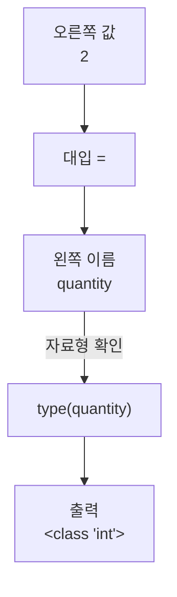
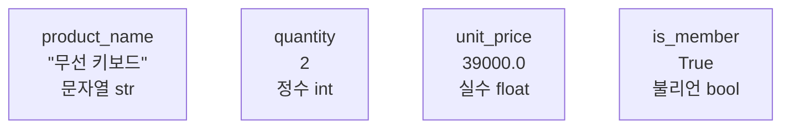
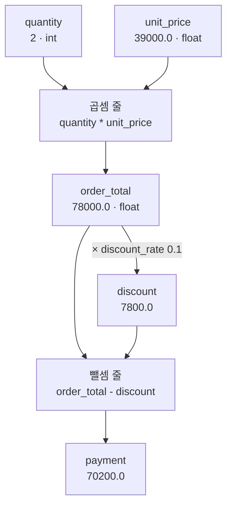
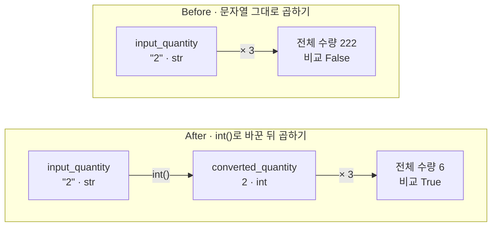

# 01-변수와-자료형

## _src 본문 (HTML 원본)

```html
<!--meta: 강의 1h | 실습 2h | 코드 Jupyter Notebook | 새 용어 11 -->
<h2 id="b1"><span class="no">1</span>학습 목표</h2>
<div class="goal"><ul><li>값을 변수에 대입하고, 변수 이름으로 다시 읽어 계산할 수 있습니다.</li><li>출력된 <code>&lt;class 'int'&gt;</code> 같은 결과를 보고 정수·실수·문자열·불리언을 구분할 수 있습니다.</li><li>숫자 모양 문자열을 정수로 바꿔야 계산이 맞는 이유를 출력으로 설명할 수 있습니다.</li></ul></div>
<h2 id="b2"><span class="no">2</span>이 내용을 배우는 이유</h2>
<p>프로그램은 상품 이름, 수량, 가격처럼 성격이 다른 값을 함께 다룹니다. 값마다 이름을 붙여 두면 여러 줄의 계산에서 같은 값을 다시 쓸 수 있습니다.</p>
<p>값의 종류도 중요합니다. 화면에는 똑같이 2로 보여도 글자 2와 숫자 2는 계산 결과가 다릅니다. 글자 "2"에 3을 곱하면 6이 아니라 222가 나옵니다.</p>
<p>이때 오류 메시지는 나오지 않습니다. Ch 1 4절에서 곱셈을 덧셈으로 잘못 적었을 때도 오류 없이 3002원이 나왔습니다. 이번에는 적은 식이 아니라 값의 종류가 원인입니다. <b>실행이 멈추지 않아도 계산 결과는 틀릴 수 있습니다.</b> 그래서 계산하기 전에 값의 종류를 확인하는 습관이 필요합니다.</p>
<p><strong>이 절의 질문</strong> — 문자열로 받은 수량을 숫자로 계산하려면 무엇을 바꿔야 할까요?</p>
<h2 id="b3"><span class="no">3</span>앞에서 배운 내용</h2>
<p>Ch 1에서 배운 것 가운데 이 절이 이어 쓰는 것을 표로 모았습니다.</p>
<table><thead><tr><th>Ch 1</th><th>배운 것</th><th>이 절에서 이어 쓰는 곳</th></tr></thead><tbody>
<tr><td>1절</td><td>이름 <code>price</code>에 3000, <code>count</code>에 2를 저장하고 곱해 합계 6000 얻기</td><td>같은 곱셈을 다시 해 자료형 확인</td></tr>
<tr><td>1절</td><td>대입 <code>=</code>, 비교 <code>==</code>와 <code>True</code>·<code>False</code>, <code>print(라벨, 값)</code></td><td>변수 저장, 자료형 출력, 기대 수량과 비교</td></tr>
<tr><td>1절</td><td>예상 적기 → 실행 → 출력 확인 → 비교, 값 하나만 바꿔 다시</td><td>계산 셀마다 먼저 예상, 수량을 2에서 3으로 바꾸기</td></tr>
<tr><td>1·4절</td><td>검사 줄 <code>assert</code>, 오류 없이 틀린 결과(덧셈으로 잘못 적은 3002원)</td><td>Before의 222, After의 검사 줄</td></tr>
<tr><td>3절</td><td>실습 폴더에서 <code>uv sync --locked</code>, 커널에서 <code>.venv</code> 고르기</td><td>이 장의 실습 폴더 <code>labs/part1/ch02-python</code></td></tr>
<tr><td>4절</td><td><code>hello.py</code> 마지막 줄 <code>f"총액: {total}원"</code>을 읽기만 함</td><td>f-string으로 주문 요약 문장 만들기</td></tr>
</tbody></table>
<p>Ch 1은 함수, 반환값, 문자열, 변수, 인자를 한 문장씩 정의했습니다. 이 절은 그 뜻을 그대로 이어 씁니다. 이름과 값의 규칙, 자료형, 형 변환은 Ch 1이 Ch 2로 미룬 내용이라 이 절에서 배웁니다.</p>
<p>Ch 1에서 목록과 <code>for</code>, 여러 줄 <code>if</code>도 써 보았습니다. 이 절의 노트북에는 나오지 않고, 2절과 3절에서 자세히 배웁니다.</p>
<p>노트북은 Ch 1 3절과 같은 순서로 준비합니다. 실습 폴더에서 환경을 만들고, 커널에서 <code>.venv</code>를 고른 뒤 첫 셀부터 실행합니다. 이전 커널의 변수는 쓰지 않으므로 첫 셀부터 차례로 실행하면 필요한 변수가 모두 새로 만들어집니다.</p>
<h2 id="b4"><span class="no">4</span>핵심 개념</h2>
<h3>비유로 시작하기</h3>
<p>창고 선반에 투명한 상자가 여럿 있다고 해 봅니다. 상자마다 이름표를 달아 두면 이름만 보고 원하는 상자를 찾을 수 있습니다.</p>
<p>상자 안에 든 물건은 종류가 다릅니다. 종이 쪽지, 나무 블록 두 개, 물을 반쯤 채운 계량컵, 켜고 끄는 스위치가 들어 있습니다. 물건의 종류가 다르면 쓰는 방법도 다릅니다.</p>
<p>프로그램에서 이름표는 변수이고, 상자 안의 물건은 값입니다. 물건의 종류는 자료형입니다.</p>
{{img:01-5-이름표-상자|선반 위 투명한 상자 네 개에 빈 이름표가 하나씩 매달려 있고, 상자 안에 종이 쪽지, 나무 블록 두 개, 물이 반쯤 찬 계량컵, 스위치가 각각 들어 있는 삽화|이름표는 변수, 상자 안의 물건은 값, 물건의 종류는 자료형에 해당합니다.}}
<p><strong>그림 읽기</strong> — 상자마다 노란 이름표가 하나씩 매달려 있습니다. 이름표가 변수 이름이고, 상자 안의 물건이 값입니다. 왼쪽부터 종이 쪽지는 문자열, 나무 블록 두 개는 정수입니다. 물이 반쯤 찬 계량컵은 실수, 켜고 끄는 스위치는 불리언에 해당합니다.</p>
<p>왼쪽 끝의 손은 첫 상자에 이름표를 다는 중입니다. 대입으로 값에 이름을 붙이는 순간입니다.</p>
<h3>이 절에서 쓰는 말</h3>
<table><thead><tr><th>용어</th><th>뜻</th><th>이 절에서 보이는 모습</th></tr></thead><tbody>
<tr><td>변수(variable)</td><td>값을 저장한 이름(Ch 1 2절에서 한 문장으로 정의)</td><td><code>quantity</code>, <code>unit_price</code></td></tr>
<tr><td>대입(assignment)</td><td>오른쪽 값에 왼쪽 이름을 붙여 저장하는 일</td><td><code>quantity = 2</code></td></tr>
<tr><td>자료형(type)</td><td>값의 종류. 할 수 있는 계산이 달라짐</td><td><code>&lt;class 'int'&gt;</code> 같은 출력</td></tr>
<tr><td>정수(int)</td><td>소수점이 없는 수</td><td>수량 <code>2</code></td></tr>
<tr><td>실수(float)</td><td>소수점이 있는 수</td><td>단가 <code>39000.0</code></td></tr>
<tr><td>문자열(str)</td><td>따옴표로 감싼 글(Ch 1). 자료형 이름은 str</td><td><code>"무선 키보드"</code>, <code>"2"</code></td></tr>
<tr><td>불리언(bool)</td><td>참과 거짓 두 값만 있는 자료형</td><td>회원 여부 <code>True</code></td></tr>
<tr><td>함수 호출</td><td>함수(Ch 1)를 부르는 일. 괄호 안에 인자를 건넴</td><td><code>type(quantity)</code></td></tr>
<tr><td>예약어(keyword)</td><td>Python이 문법에 쓰려고 정해 둔 낱말. 이름으로 못 씀</td><td><code>True</code>, <code>for</code>, <code>if</code></td></tr>
<tr><td>f-string</td><td>중괄호 자리에 변수 값을 넣는 문자열</td><td><code>f"{product_name} {quantity}개, ..."</code></td></tr>
<tr><td>형 변환</td><td>값의 자료형을 다른 자료형으로 바꾸는 일</td><td><code>int(input_quantity)</code></td></tr>
</tbody></table>
<h3>대입문 읽는 순서</h3>
<p>대입문 <code>quantity = 2</code>는 오른쪽부터 읽습니다. 먼저 값 2가 있고, 그 값에 이름 quantity가 붙습니다.</p>
<p>Ch 1에서 본 대로 이 줄은 「두 쪽이 같다」가 아니라 「오른쪽 값에 왼쪽 이름을 붙여 저장한다」는 뜻입니다.</p>
{{mermaid:01-1-대입-읽는-순서|값 2가 대입을 거쳐 이름 quantity에 붙고, type(quantity)로 자료형을 확인하면 class int가 출력되는 흐름도|대입문 읽는 순서. 오른쪽 값 2에 이름 quantity가 붙고, 자료형을 확인하면 int가 나옵니다.}}
<p><strong>도식 읽기</strong> — 위에서 아래로 읽습니다. 초록 상자는 값이고, 파란 상자는 우리가 적는 대입과 이름입니다. 노란 상자는 확인하는 줄과 그 출력입니다.</p>
<p>값 2가 대입을 거쳐 이름 quantity에 붙습니다. 이어서 이름을 넣어 <code>type(quantity)</code>를 실행하면 <code>&lt;class 'int'&gt;</code>가 출력됩니다.</p>
<p>이미 있는 이름에 다시 대입하면 그 이름의 값이 바뀝니다. 그 이름으로 앞에서 계산해 둔 결과는 바뀌지 않습니다. 이 동작은 실행 예제에서 출력으로 확인합니다.</p>
<h3>이름 짓는 규칙</h3>
<p>Ch 1은 이름과 값의 규칙을 Ch 2에서 자세히 배운다고 미뤄 두었습니다. 이름을 규칙에 어긋나게 적으면 셀이 아예 실행되지 않으므로 먼저 정리합니다.</p>
<table><thead><tr><th>규칙</th><th>쓸 수 있는 이름</th><th>쓸 수 없는 이름</th></tr></thead><tbody>
<tr><td>숫자로 시작하지 않습니다</td><td><code>price2</code></td><td><code>2price</code></td></tr>
<tr><td>빈칸 대신 밑줄로 낱말을 잇습니다</td><td><code>unit_price</code></td><td><code>unit price</code></td></tr>
<tr><td>예약어는 이름으로 쓰지 않습니다</td><td><code>is_member</code></td><td><code>True</code>, <code>for</code></td></tr>
<tr><td>대문자와 소문자를 다른 글자로 봅니다</td><td><code>quantity</code>와 <code>Quantity</code>는 서로 다른 이름</td><td>—</td></tr>
</tbody></table>
<p>예약어(keyword)는 Python이 문법에 쓰려고 정해 둔 낱말입니다. 달리기 시합에서 신호 말 「출발」을 선수 이름으로 부르면 모두 뛰어나가는 것과 비슷합니다. Ch 1에서 쓴 <code>for</code>, <code>if</code>, <code>True</code>가 예약어입니다.</p>
<p>이 교재는 이름에 영문 소문자, 숫자, 밑줄만 씁니다. q보다 quantity처럼 뜻이 드러나는 낱말을 고릅니다. 규칙에 어긋난 이름이 든 셀은 문법 오류로 실행되지 않습니다. 이 오류 장면은 이번에 실행하지 않았습니다.</p>
<h3>네 가지 자료형</h3>
<p>자료형(type)은 값의 종류입니다. 종류에 따라 할 수 있는 계산이 달라집니다. 이 절에서는 네 가지를 씁니다.</p>
<p>정수(int)는 소수점이 없는 수이고, 실수(float)는 소수점이 있는 수입니다. Ch 1에서 따옴표로 감싼 글이라고 한 문자열도 자료형 하나이고, 이름은 str입니다. 불리언(bool)은 Ch 1의 비교에서 본 True와 False 두 값만 가집니다.</p>
<p>값을 적는 규칙도 자료형마다 다릅니다. 글은 따옴표로 감싸고, 숫자는 따옴표 없이 적습니다. 금액 39000에는 천 단위 쉼표를 넣지 않습니다. 쉼표는 Ch 1의 목록에서처럼 값 여러 개를 나누는 표시이기 때문입니다. 불리언 값은 첫 글자를 대문자로 써서 True와 False로 적습니다.</p>
{{mermaid:01-2-네-자료형|product_name은 문자열, quantity는 정수, unit_price는 실수, is_member는 불리언임을 나란히 보여 주는 그림|노트북에서 저장한 네 변수. 상자마다 이름, 값, 자료형 순서로 적었습니다.}}
<p><strong>도식 읽기</strong> — 초록 상자 네 개는 노트북에서 저장한 네 변수입니다. 상자마다 첫 줄은 변수 이름, 둘째 줄은 값, 셋째 줄은 자료형입니다.</p>
<p>첫 상자의 값 "무선 키보드"에만 따옴표가 있습니다. 둘째 상자의 2에는 소수점이 없고, 셋째 상자의 39000.0에는 소수점이 있습니다. 그래서 둘째는 정수, 셋째는 실수입니다.</p>
<p>따옴표가 붙은 "2"는 문자열이고, 따옴표가 없는 2는 정수입니다. 출력 화면에는 따옴표가 나오지 않아 둘 다 2로 보입니다. 그래서 자료형을 출력해 구분합니다.</p>
<h3>함수 호출과 f-string</h3>
<p>Ch 1에서 이름 뒤에 괄호를 붙여 부르는 기능을 함수라고 했습니다. 괄호 안에 건네는 값은 인자이고, 함수가 계산해 내놓는 값은 반환값입니다. 함수를 부르는 일을 함수 호출이라고 합니다.</p>
<p>Ch 1에서 쓴 함수 <code>print()</code>에 더해, 이 절에서는 내장 함수 두 개를 새로 씁니다. 함수 <code>type()</code>은 인자로 받은 값의 자료형을 반환합니다. 함수 <code>int()</code>는 숫자 모양 문자열을 정수로 바꿔 반환합니다.</p>
<p>Ch 1 4절의 <code>hello.py</code> 마지막 줄 <code>f"총액: {total}원"</code>은 읽기만 했습니다. 따옴표 앞에 f를 붙인 이 문자열을 f-string이라고 합니다. 중괄호 안에 변수 이름을 적으면 그 자리에 변수 값이 들어갑니다. 수량이 2이면 <code>f"{quantity}개"</code>는 2개가 됩니다.</p>
<h2 id="b5"><span class="no">5</span>실행 예제</h2>
<p>노트북은 Python 버전을 확인한 뒤 상품 정보 네 가지를 변수에 저장합니다. 그다음 자료형을 출력하고, 주문 금액과 결제 금액을 계산합니다. 주문 금액을 계산하기 전에 Ch 1 1절의 합계 3000 × 2도 다시 계산해 자료형을 비교합니다.</p>
<p>모델을 부르지 않으므로 API 키가 필요 없고 비용도 들지 않습니다. 계산 셀의 출력 숫자는 다시 실행해도 같습니다.</p>
<p>마지막으로 수량만 2에서 3으로 바꿉니다. Ch 1 1절에서는 새 이름 <code>new_count</code>에 3을 담았지만, 이번에는 같은 이름 <code>quantity</code>에 다시 대입합니다. 이미 계산한 주문 금액이 저절로 바뀌는지 출력으로 확인합니다.</p>
{{notebook:01-변수와-자료형|example}}
<p class="look"><b>확인할 점</b> — 자료형 출력 네 줄이 모두 다른지 봅니다. Ch 1의 합계 6000은 int, 주문 금액 78000.0은 float인지 확인합니다. 수량을 3으로 바꾼 직후에도 주문 금액이 78000.0으로 남아 있는지 확인합니다.</p>
<h3>금액이 계산되는 순서</h3>
<p>주문 금액부터 결제 금액까지 값이 이어지는 순서를 한 그림으로 모았습니다.</p>
{{mermaid:01-3-금액-계산-흐름|quantity 2와 unit_price 39000.0이 곱셈 줄에서 order_total 78000.0이 되고, 할인액 7800.0을 뺄셈 줄에서 빼 payment 70200.0이 되는 흐름도|금액 계산 흐름. 정수 2와 실수 39000.0을 곱한 order_total은 실수 78000.0입니다.}}
<p><strong>도식 읽기</strong> — 위에서 아래로 읽습니다. 초록 상자는 변수에 저장된 값이고, 파란 상자는 계산하는 줄입니다.</p>
<p>quantity 2와 unit_price 39000.0이 곱셈 줄로 들어가 order_total 78000.0이 됩니다. 정수와 실수를 곱해 결과의 자료형은 float입니다. 정수끼리 곱한 Ch 1의 합계 6000은 int였습니다. 주문 금액에 할인율 0.1을 곱하면 discount 7800.0입니다. 뺄셈 줄에서 두 값을 빼면 payment 70200.0이 나옵니다.</p>
<p>수량을 3으로 바꾼 뒤에는 곱셈 줄을 다시 실행해야 새 금액이 나옵니다. 노트북에서는 새 이름 <code>new_total</code>에 117000.0을 담았습니다. 이때 order_total은 78000.0 그대로였습니다.</p>
<h2 id="b6"><span class="no">6</span>일부러 실패해 보기</h2>
<p>파일에서 읽은 값은 숫자 모양이어도 문자열입니다. 5절에서 파일을 읽어 직접 확인합니다. 이번에는 수량을 문자열 "2"로 받았다고 가정합니다. 상자 3개에 2개씩 담으면 기대하는 전체 수량은 6개입니다.</p>
<p>Before 셀은 문자열 "2"에 정수 3을 곱합니다. 오류 없이 실행되지만 전체 수량은 222입니다. 기대한 수량 6과 비교한 결과는 False입니다. 문자열에 정수를 곱하면 글자를 그 횟수만큼 이어 붙이기 때문입니다.</p>
<p>After 셀은 곱하기 전에 함수 <code>int()</code>로 문자열을 정수로 바꿉니다. 입력 "2"와 상자 수 3은 그대로 두었습니다. 자료형이 str에서 int로 바뀌고, 전체 수량은 6이 됩니다.</p>
{{mermaid:01-4-문자열-수량-비교|Before는 문자열 2에 3을 곱해 전체 수량 222와 비교 False, After는 int로 바꾼 정수 2에 3을 곱해 전체 수량 6과 비교 True가 나오는 비교 그림|같은 입력 "2"와 상자 수 3. 곱하기 전에 int()를 거치자 222가 6으로 바뀝니다.}}
<p><strong>도식 읽기</strong> — 위 칸이 Before, 아래 칸이 After입니다. 두 칸 모두 왼쪽 초록 상자의 입력은 문자열 "2"입니다.</p>
<p>Before 칸은 입력에 바로 3을 곱해 빨간 상자의 전체 수량 222, 비교 False에 이릅니다. After 칸은 int()를 거쳐 정수 2를 만든 뒤 3을 곱합니다. 노란 상자의 전체 수량은 6이고 비교는 True입니다.</p>
{{notebook:01-변수와-자료형|failure}}
<h3>확인한 범위</h3>
<p>이번에 고친 경우는 숫자 모양 문자열 "2" 하나입니다. 곱할 값도 정수 3 하나만 썼습니다.</p>
<p>"두 개"처럼 숫자 모양이 아닌 문자열을 int()에 넣는 장면은 이번에 실행하지 않았습니다. 이런 입력을 다루는 방법은 5절 파일과 예외에서 배웁니다.</p>
<h2 id="b7"><span class="no">7</span>주의할 점과 실무 메모</h2>
<ul><li>변수 이름은 규칙에 맞아도 q처럼 한 글자로 짓지 않습니다. 나중에 무엇을 담았는지 알기 어렵습니다.</li>
<li>불리언 값에 따옴표를 붙여 "False"로 적으면 불리언이 아니라 문자열이 됩니다.</li>
<li>실수는 일부 소수를 정확히 담지 못하고 가장 가까운 값으로 저장합니다. 이 절의 할인액 계산은 7800.0으로 나왔지만, 다른 소수 계산에서는 끝자리가 어긋날 수 있습니다. 그런 장면은 이번에 실행하지 않았습니다.</li>
<li>돈을 원 단위까지 정확히 다뤄야 하면 금액을 정수 원 단위로 저장하는 방법을 검토합니다.</li>
<li>변수 값을 바꾼 뒤에는 그 값을 쓰는 계산 셀도 다시 실행합니다. 노트북에서 수량을 3으로 바꿨을 때 주문 금액은 78000.0 그대로였습니다.</li>
<li>셀을 뒤섞인 순서로 실행하면 변수에 예상과 다른 값이 남습니다. 결과가 이상하면 첫 셀부터 다시 실행합니다.</li></ul>
<h2 id="b8"><span class="no">8</span>정리와 다음 절</h2>
<ul><li>변수는 값에 붙인 이름이고, 등호 <code>=</code>로 값을 대입합니다. 이름은 숫자로 시작할 수 없고 빈칸 대신 밑줄로 잇습니다. 다시 대입해도 앞에서 계산한 결과는 바뀌지 않습니다.</li><li>값마다 자료형이 있고, 함수 <code>type()</code>으로 확인합니다. 정수끼리 곱한 6000은 int, 정수와 실수를 곱한 78000.0은 float였습니다.</li><li>숫자 모양 문자열은 함수 <code>int()</code>로 정수로 바꾼 뒤 계산합니다.</li></ul>
<p><strong>다음 학습과 이어지는 지점</strong> — 2절에서는 주문 금액과 무료 배송 기준을 변수에 저장합니다. 그리고 조건이 참인지 거짓인지에 따라 서로 다른 줄을 실행합니다.</p>
<h2 id="b9"><span class="no">9</span>복습 문제</h2><details class="quiz"><summary>문제와 해설</summary>
<p class="quiz-q">1. 대입문 <code>quantity = 2</code>에서 변수와 값은 각각 무엇인가요? · 기초</p><p class="quiz-a"><b>해설</b> — 변수는 quantity이고, 값은 정수 2입니다. 등호는 오른쪽 값을 왼쪽 이름에 저장합니다.</p>
<p class="quiz-q">2. 변수 이름 <code>2price</code>와 <code>unit price</code>는 왜 쓸 수 없나요? 어떻게 고치나요? · 기초</p><p class="quiz-a"><b>해설</b> — 이름은 숫자로 시작할 수 없고 빈칸을 넣을 수 없습니다. <code>price2</code>, <code>unit_price</code>처럼 숫자를 뒤로 보내고 빈칸을 밑줄로 바꿉니다.</p>
<p class="quiz-q">3. 노트북에서 변수 <code>unit_price</code>의 자료형은 무엇으로 출력됐고, 왜 그런가요? · 기초</p><p class="quiz-a"><b>해설</b> — <code>&lt;class 'float'&gt;</code>로 출력됐습니다. 값 39000.0에 소수점이 있어서 실수입니다.</p>
<p class="quiz-q">4. Ch 1의 합계 <code>price * count</code>와 이번 주문 금액 <code>quantity * unit_price</code>의 자료형은 각각 무엇인가요? · 적용</p><p class="quiz-a"><b>해설</b> — Ch 1의 합계 6000은 <code>&lt;class 'int'&gt;</code>, 주문 금액 78000.0은 <code>&lt;class 'float'&gt;</code>로 출력됐습니다. 이번 노트북에서 정수끼리 곱하자 정수가, 정수와 실수를 곱하자 실수가 나왔습니다.</p>
<p class="quiz-q">5. 수량에 3을 대입한 직후 <code>order_total</code>을 출력하면 어떤 값이 나오나요? · 적용</p><p class="quiz-a"><b>해설</b> — 78000.0이 그대로 나옵니다. 곱셈은 그 줄을 실행한 순간에 한 번만 일어납니다. 새 수량의 금액 117000.0을 얻으려면 곱셈을 다시 실행합니다.</p>
<p class="quiz-q">6. 문자열 "2"에 3을 곱하면 왜 6이 나오지 않나요? 어떻게 고치나요? · 분석</p><p class="quiz-a"><b>해설</b> — 문자열에 정수를 곱하면 글자를 반복해 222가 됩니다. 곱하기 전에 <code>int("2")</code>로 정수로 바꾸면 6이 나옵니다.</p>
</details>
<h2 id="b10"><span class="no">10</span>참고 자료</h2>
<ul><li><a href="https://docs.python.org/3.12/tutorial/introduction.html">Python 3.12 자습서 3장: Python을 계산기로 사용하기</a> · 확인 2026-09-16 · 기준 Python 3.12</li><li><a href="https://docs.python.org/3.12/library/functions.html#type">Python 3.12 내장 함수 type</a> · 확인 2026-09-16 · 기준 Python 3.12</li><li><a href="https://docs.python.org/3.12/library/functions.html#int">Python 3.12 내장 함수 int</a> · 확인 2026-09-16 · 기준 Python 3.12</li></ul>
```

## 노트북 셀 (순서대로)

### [0] markdown {'html': 'skip'}

# 변수와 자료형

**이 노트북에서 할 일**

1. 상품 정보 네 가지를 변수에 저장하고, 값마다 자료형을 출력합니다.
2. 수량과 단가로 주문 금액과 결제 금액을 계산하고, 수량 하나만 바꿔 비교합니다.
3. 문자열 수량 `"2"`로 계산이 틀리는 장면을 보고, 정수로 바꿔 고칩니다.

**준비물** — API 키 불필요. 데이터 파일도 없습니다. 모델 호출은 0번이고 비용은 들지 않습니다.
실행 시간은 1분 이내입니다.

실습 폴더 `labs/part1/ch02-python`에서 Ch 1 3절처럼 `uv sync --locked`로 환경을 만듭니다.
커널에서 이 폴더의 `.venv`를 고른 뒤 첫 셀부터 순서대로 실행합니다.

### [1] markdown {'html': 'skip'}

## 오늘 볼 그림


위에서 아래로 읽습니다. 초록 상자는 값, 파란 상자는 우리가 적는 대입과 이름, 노란 상자는 확인 결과입니다.
대입문 `quantity = 2`는 오른쪽 값부터 읽습니다. 값 2에 이름 quantity가 붙고, 자료형을 확인하면 int가 나옵니다.

### [2] markdown {}

## 1. 준비

이 절은 설치할 패키지가 없습니다. 첫 셀은 Ch 1 1절의 첫 셀과 같이 Python 버전을 확인합니다.
셀을 고른 뒤 `Shift+Enter`를 누르면 그 셀이 실행되고 다음 셀로 넘어갑니다.

코드의 `import` 줄은 Ch 1에서 본 대로 Python에 들어 있는 기능 묶음을 불러오는 줄입니다. 자세한 뜻은 7절 모듈과 타입힌트에서 배웁니다.

### [3] code {'execution': {'iopub.execute_input': '2026-09-16T09:01:54.030154Z', 'iopub.status.busy': '2026-09-16T09:01:54.029962Z', 'iopub.status.idle': '2026-09-16T09:01:54.036978Z', 'shell.execute_reply': '2026-09-16T09:01:54.036050Z'}, 'lesson_role': 'setup', 'upgrade_allow': ['stdlib-import']}

```python
# 이 노트북을 실행하는 Python 버전을 확인합니다
import platform

# python_version()은 "3.12.13" 같은 버전 문자열을 반환합니다
python_version = platform.python_version()
is_python_312 = python_version.startswith("3.12")
print("Python 버전:", python_version)
print("3.12 버전인가:", is_python_312)
```

출력:
```
Python 버전: 3.12.13
3.12 버전인가: True

```

### [4] markdown {}

**결과 읽기** — Python 버전이 3.12로 시작하고 `True`가 보이면 준비가 된 것입니다.
버전의 마지막 숫자는 컴퓨터마다 다를 수 있습니다.

### [5] markdown {}

## 2. 값에 이름 붙이기

Ch 1 1절에서 이름 `price`에 3000을 저장했습니다. 이렇게 값을 저장한 이름을 변수(variable)라고 합니다.
선반의 상자에 이름표를 달아 두면 이름만 보고 상자를 찾는 것과 같습니다.
등호 `=`로 오른쪽 값에 왼쪽 이름을 붙여 저장하는 일은 대입(assignment)이라고 합니다.

Ch 1이 Ch 2로 미룬 이름 규칙을 여기서 정리합니다. 숫자로 시작하는 `2price`는 이름으로 쓸 수 없습니다.
빈칸도 넣을 수 없어서 두 낱말은 `unit_price`처럼 밑줄로 잇습니다.
`for`, `True`처럼 Python이 문법에 쓰려고 정해 둔 낱말(예약어)도 이름으로 쓸 수 없습니다.
대문자와 소문자는 다른 글자라서 `quantity`와 `Quantity`는 서로 다른 이름입니다.

규칙에 어긋난 이름이 든 셀은 문법 오류로 실행되지 않습니다. 이 장면은 이번에 실행하지 않았습니다.
아래 셀은 규칙에 맞는 이름으로 상품 이름, 수량, 단가, 회원 여부를 변수 네 개에 저장합니다.

### [6] code {'execution': {'iopub.execute_input': '2026-09-16T09:01:54.038732Z', 'iopub.status.busy': '2026-09-16T09:01:54.038583Z', 'iopub.status.idle': '2026-09-16T09:01:54.042114Z', 'shell.execute_reply': '2026-09-16T09:01:54.041335Z'}}

```python
# 주문 한 건의 상품 정보를 변수 네 개에 저장합니다
product_name = "무선 키보드"
quantity = 2
unit_price = 39000.0
is_member = True
# 저장만 하면 화면에 아무것도 나오지 않으므로 print()로 출력합니다
print("상품 이름:", product_name)
print("수량:", quantity)
print("단가:", unit_price)
print("회원 여부:", is_member)
```

출력:
```
상품 이름: 무선 키보드
수량: 2
단가: 39000.0
회원 여부: True

```

### [7] markdown {}

**결과 읽기** — 저장한 순서대로 네 줄이 출력됐습니다. 상품 이름은 `무선 키보드`, 수량은 `2`입니다.
단가는 `39000.0`, 회원 여부는 `True`입니다.
출력에는 따옴표가 나오지 않습니다. 따옴표는 이 값이 글자라고 Python에 알려 주는 표시입니다.

### [8] markdown {}

## 3. 자료형 확인하기

자료형(type)은 값의 종류입니다. 종류에 따라 할 수 있는 계산이 달라집니다.

Ch 1에서 이름 뒤에 괄호를 붙여 부르는 기능을 함수라고 했습니다. 함수를 부르는 일은 함수 호출이라고 합니다.
내장 함수 `type()`은 괄호 안에 건넨 인자의 자료형을 반환합니다.

### [9] code {'execution': {'iopub.execute_input': '2026-09-16T09:01:54.043631Z', 'iopub.status.busy': '2026-09-16T09:01:54.043479Z', 'iopub.status.idle': '2026-09-16T09:01:54.046794Z', 'shell.execute_reply': '2026-09-16T09:01:54.046032Z'}}

```python
# type() 함수로 네 변수에 담긴 값의 자료형을 확인합니다
print("product_name:", type(product_name))
print("quantity:", type(quantity))
print("unit_price:", type(unit_price))
print("is_member:", type(is_member))
```

출력:
```
product_name: <class 'str'>
quantity: <class 'int'>
unit_price: <class 'float'>
is_member: <class 'bool'>

```

### [10] markdown {}

**결과 읽기** — 네 줄의 자료형이 모두 다릅니다. 상품 이름은 문자열 `<class 'str'>`, 수량은 정수 `<class 'int'>`입니다.
단가는 실수 `<class 'float'>`, 회원 여부는 불리언 `<class 'bool'>`입니다.
수량 2에는 소수점이 없고, 단가 39000.0에는 소수점이 있습니다. 그래서 둘의 자료형이 다릅니다.

### [11] markdown {}

## 4. 주문 금액 계산하기

계산식에는 값 대신 변수 이름을 쓸 수 있습니다. 먼저 Ch 1 1절의 합계를 같은 이름으로 다시 계산합니다.
단가 3000과 수량 2는 둘 다 소수점이 없는 정수입니다. 정수끼리 곱한 합계의 자료형을 실행 전에 예상해 봅니다.

### [12] code {'execution': {'iopub.execute_input': '2026-09-16T09:01:54.048345Z', 'iopub.status.busy': '2026-09-16T09:01:54.048213Z', 'iopub.status.idle': '2026-09-16T09:01:54.050998Z', 'shell.execute_reply': '2026-09-16T09:01:54.050424Z'}}

```python
# Ch 1 1절의 단가와 수량을 정수로 적어 곱합니다
price = 3000
count = 2
total = price * count
print("Ch 1의 합계:", total)
print("합계의 자료형:", type(total))
```

출력:
```
Ch 1의 합계: 6000
합계의 자료형: <class 'int'>

```

### [13] markdown {}

**결과 읽기** — Ch 1과 같은 합계 `6000`이 나왔고, 자료형은 `<class 'int'>`입니다.
정수끼리 곱했더니 정수가 나왔습니다. 그래서 출력에도 소수점이 없습니다.

이번 상품은 단가를 소수점이 있는 39000.0으로 적었습니다. 식 `quantity * unit_price`로 수량과 단가를 곱합니다.
결과는 새 변수 `order_total`에 저장합니다. 정수와 실수를 곱하면 어떤 자료형이 나올지 예상해 봅니다.

### [14] code {'execution': {'iopub.execute_input': '2026-09-16T09:01:54.052255Z', 'iopub.status.busy': '2026-09-16T09:01:54.052150Z', 'iopub.status.idle': '2026-09-16T09:01:54.054666Z', 'shell.execute_reply': '2026-09-16T09:01:54.054059Z'}}

```python
# 수량과 단가를 곱해 주문 금액을 계산합니다
order_total = quantity * unit_price
print("주문 금액:", order_total)
print("주문 금액의 자료형:", type(order_total))
```

출력:
```
주문 금액: 78000.0
주문 금액의 자료형: <class 'float'>

```

### [15] markdown {}

**결과 읽기** — 주문 금액은 `78000.0`이고, 자료형은 `<class 'float'>`입니다.
정수 2와 실수 39000.0을 곱했더니 실수가 나왔습니다. 앞 셀에서 정수끼리 곱한 6000과 달리 소수점이 붙었습니다.

### [16] markdown {}

## 5. 결제 금액 계산하기

회원 할인율 10%를 소수 0.1로 저장합니다. 할인액은 주문 금액에 할인율을 곱한 값입니다.
결제 금액은 주문 금액에서 할인액을 뺀 값입니다. 뺄셈 기호는 `-`입니다.
할인액을 변수에 따로 담으면 중간 값도 출력해 확인할 수 있습니다.

### [17] code {'execution': {'iopub.execute_input': '2026-09-16T09:01:54.055803Z', 'iopub.status.busy': '2026-09-16T09:01:54.055669Z', 'iopub.status.idle': '2026-09-16T09:01:54.058329Z', 'shell.execute_reply': '2026-09-16T09:01:54.057867Z'}}

```python
# 회원 할인율 10%를 소수로 저장합니다
discount_rate = 0.1
# 할인액을 따로 담아 두면 중간 값을 출력해 볼 수 있습니다
discount = order_total * discount_rate
payment = order_total - discount
print("할인율:", discount_rate)
print("할인액:", discount)
print("결제 금액:", payment)
```

출력:
```
할인율: 0.1
할인액: 7800.0
결제 금액: 70200.0

```

### [18] markdown {}

**결과 읽기** — 할인율 `0.1`, 할인액 `7800.0`, 결제 금액 `70200.0`이 출력됐습니다.
주문 금액 78000.0에서 할인액 7800.0을 빼면 70200.0입니다.
이번에는 회원 여부를 따지지 않고 할인을 계산했습니다. 회원일 때만 할인하려면 조건문이 필요합니다.
Ch 1에서 여러 줄 `if`를 써 보았고, 조건문은 2절에서 자세히 배웁니다.

### [19] markdown {}

## 6. 한 문장으로 출력하기

Ch 1 4절의 `hello.py` 마지막 줄 `f"총액: {total}원"`은 읽기만 했습니다. 이번에는 이 문법을 직접 씁니다.
따옴표 앞에 `f`를 붙인 문자열을 f-string이라고 합니다.

중괄호 안에 변수 이름을 적으면 그 자리에 변수 값이 들어갑니다. 서식의 빈칸에 이름을 채워 넣는 모습과 비슷합니다.
중괄호 안에는 변수 이름만 적습니다. 계산은 앞 셀에서 끝내고 결과를 변수에 담아 둡니다.

### [20] code {'execution': {'iopub.execute_input': '2026-09-16T09:01:54.059483Z', 'iopub.status.busy': '2026-09-16T09:01:54.059382Z', 'iopub.status.idle': '2026-09-16T09:01:54.061921Z', 'shell.execute_reply': '2026-09-16T09:01:54.061381Z'}}

```python
# 중괄호 자리에 변수 값을 넣어 주문 요약 문장을 만듭니다
summary = f"{product_name} {quantity}개, 결제 금액 {payment}원"
print(summary)
print("요약의 자료형:", type(summary))
```

출력:
```
무선 키보드 2개, 결제 금액 70200.0원
요약의 자료형: <class 'str'>

```

### [21] markdown {}

**결과 읽기** — 출력된 문장은 `무선 키보드 2개, 결제 금액 70200.0원`입니다. 중괄호 세 곳에 변수 값이 들어갔습니다.
요약의 자료형은 `<class 'str'>`입니다. 숫자를 넣어 만들어도 f-string의 결과는 문자열입니다.

### [22] markdown {}

## 7. 수량 하나만 바꿔 보기

Ch 1 1절에서는 수량을 바꿀 때 새 이름 `new_count`에 3을 담았습니다.
이번에는 같은 이름 `quantity`에 3을 다시 대입합니다. 이미 있는 변수에 다시 대입하면 그 이름의 값이 새 값으로 바뀝니다.
앞에서 계산한 `order_total`도 저절로 바뀔까요?

실행 전에 예상을 적습니다. 주문 금액은 78000.0 그대로일 것입니다. 곱셈은 그 줄을 실행한 순간에 한 번만 일어나기 때문입니다.

### [23] code {'execution': {'iopub.execute_input': '2026-09-16T09:01:54.063007Z', 'iopub.status.busy': '2026-09-16T09:01:54.062899Z', 'iopub.status.idle': '2026-09-16T09:01:54.065354Z', 'shell.execute_reply': '2026-09-16T09:01:54.064897Z'}}

```python
# 수량 변수에 새 값 3을 대입합니다
quantity = 3
print("바꾼 수량:", quantity)
# 주문 금액은 수량이 2일 때 계산해 둔 값입니다
print("주문 금액:", order_total)
```

출력:
```
바꾼 수량: 3
주문 금액: 78000.0

```

### [24] markdown {}

**결과 읽기** — 바꾼 수량은 `3`이지만, 주문 금액은 `78000.0` 그대로입니다.
변수 `order_total`에는 4번 소제목의 두 번째 셀을 실행한 순간의 결과가 들어 있습니다. 수량을 바꿔도 다시 계산되지 않습니다.

새 수량으로 금액을 얻으려면 곱셈을 다시 실행합니다. 결과는 수량 2일 때와 나란히 보려고 새 이름 `new_total`에 담습니다.
실행 전에 예상합니다. 39000.0원짜리 3개이므로 117000.0이 나올 것입니다.

### [25] code {'execution': {'iopub.execute_input': '2026-09-16T09:01:54.066459Z', 'iopub.status.busy': '2026-09-16T09:01:54.066354Z', 'iopub.status.idle': '2026-09-16T09:01:54.068579Z', 'shell.execute_reply': '2026-09-16T09:01:54.067976Z'}}

```python
# 바꾼 수량으로 주문 금액을 다시 계산합니다
new_total = quantity * unit_price
print("수량 2일 때 주문 금액:", order_total)
print("수량 3일 때 주문 금액:", new_total)
```

출력:
```
수량 2일 때 주문 금액: 78000.0
수량 3일 때 주문 금액: 117000.0

```

### [26] markdown {}

**결과 읽기** — 수량 3일 때 주문 금액은 `117000.0`으로 예상과 같습니다. 수량 2일 때 금액 `78000.0`도 남아 있습니다.
두 금액의 차이 39000.0은 단가와 같습니다. 바꾼 값이 수량 하나뿐이라서 금액이 달라진 원인을 수량이라고 말할 수 있습니다.

### [27] markdown {'lesson_part': 'before'}

## 8. Before — 문자열 수량으로 계산하기

파일에서 읽은 값은 숫자 모양이어도 문자열입니다. 5절에서 파일을 읽어 직접 확인합니다.

이번에는 수량을 문자열 `"2"`로 받았다고 가정합니다.
상자 3개에 이 수량만큼씩 담으면 기대하는 전체 수량은 6개입니다.
아래 셀은 문자열 `"2"`에 정수 3을 곱합니다. 결과가 6이 나올지 먼저 예상해 봅니다.

### [28] code {'execution': {'iopub.execute_input': '2026-09-16T09:01:54.069629Z', 'iopub.status.busy': '2026-09-16T09:01:54.069522Z', 'iopub.status.idle': '2026-09-16T09:01:54.072589Z', 'shell.execute_reply': '2026-09-16T09:01:54.072062Z'}, 'lesson_part': 'before'}

```python
# 입력으로 받았다고 가정한 수량은 따옴표가 붙은 문자열입니다
input_quantity = "2"
box_count = 3
expected_items = 6
# 문자열 수량에 상자 수를 곱하고, 기대한 수량과 비교합니다
total_items = input_quantity * box_count
is_expected = total_items == expected_items
print("입력 수량의 자료형:", type(input_quantity))
print("전체 수량:", total_items)
print("전체 수량의 자료형:", type(total_items))
print("기대한 수량과 같은가:", is_expected)
```

출력:
```
입력 수량의 자료형: <class 'str'>
전체 수량: 222
전체 수량의 자료형: <class 'str'>
기대한 수량과 같은가: False

```

### [29] markdown {'lesson_part': 'before'}

**결과 읽기** — 전체 수량이 6이 아니라 `222`입니다. 기대한 수량과 비교한 결과는 `False`입니다.

입력 수량의 자료형이 `<class 'str'>`이기 때문입니다. 문자열에 정수를 곱하면 글자를 그 횟수만큼 이어 붙입니다.
오류 메시지는 나오지 않았습니다. 실행이 멈추지 않아도 계산 결과는 틀릴 수 있습니다.

### [30] markdown {'lesson_part': 'after'}

## 9. After — 정수로 바꾼 뒤 계산하기

내장 함수 `int()`는 숫자 모양의 문자열을 정수로 바꿉니다. 이렇게 자료형을 바꾸는 일을 형 변환이라고 합니다.
입력 `"2"`와 상자 수 3은 Before 셀과 같습니다. 곱하기 전에 `int()`를 거치는 줄만 더합니다.

### [31] code {'execution': {'iopub.execute_input': '2026-09-16T09:01:54.073594Z', 'iopub.status.busy': '2026-09-16T09:01:54.073498Z', 'iopub.status.idle': '2026-09-16T09:01:54.075842Z', 'shell.execute_reply': '2026-09-16T09:01:54.075370Z'}, 'lesson_part': 'after'}

```python
# int() 함수로 문자열 "2"를 정수 2로 바꿉니다
converted_quantity = int(input_quantity)
print("바꾸기 전 자료형:", type(input_quantity))
print("바꾼 뒤 자료형:", type(converted_quantity))
print("바꾼 수량:", converted_quantity)
```

출력:
```
바꾸기 전 자료형: <class 'str'>
바꾼 뒤 자료형: <class 'int'>
바꾼 수량: 2

```

### [32] markdown {'lesson_part': 'after'}

**결과 읽기** — 자료형이 `<class 'str'>`에서 `<class 'int'>`로 바뀌었습니다. 바꾼 수량은 `2`입니다.
출력 화면에는 따옴표가 나오지 않아 문자열과 정수가 똑같이 2로 보입니다. 그래서 자료형을 함께 출력해 구분합니다.

이제 정수로 바꾼 수량에 상자 수를 곱합니다. 이번에는 6이 나오고 비교 결과가 `True`일 것이라고 예상합니다.

### [33] code {'execution': {'iopub.execute_input': '2026-09-16T09:01:54.076963Z', 'iopub.status.busy': '2026-09-16T09:01:54.076864Z', 'iopub.status.idle': '2026-09-16T09:01:54.079287Z', 'shell.execute_reply': '2026-09-16T09:01:54.078758Z'}, 'lesson_part': 'after'}

```python
# 정수로 바꾼 수량에 상자 수를 곱하고, 기대한 수량과 비교합니다
total_items = converted_quantity * box_count
is_expected = total_items == expected_items
print("전체 수량:", total_items)
print("기대한 수량과 같은가:", is_expected)
# 전체 수량이 기대와 다르면 이 줄에서 실행을 멈춥니다
assert total_items == expected_items
```

출력:
```
전체 수량: 6
기대한 수량과 같은가: True

```

### [34] markdown {'lesson_part': 'after'}

**결과 읽기** — 전체 수량은 `6`이고, 기대한 수량과 비교한 결과는 `True`입니다. Ch 1에서 쓴 검사 줄 `assert`에서도 멈추지 않았습니다.

Before 셀과 달라진 곳은 `int()`로 바꾸는 한 줄입니다. 곱하기 전에 자료형을 맞추자 전체 수량이 222에서 6으로 바뀌었습니다.
숫자 모양이 아닌 문자열(예: `"두 개"`)을 `int()`에 넣는 장면은 이번에 실행하지 않았습니다. 이런 입력을 다루는 방법은 5절 파일과 예외에서 배웁니다.

### [35] markdown {'html': 'skip', 'lesson_part': 'after'}

## 정리

- 변수는 값에 붙인 이름이고, 등호 `=`로 값을 대입합니다. 이름은 숫자로 시작할 수 없고 빈칸 대신 밑줄로 잇습니다.
- 값마다 자료형이 있고, 함수 `type()`으로 확인합니다. 정수끼리 곱한 6000은 int, 정수와 실수를 곱한 78000.0은 float였습니다.
- 다시 대입해도 앞에서 계산한 값은 바뀌지 않습니다. 새 값으로 계산하려면 계산 줄을 다시 실행합니다.
- 숫자 모양 문자열은 함수 `int()`로 정수로 바꾼 뒤 계산합니다.

다음 절에서는 조건문으로 주문 금액에 따라 서로 다른 줄을 실행합니다.

## 그림

### 01-1-대입-읽는-순서.mmd



- 설명 대상 문장: 대입문 `quantity = 2`는 오른쪽부터 읽습니다. 먼저 값 2가 있고, 그 값에 이름 quantity가 붙습니다.
- 캡션: 대입문 읽는 순서. 오른쪽 값 2에 이름 quantity가 붙고, 자료형을 확인하면 int가 나옵니다.
- 읽는 법: 위에서 아래로 읽습니다. 초록 상자는 값(2), 파란 상자는 우리가 적는 대입(=)과 이름(quantity), 노란 상자는 확인하는 줄 `type(quantity)`와 그 출력 `<class 'int'>`입니다. 출력은 노트북 [3. 자료형 확인하기] 셀의 `quantity: <class 'int'>`와 같습니다.
- alt: 값 2가 대입을 거쳐 이름 quantity에 붙고, type(quantity)로 자료형을 확인하면 class int가 출력되는 흐름도

### 01-2-네-자료형.mmd



- 설명 대상 문장: 정수(int)는 소수점이 없는 수이고, 실수(float)는 소수점이 있는 수입니다. 문자열(str)은 따옴표로 감싼 글자입니다. 불리언(bool)은 True와 False 두 값만 가집니다.
- 캡션: 노트북에서 저장한 네 변수. 상자마다 이름, 값, 자료형 순서로 적었습니다.
- 읽는 법: 초록 상자 네 개가 노트북 [2. 값에 이름 붙이기] 셀의 네 변수입니다. 첫 줄은 변수 이름, 둘째 줄은 값, 셋째 줄은 자료형입니다. 따옴표는 첫 상자의 값에만 있고, 2와 39000.0은 소수점 유무로 정수와 실수가 갈립니다.
- alt: product_name은 문자열, quantity는 정수, unit_price는 실수, is_member는 불리언임을 나란히 보여 주는 그림

### 01-3-금액-계산-흐름.mmd



- 설명 대상 문장: 식 `quantity * unit_price`는 수량과 단가를 곱합니다. 결제 금액은 주문 금액에서 할인액을 뺀 값입니다.
- 캡션: 금액 계산 흐름. 정수 2와 실수 39000.0을 곱한 order_total은 실수 78000.0입니다.
- 읽는 법: 위에서 아래로 읽습니다. 초록 상자는 변수에 저장된 값, 파란 상자는 계산하는 줄입니다. quantity 2와 unit_price 39000.0이 곱셈 줄에서 order_total 78000.0(float)이 되고, 할인율 0.1을 곱해 discount 7800.0, 뺄셈 줄에서 payment 70200.0이 됩니다. 값은 노트북 [4]·[5] 소제목 셀 출력과 같습니다.
- alt: quantity 2와 unit_price 39000.0이 곱셈 줄에서 order_total 78000.0이 되고, 할인액 7800.0을 뺄셈 줄에서 빼 payment 70200.0이 되는 흐름도

### 01-4-문자열-수량-비교.mmd



- 설명 대상 문장: Before 셀은 문자열 "2"에 정수 3을 곱합니다. After 셀은 곱하기 전에 함수 `int()`로 문자열을 정수로 바꿉니다.
- 캡션: 같은 입력 "2"와 상자 수 3. 곱하기 전에 int()를 거치자 222가 6으로 바뀝니다.
- 읽는 법: 위 칸이 Before, 아래 칸이 After입니다. 두 칸 모두 왼쪽 초록 상자의 입력은 문자열 "2"입니다. Before는 바로 3을 곱해 빨간 상자(전체 수량 222, 비교 False)에 이릅니다. After는 int()로 정수 2(초록)를 만든 뒤 3을 곱해 노란 상자(전체 수량 6, 비교 True)에 이릅니다. 빨강은 실패 결과에만 썼습니다.
- alt: Before는 문자열 2에 3을 곱해 전체 수량 222와 비교 False, After는 int로 바꾼 정수 2에 3을 곱해 전체 수량 6과 비교 True가 나오는 비교 그림

### 01-5-이름표-상자.prompt.md

# 삽화 — 01-5 이름표 상자

- 상태: 2026-09-16 생성·검수 통과(1회 생성, 탈락 0). 모델 nano_banana_pro(서버 표기 nano_banana_2), 16:9, 2k(2752×1536), 2크레딧. job ae745864-8153-46eb-b96e-c9b23224aa0e. 교재 파일은 폭 1100px로 줄여 저장.
- 검수 메모: 투명 상자 네 개, 손잡이마다 빈 이름표, 내용물(쪽지·블록 두 개·반쯤 찬 계량컵·스위치)이 벽 너머로 보여 「이름표 → 상자 → 물건」 관계가 읽힘. 글자·숫자·화면 없음. 이름표가 상자 앞면에 겹쳐 매달려 있으나 손잡이 끈으로 연결이 보여 채택.
- 설명 대상 문장: 프로그램에서 이름표는 변수이고, 상자 안의 물건은 값입니다. 물건의 종류는 자료형입니다.
- 넣을 자리: 01절 핵심 개념 「비유로 시작하기」 단락 바로 아래
- 구성 요소와 배치(왼쪽 → 오른쪽): 선반 위 투명 상자 네 개 ① 종이 쪽지 ② 나무 블록 두 개 ③ 물이 반쯤 찬 계량컵 ④ 토글 스위치. 상자마다 손잡이에 빈 노란 이름표. 왼쪽 끝에서 손이 첫 상자에 이름표를 다는 중.
- 시선 순서: 손과 첫 이름표 → 상자 속 물건 → 오른쪽 상자들
- 대응: 이름표 = 변수 이름, 상자 안 물건 = 값, 물건의 종류 = 자료형(str·int·float·bool), 이름표를 다는 손 = 대입

## 프롬프트

Simple flat educational illustration, white background, limited soft palette, clean outlines, plain everyday objects, no text, no letters, no numbers, no logos.
A single plain wooden shelf seen from the front, with exactly four identical transparent plastic boxes standing side by side in one row, evenly spaced. Each box has one blank light yellow paper tag tied to its front handle with a short string, the tag clearly hanging outside the box. The contents are clearly visible through the clear walls, one kind of object per box, left to right: (1) one folded white paper note; (2) exactly two identical small wooden toy blocks; (3) one glass measuring cup filled halfway with light blue water; (4) one simple light switch plate with a single toggle. On the far left, one hand is reaching in from the edge of the image, tying a blank yellow tag onto the handle of the first box. Nothing else on the shelf. No monitors, no screens, no signs, no labels with writing, no price tags, no people other than the one hand, no extra boxes.

