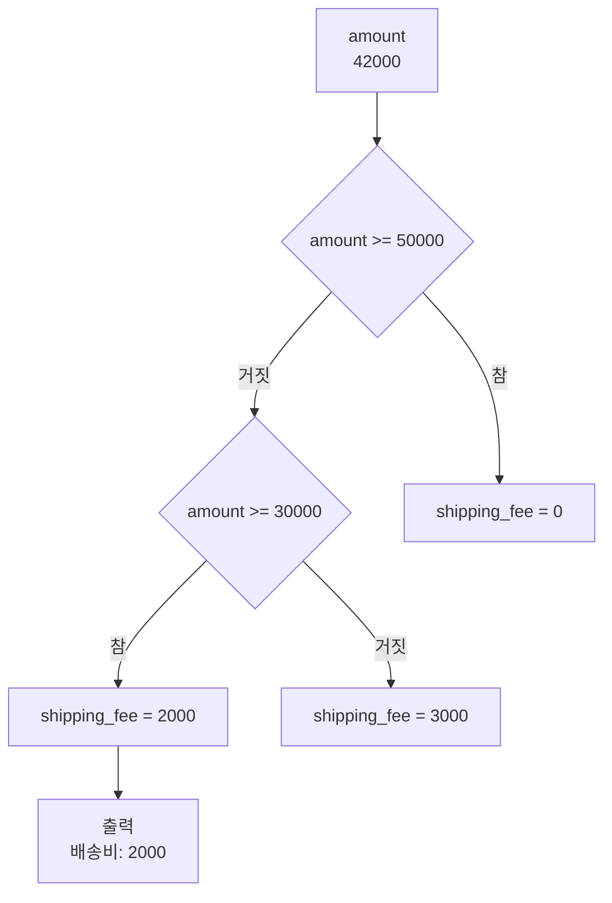
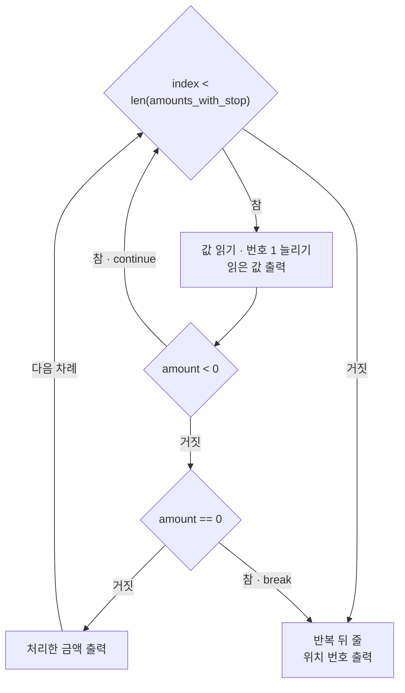
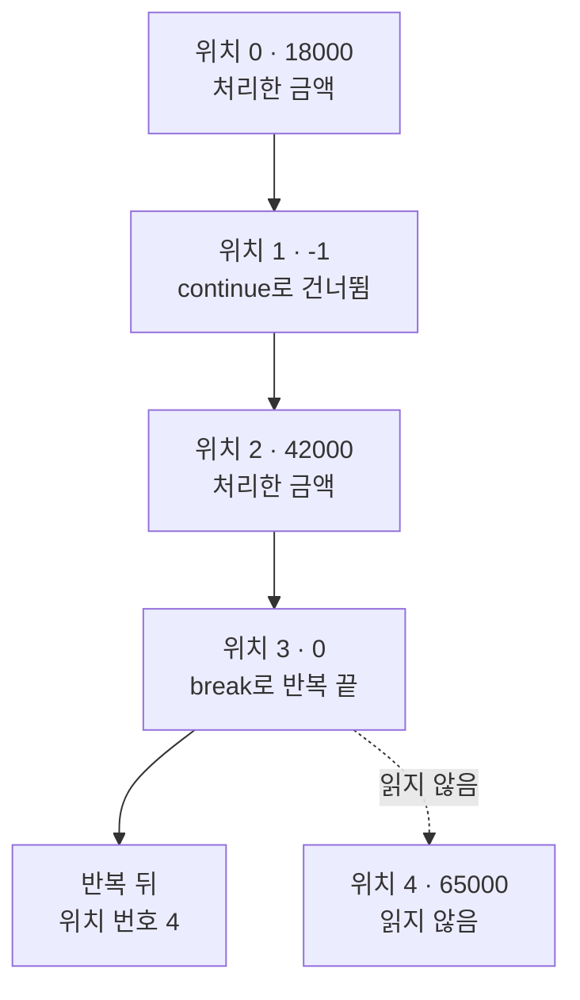
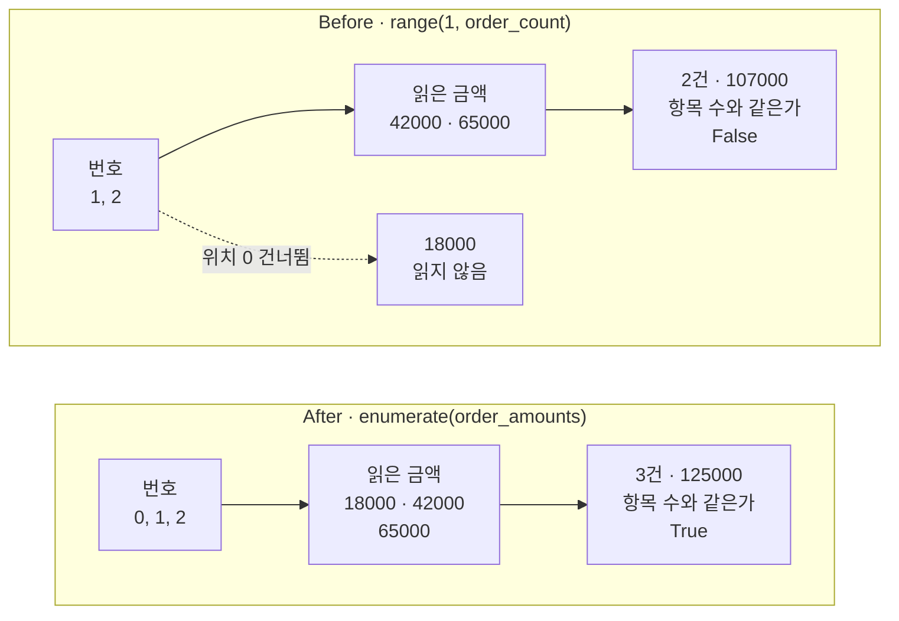

# 02-조건문과-반복문

## _src 본문 (HTML 원본)

```html
<!--meta: 강의 1h | 실습 2h | 코드 Jupyter Notebook | 새 용어 11 -->
<h2 id="b1"><span class="no">1</span>학습 목표</h2>
<div class="goal"><ul><li>조건 줄 <code>if</code>·<code>elif</code>·<code>else</code>로 금액 구간에 맞는 한 곳만 실행하고, 어느 줄이 실행됐는지 출력으로 설명할 수 있습니다.</li><li>반복문 <code>for</code>와 <code>while</code>로 목록을 읽고, <code>continue</code>와 <code>break</code>가 바꾼 흐름을 출력으로 확인할 수 있습니다.</li><li>위치 번호가 0부터 시작한다는 점을 들어, 첫 주문을 빠뜨리는 반복을 <code>enumerate()</code>로 고칠 수 있습니다.</li></ul></div>
<h2 id="b2"><span class="no">2</span>이 내용을 배우는 이유</h2>
<p>1절에서는 회원 여부를 저장만 했습니다. 할인은 회원이든 아니든 똑같이 계산했습니다. 실제 가게는 회원일 때만 할인하고, 주문 금액에 따라 배송비도 다르게 받습니다. 값에 따라 실행할 줄을 고르는 방법이 필요합니다.</p>
<p>주문은 한 건이 아니라 여러 건입니다. 같은 판정을 주문마다 복사해 적으면 기준이 바뀔 때 여러 곳을 고쳐야 합니다. 반복문을 쓰면 규칙을 한 번만 적고 목록의 모든 주문에 적용합니다.</p>
<p>반복에서 흔한 실수는 번호를 잘못 세는 것입니다. 번호를 1부터 세면 첫 주문을 빠뜨리는데도 오류 메시지가 나오지 않습니다. 1절의 222처럼 <b>실행이 멈추지 않아도 결과는 틀릴 수 있습니다.</b></p>
<p><strong>이 절의 질문</strong> — 위치 번호로 주문 목록을 읽을 때 첫 주문을 빠뜨리지 않으려면 무엇을 바꿔야 할까요?</p>
<h2 id="b3"><span class="no">3</span>앞에서 배운 내용</h2>
<p>Ch 1과 1절에서 배운 것 가운데 이 절이 이어 쓰는 것을 표로 모았습니다.</p>
<table><thead><tr><th>앞 절</th><th>배운 것</th><th>이 절에서 이어 쓰는 곳</th></tr></thead><tbody>
<tr><td>Ch 1 1절</td><td>대괄호 <code>[ ]</code> 목록, 여러 줄 <code>for</code>, 번호 늘리기 <code>number = number + 1</code>, <code>len()</code></td><td>금액 목록 읽기, 무료 배송 주문 수 세기, <code>while</code>의 위치 번호</td></tr>
<tr><td>Ch 1 1절</td><td>과정 지도에 번호를 1부터 붙이기</td><td>Before에서 위치 번호를 1부터 세는 실수</td></tr>
<tr><td>Ch 1 1·4절</td><td>비교 <code>==</code>와 <code>True</code>·<code>False</code>, 검사 줄 <code>assert</code></td><td>조건 검사, After의 검사 줄</td></tr>
<tr><td>Ch 1 3절</td><td>여러 줄 <code>if</code>/<code>else</code>, 인덱스 <code>[0]</code>·<code>[-1]</code>, 목록 번호는 0부터</td><td>회원 할인 조건문, <code>order_amounts[index]</code></td></tr>
<tr><td>1절</td><td>주문 금액 78000.0, 할인율 0.1, 회원 여부 <code>True</code>, 결제 금액 70200.0</td><td>회원일 때만 할인하기</td></tr>
<tr><td>1절</td><td>다시 대입하기, 변수만 넣은 f-string, 오류 없이 틀린 결과 222, 예약어</td><td>회원 여부와 기준 바꾸기, 배송비 출력 문장, Before, <code>continue</code>·<code>break</code></td></tr>
</tbody></table>
<p>1절은 「회원일 때만 할인하려면 조건문이 필요하고, 2절에서 자세히 배운다」고 적었습니다. 이 절의 첫 조건문이 그 약속을 지킵니다.</p>
<p>Ch 1에서 목록, <code>for</code>, 여러 줄 <code>if</code>를 이미 써 보았습니다. 이 절은 그 문법을 이어 쓰고, 조건 줄 <code>elif</code>와 반복문 <code>while</code>을 새로 배웁니다. 예약어 <code>break</code>·<code>continue</code>와 내장 함수 <code>range()</code>·<code>enumerate()</code>도 이 절에서 처음 씁니다. 목록을 다루는 자세한 방법은 3절 자료구조에서 배웁니다.</p>
<p>금액의 자료형도 짚어 둡니다. 1절의 주문 금액 78000.0은 단가 39000.0이 실수라서 실수였습니다. 이 절의 주문 금액 목록은 1절 주의할 점대로 18000처럼 원 단위 정수로 적습니다.</p>
<h2 id="b4"><span class="no">4</span>핵심 개념</h2>
<h3>비유로 시작하기</h3>
<p>택배 분류대에 크기가 다른 상자들이 한 줄로 놓여 있다고 해 봅니다. 작업자는 칸에 가까운 줄 맨 앞의 상자부터 하나씩 집습니다. 집은 상자는 크기를 보고 작은 칸, 중간 칸, 큰 칸 가운데 한 곳에만 넣습니다.</p>
<p>하나씩 집는 동작을 줄이 끝날 때까지 되풀이하는 것이 반복문입니다. 상자마다 들어갈 칸을 하나 고르는 판단이 조건문입니다.</p>
{{img:02-5-상자-분류대|탁자 왼쪽에 크기가 다른 상자들이 한 줄로 놓여 있고, 손이 중간 크기 상자 하나를 들어 올려 점선 화살표를 따라 오른쪽의 작은·중간·큰 나무 칸 가운데 중간 칸으로 옮기려는 삽화|줄에서 상자를 하나씩 집는 동작은 반복문, 크기에 맞는 칸 하나를 고르는 판단은 조건문에 해당합니다.}}
<p><strong>그림 읽기</strong> — 왼쪽에 상자들이 한 줄로 기다립니다. 이 줄이 목록이고, 손이 줄 맨 앞(오른쪽 끝)의 상자 하나를 들어 올린 동작이 반복의 한 차례입니다.</p>
<p>오른쪽의 작은 칸, 중간 칸, 큰 칸은 조건문의 세 갈래입니다. 손에 든 중간 상자의 점선 화살표는 중간 칸 하나로만 향합니다. 조건문도 한 차례에 한 갈래만 실행합니다.</p>
<h3>이 절에서 쓰는 말</h3>
<table><thead><tr><th>용어</th><th>뜻</th><th>이 절에서 보이는 모습</th></tr></thead><tbody>
<tr><td>조건문(conditional statement)</td><td>조건이 참인지 거짓인지에 따라 실행할 줄을 고르는 문장</td><td><code>if is_member:</code></td></tr>
<tr><td>비교 연산자</td><td>두 값을 비교해 <code>True</code>나 <code>False</code>를 내는 기호</td><td><code>&gt;=</code>, <code>&lt;</code>, <code>==</code></td></tr>
<tr><td>조건 줄 elif</td><td>앞 조건이 거짓일 때 검사하는 다음 조건</td><td><code>elif amount &gt;= reduced_fee_minimum:</code></td></tr>
<tr><td>반복(iteration)</td><td>같은 규칙을 여러 값에 차례로 적용하는 일</td><td><code>for amount in test_amounts:</code></td></tr>
<tr><td>반복문 while</td><td>조건이 참인 동안 되풀이하는 반복문</td><td><code>while index &lt; len(order_amounts):</code></td></tr>
<tr><td>예약어 continue</td><td>이번 차례의 남은 줄을 건너뛰고 다음 차례로 넘어감</td><td>금액 -1을 읽은 차례</td></tr>
<tr><td>예약어 break</td><td>반복 전체를 그 자리에서 끝냄</td><td>금액 0을 읽은 차례</td></tr>
<tr><td>위치 번호(index)</td><td>목록에서 값이 놓인 자리. 0부터 셈(Ch 1 3절)</td><td><code>order_amounts[index]</code></td></tr>
<tr><td>내장 함수 range()</td><td>차례로 늘어나는 번호를 만듦. 끝 숫자는 빠짐</td><td><code>range(3)</code>의 0, 1, 2</td></tr>
<tr><td>내장 함수 enumerate()</td><td>목록의 항목마다 위치 번호를 붙여 줌</td><td><code>for index, amount in enumerate(order_amounts):</code></td></tr>
<tr><td>경계값</td><td>조건의 참과 거짓이 바뀌는 바로 그 값과 바로 옆 값</td><td>49999원, 50000원</td></tr>
</tbody></table>
<h3>조건을 검사하는 순서</h3>
<p>조건문은 위에서부터 조건을 하나씩 검사합니다. 처음 참이 된 곳의 줄만 실행하고, 나머지 갈래는 건너뜁니다. 조건 뒤에는 콜론 <code>:</code>을 붙이고, 그 조건에 속한 줄은 들여 씁니다.</p>
<p>조건 줄 <code>elif</code>는 「앞 조건이 거짓이면 이 조건을 검사하라」는 뜻입니다. 마지막 줄 <code>else</code>에는 조건이 없습니다. 앞의 조건이 모두 거짓일 때 실행됩니다.</p>
<p>비교 연산자 <code>&gt;=</code>는 「크거나 같다」, <code>&lt;</code>는 「작다」로 읽습니다. 기호 <code>&gt;=</code>는 같은 값도 참으로 봅니다. 그래서 50000원은 「50000원 이상」 조건에서 참입니다.</p>
{{mermaid:02-1-조건-검사-순서|주문 금액 42000원이 첫 조건 50000원 이상에서 거짓, 둘째 조건 30000원 이상에서 참이 되어 배송비 2000원 줄만 실행되는 흐름도|조건 검사 순서. 주문 금액 42000원은 둘째 조건에서 처음 참이 되어 배송비 2000원 줄만 실행합니다.}}
<p><strong>도식 읽기</strong> — 위에서 아래로 읽습니다. 초록 상자는 주문 금액 42000이고, 노란 마름모 두 개는 조건 검사입니다. 파란 상자는 실행한 줄, 회색 상자는 실행하지 않은 줄입니다.</p>
<p>첫 마름모 「amount &gt;= 50000」은 거짓이라 거짓 화살표를 따라 왼쪽 아래 둘째 마름모로 내려갑니다. 둘째 마름모 「amount &gt;= 30000」은 참이라 파란 상자 <code>shipping_fee = 2000</code>을 실행합니다. 맨 아래 노란 상자의 출력은 배송비 2000입니다. 오른쪽의 회색 상자 두 개(배송비 0과 3000)는 이번에 실행하지 않았습니다.</p>
<h3>반복하는 두 방법</h3>
<p>반복문 <code>for</code>는 목록의 값을 앞에서부터 하나씩 꺼내 이름에 담고, 들여 쓴 줄을 실행합니다. 값이 다 떨어지면 반복이 끝납니다. 몇 번 반복할지는 목록의 항목 수가 정합니다.</p>
<p>반복문 <code>while</code>은 조건이 참인 동안 되풀이합니다. 줄 선 손님이 남아 있는 동안 계산을 계속하는 모습과 같습니다. 몇 번 반복할지는 조건이 정하므로, 반복 안에서 조건에 쓰는 값을 바꿔야 끝납니다. 이 절에서는 위치 번호 <code>index</code>를 1씩 늘려 조건을 거짓으로 만듭니다.</p>
<p>반복 안의 흐름은 예약어 두 개로 바꿀 수 있습니다. 예약어 <code>continue</code>는 이번 차례만 건너뛰고, <code>break</code>는 반복 전체를 끝냅니다. 1절에서 배운 대로 예약어는 이름으로 쓸 수 없는 낱말입니다.</p>
{{mermaid:02-2-while-갈림길|while 조건이 참이면 값을 읽고 번호를 늘린 뒤, 금액이 0보다 작으면 continue로 조건에 돌아가고, 0이면 break로 반복 뒤 줄로 가며, 둘 다 아니면 처리한 금액을 출력하고 다음 차례로 돌아가는 흐름도|while 반복의 갈림길. 예약어 continue는 맨 위 조건으로 돌아가고, 예약어 break는 반복 뒤 줄로 빠져나갑니다.}}
<p><strong>도식 읽기</strong> — 맨 위 노란 마름모가 반복 조건 <code>index &lt; len(amounts_with_stop)</code>입니다. 참이면 오른쪽 파란 상자에서 값을 읽고 번호를 1 늘린 뒤, 읽은 값을 출력합니다.</p>
<p>아래 마름모 <code>amount &lt; 0</code>이 참이면 「참 · continue」 화살표를 따라 맨 위 조건으로 돌아갑니다. 거짓이면 <code>amount == 0</code>을 검사합니다. 여기서 참이면 「참 · break」 화살표로 오른쪽 아래 「반복 뒤 줄」에 갑니다.</p>
<p>두 조건이 모두 거짓이면 왼쪽 아래 「처리한 금액 출력」을 거쳐 「다음 차례」 화살표로 맨 위 조건에 돌아갑니다. 맨 위 조건이 거짓이 되어도 「반복 뒤 줄」로 갑니다. 파란 상자는 모두 우리가 적은 줄이고, 노란 마름모는 모두 조건 검사입니다.</p>
<h3>번호를 만드는 두 함수</h3>
<p>내장 함수 <code>range()</code>는 차례로 늘어나는 번호를 만듭니다. 숫자 하나를 넣은 <code>range(3)</code>은 0, 1, 2를 만들고, 끝 숫자 3은 빠집니다. 숫자 두 개를 넣은 <code>range(1, 3)</code>은 1과 2를 만듭니다.</p>
<p>목록의 위치 번호는 0부터 시작합니다. 항목이 세 개인 목록의 위치는 0, 1, 2입니다. 그래서 위치 번호를 1부터 만들면 위치 0의 첫 항목을 읽지 못합니다.</p>
<p>내장 함수 <code>enumerate()</code>는 목록의 항목마다 위치 번호를 붙여 줍니다. 반복문 머리에 <code>index, amount</code>처럼 이름 두 개를 쉼표로 적으면 번호와 값이 차례로 담깁니다. 번호를 직접 계산하지 않으므로 시작 번호를 잘못 적을 일이 없습니다.</p>
<h2 id="b5"><span class="no">5</span>실행 예제</h2>
<p>노트북은 1절의 주문 값을 새 커널에 저장한 뒤 회원일 때만 할인합니다. 회원 여부가 True이면 할인액 7800.0, 결제 금액 70200.0으로 1절과 같습니다. 회원 여부 하나만 False로 바꾸면 할인액은 0.0, 결제 금액은 78000.0입니다.</p>
<p>이어서 배송비 규칙 세 구간을 <code>if</code>·<code>elif</code>·<code>else</code>로 적습니다. 금액 42000원 한 건으로 먼저 확인합니다. 그다음 경계값 49999원과 50000원을 넣은 금액 다섯 개를 <code>for</code>로 판정합니다.</p>
<p>함수 <code>range()</code>가 만드는 번호를 출력한 뒤, <code>while</code>로 주문 세 건을 위치 번호 0부터 읽습니다. 금액 -1과 0이 섞인 목록으로 <code>continue</code>와 <code>break</code>도 확인합니다. 마지막으로 무료 배송 기준 하나만 50000원에서 40000원으로 바꿔 무료 배송 주문 수를 비교합니다.</p>
<p>모델을 부르지 않으므로 API 키가 필요 없고 비용도 들지 않습니다. 출력 숫자는 다시 실행해도 같습니다.</p>
{{notebook:02-조건문과-반복문|example}}
<p class="look"><b>확인할 점</b> — 경계값 두 줄에서 49999원은 배송비 2000원, 50000원은 0원인지 봅니다. 예약어 셀의 「읽은 값」 줄에 65000이 없는지 확인합니다. 기준을 40000원으로 낮춘 뒤 무료 배송 주문 수가 1에서 2로 늘었는지 확인합니다.</p>
<h3>금액 다섯 개를 읽은 차례</h3>
<p>금액 -1과 0이 섞인 목록을 <code>while</code>로 읽은 차례를 한 그림으로 모았습니다.</p>
{{mermaid:02-3-while-읽은-차례|위치 0의 18000 처리, 위치 1의 -1 continue로 건너뜀, 위치 2의 42000 처리, 위치 3의 0에서 break로 반복이 끝나 위치 번호 4가 남고, 위치 4의 65000은 읽지 않은 차례를 위에서 아래로 보여 주는 흐름도|금액 다섯 개를 읽은 차례. 18000과 42000만 처리하고, 0에서 멈춰 위치 4의 65000은 읽지 않았습니다.}}
<p><strong>도식 읽기</strong> — 위에서 아래로 읽습니다. 초록 상자는 처리한 금액으로, 위치 0의 18000과 위치 2의 42000입니다. 파란 상자는 예약어가 실행된 차례로, 위치 1의 -1에서 continue, 위치 3의 0에서 break가 실행됐습니다.</p>
<p>break 뒤에는 왼쪽 아래 노란 상자에 이릅니다. 반복이 끝난 뒤 위치 번호는 4입니다. 오른쪽 아래 회색 상자는 점선으로만 이어져 있습니다. 위치 4의 65000은 읽지 않았습니다.</p>
<p>번호를 늘리는 줄은 <code>continue</code>보다 앞에 있습니다. 그래서 -1을 건너뛴 뒤에도 다음 차례에 위치 2를 읽었습니다.</p>
<h2 id="b6"><span class="no">6</span>일부러 실패해 보기</h2>
<p>Ch 1 1절에서 과정 지도에 번호를 붙일 때는 1부터 셌습니다. 사람은 첫째 주문도 1번 주문이라고 부릅니다. 그 습관대로 위치 번호를 <code>range(1, order_count)</code>로 만들면 어떻게 될까요?</p>
<p>Before 셀은 오류 없이 실행되지만, 출력된 주문은 위치 1의 42000과 위치 2의 65000 두 건입니다. 확인한 주문 수는 2, 합계는 107000입니다. 항목 수 3과 비교한 결과는 False입니다. 위치 0의 18000원을 읽지 않았습니다.</p>
<p>After 셀은 반복문 머리 한 줄을 <code>enumerate(order_amounts)</code>로 바꿉니다. 번호와 값을 함께 받으므로 위치 번호로 값을 꺼내는 줄은 뺐습니다. 위치 0부터 세 건을 읽어 주문 수는 3, 합계는 125000이 되고, 비교 결과는 True입니다.</p>
{{mermaid:02-4-before-after-비교|Before는 range(1, order_count)의 번호 1, 2로 42000과 65000만 읽어 2건 107000과 False가 나오고 18000은 읽지 않으며, After는 enumerate의 번호 0, 1, 2로 세 금액을 모두 읽어 3건 125000과 True가 나오는 비교 그림|위치 번호를 1부터 센 Before는 18000을 빠뜨려 2건이고, enumerate()를 쓴 After는 3건을 모두 읽습니다.}}
<p><strong>도식 읽기</strong> — 위 칸이 Before, 아래 칸이 After입니다. 칸 안은 왼쪽에서 오른쪽으로 읽습니다. 파란 상자는 반복문이 만든 번호이고, 초록 상자는 읽은 금액입니다.</p>
<p>Before 칸은 번호 1, 2로 42000과 65000만 읽어 빨간 상자(2건 · 107000 · False)에 이릅니다. 번호 상자에서 점선으로 이어진 회색 상자 18000은 위치 0이라 읽지 않은 값입니다. After 칸은 번호 0, 1, 2로 세 금액을 모두 읽어 노란 상자(3건 · 125000 · True)에 이릅니다.</p>
{{notebook:02-조건문과-반복문|failure}}
<h3>확인한 범위</h3>
<p>이번에 고친 경우는 주문 세 건짜리 목록 하나입니다. 시작 번호를 빼고 <code>range(order_count)</code>로 고쳐도 0부터 셉니다. 이 방법은 이번에 실행하지 않았습니다.</p>
<p>끝 숫자까지 하나 늘려 없는 위치 3을 읽는 장면은 「원리 더 알아보기」 셀에서 한 번 실행했습니다. 이때는 <code>IndexError</code> 오류가 났습니다. 오류를 잡는 <code>try</code>와 <code>except</code>는 5절 파일과 예외에서 배웁니다. 빈 목록을 반복하는 경우는 이번에 실행하지 않았습니다.</p>
<h2 id="b7"><span class="no">7</span>주의할 점과 실무 메모</h2>
<ul><li>조건의 순서가 결과를 바꿉니다. 30000원 이상 조건을 50000원 이상 조건보다 위에 두면 65000원도 먼저 참이 된 2000원 줄로 갑니다. 이 순서는 이번에 실행하지 않았습니다.</li>
<li>반복문 <code>while</code>의 조건에 쓰는 값은 반복 안에서 바꿔야 합니다. 노트북에서는 번호를 1씩 늘렸고, 번호가 3이 되자 반복이 끝났습니다.</li>
<li>번호를 늘리는 줄은 <code>continue</code>보다 앞에 둡니다. 뒤에 두면 같은 값을 계속 읽어 반복이 끝나지 않습니다. 이 장면은 실행하지 않았습니다. 셀이 끝나지 않고 계속 실행 중이면 커널을 중지(Interrupt)합니다.</li>
<li>예약어 <code>break</code> 뒤의 값은 읽지 않습니다. 노트북에서는 0 뒤의 65000을 읽지 않았습니다. 멈추는 표시가 업무 규칙과 맞는지 먼저 확인합니다.</li>
<li>경계값은 기준과 같은 값과 1 작은 값을 함께 넣어 확인합니다. 노트북에서 49999원과 50000원의 배송비가 2000원 차이 났습니다.</li>
<li>반복문 안에서 센 개수는 목록의 항목 수와 비교해 봅니다. 노트북에서는 Before 셀의 2건을 항목 수 3과 비교해 빠진 주문을 찾았습니다.</li></ul>
<h2 id="b8"><span class="no">8</span>정리와 다음 절</h2>
<ul><li>조건문은 위에서부터 조건을 검사해 처음 참이 된 한 곳만 실행합니다. 회원일 때만 할인하자 회원 여부 True는 70200.0, False는 78000.0이 나왔습니다.</li><li>반복문 <code>for</code>는 목록의 값마다, <code>while</code>은 조건이 참인 동안 반복합니다. 예약어 <code>continue</code>는 이번 차례를 건너뛰고, <code>break</code>는 반복을 끝냅니다.</li><li>목록의 위치 번호는 0부터입니다. 번호를 1부터 세면 첫 주문을 빠뜨리므로 <code>enumerate()</code>로 번호와 값을 함께 받습니다.</li></ul>
<p><strong>다음 학습과 이어지는 지점</strong> — 3절에서는 이 절에서 읽기만 한 목록을 더 자세히 다룹니다. 여러 값을 목록, 튜플, 딕셔너리, 집합에 목적에 맞게 저장합니다.</p>
<h2 id="b9"><span class="no">9</span>복습 문제</h2><details class="quiz"><summary>문제와 해설</summary>
<p class="quiz-q">1. 회원 여부를 False로 바꿨을 때 할인액과 결제 금액은 얼마였고, 조건문의 어느 줄이 실행됐나요? · 기초</p><p class="quiz-a"><b>해설</b> — 할인액은 0.0, 결제 금액은 78000.0입니다. 조건이 거짓이라 <code>else</code> 아래 줄 <code>discount = 0.0</code>이 실행됐습니다.</p>
<p class="quiz-q">2. 금액 49999원과 50000원의 배송비는 각각 얼마였나요? 둘이 다른 이유는 무엇인가요? · 기초</p><p class="quiz-a"><b>해설</b> — 49999원은 2000원, 50000원은 0원입니다. 기호 <code>&gt;=</code>는 같은 값도 참으로 봅니다. 그래서 50000원은 무료 배송 조건에서 참입니다.</p>
<p class="quiz-q">3. 함수 호출 <code>range(3)</code>과 <code>range(1, 3)</code>이 만드는 번호는 각각 무엇인가요? · 기초</p><p class="quiz-a"><b>해설</b> — 앞은 0, 1, 2이고 뒤는 1, 2입니다. 두 경우 모두 끝 숫자 3은 들어가지 않습니다.</p>
<p class="quiz-q">4. 금액 <code>[18000, -1, 42000, 0, 65000]</code>을 읽은 셀에서 처리한 금액과 반복 뒤 위치 번호는 무엇이었나요? · 적용</p><p class="quiz-a"><b>해설</b> — 처리한 금액은 18000과 42000이고, 위치 번호는 4입니다. 금액 -1은 <code>continue</code>로 건너뛰었습니다. 0에서 <code>break</code>로 반복이 끝나 위치 4의 65000은 읽지 않았습니다.</p>
<p class="quiz-q">5. 무료 배송 기준을 50000원에서 40000원으로 낮추면 무료 배송 주문 수는 어떻게 달라졌나요? · 적용</p><p class="quiz-a"><b>해설</b> — 1건에서 2건으로 늘었습니다. 주문 42000원이 새 기준 이상이 됐습니다. 바꾼 값은 기준 하나뿐입니다.</p>
<p class="quiz-q">6. Before 셀이 오류 없이 2건만 확인한 이유는 무엇이고, After 셀은 어떻게 고쳤나요? · 분석</p><p class="quiz-a"><b>해설</b> — 번호를 1부터 만들어 위치 0의 18000원을 읽지 않았기 때문입니다. After 셀은 <code>enumerate()</code>로 0부터 번호와 값을 함께 받아 세 건을 모두 읽었습니다.</p>
</details>
<h2 id="b10"><span class="no">10</span>참고 자료</h2>
<ul><li><a href="https://docs.python.org/3.12/tutorial/controlflow.html">Python 3.12 자습서 4장: 기타 제어 흐름 도구</a> · 확인 2026-09-16 · 기준 Python 3.12</li><li><a href="https://docs.python.org/3.12/library/functions.html#func-range">Python 3.12 내장 함수 range</a> · 확인 2026-09-16 · 기준 Python 3.12</li><li><a href="https://docs.python.org/3.12/library/functions.html#enumerate">Python 3.12 내장 함수 enumerate</a> · 확인 2026-09-16 · 기준 Python 3.12</li></ul>
```

## 노트북 셀 (순서대로)

### [0] markdown {'html': 'skip'}

# 조건문과 반복문

**이 노트북에서 할 일**

1. 회원일 때만 할인하고, 주문 금액 구간에 맞는 배송비를 하나 고릅니다.
2. 금액 목록을 `for`와 `while`로 하나씩 읽고, `continue`와 `break`로 건너뛰거나 멈춥니다.
3. 위치 번호를 1부터 세어 첫 주문을 빠뜨리는 장면을 보고, `enumerate()`로 고칩니다.

**준비물** — API 키 불필요. 데이터 파일도 없습니다. 모델 호출은 0번이고 비용은 들지 않습니다.
실행 시간은 1분 이내입니다.

1절과 같은 실습 폴더 `labs/part1/ch02-python`의 `.venv`를 커널로 고릅니다.
이전 커널의 변수는 쓰지 않으므로 첫 셀부터 순서대로 실행합니다.

### [1] markdown {'html': 'skip'}

## 오늘 볼 그림


위에서 아래로 읽습니다. 노란 마름모는 조건 검사이고, 파란 상자는 실제로 실행한 줄입니다.
주문 금액 42000원은 첫 조건에서 거짓, 둘째 조건에서 참입니다. 그래서 배송비 2000원 줄 하나만 실행합니다.
회색 상자 두 줄은 이번에 실행하지 않은 줄입니다.

### [2] markdown {}

## 1. 준비

이 절도 설치할 패키지가 없습니다. 준비 셀은 이 절에서 쓸 값을 새 커널에 저장합니다.
앞의 세 값은 1절에서 계산한 주문 한 건입니다. 주문 금액 78000.0, 할인율 0.1, 회원 여부 True를 그대로 씁니다.

주문 세 건의 금액은 Ch 1 1절처럼 대괄호 `[ ]`로 만든 목록에 담습니다.
1절의 주문 금액은 단가 39000.0이 실수라서 실수로 나왔습니다. 이 절의 금액은 1절 주의할 점대로 원 단위 정수로 적습니다.

### [3] code {'execution': {'iopub.execute_input': '2026-09-16T04:02:20.238139Z', 'iopub.status.busy': '2026-09-16T04:02:20.237942Z', 'iopub.status.idle': '2026-09-16T04:02:20.245976Z', 'shell.execute_reply': '2026-09-16T04:02:20.245016Z'}, 'lesson_role': 'setup'}

```python
# 1절에서 계산한 주문 한 건의 값을 새 커널에 다시 저장합니다
order_total = 78000.0
discount_rate = 0.1
is_member = True
# 이 절에서 차례로 처리할 주문 세 건의 금액입니다(원 단위 정수)
order_amounts = [18000, 42000, 65000]
print("1절 주문 금액:", order_total)
print("할인율:", discount_rate)
print("회원 여부:", is_member)
print("주문 세 건의 금액:", order_amounts)
```

출력:
```
1절 주문 금액: 78000.0
할인율: 0.1
회원 여부: True
주문 세 건의 금액: [18000, 42000, 65000]

```

### [4] markdown {}

**결과 읽기** — 1절 주문 금액 `78000.0`, 할인율 `0.1`, 회원 여부 `True`가 저장됐습니다.
주문 세 건의 금액은 `[18000, 42000, 65000]`입니다. 소수점이 없는 정수 세 개입니다.

### [5] markdown {}

## 2. 회원일 때만 할인하기

1절에서는 회원 여부를 따지지 않고 할인액을 계산했습니다. 이번에는 회원일 때만 할인합니다.
조건문(conditional statement)은 조건이 참인지 거짓인지에 따라 실행할 줄을 고르는 문장입니다.
계산대에서 회원 카드를 내면 할인하고, 카드가 없으면 정가를 받는 모습과 같습니다.

Ch 1 3절에서 여러 줄 `if`와 `else`를 써 보았습니다. 조건 뒤에는 콜론 `:`을 붙이고, 그 조건에 속한 줄은 들여 씁니다.
조건 자리에는 불리언 변수 `is_member`를 그대로 둘 수 있습니다. 값이 `True`이면 `if` 아래 줄을, `False`이면 `else` 아래 줄을 실행합니다.

### [6] code {'execution': {'iopub.execute_input': '2026-09-16T04:02:20.247753Z', 'iopub.status.busy': '2026-09-16T04:02:20.247610Z', 'iopub.status.idle': '2026-09-16T04:02:20.251733Z', 'shell.execute_reply': '2026-09-16T04:02:20.251169Z'}}

```python
# 회원이면 할인액을 계산하고, 회원이 아니면 할인액을 0.0으로 둡니다
if is_member:
    discount = order_total * discount_rate
else:
    discount = 0.0
# 할인액이 정해진 뒤에 결제 금액을 계산합니다
payment = order_total - discount
print("회원 여부:", is_member)
print("할인액:", discount)
print("결제 금액:", payment)
```

출력:
```
회원 여부: True
할인액: 7800.0
결제 금액: 70200.0

```

### [7] markdown {}

**결과 읽기** — 회원 여부가 `True`라서 `if` 아래 줄을 실행했습니다. 할인액은 `7800.0`, 결제 금액은 `70200.0`입니다.
1절에서 계산한 결과와 같습니다. 이번에는 `else` 아래 줄이 실행되지 않았습니다.

### [8] markdown {}

회원 여부 하나만 `False`로 바꿔 같은 조건문을 다시 실행합니다. 주문 금액과 할인율은 그대로 둡니다.
실행 전에 예상합니다. 이번에는 `else` 아래 줄이 실행되어 할인액 0.0, 결제 금액 78000.0이 나올 것입니다.

### [9] code {'execution': {'iopub.execute_input': '2026-09-16T04:02:20.253578Z', 'iopub.status.busy': '2026-09-16T04:02:20.253373Z', 'iopub.status.idle': '2026-09-16T04:02:20.256643Z', 'shell.execute_reply': '2026-09-16T04:02:20.256015Z'}}

```python
# 회원 여부만 False로 바꾸고 같은 조건문을 다시 실행합니다
is_member = False
if is_member:
    discount = order_total * discount_rate
else:
    discount = 0.0
payment = order_total - discount
print("회원 여부:", is_member)
print("할인액:", discount)
print("결제 금액:", payment)
```

출력:
```
회원 여부: False
할인액: 0.0
결제 금액: 78000.0

```

### [10] markdown {}

**결과 읽기** — 할인액 `0.0`, 결제 금액 `78000.0`으로 예상과 같습니다. 회원 여부가 `False`라서 `else` 아래 줄을 실행했습니다.
바꾼 값은 회원 여부 하나뿐입니다. 그래서 결제 금액이 달라진 원인은 회원 여부입니다.

### [11] markdown {}

## 3. 금액 구간으로 배송비 고르기

배송비 규칙은 세 구간입니다. 50000원 이상은 무료, 30000원 이상은 2000원, 그보다 작으면 3000원입니다.
갈림길이 셋 이상이면 `if`와 `else` 사이에 `elif`를 넣습니다. 조건 줄 `elif`는 앞 조건이 거짓일 때만 검사합니다.

비교 연산자 `>=`는 왼쪽 값이 오른쪽 값보다 크거나 같은지 검사합니다. 결과는 Ch 1의 `==`처럼 `True`나 `False`입니다.
조건은 위에서부터 차례로 검사합니다. 처음 참이 된 곳의 줄 하나만 실행하고 나머지는 건너뜁니다.

실행 전에 예상합니다. 42000원은 첫 조건에서 거짓, 둘째 조건에서 참이라 배송비는 2000원일 것입니다.

### [12] code {'execution': {'iopub.execute_input': '2026-09-16T04:02:20.257843Z', 'iopub.status.busy': '2026-09-16T04:02:20.257708Z', 'iopub.status.idle': '2026-09-16T04:02:20.261951Z', 'shell.execute_reply': '2026-09-16T04:02:20.261349Z'}}

```python
# 주문 금액 42000원이 세 구간 가운데 어디에 드는지 골라 배송비를 정합니다
free_shipping_minimum = 50000
reduced_fee_minimum = 30000
amount = 42000
# 위에서부터 검사해 처음 참이 된 곳의 줄 하나만 실행합니다
if amount >= free_shipping_minimum:
    shipping_fee = 0
elif amount >= reduced_fee_minimum:
    shipping_fee = 2000
else:
    shipping_fee = 3000
print("주문 금액:", amount)
print("배송비:", shipping_fee)
```

출력:
```
주문 금액: 42000
배송비: 2000

```

### [13] markdown {}

**결과 읽기** — 주문 금액 `42000`의 배송비는 `2000`으로 예상과 같습니다.
첫 조건 `amount >= free_shipping_minimum`은 거짓이라 그 아래 줄을 건너뛰었습니다. 둘째 조건이 참이라 배송비를 2000으로 정하는 줄을 실행했습니다.
둘째 조건이 참이 된 뒤에는 `else` 아래 줄을 실행하지 않습니다.

### [14] markdown {}

## 4. 여러 금액의 배송비를 for로 고르기

반복(iteration)은 같은 규칙을 여러 값에 차례로 적용하는 일입니다. Ch 1 1절의 반복문 `for`는 목록의 값마다 들여 쓴 줄을 한 번씩 실행했습니다.
이번에는 `for` 안에 앞 셀의 조건문을 그대로 넣습니다. 조건문은 반복문보다 한 단계 더 들여 씁니다.

금액 다섯 개에는 경계값 49999원과 50000원을 넣었습니다. 기호 `>=`는 같은 값도 참으로 봅니다.
실행 전에 예상합니다. 49999원은 2000원, 50000원은 0원일 것입니다.

### [15] code {'execution': {'iopub.execute_input': '2026-09-16T04:02:20.263310Z', 'iopub.status.busy': '2026-09-16T04:02:20.263210Z', 'iopub.status.idle': '2026-09-16T04:02:20.266276Z', 'shell.execute_reply': '2026-09-16T04:02:20.265777Z'}}

```python
# 경계값 49999원과 50000원을 넣은 금액 다섯 개의 배송비를 차례로 고릅니다
test_amounts = [18000, 42000, 49999, 50000, 65000]
for amount in test_amounts:
    # 반복할 때마다 amount에 새 금액이 담기고, 조건을 처음부터 검사합니다
    if amount >= free_shipping_minimum:
        shipping_fee = 0
    elif amount >= reduced_fee_minimum:
        shipping_fee = 2000
    else:
        shipping_fee = 3000
    print(f"{amount}원 → 배송비 {shipping_fee}원")
```

출력:
```
18000원 → 배송비 3000원
42000원 → 배송비 2000원
49999원 → 배송비 2000원
50000원 → 배송비 0원
65000원 → 배송비 0원

```

### [16] markdown {}

**결과 읽기** — 다섯 줄이 출력됐습니다. 경계값 두 줄은 `49999원 → 배송비 2000원`과 `50000원 → 배송비 0원`으로 예상과 같습니다.
첫 줄 `18000원 → 배송비 3000원`은 두 조건이 모두 거짓이라 `else` 아래 줄을 실행한 결과입니다.
50000원보다 1원 적은 금액과 같은 금액의 배송비가 2000원 차이 납니다. 경계값을 꼭 넣어 확인하는 이유입니다.

### [17] markdown {}

## 5. range()로 번호 만들기

내장 함수 `range()`는 차례로 늘어나는 번호를 만듭니다. 반복문 `for`와 함께 쓰면 번호마다 한 번씩 반복합니다.

괄호 안에 숫자 하나를 넣으면 0부터 그 숫자 바로 앞까지 만듭니다. 숫자 두 개를 넣으면 앞 숫자부터 뒤 숫자 바로 앞까지 만듭니다.
두 경우 모두 끝 숫자는 들어가지 않습니다.

실행 전에 예상합니다. 함수 호출 `range(3)`은 0, 1, 2를, `range(1, 3)`은 1, 2를 만들 것입니다.

### [18] code {'execution': {'iopub.execute_input': '2026-09-16T04:02:20.267291Z', 'iopub.status.busy': '2026-09-16T04:02:20.267197Z', 'iopub.status.idle': '2026-09-16T04:02:20.270030Z', 'shell.execute_reply': '2026-09-16T04:02:20.269535Z'}}

```python
# range(3)이 만드는 번호를 차례로 출력합니다
for number in range(3):
    print("range(3)의 번호:", number)
# 숫자를 두 개 넣으면 시작 번호를 정할 수 있습니다
for number in range(1, 3):
    print("range(1, 3)의 번호:", number)
```

출력:
```
range(3)의 번호: 0
range(3)의 번호: 1
range(3)의 번호: 2
range(1, 3)의 번호: 1
range(1, 3)의 번호: 2

```

### [19] markdown {}

**결과 읽기** — 첫 반복은 `range(3)의 번호: 0`부터 `range(3)의 번호: 2`까지 세 줄입니다. 끝 숫자 3은 나오지 않았습니다.
둘째 반복은 `range(1, 3)의 번호: 1`과 `range(1, 3)의 번호: 2` 두 줄입니다. 시작 번호가 1이라서 0이 빠졌습니다.

### [20] markdown {}

## 6. while로 목록 끝까지 읽기

반복문 `while`은 조건이 참인 동안 들여 쓴 줄을 되풀이합니다. 줄 선 손님이 남아 있는 동안 계산을 계속하는 모습과 같습니다.
기호 `<`는 왼쪽 값이 오른쪽 값보다 작은지 검사합니다. 함수 `len()`은 Ch 1에서 쓴 대로 목록의 항목 수를 반환합니다.

목록의 위치 번호는 Ch 1 3절에서 본 대로 0부터 셉니다. 읽는 식 `order_amounts[index]`는 위치 번호 `index`의 값을 꺼냅니다.
반복할 때마다 번호를 1씩 늘립니다. 번호를 늘리지 않으면 조건이 계속 참이라서 반복이 끝나지 않습니다.
실행 전에 예상합니다. 번호가 3이 되면 조건이 거짓이 되어 반복이 끝날 것입니다.

### [21] code {'execution': {'iopub.execute_input': '2026-09-16T04:02:20.270943Z', 'iopub.status.busy': '2026-09-16T04:02:20.270847Z', 'iopub.status.idle': '2026-09-16T04:02:20.273175Z', 'shell.execute_reply': '2026-09-16T04:02:20.272660Z'}}

```python
# 위치 번호 0부터 목록 길이 바로 앞까지 while로 주문 금액을 읽습니다
index = 0
while index < len(order_amounts):
    amount = order_amounts[index]
    print("위치", index, "주문 금액:", amount)
    # 번호를 늘리지 않으면 조건이 계속 참이라 반복이 끝나지 않습니다
    index = index + 1
print("반복이 끝난 뒤 위치 번호:", index)
```

출력:
```
위치 0 주문 금액: 18000
위치 1 주문 금액: 42000
위치 2 주문 금액: 65000
반복이 끝난 뒤 위치 번호: 3

```

### [22] markdown {}

**결과 읽기** — 위치 0부터 2까지 세 줄이 출력됐습니다. 첫 줄은 `위치 0 주문 금액: 18000`, 마지막 줄은 `위치 2 주문 금액: 65000`입니다.
반복이 끝난 뒤 위치 번호는 `3`입니다. 3은 목록의 항목 수와 같아서 조건이 거짓이 됐고, 반복이 멈췄습니다.

### [23] markdown {}

## 7. continue로 건너뛰고 break로 멈추기

주문 기록에 특별한 표시가 섞여 있다고 가정합니다. 금액 -1은 취소된 주문이고, 0은 여기서 처리를 멈추라는 표시입니다.
예약어 `continue`는 이번 차례의 남은 줄을 건너뛰고 다음 차례로 넘어갑니다. 예약어 `break`는 반복 전체를 그 자리에서 끝냅니다.
택배 상자를 차례로 포장하다가 취소된 상자는 옆으로 넘깁니다. 마감 팻말이 나오면 그 자리에서 일을 멈춥니다.

이 셀은 번호를 늘리는 줄을 `continue`보다 앞에 둡니다. 뒤에 두면 -1에서 번호가 늘지 않아 같은 값을 계속 읽습니다.
그 장면은 반복이 끝나지 않으므로 이번에 실행하지 않았습니다.
실행 전에 예상합니다. 18000과 42000만 처리하고, 0 뒤의 65000은 읽지 않을 것입니다.

### [24] code {'execution': {'iopub.execute_input': '2026-09-16T04:02:20.274038Z', 'iopub.status.busy': '2026-09-16T04:02:20.273950Z', 'iopub.status.idle': '2026-09-16T04:02:20.276339Z', 'shell.execute_reply': '2026-09-16T04:02:20.276001Z'}}

```python
# -1은 건너뛰고 0을 만나면 멈추면서 금액을 하나씩 읽습니다
amounts_with_stop = [18000, -1, 42000, 0, 65000]
index = 0
while index < len(amounts_with_stop):
    amount = amounts_with_stop[index]
    # continue보다 먼저 번호를 늘려야 다음 차례로 넘어갑니다
    index = index + 1
    print("읽은 값:", amount)
    if amount < 0:
        continue
    if amount == 0:
        break
    print("  처리한 금액:", amount)
print("반복이 끝난 뒤 위치 번호:", index)
```

출력:
```
읽은 값: 18000
  처리한 금액: 18000
읽은 값: -1
읽은 값: 42000
  처리한 금액: 42000
읽은 값: 0
반복이 끝난 뒤 위치 번호: 4

```

### [25] markdown {}

**결과 읽기** — 읽은 값은 `18000`, `-1`, `42000`, `0` 네 개입니다. 처리한 금액은 `처리한 금액: 18000`과 `처리한 금액: 42000` 두 줄뿐입니다.
-1을 읽은 차례에는 `continue`를 만나 처리 줄을 건너뛰었습니다. 0을 읽은 차례에는 `break`를 만나 반복이 끝났습니다.
반복이 끝난 뒤 위치 번호는 `4`입니다. 위치 4에 있는 65000은 읽지 않았습니다.

### [26] markdown {}

## 8. 값 바꿔 보기 — 무료 배송 기준 낮추기

주문 세 건 가운데 무료 배송 주문이 몇 건인지 셉니다. 조건이 참일 때마다 개수 변수에 1을 더합니다.
Ch 1 1절에서 번호를 1씩 늘린 `number = number + 1`과 같은 모양입니다.
먼저 3번 소제목의 기준 50000원으로 셉니다. 65000원 한 건만 기준 이상이라 1건일 것입니다.

### [27] code {'execution': {'iopub.execute_input': '2026-09-16T04:02:20.277217Z', 'iopub.status.busy': '2026-09-16T04:02:20.277133Z', 'iopub.status.idle': '2026-09-16T04:02:20.279318Z', 'shell.execute_reply': '2026-09-16T04:02:20.278935Z'}}

```python
# 주문 세 건 가운데 무료 배송 기준 이상인 주문 수를 셉니다
free_count = 0
for amount in order_amounts:
    if amount >= free_shipping_minimum:
        free_count = free_count + 1
print("무료 배송 기준:", free_shipping_minimum)
print("무료 배송 주문 수:", free_count)
```

출력:
```
무료 배송 기준: 50000
무료 배송 주문 수: 1

```

### [28] markdown {}

**결과 읽기** — 무료 배송 기준 `50000`에서 무료 배송 주문 수는 `1`입니다. 세 금액 가운데 65000원만 기준 이상입니다.

### [29] markdown {}

이제 변수 `free_shipping_minimum` 하나만 40000으로 바꿉니다. 주문 금액과 세는 방법은 그대로 둡니다.
실행 전에 예상합니다. 42000원도 기준 이상이 되어 2건일 것입니다.

### [30] code {'execution': {'iopub.execute_input': '2026-09-16T04:02:20.280272Z', 'iopub.status.busy': '2026-09-16T04:02:20.280177Z', 'iopub.status.idle': '2026-09-16T04:02:20.282462Z', 'shell.execute_reply': '2026-09-16T04:02:20.281994Z'}}

```python
# 무료 배송 기준 하나만 40000원으로 낮추고 같은 방법으로 다시 셉니다
free_shipping_minimum = 40000
free_count = 0
for amount in order_amounts:
    if amount >= free_shipping_minimum:
        free_count = free_count + 1
print("무료 배송 기준:", free_shipping_minimum)
print("무료 배송 주문 수:", free_count)
```

출력:
```
무료 배송 기준: 40000
무료 배송 주문 수: 2

```

### [31] markdown {}

**결과 읽기** — 기준 `40000`에서 무료 배송 주문 수는 `2`로 예상과 같습니다. 새로 무료 배송이 된 주문은 42000원입니다.
바꾼 값은 기준 하나뿐입니다. 그래서 1건이 2건으로 늘어난 원인은 기준을 낮춘 것입니다.

### [32] markdown {'lesson_part': 'before'}

## 9. Before — 위치 번호를 1부터 세기

Ch 1 1절에서 과정 지도에 번호를 붙일 때는 1부터 셌습니다. 사람은 첫째 주문도 보통 1번 주문이라고 부릅니다.
그 습관대로 `range(1, order_count)`로 위치 번호를 만들어 주문을 읽는다고 해 봅니다.
확인한 주문 수가 목록의 항목 수와 같은지도 비교합니다. 실행 전에 세 건을 모두 읽을지 예상해 봅니다.

### [33] code {'execution': {'iopub.execute_input': '2026-09-16T04:02:20.283573Z', 'iopub.status.busy': '2026-09-16T04:02:20.283478Z', 'iopub.status.idle': '2026-09-16T04:02:20.286217Z', 'shell.execute_reply': '2026-09-16T04:02:20.285744Z'}, 'lesson_part': 'before'}

```python
# 위치 번호를 1부터 세어 주문 금액을 읽고 건수와 합계를 셉니다
order_count = len(order_amounts)
checked_count = 0
checked_total = 0
for index in range(1, order_count):
    amount = order_amounts[index]
    print("위치", index, "주문 금액:", amount)
    checked_count = checked_count + 1
    checked_total = checked_total + amount
# 확인한 주문 수가 목록의 항목 수와 같은지 비교합니다
is_all_checked = checked_count == order_count
print("확인한 주문 수:", checked_count)
print("확인한 금액 합계:", checked_total)
print("항목 수와 같은가:", is_all_checked)
```

출력:
```
위치 1 주문 금액: 42000
위치 2 주문 금액: 65000
확인한 주문 수: 2
확인한 금액 합계: 107000
항목 수와 같은가: False

```

### [34] markdown {'lesson_part': 'before'}

**결과 읽기** — 출력된 주문은 `위치 1 주문 금액: 42000`과 `위치 2 주문 금액: 65000` 두 줄입니다.
확인한 주문 수는 `2`, 합계는 `107000`입니다. 항목 수와 비교한 결과는 `False`입니다.

위치 0의 18000원을 읽지 않았습니다. 목록의 위치 번호는 0부터인데, 이 셀의 번호는 1부터 시작했기 때문입니다.
오류 메시지는 나오지 않았습니다. 1절의 222처럼 실행이 멈추지 않아도 결과는 틀릴 수 있습니다.

### [35] markdown {'lesson_part': 'before'}

### 원리 더 알아보기 — 끝을 넘겨 읽으면 나오는 오류

1부터 세는 습관으로 끝 숫자까지 하나 늘리면 어떻게 될까요? 목록에 없는 위치 3까지 읽게 됩니다.
없는 위치를 읽으면 오류가 나고 셀 실행이 멈춥니다. 아래 셀은 멈추지 않고 오류 이름만 보려고 `try`와 `except`를 씁니다.
이 문법은 5절 파일과 예외에서 배우므로 지금은 출력만 읽습니다.

### [36] code {'execution': {'iopub.execute_input': '2026-09-16T04:02:20.287071Z', 'iopub.status.busy': '2026-09-16T04:02:20.286987Z', 'iopub.status.idle': '2026-09-16T04:02:20.289535Z', 'shell.execute_reply': '2026-09-16T04:02:20.289065Z'}, 'lesson_level': 'deep-dive', 'lesson_part': 'before'}

```python
# 원리 더 알아보기: 끝 숫자를 하나 늘려 없는 위치 3까지 읽어 봅니다
try:
    for index in range(1, order_count + 1):
        amount = order_amounts[index]
        print("위치", index, "주문 금액:", amount)
except IndexError as error:
    print("오류 이름:", type(error).__name__)
    print("오류 메시지:", error)
```

출력:
```
위치 1 주문 금액: 42000
위치 2 주문 금액: 65000
오류 이름: IndexError
오류 메시지: list index out of range

```

### [37] markdown {'lesson_part': 'before'}

**결과 읽기** — 위치 1과 2를 읽은 뒤 오류 이름 `IndexError`가 나왔습니다. 오류 메시지 `list index out of range`는 목록 범위를 벗어난 위치라는 뜻입니다.
Before 셀은 틀린 결과를 조용히 냈지만, 이번에는 오류로 멈췄습니다.

### [38] markdown {'lesson_part': 'after'}

## 10. After — enumerate()로 위치 번호와 값을 함께 받기

내장 함수 `enumerate()`는 목록의 항목마다 위치 번호를 붙여 줍니다. 번호는 0부터 시작합니다.
반복문 머리에 이름 두 개를 쉼표로 적으면 위치 번호와 값이 차례로 담깁니다. 예를 들어 `for index, amount in enumerate(order_amounts):`처럼 씁니다.
번호를 직접 계산하지 않으므로 시작 번호를 잘못 적을 일이 없습니다.

Before 셀과 달라진 곳은 반복문 머리 한 줄입니다. 값도 함께 받으므로 위치 번호로 값을 꺼내는 줄은 뺐습니다.
실행 전에 예상합니다. 위치 0부터 2까지 세 건을 읽고, 비교 결과는 `True`일 것입니다.

### [39] code {'execution': {'iopub.execute_input': '2026-09-16T04:02:20.290484Z', 'iopub.status.busy': '2026-09-16T04:02:20.290403Z', 'iopub.status.idle': '2026-09-16T04:02:20.293188Z', 'shell.execute_reply': '2026-09-16T04:02:20.292649Z'}, 'lesson_part': 'after'}

```python
# enumerate()가 붙여 주는 위치 번호와 금액을 함께 받아 건수와 합계를 셉니다
checked_count = 0
checked_total = 0
for index, amount in enumerate(order_amounts):
    print("위치", index, "주문 금액:", amount)
    checked_count = checked_count + 1
    checked_total = checked_total + amount
is_all_checked = checked_count == order_count
print("확인한 주문 수:", checked_count)
print("확인한 금액 합계:", checked_total)
print("항목 수와 같은가:", is_all_checked)
# 세 건을 모두 확인하지 못했으면 이 줄에서 실행을 멈춥니다
assert is_all_checked
```

출력:
```
위치 0 주문 금액: 18000
위치 1 주문 금액: 42000
위치 2 주문 금액: 65000
확인한 주문 수: 3
확인한 금액 합계: 125000
항목 수와 같은가: True

```

### [40] markdown {'lesson_part': 'after'}

**결과 읽기** — 첫 줄은 `위치 0 주문 금액: 18000`이고 위치 2까지 세 줄이 출력됐습니다.
확인한 주문 수는 `3`, 합계는 `125000`입니다. 비교 결과는 `True`이고, 검사 줄 `assert`에서도 멈추지 않았습니다.

Before 셀의 2건과 107000원이 3건과 125000원으로 바뀌었습니다. 빠졌던 18000원이 들어간 차이입니다.
시작 번호를 빼고 `range(order_count)`로 고쳐도 0부터 셉니다. 이 방법은 이번에 실행하지 않았습니다.

### [41] markdown {'html': 'skip', 'lesson_part': 'after'}

## 정리

- 조건문은 조건이 참인지 거짓인지에 따라 실행할 줄을 고릅니다. 회원일 때만 할인해 결제 금액 70200.0을 얻었습니다.
- 조건 줄 `if`·`elif`·`else`는 위에서부터 검사해 처음 참이 된 곳 하나만 실행합니다. 기호 `>=`는 같은 값도 참이라서 50000원은 무료 배송입니다.
- 반복문 `for`는 목록의 값마다, `while`은 조건이 참인 동안 반복합니다. 예약어 `continue`는 이번 차례를 건너뛰고, `break`는 반복을 끝냅니다.
- 목록의 위치 번호는 0부터입니다. 번호를 1부터 세면 첫 주문을 빠뜨리므로 `enumerate()`로 번호와 값을 함께 받습니다.

다음 절에서는 목록을 더 자세히 다루고, 튜플·딕셔너리·집합에 여러 값을 목적에 맞게 저장합니다.

## 그림

### 02-1-조건-검사-순서.mmd



- 설명 대상 문장: 조건문은 위에서부터 조건을 하나씩 검사합니다. 처음 참이 된 곳의 줄만 실행합니다.
- 캡션: 조건 검사 순서. 주문 금액 42000원은 둘째 조건에서 처음 참이 되어 배송비 2000원 줄만 실행합니다.
- 읽는 법: 위에서 아래로 읽습니다. 초록 상자는 값(amount 42000), 노란 마름모는 조건 검사, 파란 상자는 실행한 줄, 회색 상자는 실행하지 않은 줄입니다. 첫 마름모(50000 이상)는 거짓이라 왼쪽 아래 둘째 마름모로 내려갑니다. 둘째 마름모(30000 이상)가 참이라 왼쪽 아래 파란 상자 `shipping_fee = 2000`을 실행하고, 노란 출력 상자 `배송비: 2000`에 이릅니다. 오른쪽의 회색 상자 두 개(0, 3000)는 실행하지 않았습니다. 값은 노트북 [3. 금액 구간으로 배송비 고르기] 셀 출력 `주문 금액: 42000`, `배송비: 2000`과 같습니다.
- alt: 주문 금액 42000원이 첫 조건 50000원 이상에서 거짓, 둘째 조건 30000원 이상에서 참이 되어 배송비 2000원 줄만 실행되는 흐름도

### 02-2-while-갈림길.mmd



- 설명 대상 문장: 예약어 `continue`는 이번 차례만 건너뛰고, `break`는 반복 전체를 끝냅니다.
- 캡션: while 반복의 갈림길. 예약어 continue는 맨 위 조건으로 돌아가고, 예약어 break는 반복 뒤 줄로 빠져나갑니다.
- 읽는 법: 맨 위 노란 마름모가 반복 조건 `index < len(amounts_with_stop)`입니다. 참이면 오른쪽 파란 상자에서 값을 읽고 번호를 1 늘린 뒤 읽은 값을 출력합니다. 아래 마름모 `amount < 0`이 참이면 「참 · continue」 화살표를 따라 맨 위 조건으로 돌아갑니다. 거짓이면 `amount == 0`을 검사하고, 참이면 「참 · break」 화살표로 오른쪽 아래 「반복 뒤 줄」에 갑니다. 둘 다 거짓이면 왼쪽 아래 「처리한 금액 출력」을 거쳐 「다음 차례」 화살표로 맨 위 조건에 돌아갑니다. 맨 위 조건이 거짓이 되어도 「반복 뒤 줄」로 갑니다.
- alt: while 조건이 참이면 값을 읽고 번호를 늘린 뒤, 금액이 0보다 작으면 continue로 조건에 돌아가고, 0이면 break로 반복 뒤 줄로 가며, 둘 다 아니면 처리한 금액을 출력하고 다음 차례로 돌아가는 흐름도

### 02-3-while-읽은-차례.mmd



- 설명 대상 문장: -1을 읽은 차례에는 continue로 처리 줄을 건너뛰었습니다. 0을 읽은 차례에는 break로 반복이 끝났습니다.
- 캡션: 금액 다섯 개를 읽은 차례. 18000과 42000만 처리하고, 0에서 멈춰 위치 4의 65000은 읽지 않았습니다.
- 읽는 법: 위에서 아래로 읽습니다. 초록 상자는 처리한 금액(위치 0의 18000, 위치 2의 42000), 파란 상자는 continue(위치 1의 -1)와 break(위치 3의 0)가 실행된 차례입니다. break 뒤에 왼쪽 아래 노란 상자 「반복 뒤 위치 번호 4」에 이릅니다. 오른쪽 아래 회색 상자(위치 4의 65000)는 점선으로만 이어져 있고 읽지 않았습니다. 값은 노트북 [7. continue로 건너뛰고 break로 멈추기] 셀 출력 `읽은 값: -1`, `처리한 금액: 42000`, `반복이 끝난 뒤 위치 번호: 4`와 같습니다.
- alt: 위치 0의 18000 처리, 위치 1의 -1 continue로 건너뜀, 위치 2의 42000 처리, 위치 3의 0에서 break로 반복이 끝나 위치 번호 4가 남고, 위치 4의 65000은 읽지 않은 차례를 위에서 아래로 보여 주는 흐름도

### 02-4-before-after-비교.mmd



- 설명 대상 문장: Before 셀과 달라진 곳은 반복문 머리 한 줄입니다.
- 캡션: 위치 번호를 1부터 센 Before는 18000을 빠뜨려 2건이고, enumerate()를 쓴 After는 3건을 모두 읽습니다.
- 읽는 법: 위 칸이 Before, 아래 칸이 After이고, 칸 안은 왼쪽에서 오른쪽으로 읽습니다. 파란 상자는 반복문이 만든 번호, 초록 상자는 읽은 금액입니다. Before는 번호 1, 2로 42000·65000만 읽어 빨간 상자(2건 · 107000, False)에 이릅니다. 번호 상자에서 점선으로 이어진 회색 상자 18000은 위치 0이라 읽지 않은 값입니다. After는 번호 0, 1, 2로 세 금액을 모두 읽어 노란 상자(3건 · 125000, True)에 이릅니다. 빨강은 실제로 틀린 Before 결과에만 썼습니다.
- alt: Before는 range(1, order_count)의 번호 1, 2로 42000과 65000만 읽어 2건 107000과 False가 나오고 18000은 읽지 않으며, After는 enumerate의 번호 0, 1, 2로 세 금액을 모두 읽어 3건 125000과 True가 나오는 비교 그림

### 02-5-상자-분류대.prompt.md

# 삽화 — 02-5 상자 분류대

- 상태: 2026-09-16 생성·검수 통과(1회 생성, 탈락 0). 모델 nano_banana_pro(서버 표기 nano_banana_2), 16:9, 2k(2752×1536), 2크레딧. job 1c7c0c75-65e9-4757-ab58-8cf14ff7aa9d. 교재 파일은 폭 1100px로 줄여 저장.
- 검수 메모: 탁자 왼쪽에 크기가 다른 상자 세 개가 한 줄로 있고, 손이 줄 오른쪽 끝에서 중간 크기 상자 하나를 들어 올림(모두 네 개). 오른쪽에 작은·중간·큰 나무 칸 세 개가 나란히 있고 칸마다 크기가 맞는 상자 하나. 점선 화살표가 든 상자에서 중간 칸 하나로만 향해 「한 상자 → 한 칸」 관계가 읽힘. 글자·숫자·화면·표지 없음. 줄에 남은 상자가 크기순으로 놓인 점은 관계와 무관해 채택.
- 설명 대상 문장: 하나씩 집는 동작을 줄이 끝날 때까지 되풀이하는 것이 반복문입니다. 상자마다 들어갈 칸을 하나 고르는 판단이 조건문입니다.
- 넣을 자리: 02절 핵심 개념 「비유로 시작하기」 단락 바로 아래
- 구성 요소와 배치(왼쪽 → 오른쪽): 줄 선 상자 세 개 → 손이 들어 올린 중간 상자 → 점선 화살표 → 작은 칸·중간 칸·큰 칸(각각 크기가 맞는 상자 하나)
- 시선 순서: 손과 든 상자 → 점선 화살표 → 중간 칸 → 왼쪽의 남은 줄
- 대응: 줄 선 상자 = 목록, 줄에서 하나씩 집는 손 = 반복 한 차례, 크기가 다른 칸 세 개 = if·elif·else 세 갈래, 한 칸으로만 가는 화살표 = 처음 참이 된 한 갈래만 실행

## 프롬프트

Simple flat educational illustration, white background, limited soft palette, clean outlines, plain everyday objects, no text, no letters, no numbers, no logos.
A plain light wooden sorting table seen from the front. On the left half of the table, exactly four closed brown cardboard parcels of clearly different sizes wait in one straight row, one after another, all facing right. In the middle of the table, one hand reaches in from the top edge of the image and lifts the front parcel of the row, which is a medium-sized parcel. On the right half of the table, exactly three open wooden crates stand side by side in one row, from left to right: one small crate, one medium crate, one large crate. Each crate already holds exactly one parcel that clearly matches its size: the small crate holds one small parcel, the medium crate holds one medium parcel, the large crate holds one large parcel. One dotted curved arrow goes from the lifted medium parcel to the medium crate only. Nothing else on the table. No monitors, no screens, no signs, no labels, no stickers, no scales, no conveyor belt, no people other than the one hand, no extra crates.

