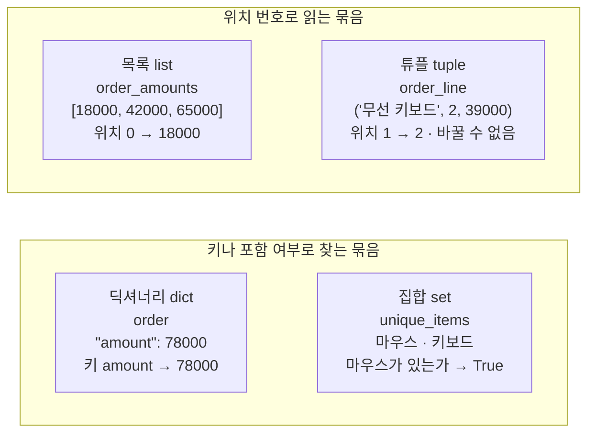
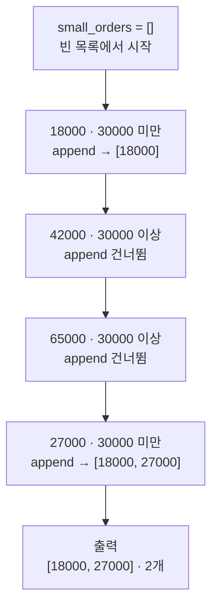
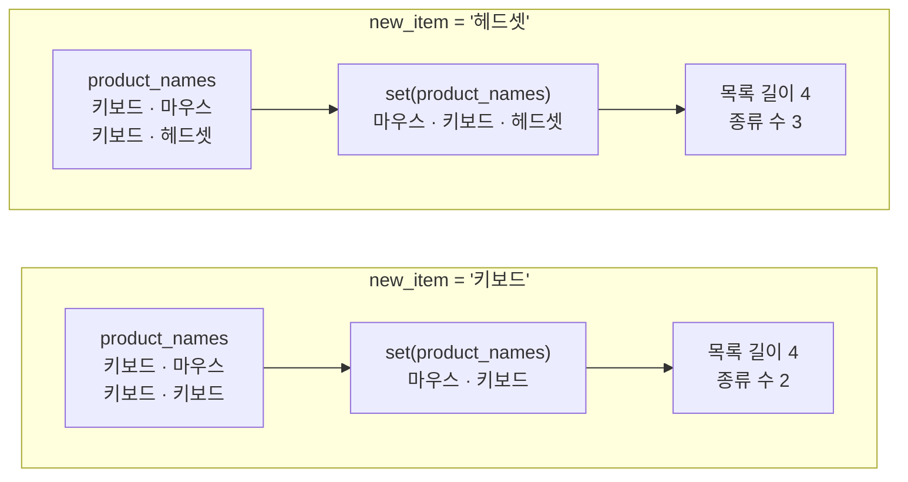
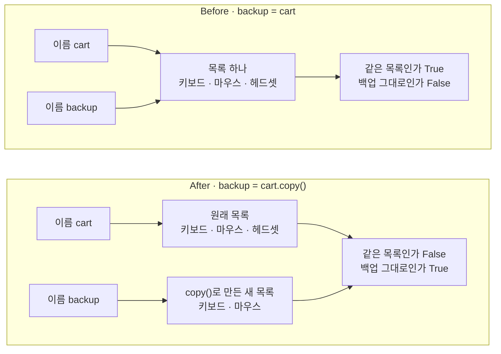

# 03-자료구조

## _src 본문 (HTML 원본)

```html
<!--meta: 강의 1h | 실습 2h | 코드 Jupyter Notebook | 새 용어 11 -->
<h2 id="b1"><span class="no">1</span>학습 목표</h2>
<div class="goal"><ul><li>목록을 위치 번호와 슬라이싱으로 읽고, 빈 목록에 <code>append()</code>로 조건에 맞는 값을 모을 수 있습니다.</li><li>값을 찾는 방법에 맞춰 튜플·딕셔너리·집합 가운데 하나를 고르고, 담은 값을 출력으로 확인할 수 있습니다.</li><li>대입으로 만든 백업이 원본과 함께 바뀌는 이유를 <code>is</code> 출력으로 설명하고, <code>copy()</code>로 고칠 수 있습니다.</li></ul></div>
<h2 id="b2"><span class="no">2</span>이 내용을 배우는 이유</h2>
<p>2절에서는 주문 금액만 목록에 담았습니다. 실제 주문 한 건에는 주문 번호, 상품 이름, 수량, 금액이 함께 있습니다. 이 값을 모두 낱개 변수로 만들면 주문이 늘 때마다 변수도 늘어납니다. 어느 값이 어느 주문의 것인지도 알기 어렵습니다.</p>
<p>자료구조는 여러 값을 한 이름 아래 묶습니다. 값을 순서로 찾을지, 이름으로 찾을지, 중복을 없앨지에 따라 고를 묶음이 다릅니다. 이 절은 2절의 주문 목록과 1절의 주문 한 건을 네 가지 묶음에 담아 봅니다.</p>
<p>목록에서 흔한 실수는 대입만으로 백업을 만들었다고 믿는 것입니다. 원본에 상품을 추가하면 백업에도 같이 들어가는데, 오류 메시지는 나오지 않습니다. 1·2절처럼 <b>실행이 멈추지 않아도 결과는 틀릴 수 있습니다.</b></p>
<p><strong>이 절의 질문</strong> — 장바구니 목록을 다른 이름에 대입해 두면, 원본에 상품을 추가해도 백업이 그대로 남을까요?</p>
<h2 id="b3"><span class="no">3</span>앞에서 배운 내용</h2>
<p>Ch 1과 1·2절에서 배운 것 가운데 이 절이 이어 쓰는 것을 표로 모았습니다.</p>
<table><thead><tr><th>앞 절</th><th>배운 것</th><th>이 절에서 이어 쓰는 곳</th></tr></thead><tbody>
<tr><td>Ch 1 2절</td><td>메서드(값 뒤에 점을 찍고 부르는 기능)</td><td><code>append()</code>·<code>get()</code>·<code>items()</code>·<code>copy()</code></td></tr>
<tr><td>Ch 1 3절</td><td>인덱스 <code>[0]</code>·<code>[-1]</code>, <code>is not None</code></td><td>목록·튜플 읽기, 연산자 <code>is</code></td></tr>
<tr><td>Ch 1 4절</td><td>연산자 <code>in</code></td><td>딕셔너리의 키와 집합의 값 확인</td></tr>
<tr><td>1절</td><td>대입은 오른쪽 값에 이름을 붙이는 일, 다시 대입해도 앞 계산은 그대로, 무선 키보드 2개와 주문 금액 78000.0</td><td>Before의 <code>backup = cart</code>, 튜플과 딕셔너리에 담는 주문 한 건</td></tr>
<tr><td>2절</td><td>주문 세 건 <code>[18000, 42000, 65000]</code>과 합계 125000, 배송비 기준 30000원·50000원</td><td>목록 읽기와 추가, 30000원 미만 주문 모으기, 배송비 키</td></tr>
<tr><td>2절</td><td><code>for</code>와 <code>if</code>, <code>range()</code>의 끝 번호 제외, <code>enumerate()</code>의 이름 두 개, <code>checked_total = checked_total + amount</code></td><td>빈 목록 채우기, 슬라이싱 끝 번호, 풀어 담기와 <code>items()</code>, <code>+=</code></td></tr>
</tbody></table>
<p>지금까지는 목록을 만들고 위치 번호로 읽기만 했습니다. 목록에 값을 추가하는 <code>append()</code>와 합계를 줄여 쓰는 <code>+=</code>는 2절에서 쓰지 않았습니다. 두 가지 모두 이 절에서 처음 배웁니다.</p>
<p>금액은 2절처럼 원 단위 정수로 적습니다. 1절의 단가 39000.0도 이 절에서는 39000으로 적습니다. 그래서 1절의 주문 금액 78000.0이 이 절에서는 정수 78000으로 나옵니다.</p>
<h2 id="b4"><span class="no">4</span>핵심 개념</h2>
<h3>비유로 시작하기</h3>
<p>1절에서 변수를 상자에 단 이름표에 비유했습니다. 이름표는 상자를 가리킬 뿐이고, 물건은 상자 안에 있습니다.</p>
<p>한 상자에 이름표를 두 개 달 수도 있습니다. 어느 이름표를 보고 물건을 넣든 같은 상자 하나에 들어갑니다. 사본을 따로 두려면 새 상자를 마련해 같은 물건을 담아야 합니다.</p>
{{img:03-5-이름표-두-개|왼쪽에는 투명 상자 하나에 노란 이름표 두 개가 매달려 있고 손이 헤드폰을 그 상자에 넣으며, 오른쪽에는 이름표가 하나씩 달린 상자 두 개 가운데 왼쪽 상자에만 헤드폰을 넣고 오른쪽 상자에는 마우스와 키보드만 남은 삽화|이름표 두 개를 한 상자에 단 왼쪽은 대입, 상자를 하나 더 마련한 오른쪽은 복사에 해당합니다.}}
<p><strong>그림 읽기</strong> — 가운데 세로줄 왼쪽에는 상자 하나에 노란 이름표 두 개가 매달려 있습니다. 상자는 목록이고, 두 이름표는 이름 cart와 backup입니다. 손이 넣는 헤드폰은 그 상자 하나에 들어가므로, 어느 이름표 쪽에서 봐도 보입니다.</p>
<p>세로줄 오른쪽에는 상자가 둘이고 이름표도 하나씩입니다. 복사로 새 목록을 만든 모습입니다. 헤드폰은 왼쪽 상자에만 들어가고, 오른쪽 끝 상자에는 마우스와 키보드만 남습니다.</p>
<h3>이 절에서 쓰는 말</h3>
<table><thead><tr><th>용어</th><th>뜻</th><th>이 절에서 보이는 모습</th></tr></thead><tbody>
<tr><td>자료구조(data structure)</td><td>여러 값을 한 이름 아래 묶어 저장하는 방법</td><td>목록·튜플·딕셔너리·집합</td></tr>
<tr><td>목록(list)</td><td>값을 순서대로 담고, 만든 뒤에도 바꿀 수 있는 묶음. 대괄호로 만듦</td><td><code>[18000, 42000, 65000]</code></td></tr>
<tr><td>슬라이싱(slicing)</td><td>위치 번호 두 개로 목록의 일부를 잘라 새 목록을 만드는 일. 끝 번호는 빠짐</td><td><code>order_amounts[0:2]</code></td></tr>
<tr><td>변경 가능(mutable)</td><td>만든 뒤에 값을 더하거나 바꿀 수 있는 성질</td><td><code>order_amounts.append(new_amount)</code></td></tr>
<tr><td>복합 대입 +=</td><td>이름의 값에 오른쪽 값을 더해 다시 저장하는 줄임 표기</td><td><code>order_sum += amount</code></td></tr>
<tr><td>튜플(tuple)</td><td>순서가 있고 만든 뒤 바꿀 수 없는 묶음. 소괄호로 만듦</td><td><code>("무선 키보드", 2, 39000)</code></td></tr>
<tr><td>풀어 담기(unpacking)</td><td>이름 여러 개를 쉼표로 적어 묶음의 값을 차례로 받는 일</td><td><code>product_name, quantity, unit_price = order_line</code></td></tr>
<tr><td>딕셔너리(dictionary)</td><td>키와 값을 짝지어 담는 묶음. 중괄호로 만듦</td><td><code>{"order_id": "A102", ...}</code></td></tr>
<tr><td>키(key)</td><td>딕셔너리에서 값을 찾을 때 쓰는 이름</td><td><code>order["amount"]</code></td></tr>
<tr><td>집합(set)</td><td>같은 값을 한 번만 담고 순서를 정해 두지 않는 묶음</td><td><code>set(product_names)</code></td></tr>
<tr><td>연산자 is</td><td>두 이름이 같은 값 하나에 붙어 있는지 검사</td><td><code>cart is backup</code></td></tr>
</tbody></table>
<h3>네 자료구조와 읽는 방법</h3>
<p>목록은 값을 순서대로 담고, 만든 뒤에도 바꿀 수 있습니다. 대괄호 <code>[ ]</code>로 만들고 위치 번호로 읽습니다. 슬라이싱 <code>order_amounts[0:2]</code>는 위치 0부터 위치 2 바로 앞까지 잘라 새 목록을 만듭니다.</p>
<p>튜플은 순서가 있지만 만든 뒤 바꿀 수 없습니다. 소괄호 <code>( )</code>로 만들고, 목록처럼 위치 번호로 읽습니다. 상품 이름·수량·단가처럼 자리마다 뜻이 정해진 값을 담습니다.</p>
<p>딕셔너리는 중괄호 <code>{ }</code> 안에 <code>키: 값</code> 짝을 담습니다. 서랍마다 붙은 이름표를 보고 물건을 꺼내듯, 위치 번호 대신 키로 값을 찾습니다. 식 <code>order["amount"]</code>는 키 amount와 짝인 값을 읽습니다.</p>
<p>집합은 같은 값을 한 번만 담습니다. 출석부에 같은 이름을 두 번 적어도 한 사람으로 세는 것과 같습니다. 위치 번호가 없으므로, 값이 들어 있는지를 연산자 <code>in</code>으로 검사합니다.</p>
{{mermaid:03-1-네-자료구조|목록 order_amounts와 튜플 order_line은 위치 번호로 읽고, 딕셔너리 order는 키로, 집합 unique_items는 포함 여부로 읽는다는 것을 네 상자로 보여 주는 그림|이 절에서 만드는 네 자료구조. 위 칸은 위치 번호로 읽고, 아래 칸은 키나 포함 여부로 찾습니다.}}
<p><strong>도식 읽기</strong> — 위 칸은 위치 번호로 읽는 목록과 튜플, 아래 칸은 키로 찾는 딕셔너리와 포함 여부로 찾는 집합입니다. 초록 상자마다 첫 줄은 자료구조 이름, 둘째 줄은 노트북의 변수 이름, 셋째 줄은 담은 값입니다.</p>
<p>넷째 줄은 읽는 방법과 결과입니다. 목록은 위치 0에서 18000을, 튜플은 위치 1에서 수량 2를 읽습니다. 딕셔너리는 키 amount로 78000을 읽습니다. 집합은 마우스가 있는지 검사해 True를 얻습니다.</p>
<h3>빈 목록을 채우는 모양</h3>
<p>여러 값 가운데 조건에 맞는 값만 고를 때는 빈 목록 <code>[]</code>에서 시작합니다. 반복문 <code>for</code>로 값을 하나씩 읽고, 조건이 참일 때만 메서드 <code>append()</code>로 끝에 추가합니다. 이 교재는 앞으로도 이 모양으로 새 목록을 만듭니다.</p>
<p>메서드 <code>append()</code>는 새 목록을 만들지 않고, 이름이 붙은 목록 자체를 바꿉니다. 목록이 변경 가능한 묶음이라서 할 수 있는 일입니다.</p>
<p>합계를 늘리는 줄은 복합 대입 <code>+=</code>로 줄여 씁니다. 줄 <code>order_sum += amount</code>는 2절 모양으로 쓴 <code>order_sum = order_sum + amount</code>와 같은 뜻입니다.</p>
<h3>대입과 복사</h3>
<p>1절에서 대입은 오른쪽 값에 왼쪽 이름을 붙이는 일이라고 배웠습니다. 대입 <code>backup = cart</code>의 오른쪽은 이름 cart가 붙은 목록입니다. 그래서 새 목록은 생기지 않고, 그 목록에 이름 backup이 하나 더 붙습니다.</p>
<p>1절에서 수량에 3을 다시 대입했을 때 주문 금액은 그대로였습니다. 다시 대입은 이름을 새 값에 옮겨 붙일 뿐, 앞에서 계산한 값을 건드리지 않습니다. 반면 메서드 <code>append()</code>는 이름이 붙은 목록 자체를 바꿉니다. 그래서 이름 두 개가 붙은 목록에 추가하면 두 이름 모두에서 바뀐 값이 보입니다.</p>
<p>연산자 <code>is</code>는 두 이름이 같은 목록 하나에 붙어 있는지 검사합니다. 연산자 <code>==</code>는 두 목록의 내용이 같은지 검사합니다. 메서드 <code>copy()</code>로 만든 백업은 내용이 같은 다른 목록입니다. 그래서 복사 직후 <code>==</code>는 True이고 <code>is</code>는 False입니다.</p>
<h2 id="b5"><span class="no">5</span>실행 예제</h2>
<p>노트북은 2절의 주문 세 건 금액을 새 커널에 저장하고 시작합니다. 위치 번호와 슬라이싱으로 첫 주문 18000, 마지막 주문 65000, 앞의 두 주문 [18000, 42000]을 읽습니다. 새 주문 27000을 <code>append()</code>로 추가하면 주문 수가 4가 됩니다.</p>
<p>빈 목록에 30000원 미만 주문만 모으면 [18000, 27000]입니다. 네 주문의 합계는 <code>+=</code>로 세어 152000입니다. 이어서 1절의 주문 한 줄을 튜플에 담아 풀어 담고, 주문 금액 78000을 계산합니다.</p>
<p>딕셔너리에는 주문 번호 A102와 금액 78000을 키와 함께 담습니다. 키 shipping_fee를 추가하고, 없는 키 coupon_code는 <code>in</code>과 <code>get()</code>으로 확인합니다. 마지막으로 상품 목록을 집합으로 바꾸고, 추가할 상품 하나만 바꿔 종류 수를 비교합니다.</p>
<p>모델을 부르지 않으므로 API 키가 필요 없고 비용도 들지 않습니다. 집합은 정렬해서 출력하므로 출력은 다시 실행해도 같습니다.</p>
<p>강의 시간에는 2~7번과 13~14번 소제목을 함께 실행합니다. 8~12번(딕셔너리 키 추가, <code>in</code>과 <code>get()</code>, <code>items()</code>, 집합과 값 바꿔 보기)은 실습 시간에 이어서 실행합니다.</p>
{{notebook:03-자료구조|example}}
<p class="look"><b>확인할 점</b> — 슬라이싱 결과 [18000, 42000]에 위치 2의 65000이 없는지 봅니다. 딕셔너리의 짝 수가 3에서 4로 늘었는지, 쿠폰 코드가 기본값 <code>"없음"</code>으로 나왔는지 확인합니다. 헤드셋을 추가하면 종류 수 3, 키보드를 추가하면 2인지 확인합니다.</p>
<h3>빈 목록을 채운 차례</h3>
<p>30000원 미만 주문을 모은 셀이 금액 네 개를 읽은 차례를 한 그림으로 모았습니다.</p>
{{mermaid:03-2-빈-목록-채우기|빈 목록 small_orders에서 시작해 18000은 추가, 42000과 65000은 건너뛰고, 27000을 추가해 [18000, 27000] 두 개가 출력되는 흐름도|빈 목록 채우기. 금액 네 개를 차례로 읽어 30000원 미만인 18000과 27000만 목록에 추가합니다.}}
<p><strong>도식 읽기</strong> — 위에서 아래로 읽습니다. 맨 위 파란 상자는 우리가 적은 빈 목록 줄입니다. 초록 상자 두 개는 조건이 참이라 append 줄을 실행한 차례이고, 추가한 뒤 목록 모양을 함께 적었습니다.</p>
<p>회색 상자 42000과 65000은 30000 이상이라 append 줄을 실행하지 않은 차례입니다. 맨 아래 노란 상자가 출력 [18000, 27000]과 개수 2입니다. 모인 순서는 원래 목록에서 읽은 순서와 같습니다.</p>
<h3>목록 길이와 종류 수</h3>
<p>상품 목록 [키보드, 마우스, 키보드]의 길이는 3이고, 집합으로 바꾼 종류 수는 2였습니다. 목록 길이는 담긴 상품 수이고, 종류 수는 서로 다른 상품 수입니다. 값 바꿔 보기에서는 추가할 상품 new_item 하나만 바꿔 두 숫자를 비교했습니다.</p>
{{mermaid:03-3-목록과-집합-비교|헤드셋을 추가하면 목록 길이 4에 집합 종류 수 3이고, 키보드를 추가하면 목록 길이 4에 종류 수 2로 남는 것을 위아래 두 칸으로 비교한 그림|추가한 상품 하나만 바꾼 비교. 목록 길이는 둘 다 4이고, 종류 수만 3과 2로 갈립니다.}}
<p><strong>도식 읽기</strong> — 위 칸은 헤드셋, 아래 칸은 키보드를 추가한 경우입니다. 칸 안은 왼쪽에서 오른쪽으로 읽습니다. 초록 상자는 목록과 집합에 든 값이고, 집합은 노트북에서 sorted()로 정렬해 출력한 순서로 적었습니다.</p>
<p>노란 상자의 목록 길이는 둘 다 4입니다. 종류 수는 헤드셋 쪽이 3, 키보드 쪽이 2입니다. 키보드는 이미 있던 상품이라 집합에 한 번만 남았습니다.</p>
<h2 id="b6"><span class="no">6</span>일부러 실패해 보기</h2>
<p>장바구니 cart에 키보드와 마우스를 담았습니다. 상품을 더 담기 전에 지금 상태를 백업하려고 <code>backup = cart</code>를 적습니다. 그다음 이름 cart로 헤드셋을 추가합니다.</p>
<p>Before 셀은 오류 없이 실행됩니다. 그러나 cart와 backup 두 줄이 모두 ['키보드', '마우스', '헤드셋']입니다. 같은 목록인가는 True, 백업이 추가 전 그대로인가는 False입니다. 대입이 새 목록을 만들지 않고, 목록 하나에 이름을 하나 더 붙였기 때문입니다.</p>
<p>After 셀은 그 한 줄을 <code>backup = cart.copy()</code>로 바꿉니다. 복사 직후 내용이 같은가는 True입니다. 헤드셋을 추가한 뒤 backup은 ['키보드', '마우스'] 그대로입니다. 같은 목록인가는 False, 백업이 그대로인가는 True입니다.</p>
{{mermaid:03-4-before-after-비교|Before는 이름 cart와 backup이 목록 하나를 함께 가리켜 같은 목록 True와 백업 그대로 False가 나오고, After는 두 이름이 서로 다른 목록을 가리켜 backup이 키보드와 마우스 두 상품 그대로이며 False와 True가 나오는 비교 그림|대입한 Before는 목록 하나에 이름 두 개가 붙어 백업에도 헤드셋이 들어가고, copy()를 쓴 After는 백업이 두 상품 그대로입니다.}}
<p><strong>도식 읽기</strong> — 위 칸이 Before, 아래 칸이 After이고, 칸 안은 왼쪽에서 오른쪽으로 읽습니다. 파란 상자는 이름, 초록 상자는 목록입니다.</p>
<p>Before 칸에서는 이름 cart와 backup의 화살표가 초록 상자 하나로 모입니다. 그 목록에서 빨간 상자(같은 목록인가 True, 백업 그대로인가 False)로 이어집니다. After 칸에서는 두 이름이 서로 다른 초록 상자로 갑니다. 이름 backup 쪽 새 목록에는 키보드와 마우스만 있고, 노란 상자의 결과는 False와 True입니다.</p>
{{notebook:03-자료구조|failure}}
<h3>확인한 범위</h3>
<p>이번에 고친 경우는 글자 값 두 개가 든 목록 하나입니다. Python 문서는 메서드 <code>copy()</code>를 얕은 복사(shallow copy)라고 부릅니다. 목록 안에 또 목록이 든 경우의 복사는 이번에 실행하지 않았습니다.</p>
<p>튜플의 값을 바꾸는 장면은 「원리 더 알아보기」 셀에서 한 번 실행했고, <code>TypeError</code> 오류가 났습니다. 오류를 잡는 <code>try</code>와 <code>except</code>는 5절 파일과 예외에서 배웁니다. 딕셔너리에서 없는 키를 대괄호로 읽는 <code>KeyError</code> 장면은 이번에 실행하지 않았습니다.</p>
<h2 id="b7"><span class="no">7</span>주의할 점과 실무 메모</h2>
<ul><li>메서드 <code>append()</code>가 든 셀은 실행할 때마다 값을 추가합니다. 노트북에서는 한 번만 실행해 주문 수가 4였습니다. 여러 번 실행했다면 첫 셀부터 다시 실행합니다.</li>
<li>슬라이싱의 끝 번호는 들어가지 않습니다. 식 <code>order_amounts[0:2]</code>는 위치 0과 1만 읽어 [18000, 42000]이었습니다.</li>
<li>없을 수도 있는 키는 <code>in</code>으로 먼저 확인하거나 <code>get()</code>에 기본값을 줍니다. 노트북에서 쿠폰 코드는 기본값 <code>"없음"</code>으로 나왔습니다.</li>
<li>집합은 값의 순서를 정해 두지 않습니다. 화면에 보이거나 비교할 때는 노트북처럼 <code>sorted()</code>로 정렬한 목록을 씁니다.</li>
<li>목록 길이와 집합의 종류 수는 서로 다른 질문에 답합니다. 노트북에서 담긴 상품 수는 3, 서로 다른 상품 수는 2였습니다.</li>
<li>백업이 필요하면 대입 대신 <code>copy()</code>를 씁니다. 목록 안에 목록이 든 데이터는 안쪽 목록까지 따로 확인합니다.</li></ul>
<h2 id="b8"><span class="no">8</span>정리와 다음 절</h2>
<ul><li>목록은 순서대로 담고 바꿀 수 있습니다. 슬라이싱 <code>[0:2]</code>로 일부를 읽고, 빈 목록에 <code>append()</code>로 30000원 미만 주문 [18000, 27000]을 모았습니다.</li><li>튜플은 바꿀 수 없는 순서 묶음, 딕셔너리는 키로 찾는 묶음, 집합은 중복 없는 묶음입니다. 키로 읽은 주문 금액은 78000, 상품 종류 수는 2였습니다.</li><li>대입 <code>backup = cart</code>는 목록 하나에 이름을 하나 더 붙입니다. 백업을 따로 남기려면 <code>copy()</code>로 새 목록을 만들고, <code>is</code>가 False인지 확인합니다.</li></ul>
<p><strong>다음 학습과 이어지는 지점</strong> — 4절에서는 계산 순서에 이름을 붙여 여러 번 부르는 함수를 배웁니다. 목록을 다루는 함수에서도 이 절의 <code>append()</code>와 <code>is</code>로 목록이 어떻게 바뀌는지 확인합니다.</p>
<h2 id="b9"><span class="no">9</span>복습 문제</h2><details class="quiz"><summary>문제와 해설</summary>
<p class="quiz-q">1. 식 <code>order_amounts[0:2]</code>의 결과는 무엇이었고, 위치 2의 값은 왜 빠졌나요? · 기초</p><p class="quiz-a"><b>해설</b> — 결과는 [18000, 42000]입니다. 슬라이싱의 끝 번호 2는 들어가지 않습니다. 2절의 <code>range(1, 3)</code>이 3을 만들지 않은 것과 같습니다.</p>
<p class="quiz-q">2. 빈 목록 <code>small_orders</code>에 30000원 미만 주문을 모은 결과는 무엇이었나요? 42000을 읽은 차례에는 무슨 일이 있었나요? · 기초</p><p class="quiz-a"><b>해설</b> — 결과는 [18000, 27000], 2개입니다. 42000을 읽은 차례에는 조건이 거짓이라 <code>append()</code> 줄을 건너뛰었습니다.</p>
<p class="quiz-q">3. 주문 번호·상품 이름·금액을 담을 때 튜플보다 딕셔너리가 나은 점은 무엇인가요? 금액을 읽는 식도 쓰세요. · 기초</p><p class="quiz-a"><b>해설</b> — 딕셔너리는 키 이름으로 값을 찾아 뜻이 드러납니다. 식은 <code>order["amount"]</code>이고 78000이 나왔습니다. 튜플은 둘째 값이 수량이라는 것을 순서로만 압니다.</p>
<p class="quiz-q">4. 없는 키 coupon_code를 <code>get()</code>으로 읽으면 무엇이 나왔나요? 대괄호로 읽을 때와 무엇이 다른가요? · 적용</p><p class="quiz-a"><b>해설</b> — 기본값 <code>"없음"</code>이 나왔고 셀이 멈추지 않았습니다. 대괄호로 없는 키를 읽으면 <code>KeyError</code> 오류가 납니다. 이 장면은 노트북에서 실행하지 않았습니다.</p>
<p class="quiz-q">5. 헤드셋을 추가했을 때와 키보드를 추가했을 때 목록 길이와 종류 수는 어떻게 달랐나요? · 적용</p><p class="quiz-a"><b>해설</b> — 목록 길이는 둘 다 4입니다. 종류 수는 헤드셋이 3, 키보드가 2입니다. 키보드는 이미 있던 상품이라 집합에 한 번만 남습니다.</p>
<p class="quiz-q">6. Before 셀에서 백업에도 헤드셋이 들어간 이유는 무엇이고, After 셀은 어떻게 고쳤나요? · 분석</p><p class="quiz-a"><b>해설</b> — 대입 <code>backup = cart</code>가 새 목록을 만들지 않고 같은 목록에 이름을 하나 더 붙였기 때문입니다. 그래서 같은 목록인가가 True였습니다. After 셀은 <code>cart.copy()</code>로 새 목록을 만들어, 같은 목록인가 False에 백업은 두 상품 그대로였습니다.</p>
</details>
<h2 id="b10"><span class="no">10</span>참고 자료</h2>
<ul><li><a href="https://docs.python.org/3.12/tutorial/datastructures.html">Python 3.12 자습서 5장: 자료 구조</a> · 확인 2026-09-16 · 기준 Python 3.12</li><li><a href="https://docs.python.org/3.12/library/stdtypes.html#sequence-types-list-tuple-range">Python 3.12 내장 형: 목록과 튜플</a> · 확인 2026-09-16 · 기준 Python 3.12</li><li><a href="https://docs.python.org/3.12/library/stdtypes.html#mapping-types-dict">Python 3.12 내장 형: 매핑(dict)</a> · 확인 2026-09-16 · 기준 Python 3.12</li><li><a href="https://docs.python.org/3.12/library/stdtypes.html#set-types-set-frozenset">Python 3.12 내장 형: 집합(set)</a> · 확인 2026-09-16 · 기준 Python 3.12</li></ul>
```

## 노트북 셀 (순서대로)

### [0] markdown {'html': 'skip'}

# 자료구조

**이 노트북에서 할 일**

1. 주문 금액 목록을 위치 번호와 슬라이싱으로 읽고, `append()`로 새 주문을 추가합니다.
2. 튜플·딕셔너리·집합에 주문 정보를 목적에 맞게 담고 읽습니다.
3. 대입으로 만든 백업이 원본과 함께 바뀌는 장면을 보고, `copy()`로 고칩니다.

**준비물** — API 키 불필요. 데이터 파일도 없습니다. 모델 호출은 0번이고 비용은 들지 않습니다.
실행 시간은 1분 이내입니다.

**강의와 실습 범위** — 강의 시간에는 2~7번과 13~14번 소제목을 함께 실행합니다.
8~12번(딕셔너리 키 추가, `in`과 `get()`, `items()`, 집합과 값 바꿔 보기)은 실습 시간에 이어서 실행합니다.

1·2절과 같은 실습 폴더 `labs/part1/ch02-python`의 `.venv`를 커널로 고릅니다.
이전 커널의 변수는 쓰지 않으므로 첫 셀부터 순서대로 실행합니다.

### [1] markdown {'html': 'skip'}

## 오늘 볼 그림


위 칸은 위치 번호로 읽는 목록과 튜플, 아래 칸은 키로 찾는 딕셔너리와 포함 여부로 찾는 집합입니다.
상자마다 첫 줄은 자료구조 이름, 둘째 줄은 변수 이름, 셋째 줄은 이 노트북에서 담는 값입니다.
마지막 줄은 값을 읽는 방법입니다. 예를 들어 목록은 위치 0에서 18000을 읽습니다.

### [2] markdown {}

## 1. 준비

이 절도 설치할 패키지가 없습니다. 준비 셀은 2절에서 읽은 주문 세 건의 금액을 새 커널에 저장합니다.
금액은 2절처럼 원 단위 정수로 적습니다.

### [3] code {'execution': {'iopub.execute_input': '2026-09-16T08:59:49.639457Z', 'iopub.status.busy': '2026-09-16T08:59:49.639196Z', 'iopub.status.idle': '2026-09-16T08:59:49.644464Z', 'shell.execute_reply': '2026-09-16T08:59:49.643919Z'}, 'lesson_role': 'setup'}

```python
# 2절에서 읽은 주문 세 건의 금액을 새 커널에 다시 저장합니다
order_amounts = [18000, 42000, 65000]
order_count = len(order_amounts)
print("주문 세 건의 금액:", order_amounts)
print("주문 수:", order_count)
```

출력:
```
주문 세 건의 금액: [18000, 42000, 65000]
주문 수: 3

```

### [4] markdown {}

**결과 읽기** — 주문 세 건의 금액은 `[18000, 42000, 65000]`이고, 주문 수는 `3`입니다.
2절 After에서 읽은 세 건과 같습니다.

### [5] markdown {}

## 2. 목록에서 일부 읽기

자료구조(data structure)는 여러 값을 한 이름 아래 묶어 저장하는 방법입니다. 장 볼 물건을 종이 한 장에 줄줄이 적는 것과 같습니다.
이 절에서는 목록·튜플·딕셔너리·집합 네 가지를 씁니다. 그 가운데 목록(list)은 값을 순서대로 담는 자료구조입니다.

Ch 1 3절에서 본 대로 위치 번호 `[0]`은 첫 값, `[-1]`은 마지막 값을 읽습니다.
슬라이싱(slicing)은 위치 번호 두 개로 목록의 일부를 잘라 새 목록을 만드는 일입니다.
읽는 식 `order_amounts[0:2]`는 위치 0부터 위치 2 바로 앞까지 읽습니다. 2절의 `range(1, 3)`처럼 끝 번호는 들어가지 않습니다.

실행 전에 예상합니다. 앞의 두 주문은 18000과 42000일 것입니다.

### [6] code {'execution': {'iopub.execute_input': '2026-09-16T08:59:49.646116Z', 'iopub.status.busy': '2026-09-16T08:59:49.645990Z', 'iopub.status.idle': '2026-09-16T08:59:49.649009Z', 'shell.execute_reply': '2026-09-16T08:59:49.648316Z'}}

```python
# 위치 번호와 슬라이싱으로 목록의 일부를 읽습니다
first_amount = order_amounts[0]
last_amount = order_amounts[-1]
# [0:2]는 위치 0부터 위치 2 바로 앞까지 읽어 새 목록을 만듭니다
first_two = order_amounts[0:2]
print("첫 주문 금액:", first_amount)
print("마지막 주문 금액:", last_amount)
print("앞의 두 주문:", first_two)
```

출력:
```
첫 주문 금액: 18000
마지막 주문 금액: 65000
앞의 두 주문: [18000, 42000]

```

### [7] markdown {}

**결과 읽기** — 첫 주문 금액은 `18000`, 마지막 주문 금액은 `65000`입니다. 앞의 두 주문은 `[18000, 42000]`으로 예상과 같습니다.
잘라 낸 결과도 대괄호와 함께 출력됐습니다. 슬라이싱은 목록의 일부를 새 목록으로 만듭니다.

### [8] markdown {}

## 3. append()로 새 주문 추가하기

목록은 만든 뒤에도 값을 더하거나 바꿀 수 있습니다. 이런 성질을 변경 가능(mutable)하다고 합니다.
Ch 1 2절에서 값 뒤에 점을 찍고 부르는 기능을 메서드라고 했습니다. 메서드 `append()`는 괄호 안의 값 하나를 목록 끝에 추가합니다.
이 메서드는 새 목록을 만들지 않고, 이름 `order_amounts`가 붙은 목록 자체를 바꿉니다.

이 셀은 한 번만 실행합니다. 다시 실행하면 27000이 한 번 더 들어가므로, 그럴 때는 첫 셀부터 다시 실행합니다.

실행 전에 예상합니다. 주문 수는 3에서 4로 늘 것입니다.

### [9] code {'execution': {'iopub.execute_input': '2026-09-16T08:59:49.650506Z', 'iopub.status.busy': '2026-09-16T08:59:49.650372Z', 'iopub.status.idle': '2026-09-16T08:59:49.653527Z', 'shell.execute_reply': '2026-09-16T08:59:49.652905Z'}}

```python
# 새로 들어온 주문 27000원을 목록 끝에 추가합니다
new_amount = 27000
order_amounts.append(new_amount)
order_count = len(order_amounts)
print("추가한 뒤 목록:", order_amounts)
print("추가한 뒤 주문 수:", order_count)
```

출력:
```
추가한 뒤 목록: [18000, 42000, 65000, 27000]
추가한 뒤 주문 수: 4

```

### [10] markdown {}

**결과 읽기** — 추가한 뒤 목록은 `[18000, 42000, 65000, 27000]`이고, 주문 수는 `4`입니다.
새 값 27000은 목록 맨 끝에 들어갔습니다. 앞의 세 값과 그 순서는 그대로입니다.

### [11] markdown {}

## 4. 빈 목록에 조건에 맞는 값 모으기

2절의 배송비 규칙에서 30000원 미만 주문은 배송비가 3000원이었습니다. 이런 주문만 골라 새 목록에 모읍니다.
먼저 빈 목록 `[]`을 만들고, 반복문 `for`로 금액을 하나씩 읽습니다. 조건이 참일 때만 `append()`로 추가합니다.
여러 값 가운데 일부를 고를 때 앞으로 계속 쓰는 모양입니다.

실행 전에 예상합니다. 네 금액 가운데 18000과 27000이 모일 것입니다.

### [12] code {'execution': {'iopub.execute_input': '2026-09-16T08:59:49.654863Z', 'iopub.status.busy': '2026-09-16T08:59:49.654726Z', 'iopub.status.idle': '2026-09-16T08:59:49.657606Z', 'shell.execute_reply': '2026-09-16T08:59:49.657001Z'}}

```python
# 배송비가 3000원인 30000원 미만 주문만 새 목록에 모읍니다
reduced_fee_minimum = 30000
small_orders = []
for amount in order_amounts:
    # 조건이 참인 차례에만 목록 끝에 금액을 추가합니다
    if amount < reduced_fee_minimum:
        small_orders.append(amount)
small_count = len(small_orders)
print("30000원 미만 주문:", small_orders)
print("30000원 미만 주문 수:", small_count)
```

출력:
```
30000원 미만 주문: [18000, 27000]
30000원 미만 주문 수: 2

```

### [13] markdown {}

**결과 읽기** — 30000원 미만 주문은 `[18000, 27000]`, 개수는 `2`로 예상과 같습니다.
금액 42000과 65000을 읽은 차례에는 조건이 거짓이라 `append()` 줄을 건너뛰었습니다. 모인 순서는 원래 목록의 순서와 같습니다.

### [14] markdown {}

## 5. 복합 대입 +=로 합계 늘리기

2절에서는 합계를 `checked_total = checked_total + amount`처럼 늘렸습니다. 같은 이름을 두 번 적어야 합니다.
복합 대입 `+=`는 이 줄을 줄여 씁니다. 줄 `order_sum += amount`는 `order_sum = order_sum + amount`와 같은 뜻입니다.

실행 전에 예상합니다. 2절의 합계 125000에 새 주문 27000을 더한 152000일 것입니다.

### [15] code {'execution': {'iopub.execute_input': '2026-09-16T08:59:49.658808Z', 'iopub.status.busy': '2026-09-16T08:59:49.658680Z', 'iopub.status.idle': '2026-09-16T08:59:49.661520Z', 'shell.execute_reply': '2026-09-16T08:59:49.660847Z'}}

```python
# 주문 네 건의 금액을 모두 더합니다
order_sum = 0
for amount in order_amounts:
    # order_sum = order_sum + amount와 같은 뜻입니다
    order_sum += amount
print("주문 수:", order_count)
print("주문 네 건의 합계:", order_sum)
```

출력:
```
주문 수: 4
주문 네 건의 합계: 152000

```

### [16] markdown {}

**결과 읽기** — 주문 수 `4`, 주문 네 건의 합계는 `152000`으로 예상과 같습니다.
2절 After에서 센 세 건의 합계 125000보다 새 주문 27000원만큼 많습니다.

### [17] markdown {}

## 6. 튜플로 순서가 정해진 값 묶기

튜플(tuple)은 순서가 있고, 만든 뒤에는 바꿀 수 없는 묶음입니다. 영수증에 이미 찍힌 한 줄처럼 자리와 개수가 고정됩니다.
대괄호 대신 소괄호 `( )`로 만들고, 읽을 때는 목록처럼 위치 번호를 씁니다.

1절의 주문 한 줄을 상품 이름, 수량, 단가 순서로 튜플에 담습니다. 단가는 2절처럼 원 단위 정수 39000으로 적습니다.
이름 세 개를 쉼표로 적고 튜플을 대입하면 값이 차례로 담깁니다. 이 모양을 풀어 담기(unpacking)라고 합니다.
2절의 `for index, amount in enumerate(order_amounts):`도 이름 두 개에 값을 풀어 담았습니다.

실행 전에 예상합니다. 수량 2에 단가 39000을 곱한 주문 금액은 78000일 것입니다.

### [18] code {'execution': {'iopub.execute_input': '2026-09-16T08:59:49.662627Z', 'iopub.status.busy': '2026-09-16T08:59:49.662505Z', 'iopub.status.idle': '2026-09-16T08:59:49.665680Z', 'shell.execute_reply': '2026-09-16T08:59:49.665056Z'}}

```python
# 상품 이름·수량·단가를 순서가 정해진 튜플 하나에 담습니다
order_line = ("무선 키보드", 2, 39000)
second_value = order_line[1]
print("주문 줄:", order_line)
print("둘째 값(수량):", second_value)
# 이름 세 개를 쉼표로 적으면 튜플의 값이 순서대로 담깁니다
product_name, quantity, unit_price = order_line
line_total = quantity * unit_price
print("상품 이름:", product_name)
print("주문 금액:", line_total)
```

출력:
```
주문 줄: ('무선 키보드', 2, 39000)
둘째 값(수량): 2
상품 이름: 무선 키보드
주문 금액: 78000

```

### [19] markdown {}

**결과 읽기** — 주문 줄은 `('무선 키보드', 2, 39000)`으로 소괄호와 함께 출력됐습니다. 둘째 값은 수량 `2`입니다.
풀어 담은 뒤 상품 이름은 `무선 키보드`, 주문 금액은 `78000`입니다.
1절에서는 실수 단가로 78000.0을 얻었고, 이번에는 같은 금액을 정수로 계산했습니다.

### [20] markdown {}

### 원리 더 알아보기 — 튜플의 값을 바꾸면 나오는 오류

튜플의 수량 자리에 3을 넣으면 어떻게 될까요? 튜플은 바꿀 수 없으므로 오류가 나고 셀 실행이 멈춥니다.
아래 셀은 멈추지 않고 오류 이름만 보려고 `try`와 `except`를 씁니다. 2절의 원리 더 알아보기와 같은 방법입니다.
이 문법은 5절 파일과 예외에서 배우므로 지금은 출력만 읽습니다.

### [21] code {'execution': {'iopub.execute_input': '2026-09-16T08:59:49.666770Z', 'iopub.status.busy': '2026-09-16T08:59:49.666658Z', 'iopub.status.idle': '2026-09-16T08:59:49.669358Z', 'shell.execute_reply': '2026-09-16T08:59:49.668808Z'}, 'lesson_level': 'deep-dive'}

```python
# 원리 더 알아보기: 튜플의 수량 자리에 3을 넣어 봅니다
try:
    order_line[1] = 3
except TypeError as error:
    print("오류 이름:", type(error).__name__)
    print("오류 메시지:", error)
print("튜플 값:", order_line)
```

출력:
```
오류 이름: TypeError
오류 메시지: 'tuple' object does not support item assignment
튜플 값: ('무선 키보드', 2, 39000)

```

### [22] markdown {}

**결과 읽기** — 오류 이름은 `TypeError`, 메시지는 `'tuple' object does not support item assignment`입니다.
튜플은 위치 번호로 값을 바꾸는 대입을 받지 않는다는 뜻입니다. 마지막 줄의 튜플 값은 `('무선 키보드', 2, 39000)` 그대로입니다.

### [23] markdown {}

## 7. 딕셔너리로 이름을 붙여 저장하기

딕셔너리(dictionary)는 키(key)와 값을 짝지어 저장하는 자료구조입니다. 서랍마다 붙은 이름표를 보고 물건을 꺼내는 것과 같습니다.
중괄호 `{ }` 안에 `키: 값`을 쉼표로 나눠 적습니다. 콜론 왼쪽이 키, 오른쪽이 값입니다.

튜플은 둘째 값이 수량이라는 것을 순서로만 압니다. 딕셔너리는 `"amount"` 같은 키 이름으로 값을 찾으므로 뜻이 드러납니다.
1절의 주문 한 건에 주문 번호를 붙여 딕셔너리에 담습니다.

실행 전에 예상합니다. 키 `"amount"`로 읽은 값은 78000일 것입니다.

### [24] code {'execution': {'iopub.execute_input': '2026-09-16T08:59:49.670389Z', 'iopub.status.busy': '2026-09-16T08:59:49.670289Z', 'iopub.status.idle': '2026-09-16T08:59:49.672843Z', 'shell.execute_reply': '2026-09-16T08:59:49.672277Z'}}

```python
# 주문 한 건의 번호·상품 이름·금액을 키와 값의 짝으로 저장합니다
order = {"order_id": "A102", "product_name": "무선 키보드", "amount": 78000}
print("주문:", order)
# 대괄호 안에 키를 적으면 그 키와 짝인 값을 읽습니다
order_id = order["order_id"]
order_amount = order["amount"]
print("주문 번호:", order_id)
print("주문 금액:", order_amount)
```

출력:
```
주문: {'order_id': 'A102', 'product_name': '무선 키보드', 'amount': 78000}
주문 번호: A102
주문 금액: 78000

```

### [25] markdown {}

**결과 읽기** — 주문 번호는 `A102`, 주문 금액은 `78000`으로 예상과 같습니다.
딕셔너리 전체를 출력하면 `'amount': 78000`처럼 키와 값이 콜론으로 이어져 보입니다.

### [26] markdown {}

## 8. 딕셔너리에 키 추가하기

없는 키에 값을 대입하면 딕셔너리에 새 짝이 추가됩니다. 목록처럼 딕셔너리도 만든 뒤에 바꿀 수 있습니다.
2절 규칙대로 78000원은 50000원 이상이라 배송비가 0원입니다. 키 `"shipping_fee"`에 0을 대입해 주문 정보에 더합니다.
함수 `len()`에 딕셔너리를 넣으면 키와 값의 짝이 몇 개인지 반환합니다.

실행 전에 예상합니다. 짝의 수는 3에서 4로 늘 것입니다.

### [27] code {'execution': {'iopub.execute_input': '2026-09-16T08:59:49.673900Z', 'iopub.status.busy': '2026-09-16T08:59:49.673799Z', 'iopub.status.idle': '2026-09-16T08:59:49.676330Z', 'shell.execute_reply': '2026-09-16T08:59:49.675723Z'}}

```python
# 없는 키 "shipping_fee"에 대입해 배송비 짝을 추가합니다
order["shipping_fee"] = 0
field_count = len(order)
print("배송비를 추가한 주문:", order)
print("키와 값의 짝 수:", field_count)
```

출력:
```
배송비를 추가한 주문: {'order_id': 'A102', 'product_name': '무선 키보드', 'amount': 78000, 'shipping_fee': 0}
키와 값의 짝 수: 4

```

### [28] markdown {}

**결과 읽기** — 출력 끝에 `'shipping_fee': 0`이 붙었고, 짝의 수는 `4`로 예상과 같습니다.
새 짝은 맨 뒤에 들어갔습니다. 앞의 세 짝은 그대로입니다.

### [29] markdown {}

## 9. 없을 수도 있는 키 확인하기

대괄호로 없는 키를 읽으면 `KeyError` 오류가 나고 셀이 멈춥니다. 이 장면은 이번에 실행하지 않았습니다.
키가 없을 수도 있으면 연산자 `in`으로 먼저 확인합니다. Ch 1 4절에서 쓴 연산자이고, 딕셔너리에서는 그 키가 있는지 검사합니다.
메서드 `get()`은 키가 있으면 그 값을, 없으면 괄호 둘째 자리에 적은 기본값을 반환합니다.

실행 전에 예상합니다. 이 주문에는 쿠폰 키가 없으므로 `False`와 기본값 `"없음"`이 나올 것입니다.
기본값을 적지 않으면 `get()`은 `None`을 반환합니다. 이 장면은 이번에 실행하지 않았습니다.

### [30] code {'execution': {'iopub.execute_input': '2026-09-16T08:59:49.677456Z', 'iopub.status.busy': '2026-09-16T08:59:49.677352Z', 'iopub.status.idle': '2026-09-16T08:59:49.680276Z', 'shell.execute_reply': '2026-09-16T08:59:49.679644Z'}}

```python
# 쿠폰 키가 있는지 in으로 확인하고, get()으로 기본값과 함께 읽습니다
has_coupon = "coupon_code" in order
coupon_code = order.get("coupon_code", "없음")
# 있는 키를 get()으로 읽으면 기본값 대신 저장된 값이 나옵니다
shipping_fee = order.get("shipping_fee", "없음")
print("쿠폰 키가 있는가:", has_coupon)
print("쿠폰 코드:", coupon_code)
print("배송비:", shipping_fee)
```

출력:
```
쿠폰 키가 있는가: False
쿠폰 코드: 없음
배송비: 0

```

### [31] markdown {}

**결과 읽기** — 쿠폰 키가 있는가는 `False`, 쿠폰 코드는 기본값 `없음`입니다. 있는 키인 배송비는 저장된 값 `0`이 나왔습니다.
기본값을 주었기 때문에 키가 없어도 셀이 멈추지 않았습니다.

### [32] markdown {}

## 10. 키와 값을 함께 읽기

반복문 `for`로 딕셔너리의 짝을 모두 읽을 때는 메서드 `items()`를 씁니다. 이 메서드는 키와 값의 짝을 차례로 내놓습니다.
반복문 머리에 이름 두 개를 쉼표로 적으면 키와 값이 풀어 담깁니다. 2절의 `enumerate()`와 같은 모양입니다.
읽은 짝의 수는 5번 소제목의 `+=`로 셉니다.

실행 전에 예상합니다. 짝 네 개를 읽고, 앞 셀에서 추가한 배송비가 마지막 줄에 나올 것입니다.

### [33] code {'execution': {'iopub.execute_input': '2026-09-16T08:59:49.681881Z', 'iopub.status.busy': '2026-09-16T08:59:49.681734Z', 'iopub.status.idle': '2026-09-16T08:59:49.684921Z', 'shell.execute_reply': '2026-09-16T08:59:49.684070Z'}}

```python
# items()가 내놓는 키와 값의 짝을 하나씩 읽어 출력합니다
read_count = 0
for key, value in order.items():
    print(f"{key}: {value}")
    read_count += 1
print("읽은 짝의 수:", read_count)
```

출력:
```
order_id: A102
product_name: 무선 키보드
amount: 78000
shipping_fee: 0
읽은 짝의 수: 4

```

### [34] markdown {}

**결과 읽기** — 첫 줄은 `order_id: A102`, 마지막 줄은 `shipping_fee: 0`입니다. 읽은 짝의 수는 `4`로 예상과 같습니다.
딕셔너리는 넣은 순서대로 짝을 내놓았습니다. 그래서 나중에 추가한 배송비가 마지막에 나왔습니다.

### [35] markdown {}

## 11. 집합으로 중복 없애기

집합(set)은 같은 값을 한 번만 담는 자료구조입니다. 출석부에 같은 이름을 두 번 적어도 한 사람으로 세는 것과 같습니다.
내장 함수 `set()`에 목록을 넣으면 중복을 뺀 새 집합을 반환합니다.
집합에는 위치 번호가 없고, 값의 순서도 정해 두지 않습니다. 그래서 화면에 보일 때는 내장 함수 `sorted()`로 정렬한 새 목록을 만듭니다.

장바구니 기록에 담긴 상품 이름은 키보드, 마우스, 키보드입니다.

실행 전에 예상합니다. 목록 길이는 3, 상품 종류 수는 2일 것입니다.

### [36] code {'execution': {'iopub.execute_input': '2026-09-16T08:59:49.686344Z', 'iopub.status.busy': '2026-09-16T08:59:49.686210Z', 'iopub.status.idle': '2026-09-16T08:59:49.689646Z', 'shell.execute_reply': '2026-09-16T08:59:49.688784Z'}}

```python
# 장바구니 기록의 상품 이름에서 중복을 뺀 집합을 만듭니다
product_names = ["키보드", "마우스", "키보드"]
unique_items = set(product_names)
# sorted()는 값을 정렬한 새 목록을 반환합니다(집합에 순서가 생기지는 않습니다)
sorted_items = sorted(unique_items)
has_mouse = "마우스" in unique_items
print("원래 목록:", product_names)
print("상품 목록 길이:", len(product_names))
print("상품 종류 수:", len(unique_items))
print("상품 종류(정렬):", sorted_items)
print("마우스가 있는가:", has_mouse)
```

출력:
```
원래 목록: ['키보드', '마우스', '키보드']
상품 목록 길이: 3
상품 종류 수: 2
상품 종류(정렬): ['마우스', '키보드']
마우스가 있는가: True

```

### [37] markdown {}

**결과 읽기** — 상품 목록 길이는 `3`, 상품 종류 수는 `2`로 예상과 같습니다. 정렬한 상품 종류는 `['마우스', '키보드']`입니다.
마우스가 있는가는 `True`입니다. 원래 목록은 키보드가 두 번 든 그대로라서, 집합은 새로 만들어졌습니다.

목록 길이 3은 담긴 상품 수이고, 종류 수 2는 서로 다른 상품 수입니다. 두 숫자는 서로 다른 질문에 답합니다.

### [38] markdown {}

## 12. 값 바꿔 보기 — 새 상품 하나 추가하기

변수 `new_item` 하나만 바꿔 목록 길이와 상품 종류 수를 비교합니다. 목록은 매번 처음 세 상품으로 다시 만듭니다.
먼저 목록에 없던 헤드셋을 추가합니다.

실행 전에 예상합니다. 목록 길이는 4, 종류 수는 3일 것입니다.

### [39] code {'execution': {'iopub.execute_input': '2026-09-16T08:59:49.691075Z', 'iopub.status.busy': '2026-09-16T08:59:49.690931Z', 'iopub.status.idle': '2026-09-16T08:59:49.694211Z', 'shell.execute_reply': '2026-09-16T08:59:49.693715Z'}}

```python
# 목록에 없던 상품 하나를 추가하고 목록 길이와 종류 수를 봅니다
new_item = "헤드셋"
product_names = ["키보드", "마우스", "키보드"]
product_names.append(new_item)
unique_items = set(product_names)
sorted_items = sorted(unique_items)
print("추가한 상품:", new_item)
print("상품 목록 길이:", len(product_names))
print("상품 종류 수:", len(unique_items))
print("상품 종류(정렬):", sorted_items)
```

출력:
```
추가한 상품: 헤드셋
상품 목록 길이: 4
상품 종류 수: 3
상품 종류(정렬): ['마우스', '키보드', '헤드셋']

```

### [40] markdown {}

**결과 읽기** — 목록 길이 `4`, 상품 종류 수 `3`으로 예상과 같습니다. 정렬한 상품 종류는 `['마우스', '키보드', '헤드셋']`입니다.

### [41] markdown {}

이번에는 변수 `new_item`만 이미 목록에 있는 키보드로 바꿉니다. 다시 만드는 목록과 세는 방법은 그대로 둡니다.

실행 전에 예상합니다. 목록 길이는 똑같이 4이지만, 종류 수는 2에 머물 것입니다.

### [42] code {'execution': {'iopub.execute_input': '2026-09-16T08:59:49.695247Z', 'iopub.status.busy': '2026-09-16T08:59:49.695144Z', 'iopub.status.idle': '2026-09-16T08:59:49.697683Z', 'shell.execute_reply': '2026-09-16T08:59:49.697171Z'}}

```python
# 추가할 상품만 이미 있는 키보드로 바꾸고 같은 방법으로 봅니다
new_item = "키보드"
product_names = ["키보드", "마우스", "키보드"]
product_names.append(new_item)
unique_items = set(product_names)
sorted_items = sorted(unique_items)
print("추가한 상품:", new_item)
print("상품 목록 길이:", len(product_names))
print("상품 종류 수:", len(unique_items))
print("상품 종류(정렬):", sorted_items)
```

출력:
```
추가한 상품: 키보드
상품 목록 길이: 4
상품 종류 수: 2
상품 종류(정렬): ['마우스', '키보드']

```

### [43] markdown {}

**결과 읽기** — 목록 길이는 `4`, 상품 종류 수는 `2`로 예상과 같습니다. 정렬한 상품 종류는 `['마우스', '키보드']` 그대로입니다.
목록에는 키보드가 세 번 들어갔지만 집합에는 한 번만 남았습니다.
바꾼 값은 추가한 상품 하나뿐입니다. 그래서 종류 수 3과 2의 차이는 새 상품이 이미 있던 상품인지에서 나왔습니다.

### [44] markdown {'lesson_part': 'before'}

## 13. Before — 대입으로 백업 만들기

장바구니 `cart`에 키보드와 마우스를 담았습니다. 상품을 더 담기 전에 지금 상태를 백업해 두려고 합니다.
백업(backup)은 나중에 비교하거나 되돌리려고 따로 남겨 두는 사본입니다.
1절에서 대입은 오른쪽 값에 왼쪽 이름을 붙이는 일이라고 배웠습니다. 그래서 `backup = cart`로 이름을 하나 더 붙여 백업으로 삼습니다.

연산자 `is`는 두 이름이 같은 목록 하나에 붙어 있는지 검사합니다. Ch 1 3절의 `is not None`에서 본 연산자입니다.
백업을 만든 뒤 `cart`에만 헤드셋을 추가합니다. 실행 전에 예상해 봅니다. 백업은 두 상품 그대로일까요?

### [45] code {'execution': {'iopub.execute_input': '2026-09-16T08:59:49.698640Z', 'iopub.status.busy': '2026-09-16T08:59:49.698554Z', 'iopub.status.idle': '2026-09-16T08:59:49.701282Z', 'shell.execute_reply': '2026-09-16T08:59:49.700756Z'}, 'lesson_part': 'before'}

```python
# 장바구니에 이름 backup을 하나 더 붙인 뒤, cart 쪽에만 헤드셋을 추가합니다
cart = ["키보드", "마우스"]
backup = cart
cart.append("헤드셋")
# is는 두 이름이 같은 목록 하나에 붙어 있는지 검사합니다
is_same_list = cart is backup
is_backup_kept = backup == ["키보드", "마우스"]
print("cart:", cart)
print("backup:", backup)
print("같은 목록인가:", is_same_list)
print("백업이 추가 전 그대로인가:", is_backup_kept)
```

출력:
```
cart: ['키보드', '마우스', '헤드셋']
backup: ['키보드', '마우스', '헤드셋']
같은 목록인가: True
백업이 추가 전 그대로인가: False

```

### [46] markdown {'lesson_part': 'before'}

**결과 읽기** — 두 줄 모두 `['키보드', '마우스', '헤드셋']`입니다. 같은 목록인가는 `True`, 백업이 추가 전 그대로인가는 `False`입니다.

오류는 나지 않았지만 백업에도 헤드셋이 들어갔습니다. 대입 `backup = cart`는 새 목록을 만들지 않았습니다.
목록 하나에 이름 두 개가 붙었을 뿐입니다. 그래서 이름 `cart`로 추가한 헤드셋이 이름 `backup`으로 읽어도 보입니다.

1절에서 수량에 3을 다시 대입했을 때는 주문 금액이 그대로였습니다. 다시 대입은 이름을 옮겨 붙이지만, `append()`는 목록 자체를 바꿉니다.

### [47] markdown {'lesson_part': 'after'}

## 14. After — copy()로 새 목록 만들기

메서드 `copy()`는 목록에 든 값을 그대로 담은 새 목록을 만들어 반환합니다. 같은 물건을 새 상자에 한 벌 더 담는 것과 같습니다.
Before 셀과 달라진 곳은 `backup = cart.copy()` 한 줄입니다. 복사 직후에는 연산자 `==`로 내용이 같은지도 확인합니다.

실행 전에 예상합니다. 복사 직후 내용은 같지만, 같은 목록인가는 `False`일 것입니다.

### [48] code {'execution': {'iopub.execute_input': '2026-09-16T08:59:49.702312Z', 'iopub.status.busy': '2026-09-16T08:59:49.702200Z', 'iopub.status.idle': '2026-09-16T08:59:49.705075Z', 'shell.execute_reply': '2026-09-16T08:59:49.704566Z'}, 'lesson_part': 'after'}

```python
# copy()로 내용이 같은 새 목록을 만든 뒤, cart 쪽에만 헤드셋을 추가합니다
cart = ["키보드", "마우스"]
backup = cart.copy()
# 복사 직후에는 두 목록의 내용이 같습니다
is_same_content = backup == cart
cart.append("헤드셋")
is_same_list = cart is backup
is_backup_kept = backup == ["키보드", "마우스"]
print("복사 직후 내용이 같은가:", is_same_content)
print("cart:", cart)
print("backup:", backup)
print("같은 목록인가:", is_same_list)
print("백업이 추가 전 그대로인가:", is_backup_kept)
# 백업이 추가 전 두 상품 그대로가 아니면 이 줄에서 멈춥니다
assert is_backup_kept
```

출력:
```
복사 직후 내용이 같은가: True
cart: ['키보드', '마우스', '헤드셋']
backup: ['키보드', '마우스']
같은 목록인가: False
백업이 추가 전 그대로인가: True

```

### [49] markdown {'lesson_part': 'after'}

**결과 읽기** — 복사 직후 내용이 같은가는 `True`입니다. 헤드셋을 추가한 뒤 `cart: ['키보드', '마우스', '헤드셋']`, `backup: ['키보드', '마우스']`입니다.
같은 목록인가는 `False`, 백업이 추가 전 그대로인가는 `True`입니다. 검사 줄 `assert`에서도 멈추지 않았습니다.

Before 셀의 `True`·`False`가 After 셀에서 `False`·`True`로 바뀌었습니다. 연산자 `==`는 내용이 같은지, `is`는 같은 목록 하나인지 검사합니다.
이번 목록에는 글자 값만 들어 있습니다. 목록 안에 목록이 든 경우의 복사는 이번에 실행하지 않았습니다.

### [50] markdown {'html': 'skip', 'lesson_part': 'after'}

## 정리

- 목록은 값을 순서대로 담고 바꿀 수 있습니다. 슬라이싱 `[0:2]`로 일부를 읽고, `append()`로 끝에 추가했습니다.
- 빈 목록과 `for`·`append()`로 30000원 미만 주문 `[18000, 27000]`을 모았고, `+=`로 합계 152000을 셌습니다.
- 튜플은 바꿀 수 없는 순서 묶음, 딕셔너리는 키로 찾는 묶음, 집합은 중복 없는 묶음입니다.
- 대입 `backup = cart`는 목록 하나에 이름을 하나 더 붙입니다. 따로 남기려면 `copy()`로 새 목록을 만듭니다.

다음 절에서는 계산 순서에 이름을 붙여 다시 쓰는 함수를 배웁니다.

## 그림

### 03-1-네-자료구조.mmd



- 설명 대상 문장: 목록과 튜플은 위치 번호로 읽고, 딕셔너리는 키로, 집합은 포함 여부로 값을 찾습니다.
- 캡션: 이 절에서 만드는 네 자료구조. 위 칸은 위치 번호로 읽고, 아래 칸은 키나 포함 여부로 찾습니다.
- 읽는 법: 초록 상자 네 개가 노트북에서 만든 네 자료구조입니다. 상자마다 첫 줄은 자료구조 이름, 둘째 줄은 변수 이름, 셋째 줄은 담은 값, 넷째 줄은 읽는 방법과 결과입니다. 위 칸의 목록은 위치 0에서 18000을, 튜플은 위치 1에서 수량 2를 읽습니다. 아래 칸의 딕셔너리는 키 amount로 78000을 읽고, 집합은 마우스가 있는지 True로 답합니다.
- alt: 목록 order_amounts와 튜플 order_line은 위치 번호로 읽고, 딕셔너리 order는 키로, 집합 unique_items는 포함 여부로 읽는다는 것을 네 상자로 보여 주는 그림

### 03-2-빈-목록-채우기.mmd



- 설명 대상 문장: 먼저 빈 목록 `[]`을 만들고, 반복문 `for`로 금액을 하나씩 읽습니다. 조건이 참일 때만 `append()`로 추가합니다.
- 캡션: 빈 목록 채우기. 금액 네 개를 차례로 읽어 30000원 미만인 18000과 27000만 목록에 추가합니다.
- 읽는 법: 위에서 아래로 읽습니다. 파란 상자는 우리가 적은 빈 목록 줄입니다. 초록 상자는 조건이 참이라 append 줄을 실행한 차례로, 추가한 뒤 목록 모양을 함께 적었습니다. 회색 상자 두 개는 조건이 거짓이라 append 줄을 실행하지 않은 차례입니다. 맨 아래 노란 상자가 출력 [18000, 27000]과 개수 2입니다.
- alt: 빈 목록 small_orders에서 시작해 18000은 추가, 42000과 65000은 건너뛰고, 27000을 추가해 [18000, 27000] 두 개가 출력되는 흐름도

### 03-3-목록과-집합-비교.mmd



- 설명 대상 문장: 목록 길이 3은 담긴 상품 수이고, 종류 수 2는 서로 다른 상품 수입니다. 두 숫자는 서로 다른 질문에 답합니다.
- 캡션: 추가한 상품 하나만 바꾼 비교. 목록 길이는 둘 다 4이고, 종류 수만 3과 2로 갈립니다.
- 읽는 법: 위 칸은 헤드셋, 아래 칸은 키보드를 추가한 경우이고, 칸 안은 왼쪽에서 오른쪽으로 읽습니다. 초록 상자는 목록과 집합에 든 값입니다. 집합 상자는 노트북에서 sorted()로 정렬해 출력한 순서로 적었습니다. 노란 상자에서 목록 길이는 둘 다 4이지만, 종류 수는 헤드셋 쪽이 3, 키보드 쪽이 2입니다.
- alt: 헤드셋을 추가하면 목록 길이 4에 집합 종류 수 3이고, 키보드를 추가하면 목록 길이 4에 종류 수 2로 남는 것을 위아래 두 칸으로 비교한 그림

### 03-4-before-after-비교.mmd



- 설명 대상 문장: Before 셀과 달라진 곳은 `backup = cart.copy()` 한 줄입니다.
- 캡션: 대입한 Before는 목록 하나에 이름 두 개가 붙어 백업에도 헤드셋이 들어가고, copy()를 쓴 After는 백업이 두 상품 그대로입니다.
- 읽는 법: 위 칸이 Before, 아래 칸이 After이고, 칸 안은 왼쪽에서 오른쪽으로 읽습니다. 파란 상자는 이름, 초록 상자는 목록입니다. Before는 이름 cart와 backup이 초록 상자 하나로 모여 빨간 상자(같은 목록인가 True, 백업 그대로인가 False)에 이릅니다. After는 두 이름이 서로 다른 초록 상자로 가고, backup 쪽 새 목록에는 키보드와 마우스만 있습니다. 노란 상자의 결과는 False와 True입니다. 빨강은 실제로 틀린 Before 결과에만 썼습니다.
- alt: Before는 이름 cart와 backup이 목록 하나를 함께 가리켜 같은 목록 True와 백업 그대로 False가 나오고, After는 두 이름이 서로 다른 목록을 가리켜 backup이 키보드와 마우스 두 상품 그대로이며 False와 True가 나오는 비교 그림

### 03-5-이름표-두-개.prompt.md

# 삽화 — 03-5 이름표 두 개

- 상태: 2026-09-16 생성·검수 통과(1회 생성, 탈락 0). 모델 nano_banana_pro(서버 표기 nano_banana_2), 16:9, 2k(2752×1536), 2크레딧. job c5ab3156-46d7-4d8b-bf2b-6f80c976b673. 교재 파일은 폭 1100px로 줄여 저장.
- 검수 메모: 가운데 회색 세로줄로 왼쪽·오른쪽이 나뉨. 왼쪽은 투명 상자 하나의 손잡이에 빈 노란 이름표 두 개가 매달리고, 손이 헤드폰을 그 상자에 넣음(안에 마우스·키보드). 오른쪽은 같은 상자 두 개에 이름표가 하나씩, 손이 왼쪽 상자에만 헤드폰을 넣고 오른쪽 상자에는 마우스·키보드만 있음. 「한 상자에 이름표 둘 → 넣은 물건이 그 한 상자에」와 「상자 둘 → 한쪽에만 들어감」이 그림만으로 읽힘. 키보드 자판은 빈 네모이고 글자·숫자·화면·표지 없음. 오른쪽 키보드가 숫자 패드처럼 작게 그려진 점은 관계와 무관해 채택.
- 설명 대상 문장: 한 상자에 이름표를 두 개 달면, 어느 이름표를 보고 물건을 넣든 같은 상자 하나에 들어갑니다. 사본을 따로 두려면 새 상자를 마련해 같은 물건을 담아야 합니다.
- 넣을 자리: 03절 핵심 개념 「비유로 시작하기」 단락 바로 아래(1절 이름표 상자 비유를 이어 씀)
- 구성 요소와 배치(왼쪽 → 오른쪽): 상자 하나 + 이름표 두 개 + 헤드폰을 넣는 손 | 세로줄 | 상자 둘(이름표 하나씩) + 왼쪽 상자에만 헤드폰을 넣는 손
- 시선 순서: 왼쪽 상자의 이름표 두 개 → 헤드폰을 넣는 손 → 세로줄 너머 상자 두 개 → 헤드폰이 없는 오른쪽 끝 상자
- 대응: 상자 = 목록, 이름표 = 이름(cart·backup), 헤드폰을 넣는 손 = append("헤드셋"), 왼쪽 장면 = Before `backup = cart`, 오른쪽 장면 = After `backup = cart.copy()`

## 프롬프트

Simple flat educational illustration, white background, limited soft palette, clean outlines, plain everyday objects, no text, no letters, no numbers, no logos.
The image is divided into a left half and a right half by one thin light gray vertical line.
Left half: exactly one clear transparent plastic storage box with a single handle on its lid stands on a plain light wooden table. Two blank yellow paper name tags hang from that same handle on two separate strings, so both tags clearly belong to the one box. Inside the box are one small plain computer mouse and one small plain keyboard whose keys are completely blank squares. One hand reaches down from the top edge and is placing a pair of headphones into this box.
Right half: exactly two identical clear transparent plastic storage boxes stand side by side on a plain light wooden table with a clear gap between them. Each box has exactly one blank yellow paper name tag hanging from its own lid handle on a string. The left box of this pair holds one small plain mouse, one small plain keyboard with blank keys, and one hand from the top edge is placing a pair of headphones into it. The right box of this pair holds only one small plain mouse and one small plain keyboard with blank keys, and clearly no headphones.
No monitors, no screens, no computers, no cables, no signs, no writing on the tags, no stickers, no arrows, no people other than the two hands, no extra boxes.

