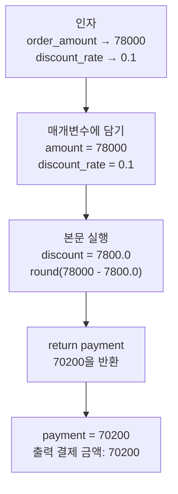
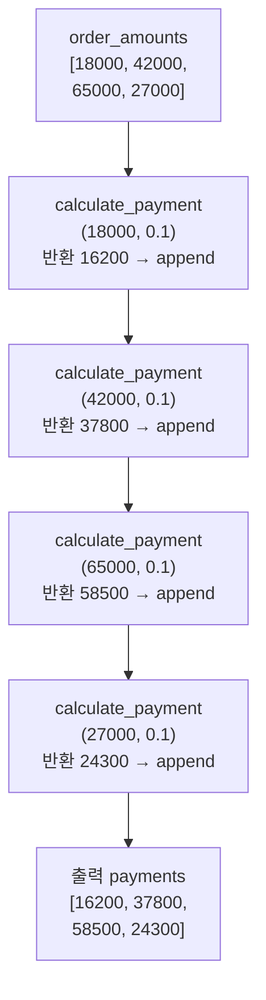
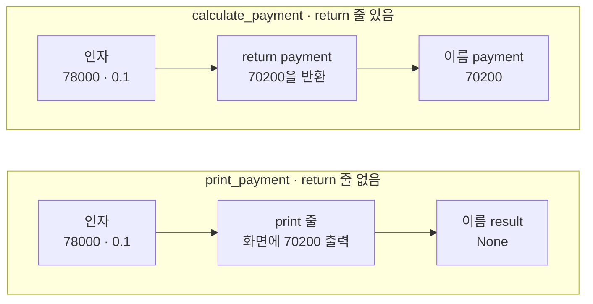
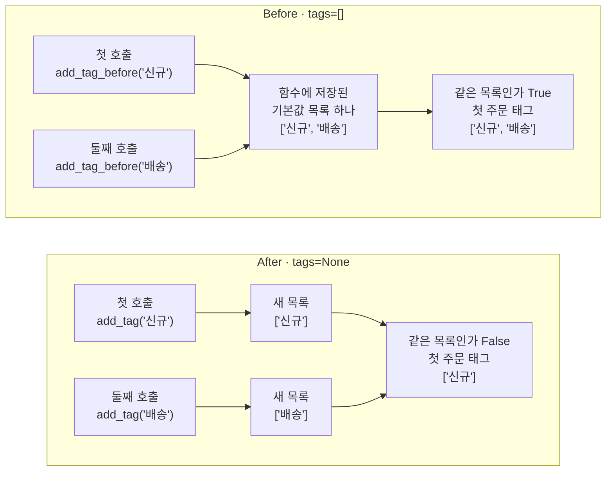

# 04-함수

## _src 본문 (HTML 원본)

```html
<!--meta: 강의 1h | 실습 2h | 코드 Jupyter Notebook | 새 용어 10 -->
<h2 id="b1"><span class="no">1</span>학습 목표</h2>
<div class="goal"><ul><li>할인 계산을 <code>def</code>로 정의하고, 인자를 넣어 호출한 반환값을 출력으로 확인할 수 있습니다.</li><li>return 줄이 없는 함수의 반환값과, 함수 안 이름과 밖 이름의 차이를 출력으로 설명할 수 있습니다.</li><li>기본값을 빈 목록으로 둔 함수가 호출 사이에 목록을 함께 쓰는 이유를 <code>is</code> 출력으로 설명하고, <code>None</code>으로 고칠 수 있습니다.</li></ul></div>
<h2 id="b2"><span class="no">2</span>이 내용을 배우는 이유</h2>
<p>1절에서 적은 할인 계산 줄을 2절에서 다시 적었습니다. 2절에서는 회원 여부 하나를 바꾸려고 같은 조건문을 한 번 더 적었습니다. 계산할 주문이 늘면 같은 줄도 그만큼 늘어납니다. 규칙이 바뀌면 적어 둔 곳을 모두 찾아 고쳐야 합니다.</p>
<p>함수는 여러 줄의 처리에 이름을 붙여 둡니다. 한 번 정의하면 인자만 바꿔 여러 번 부를 수 있습니다. 이 절은 할인 계산을 함수로 만들어 3절의 주문 네 건에 씁니다.</p>
<p>함수에서 흔한 실수는 기본값 자리에 빈 목록을 두는 것입니다. 호출을 따로 해도 앞 호출에서 넣은 값이 다음 호출에 남는데, 오류 메시지는 나오지 않습니다. 1~3절처럼 <b>실행이 멈추지 않아도 결과는 틀릴 수 있습니다.</b></p>
<p><strong>이 절의 질문</strong> — 기본값을 빈 목록으로 둔 함수를 목록 없이 두 번 부르면, 두 호출이 목록을 따로 받을까요?</p>
<h2 id="b3"><span class="no">3</span>앞에서 배운 내용</h2>
<p>Ch 1과 1~3절에서 배운 것 가운데 이 절이 이어 쓰는 것을 표로 모았습니다.</p>
<table><thead><tr><th>앞 절</th><th>배운 것</th><th>이 절에서 이어 쓰는 곳</th></tr></thead><tbody>
<tr><td>Ch 1 2절</td><td>인자(괄호 안에 건네는 값), 메서드</td><td>호출할 때 넣는 값, <code>append()</code>·<code>copy()</code></td></tr>
<tr><td>Ch 1 3절</td><td>값 <code>None</code>, <code>is not None</code></td><td>return 줄이 없는 함수의 반환값, After의 <code>tags is None</code></td></tr>
<tr><td>1절</td><td>내장 함수 호출 <code>type()</code>·<code>int()</code>, 할인율 0.1, 할인액 7800.0, 결제 금액 70200.0</td><td>함수 정의와 호출, 함수 <code>calculate_payment()</code>의 본문</td></tr>
<tr><td>2절</td><td>여러 줄 <code>if</code>와 <code>for</code>, 회원 여부만 바꾸려고 같은 조건문을 두 번 적은 셀</td><td>After의 <code>if</code>, 주문마다 함수 부르기, 함수가 필요한 이유</td></tr>
<tr><td>3절</td><td>딕셔너리 <code>order</code>, 주문 네 건 <code>[18000, 42000, 65000, 27000]</code>, 빈 목록과 <code>for</code>·<code>append()</code>로 새 목록 만들기, 튜플의 단가 39000·수량 2</td><td>준비 셀, 결제 금액 목록 모으기, 기본값이 있는 매개변수</td></tr>
<tr><td>3절</td><td>연산자 <code>is</code>와 메서드 <code>copy()</code>, 이름 두 개가 목록 하나에 붙은 Before</td><td>Before·After의 같은 목록 검사, 첫 호출 직후 복사</td></tr>
</tbody></table>
<p>지금까지는 <code>type()</code>·<code>len()</code>·<code>sorted()</code> 같은 내장 함수를 부르기만 했습니다. 이 절에서 처음으로 함수를 직접 정의합니다. 예약어 <code>def</code>, 값을 보내는 <code>return</code> 줄, 기본값이 있는 매개변수가 새 문법입니다.</p>
<p>금액은 3절처럼 원 단위 정수로 적습니다. 할인율 0.1을 곱한 할인액은 실수라서, 함수 안에서 내장 함수 <code>round()</code>로 결제 금액을 정수로 맞춥니다. 그래서 1절의 결제 금액 70200.0이 이 절에서는 70200으로 나옵니다.</p>
<h2 id="b4"><span class="no">4</span>핵심 개념</h2>
<h3>비유로 시작하기</h3>
<p>택배 주문을 받는 직원에게 꼬리표를 건네며 「고리에 꿰어 주세요」라고 부탁한다고 해 봅니다. 자주 하는 일에 이름을 붙여 두고 필요할 때 부르는 것이 함수입니다. 건네는 꼬리표가 인자이고, 직원이 꿰어서 건네는 고리가 반환값입니다.</p>
<p>고리를 가져오지 않은 주문에는 직원이 계산대에 걸어 둔 고리를 씁니다. 그 고리가 하나뿐이면 앞 주문의 꼬리표가 다음 주문의 고리에도 남습니다. 주문마다 새 고리를 꺼내야 꼬리표가 섞이지 않습니다.</p>
{{img:04-5-꼬리표-고리|왼쪽에는 초록 소매 손과 주황 소매 손이 금속 고리 하나를 함께 쥐고 그 고리에 노란 꼬리표와 파란 꼬리표가 함께 걸려 있고, 오른쪽에는 초록 소매 손이 노란 꼬리표 하나만 걸린 고리를, 주황 소매 손이 파란 꼬리표 하나만 걸린 다른 고리를 따로 쥔 삽화|고리 하나를 두 손이 함께 쥔 왼쪽은 기본값 빈 목록, 손마다 고리를 따로 쥔 오른쪽은 호출마다 새 목록에 해당합니다.}}
<p><strong>그림 읽기</strong> — 가운데 세로줄 왼쪽에서는 초록 소매 손과 주황 소매 손이 고리 하나를 함께 쥐었습니다. 고리는 태그 목록이고, 두 손은 함수를 두 번 부른 호출입니다. 그래서 노란 꼬리표(신규)와 파란 꼬리표(배송)가 한 고리에 함께 걸려 있습니다.</p>
<p>세로줄 오른쪽에서는 고리가 둘이고, 손마다 자기 고리를 쥐었습니다. 호출할 때마다 새 목록을 만든 모습입니다. 고리마다 꼬리표가 하나씩만 걸려 있습니다.</p>
<h3>이 절에서 쓰는 말</h3>
<table><thead><tr><th>용어</th><th>뜻</th><th>이 절에서 보이는 모습</th></tr></thead><tbody>
<tr><td>함수(function)</td><td>여러 줄의 처리에 이름을 붙여 두고, 이름으로 불러 실행하는 코드 묶음</td><td><code>calculate_payment</code></td></tr>
<tr><td>정의(definition)</td><td>예약어 def로 함수 이름·매개변수·본문을 적어 두는 일. 본문은 아직 실행하지 않음</td><td><code>def calculate_payment(amount, discount_rate):</code></td></tr>
<tr><td>매개변수(parameter)</td><td>함수가 받을 값에 붙이는 이름</td><td><code>amount</code>, <code>discount_rate</code></td></tr>
<tr><td>인자(argument)</td><td>호출할 때 괄호 안에 넣는 값(Ch 1 2절)</td><td><code>order_amount</code>의 값 78000</td></tr>
<tr><td>호출(call)</td><td>함수 이름 뒤에 소괄호를 붙여 함수를 실행하는 일</td><td><code>calculate_payment(order_amount, discount_rate)</code></td></tr>
<tr><td>반환값(return value)</td><td>return 줄이 함수를 부른 곳으로 보내는 값. return 줄이 없으면 None</td><td><code>return payment</code>로 보낸 70200</td></tr>
<tr><td>지역 변수(local variable)</td><td>함수 안에서 만든 이름. 밖의 같은 이름과 따로 저장됨</td><td>본문의 <code>discount</code></td></tr>
<tr><td>범위(scope)</td><td>이름을 쓸 수 있는 코드 영역</td><td>함수 안의 discount와 함수 밖의 discount</td></tr>
<tr><td>기본값(default value)</td><td>호출할 때 인자를 넣지 않으면 매개변수가 대신 쓰는 값</td><td><code>quantity=1</code>, <code>tags=None</code></td></tr>
<tr><td>내장 함수 round()</td><td>숫자 하나를 받아 가장 가까운 정수를 반환하는 함수. 가운데인 .5는 짝수 쪽으로 보냄</td><td><code>round(amount - discount)</code></td></tr>
</tbody></table>
<h3>정의와 호출</h3>
<p>함수 정의는 예약어 <code>def</code>로 시작합니다. 그 뒤에 함수 이름, 소괄호 안의 매개변수, 콜론을 차례로 적습니다. 함수에 속한 본문은 <code>if</code> 아래 줄처럼 들여 씁니다.</p>
<p>정의 셀을 실행하면 출력이 없습니다. 정의는 함수 이름과 본문을 기억해 둘 뿐이고, 본문은 호출할 때 실행됩니다. 노트북의 <code>print_payment()</code> 정의 셀도 본문에 <code>print()</code> 줄이 있지만 아무것도 출력하지 않았습니다.</p>
<p>호출 <code>calculate_payment(order_amount, discount_rate)</code>를 실행하면 인자가 적은 순서대로 매개변수에 담깁니다. 첫 인자의 값 78000은 amount에, 둘째 인자의 값 0.1은 discount_rate에 들어갑니다. 본문이 할인액 7800.0을 계산하고, 줄 <code>return payment</code>가 70200을 반환합니다.</p>
{{mermaid:04-1-함수-한-번-호출|인자 78000과 0.1이 매개변수 amount와 discount_rate에 담기고, 본문이 할인액 7800.0을 계산한 뒤 return으로 70200을 반환해 이름 payment에 담기는 흐름도|함수 한 번 호출. 인자 78000과 0.1이 매개변수에 담기고, 반환값 70200이 이름 payment에 담깁니다.}}
<p><strong>도식 읽기</strong> — 위에서 아래로 읽습니다. 맨 위 초록 상자는 호출할 때 넣은 인자 두 개입니다. 파란 상자 세 개는 매개변수에 값이 담기고, 본문을 실행하고, return 줄이 값을 보내는 차례입니다.</p>
<p>맨 아래 노란 상자는 반환값 70200에 붙은 이름 payment와 그 출력입니다. 본문의 할인액 7800.0은 노트북에 출력하지 않은 값입니다. 결제 금액 70200이 78000에서 7800을 뺀 값이라 거꾸로 확인할 수 있습니다.</p>
<h3>return 줄과 None</h3>
<p>함수를 부른 곳이 값을 받으려면 본문에 return 줄이 있어야 합니다. 노트북의 <code>print_payment()</code>는 같은 계산을 하고 결제 금액을 화면에 출력만 합니다. 이 함수를 부르자 화면에는 70200이 보였지만, 반환값은 None이었습니다.</p>
<p>화면에 보인 값은 이름에 담기지 않으므로 뒤 계산에 쓸 수 없습니다. 뒤에서 쓸 값은 return 줄로 반환하고, 호출한 곳에서 이름을 붙입니다.</p>
<h3>함수 안의 이름과 밖의 이름</h3>
<p>지역 변수는 함수 안에서 만든 이름입니다. 두 방에 같은 이름표를 단 상자가 하나씩 있으면, 한 방 상자에 넣은 물건이 다른 방 상자에는 들어가지 않습니다. 함수 <code>calculate_payment()</code>의 본문에서 만든 discount와 payment가 지역 변수입니다.</p>
<p>범위(scope)는 이름을 쓸 수 있는 코드 영역입니다. 노트북은 함수 밖에 <code>discount = 0</code>을 만든 뒤 함수를 불렀습니다. 함수 안에서 할인액을 계산했지만, 함수 밖의 discount는 0 그대로였습니다.</p>
<h3>기본값과 목록</h3>
<p>기본값은 호출할 때 인자를 넣지 않으면 매개변수가 대신 쓰는 값입니다. 정의 줄의 <code>quantity=1</code>처럼 매개변수 이름 뒤에 등호와 값을 적습니다. 노트북에서 수량을 빼고 부르자 기본값 1을 써서 39000이 나왔습니다.</p>
<p>Python 문서는 기본값을 함수를 정의할 때 한 번만 계산한다고 설명합니다. 기본값이 빈 목록이면, 목록을 넣지 않은 호출은 모두 함수에 저장된 그 목록 하나를 씁니다. 그 목록에 <code>append()</code>로 추가하면 다음 호출에도 추가한 값이 남습니다.</p>
<p>After 함수는 기본값을 None으로 두고, 본문에서 <code>tags is None</code>이 참일 때 새 빈 목록을 만듭니다. 본문은 호출할 때마다 실행되므로, 목록을 넣지 않은 호출은 매번 새 목록을 받습니다.</p>
<h2 id="b5"><span class="no">5</span>실행 예제</h2>
<p>노트북은 3절의 주문 딕셔너리와 주문 네 건 금액, 할인율 0.1을 새 커널에 저장하고 시작합니다. 할인 계산 함수를 정의하고, 주문 금액 78000으로 불러 결제 금액 70200을 얻습니다. 같은 함수를 주문 네 건에 한 번씩 불러 [16200, 37800, 58500, 24300]을 모읍니다.</p>
<p>이어서 return 줄이 없는 함수의 반환값 None을 확인하고, 함수 밖 discount가 호출 뒤에도 0인지 봅니다. 기본값이 있는 <code>calculate_line_total()</code>은 수량 2를 넣으면 78000, 수량을 빼면 39000입니다. 마지막으로 할인율 하나만 0.2로 바꿔 결제 금액 62400을 얻습니다.</p>
<p>모델을 부르지 않으므로 API 키가 필요 없고 비용도 들지 않습니다. 정해진 계산만 하므로 다시 실행해도 출력은 같습니다.</p>
{{notebook:04-함수|example}}
<p class="look"><b>확인할 점</b> — 함수를 정의만 한 셀에 출력이 없는지 봅니다. return 줄이 없는 함수의 반환값이 None인지, 함수 밖 discount가 0인지 확인합니다. 할인율을 0.2로 바꾸면 결제 금액이 70200에서 62400으로 줄었는지 확인합니다.</p>
<h3>여러 주문에 같은 함수를 부른 차례</h3>
<p>주문 네 건의 결제 금액을 모은 셀이 함수를 부른 차례를 한 그림으로 모았습니다.</p>
{{mermaid:04-2-여러-주문-반복|목록 order_amounts의 금액 18000, 42000, 65000, 27000으로 calculate_payment를 차례로 네 번 불러 반환값 16200, 37800, 58500, 24300을 append하고, payments 목록이 출력되는 흐름도|여러 주문에 같은 함수 쓰기. 금액 네 개로 함수를 네 번 불러 결제 금액 네 개를 모읍니다.}}
<p><strong>도식 읽기</strong> — 위에서 아래로 읽습니다. 맨 위 초록 상자가 주문 네 건의 금액 목록입니다. 파란 상자 네 개는 반복 한 번마다의 호출이고, 넣은 금액과 반환값을 적었습니다.</p>
<p>반환값은 차례마다 append로 목록 끝에 들어갑니다. 맨 아래 노란 상자가 출력 [16200, 37800, 58500, 24300]입니다. 함수 정의는 한 번이고 호출은 네 번입니다.</p>
<h3>반환값과 None</h3>
<p>같은 인자 78000과 0.1을 넣어도, return 줄이 있는지에 따라 이름에 담기는 값이 다릅니다.</p>
{{mermaid:04-3-return-유무-비교|인자 78000과 0.1을 넣었을 때 return 줄이 있는 calculate_payment는 70200을 반환해 payment에 담기고, return 줄이 없는 print_payment는 화면에 70200을 출력만 해 result에 None이 담기는 것을 위아래 두 칸으로 비교한 그림|return 줄이 있는 함수와 없는 함수. 같은 인자를 넣어도, 이름에 담기는 값은 70200과 None으로 갈립니다.}}
<p><strong>도식 읽기</strong> — 위 칸은 calculate_payment, 아래 칸은 print_payment입니다. 칸 안은 왼쪽에서 오른쪽으로 읽습니다. 초록 상자의 인자는 두 칸이 같습니다. 파란 상자에서 위 칸은 70200을 반환하고, 아래 칸은 화면에 70200을 출력만 합니다.</p>
<p>노란 상자를 비교합니다. 이름 payment에는 70200이 담겼고, 이름 result에는 None이 담겼습니다.</p>
<h2 id="b6"><span class="no">6</span>일부러 실패해 보기</h2>
<p>주문마다 태그 목록을 만듭니다. 태그는 주문에 붙이는 짧은 표시입니다. 함수 <code>add_tag_before()</code>는 태그 하나를 목록 끝에 추가해 반환하고, 목록을 넣지 않으면 기본값 빈 목록을 씁니다. 첫 주문에는 신규, 둘째 주문에는 배송을 붙이고, 두 번 모두 목록은 넣지 않습니다.</p>
<p>Before 셀은 오류 없이 실행됩니다. 첫 호출 직후 첫 주문 태그는 ['신규']였습니다. 그러나 둘째 호출 뒤에는 첫 주문 태그와 둘째 주문 태그가 모두 ['신규', '배송']입니다. 같은 목록인가는 True입니다.</p>
<p>원리 더 알아보기 셀은 함수에 저장된 기본값을 읽었습니다. 출력은 (['신규', '배송'],)이고, 그 목록이 첫 주문 태그와 같은 목록이었습니다. 3절 Before에서는 이름 두 개가 목록 하나에 붙었습니다. 이번에는 두 호출의 반환값이 함수에 저장된 목록 하나에 붙었습니다.</p>
<p>After 셀은 기본값을 None으로 두고, 본문에서 새 빈 목록을 만듭니다. 달라진 곳은 기본값 <code>[]</code>를 <code>None</code>으로 바꾼 것과, 새로 넣은 <code>if</code> 두 줄입니다. 첫 주문 태그는 ['신규'], 둘째 주문 태그는 ['배송']이고, 같은 목록인가는 False입니다.</p>
{{mermaid:04-4-before-after-비교|Before는 add_tag_before의 두 호출이 함수에 저장된 기본값 목록 하나에 신규와 배송을 쌓아 같은 목록 True가 나오고, After는 add_tag의 두 호출이 각각 새 목록 신규와 배송을 받아 같은 목록 False가 나오는 비교 그림|기본값을 빈 목록으로 둔 Before는 두 호출의 태그가 목록 하나에 쌓이고, None으로 둔 After는 호출마다 새 목록을 받습니다.}}
<p><strong>도식 읽기</strong> — 위 칸이 Before, 아래 칸이 After이고, 칸 안은 왼쪽에서 오른쪽으로 읽습니다. 파란 상자는 두 번의 호출, 초록 상자는 목록입니다.</p>
<p>Before 칸에서는 두 호출의 화살표가 함수에 저장된 기본값 목록 하나로 모입니다. 그 목록에서 빨간 상자(같은 목록인가 True)로 이어집니다. After 칸에서는 두 호출이 서로 다른 새 목록으로 갑니다. 노란 상자의 결과는 같은 목록인가 False, 첫 주문 태그 ['신규']입니다.</p>
{{notebook:04-함수|failure}}
<h3>확인한 범위</h3>
<p>이번에 고친 경우는 기본값이 빈 목록인 함수 하나를 두 번 부른 장면입니다. 딕셔너리나 집합을 기본값으로 둔 경우는 이번에 실행하지 않았습니다.</p>
<p>함수 안에서만 만든 이름을 함수 밖에서 읽는 장면도 이번에 실행하지 않았습니다. 정의 줄에 자료형을 적는 타입힌트는 7절에서 배웁니다. 오류를 잡는 <code>try</code>와 <code>except</code>는 5절에서 배웁니다.</p>
<h2 id="b7"><span class="no">7</span>주의할 점과 실무 메모</h2>
<ul><li>정의 셀만 실행하면 계산은 일어나지 않습니다. 노트북의 정의 셀 다섯 곳은 모두 출력이 없었고, 결과는 호출 셀에서 나왔습니다.</li>
<li>함수를 부르는 셀보다 정의 셀을 먼저 실행합니다. 이 노트북은 첫 셀부터 차례로 실행했습니다.</li>
<li>인자는 적은 순서대로 매개변수에 담깁니다. 노트북 호출에서 첫 인자는 주문 금액, 둘째 인자는 할인율이었습니다.</li>
<li>뒤에서 쓸 값은 return 줄로 반환합니다. 출력만 한 함수의 반환값은 None이라 이름 result로 계산할 수 없었습니다.</li>
<li>목록을 기본값으로 두지 않습니다. 노트북 After처럼 기본값을 None으로 두고 본문에서 새 목록을 만듭니다.</li>
<li>기본값 목록을 쓰는 Before 호출 셀은 한 번만 실행했습니다. 여러 번 실행했다면 첫 셀부터 다시 실행합니다.</li>
<li>내장 함수 <code>round()</code>는 정확히 가운데인 .5를 짝수 쪽 정수로 보냅니다. 노트북 금액은 소수점 아래가 모두 0이라 이 경우는 실행하지 않았습니다.</li></ul>
<h2 id="b8"><span class="no">8</span>정리와 다음 절</h2>
<ul><li>함수는 <code>def</code>로 정의하고, 이름 뒤 소괄호에 인자를 넣어 호출합니다. 할인 계산 함수는 78000과 0.1을 받아 70200을 반환했고, 주문 네 건에도 네 번 불렀습니다.</li><li>뒤에서 쓸 값은 return 줄로 반환합니다. return 줄이 없는 함수의 반환값은 None이었고, 함수 안의 discount는 밖의 discount와 따로였습니다.</li><li>기본값을 빈 목록으로 두자 두 호출이 목록 하나를 함께 써서 같은 목록인가가 True였습니다. 기본값을 <code>None</code>으로 두고 본문에서 새 목록을 만들자 False가 되었습니다.</li></ul>
<p><strong>다음 학습과 이어지는 지점</strong> — 5절에서는 파일을 읽고 쓰는 방법을 배웁니다. 파일이 없을 때 나는 오류를 셀이 멈추지 않게 처리하는 예외도 함께 배웁니다.</p>
<h2 id="b9"><span class="no">9</span>복습 문제</h2><details class="quiz"><summary>문제와 해설</summary>
<p class="quiz-q">1. 함수를 정의만 한 셀에는 왜 출력이 없었나요? · 기초</p><p class="quiz-a"><b>해설</b> — 정의는 함수 이름과 본문을 기억해 둘 뿐이고, 본문은 호출할 때 실행되기 때문입니다. 함수 <code>print_payment()</code>의 정의 셀도 본문에 <code>print()</code> 줄이 있었지만 출력이 없었습니다.</p>
<p class="quiz-q">2. 호출 <code>calculate_payment(order_amount, discount_rate)</code>에서 매개변수와 인자를 구분하세요. · 기초</p><p class="quiz-a"><b>해설</b> — 정의 줄의 amount와 discount_rate가 매개변수입니다. 호출 괄호 안의 order_amount와 discount_rate가 인자입니다. 그 값 78000과 0.1이 순서대로 매개변수에 담겼습니다.</p>
<p class="quiz-q">3. 함수 <code>print_payment()</code>의 반환값은 무엇이었나요? 화면에 보인 70200을 뒤 계산에 쓸 수 없는 이유도 쓰세요. · 기초</p><p class="quiz-a"><b>해설</b> — 반환값은 None이었습니다. 이 함수는 return 줄 없이 화면에 출력만 했습니다. 그래서 70200은 이름 result에 담기지 않았습니다.</p>
<p class="quiz-q">4. 함수 밖에 <code>discount = 0</code>을 만든 뒤 할인 계산 함수를 불렀습니다. 함수 밖 discount는 무엇이었고, 왜 그런가요? · 적용</p><p class="quiz-a"><b>해설</b> — 0 그대로였습니다. 함수 안의 discount는 지역 변수라서 함수 밖의 같은 이름과 따로 저장됩니다. 결제 금액 70200을 보면 함수 안에서는 할인액 7800을 계산했습니다.</p>
<p class="quiz-q">5. 호출 <code>calculate_line_total(unit_price)</code>는 무엇을 반환했나요? 할인율을 0.2로 바꾼 결제 금액도 쓰세요. · 적용</p><p class="quiz-a"><b>해설</b> — 수량을 넣지 않아 기본값 1을 써서 39000을 반환했습니다. 할인율 0.2로 부른 결제 금액은 62400이고, 할인율 0.1의 70200보다 7800원 적습니다.</p>
<p class="quiz-q">6. Before에서 두 주문의 태그가 섞인 이유는 무엇이고, After는 어떻게 고쳤나요? · 분석</p><p class="quiz-a"><b>해설</b> — 기본값 빈 목록은 함수를 정의할 때 한 번만 만들어져 함수에 저장됩니다. 두 호출이 그 목록 하나에 태그를 추가해 같은 목록인가가 True였습니다. After 함수는 기본값을 None으로 두고 본문에서 새 목록을 만듭니다. 그래서 태그가 한 개씩 따로 남고, 같은 목록인가가 False였습니다.</p>
</details>
<h2 id="b10"><span class="no">10</span>참고 자료</h2>
<ul><li><a href="https://docs.python.org/3.12/tutorial/controlflow.html#defining-functions">Python 3.12 자습서 4.7: 함수 정의하기</a> · 확인 2026-09-16 · 기준 Python 3.12</li><li><a href="https://docs.python.org/3.12/tutorial/controlflow.html#default-argument-values">Python 3.12 자습서 4.8.1: 기본 인자 값</a> · 확인 2026-09-16 · 기준 Python 3.12</li><li><a href="https://docs.python.org/3.12/library/functions.html#round">Python 3.12 내장 함수: round()</a> · 확인 2026-09-16 · 기준 Python 3.12</li><li><a href="https://docs.python.org/3.12/glossary.html#term-parameter">Python 3.12 용어집: 매개변수(parameter)</a> · 확인 2026-09-16 · 기준 Python 3.12</li></ul>
```

## 노트북 셀 (순서대로)

### [0] markdown {'html': 'skip'}

# 함수

**이 노트북에서 할 일**

1. 할인 계산에 이름을 붙여 함수로 정의하고, 인자를 넣어 호출합니다.
2. 반환값, 함수 안의 이름, 기본값이 있는 매개변수를 출력으로 확인합니다.
3. 기본값을 빈 목록으로 둔 함수가 호출 사이에 목록을 함께 쓰는 장면을 보고, `None`으로 고칩니다.

**준비물** — API 키 불필요. 데이터 파일도 없습니다. 모델 호출은 0번이고 비용은 들지 않습니다.
실행 시간은 1분 이내입니다.

1~3절과 같은 실습 폴더 `labs/part1/ch02-python`의 `.venv`를 커널로 고릅니다.
이전 커널의 변수는 쓰지 않으므로 첫 셀부터 순서대로 실행합니다.

### [1] markdown {'html': 'skip'}

## 오늘 볼 그림


위에서 아래로 읽습니다. 초록 상자는 호출할 때 넣는 값이고, 파란 상자는 함수 안에서 실행되는 차례입니다.

값 78000과 0.1이 매개변수 amount와 discount_rate에 담깁니다. 본문이 할인액 7800.0을 계산하고, return 줄이 70200을 반환합니다.
맨 아래 노란 상자는 반환값에 붙인 이름 payment와 그 출력입니다.

### [2] markdown {}

## 1. 준비

이 절도 설치할 패키지가 없습니다. 준비 셀은 3절에서 만든 주문 딕셔너리 `order`를 새 커널에 다시 저장합니다.
주문 네 건의 금액은 3절에서 27000을 추가한 뒤의 목록입니다. 할인율 0.1은 1·2절에서 쓴 회원 할인율입니다.

### [3] code {'execution': {'iopub.execute_input': '2026-09-16T08:59:52.571683Z', 'iopub.status.busy': '2026-09-16T08:59:52.571538Z', 'iopub.status.idle': '2026-09-16T08:59:52.575686Z', 'shell.execute_reply': '2026-09-16T08:59:52.575206Z'}, 'lesson_role': 'setup'}

```python
# 3절에서 만든 주문 한 건과 주문 네 건의 금액을 새 커널에 다시 저장합니다
order = {"order_id": "A102", "product_name": "무선 키보드", "amount": 78000, "shipping_fee": 0}
order_amounts = [18000, 42000, 65000, 27000]
# 1·2절에서 쓴 회원 할인율입니다
discount_rate = 0.1
order_amount = order["amount"]
print("주문 번호:", order["order_id"])
print("주문 금액:", order_amount)
print("주문 네 건의 금액:", order_amounts)
print("할인율:", discount_rate)
```

출력:
```
주문 번호: A102
주문 금액: 78000
주문 네 건의 금액: [18000, 42000, 65000, 27000]
할인율: 0.1

```

### [4] markdown {}

**결과 읽기** — 주문 번호 `A102`, 주문 금액 `78000`입니다. 주문 네 건의 금액은 `[18000, 42000, 65000, 27000]`, 할인율은 `0.1`입니다.
금액은 3절처럼 원 단위 정수입니다.

### [5] markdown {}

## 2. 함수 정의하기

함수(function)는 여러 줄의 처리에 이름을 붙여 두고, 필요할 때 그 이름으로 불러 실행하는 코드 묶음입니다.
가게에서 할인 계산 순서를 종이에 적고 「할인 계산」이라는 제목을 붙여 두는 것과 같습니다.
이 셀은 1절의 할인 계산 두 줄에 이름 `calculate_payment`를 붙입니다.

정의는 예약어 `def`로 시작합니다. 그 뒤에 함수 이름, 소괄호 안의 매개변수, 콜론 `:`을 차례로 적습니다.
매개변수(parameter)는 함수가 받을 값에 붙이는 이름입니다. 이 함수에는 `amount`와 `discount_rate` 두 개가 있습니다.
함수에 속한 줄은 `if` 아래 줄처럼 들여 씁니다.

마지막 줄 `return payment`는 계산한 값을 함수를 부른 곳으로 보냅니다.
내장 함수 `round()`는 숫자 하나를 받아 가장 가까운 정수를 반환합니다. 할인액이 실수라서 결제 금액을 원 단위 정수로 맞춥니다.

실행 전에 예상합니다. 정의만 하는 셀이라 아무것도 출력되지 않을 것입니다.

### [6] code {'execution': {'iopub.execute_input': '2026-09-16T08:59:52.576659Z', 'iopub.status.busy': '2026-09-16T08:59:52.576567Z', 'iopub.status.idle': '2026-09-16T08:59:52.578539Z', 'shell.execute_reply': '2026-09-16T08:59:52.578152Z'}}

```python
# 주문 금액과 할인율을 받아 할인한 결제 금액을 반환하는 함수를 정의합니다
def calculate_payment(amount, discount_rate):
    # 1절과 같은 순서로 할인액을 먼저 계산합니다
    discount = amount * discount_rate
    # round()로 소수점 없는 원 단위 금액을 만듭니다
    payment = round(amount - discount)
    return payment
```

출력:
```

```

### [7] markdown {}

**결과 읽기** — 예상대로 출력이 없습니다. 정의 셀은 함수 이름과 본문을 기억해 둘 뿐입니다.
본문의 계산 줄은 함수를 호출할 때 실행됩니다.

### [8] markdown {}

## 3. 함수 호출하기

호출(call)은 함수 이름 뒤에 소괄호를 붙여 함수를 실행하는 일입니다. 1절에서 `type(quantity)`로 내장 함수를 호출해 보았습니다.
Ch 1 2절에서 괄호 안에 건네는 값을 인자(argument)라고 했습니다. 인자는 적은 순서대로 매개변수에 담깁니다.
첫 인자 `order_amount`의 값 78000은 `amount`에, 둘째 인자의 값 0.1은 `discount_rate`에 담깁니다.

반환값(return value)은 함수가 `return` 줄로 보낸 값입니다. 대입 `payment = calculate_payment(...)`은 반환값에 이름 `payment`를 붙입니다.

실행 전에 예상합니다. 1절에서 계산한 결제 금액과 같은 70200이 나오고, 이번에는 소수점이 없을 것입니다.

### [9] code {'execution': {'iopub.execute_input': '2026-09-16T08:59:52.579735Z', 'iopub.status.busy': '2026-09-16T08:59:52.579645Z', 'iopub.status.idle': '2026-09-16T08:59:52.582051Z', 'shell.execute_reply': '2026-09-16T08:59:52.581515Z'}}

```python
# 3절 주문 금액과 할인율을 인자로 넣어 함수를 호출합니다
payment = calculate_payment(order_amount, discount_rate)
print("주문 금액:", order_amount)
print("할인율:", discount_rate)
print("결제 금액:", payment)
```

출력:
```
주문 금액: 78000
할인율: 0.1
결제 금액: 70200

```

### [10] markdown {}

**결과 읽기** — 주문 금액 `78000`, 할인율 `0.1`을 넣어 부른 결과, 결제 금액은 `70200`으로 예상과 같습니다.

1절에서는 같은 계산의 결과가 실수 70200.0이었습니다. 함수 안의 `round()`가 정수로 맞춰, 3절처럼 원 단위 정수가 나왔습니다.

### [11] markdown {}

## 4. 여러 주문에 같은 함수 쓰기

함수는 한 번 정의하면 인자만 바꿔 여러 번 부를 수 있습니다. 2절에서는 회원 여부 하나를 바꾸려고 같은 조건문을 한 번 더 적었습니다.
함수를 쓰면 계산 줄을 다시 적지 않고 이름만 부릅니다.

주문 네 건의 결제 금액을 3절에서 정한 모양대로 빈 목록에 모읍니다. 반복문 `for`가 금액을 하나 읽을 때마다 함수를 부릅니다.
반환값은 `append()`로 목록 끝에 추가합니다.

실행 전에 예상합니다. 금액마다 10%를 뺀 16200, 37800, 58500, 24300이 차례로 모일 것입니다.

### [12] code {'execution': {'iopub.execute_input': '2026-09-16T08:59:52.583053Z', 'iopub.status.busy': '2026-09-16T08:59:52.582946Z', 'iopub.status.idle': '2026-09-16T08:59:52.585188Z', 'shell.execute_reply': '2026-09-16T08:59:52.584758Z'}}

```python
# 주문 네 건마다 같은 함수를 불러 결제 금액을 빈 목록에 모읍니다
payments = []
for amount in order_amounts:
    # 반복할 때마다 목록의 금액 하나가 첫 인자로 들어갑니다
    order_payment = calculate_payment(amount, discount_rate)
    payments.append(order_payment)
print("주문 금액:", order_amounts)
print("결제 금액:", payments)
```

출력:
```
주문 금액: [18000, 42000, 65000, 27000]
결제 금액: [16200, 37800, 58500, 24300]

```

### [13] markdown {}

**결과 읽기** — 결제 금액은 `[16200, 37800, 58500, 24300]`으로 예상과 같습니다. 주문 금액 `[18000, 42000, 65000, 27000]`과 같은 순서입니다.
함수는 2번 소제목에서 한 번만 정의했고, 이 셀에서 네 번 불렀습니다.

### [14] markdown {}

## 5. return 줄이 없는 함수

함수 안에서 결과를 `print()`로 출력만 하고 `return` 줄을 적지 않으면 어떻게 될까요?
아래 셀은 `calculate_payment()`와 같은 계산을 하는 함수 `print_payment()`를 정의합니다. 마지막 줄만 `return` 대신 `print()`입니다.

실행 전에 예상합니다. 본문에 `print()` 줄이 있어도 정의만 하는 셀이라 출력은 없을 것입니다.

### [15] code {'execution': {'iopub.execute_input': '2026-09-16T08:59:52.586121Z', 'iopub.status.busy': '2026-09-16T08:59:52.586039Z', 'iopub.status.idle': '2026-09-16T08:59:52.588217Z', 'shell.execute_reply': '2026-09-16T08:59:52.587775Z'}}

```python
# 결제 금액을 화면에 출력만 하고 return 줄은 없는 함수를 정의합니다
def print_payment(amount, discount_rate):
    discount = amount * discount_rate
    payment = round(amount - discount)
    # 반환하지 않고 화면에만 보여 줍니다
    print("함수 안에서 출력한 결제 금액:", payment)
```

출력:
```

```

### [16] markdown {}

**결과 읽기** — 예상대로 출력이 없습니다. 본문의 `print()` 줄도 함수를 호출하기 전에는 실행되지 않았습니다.

### [17] markdown {}

이제 함수 `print_payment()`를 호출하고, 반환값을 이름 `result`에 받아 봅니다.
값 `None`은 Ch 1 3절에서 본, 값이 없음을 나타내는 값입니다.
값 `None`은 프로그램 안에 하나만 있습니다. 그래서 이름이 그 `None` 하나에 붙어 있는지 3절의 연산자 `is`로 검사합니다.

실행 전에 예상합니다. 함수 안의 출력 줄이 결제 금액 70200을 보여 주지만, 반환값은 없을 것입니다.

### [18] code {'execution': {'iopub.execute_input': '2026-09-16T08:59:52.589110Z', 'iopub.status.busy': '2026-09-16T08:59:52.589022Z', 'iopub.status.idle': '2026-09-16T08:59:52.591113Z', 'shell.execute_reply': '2026-09-16T08:59:52.590820Z'}}

```python
# 출력만 하는 함수를 호출하고, 반환값을 이름 result에 받습니다
result = print_payment(order_amount, discount_rate)
print("반환값:", result)
# 반환값이 None인지 연산자 is로 검사합니다
is_none = result is None
print("반환값이 None인가:", is_none)
```

출력:
```
함수 안에서 출력한 결제 금액: 70200
반환값: None
반환값이 None인가: True

```

### [19] markdown {}

**결과 읽기** — 첫 줄 `함수 안에서 출력한 결제 금액: 70200`은 함수 본문의 `print()`가 출력했습니다. 그러나 반환값은 `None`이고, 반환값이 None인가는 `True`입니다.

return 줄이 없는 함수를 부르자 반환값으로 `None`을 받았습니다. 화면에 보인 70200은 이름 `result`에 담기지 않았으므로 뒤 계산에 쓸 수 없습니다.
뒤에서 쓸 값은 `return` 줄로 반환합니다.

### [20] markdown {}

## 6. 함수 안의 이름과 밖의 이름

지역 변수(local variable)는 함수 안에서 만든 이름입니다. 함수 밖에 같은 글자의 이름이 있어도 서로 따로 저장됩니다.
두 방에 같은 이름표를 단 상자가 하나씩 있으면, 한 방의 상자에 넣은 물건이 다른 방 상자에는 들어가지 않는 것과 같습니다.
함수 `calculate_payment()`의 본문에서 만든 `discount`와 `payment`가 지역 변수입니다.

범위(scope)는 이름을 쓸 수 있는 코드 영역입니다. 아래 셀은 함수 밖에 `discount = 0`을 만든 뒤 함수를 부릅니다.

실행 전에 예상합니다. 함수 안에서 할인액을 계산해도, 함수 밖의 `discount`는 0 그대로일 것입니다.

### [21] code {'execution': {'iopub.execute_input': '2026-09-16T08:59:52.592389Z', 'iopub.status.busy': '2026-09-16T08:59:52.592318Z', 'iopub.status.idle': '2026-09-16T08:59:52.594390Z', 'shell.execute_reply': '2026-09-16T08:59:52.594049Z'}}

```python
# 함수 밖에 discount를 만든 뒤 함수를 부르고, 밖의 discount를 다시 읽습니다
discount = 0
payment = calculate_payment(order_amount, discount_rate)
print("함수가 반환한 결제 금액:", payment)
# 함수 안의 discount와 이름만 같은 함수 밖의 이름입니다
print("함수 밖 discount:", discount)
```

출력:
```
함수가 반환한 결제 금액: 70200
함수 밖 discount: 0

```

### [22] markdown {}

**결과 읽기** — 함수가 반환한 결제 금액은 `70200`이고, 함수 밖 discount는 `0`으로 예상과 같습니다.

결제 금액이 70200이므로 함수 안의 `discount`에는 78000 × 0.1인 7800.0이 담겼습니다. 그래도 함수 밖의 `discount`는 바뀌지 않았습니다.
두 이름은 글자만 같고 서로 다른 범위에 있습니다. 함수 안의 값을 밖에서 쓰려면 `return`으로 반환해 이름을 붙입니다.

### [23] markdown {}

## 7. 기본값이 있는 매개변수

기본값(default value)은 호출할 때 인자를 넣지 않으면 매개변수가 대신 쓰는 값입니다. 카페에서 크기를 말하지 않으면 보통 크기로 주는 것과 같습니다.
정의 줄에서 매개변수 이름 뒤에 `=`과 값을 적습니다.

아래 함수 `calculate_line_total()`은 단가와 수량을 곱해 주문 줄 금액을 반환합니다. 매개변수 `quantity=1`은 수량을 넣지 않으면 1개로 계산한다는 뜻입니다.

실행 전에 예상합니다. 정의 셀이므로 출력은 없을 것입니다.

### [24] code {'execution': {'iopub.execute_input': '2026-09-16T08:59:52.595293Z', 'iopub.status.busy': '2026-09-16T08:59:52.595216Z', 'iopub.status.idle': '2026-09-16T08:59:52.597023Z', 'shell.execute_reply': '2026-09-16T08:59:52.596747Z'}}

```python
# 단가와 수량을 곱해 주문 줄 금액을 반환합니다(수량을 넣지 않으면 1개)
def calculate_line_total(unit_price, quantity=1):
    line_total = unit_price * quantity
    return line_total
```

출력:
```

```

### [25] markdown {}

**결과 읽기** — 출력이 없습니다. 정의 셀은 함수 이름, 본문, 기본값 1을 기억해 둡니다.

### [26] markdown {}

3절의 주문 줄 튜플 `("무선 키보드", 2, 39000)`에서 단가 39000과 수량 2를 가져와 씁니다.
한 번은 수량을 인자로 넣고, 한 번은 수량을 빼고 호출합니다.

실행 전에 예상합니다. 수량 2를 넣으면 78000이고, 수량을 빼면 기본값 1을 써서 39000일 것입니다.

### [27] code {'execution': {'iopub.execute_input': '2026-09-16T08:59:52.597938Z', 'iopub.status.busy': '2026-09-16T08:59:52.597870Z', 'iopub.status.idle': '2026-09-16T08:59:52.600000Z', 'shell.execute_reply': '2026-09-16T08:59:52.599581Z'}}

```python
# 3절 주문 줄의 단가와 수량으로, 수량을 넣은 호출과 뺀 호출을 비교합니다
unit_price = 39000
quantity = 2
line_total_two = calculate_line_total(unit_price, quantity)
# 인자를 하나만 넣으면 quantity는 기본값 1을 씁니다
line_total_default = calculate_line_total(unit_price)
print("수량 2를 넣었을 때:", line_total_two)
print("수량을 뺐을 때:", line_total_default)
```

출력:
```
수량 2를 넣었을 때: 78000
수량을 뺐을 때: 39000

```

### [28] markdown {}

**결과 읽기** — 수량 2를 넣었을 때 `78000`, 수량을 뺐을 때 `39000`으로 예상과 같습니다.

둘째 호출은 인자를 하나만 넣었습니다. 그래서 매개변수 `quantity`가 기본값 1을 썼습니다.
9번 Before에서는 기본값 자리에 숫자 대신 빈 목록을 둡니다.

### [29] markdown {}

## 8. 값 바꿔 보기 — 할인율 하나만 바꾸기

함수를 다시 정의하지 않고 인자 하나만 바꿔 부릅니다. 주문 금액 78000은 그대로 두고, 할인율만 0.1에서 0.2로 바꿉니다.

실행 전에 예상합니다. 할인액이 15600이 되어 결제 금액은 62400일 것입니다.

### [30] code {'execution': {'iopub.execute_input': '2026-09-16T08:59:52.600798Z', 'iopub.status.busy': '2026-09-16T08:59:52.600715Z', 'iopub.status.idle': '2026-09-16T08:59:52.602847Z', 'shell.execute_reply': '2026-09-16T08:59:52.602408Z'}}

```python
# 주문 금액은 그대로 두고 할인율만 0.2로 바꿔 같은 함수를 부릅니다
new_discount_rate = 0.2
new_payment = calculate_payment(order_amount, new_discount_rate)
print("원래 할인율:", discount_rate)
print("원래 결제 금액:", payment)
print("바꾼 할인율:", new_discount_rate)
print("바꾼 결제 금액:", new_payment)
```

출력:
```
원래 할인율: 0.1
원래 결제 금액: 70200
바꾼 할인율: 0.2
바꾼 결제 금액: 62400

```

### [31] markdown {}

**결과 읽기** — 바꾼 할인율 `0.2`에서 결제 금액은 `62400`으로 예상과 같습니다. 원래 할인율 `0.1`의 결제 금액 `70200`보다 7800원 적습니다.

바꾼 값은 할인율 하나뿐이고, 함수 정의는 그대로 두었습니다. 그래서 결제 금액의 차이는 할인율에서 나왔습니다.

### [32] markdown {'lesson_part': 'before'}

## 9. Before — 기본값을 빈 목록으로 두기

주문마다 태그(tag) 목록을 만듭니다. 태그는 주문에 붙이는 짧은 표시입니다. 택배 상자에 「신규」나 「배송」 꼬리표를 다는 것과 같습니다.

함수 `add_tag_before()`는 태그 하나를 받아 태그 목록 끝에 추가하고, 그 목록을 반환합니다.
목록을 넣지 않으면 기본값 빈 목록 `[]`을 씁니다. 7번 소제목의 `quantity=1`과 같은 모양입니다.

실행 전에 예상합니다. 정의 셀이라 출력은 없을 것입니다.

### [33] code {'execution': {'iopub.execute_input': '2026-09-16T08:59:52.603569Z', 'iopub.status.busy': '2026-09-16T08:59:52.603500Z', 'iopub.status.idle': '2026-09-16T08:59:52.605330Z', 'shell.execute_reply': '2026-09-16T08:59:52.604978Z'}, 'lesson_part': 'before'}

```python
# 태그 하나를 목록 끝에 추가해 반환합니다(목록을 넣지 않으면 기본값 빈 목록)
def add_tag_before(tag, tags=[]):
    tags.append(tag)
    return tags
```

출력:
```

```

### [34] markdown {'lesson_part': 'before'}

**결과 읽기** — 출력이 없습니다. 이번 정의는 기본값 자리에 숫자 대신 빈 목록을 두었습니다.

### [35] markdown {'lesson_part': 'before'}

첫 주문에는 태그 신규를, 둘째 주문에는 태그 배송을 붙입니다. 두 번 모두 목록은 넣지 않고 기본값을 씁니다.

첫 호출 직후의 모습은 3절의 `copy()`로 따로 남겨 둡니다. 두 반환값이 같은 목록 하나인지는 3절의 연산자 `is`로 검사합니다.
이 셀은 한 번만 실행합니다. 여러 번 실행했다면 첫 셀부터 다시 실행합니다.

실행 전에 예상해 봅니다. 호출을 따로 했으니 첫 주문 태그는 신규 하나, 둘째 주문 태그는 배송 하나일까요?

### [36] code {'execution': {'iopub.execute_input': '2026-09-16T08:59:52.606135Z', 'iopub.status.busy': '2026-09-16T08:59:52.606066Z', 'iopub.status.idle': '2026-09-16T08:59:52.608225Z', 'shell.execute_reply': '2026-09-16T08:59:52.607881Z'}, 'lesson_part': 'before'}

```python
# 목록을 넣지 않고 두 주문의 태그를 차례로 만듭니다
first_tags = add_tag_before("신규")
# 첫 호출 직후의 모습을 copy()로 따로 남겨 둡니다
first_snapshot = first_tags.copy()
second_tags = add_tag_before("배송")
is_same_list = first_tags is second_tags
print("첫 호출 직후 첫 주문 태그:", first_snapshot)
print("둘째 호출 뒤 첫 주문 태그:", first_tags)
print("둘째 주문 태그:", second_tags)
print("같은 목록인가:", is_same_list)
```

출력:
```
첫 호출 직후 첫 주문 태그: ['신규']
둘째 호출 뒤 첫 주문 태그: ['신규', '배송']
둘째 주문 태그: ['신규', '배송']
같은 목록인가: True

```

### [37] markdown {'lesson_part': 'before'}

**결과 읽기** — 첫 호출 직후 첫 주문 태그는 `['신규']`였습니다. 그런데 둘째 호출 뒤 첫 주문 태그는 `['신규', '배송']`입니다. 둘째 주문 태그도 `['신규', '배송']`이고, 같은 목록인가는 `True`입니다.

오류는 나지 않았지만 두 주문의 태그가 한 목록에 섞였습니다. 두 호출은 목록을 새로 만들지 않았습니다. 같은 기본값 목록 하나에 `append()`로 태그를 추가했습니다.
3절 Before에서는 이름 두 개가 목록 하나에 붙었습니다. 이번에는 두 호출의 반환값이 목록 하나에 붙었습니다.

### [38] markdown {'lesson_part': 'before'}

### 원리 더 알아보기 — 기본값 목록이 저장된 곳

Python 문서는 기본값을 함수를 정의할 때 한 번만 계산한다고 설명합니다. 만든 기본값은 함수에 붙어 저장됩니다.
아래 셀은 함수의 속성 `__defaults__`로 저장된 기본값을 읽습니다. 이 속성은 앞으로 쓰지 않으므로 지금은 출력만 읽습니다.

### [39] code {'execution': {'iopub.execute_input': '2026-09-16T08:59:52.608938Z', 'iopub.status.busy': '2026-09-16T08:59:52.608867Z', 'iopub.status.idle': '2026-09-16T08:59:52.610870Z', 'shell.execute_reply': '2026-09-16T08:59:52.610478Z'}, 'lesson_level': 'deep-dive', 'lesson_part': 'before'}

```python
# 원리 더 알아보기: 함수에 저장된 기본값을 읽습니다
saved_defaults = add_tag_before.__defaults__
print("저장된 기본값:", saved_defaults)
# 저장된 기본값 목록과 첫 주문 태그가 같은 목록인지 봅니다
is_default_list = saved_defaults[0] is first_tags
print("기본값 목록과 첫 주문 태그가 같은 목록인가:", is_default_list)
```

출력:
```
저장된 기본값: (['신규', '배송'],)
기본값 목록과 첫 주문 태그가 같은 목록인가: True

```

### [40] markdown {'lesson_part': 'before'}

**결과 읽기** — 저장된 기본값은 `(['신규', '배송'],)`입니다. 값 하나가 든 튜플이고, 그 값이 태그 두 개가 쌓인 목록입니다.
기본값 목록과 첫 주문 태그가 같은 목록인가는 `True`입니다. 두 호출이 함수에 저장된 목록 하나를 함께 썼습니다.

### [41] markdown {'lesson_part': 'after'}

## 10. After — 기본값을 None으로 두기

기본값을 빈 목록 대신 `None`으로 둡니다. 본문에서 `tags is None`이 참이면 그때 새 빈 목록을 만듭니다.
본문의 줄은 호출할 때마다 실행됩니다. 그래서 목록을 넣지 않은 호출은 매번 새 목록을 받습니다.

Before 함수와 달라진 곳은 기본값 `[]`를 `None`으로 바꾼 것과, 새로 넣은 `if` 두 줄입니다. 함수 이름은 `add_tag()`로 바꿨습니다.

실행 전에 예상합니다. 정의 셀이라 출력은 없을 것입니다.

### [42] code {'execution': {'iopub.execute_input': '2026-09-16T08:59:52.611525Z', 'iopub.status.busy': '2026-09-16T08:59:52.611462Z', 'iopub.status.idle': '2026-09-16T08:59:52.613383Z', 'shell.execute_reply': '2026-09-16T08:59:52.613022Z'}, 'lesson_part': 'after'}

```python
# 목록을 넣지 않으면 호출할 때마다 새 빈 목록을 만들어 태그를 추가합니다
def add_tag(tag, tags=None):
    # 기본값 None은 목록을 받지 않았다는 표시입니다
    if tags is None:
        tags = []
    tags.append(tag)
    return tags
```

출력:
```

```

### [43] markdown {'lesson_part': 'after'}

**결과 읽기** — 출력이 없습니다. 이번 정의는 기본값 자리에 빈 목록 대신 `None`을 두었습니다.

### [44] markdown {'lesson_part': 'after'}

이번에는 Before와 같은 두 호출을 새 함수로 실행합니다. 태그 신규와 배송, 첫 호출 직후 복사, `is` 검사도 그대로입니다.
마지막에는 검사 줄 `assert`로 두 주문의 태그를 확인합니다.

실행 전에 예상합니다. 첫 주문 태그는 신규 하나, 둘째 주문 태그는 배송 하나이고, 같은 목록인가는 `False`일 것입니다.

### [45] code {'execution': {'iopub.execute_input': '2026-09-16T08:59:52.614227Z', 'iopub.status.busy': '2026-09-16T08:59:52.614156Z', 'iopub.status.idle': '2026-09-16T08:59:52.616394Z', 'shell.execute_reply': '2026-09-16T08:59:52.615998Z'}, 'lesson_part': 'after'}

```python
# Before와 같은 두 호출을 새 함수로 실행합니다
first_tags = add_tag("신규")
first_snapshot = first_tags.copy()
second_tags = add_tag("배송")
is_same_list = first_tags is second_tags
print("첫 호출 직후 첫 주문 태그:", first_snapshot)
print("둘째 호출 뒤 첫 주문 태그:", first_tags)
print("둘째 주문 태그:", second_tags)
print("같은 목록인가:", is_same_list)
# 두 주문의 태그가 한 개씩 따로 있지 않으면 이 줄에서 멈춥니다
assert first_tags == ["신규"]
assert second_tags == ["배송"]
```

출력:
```
첫 호출 직후 첫 주문 태그: ['신규']
둘째 호출 뒤 첫 주문 태그: ['신규']
둘째 주문 태그: ['배송']
같은 목록인가: False

```

### [46] markdown {'lesson_part': 'after'}

**결과 읽기** — 첫 호출 직후와 둘째 호출 뒤 모두 첫 주문 태그는 `['신규']`입니다. 둘째 주문 태그는 `['배송']`이고, 같은 목록인가는 `False`입니다. 검사 줄 `assert`에서도 멈추지 않았습니다.

Before 셀의 `['신규', '배송']`과 `True`가 After 셀에서 `['신규']`와 `False`로 바뀌었습니다. 달라진 곳은 기본값 `[]`를 `None`으로 바꾼 것과, 새로 넣은 `if` 두 줄뿐입니다.
이번에 확인한 기본값은 빈 목록 하나입니다. 딕셔너리나 집합을 기본값으로 둔 경우는 이번에 실행하지 않았습니다.

### [47] markdown {'html': 'skip', 'lesson_part': 'after'}

## 정리

- 함수는 `def`로 정의하고, 이름 뒤 소괄호에 인자를 넣어 호출합니다. 할인 계산 함수는 78000과 0.1을 받아 70200을 반환했습니다.
- 뒤에서 쓸 값은 `return` 줄로 반환합니다. return 줄이 없는 함수를 부르면 반환값이 `None`이었습니다.
- 함수 안에서 만든 `discount`는 밖의 `discount`와 따로입니다. 매개변수에 기본값을 두면 인자를 빼고 부를 수 있습니다.
- 기본값을 빈 목록으로 두면 두 호출이 목록 하나를 함께 썼습니다. 기본값을 `None`으로 두고 본문에서 새 목록을 만들어 고쳤습니다.

다음 절에서는 파일을 읽고 쓰는 방법과, 오류가 나도 셀이 멈추지 않게 처리하는 예외를 배웁니다.

## 그림

### 04-1-함수-한-번-호출.mmd



- 설명 대상 문장: 인자는 적은 순서대로 매개변수에 담기고, 본문을 실행한 뒤 return 줄이 반환값을 함수를 부른 곳으로 보냅니다.
- 캡션: 함수 한 번 호출. 인자 78000과 0.1이 매개변수에 담기고, 반환값 70200이 이름 payment에 담깁니다.
- 읽는 법: 위에서 아래로 읽습니다. 초록 상자는 호출할 때 넣은 값, 파란 상자 세 개는 함수 안에서 실행되는 차례, 노란 상자는 반환값을 받은 이름과 그 출력입니다. 본문의 할인액 7800.0은 출력하지 않은 값으로, 78000 × 0.1을 계산한 값입니다(1절 출력과 같은 곱셈).
- alt: 인자 78000과 0.1이 매개변수 amount와 discount_rate에 담기고, 본문이 할인액 7800.0을 계산한 뒤 return으로 70200을 반환해 이름 payment에 담기는 흐름도

### 04-2-여러-주문-반복.mmd



- 설명 대상 문장: 반복문 for가 금액을 하나 읽을 때마다 함수를 부르고, 반환값을 append()로 목록 끝에 추가합니다.
- 캡션: 여러 주문에 같은 함수 쓰기. 금액 네 개로 함수를 네 번 불러 결제 금액 네 개를 모읍니다.
- 읽는 법: 위에서 아래로 읽습니다. 맨 위 초록 상자가 주문 네 건의 금액이고, 파란 상자 네 개가 반복 한 번마다의 호출입니다. 파란 상자마다 넣은 인자와 반환값, 그 값을 append로 추가하는 차례를 적었습니다. 맨 아래 노란 상자가 출력 [16200, 37800, 58500, 24300]입니다.
- alt: 목록 order_amounts의 금액 18000, 42000, 65000, 27000으로 calculate_payment를 차례로 네 번 불러 반환값 16200, 37800, 58500, 24300을 append하고, payments 목록이 출력되는 흐름도

### 04-3-return-유무-비교.mmd



- 설명 대상 문장: return 줄이 없는 함수를 부르자 반환값으로 None을 받았습니다.
- 캡션: return 줄이 있는 함수와 없는 함수. 같은 인자를 넣어도, 이름에 담기는 값은 70200과 None으로 갈립니다.
- 읽는 법: 위 칸은 calculate_payment, 아래 칸은 print_payment이고, 칸 안은 왼쪽에서 오른쪽으로 읽습니다. 초록 상자는 넣은 인자로 두 칸이 같습니다. 파란 상자에서 위 칸은 70200을 반환하고, 아래 칸은 화면에 70200을 출력만 합니다. 노란 상자에서 이름 payment에는 70200이, 이름 result에는 None이 담깁니다.
- alt: 인자 78000과 0.1을 넣었을 때 return 줄이 있는 calculate_payment는 70200을 반환해 payment에 담기고, return 줄이 없는 print_payment는 화면에 70200을 출력만 해 result에 None이 담기는 것을 위아래 두 칸으로 비교한 그림

### 04-4-before-after-비교.mmd



- 설명 대상 문장: 기본값을 빈 목록으로 두면 두 호출이 목록 하나를 함께 썼습니다. 기본값을 None으로 두고 본문에서 새 목록을 만들어 고쳤습니다.
- 캡션: 기본값을 빈 목록으로 둔 Before는 두 호출의 태그가 목록 하나에 쌓이고, None으로 둔 After는 호출마다 새 목록을 받습니다.
- 읽는 법: 위 칸이 Before, 아래 칸이 After이고, 칸 안은 왼쪽에서 오른쪽으로 읽습니다. 파란 상자는 두 번의 호출, 초록 상자는 목록입니다. Before는 두 호출의 화살표가 함수에 저장된 기본값 목록 하나로 모이고, 빨간 상자(같은 목록인가 True, 첫 주문 태그 ['신규', '배송'])에 이릅니다. After는 두 호출이 서로 다른 새 목록으로 가고, 노란 상자의 결과는 False와 ['신규']입니다. 빨강은 실제로 틀린 Before 결과에만 썼습니다.
- alt: Before는 add_tag_before의 두 호출이 함수에 저장된 기본값 목록 하나에 신규와 배송을 쌓아 같은 목록 True가 나오고, After는 add_tag의 두 호출이 각각 새 목록 신규와 배송을 받아 같은 목록 False가 나오는 비교 그림

### 04-5-꼬리표-고리.prompt.md

# 삽화 — 04-5 꼬리표 고리

- 상태: 2026-09-16 생성·검수 통과(1회 생성, 탈락 0). 모델 nano_banana_pro(서버 표기 nano_banana_2), 16:9, 2k(2752×1536), 2크레딧. job 2aed0c60-ac79-4320-a08a-fabf6b4afd17. 교재 파일은 폭 1100px로 줄여 저장.
- 검수 메모: 가운데 회색 세로줄로 왼쪽·오른쪽이 나뉨. 왼쪽은 초록 소매 손과 주황 소매 손이 금속 고리 하나를 동시에 쥐고, 그 고리에 노란·파란 꼬리표 두 장이 함께 걸림. 오른쪽은 고리 둘이 떨어져 있고, 초록 소매 손의 고리에는 노란 꼬리표 하나, 주황 소매 손의 고리에는 파란 꼬리표 하나만 걸림. 「고리 하나를 두 손이 함께 씀 → 꼬리표가 섞임」과 「손마다 고리 따로 → 꼬리표 하나씩」이 그림만으로 읽힘. 꼬리표에 글자·숫자·표시 없음, 상자·화면·열쇠 없음.
- 설명 대상 문장: 고리를 가져오지 않은 주문에 계산대에 걸어 둔 고리 하나를 쓰면, 앞 주문의 꼬리표가 다음 주문 고리에도 남습니다. 주문마다 새 고리를 꺼내야 꼬리표가 섞이지 않습니다.
- 넣을 자리: 04절 핵심 개념 「비유로 시작하기」 단락 바로 아래(3절 이름표 두 개 삽화의 「하나를 함께 씀 / 따로 씀」 구도를 이어 씀)
- 구성 요소와 배치(왼쪽 → 오른쪽): 고리 하나 + 꼬리표 둘 + 두 손이 함께 쥠 | 세로줄 | 고리 둘(꼬리표 하나씩) + 손마다 따로 쥠
- 시선 순서: 왼쪽 고리를 함께 쥔 두 손 → 한 고리에 걸린 꼬리표 두 장 → 세로줄 너머 떨어진 고리 두 개 → 고리마다 꼬리표 하나
- 대응: 고리 = 태그 목록, 초록 소매 손 = 첫 호출(태그 신규, 노란 꼬리표), 주황 소매 손 = 둘째 호출(태그 배송, 파란 꼬리표), 왼쪽 장면 = Before `tags=[]`, 오른쪽 장면 = After `tags=None`

## 프롬프트

Simple flat educational illustration, white background, limited soft palette, clean outlines, plain everyday objects, no text, no letters, no numbers, no logos.
The image is divided into a left half and a right half by one thin light gray vertical line.
Left half: exactly one plain round metal key ring in the middle. Exactly two blank paper luggage tags hang from this one ring: one yellow tag and one light blue tag, both clearly threaded on the same ring. Two hands reach in from the bottom edge: one hand with a green sleeve from the lower left and one hand with an orange sleeve from the lower right. Both hands pinch the same single ring at the same time, so the one ring is clearly shared by the two hands.
Right half: exactly two plain round metal key rings side by side with a wide clear gap between them. The left ring holds only one blank yellow paper tag and is held by one hand with a green sleeve from the lower left. The right ring holds only one blank light blue paper tag and is held by one hand with an orange sleeve from the lower right. The two rings do not touch.
No boxes, no parcels, no monitors, no screens, no computers, no keys, no writing or marks on the tags, no arrows, no people other than the four hands, no extra rings, no extra tags.

