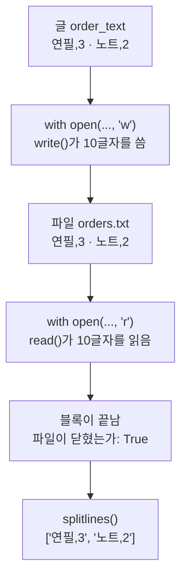
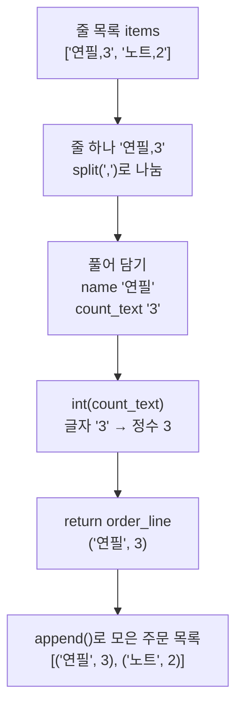
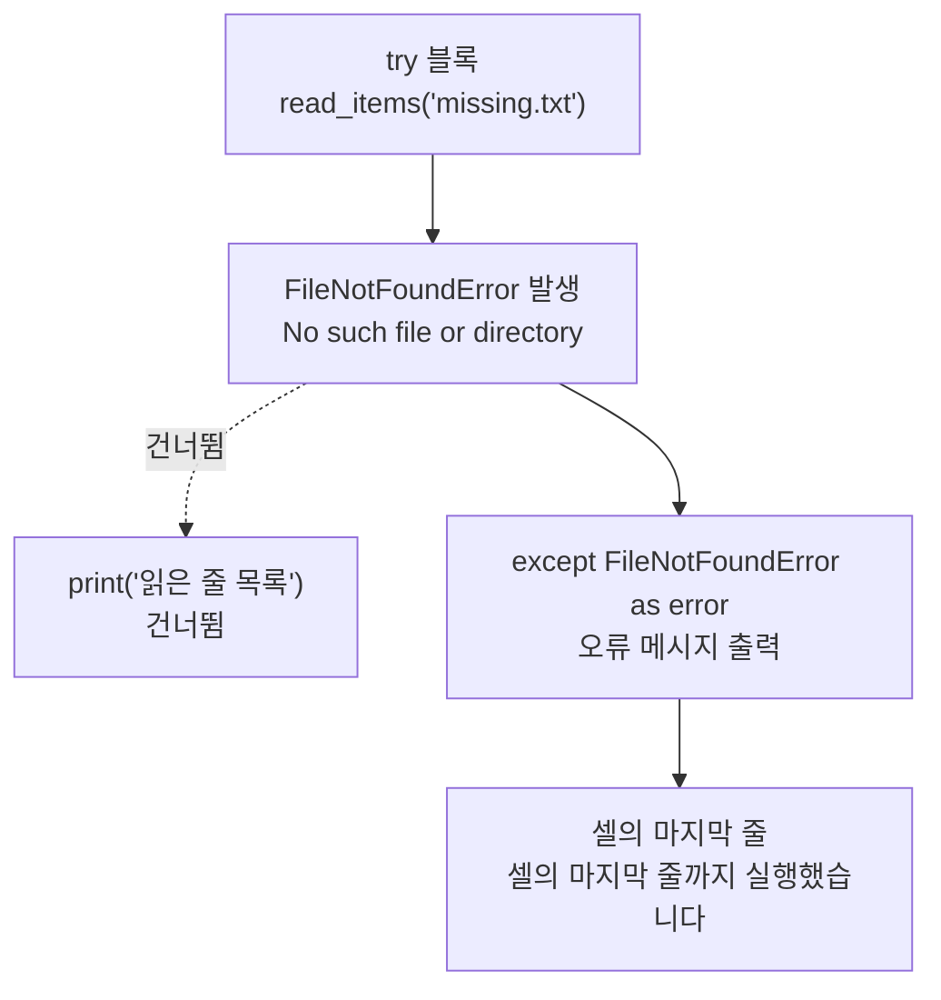
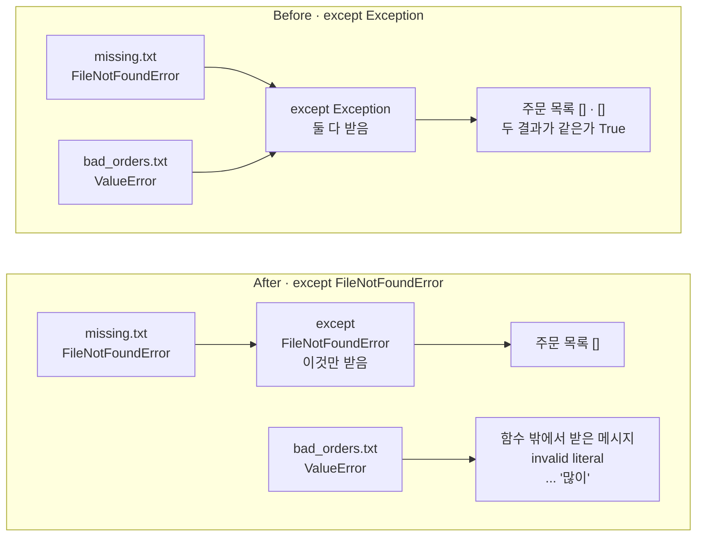

# 05-파일과-예외

## _src 본문 (HTML 원본)

```html
<!--meta: 강의 1h | 실습 2h | 코드 Jupyter Notebook | 새 용어 10 -->
<h2 id="b1"><span class="no">1</span>학습 목표</h2>
<div class="goal"><ul><li>주문 두 줄을 <code>with open()</code> 블록으로 UTF-8 파일에 쓰고 다시 읽어, 줄 목록과 주문 튜플로 바꿀 수 있습니다.</li><li>없는 파일과 숫자가 아닌 수량에서 나는 오류를 <code>try</code>와 <code>except</code>로 받아 메시지를 읽을 수 있습니다.</li><li>모든 오류를 받는 <code>except Exception</code>이 두 문제를 감추는 이유를 출력으로 설명하고, 파일 없음만 받도록 고칠 수 있습니다.</li></ul></div>
<h2 id="b2"><span class="no">2</span>이 내용을 배우는 이유</h2>
<p>1~4절의 값은 모두 변수에 저장했습니다. 변수의 값은 커널을 다시 시작하면 사라집니다. 그래서 절마다 준비 셀에서 주문 금액을 다시 저장했습니다. 주문을 다음 실행에도 쓰려면 파일에 써 두어야 합니다.</p>
<p>파일을 읽을 때는 코드 밖의 사정 때문에 오류가 나기도 합니다. 파일이 없을 수도 있고, 사람이 수량 칸에 글자를 적었을 수도 있습니다. 예외 처리는 이런 오류가 났을 때 실행할 줄을 미리 정해 둡니다.</p>
<p>흔한 실수는 모든 오류를 한꺼번에 받아 빈 결과로 바꾸는 것입니다. 오류 메시지가 사라지므로 무엇이 잘못됐는지 알 수 없습니다. 1~4절처럼 <b>실행이 멈추지 않아도 결과는 틀릴 수 있습니다.</b></p>
<p><strong>이 절의 질문</strong> — 없는 파일만 빈 목록으로 처리하고 다른 오류는 드러내려면, except 줄에 무엇을 적어야 할까요?</p>
<h2 id="b3"><span class="no">3</span>앞에서 배운 내용</h2>
<p>Ch 1과 1~4절에서 배운 것 가운데 이 절이 이어 쓰는 것을 표로 모았습니다.</p>
<table><thead><tr><th>앞 절</th><th>배운 것</th><th>이 절에서 이어 쓰는 곳</th></tr></thead><tbody>
<tr><td>Ch 1 2절</td><td>현재 작업 폴더, 터미널의 <code>cd</code></td><td>준비 셀이 임시 폴더로 작업 위치를 옮김, 파일 이름만으로 파일 찾기</td></tr>
<tr><td>Ch 1 4절</td><td>여러 줄 글 <code>"""…"""</code></td><td>주문 두 줄을 적은 글 <code>order_text</code></td></tr>
<tr><td>1절</td><td><code>int()</code>로 숫자 모양 문자열 바꾸기, 문자열 "2" × 3 = 222인 Before</td><td>함수 <code>parse_order()</code>의 <code>int(count_text)</code></td></tr>
<tr><td>1절</td><td>숫자 모양이 아닌 문자열을 <code>int()</code>에 넣는 장면을 5절로 미룸</td><td>8번 소제목의 줄 「연필,많이」와 <code>ValueError</code></td></tr>
<tr><td>2·3절</td><td>원리 더 알아보기에서 본 <code>IndexError</code>·<code>TypeError</code>, 문법은 5절로 미룸</td><td>7번 소제목의 <code>try</code>와 <code>except</code></td></tr>
<tr><td>3절</td><td>튜플, 풀어 담기, 빈 목록과 <code>for</code>·<code>append()</code>, 연산자 <code>==</code></td><td>(상품 이름, 수량) 튜플, 주문 목록 모으기, Before의 두 결과 비교</td></tr>
<tr><td>4절</td><td><code>def</code>·<code>return</code>, 정의 셀과 호출 셀 나누기, 기본값이 있는 매개변수 <code>quantity=1</code></td><td>함수 <code>read_items()</code>·<code>parse_order()</code>·<code>load_orders()</code>, 키워드 인자 <code>encoding="utf-8"</code></td></tr>
</tbody></table>
<p>이 절의 새 문법은 <code>with open()</code> 블록, 키워드 인자, <code>try</code>와 <code>except</code>입니다. 4절이 「5절에서 배웁니다」라고 미룬 오류 받기를 여기서 배웁니다.</p>
<p>주문 데이터는 파일 한 줄에 「상품 이름,수량」을 적은 두 줄입니다. 연필 3개와 노트 2개입니다. 한 줄을 쉼표에서 나누는 연습에 맞춰, 4절까지의 주문 딕셔너리 대신 짧은 두 줄을 씁니다.</p>
<h2 id="b4"><span class="no">4</span>핵심 개념</h2>
<h3>비유로 시작하기</h3>
<p>가게 직원이 아침마다 주문서 봉투를 열어 주문을 셉니다. 봉투가 비어 있으면 「오늘 주문 0건」이라고 적으면 됩니다. 그런데 주문서의 수량 칸이 잉크로 번져 읽을 수 없을 때도 0건이라고 적으면, 주문이 있었다는 사실이 사라집니다.</p>
<p>무엇이든 받아 넣는 큰 통 하나를 쓰면 빈 봉투와 번진 주문서가 섞입니다. 빈 봉투만 받는 작은 받침을 쓰면, 번진 주문서는 받침에 들어가지 않고 눈에 띕니다. except 줄에 적는 오류 이름이 이 받침의 크기에 해당합니다.</p>
{{img:05-5-봉투-받침|왼쪽에는 큰 회색 통 하나에 빈 봉투와 잉크가 번진 종이가 함께 들어 있고, 오른쪽에는 작은 연두색 받침에 빈 봉투 하나만 있으며 손이 잉크가 번진 종이를 받침 밖 위로 들어 올린 삽화|둘 다 받는 큰 통은 except Exception(Before), 빈 봉투만 받는 작은 받침은 except FileNotFoundError(After)에 해당합니다.}}
<p><strong>그림 읽기</strong> — 가운데 세로줄 왼쪽의 큰 회색 통에는 빈 봉투와 잉크가 번진 종이가 함께 들어 있습니다. 큰 통은 <code>except Exception</code>, 빈 봉투는 파일 없음, 번진 종이는 수량이 잘못된 줄입니다. 두 문제가 한 통에 섞여 무엇이 들었는지 구분하기 어렵습니다.</p>
<p>세로줄 오른쪽의 작은 연두색 받침에는 빈 봉투만 들어 있습니다. 작은 받침은 <code>except FileNotFoundError</code>입니다. 번진 종이는 손이 받침 밖으로 들어 올렸습니다. 받지 않은 오류가 함수 밖으로 나와 보이는 모습입니다.</p>
<h3>이 절에서 쓰는 말</h3>
<table><thead><tr><th>용어</th><th>뜻</th><th>이 절에서 보이는 모습</th></tr></thead><tbody>
<tr><td>파일(file)</td><td>글이나 값을 이름을 붙여 컴퓨터에 저장해 둔 것. 커널을 다시 시작해도 남음</td><td><code>orders.txt</code>, <code>bad_orders.txt</code></td></tr>
<tr><td>모드(mode)</td><td>파일을 여는 목적을 적는 글자. "w"는 쓰기, "r"은 읽기</td><td><code>open("orders.txt", "w", encoding="utf-8")</code></td></tr>
<tr><td>문자 인코딩(character encoding)</td><td>글자를 파일에 저장할 숫자로 바꾸는 규칙</td><td><code>encoding="utf-8"</code></td></tr>
<tr><td>키워드 인자(keyword argument)</td><td>매개변수 이름과 값을 등호로 이어 넣는 인자. 순서가 아니라 이름으로 들어감</td><td><code>encoding="utf-8"</code>, <code>prefix="ch02-05-"</code></td></tr>
<tr><td>with 블록</td><td>파일을 열어 둔 채 들여 쓴 줄을 실행하고, 블록이 끝나면 파일을 닫는 문장</td><td><code>with open(...) as file:</code></td></tr>
<tr><td>예외(exception)</td><td>실행 중에 문제가 생겼을 때 Python이 만드는 오류 값</td><td><code>FileNotFoundError</code>, <code>ValueError</code></td></tr>
<tr><td>try 블록과 except 블록</td><td>오류가 날 수 있는 줄과, 이름이 맞는 오류가 났을 때 실행할 줄</td><td><code>except FileNotFoundError as error:</code></td></tr>
<tr><td>오류 FileNotFoundError</td><td>요청한 파일이 없을 때 나는 오류</td><td><code>[Errno 2] No such file or directory: 'missing.txt'</code></td></tr>
<tr><td>오류 ValueError</td><td>자료형은 맞지만 값의 모양이 맞지 않을 때 나는 오류</td><td><code>invalid literal for int() with base 10: '많이'</code></td></tr>
<tr><td>오류 이름 Exception</td><td>거의 모든 오류를 묶어 부르는 이름</td><td>Before 함수의 <code>except Exception:</code></td></tr>
</tbody></table>
<h3>파일 쓰기와 읽기</h3>
<p>내장 함수 <code>open()</code>은 파일 이름과 모드를 받아 파일을 엽니다. 쓰기 모드 "w"는 파일이 없으면 새로 만들고, 있으면 내용을 지우고 새로 씁니다. 읽기 모드 "r"은 파일 내용을 바꾸지 않습니다.</p>
<p>예약어 <code>with</code>로 시작하는 블록은 파일을 열어 둔 채 들여 쓴 줄을 실행합니다. 블록이 끝나면 파일을 닫습니다. 노트북에서 블록 밖의 줄이 읽은 <code>file.closed</code> 값은 True였습니다.</p>
<p>인자 <code>encoding="utf-8"</code>은 매개변수 이름과 값을 등호로 이어 넣었습니다. 이런 인자를 키워드 인자라고 합니다. 4절 정의 줄의 <code>quantity=1</code>은 기본값을 정하는 자리이고, 호출 괄호 안의 <code>encoding="utf-8"</code>은 값을 이름으로 넣는 자리입니다. 등호 모양은 같지만 적는 곳이 다릅니다. 함수 <code>open()</code>의 정의에 기본값이 있는 매개변수 encoding이 있어서, 호출할 때 이름으로 값을 넣었습니다.</p>
<p>Python 문서는 인코딩을 적지 않으면 컴퓨터 환경에 따라 기본 인코딩이 달라진다고 설명합니다. 그래서 쓸 때와 읽을 때 모두 UTF-8을 적었습니다. 인코딩을 빼고 쓰는 경우는 이번에 실행하지 않았습니다.</p>
{{mermaid:05-1-파일-쓰고-읽기|글 order_text를 쓰기 모드 w로 연 파일에 써서 10글자가 저장되고, 같은 파일을 읽기 모드 r로 열어 10글자를 읽은 뒤 블록이 끝나 파일이 닫히고, splitlines로 줄 목록 두 개를 얻는 흐름도|파일 쓰고 읽기. 쓰기 블록이 10글자를 쓰고, 읽기 블록이 같은 10글자를 읽은 뒤 파일이 닫힙니다.}}
<p><strong>도식 읽기</strong> — 위에서 아래로 읽습니다. 초록 상자는 글과 파일, 파란 상자는 우리가 적은 with 블록, 노란 상자는 출력입니다. 쓰기 블록이 글 10글자를 파일 orders.txt에 쓰고, 읽기 블록이 같은 10글자를 읽습니다.</p>
<p>읽기 블록이 끝난 뒤의 노란 상자는 출력 「파일이 닫혔는가: True」입니다. 맨 아래 노란 상자는 함수 <code>read_items()</code>가 같은 글을 줄마다 나눈 목록 ['연필,3', '노트,2']입니다.</p>
<h3>예외와 try, except</h3>
<p>예외는 실행 중에 문제가 생겼을 때 Python이 만드는 오류 값입니다. 오류가 나면 셀은 오류 메시지를 보이고 그 줄에서 멈춥니다. 2절의 <code>IndexError</code>와 3절의 <code>TypeError</code>도 이런 예외였습니다.</p>
<p>예약어 <code>try</code> 아래에는 오류가 날 수 있는 줄을 들여 씁니다. 줄 <code>except 오류이름:</code> 아래에는 그 이름의 오류가 났을 때 실행할 줄을 들여 씁니다. try 블록에서 오류가 나면 남은 줄은 건너뛰고 except 블록으로 넘어갑니다.</p>
<p>줄 끝의 <code>as error</code>는 받은 오류에 이름 error를 붙입니다. 이 이름을 출력하면 오류 메시지가 나옵니다. 노트북에서 없는 파일을 읽은 셀의 메시지는 <code>[Errno 2] No such file or directory: 'missing.txt'</code>였습니다.</p>
{{mermaid:05-3-try-except-차례|try 블록에서 read_items('missing.txt')가 FileNotFoundError를 내고, 읽은 줄 목록 출력은 건너뛰며, except FileNotFoundError as error 블록이 오류 메시지를 출력한 뒤 셀의 마지막 줄까지 실행되는 흐름도|try와 except의 실행 차례. missing.txt를 읽다 난 FileNotFoundError를 except 블록이 받아, 셀이 마지막 줄까지 실행됩니다.}}
<p><strong>도식 읽기</strong> — 위에서 아래로 읽습니다. 파란 상자 try 블록이 missing.txt를 읽다가 노란 상자의 FileNotFoundError가 납니다. 노란색은 except 블록이 받아 메시지로 남길 오류라는 뜻입니다. 점선 화살표 끝의 회색 상자는 건너뛴 출력 줄입니다.</p>
<p>실선 화살표는 파란 except 블록으로 이어집니다. except 블록이 오류 메시지를 출력하고, 맨 아래 노란 상자인 셀의 마지막 줄까지 실행됩니다.</p>
<h3>except 줄의 오류 이름</h3>
<p>except 줄은 적은 이름의 오류만 받습니다. 노트북 8번 소제목은 수량 「많이」에서 난 오류를 <code>except ValueError</code>로 받았습니다. 이름이 다른 오류는 그 except 블록이 받지 않고, 함수를 부른 곳으로 나갑니다.</p>
<p>오류 이름 <code>Exception</code>은 거의 모든 오류를 묶어 부르는 이름입니다. 그래서 <code>except Exception</code>은 파일 없음과 값 오류를 모두 받습니다. 받은 뒤 빈 목록으로 바꾸면 두 문제가 같은 결과가 되어 원인이 사라집니다.</p>
<p>오류 이름 없이 <code>except:</code>만 적는 방법도 있지만 이 교재는 쓰지 않습니다. 무엇을 받는지 줄에 드러나지 않기 때문입니다. 이 모양은 이번에 실행하지 않았습니다.</p>
<h2 id="b5"><span class="no">5</span>실행 예제</h2>
<p>노트북은 빈 임시 폴더로 작업 위치를 옮기고 시작합니다. 주문 두 줄을 orders.txt에 써서 쓴 글자 수 10을 봅니다. 같은 파일을 읽어 읽은 글자 수 10과 파일이 닫혔는가 True를 봅니다.</p>
<p>함수 <code>read_items()</code>는 줄 목록 ['연필,3', '노트,2']를 반환합니다. 함수 <code>parse_order()</code>로 줄마다 나눈 주문 목록은 [('연필', 3), ('노트', 2)]입니다. 파일의 수량 하나만 5로 바꿔 다시 쓰면, 첫 주문만 ('연필', 5)로 바뀌고 줄 수는 2 그대로입니다.</p>
<p>마지막 두 셀은 오류를 받습니다. 없는 파일 missing.txt에서는 FileNotFoundError, 줄 「연필,많이」에서는 ValueError가 났습니다. 모델을 부르지 않으므로 API 키가 필요 없습니다. 준비 셀이 출력하는 작업 폴더 경로만 실행할 때마다 달라집니다.</p>
<p>강의 시간에는 2~5번과 7~10번 소제목을 설명합니다. 6번(값 바꿔 보기)의 비교는 실습 시간에 읽습니다. 강의에서도 6번의 코드 셀 두 개는 실행해 둡니다. 10번 After가 6번에서 바꾼 파일을 읽기 때문입니다.</p>
{{notebook:05-파일과-예외|example}}
<p class="look"><b>확인할 점</b> — 쓴 글자 수와 읽은 글자 수가 모두 10인지 봅니다. 주문 목록의 수량 3에 따옴표가 없는지 확인합니다. 오류를 받은 두 셀에서 try 블록의 출력 줄이 나오지 않았는지, 셀이 끝까지 실행됐는지 확인합니다.</p>
<h3>줄 하나가 주문 튜플이 되는 차례</h3>
<p>주문 목록을 만든 셀에서 줄 하나가 함수 <code>parse_order()</code>를 거치는 차례를 한 그림으로 모았습니다.</p>
{{mermaid:05-2-줄을-주문으로|줄 목록의 줄 '연필,3'을 split으로 나눠 name '연필'과 count_text '3'에 풀어 담고, int로 정수 3으로 바꿔 튜플 ('연필', 3)을 반환한 뒤 append로 모은 주문 목록 [('연필', 3), ('노트', 2)]가 출력되는 흐름도|줄 하나가 주문 튜플이 되는 차례. 줄 '연필,3'이 튜플 ('연필', 3)이 되어 주문 목록에 모입니다.}}
<p><strong>도식 읽기</strong> — 위에서 아래로 읽습니다. 맨 위 초록 상자는 파일에서 읽은 줄 목록입니다. 파란 상자 네 개는 함수 안의 차례로, 쉼표에서 나누고 이름 두 개에 담고 정수로 바꿔 튜플을 반환합니다.</p>
<p>나눈 값 '3'과 정수 3은 노트북에 출력하지 않은 중간 값입니다. 맨 아래 노란 상자의 출력 ('연필', 3)에서 수량에 따옴표가 없는 것으로 정수가 된 것을 확인합니다.</p>
<h2 id="b6"><span class="no">6</span>일부러 실패해 보기</h2>
<p>주문 파일을 읽어 주문 목록을 반환하는 함수를 만듭니다. 파일이 없으면 주문 0건으로 보고 빈 목록을 반환하려고 합니다. 준비로 수량 자리에 「많이」가 든 파일 bad_orders.txt를 만들었습니다. 그 줄 목록은 ['연필,많이', '노트,2']입니다.</p>
<p>Before 함수 <code>load_orders_before()</code>는 except 줄에 <code>Exception</code>을 적었습니다. 두 파일 missing.txt와 bad_orders.txt를 읽자 주문 목록이 모두 []였습니다. 두 결과가 같은가는 True였습니다. 오류 메시지는 없었지만 원인이 다른 두 문제를 구분할 수 없습니다. 파일 bad_orders.txt의 정상 줄 「노트,2」도 함께 사라졌습니다.</p>
<p>After 함수 <code>load_orders()</code>는 except 줄의 오류 이름 하나만 <code>FileNotFoundError</code>로 바꿨습니다. 없는 파일의 결과는 Before처럼 []입니다. 정상 파일 orders.txt의 결과는 [('연필', 5), ('노트', 2)]입니다.</p>
<p>After 함수로 bad_orders.txt를 읽자 ValueError가 함수 밖으로 나왔습니다. 호출한 셀의 <code>except ValueError</code>가 받은 메시지는 invalid literal for int() with base 10: '많이'입니다. 실제 프로그램에서는 이 오류를 받지 않고 멈추게 두어 파일을 고칩니다. 노트북은 끝까지 실행하려고 이 셀에서만 받았습니다.</p>
{{mermaid:05-4-before-after-비교|Before는 missing.txt의 FileNotFoundError와 bad_orders.txt의 ValueError가 모두 except Exception에 받혀 두 주문 목록이 빈 목록으로 같아지고, After는 missing.txt만 except FileNotFoundError에 받혀 빈 목록이 되고 bad_orders.txt의 ValueError는 함수 밖에서 오류 메시지로 보이는 비교 그림|except 줄에 Exception을 적은 Before는 두 문제가 같은 빈 목록이 되고, FileNotFoundError만 적은 After는 수량 오류가 함수 밖으로 나옵니다.}}
<p><strong>도식 읽기</strong> — 위 칸이 Before, 아래 칸이 After이고, 칸 안은 왼쪽에서 오른쪽으로 읽습니다. 초록 상자는 읽은 파일과 거기서 난 오류, 파란 상자는 except 줄입니다.</p>
<p>Before 칸에서는 두 파일의 화살표가 except Exception 하나로 모입니다. 그리고 빨간 상자(두 결과가 같은가 True)로 이어집니다. After 칸에서는 missing.txt만 except FileNotFoundError를 거쳐 노란 상자 []로 갑니다. 파일 bad_orders.txt의 화살표는 except 줄을 거치지 않고 노란 상자의 오류 메시지로 갑니다.</p>
{{notebook:05-파일과-예외|failure}}
<h3>확인한 범위</h3>
<p>이번에 확인한 오류는 파일 없음과 정수로 바꿀 수 없는 수량 두 가지입니다. 인코딩이 다른 파일을 읽는 경우는 이번에 실행하지 않았습니다. 내용을 이어 붙이는 모드 "a"와 큰 파일을 줄 단위로 읽는 방법도 실행하지 않았습니다.</p>
<p>try 없이 오류가 나서 셀이 멈추는 장면은, 노트북을 끝까지 실행하려고 실행하지 않았습니다. 딕셔너리에서 없는 키를 대괄호로 읽는 <code>KeyError</code>도 이번에 실행하지 않았습니다.</p>
<h2 id="b7"><span class="no">7</span>주의할 점과 실무 메모</h2>
<ul><li>쓰기 모드 "w"는 있던 내용을 지우고 씁니다. 노트북에서 수량을 바꿔 다시 쓴 뒤에도 줄 수는 4가 아니라 2였습니다.</li>
<li>파일은 with 블록으로 엽니다. 닫는 줄을 적지 않아도 블록이 끝나면 닫혀, 노트북의 <code>file.closed</code>가 True였습니다.</li>
<li>쓸 때와 읽을 때 모두 <code>encoding="utf-8"</code>을 적습니다. 노트북에서 한글 「연필」이 그대로 읽혔습니다.</li>
<li>파일에서 읽은 수량은 문자열입니다. 계산하기 전에 <code>int()</code>로 정수로 바꿉니다.</li>
<li>except 줄에는 받을 오류 이름을 적습니다. 모든 오류를 받아 빈 결과로 바꾸면, Before처럼 원인이 다른 문제가 같은 결과가 됩니다.</li>
<li>노트북의 파일은 준비 셀이 만든 임시 폴더에 생깁니다. 실습 폴더에서 orders.txt를 찾아도 없습니다.</li>
<li>준비 셀은 실행할 때마다 새 임시 폴더를 만들고, 앞의 폴더는 지우지 않습니다. 그래서 커널을 다시 시작해 첫 셀부터 실행하면 앞에서 만든 orders.txt는 새 작업 폴더에 보이지 않습니다. 파일은 앞 실행의 준비 셀이 출력한 작업 폴더에 남아 있습니다. 그 폴더를 열어 보는 장면은 이번에 실행하지 않았습니다.</li></ul>
<h2 id="b8"><span class="no">8</span>정리와 다음 절</h2>
<ul><li>파일은 <code>with open(파일 이름, 모드, encoding="utf-8") as file:</code>로 열고, 블록이 끝나면 닫힙니다. 쓰기 모드로 10글자를 쓰고, 읽기 모드로 같은 10글자를 읽었습니다.</li><li>읽은 줄을 <code>split(",")</code>으로 나누고 <code>int()</code>로 바꿔 [('연필', 3), ('노트', 2)]를 만들었습니다. try 블록에서 오류가 나면 이름이 맞는 except 블록이 실행됩니다.</li><li>except 줄에 <code>Exception</code>을 적자 파일 없음과 수량 오류가 같은 빈 목록이 됐습니다. 오류 이름을 <code>FileNotFoundError</code>로 좁히자 수량 오류의 메시지가 함수 밖까지 나왔습니다.</li></ul>
<p><strong>다음 학습과 이어지는 지점</strong> — 6절에서는 상품 이름과 수량처럼 함께 다니는 값과 그 값을 다루는 함수를 클래스로 묶습니다. 파일을 닫아 주는 with 블록의 원리는 확장 경로(B)의 9절 컨텍스트 매니저에서 다시 봅니다.</p>
<h2 id="b9"><span class="no">9</span>복습 문제</h2><details class="quiz"><summary>문제와 해설</summary>
<p class="quiz-q">1. 파일에 주문 두 줄을 쓴 셀에서 쓴 글자 수는 왜 10이었나요? · 기초</p><p class="quiz-a"><b>해설</b> — 「연필,3」은 4글자이고 줄바꿈도 한 글자로 셉니다. 한 줄에 5글자씩 두 줄이라 10글자입니다. 메서드 <code>write()</code>가 쓴 글자 수 10을 반환했습니다.</p>
<p class="quiz-q">2. 읽기 셀에는 파일을 닫는 줄이 없었습니다. 블록 밖에서 읽은 <code>file.closed</code>가 True였던 이유는 무엇인가요? · 기초</p><p class="quiz-a"><b>해설</b> — with 블록이 끝날 때 파일을 닫기 때문입니다. 블록 밖의 줄이 실행될 때 파일은 이미 닫혀 있었습니다.</p>
<p class="quiz-q">3. 인자 <code>encoding="utf-8"</code>처럼 넣는 인자를 무엇이라 하나요? 4절 정의 줄의 <code>quantity=1</code>과 무엇이 다른가요? · 기초</p><p class="quiz-a"><b>해설</b> — 키워드 인자입니다. 호출할 때 매개변수 이름으로 값을 넣습니다. 4절의 <code>quantity=1</code>은 정의 줄에서 기본값을 정한 것입니다.</p>
<p class="quiz-q">4. 없는 파일을 읽은 셀에서 「읽은 줄 목록」 줄이 출력되지 않았는데도 셀의 마지막 줄은 출력됐습니다. 이유를 쓰세요. · 적용</p><p class="quiz-a"><b>해설</b> — try 블록의 <code>read_items()</code> 호출에서 FileNotFoundError가 나서 그 아래 출력 줄을 건너뛰었습니다. except FileNotFoundError 블록이 오류를 받았으므로 셀은 멈추지 않고 마지막 줄까지 실행됐습니다.</p>
<p class="quiz-q">5. 함수 <code>parse_order()</code>에 줄 「연필,많이」를 넣으면 어느 줄에서 어떤 오류가 나나요? · 적용</p><p class="quiz-a"><b>해설</b> — 수량 글자를 정수로 바꾸는 <code>int()</code> 줄에서 ValueError가 납니다. 메시지는 invalid literal for int() with base 10: '많이'였습니다. 함수 안에서 난 오류를 함수를 부른 셀의 except ValueError가 받았습니다.</p>
<p class="quiz-q">6. Before에서 두 결과가 같은가가 True였던 이유는 무엇이고, After는 어떻게 고쳤나요? · 분석</p><p class="quiz-a"><b>해설</b> — except Exception이 두 오류를 모두 받아 빈 목록으로 바꿨기 때문입니다. 두 오류는 FileNotFoundError와 ValueError입니다. After 함수는 except 줄의 오류 이름만 FileNotFoundError로 바꿨습니다. 그래서 없는 파일만 빈 목록이 되고, 수량 오류는 함수 밖으로 나와 메시지가 보였습니다.</p>
</details>
<h2 id="b10"><span class="no">10</span>참고 자료</h2>
<ul><li><a href="https://docs.python.org/3.12/tutorial/inputoutput.html#reading-and-writing-files">Python 3.12 자습서 7.2: 파일 읽고 쓰기</a> · 확인 2026-09-16 · 기준 Python 3.12</li><li><a href="https://docs.python.org/3.12/tutorial/errors.html#handling-exceptions">Python 3.12 자습서 8.3: 예외 처리하기</a> · 확인 2026-09-16 · 기준 Python 3.12</li><li><a href="https://docs.python.org/3.12/library/functions.html#open">Python 3.12 내장 함수: open()</a> · 확인 2026-09-16 · 기준 Python 3.12</li><li><a href="https://docs.python.org/3.12/library/exceptions.html#FileNotFoundError">Python 3.12 내장 예외: FileNotFoundError</a> · 확인 2026-09-16 · 기준 Python 3.12</li><li><a href="https://docs.python.org/3.12/glossary.html#term-argument">Python 3.12 용어집: 인자(argument)와 키워드 인자</a> · 확인 2026-09-16 · 기준 Python 3.12</li></ul>
```

## 노트북 셀 (순서대로)

### [0] markdown {'html': 'skip'}

# 파일과 예외

**이 노트북에서 할 일**

1. 주문 두 줄을 파일에 쓰고 다시 읽어, 상품 이름과 정수 수량으로 나눕니다.
2. 없는 파일과 숫자가 아닌 수량에서 나는 오류를 `try`와 `except`로 받아 메시지를 읽습니다.
3. 모든 오류를 빈 목록으로 바꾸는 함수가 두 문제를 감추는 장면을 보고, 파일 없음만 받도록 고칩니다.

**준비물** — API 키 불필요. 데이터 파일은 노트북이 임시 폴더에 직접 만듭니다.
모델 호출은 0번이고 비용은 들지 않습니다. 실행 시간은 1분 이내입니다.

**강의와 실습 범위** — 강의 시간에는 2~5번과 7~10번 소제목을 설명합니다. 6번(값 바꿔 보기)의 비교는 실습 시간에 읽습니다.
강의에서도 6번의 코드 셀 두 개는 실행해 둡니다. 10번 After가 6번에서 바꾼 파일을 읽기 때문입니다.

1~4절과 같은 실습 폴더 `labs/part1/ch02-python`의 `.venv`를 커널로 고릅니다.
이전 커널의 변수는 쓰지 않으므로 첫 셀부터 순서대로 실행합니다.

### [1] markdown {'html': 'skip'}

## 오늘 볼 그림


위에서 아래로 읽습니다. 초록 상자는 글과 파일, 파란 상자는 우리가 적은 `with` 블록, 노란 상자는 출력입니다.

쓰기 블록이 글 10글자를 파일 orders.txt에 저장합니다. 읽기 블록이 같은 10글자를 읽고, 블록이 끝나면 파일이 닫힙니다.
맨 아래 노란 상자는 글을 줄마다 나눈 목록입니다.

### [2] markdown {}

## 1. 준비

이 절도 설치할 패키지가 없습니다. 이 노트북은 파일을 만들므로, 파일을 둘 빈 폴더를 먼저 준비합니다.

준비 셀은 운영체제의 임시 폴더 안에 새 폴더를 만듭니다. 그리고 그 폴더를 현재 작업 폴더로 옮깁니다.
Ch 1 2절 터미널에서 `cd`로 폴더를 옮긴 것과 같은 일입니다.
그래서 뒤 셀의 파일 이름 `"orders.txt"`는 이 새 폴더 안의 파일을 가리킵니다. 실습 폴더에는 파일이 생기지 않습니다.

코드의 `import` 줄은 1절 준비 셀처럼 Python에 들어 있는 기능 묶음을 불러오는 줄입니다. 자세한 뜻은 7절 모듈과 타입힌트에서 배웁니다.

### [3] code {'execution': {'iopub.execute_input': '2026-09-16T09:02:21.602737Z', 'iopub.status.busy': '2026-09-16T09:02:21.602570Z', 'iopub.status.idle': '2026-09-16T09:02:21.608784Z', 'shell.execute_reply': '2026-09-16T09:02:21.608228Z'}, 'lesson_role': 'setup', 'upgrade_allow': ['stdlib-import']}

```python
# 실습 파일을 둘 빈 임시 폴더를 만들고, 그 폴더로 작업 위치를 옮깁니다
import os
import tempfile

# mkdtemp()는 운영체제 임시 폴더 안에 새 폴더를 만들고 그 경로를 반환합니다
practice_folder = tempfile.mkdtemp(prefix="ch02-05-")
# chdir()는 터미널의 cd처럼 현재 작업 폴더를 옮깁니다
os.chdir(practice_folder)
# listdir()는 현재 작업 폴더 안의 파일 이름 목록을 반환합니다
file_names = os.listdir()
# 파일이 생기는 곳을 찾아볼 수 있게 작업 폴더 경로도 출력합니다
print("작업 폴더:", practice_folder)
print("현재 작업 폴더의 파일:", file_names)
```

출력:
```
작업 폴더: [사용자 폴더]/tmp/ch02-05-lgxzsts5
현재 작업 폴더의 파일: []

```

### [4] markdown {}

**결과 읽기** — 현재 작업 폴더의 파일은 `[]`로, 빈 폴더에서 시작합니다.
작업 폴더 경로는 `ch02-05-` 뒤에 붙은 글자가 실행할 때마다 달라집니다. 운영체제마다 앞부분도 다릅니다.
출력의 `[사용자 폴더]`는 교재를 실행한 컴퓨터의 사용자 폴더 경로를 가린 표시입니다.
준비 셀은 실행할 때마다 새 임시 폴더를 만들고, 앞에서 만든 폴더는 지우지 않습니다.

### [5] markdown {}

## 2. 파일에 글 쓰기

파일(file)은 글이나 값을 이름을 붙여 컴퓨터에 저장해 둔 것입니다. 공책에 적어 두면 다음 날에도 읽을 수 있는 것과 같습니다.

변수의 값은 커널을 다시 시작하면 사라집니다. 1~4절이 준비 셀에서 값을 다시 저장한 이유입니다. 파일에 쓴 글은 커널을 다시 시작해도 남습니다.
다만 이 노트북은 준비 셀을 실행할 때마다 새 임시 폴더로 옮깁니다. 앞에서 쓴 파일은 준비 셀이 출력한 앞 폴더에 남아 있습니다.

내장 함수 `open()`은 파일 이름과 모드를 받아 파일을 엽니다. 쓰기 모드 `"w"`는 파일이 없으면 새로 만듭니다. 파일이 있으면 내용을 지우고 새로 씁니다.
문자 인코딩(character encoding)은 글자를 파일에 저장할 숫자로 바꾸는 규칙입니다. 이 절은 쓸 때와 읽을 때 모두 UTF-8 규칙을 씁니다.

`encoding="utf-8"`처럼 매개변수 이름과 값을 등호로 이어 넣는 인자를 키워드 인자(keyword argument)라고 합니다.
정의 줄의 `quantity=1`은 기본값을 정하는 자리이고, 호출 괄호 안의 `encoding="utf-8"`은 값을 이름으로 넣는 자리입니다.
등호 모양은 같지만 적는 곳이 다릅니다. 함수 `open()`의 정의에 기본값이 있는 매개변수 `encoding`이 있어서, 호출할 때 이름으로 값을 넣었습니다.

키워드 인자는 순서가 아니라 이름으로 매개변수를 찾아 들어갑니다. 준비 셀의 `prefix="ch02-05-"`도 키워드 인자였습니다.

예약어 `with`로 시작하는 블록은 파일을 열어 둔 채 들여 쓴 줄을 실행합니다. 블록이 끝나면 파일을 닫습니다.
줄 끝의 `as file`은 열린 파일에 이름 `file`을 붙입니다. 메서드 `write()`는 글을 파일에 쓰고, 쓴 글자 수를 반환합니다.
주문 두 줄은 Ch 1 4절에서 본 여러 줄 글 `"""…"""`로 적습니다.

실행 전에 예상합니다. 「연필,3」은 4글자이고 줄바꿈도 한 글자로 셉니다. 그래서 쓴 글자 수는 10일 것입니다.

### [6] code {'execution': {'iopub.execute_input': '2026-09-16T09:02:21.610303Z', 'iopub.status.busy': '2026-09-16T09:02:21.610173Z', 'iopub.status.idle': '2026-09-16T09:02:21.613730Z', 'shell.execute_reply': '2026-09-16T09:02:21.613013Z'}}

```python
# 주문 두 줄을 파일 orders.txt에 UTF-8로 저장합니다
order_text = """연필,3
노트,2
"""
# "w"는 쓰기 모드입니다. 파일이 없으면 새로 만듭니다
with open("orders.txt", "w", encoding="utf-8") as file:
    # write()는 글을 파일에 쓰고, 쓴 글자 수를 반환합니다
    written_count = file.write(order_text)
print("쓴 글자 수:", written_count)
```

출력:
```
쓴 글자 수: 10

```

### [7] markdown {}

**결과 읽기** — 쓴 글자 수는 `10`으로 예상과 같습니다. 한 줄에 4글자와 줄바꿈 1글자가 두 번입니다.
이 셀은 현재 작업 폴더에 파일 orders.txt를 만들었습니다. 파일이 제대로 저장됐는지는 다음 셀에서 읽어 확인합니다.

### [8] markdown {}

## 3. 파일에서 글 읽기

같은 파일을 이번에는 읽기 모드 `"r"`로 엽니다. 읽기 모드는 파일 내용을 바꾸지 않습니다.
메서드 `read()`는 파일의 글 전체를 문자열 하나로 반환합니다.

블록이 끝난 뒤에는 `file.closed` 값으로 파일이 닫혔는지 확인합니다. 점 뒤에 괄호 없이 적는 이 값은 파일이 닫혔으면 `True`입니다.

실행 전에 예상합니다. 읽은 글자 수는 쓴 글자 수와 같은 10이고, 파일이 닫혔는가는 `True`일 것입니다.

### [9] code {'execution': {'iopub.execute_input': '2026-09-16T09:02:21.614956Z', 'iopub.status.busy': '2026-09-16T09:02:21.614822Z', 'iopub.status.idle': '2026-09-16T09:02:21.618346Z', 'shell.execute_reply': '2026-09-16T09:02:21.617706Z'}}

```python
# orders.txt를 읽기 모드로 열어 글 전체를 읽습니다
with open("orders.txt", "r", encoding="utf-8") as file:
    # read()는 파일의 글 전체를 문자열 하나로 반환합니다
    text = file.read()
# with 블록이 끝난 뒤의 줄입니다. 파일이 닫혔는지 확인합니다
is_closed = file.closed
text_length = len(text)
print("읽은 글자 수:", text_length)
print("파일이 닫혔는가:", is_closed)
print(text)
```

출력:
```
읽은 글자 수: 10
파일이 닫혔는가: True
연필,3
노트,2


```

### [10] markdown {}

**결과 읽기** — 읽은 글자 수 `10`, 파일이 닫혔는가 `True`로 예상과 같습니다. 마지막 두 줄에 저장한 글 `연필,3`과 `노트,2`가 그대로 나왔습니다.

파일을 닫는 줄을 따로 적지 않았지만, `with` 블록이 끝날 때 파일이 닫혔습니다. 한글 「연필」도 UTF-8로 쓰고 UTF-8로 읽어 그대로 나왔습니다.

### [11] markdown {}

## 4. 파일을 줄 목록으로 읽는 함수

4절처럼 자주 하는 처리에 이름을 붙입니다. 함수 `read_items()`는 파일 이름을 받아 파일의 줄 목록을 반환합니다.
메서드 `splitlines()`는 글을 줄바꿈 자리에서 나눠 문자열 목록을 반환합니다. 줄바꿈 글자는 목록에 넣지 않습니다.

4절처럼 정의 셀과 호출 셀을 나눕니다. 실행 전에 예상합니다. 정의 셀이라 출력은 없을 것입니다.

### [12] code {'execution': {'iopub.execute_input': '2026-09-16T09:02:21.620110Z', 'iopub.status.busy': '2026-09-16T09:02:21.619930Z', 'iopub.status.idle': '2026-09-16T09:02:21.622668Z', 'shell.execute_reply': '2026-09-16T09:02:21.622060Z'}}

```python
# 파일 이름을 받아 파일의 줄 목록을 반환하는 함수를 정의합니다
def read_items(file_name):
    with open(file_name, "r", encoding="utf-8") as file:
        text = file.read()
    # splitlines()는 줄바꿈 자리에서 글을 나눠 문자열 목록을 반환합니다
    lines = text.splitlines()
    return lines
```

출력:
```

```

### [13] markdown {}

**결과 읽기** — 예상대로 출력이 없습니다. 본문의 `with` 블록은 함수를 호출할 때 실행됩니다.

### [14] markdown {}

방금 저장한 파일 이름 `"orders.txt"`를 인자로 넣어 함수를 부릅니다.

실행 전에 예상합니다. 줄 목록에는 문자열 두 개 「연필,3」과 「노트,2」가 들고, 줄 수는 2일 것입니다.

### [15] code {'execution': {'iopub.execute_input': '2026-09-16T09:02:21.624071Z', 'iopub.status.busy': '2026-09-16T09:02:21.623932Z', 'iopub.status.idle': '2026-09-16T09:02:21.626633Z', 'shell.execute_reply': '2026-09-16T09:02:21.625994Z'}}

```python
# 방금 저장한 파일을 함수로 읽어 줄 목록을 받습니다
items = read_items("orders.txt")
item_count = len(items)
print("줄 목록:", items)
print("줄 수:", item_count)
```

출력:
```
줄 목록: ['연필,3', '노트,2']
줄 수: 2

```

### [16] markdown {}

**결과 읽기** — 줄 목록은 `['연필,3', '노트,2']`, 줄 수는 `2`로 예상과 같습니다.
글 끝의 줄바꿈 뒤에는 글자가 없어서, 빈 문자열 항목은 생기지 않았습니다.

### [17] markdown {}

## 5. 한 줄을 상품 이름과 수량으로 나누기

파일에서 읽은 줄은 모두 문자열입니다. 줄 「연필,3」의 3도 숫자가 아니라 글자입니다.
1절 Before에서 문자열 `"2"`에 3을 곱해 222가 나온 것과 같은 상황입니다.

함수 `parse_order()`는 줄 하나를 받아 (상품 이름, 수량) 튜플을 반환합니다. 메서드 `split(",")`는 글을 쉼표 자리에서 나눠 목록을 반환합니다.
나눈 값 두 개는 3절에서 튜플을 풀어 담은 것처럼 이름 두 개에 차례로 담습니다. 목록도 같은 방법으로 풀어 담을 수 있습니다.
수량 글자는 1절의 `int()`로 정수로 바꿉니다.

실행 전에 예상합니다. 정의 셀이라 출력은 없을 것입니다.

### [18] code {'execution': {'iopub.execute_input': '2026-09-16T09:02:21.627894Z', 'iopub.status.busy': '2026-09-16T09:02:21.627756Z', 'iopub.status.idle': '2026-09-16T09:02:21.630432Z', 'shell.execute_reply': '2026-09-16T09:02:21.629853Z'}}

```python
# 주문 한 줄을 받아 (상품 이름, 수량) 튜플을 반환하는 함수를 정의합니다
def parse_order(line):
    # split(",")는 쉼표 자리에서 글을 나눠 목록을 반환합니다
    name, count_text = line.split(",")
    # 파일에서 읽은 수량은 문자열이라 int()로 정수로 바꿉니다
    count = int(count_text)
    order_line = (name, count)
    return order_line
```

출력:
```

```

### [19] markdown {}

**결과 읽기** — 출력이 없습니다. 정의 셀은 함수 이름과 본문을 기억해 둡니다.

### [20] markdown {}

줄 목록의 줄마다 함수를 불러, 4절에서 결제 금액을 모은 모양대로 빈 목록에 모읍니다.
마지막 줄의 검사 줄 `assert`로 첫 주문을 확인합니다.

실행 전에 예상합니다. 주문은 연필 3개와 노트 2개이고, 수량에는 따옴표가 없을 것입니다.

### [21] code {'execution': {'iopub.execute_input': '2026-09-16T09:02:21.631610Z', 'iopub.status.busy': '2026-09-16T09:02:21.631501Z', 'iopub.status.idle': '2026-09-16T09:02:21.634369Z', 'shell.execute_reply': '2026-09-16T09:02:21.633749Z'}}

```python
# 줄마다 함수를 불러 주문 튜플을 빈 목록에 모읍니다
orders = []
for line in items:
    order_line = parse_order(line)
    orders.append(order_line)
print("주문 목록:", orders)
# 첫 주문이 연필 3개가 아니면 이 줄에서 멈춥니다
assert orders[0] == ("연필", 3)
```

출력:
```
주문 목록: [('연필', 3), ('노트', 2)]

```

### [22] markdown {}

**결과 읽기** — 주문 목록은 `[('연필', 3), ('노트', 2)]`로 예상과 같습니다. 검사 줄 `assert`에서도 멈추지 않았습니다.

상품 이름 `'연필'`에는 따옴표가 있고, 수량 3에는 따옴표가 없습니다. 파일의 글자 3이 정수 3으로 바뀌었습니다.

### [23] markdown {}

## 6. 값 바꿔 보기 — 파일의 수량 하나만 바꾸기

함수 두 개는 그대로 두고, 파일 첫 줄의 수량만 3에서 5로 바꿉니다. 같은 파일 이름에 쓰기 모드 `"w"`로 다시 씁니다.

실행 전에 예상합니다. 글자 수는 그대로라서 다시 쓴 글자 수도 10일 것입니다.

### [24] code {'execution': {'iopub.execute_input': '2026-09-16T09:02:21.635382Z', 'iopub.status.busy': '2026-09-16T09:02:21.635282Z', 'iopub.status.idle': '2026-09-16T09:02:21.638432Z', 'shell.execute_reply': '2026-09-16T09:02:21.637657Z'}}

```python
# 첫 줄의 수량만 3에서 5로 바꾼 글을 같은 파일 이름으로 다시 씁니다
new_order_text = """연필,5
노트,2
"""
# "w" 모드는 있던 내용을 지우고 새로 씁니다
with open("orders.txt", "w", encoding="utf-8") as file:
    written_count = file.write(new_order_text)
print("다시 쓴 글자 수:", written_count)
```

출력:
```
다시 쓴 글자 수: 10

```

### [25] markdown {}

**결과 읽기** — 다시 쓴 글자 수는 `10`입니다. 숫자 3이 5로 바뀌었을 뿐 글자 수는 같습니다.

### [26] markdown {}

같은 두 함수로 파일을 다시 읽어 주문 목록을 만들고, 바꾸기 전 목록 `orders`와 나란히 출력합니다.

실행 전에 예상합니다. 첫 주문만 연필 5개로 바뀔 것입니다. 쓰기 모드는 내용을 지우고 쓰므로 줄 수는 4가 아니라 2일 것입니다.

### [27] code {'execution': {'iopub.execute_input': '2026-09-16T09:02:21.639807Z', 'iopub.status.busy': '2026-09-16T09:02:21.639689Z', 'iopub.status.idle': '2026-09-16T09:02:21.642603Z', 'shell.execute_reply': '2026-09-16T09:02:21.642014Z'}}

```python
# 같은 두 함수로 파일을 다시 읽어 주문 목록을 만듭니다
new_items = read_items("orders.txt")
new_orders = []
for line in new_items:
    order_line = parse_order(line)
    new_orders.append(order_line)
new_item_count = len(new_items)
print("바꾸기 전 주문 목록:", orders)
print("바꾼 뒤 주문 목록:", new_orders)
print("바꾼 뒤 줄 수:", new_item_count)
```

출력:
```
바꾸기 전 주문 목록: [('연필', 3), ('노트', 2)]
바꾼 뒤 주문 목록: [('연필', 5), ('노트', 2)]
바꾼 뒤 줄 수: 2

```

### [28] markdown {}

**결과 읽기** — 바꾼 뒤 주문 목록은 `[('연필', 5), ('노트', 2)]`, 줄 수는 `2`로 예상과 같습니다. 바꾸기 전 목록 `[('연필', 3), ('노트', 2)]`과 첫 주문의 수량만 다릅니다.

바꾼 값은 파일의 수량 하나뿐이고 함수는 그대로입니다. 그래서 출력의 차이는 파일 내용에서 나왔습니다.

### [29] markdown {}

## 7. 없는 파일 읽기 — 예외 받기

예외(exception)는 실행 중에 문제가 생겼을 때 Python이 만드는 오류 값입니다.
주문서 봉투를 가지러 갔는데 봉투가 없으면, 직원이 「봉투 없음」을 알리는 것과 같습니다.
2절의 `IndexError`와 3절의 `TypeError`도 예외였습니다. 두 절의 「원리 더 알아보기」는 오류 이름만 보고 문법을 이 절로 미뤘습니다.

예약어 `try` 아래에는 오류가 날 수 있는 줄을 들여 씁니다. 그 아래 `except 오류이름:` 줄에는 그 이름의 오류가 났을 때 실행할 줄을 들여 씁니다.
try 블록에서 오류가 나면 남은 줄은 건너뛰고 except 블록으로 넘어갑니다.
줄 끝의 `as error`는 받은 오류에 이름 `error`를 붙입니다. 이 이름을 출력하면 오류 메시지가 나옵니다.

오류 이름 `FileNotFoundError`는 요청한 파일이 없을 때 나는 오류입니다. 아래 셀은 만들지 않은 파일 `missing.txt`를 읽습니다.
try 없이 읽으면 셀은 오류 메시지를 보이고 그 줄에서 멈춥니다. 노트북을 끝까지 실행하려고 그 장면은 실행하지 않았습니다.

실행 전에 예상합니다. 「읽은 줄 목록」 줄은 출력되지 않고, except 블록의 두 줄과 셀의 마지막 줄이 출력될 것입니다.

### [30] code {'execution': {'iopub.execute_input': '2026-09-16T09:02:21.643724Z', 'iopub.status.busy': '2026-09-16T09:02:21.643621Z', 'iopub.status.idle': '2026-09-16T09:02:21.646341Z', 'shell.execute_reply': '2026-09-16T09:02:21.645827Z'}}

```python
# 만들지 않은 missing.txt를 읽어 보고, 파일이 없다는 오류만 받습니다
try:
    missing_items = read_items("missing.txt")
    print("읽은 줄 목록:", missing_items)
except FileNotFoundError as error:
    # 이 블록은 FileNotFoundError가 났을 때만 실행됩니다
    print("FileNotFoundError를 받았습니다")
    print("오류 메시지:", error)
print("셀의 마지막 줄까지 실행했습니다")
```

출력:
```
FileNotFoundError를 받았습니다
오류 메시지: [Errno 2] No such file or directory: 'missing.txt'
셀의 마지막 줄까지 실행했습니다

```

### [31] markdown {}

**결과 읽기** — 첫 줄 `FileNotFoundError를 받았습니다`는 except 블록이 출력했습니다. 오류 메시지는 `[Errno 2] No such file or directory: 'missing.txt'`입니다. 「읽은 줄 목록」 줄은 출력되지 않았습니다.

오류 메시지는 missing.txt라는 파일이 없다는 뜻입니다. try 블록의 `read_items()` 호출에서 오류가 나서 그 아래 출력 줄을 건너뛰었습니다.
마지막 줄 `셀의 마지막 줄까지 실행했습니다`도 나왔으므로 셀은 멈추지 않았습니다.

### [32] markdown {}

## 8. 수량이 숫자가 아닌 줄 — ValueError 받기

1절에서는 숫자 모양이 아닌 문자열을 `int()`에 넣는 장면을 이 절로 미뤘습니다.
이번에는 수량 자리에 글자 「많이」가 든 줄 「연필,많이」를 함수 `parse_order()`에 넣습니다.
오류 이름 `ValueError`는 자료형은 맞지만 값의 모양이 맞지 않을 때 나는 오류입니다. 이번 except 줄에는 이 이름을 적습니다.

실행 전에 예상합니다. 함수 안의 `int()` 줄에서 오류가 나고, except 블록이 오류 메시지를 출력할 것입니다.

### [33] code {'execution': {'iopub.execute_input': '2026-09-16T09:02:21.647481Z', 'iopub.status.busy': '2026-09-16T09:02:21.647374Z', 'iopub.status.idle': '2026-09-16T09:02:21.650034Z', 'shell.execute_reply': '2026-09-16T09:02:21.649454Z'}}

```python
# 수량 자리에 숫자가 아닌 글자가 든 줄을 나눠 보고, 값 오류만 받습니다
bad_line = "연필,많이"
try:
    bad_order = parse_order(bad_line)
    print("주문 튜플:", bad_order)
except ValueError as error:
    print("ValueError를 받았습니다")
    print("오류 메시지:", error)
```

출력:
```
ValueError를 받았습니다
오류 메시지: invalid literal for int() with base 10: '많이'

```

### [34] markdown {}

**결과 읽기** — `ValueError를 받았습니다`가 출력됐고, 오류 메시지는 `invalid literal for int() with base 10: '많이'`입니다. 「주문 튜플」 줄은 출력되지 않았습니다.

메시지는 `int()`가 10진수 정수로 읽을 수 없는 글자 '많이'를 받았다는 뜻입니다.
오류는 함수 `parse_order()` 안의 `int()` 줄에서 났습니다. 그 오류를 함수를 부른 셀의 except 블록이 받았습니다.

### [35] markdown {'lesson_part': 'before'}

## 9. Before — 모든 오류를 빈 목록으로 바꾸기

주문 파일을 읽어 주문 목록을 반환하는 함수를 만듭니다. 파일이 없으면 주문이 0건이라고 보고 빈 목록을 반환하려고 합니다.

먼저 수량 자리에 「많이」가 들어간 주문 파일 `bad_orders.txt`를 하나 더 만듭니다. 둘째 줄 「노트,2」는 정상입니다.

실행 전에 예상합니다. 이 파일의 줄 목록은 「연필,많이」와 「노트,2」 두 줄일 것입니다.

### [36] code {'execution': {'iopub.execute_input': '2026-09-16T09:02:21.651083Z', 'iopub.status.busy': '2026-09-16T09:02:21.650983Z', 'iopub.status.idle': '2026-09-16T09:02:21.653554Z', 'shell.execute_reply': '2026-09-16T09:02:21.652963Z'}, 'lesson_part': 'before'}

```python
# 수량 자리에 글자가 잘못 들어간 주문 파일을 하나 더 만듭니다
bad_order_text = """연필,많이
노트,2
"""
with open("bad_orders.txt", "w", encoding="utf-8") as file:
    file.write(bad_order_text)
bad_items = read_items("bad_orders.txt")
print("bad_orders.txt 줄 목록:", bad_items)
```

출력:
```
bad_orders.txt 줄 목록: ['연필,많이', '노트,2']

```

### [37] markdown {'lesson_part': 'before'}

**결과 읽기** — 줄 목록은 `['연필,많이', '노트,2']`로 예상과 같습니다. 첫 줄의 수량 자리에만 글자가 들어 있습니다.

### [38] markdown {'lesson_part': 'before'}

함수 `load_orders_before()`는 파일을 읽고 줄마다 `parse_order()`를 부릅니다. try 블록에서 오류가 나면 except 블록이 빈 목록을 담습니다.
except 줄에 적은 `Exception`은 거의 모든 오류를 묶어 부르는 이름입니다. 그래서 `FileNotFoundError`와 `ValueError`를 모두 받습니다.

실행 전에 예상합니다. 정의 셀이라 출력은 없을 것입니다.

### [39] code {'execution': {'iopub.execute_input': '2026-09-16T09:02:21.654539Z', 'iopub.status.busy': '2026-09-16T09:02:21.654441Z', 'iopub.status.idle': '2026-09-16T09:02:21.657079Z', 'shell.execute_reply': '2026-09-16T09:02:21.656543Z'}, 'lesson_part': 'before'}

```python
# 파일의 주문 목록을 반환합니다(어떤 오류가 나도 빈 목록)
def load_orders_before(file_name):
    orders = []
    try:
        lines = read_items(file_name)
        for line in lines:
            order_line = parse_order(line)
            orders.append(order_line)
    except Exception:
        # 어떤 오류든 받아서 주문 0건으로 처리합니다
        orders = []
    return orders
```

출력:
```

```

### [40] markdown {'lesson_part': 'before'}

**결과 읽기** — 출력이 없습니다. 이번 정의는 except 줄에 오류 이름 `Exception`을 적었습니다.

### [41] markdown {'lesson_part': 'before'}

없는 파일 `missing.txt`와 수량이 잘못된 파일 `bad_orders.txt`를 같은 함수로 읽습니다. 두 결과가 같은지는 연산자 `==`로 비교합니다.

실행 전에 예상해 봅니다. 두 파일의 문제는 서로 다릅니다. 결과에서 그 차이가 보일까요?

### [42] code {'execution': {'iopub.execute_input': '2026-09-16T09:02:21.658095Z', 'iopub.status.busy': '2026-09-16T09:02:21.657994Z', 'iopub.status.idle': '2026-09-16T09:02:21.660370Z', 'shell.execute_reply': '2026-09-16T09:02:21.659995Z'}, 'lesson_part': 'before'}

```python
# 없는 파일과 수량이 잘못된 파일을 같은 함수로 읽습니다
missing_orders = load_orders_before("missing.txt")
bad_orders = load_orders_before("bad_orders.txt")
is_same_result = missing_orders == bad_orders
print("missing.txt 주문 목록:", missing_orders)
print("bad_orders.txt 주문 목록:", bad_orders)
print("두 결과가 같은가:", is_same_result)
```

출력:
```
missing.txt 주문 목록: []
bad_orders.txt 주문 목록: []
두 결과가 같은가: True

```

### [43] markdown {'lesson_part': 'before'}

**결과 읽기** — missing.txt 주문 목록은 `[]`, bad_orders.txt 주문 목록도 `[]`입니다. 두 결과가 같은가는 `True`입니다.

오류 메시지는 나오지 않았지만, 서로 다른 두 문제가 같은 빈 목록이 되어 구분할 수 없습니다.
bad_orders.txt에는 정상 줄 「노트,2」도 있었는데 함께 사라졌습니다. 1~4절처럼 실행이 멈추지 않아도 결과는 틀릴 수 있습니다.

### [44] markdown {'lesson_part': 'after'}

## 10. After — 파일 없음만 받기

Before 함수와 달라진 곳은 except 줄 하나입니다. 오류 이름을 `Exception`에서 `FileNotFoundError`로 바꿨습니다. 함수 이름은 `load_orders()`로 바꿨습니다.
이제 파일이 없을 때만 빈 목록을 담습니다. 이름이 다른 오류는 받지 않으므로, 함수를 부른 곳으로 그대로 나갑니다.

실행 전에 예상합니다. 정의 셀이라 출력은 없을 것입니다.

### [45] code {'execution': {'iopub.execute_input': '2026-09-16T09:02:21.661424Z', 'iopub.status.busy': '2026-09-16T09:02:21.661335Z', 'iopub.status.idle': '2026-09-16T09:02:21.663489Z', 'shell.execute_reply': '2026-09-16T09:02:21.663044Z'}, 'lesson_part': 'after'}

```python
# 파일이 없을 때만 빈 목록을 반환하고, 다른 오류는 받지 않습니다
def load_orders(file_name):
    orders = []
    try:
        lines = read_items(file_name)
        for line in lines:
            order_line = parse_order(line)
            orders.append(order_line)
    except FileNotFoundError:
        # 파일이 없을 때만 주문 0건으로 처리합니다
        orders = []
    return orders
```

출력:
```

```

### [46] markdown {'lesson_part': 'after'}

**결과 읽기** — 출력이 없습니다. 이번 정의는 except 줄에 오류 이름 `FileNotFoundError`만 적었습니다.

### [47] markdown {'lesson_part': 'after'}

먼저 없는 파일 `missing.txt`와 정상 파일 `orders.txt`를 고친 함수로 읽습니다.

실행 전에 예상합니다. 없는 파일은 Before처럼 빈 목록이고, 정상 파일은 6번에서 바꾼 연필 5개와 노트 2개일 것입니다.

### [48] code {'execution': {'iopub.execute_input': '2026-09-16T09:02:21.664381Z', 'iopub.status.busy': '2026-09-16T09:02:21.664298Z', 'iopub.status.idle': '2026-09-16T09:02:21.666410Z', 'shell.execute_reply': '2026-09-16T09:02:21.666059Z'}, 'lesson_part': 'after'}

```python
# 없는 파일과 정상 파일을 고친 함수로 읽습니다
missing_orders = load_orders("missing.txt")
normal_orders = load_orders("orders.txt")
print("missing.txt 주문 목록:", missing_orders)
print("orders.txt 주문 목록:", normal_orders)
# 파일이 없을 때 빈 목록이 아니면 이 줄에서 멈춥니다
assert missing_orders == []
```

출력:
```
missing.txt 주문 목록: []
orders.txt 주문 목록: [('연필', 5), ('노트', 2)]

```

### [49] markdown {'lesson_part': 'after'}

**결과 읽기** — missing.txt 주문 목록은 `[]`, orders.txt 주문 목록은 `[('연필', 5), ('노트', 2)]`입니다. 검사 줄 `assert`에서도 멈추지 않았습니다.

파일이 없는 경우는 Before와 같은 빈 목록입니다. 정상 파일도 두 주문을 그대로 읽었습니다.

### [50] markdown {'lesson_part': 'after'}

이번에는 bad_orders.txt를 고친 함수로 읽습니다. 함수 안에서 `ValueError`가 나면 except FileNotFoundError 줄은 그 오류를 받지 않습니다.
셀이 멈추지 않도록, 함수를 부른 셀에서 8번처럼 `ValueError`만 받아 메시지를 출력합니다.
실제 프로그램에서는 이 오류를 받지 않고 멈추게 두어 파일을 고칩니다. 노트북은 끝까지 실행하려고 이 셀에서만 받았습니다.

실행 전에 예상합니다. 「bad_orders.txt 주문 목록」 줄 대신 오류 메시지가 출력될 것입니다.

### [51] code {'execution': {'iopub.execute_input': '2026-09-16T09:02:21.667396Z', 'iopub.status.busy': '2026-09-16T09:02:21.667310Z', 'iopub.status.idle': '2026-09-16T09:02:21.669346Z', 'shell.execute_reply': '2026-09-16T09:02:21.668970Z'}, 'lesson_part': 'after'}

```python
# 수량이 잘못된 파일을 고친 함수로 읽고, 함수 밖으로 나온 값 오류를 받습니다
try:
    bad_orders = load_orders("bad_orders.txt")
    print("bad_orders.txt 주문 목록:", bad_orders)
except ValueError as error:
    print("함수 밖에서 ValueError를 받았습니다")
    print("오류 메시지:", error)
```

출력:
```
함수 밖에서 ValueError를 받았습니다
오류 메시지: invalid literal for int() with base 10: '많이'

```

### [52] markdown {'lesson_part': 'after'}

**결과 읽기** — `함수 밖에서 ValueError를 받았습니다`가 출력됐고, 오류 메시지는 `invalid literal for int() with base 10: '많이'`입니다. 「bad_orders.txt 주문 목록」 줄은 출력되지 않았습니다.

Before에서는 같은 파일의 결과가 빈 목록이었고 원인이 보이지 않았습니다. After에서는 수량이 잘못됐다는 메시지가 함수 밖까지 나왔습니다.
달라진 곳은 except 줄의 오류 이름 하나뿐입니다.

이번에 확인한 오류는 파일 없음과 정수로 바꿀 수 없는 수량 두 가지입니다. 인코딩이 다른 파일을 읽는 경우는 이번에 실행하지 않았습니다.

### [53] markdown {'html': 'skip', 'lesson_part': 'after'}

## 정리

- 파일은 `with open(파일 이름, 모드, encoding="utf-8") as file:`로 열고, 블록이 끝나면 닫힙니다. 쓰기 모드로 10글자를 쓰고 읽기 모드로 같은 10글자를 읽었습니다.
- 파일에서 읽은 수량은 문자열입니다. 메서드 `split(",")`으로 나누고 `int()`로 바꿔 주문 목록 `[('연필', 3), ('노트', 2)]`를 만들었습니다.
- try 블록에서 오류가 나면 이름이 맞는 except 블록이 실행됩니다. 없는 파일은 `FileNotFoundError`, 숫자가 아닌 수량은 `ValueError`였습니다.
- except 줄에 `Exception`을 적으면 두 문제가 같은 빈 목록으로 감춰졌습니다. 오류 이름을 `FileNotFoundError`로 좁히자 수량 오류의 메시지가 함수 밖까지 나왔습니다.

다음 절에서는 상품 이름과 수량처럼 함께 다니는 값과 그 값을 다루는 함수를 클래스 하나로 묶습니다.

## 그림

### 05-1-파일-쓰고-읽기.mmd



- 설명 대상 문장: 예약어 with로 시작하는 블록은 파일을 열어 둔 채 들여 쓴 줄을 실행하고, 블록이 끝나면 파일을 닫습니다.
- 캡션: 파일 쓰고 읽기. 쓰기 블록이 10글자를 쓰고, 읽기 블록이 같은 10글자를 읽은 뒤 파일이 닫힙니다.
- 읽는 법: 위에서 아래로 읽습니다. 초록 상자는 글과 파일, 파란 상자는 우리가 적은 with 블록, 노란 상자는 출력입니다. 쓰기 블록이 글 10글자를 orders.txt에 쓰고, 읽기 블록이 같은 10글자를 읽습니다. 블록이 끝난 뒤 파일이 닫혔는가는 True입니다. 맨 아래 줄 목록은 4번 소제목의 함수 read_items()가 같은 글을 나눈 결과입니다.
- alt: 글 order_text를 쓰기 모드 w로 연 파일에 써서 10글자가 저장되고, 같은 파일을 읽기 모드 r로 열어 10글자를 읽은 뒤 블록이 끝나 파일이 닫히고, splitlines로 줄 목록 두 개를 얻는 흐름도

### 05-2-줄을-주문으로.mmd



- 설명 대상 문장: 함수 parse_order()는 줄 하나를 쉼표에서 나누고, 수량 글자를 int()로 정수로 바꿔 튜플로 반환합니다.
- 캡션: 줄 하나가 주문 튜플이 되는 차례. 줄 '연필,3'이 튜플 ('연필', 3)이 되어 주문 목록에 모입니다.
- 읽는 법: 위에서 아래로 읽습니다. 초록 상자는 파일에서 읽은 줄 목록, 파란 상자 네 개는 함수 parse_order() 안의 차례, 노란 상자는 출력한 주문 목록입니다. 나눈 값 '3'과 정수 3은 노트북에 출력하지 않은 중간 값이고, 출력의 ('연필', 3)에서 수량에 따옴표가 없는 것으로 확인합니다.
- alt: 줄 목록의 줄 '연필,3'을 split으로 나눠 name '연필'과 count_text '3'에 풀어 담고, int로 정수 3으로 바꿔 튜플 ('연필', 3)을 반환한 뒤 append로 모은 주문 목록 [('연필', 3), ('노트', 2)]가 출력되는 흐름도

### 05-3-try-except-차례.mmd



- 설명 대상 문장: try 블록에서 오류가 나면 남은 줄은 건너뛰고 except 블록으로 넘어갑니다.
- 캡션: try와 except의 실행 차례. missing.txt를 읽다 난 FileNotFoundError를 except 블록이 받아, 셀이 마지막 줄까지 실행됩니다.
- 읽는 법: 위에서 아래로 읽습니다. 파란 상자 try 블록이 missing.txt를 읽다가 노란 상자의 FileNotFoundError가 납니다. 노란색은 except 블록이 받을 오류라는 뜻입니다. 점선 화살표 끝의 회색 상자는 건너뛴 출력 줄입니다. 실선 화살표는 파란 except 블록을 거쳐 맨 아래 노란 상자의 셀 마지막 줄로 이어집니다.
- alt: try 블록에서 read_items('missing.txt')가 FileNotFoundError를 내고, 읽은 줄 목록 출력은 건너뛰며, except FileNotFoundError as error 블록이 오류 메시지를 출력한 뒤 셀의 마지막 줄까지 실행되는 흐름도

### 05-4-before-after-비교.mmd



- 설명 대상 문장: except Exception은 파일 없음과 수량 오류를 같은 빈 목록으로 감췄고, except 줄을 FileNotFoundError로 좁히자 수량 오류의 메시지가 함수 밖까지 나왔습니다.
- 캡션: except 줄에 Exception을 적은 Before는 두 문제가 같은 빈 목록이 되고, FileNotFoundError만 적은 After는 수량 오류가 함수 밖으로 나옵니다.
- 읽는 법: 위 칸이 Before, 아래 칸이 After이고, 칸 안은 왼쪽에서 오른쪽으로 읽습니다. 초록 상자는 읽은 파일과 거기서 난 오류, 파란 상자는 except 줄입니다. Before는 두 화살표가 except Exception 하나로 모여 빨간 상자(주문 목록 [] · [], 두 결과가 같은가 True)에 이릅니다. After는 missing.txt만 except FileNotFoundError를 거쳐 노란 상자 []로 가고, bad_orders.txt는 except 줄을 거치지 않고 노란 상자의 오류 메시지로 갑니다. 빨강은 실제로 틀린 Before 결과에만 썼습니다.
- alt: Before는 missing.txt의 FileNotFoundError와 bad_orders.txt의 ValueError가 모두 except Exception에 받혀 두 주문 목록이 빈 목록으로 같아지고, After는 missing.txt만 except FileNotFoundError에 받혀 빈 목록이 되고 bad_orders.txt의 ValueError는 함수 밖에서 오류 메시지로 보이는 비교 그림

### 05-5-봉투-받침.prompt.md

# 삽화 — 05-5 봉투 받침

- 상태: 2026-09-16 생성·검수 통과(1회 생성, 탈락 0). 모델 nano_banana_pro(서버 표기 nano_banana_2), 16:9, 2k(2752×1536), 2크레딧. job 57b9f56c-48d7-4064-9c34-50a09745f7de. 교재 파일은 폭 1100px로 줄여 저장.
- 검수 메모: 가운데 회색 세로줄로 왼쪽·오른쪽이 나뉨. 왼쪽은 큰 회색 통 하나에 빈 흰 봉투와 남색 잉크 얼룩 종이가 함께 들어 있음. 오른쪽은 작은 연두색 받침에 빈 봉투 하나만 있고, 손이 잉크 얼룩 종이를 받침 밖 위쪽으로 들어 올림. 「큰 통은 둘 다 받아 섞임」과 「작은 받침은 봉투만 받고 얼룩 종이는 밖에서 보임」이 그림만으로 읽힘. 글자·숫자·화면 없음. 왼쪽 통 안 봉투 아래의 흰 모양이 봉투 뒷면처럼 겹쳐 보이는 점은 관계와 무관해 채택.
- 설명 대상 문장: 무엇이든 받아 넣는 큰 통 하나를 쓰면 빈 봉투와 번진 주문서가 섞입니다. 빈 봉투만 받는 작은 받침을 쓰면, 번진 주문서는 받침에 들어가지 않고 눈에 띕니다.
- 넣을 자리: 05절 핵심 개념 「비유로 시작하기」 단락 바로 아래(3절 이름표 두 개·4절 꼬리표 고리 삽화의 좌우 Before/After 구도를 이어 씀)
- 구성 요소와 배치(왼쪽 → 오른쪽): 큰 회색 통 + 빈 봉투 + 잉크 얼룩 종이 | 세로줄 | 작은 받침 + 빈 봉투 + 얼룩 종이를 받침 밖으로 든 손
- 시선 순서: 왼쪽 통 안에 섞인 두 물건 → 세로줄 너머 봉투 하나만 든 작은 받침 → 손에 들려 받침 밖에 있는 얼룩 종이
- 대응: 큰 통 = `except Exception`, 작은 받침 = `except FileNotFoundError`, 빈 봉투 = 파일 없음(주문 0건, 빈 목록), 잉크 얼룩 종이 = 수량이 「많이」인 줄(`ValueError`), 들어 올린 손 = 받지 않은 오류가 함수 밖으로 나와 메시지가 보임, 왼쪽 장면 = Before, 오른쪽 장면 = After

## 프롬프트

Simple flat educational illustration, white background, limited soft palette, clean outlines, plain everyday objects, no text, no letters, no numbers, no logos.
The image is divided into a left half and a right half by one thin light gray vertical line. Both halves show the same plain light wooden table top.
Left half: exactly one large, wide, open gray plastic bin stands on the table. Inside this one bin lie two items mixed together and clearly visible over the rim: one empty open white envelope with nothing inside, and one small white paper slip with a big dark blue ink blot smeared across it. Both items are clearly inside the same bin.
Right half: exactly one small shallow light green tray, only as wide as an envelope, lies on the table. It holds only one empty open white envelope with nothing inside. Next to the tray, one hand reaches up from the lower right edge and holds one small white paper slip with a big dark blue ink blot high in the air, clearly outside and above the tray, as if showing it to someone.
No writing or marks on the envelopes or slips other than the one ink blot, no monitors, no screens, no computers, no boxes other than the bin, no arrows, no people other than the one hand, no extra envelopes, no extra slips.

