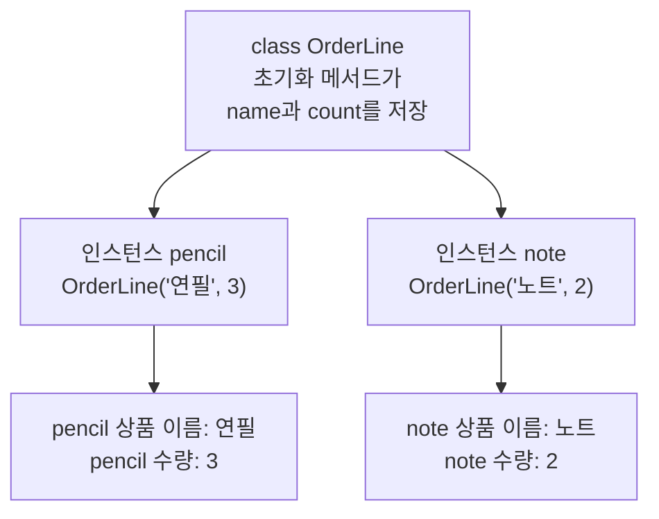
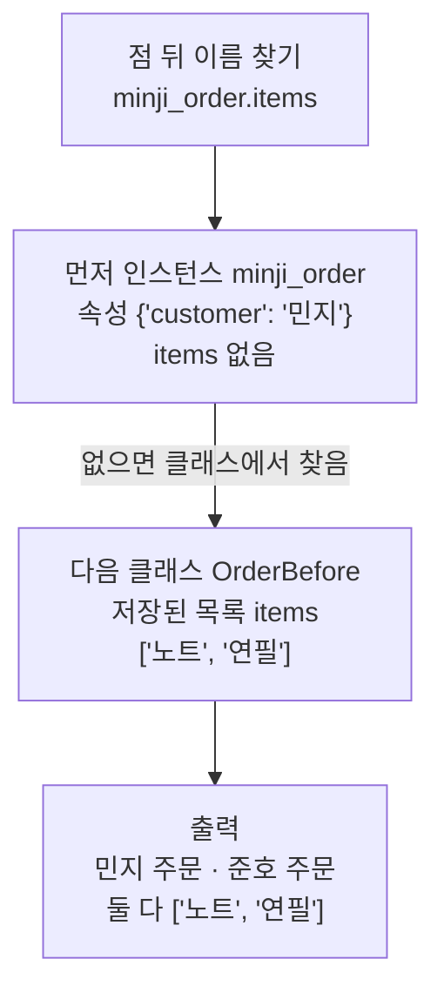
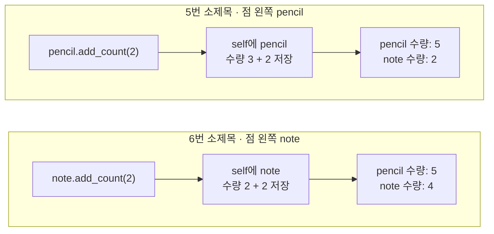
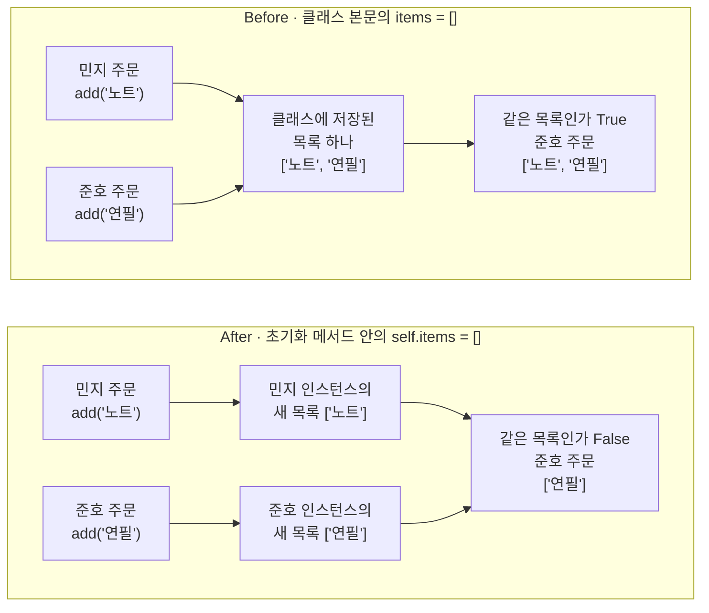

# 06-클래스

## _src 본문 (HTML 원본)

```html
<!--meta: 강의 1h | 실습 2h | 코드 Jupyter Notebook | 새 용어 8 -->
<h2 id="b1"><span class="no">1</span>학습 목표</h2>
<div class="goal"><ul><li>상품 이름과 수량을 저장하는 클래스를 정의하고, 인스턴스 두 개를 만들어 속성을 출력으로 확인할 수 있습니다.</li><li>메서드를 부르면 점 왼쪽 인스턴스가 <code>self</code>에 들어가는 것을 수량 출력으로 설명할 수 있습니다.</li><li>목록을 클래스 본문에 둔 클래스가 두 주문의 상품을 섞는 이유를 <code>is</code> 출력으로 설명하고 고칠 수 있습니다.</li></ul></div>
<h2 id="b2"><span class="no">2</span>이 내용을 배우는 이유</h2>
<p>5절에서 파일을 읽어 주문 목록 [('연필', 3), ('노트', 2)]를 만들었습니다. 튜플의 상품 이름은 번호 0, 수량은 번호 1로 읽습니다. 그런데 코드의 번호만 보고는 어느 값이 수량인지 알 수 없습니다. 튜플은 만든 뒤 값을 바꿀 수도 없습니다.</p>
<p>클래스는 함께 다니는 값에 이름을 붙이고, 그 값을 다루는 함수를 함께 묶습니다. 수량은 <code>pencil.count</code>처럼 이름으로 읽고, 메서드로 바꿉니다. 같은 클래스로 상품 한 줄을 여러 개 만들어도 값은 따로 저장됩니다.</p>
<p>흔한 실수는 모든 주문이 빈 목록으로 시작하니, 목록을 클래스 본문에 한 번만 적는 것입니다. 한 주문에 넣은 상품이 다른 주문에도 보이는데, 오류 메시지는 나오지 않습니다. 1~5절처럼 <b>실행이 멈추지 않아도 결과는 틀릴 수 있습니다.</b></p>
<p><strong>이 절의 질문</strong> — 주문마다 상품 목록을 따로 가지게 하려면, 빈 목록을 클래스의 어디에서 만들어야 할까요?</p>
<h2 id="b3"><span class="no">3</span>앞에서 배운 내용</h2>
<p>Ch 1과 1~5절에서 배운 것 가운데 이 절이 이어 쓰는 것을 표로 모았습니다.</p>
<table><thead><tr><th>앞 절</th><th>배운 것</th><th>이 절에서 이어 쓰는 곳</th></tr></thead><tbody>
<tr><td>Ch 1 2절</td><td>메서드(값 뒤에 점을 찍고 부르는 기능)</td><td>클래스 안에 직접 정의한 메서드 <code>add_count()</code>·<code>add()</code></td></tr>
<tr><td>1절</td><td>내장 함수 <code>type()</code>의 출력 &lt;class 'int'&gt;</td><td>인스턴스의 자료형 &lt;class '__main__.OrderLine'&gt;</td></tr>
<tr><td>3절</td><td>튜플과 위치 번호, 튜플 값을 바꾸면 나는 <code>TypeError</code>(원리 더 알아보기)</td><td>2번 소제목의 튜플 번호 읽기, 속성 이름으로 읽고 바꾸기</td></tr>
<tr><td>3절</td><td>메서드 <code>append()</code>, 연산자 <code>is</code></td><td>메서드 <code>add()</code>의 본문, Before·After의 같은 목록 검사</td></tr>
<tr><td>4절</td><td><code>def</code>와 매개변수, return 줄이 없는 함수, 정의 셀과 호출 셀 나누기</td><td>클래스 안의 메서드 정의, 값을 반환하지 않고 바꾸는 <code>add_count()</code></td></tr>
<tr><td>4절</td><td>기본값을 빈 목록으로 둔 Before(두 호출이 목록 하나를 함께 씀)</td><td>7번 소제목 Before(두 인스턴스가 목록 하나를 함께 씀)</td></tr>
<tr><td>5절</td><td>주문 목록 [('연필', 3), ('노트', 2)], 수량 3을 5로 바꾸려고 파일을 다시 쓴 셀, 속성 <code>file.closed</code></td><td>준비 셀의 <code>orders</code>, 인스턴스 pencil·note의 값, 메서드로 바꾼 수량 5, 속성 읽기</td></tr>
</tbody></table>
<p>이 절의 새 문법은 예약어 <code>class</code>, 초기화 메서드 <code>__init__</code>과 매개변수 <code>self</code>, 속성입니다. 5절 끝에서 「함께 다니는 값과 그 값을 다루는 함수를 클래스로 묶는다」고 예고한 내용입니다.</p>
<p>데이터는 5절 주문 목록의 연필 3개와 노트 2개입니다. 실패 장면에서는 고객 민지와 준호의 두 주문에 노트와 연필을 하나씩 추가합니다. 이 절은 파일을 만들지 않으므로 5절의 임시 폴더 준비 셀이 없습니다.</p>
<h2 id="b4"><span class="no">4</span>핵심 개념</h2>
<h3>비유로 시작하기</h3>
<p>가게에서 같은 양식으로 주문서를 여러 장 만듭니다. 양식에는 「상품 이름」과 「수량」 칸이 정해져 있습니다. 양식이 클래스이고, 양식으로 만든 주문서 한 장이 인스턴스입니다. 주문서마다 칸에 적힌 값은 다릅니다.</p>
<p>이번에는 상품 한 줄이 아니라 고객 한 명의 주문서 양식을 생각합니다. 주문서마다 상품을 담을 바구니도 필요합니다. 바구니를 양식 옆에 하나만 두면 민지 주문서와 준호 주문서가 그 바구니를 함께 씁니다. 민지의 노트와 준호의 연필이 한 바구니에 섞입니다. 주문서를 만들 때마다 새 바구니를 꺼내야 상품이 섞이지 않습니다.</p>
{{img:06-5-주문서-바구니|왼쪽에는 초록 클립과 주황 클립을 단 같은 모양의 주문서 두 장이 바구니 하나에 함께 꽂혀 있고 그 안에 파란 공책과 연필이 섞여 있으며, 오른쪽에는 바구니 두 개에 초록 클립 주문서와 공책, 주황 클립 주문서와 연필이 따로 담긴 삽화|주문서 두 장이 바구니 하나를 함께 쓰는 왼쪽은 클래스 본문의 목록(Before), 주문서마다 바구니가 따로 있는 오른쪽은 초기화 메서드 안의 목록(After)에 해당합니다.}}
<p><strong>그림 읽기</strong> — 가운데 세로줄 왼쪽에서는 초록 클립 주문서와 주황 클립 주문서가 바구니 하나에 함께 꽂혀 있습니다. 두 주문서는 같은 클래스로 만든 민지 주문과 준호 주문이고, 바구니는 목록 items입니다. 그래서 파란 공책(노트)과 연필이 한 바구니에 섞였습니다.</p>
<p>세로줄 오른쪽에서는 바구니가 둘이고, 주문서마다 자기 바구니에 꽂혀 있습니다. 인스턴스를 만들 때마다 새 목록을 만든 모습입니다. 초록 클립 쪽 바구니에는 공책만, 주황 클립 쪽 바구니에는 연필만 들어 있습니다.</p>
<h3>이 절에서 쓰는 말</h3>
<table><thead><tr><th>용어</th><th>뜻</th><th>이 절에서 보이는 모습</th></tr></thead><tbody>
<tr><td>클래스(class)</td><td>함께 다니는 값과 그 값을 다루는 함수를 한 이름으로 묶은 설계</td><td><code>class OrderLine:</code></td></tr>
<tr><td>인스턴스(instance)</td><td>클래스로 만든 값 하나. 인스턴스마다 값을 따로 저장함</td><td><code>pencil</code>, <code>note</code></td></tr>
<tr><td>메서드(method)</td><td>클래스 안에 def로 정의한 함수. 인스턴스 이름 뒤에 점을 찍고 부름</td><td><code>pencil.add_count(2)</code></td></tr>
<tr><td>초기화 메서드(initializer)</td><td>인스턴스를 만들 때 저절로 실행되는 메서드. 이름은 __init__</td><td><code>def __init__(self, name, count):</code></td></tr>
<tr><td>매개변수 self</td><td>메서드의 첫 매개변수. 새 인스턴스나 점 왼쪽 인스턴스가 들어감</td><td><code>self.count = self.count + extra</code></td></tr>
<tr><td>속성(attribute)</td><td>인스턴스나 클래스에 저장된 이름과 값. 점 뒤에 이름을 적어 읽음</td><td><code>pencil.name</code>, 5절의 <code>file.closed</code></td></tr>
<tr><td>인스턴스 속성(instance attribute)</td><td>초기화 메서드 안에서 self에 저장한 속성. 인스턴스마다 따로 있음</td><td>After의 <code>self.items = []</code></td></tr>
<tr><td>클래스 속성(class attribute)</td><td>클래스 본문에 적은 속성. 그 클래스로 만든 인스턴스가 함께 씀</td><td>Before의 <code>items = []</code></td></tr>
</tbody></table>
<h3>클래스 정의와 인스턴스</h3>
<p>클래스 정의는 예약어 <code>class</code>, 클래스 이름, 콜론 순서로 시작합니다. 클래스에 속한 줄은 들여 씁니다. 클래스 이름은 OrderLine처럼 단어마다 첫 글자를 대문자로 적어 붙여 씁니다.</p>
<p>클래스 안에 <code>def</code>로 정의한 함수가 메서드입니다. 첫 메서드 <code>__init__</code>은 초기화 메서드입니다. 이름 앞뒤의 밑줄 두 개는 Python이 정해 둔 특별한 이름이라는 표시입니다.</p>
<p>클래스 이름을 함수처럼 부르면 인스턴스가 만들어지고, 초기화 메서드가 저절로 실행됩니다. 호출 <code>OrderLine("연필", 3)</code>의 인자는 self 다음의 name과 count에 차례로 담깁니다. 매개변수 self 자리에는 인자를 넣지 않습니다. 이 자리에는 새 인스턴스가 저절로 들어갑니다.</p>
<p>줄 <code>self.name = name</code>은 받은 상품 이름을 인스턴스에 저장합니다. 이렇게 저장한 이름과 값이 속성입니다. 노트북에서 인스턴스 pencil과 note를 만들자 수량 속성은 각각 3과 2였습니다. 자료형은 <code>&lt;class '__main__.OrderLine'&gt;</code>로, 1절의 &lt;class 'int'&gt;처럼 클래스 이름이 나왔습니다.</p>
{{mermaid:06-1-클래스와-인스턴스|클래스 OrderLine 정의에서 인자 연필, 3과 노트, 2로 인스턴스 pencil과 note를 만들고, 두 인스턴스에 상품 이름과 수량이 따로 저장되어 출력되는 흐름도|클래스와 인스턴스. 같은 클래스 OrderLine으로 만든 pencil과 note가 수량 3과 2를 따로 저장합니다.}}
<p><strong>도식 읽기</strong> — 위에서 아래로 읽습니다. 맨 위 파란 상자는 우리가 적은 클래스 정의입니다. 화살표 두 개가 초록 상자인 인스턴스 pencil과 note로 갈라지고, 상자마다 만들 때 넣은 인자를 적었습니다.</p>
<p>맨 아래 노란 상자 두 개는 각 인스턴스의 속성을 읽은 출력입니다. 왼쪽 상자는 pencil 수량: 3, 오른쪽 상자는 note 수량: 2입니다.</p>
<h3>메서드와 self</h3>
<p>메서드는 인스턴스 이름 뒤에 점을 찍고 부릅니다. 호출 <code>pencil.add_count(2)</code>에서는 점 왼쪽의 pencil이 매개변수 self에 들어갑니다. 괄호 안의 2는 둘째 매개변수 extra에 담깁니다. 그래서 본문의 <code>self.count</code>는 pencil의 수량을 가리킵니다.</p>
<p>노트북은 같은 메서드를 같은 인자 2로 두 번 불렀습니다. 점 왼쪽이 pencil일 때는 pencil 수량만 3에서 5가 되었습니다. 점 왼쪽 이름만 note로 바꾸자 note 수량만 2에서 4가 되었습니다.</p>
<p>3절의 튜플은 값을 바꿀 수 없었고, 5절에서는 수량을 바꾸려고 파일을 다시 썼습니다. 인스턴스의 속성은 메서드로 바꿀 수 있습니다. 메서드 <code>add_count()</code>에는 return 줄이 없습니다. 값을 반환하지 않고, 인스턴스에 저장된 값을 바꿉니다.</p>
<h3>클래스 속성과 인스턴스 속성</h3>
<p>속성은 저장하는 자리에 따라 둘로 나뉩니다. 초기화 메서드 안에서 self에 저장한 속성은 인스턴스 속성입니다. 초기화 메서드는 인스턴스를 만들 때마다 실행되므로, 인스턴스마다 따로 저장됩니다.</p>
<p>클래스 본문에 적은 속성은 클래스 속성입니다. 클래스 본문의 대입 줄은 클래스를 정의할 때 실행됩니다. 그래서 값이 클래스에 한 번 저장됩니다. Python 자습서는 클래스 속성을 그 클래스의 모든 인스턴스가 함께 쓴다고 설명합니다.</p>
<p>인스턴스에 없는 이름을 점 뒤에 적으면, Python은 그 인스턴스를 만든 클래스에서 같은 이름을 찾습니다. 노트북 「원리 더 알아보기」 셀에서 민지 주문 인스턴스의 속성은 <code>{'customer': '민지'}</code>뿐이었습니다. 목록 items는 클래스 OrderBefore에 ['노트', '연필']로 저장되어 있었습니다.</p>
{{mermaid:06-2-속성-찾는-차례|점 뒤 이름 minji_order.items를 찾을 때 먼저 속성이 customer뿐인 인스턴스 minji_order에서 찾고, items가 없어 클래스 OrderBefore에 저장된 목록 ['노트', '연필']을 찾아, 민지 주문과 준호 주문이 모두 같은 목록으로 출력되는 흐름도|속성을 찾는 차례. 인스턴스 minji_order에 items가 없어서, 클래스 OrderBefore에 저장된 목록을 읽습니다.}}
<p><strong>도식 읽기</strong> — 위에서 아래로 읽습니다. 파란 상자는 점 뒤 이름 items를 찾는 코드입니다. 첫 초록 상자는 인스턴스 minji_order이고, 속성이 customer 하나라 items가 없습니다.</p>
<p>화살표 「없으면 클래스에서 찾음」을 따라 둘째 초록 상자인 클래스 OrderBefore의 목록으로 갑니다. 준호 주문 인스턴스의 속성도 {'customer': '준호'}뿐이라 같은 목록을 찾습니다. 맨 아래 빨간 상자는 두 주문이 모두 ['노트', '연필']인 Before 셀의 출력입니다.</p>
<h2 id="b5"><span class="no">5</span>실행 예제</h2>
<p>노트북은 5절의 주문 목록 [('연필', 3), ('노트', 2)]를 새 커널에 저장하고 시작합니다. 첫 튜플을 번호로 읽어 번호 0의 값 연필, 번호 1의 값 3을 봅니다. 클래스 OrderLine을 정의하고, 인스턴스 pencil과 note를 만들어 수량 3과 2를 읽습니다.</p>
<p>이어서 pencil에 메서드 <code>add_count(2)</code>를 불러 수량 5를 얻습니다. 값 바꿔 보기에서는 점 왼쪽 이름만 note로 바꿔, note 수량 4와 pencil 수량 5를 봅니다. 모델을 부르지 않고 파일도 만들지 않습니다. 그래서 API 키가 필요 없고, 다시 실행해도 출력은 같습니다.</p>
{{notebook:06-클래스|example}}
<p class="look"><b>확인할 점</b> — 클래스 정의 셀에 출력이 없는지 봅니다. 인스턴스 pencil과 note의 수량이 3과 2로 따로 나왔는지 확인합니다. 메서드를 부른 두 셀에서 점 왼쪽 인스턴스의 수량만 바뀌었는지 확인합니다.</p>
<h3>점 왼쪽 인스턴스가 self에 들어가는 차례</h3>
<p>메서드를 부른 두 셀을 한 그림으로 모았습니다. 두 셀은 메서드와 인자가 같고, 점 왼쪽 이름만 다릅니다.</p>
{{mermaid:06-3-self에-들어가는-인스턴스|5번 소제목에서 pencil.add_count(2)를 부르면 self에 pencil이 들어가 수량 3에 2를 더해 pencil 수량 5와 note 수량 2가 출력되고, 6번 소제목에서 note.add_count(2)를 부르면 self에 note가 들어가 수량 2에 2를 더해 pencil 수량 5와 note 수량 4가 출력되는 것을 위아래 두 칸으로 비교한 그림|같은 메서드를 불러도 점 왼쪽 인스턴스가 self에 들어갑니다. 점 왼쪽이 pencil이면 pencil만 5, note이면 note만 4가 됩니다.}}
<p><strong>도식 읽기</strong> — 위 칸은 5번 소제목, 아래 칸은 6번 소제목이고, 칸 안은 왼쪽에서 오른쪽으로 읽습니다. 파란 상자는 메서드 호출, 초록 상자는 self에 들어간 인스턴스와 저장한 계산입니다.</p>
<p>노란 상자의 출력을 비교합니다. 위 칸에서는 pencil 수량만 5로 바뀌고, note 수량은 2입니다. 아래 칸에서는 note 수량만 4로 바뀌고, pencil 수량은 앞 셀의 5 그대로입니다.</p>
<h2 id="b6"><span class="no">6</span>일부러 실패해 보기</h2>
<p>고객 한 명의 주문을 클래스로 만듭니다. 주문에는 고객 이름과 상품 이름 목록이 있습니다. 메서드 <code>add()</code>는 상품 이름 하나를 목록 끝에 추가합니다. 모든 주문은 빈 목록으로 시작하므로, Before 클래스 OrderBefore는 빈 목록을 클래스 본문에 한 번만 적었습니다.</p>
<p>Before 셀은 오류 없이 실행됩니다. 민지 주문에만 노트를 추가했는데, 노트 추가 뒤 준호 주문이 ['노트']였습니다. 준호 주문에 연필을 추가하자 두 주문이 모두 ['노트', '연필']입니다. 같은 목록인가는 True입니다.</p>
<p>원리 더 알아보기 셀에서 민지 주문 인스턴스의 속성은 <code>{'customer': '민지'}</code>뿐이었습니다. 목록은 클래스 OrderBefore에 저장되어 있었습니다. 4절 Before에서는 두 호출이 함수의 기본값 목록 하나를 함께 썼습니다. 이번에는 두 인스턴스가 클래스의 목록 하나를 함께 썼습니다.</p>
<p>After 클래스 Order는 빈 목록을 만드는 줄의 자리만 옮겼습니다. 클래스 본문의 <code>items = []</code>를 지우고, 초기화 메서드 안에 <code>self.items = []</code>를 적었습니다. 같은 순서로 실행하자 노트 추가 뒤 준호 주문은 []였습니다. 민지 주문은 ['노트'], 준호 주문은 ['연필']이고, 같은 목록인가는 False입니다.</p>
{{mermaid:06-4-before-after-비교|Before는 민지 주문의 add('노트')와 준호 주문의 add('연필')가 클래스에 저장된 목록 하나에 쌓여 같은 목록 True와 준호 주문 ['노트', '연필']이 나오고, After는 두 주문이 각자 인스턴스의 새 목록 ['노트']와 ['연필']에 추가해 같은 목록 False와 준호 주문 ['연필']이 나오는 비교 그림|목록을 클래스 본문에 둔 Before는 두 주문의 상품이 목록 하나에 쌓이고, 초기화 메서드 안에서 만든 After는 주문마다 새 목록을 받습니다.}}
<p><strong>도식 읽기</strong> — 위 칸이 Before, 아래 칸이 After이고, 칸 안은 왼쪽에서 오른쪽으로 읽습니다. 파란 상자는 두 주문의 <code>add()</code> 호출, 초록 상자는 목록입니다.</p>
<p>Before 칸에서는 두 호출의 화살표가 클래스에 저장된 목록 하나로 모입니다. 그 목록에서 빨간 상자(같은 목록인가 True)로 이어집니다. After 칸에서는 두 호출이 인스턴스마다 만든 새 목록으로 갑니다. 노란 상자의 결과는 같은 목록인가 False, 준호 주문 ['연필']입니다.</p>
{{notebook:06-클래스|failure}}
<h3>확인한 범위</h3>
<p>이번에 고친 경우는 목록 속성 하나를 가진 클래스로 주문 두 개를 만든 장면입니다. 딕셔너리를 클래스 본문에 둔 경우는 이번에 실행하지 않았습니다. 숫자나 글자처럼 메서드로 내용을 바꾸지 않는 값을 클래스 속성으로 둔 경우도 실행하지 않았습니다.</p>
<p>없는 속성 이름을 읽을 때 나는 오류는 이번에 실행하지 않았습니다. 클래스를 물려받아 새 클래스를 만드는 상속(inheritance)도 다루지 않았습니다. 정의 줄에 자료형을 적는 타입힌트는 7절에서 배웁니다.</p>
<h2 id="b7"><span class="no">7</span>주의할 점과 실무 메모</h2>
<ul><li>메서드를 정의할 때는 첫 매개변수 self를 직접 적습니다. 부를 때는 self 자리에 인자를 넣지 않고, 점 왼쪽 인스턴스가 들어갑니다.</li>
<li>인스턴스마다 따로 가질 목록은 초기화 메서드 안에서 self에 저장합니다. 노트북 After에서 두 주문의 같은 목록인가가 False였습니다.</li>
<li>클래스 본문에 목록을 두면 그 클래스로 만든 인스턴스가 목록 하나를 함께 씁니다. Before에서 준호 주문에 민지의 노트가 들어갔습니다.</li>
<li>메서드로 값을 바꾸는 셀은 실행할 때마다 값을 바꿉니다. 수량에 2를 더하는 셀을 한 번 더 실행하면 수량이 또 늘어납니다. 여러 번 실행했다면 첫 셀부터 다시 실행합니다.</li>
<li>인스턴스에 저장된 값은 커널을 다시 시작하면 변수처럼 사라집니다. 다음 실행에도 쓸 값은 5절처럼 파일에 씁니다.</li></ul>
<h2 id="b8"><span class="no">8</span>정리와 다음 절</h2>
<ul><li>클래스는 함께 다니는 값과 메서드를 한 이름으로 묶은 설계입니다. 클래스 OrderLine으로 만든 인스턴스 pencil과 note는 수량 3과 2를 따로 저장했습니다.</li><li>메서드를 부르면 점 왼쪽 인스턴스가 self에 들어갑니다. 같은 메서드 <code>add_count(2)</code>가 pencil만 5로, note만 4로 바꿨습니다.</li><li>빈 목록을 클래스 본문에 두자 두 주문이 목록 하나를 함께 써서 같은 목록인가가 True였습니다. 목록을 초기화 메서드 안에서 만들자 False가 되었습니다.</li></ul>
<p><strong>다음 학습과 이어지는 지점</strong> — 7절에서는 함수와 클래스를 다른 파일에 나눠 두고 <code>import</code>로 불러오는 모듈을 배웁니다. 1절과 5절 준비 셀에서 뜻을 미룬 import 줄도 7절에서 배웁니다. 정의 줄에 자료형을 적는 타입힌트도 함께 배웁니다.</p>
<h2 id="b9"><span class="no">9</span>복습 문제</h2><details class="quiz"><summary>문제와 해설</summary>
<p class="quiz-q">1. 클래스 OrderLine을 정의한 셀에는 왜 출력이 없었나요? · 기초</p><p class="quiz-a"><b>해설</b> — 정의 셀은 클래스 이름과 메서드를 기억해 둘 뿐이기 때문입니다. 메서드 본문은 인스턴스를 만들거나 메서드를 부를 때 실행됩니다. 4절의 함수 정의 셀과 같습니다.</p>
<p class="quiz-q">2. 호출 <code>OrderLine("노트", 2)</code>에서 인자는 어느 매개변수에 담기나요? 매개변수 self에는 무엇이 들어가나요? · 기초</p><p class="quiz-a"><b>해설</b> — 인자 "노트"는 name에, 2는 count에 차례로 담깁니다. 매개변수 self 자리에는 인자를 넣지 않고, 새로 만든 인스턴스가 들어갑니다. 초기화 메서드가 두 값을 그 인스턴스에 저장해 note 수량이 2로 출력됐습니다.</p>
<p class="quiz-q">3. 튜플 ('연필', 3)의 수량을 읽는 코드와 인스턴스 pencil의 수량을 읽는 코드를 비교하세요. · 기초</p><p class="quiz-a"><b>해설</b> — 튜플은 <code>first_tuple[1]</code>처럼 위치 번호로 읽습니다. 인스턴스는 <code>pencil.count</code>처럼 속성 이름으로 읽습니다. 이름으로 읽으면 번호의 뜻을 기억하지 않아도 수량이라는 것을 알 수 있습니다.</p>
<p class="quiz-q">4. 값 바꿔 보기 셀 <code>note.add_count(2)</code>를 실행한 뒤 pencil 수량이 4가 아니라 5였던 이유는 무엇인가요? · 적용</p><p class="quiz-a"><b>해설</b> — 점 왼쪽의 note가 self에 들어가 note의 수량만 2에서 4로 바뀌었기 때문입니다. pencil 수량은 앞 셀에서 <code>pencil.add_count(2)</code>로 바뀐 5 그대로입니다.</p>
<p class="quiz-q">5. Before 셀에서 민지 주문에만 노트를 추가했는데 준호 주문이 ['노트']였던 이유를 쓰세요. · 분석</p><p class="quiz-a"><b>해설</b> — 목록 items를 클래스 본문에 적어 클래스에 한 번만 저장했기 때문입니다. 인스턴스에는 items가 없어서, 두 주문의 self.items가 모두 클래스의 목록을 찾았습니다. 원리 더 알아보기 셀에서 민지 주문 인스턴스의 속성은 <code>{'customer': '민지'}</code>뿐이었습니다.</p>
<p class="quiz-q">6. After 클래스 Order는 어디를 바꿨고, 같은 목록인가는 어떻게 달라졌나요? 4절 Before와 비슷한 점도 쓰세요. · 분석</p><p class="quiz-a"><b>해설</b> — 빈 목록을 만드는 줄을 초기화 메서드 안의 <code>self.items = []</code>로 옮겼습니다. 초기화 메서드는 인스턴스를 만들 때마다 실행되어 주문마다 새 목록이 생깁니다. 그래서 같은 목록인가가 True에서 False가 됐습니다. 4절의 기본값 빈 목록도 한 번만 만들어져, 두 호출이 목록 하나를 함께 썼습니다.</p>
</details>
<h2 id="b10"><span class="no">10</span>참고 자료</h2>
<ul><li><a href="https://docs.python.org/3.12/tutorial/classes.html#class-definition-syntax">Python 3.12 자습서 9.3.1: 클래스 정의 문법</a> · 확인 2026-09-16 · 기준 Python 3.12</li><li><a href="https://docs.python.org/3.12/tutorial/classes.html#class-objects">Python 3.12 자습서 9.3.2: 클래스 객체</a> · 확인 2026-09-16 · 기준 Python 3.12</li><li><a href="https://docs.python.org/3.12/tutorial/classes.html#method-objects">Python 3.12 자습서 9.3.4: 메서드 객체</a> · 확인 2026-09-16 · 기준 Python 3.12</li><li><a href="https://docs.python.org/3.12/tutorial/classes.html#class-and-instance-variables">Python 3.12 자습서 9.3.5: 클래스·인스턴스 변수</a> · 확인 2026-09-16 · 기준 Python 3.12</li><li><a href="https://docs.python.org/3.12/tutorial/classes.html#random-remarks">Python 3.12 자습서 9.4: 기타 참고</a> · 확인 2026-09-16 · 기준 Python 3.12</li></ul>
```

## 노트북 셀 (순서대로)

### [0] markdown {'html': 'skip'}

# 클래스

**이 노트북에서 할 일**

1. 상품 이름과 수량을 이름으로 읽는 클래스를 정의하고, 같은 클래스로 인스턴스 두 개를 만듭니다.
2. 초기화 메서드 `__init__`, 매개변수 `self`, 메서드 호출로 인스턴스마다 값이 따로 바뀌는 것을 확인합니다.
3. 빈 목록을 클래스 본문에 둔 주문 클래스가 두 주문의 상품을 섞는 장면을 보고, 목록을 만드는 자리를 옮겨 고칩니다.

**준비물** — API 키 불필요. 데이터 파일도 없습니다. 모델 호출은 0번이고 비용은 들지 않습니다.
실행 시간은 1분 이내입니다.

1~5절과 같은 실습 폴더 `labs/part1/ch02-python`의 `.venv`를 커널로 고릅니다.
이전 커널의 변수는 쓰지 않으므로 첫 셀부터 순서대로 실행합니다.

### [1] markdown {'html': 'skip'}

## 오늘 볼 그림


위에서 아래로 읽습니다. 파란 상자는 우리가 적은 클래스 정의, 초록 상자는 만든 인스턴스, 노란 상자는 출력입니다.

클래스 하나에서 화살표 두 개가 인스턴스 pencil과 note로 갈라집니다.
두 인스턴스는 같은 클래스로 만들었지만 상품 이름과 수량을 따로 저장합니다.

### [2] markdown {}

## 1. 준비

이 절은 설치할 패키지가 없고, 파일도 만들지 않습니다.
준비 셀은 5절에서 파일을 읽어 만든 주문 목록 `orders`를 새 커널에 다시 저장합니다. 주문 목록에는 (상품 이름, 수량) 튜플 두 개가 들어 있습니다.

### [3] code {'execution': {'iopub.execute_input': '2026-09-16T08:59:56.168816Z', 'iopub.status.busy': '2026-09-16T08:59:56.168598Z', 'iopub.status.idle': '2026-09-16T08:59:56.174605Z', 'shell.execute_reply': '2026-09-16T08:59:56.173931Z'}, 'lesson_role': 'setup'}

```python
# 5절에서 파일을 읽어 만든 주문 목록을 새 커널에 다시 저장합니다
orders = [("연필", 3), ("노트", 2)]
order_count = len(orders)
print("주문 목록:", orders)
print("주문 수:", order_count)
```

출력:
```
주문 목록: [('연필', 3), ('노트', 2)]
주문 수: 2

```

### [4] markdown {}

**결과 읽기** — 주문 목록은 `[('연필', 3), ('노트', 2)]`, 주문 수는 `2`입니다.
5절에서 함수 `parse_order()`로 처음 만든 주문 목록과 같습니다.

### [5] markdown {}

## 2. 튜플의 값을 위치 번호로 읽기

튜플은 값을 순서대로 담습니다. 그래서 첫 주문의 상품 이름은 번호 0, 수량은 번호 1로 꺼냅니다.
그런데 코드의 `[0]`과 `[1]`만 보고는 어느 쪽이 수량인지 알 수 없습니다. 5절 함수 `parse_order()`가 튜플을 만든 순서를 기억해야 합니다.

3절 「원리 더 알아보기」에서는 튜플의 수량 자리에 새 값을 넣자 `TypeError`가 났습니다. 튜플은 만든 뒤 값을 바꿀 수 없습니다.

실행 전에 예상합니다. 첫 주문 튜플의 번호 0은 연필, 번호 1은 3일 것입니다.

### [6] code {'execution': {'iopub.execute_input': '2026-09-16T08:59:56.176622Z', 'iopub.status.busy': '2026-09-16T08:59:56.176462Z', 'iopub.status.idle': '2026-09-16T08:59:56.179635Z', 'shell.execute_reply': '2026-09-16T08:59:56.178899Z'}}

```python
# 첫 주문 튜플에서 상품 이름과 수량을 위치 번호로 꺼냅니다
first_tuple = orders[0]
tuple_name = first_tuple[0]
tuple_count = first_tuple[1]
print("번호 0의 값:", tuple_name)
print("번호 1의 값:", tuple_count)
```

출력:
```
번호 0의 값: 연필
번호 1의 값: 3

```

### [7] markdown {}

**결과 읽기** — 번호 0의 값은 `연필`, 번호 1의 값은 `3`으로 예상과 같습니다.
출력 라벨에도 「상품 이름」, 「수량」 대신 번호만 적혔습니다. 값의 뜻을 번호가 아니라 이름으로 읽을 수 있으면 코드를 읽기 쉬워집니다.

### [8] markdown {}

## 3. 클래스 정의하기

클래스(class)는 함께 다니는 값과 그 값을 다루는 함수를 한 이름으로 묶은 설계입니다.
가게의 주문서 양식에 「상품 이름」 칸과 「수량」 칸이 정해져 있는 것과 같습니다.
이 셀은 상품 한 줄을 뜻하는 클래스 `OrderLine`을 정의합니다. 클래스 이름은 단어마다 첫 글자를 대문자로 적어 붙여 씁니다.

정의는 예약어 `class`, 클래스 이름, 콜론 순서로 시작합니다. 클래스에 속한 줄은 들여 씁니다.
클래스 안에 `def`로 정의한 함수를 메서드(method)라고 합니다. 3절에서 부른 `append()`도 목록의 메서드입니다.

첫 메서드 `__init__`은 초기화 메서드(initializer)입니다. 이름 앞뒤의 밑줄 두 개는 Python이 정해 둔 특별한 이름이라는 표시입니다.
클래스 이름을 함수처럼 부르면 Python이 새 값 하나를 만들고, 이 메서드를 저절로 실행합니다.
이렇게 클래스로 만든 값 하나를 인스턴스(instance)라고 합니다.

첫 매개변수 `self`에는 방금 만든 인스턴스가 들어갑니다. 줄 `self.name = name`은 인자로 받은 상품 이름을 그 인스턴스에 저장합니다.
둘째 메서드 `add_count()`는 5번 소제목에서 부릅니다.

실행 전에 예상합니다. 4절의 정의 셀처럼 출력은 없을 것입니다.

### [9] code {'execution': {'iopub.execute_input': '2026-09-16T08:59:56.181047Z', 'iopub.status.busy': '2026-09-16T08:59:56.180923Z', 'iopub.status.idle': '2026-09-16T08:59:56.183668Z', 'shell.execute_reply': '2026-09-16T08:59:56.182972Z'}, 'upgrade_allow': ['class_def']}

```python
# 상품 이름과 수량을 함께 저장하는 클래스를 정의합니다
class OrderLine:
    # 인스턴스를 만들 때 저절로 실행되어 두 값을 인스턴스에 저장합니다
    def __init__(self, name, count):
        self.name = name
        self.count = count

    # 이 인스턴스의 수량에 extra를 더해 다시 저장합니다
    def add_count(self, extra):
        self.count = self.count + extra
```

출력:
```

```

### [10] markdown {}

**결과 읽기** — 예상대로 출력이 없습니다. 정의 셀은 클래스 이름과 메서드 두 개를 기억해 둘 뿐입니다.
메서드의 본문은 인스턴스를 만들거나 메서드를 부를 때 실행됩니다.

### [11] markdown {}

## 4. 인스턴스 만들기

클래스 이름 뒤에 소괄호를 붙여 부르면 인스턴스가 만들어집니다.
호출 `OrderLine("연필", 3)`의 인자는 매개변수 `self` 다음의 `name`과 `count`에 차례로 담깁니다.
매개변수 `self` 자리에는 인자를 넣지 않습니다. 이 자리에는 새 인스턴스가 저절로 들어갑니다.

속성(attribute)은 인스턴스에 저장된 이름과 값입니다. 인스턴스 이름 뒤에 점과 속성 이름을 적어 읽습니다.
5절에서 파일이 닫혔는지 읽은 `file.closed`도 속성이었습니다.

같은 클래스로 인스턴스를 두 개 만들고, 1절의 내장 함수 `type()`으로 자료형도 봅니다.

실행 전에 예상합니다. 인스턴스 pencil의 수량은 3, 인스턴스 note의 수량은 2일 것입니다.

### [12] code {'execution': {'iopub.execute_input': '2026-09-16T08:59:56.185564Z', 'iopub.status.busy': '2026-09-16T08:59:56.185410Z', 'iopub.status.idle': '2026-09-16T08:59:56.188519Z', 'shell.execute_reply': '2026-09-16T08:59:56.188035Z'}}

```python
# 5절 주문 튜플 두 개와 같은 값으로 인스턴스 두 개를 만듭니다
pencil = OrderLine("연필", 3)
note = OrderLine("노트", 2)
# 점 뒤에 속성 이름을 적어 인스턴스에 저장된 값을 읽습니다
print("pencil 상품 이름:", pencil.name)
print("pencil 수량:", pencil.count)
print("note 상품 이름:", note.name)
print("note 수량:", note.count)
# 1절의 type()으로 인스턴스의 자료형을 봅니다
pencil_type = type(pencil)
print("pencil의 자료형:", pencil_type)
```

출력:
```
pencil 상품 이름: 연필
pencil 수량: 3
note 상품 이름: 노트
note 수량: 2
pencil의 자료형: <class '__main__.OrderLine'>

```

### [13] markdown {}

**결과 읽기** — 출력의 수량은 `pencil 수량: 3`, `note 수량: 2`로 예상과 같습니다. 같은 클래스로 만들었지만 두 인스턴스의 값은 따로 저장됐습니다.

자료형은 `<class '__main__.OrderLine'>`입니다. 1절에서 `type()`이 보여 준 `<class 'int'>`처럼, 우리가 정의한 클래스도 자료형이 됩니다.
앞의 `__main__`은 이 노트북에서 정의한 이름이라는 표시입니다. 자세한 뜻은 7절 모듈에서 배웁니다.

### [14] markdown {}

## 5. 메서드 부르기

메서드는 인스턴스 이름 뒤에 점을 찍고 부릅니다. 호출 `pencil.add_count(2)`에서는 점 왼쪽의 pencil이 매개변수 `self`에 들어갑니다.
괄호 안의 2는 둘째 매개변수 `extra`에 담깁니다.

그래서 본문의 `self.count`는 `pencil.count`와 같은 값을 가리킵니다. 본문 줄은 3에 2를 더한 5를 다시 저장합니다.
3절에서 튜플의 값은 바꿀 수 없었고, 5절에서는 수량을 5로 바꾸려고 파일을 다시 썼습니다. 인스턴스의 속성은 메서드로 바꿀 수 있습니다.

실행 전에 예상합니다. 인스턴스 pencil의 수량은 5가 되고, 메서드를 부르지 않은 note의 수량은 2 그대로일 것입니다.

### [15] code {'execution': {'iopub.execute_input': '2026-09-16T08:59:56.189820Z', 'iopub.status.busy': '2026-09-16T08:59:56.189706Z', 'iopub.status.idle': '2026-09-16T08:59:56.192365Z', 'shell.execute_reply': '2026-09-16T08:59:56.191791Z'}}

```python
# pencil 인스턴스에만 메서드를 불러 수량에 2를 더합니다
pencil.add_count(2)
print("pencil 수량:", pencil.count)
# 메서드를 부르지 않은 note의 수량도 함께 봅니다
print("note 수량:", note.count)
```

출력:
```
pencil 수량: 5
note 수량: 2

```

### [16] markdown {}

**결과 읽기** — 출력은 `pencil 수량: 5`, `note 수량: 2`로 예상과 같습니다. 메서드는 점 왼쪽 인스턴스 pencil의 수량만 바꿨습니다.
메서드 `add_count()`에는 return 줄이 없습니다. 이 메서드는 값을 반환하지 않고, 인스턴스에 저장된 값을 바꿉니다.

### [17] markdown {}

## 6. 값 바꿔 보기 — 점 왼쪽 이름만 바꾸기

5번 소제목과 같은 메서드와 같은 인자 2를 씁니다. 점 왼쪽의 인스턴스 이름 하나만 pencil에서 note로 바꿉니다.
이 셀은 한 번만 실행합니다. 여러 번 실행하면 실행할 때마다 수량이 2씩 늘어납니다.

실행 전에 예상합니다. 이번에는 매개변수 `self`에 note가 들어갑니다. 그래서 note의 수량이 2에서 4가 되고, pencil의 수량은 5 그대로일 것입니다.

### [18] code {'execution': {'iopub.execute_input': '2026-09-16T08:59:56.193667Z', 'iopub.status.busy': '2026-09-16T08:59:56.193515Z', 'iopub.status.idle': '2026-09-16T08:59:56.195905Z', 'shell.execute_reply': '2026-09-16T08:59:56.195469Z'}}

```python
# 점 왼쪽 이름만 note로 바꿔 같은 메서드를 부릅니다
note.add_count(2)
print("pencil 수량:", pencil.count)
print("note 수량:", note.count)
```

출력:
```
pencil 수량: 5
note 수량: 4

```

### [19] markdown {}

**결과 읽기** — 출력은 `pencil 수량: 5`, `note 수량: 4`로 예상과 같습니다. 바꾼 것은 점 왼쪽 이름 하나뿐입니다.
같은 메서드를 불러도 점 왼쪽의 인스턴스가 `self`에 들어가, 그 인스턴스의 값만 바뀝니다.

### [20] markdown {'lesson_part': 'before'}

## 7. Before — 빈 목록을 클래스 본문에 한 번만 적기

이번에는 고객 한 명의 주문을 클래스로 만듭니다. 주문에는 고객 이름과 상품 이름 목록이 있습니다.
메서드 `add()`는 상품 이름 하나를 목록 끝에 추가합니다.

모든 주문은 빈 목록으로 시작합니다. 그래서 빈 목록을 초기화 메서드 안이 아니라 클래스 본문에 한 번만 적었습니다.
클래스 본문에 적은 이름을 클래스 속성(class attribute)이라고 합니다. 초기화 메서드 안에서 `self`에 저장한 이름은 인스턴스 속성(instance attribute)입니다.

실행 전에 예상합니다. 정의 셀이라 출력은 없을 것입니다.

### [21] code {'execution': {'iopub.execute_input': '2026-09-16T08:59:56.197086Z', 'iopub.status.busy': '2026-09-16T08:59:56.196972Z', 'iopub.status.idle': '2026-09-16T08:59:56.199507Z', 'shell.execute_reply': '2026-09-16T08:59:56.198965Z'}, 'lesson_part': 'before', 'upgrade_allow': ['class_def']}

```python
# 고객 한 명의 주문을 저장하는 클래스를 정의합니다(빈 목록은 클래스 본문에 한 번)
class OrderBefore:
    # 모든 주문이 빈 목록으로 시작하므로 클래스 본문에 적었습니다
    items = []

    def __init__(self, customer):
        self.customer = customer

    # 상품 이름 하나를 목록 끝에 추가합니다
    def add(self, product_name):
        self.items.append(product_name)
```

출력:
```

```

### [22] markdown {'lesson_part': 'before'}

**결과 읽기** — 출력이 없습니다. 이번 정의는 줄 `items = []`를 초기화 메서드 밖, 클래스 본문에 적었습니다.

### [23] markdown {'lesson_part': 'before'}

민지와 준호의 주문을 이 클래스로 하나씩 만듭니다. 민지 주문에 노트를 추가한 뒤, 아직 아무것도 추가하지 않은 준호 주문을 출력합니다.
이어서 준호 주문에 연필을 추가합니다. 두 주문의 목록이 같은 목록인지는 3절과 4절처럼 연산자 `is`로 검사합니다.

이 셀은 한 번만 실행합니다. 여러 번 실행했다면 첫 셀부터 다시 실행합니다.

실행 전에 예상해 봅니다. 준호 주문에는 노트를 넣지 않았습니다. 노트 추가 뒤 준호 주문은 빈 목록일까요?

### [24] code {'execution': {'iopub.execute_input': '2026-09-16T08:59:56.200476Z', 'iopub.status.busy': '2026-09-16T08:59:56.200374Z', 'iopub.status.idle': '2026-09-16T08:59:56.203227Z', 'shell.execute_reply': '2026-09-16T08:59:56.202713Z'}, 'lesson_part': 'before'}

```python
# 민지와 준호의 주문을 만들고, 민지 주문에만 노트를 추가합니다
minji_order = OrderBefore("민지")
junho_order = OrderBefore("준호")
minji_order.add("노트")
print("노트 추가 뒤 준호 주문:", junho_order.items)
# 이번에는 준호 주문에만 연필을 추가합니다
junho_order.add("연필")
is_same_list = minji_order.items is junho_order.items
print("민지 주문:", minji_order.items)
print("준호 주문:", junho_order.items)
print("같은 목록인가:", is_same_list)
```

출력:
```
노트 추가 뒤 준호 주문: ['노트']
민지 주문: ['노트', '연필']
준호 주문: ['노트', '연필']
같은 목록인가: True

```

### [25] markdown {'lesson_part': 'before'}

**결과 읽기** — 노트 추가 뒤 준호 주문은 `['노트']`입니다. 연필을 추가한 뒤에는 민지 주문과 준호 주문이 모두 `['노트', '연필']`이고, 같은 목록인가는 `True`입니다.

오류 메시지는 나오지 않았지만, 준호 주문에 민지의 노트가 들어갔습니다. 1~5절처럼 실행이 멈추지 않아도 결과는 틀릴 수 있습니다.
4절 Before에서는 두 호출이 함수에 저장된 기본값 목록 하나를 함께 썼습니다. 이번에는 두 인스턴스가 목록 하나를 함께 썼습니다.

### [26] markdown {'lesson_part': 'before'}

### 원리 더 알아보기 — 목록 items가 저장된 곳

속성 `__dict__`는 인스턴스에 저장된 속성을 딕셔너리로 보여 줍니다. 이 속성은 앞으로 쓰지 않으므로 지금은 출력만 읽습니다.
클래스 속성은 클래스 이름 뒤에 점을 찍어서도 읽을 수 있습니다.

### [27] code {'execution': {'iopub.execute_input': '2026-09-16T08:59:56.204222Z', 'iopub.status.busy': '2026-09-16T08:59:56.204123Z', 'iopub.status.idle': '2026-09-16T08:59:56.206592Z', 'shell.execute_reply': '2026-09-16T08:59:56.206057Z'}, 'lesson_level': 'deep-dive', 'lesson_part': 'before'}

```python
# 원리 더 알아보기: 인스턴스와 클래스에 저장된 값을 각각 읽습니다
minji_attributes = minji_order.__dict__
junho_attributes = junho_order.__dict__
class_items = OrderBefore.items
print("민지 주문 인스턴스의 속성:", minji_attributes)
print("준호 주문 인스턴스의 속성:", junho_attributes)
print("클래스 OrderBefore의 items:", class_items)
```

출력:
```
민지 주문 인스턴스의 속성: {'customer': '민지'}
준호 주문 인스턴스의 속성: {'customer': '준호'}
클래스 OrderBefore의 items: ['노트', '연필']

```

### [28] markdown {'lesson_part': 'before'}

**결과 읽기** — 민지 주문 인스턴스의 속성은 `{'customer': '민지'}`뿐이고, 이름 items가 없습니다. 준호 주문도 `{'customer': '준호'}`뿐입니다.
클래스 OrderBefore의 items는 `['노트', '연필']`입니다.
인스턴스에 없는 이름을 점 뒤에 적으면, Python은 그 인스턴스를 만든 클래스에서 같은 이름을 찾습니다.
그래서 두 주문의 `self.items`가 클래스에 저장된 목록 하나를 가리켰습니다.

### [29] markdown {'lesson_part': 'after'}

## 8. After — 빈 목록을 초기화 메서드 안에서 만들기

Before 클래스와 달라진 곳은 빈 목록을 만드는 줄의 자리 하나입니다.
클래스 본문의 `items = []`를 지우고, 초기화 메서드 안에 `self.items = []`를 적었습니다. 클래스 이름은 `Order`로 바꿨습니다.

초기화 메서드는 인스턴스를 만들 때마다 실행됩니다. 그래서 주문을 하나 만들 때마다 새 빈 목록이 그 인스턴스에 저장됩니다.

실행 전에 예상합니다. 정의 셀이라 출력은 없을 것입니다.

### [30] code {'execution': {'iopub.execute_input': '2026-09-16T08:59:56.207534Z', 'iopub.status.busy': '2026-09-16T08:59:56.207422Z', 'iopub.status.idle': '2026-09-16T08:59:56.210003Z', 'shell.execute_reply': '2026-09-16T08:59:56.209453Z'}, 'lesson_part': 'after', 'upgrade_allow': ['class_def']}

```python
# 인스턴스를 만들 때마다 새 빈 목록을 저장하는 주문 클래스를 정의합니다
class Order:
    def __init__(self, customer):
        self.customer = customer
        # 초기화 메서드 안이라 인스턴스마다 새 목록이 만들어집니다
        self.items = []

    # 상품 이름 하나를 이 인스턴스의 목록 끝에 추가합니다
    def add(self, product_name):
        self.items.append(product_name)
```

출력:
```

```

### [31] markdown {'lesson_part': 'after'}

**결과 읽기** — 출력이 없습니다. 이번 정의는 줄 `self.items = []`를 초기화 메서드 안에 적었습니다.

### [32] markdown {'lesson_part': 'after'}

Before 셀과 같은 순서로 민지 주문에 노트, 준호 주문에 연필을 추가합니다. 마지막 줄의 검사 줄 `assert`로 준호 주문을 확인합니다.

실행 전에 예상합니다. 노트 추가 뒤 준호 주문은 빈 목록이고, 두 주문의 목록은 서로 다른 목록일 것입니다.

### [33] code {'execution': {'iopub.execute_input': '2026-09-16T08:59:56.210969Z', 'iopub.status.busy': '2026-09-16T08:59:56.210881Z', 'iopub.status.idle': '2026-09-16T08:59:56.213491Z', 'shell.execute_reply': '2026-09-16T08:59:56.213032Z'}, 'lesson_part': 'after'}

```python
# 고친 클래스로 Before와 같은 순서를 실행합니다
minji_order = Order("민지")
junho_order = Order("준호")
minji_order.add("노트")
print("노트 추가 뒤 준호 주문:", junho_order.items)
junho_order.add("연필")
is_same_list = minji_order.items is junho_order.items
print("민지 주문:", minji_order.items)
print("준호 주문:", junho_order.items)
print("같은 목록인가:", is_same_list)
# 준호 주문에 연필 하나만 있지 않으면 이 줄에서 멈춥니다
assert junho_order.items == ["연필"]
```

출력:
```
노트 추가 뒤 준호 주문: []
민지 주문: ['노트']
준호 주문: ['연필']
같은 목록인가: False

```

### [34] markdown {'lesson_part': 'after'}

**결과 읽기** — 노트 추가 뒤 준호 주문은 `[]`입니다. 민지 주문은 `['노트']`, 준호 주문은 `['연필']`이고, 같은 목록인가는 `False`입니다. 검사 줄 `assert`에서도 멈추지 않았습니다.

같은 순서로 실행한 Before 클래스에서는 두 주문이 모두 ['노트', '연필']이었습니다. 달라진 곳은 빈 목록을 만드는 줄의 자리 하나입니다.

이번에 확인한 것은 목록 속성 하나입니다. 딕셔너리를 클래스 본문에 둔 경우는 이번에 실행하지 않았습니다.

### [35] markdown {'html': 'skip', 'lesson_part': 'after'}

## 정리

- 클래스는 함께 다니는 값과 메서드를 한 이름으로 묶은 설계입니다. 호출 `OrderLine("연필", 3)`은 초기화 메서드를 실행해 인스턴스를 만듭니다.
- 메서드를 부르면 점 왼쪽 인스턴스가 `self`에 들어갑니다. 수량에 2를 더하는 같은 메서드가 pencil만 5로, note만 4로 바꿨습니다.
- 빈 목록을 클래스 본문에 두자 두 주문이 목록 하나를 함께 써서 같은 목록인가가 True였습니다. 목록을 초기화 메서드 안에서 만들자 False가 되었습니다.

다음 절에서는 함수와 클래스를 다른 파일에 나눠 두고 `import`로 불러오는 모듈을 배웁니다. 정의 줄에 자료형을 적는 타입힌트도 함께 배웁니다.

## 그림

### 06-1-클래스와-인스턴스.mmd



- 설명 대상 문장: 클래스 이름을 함수처럼 부르면 인스턴스가 만들어지고, 초기화 메서드가 저절로 실행됩니다.
- 캡션: 클래스와 인스턴스. 같은 클래스 OrderLine으로 만든 pencil과 note가 수량 3과 2를 따로 저장합니다.
- 읽는 법: 위에서 아래로 읽습니다. 파란 상자는 우리가 적은 클래스 정의, 초록 상자는 만든 인스턴스와 넣은 인자, 노란 상자는 속성을 읽은 출력입니다. 클래스 하나에서 화살표 두 개가 pencil과 note로 갈라지고, 출력은 pencil 수량: 3과 note 수량: 2입니다.
- alt: 클래스 OrderLine 정의에서 인자 연필, 3과 노트, 2로 인스턴스 pencil과 note를 만들고, 두 인스턴스에 상품 이름과 수량이 따로 저장되어 출력되는 흐름도

### 06-2-속성-찾는-차례.mmd



- 설명 대상 문장: 인스턴스에 없는 이름을 점 뒤에 적으면, Python은 그 인스턴스를 만든 클래스에서 같은 이름을 찾습니다.
- 캡션: 속성을 찾는 차례. 인스턴스 minji_order에 items가 없어서, 클래스 OrderBefore에 저장된 목록을 읽습니다.
- 읽는 법: 위에서 아래로 읽습니다. 파란 상자는 점 뒤 이름 items를 찾는 코드입니다. 첫 초록 상자인 인스턴스의 속성은 customer 하나뿐입니다(원리 더 알아보기 셀 출력). 화살표 「없으면 클래스에서 찾음」을 따라 둘째 초록 상자인 클래스의 목록 ['노트', '연필']로 갑니다. 빨간 상자는 두 주문이 섞인 Before 셀의 출력입니다.
- alt: 점 뒤 이름 minji_order.items를 찾을 때 먼저 속성이 customer뿐인 인스턴스 minji_order에서 찾고, items가 없어 클래스 OrderBefore에 저장된 목록 ['노트', '연필']을 찾아, 민지 주문과 준호 주문이 모두 같은 목록으로 출력되는 흐름도

### 06-3-self에-들어가는-인스턴스.mmd



- 설명 대상 문장: 같은 메서드를 불러도 점 왼쪽의 인스턴스가 self에 들어가, 그 인스턴스의 값만 바뀝니다.
- 캡션: 같은 메서드를 불러도 점 왼쪽 인스턴스가 self에 들어갑니다. 점 왼쪽이 pencil이면 pencil만 5, note이면 note만 4가 됩니다.
- 읽는 법: 위 칸은 5번 소제목, 아래 칸은 6번 소제목이고, 칸 안은 왼쪽에서 오른쪽으로 읽습니다. 파란 상자는 메서드 호출, 초록 상자는 self에 들어간 인스턴스와 저장한 계산, 노란 상자는 출력입니다. 위 칸은 pencil 수량만 5, 아래 칸은 note 수량만 4로 바뀝니다.
- alt: 5번 소제목에서 pencil.add_count(2)를 부르면 self에 pencil이 들어가 수량 3에 2를 더해 pencil 수량 5와 note 수량 2가 출력되고, 6번 소제목에서 note.add_count(2)를 부르면 self에 note가 들어가 수량 2에 2를 더해 pencil 수량 5와 note 수량 4가 출력되는 것을 위아래 두 칸으로 비교한 그림

### 06-4-before-after-비교.mmd



- 설명 대상 문장: 빈 목록을 클래스 본문에 두자 두 주문이 목록 하나를 함께 썼고, 목록을 초기화 메서드 안에서 만들자 주문마다 새 목록을 받았습니다.
- 캡션: 목록을 클래스 본문에 둔 Before는 두 주문의 상품이 목록 하나에 쌓이고, 초기화 메서드 안에서 만든 After는 주문마다 새 목록을 받습니다.
- 읽는 법: 위 칸이 Before, 아래 칸이 After이고, 칸 안은 왼쪽에서 오른쪽으로 읽습니다. 파란 상자는 두 주문의 add() 호출, 초록 상자는 목록입니다. Before는 두 화살표가 클래스에 저장된 목록 하나로 모여 빨간 상자(같은 목록인가 True)에 이릅니다. After는 두 호출이 인스턴스마다 만든 새 목록으로 가고, 노란 상자의 결과는 같은 목록인가 False입니다. 빨강은 실제로 틀린 Before 결과에만 썼습니다.
- alt: Before는 민지 주문의 add('노트')와 준호 주문의 add('연필')가 클래스에 저장된 목록 하나에 쌓여 같은 목록 True와 준호 주문 ['노트', '연필']이 나오고, After는 두 주문이 각자 인스턴스의 새 목록 ['노트']와 ['연필']에 추가해 같은 목록 False와 준호 주문 ['연필']이 나오는 비교 그림

### 06-5-주문서-바구니.prompt.md

# 삽화 — 06-5 주문서 바구니

- 상태: 2026-09-16 생성·검수 통과(1회 생성, 탈락 0). 모델 nano_banana_pro(서버 표기 nano_banana_2), 16:9, 2k(2752×1536), 2크레딧. job f1c6889f-fedb-467f-bf50-b9f8f9c5c1af. 교재 파일은 폭 1100px로 줄여 저장.
- 검수 메모: 가운데 회색 세로줄로 왼쪽·오른쪽이 나뉨. 왼쪽은 바구니 하나에 초록 클립·주황 클립 주문서 두 장이 함께 반쯤 꽂혀 있고, 같은 바구니에 파란 공책과 연필이 섞여 있음. 오른쪽은 바구니 두 개에 초록 클립 주문서+공책, 주황 클립 주문서+연필이 따로 담김. 「바구니 하나를 두 주문서가 함께 씀 → 상품이 섞임」과 「주문서마다 바구니 따로 → 상품 하나씩」이 그림만으로 읽힘. 네 주문서 모양이 같아 「같은 양식(클래스)으로 만든 주문서」로 읽힘. 글자·숫자·화면·손 없음. 오른쪽 두 바구니 사이 간격이 좁지만 닿지 않아 채택.
- 설명 대상 문장: 바구니를 양식 옆에 하나만 두면 민지 주문서와 준호 주문서가 그 바구니를 함께 씁니다. 주문서를 만들 때마다 새 바구니를 꺼내야 상품이 섞이지 않습니다.
- 넣을 자리: 06절 핵심 개념 「비유로 시작하기」 단락 바로 아래(3절 이름표 두 개·4절 꼬리표 고리·5절 봉투 받침 삽화의 좌우 Before/After 구도를 이어 씀)
- 구성 요소와 배치(왼쪽 → 오른쪽): 바구니 하나 + 주문서 두 장(초록·주황 클립) + 공책·연필 | 세로줄 | 바구니 둘(초록 클립 주문서+공책 / 주황 클립 주문서+연필)
- 시선 순서: 왼쪽 한 바구니에 함께 꽂힌 주문서 두 장 → 같은 바구니 안에 섞인 공책과 연필 → 세로줄 너머 떨어진 바구니 두 개 → 바구니마다 주문서 한 장과 상품 하나
- 대응: 같은 모양의 주문서 = 같은 클래스로 만든 인스턴스, 초록 클립 주문서 = 민지 주문(노트 = 파란 공책), 주황 클립 주문서 = 준호 주문(연필), 바구니 = 목록 items, 왼쪽 장면 = Before 클래스 본문의 `items = []`, 오른쪽 장면 = After 초기화 메서드 안의 `self.items = []`

## 프롬프트

Simple flat educational illustration, white background, limited soft palette, clean outlines, plain everyday objects, no text, no letters, no numbers, no logos.
The image is divided into a left half and a right half by one thin light gray vertical line. Both halves show the same plain light wooden table top.
Left half: exactly one medium open wicker basket stands in the middle of the table. Exactly two identical blank white paper order forms stand upright inside this one basket, clearly sticking halfway out of the same basket: one form has a green paper clip at its top edge and the other form has an orange paper clip at its top edge. Inside the same basket, clearly visible over the rim, lie one small closed blue paper notebook and one yellow wooden pencil together.
Right half: exactly two identical medium open wicker baskets stand side by side with a wide clear gap between them. The left basket holds one blank white paper order form with a green paper clip, clearly sticking halfway out of it, and only one small closed blue paper notebook. The right basket holds one blank white paper order form with an orange paper clip, clearly sticking halfway out of it, and only one yellow wooden pencil. The two baskets do not touch.
All four order forms look exactly the same except for the clip color. No writing, lines or marks on the forms, no monitors, no screens, no computers, no laptops, no people, no hands, no arrows, no extra baskets, no extra notebooks, no extra pencils.

