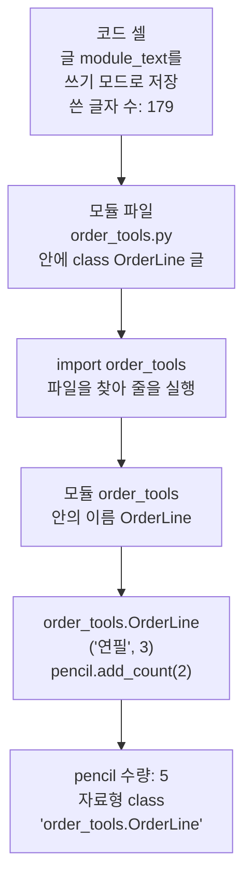
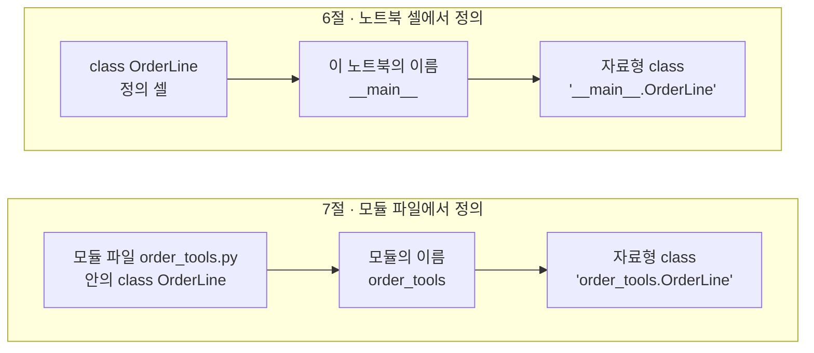
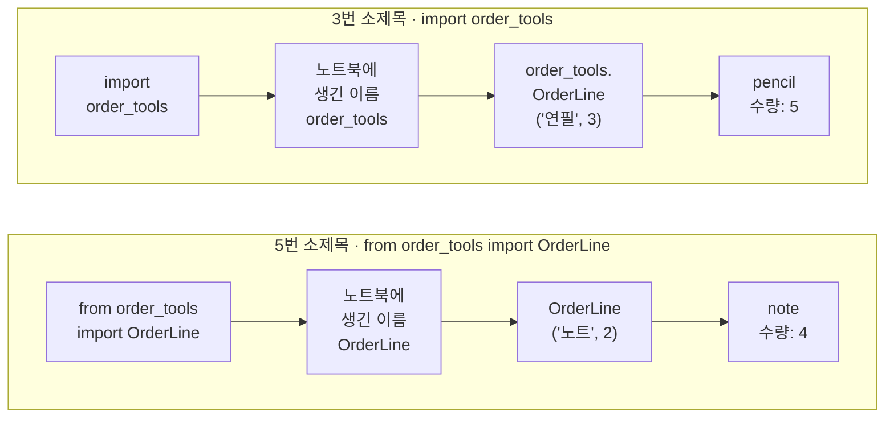
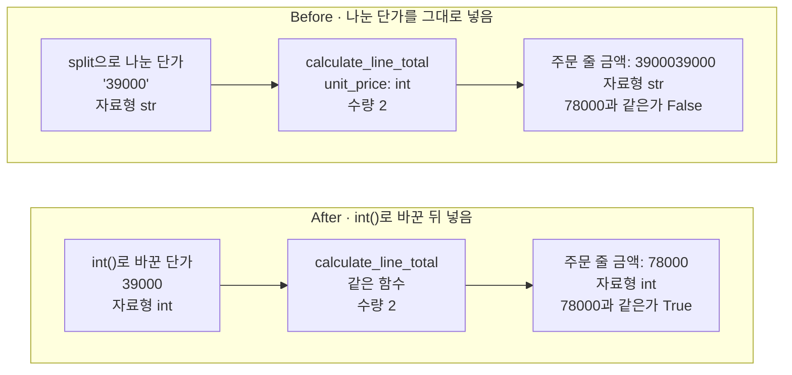

# 07-모듈과-타입힌트

## _src 본문 (HTML 원본)

```html
<!--meta: 강의 1h | 실습 2h | 코드 Jupyter Notebook | 새 용어 7 -->
<h2 id="b1"><span class="no">1</span>학습 목표</h2>
<div class="goal"><ul><li>클래스 정의를 모듈 파일에 저장하고, <code>import</code> 문과 <code>from ... import</code> 문으로 불러와 인스턴스를 만들 수 있습니다.</li><li>모듈 이름 출력으로 6절 자료형에 나온 <code>__main__</code>의 뜻을 설명할 수 있습니다.</li><li>정의 줄에 타입힌트를 적고, 타입힌트가 문자열 단가를 막지 않는다는 것을 출력으로 설명하고 고칠 수 있습니다.</li></ul></div>
<h2 id="b2"><span class="no">2</span>이 내용을 배우는 이유</h2>
<p>6절에서 정의한 클래스 OrderLine은 6절 노트북 안에만 있습니다. 새 노트북에서 쓰려면 정의를 다시 적어야 합니다. 정의를 파일 하나에 저장해 두면, 필요한 곳에서 import 줄 하나로 불러 쓸 수 있습니다.</p>
<p>다른 파일의 함수는 정의를 열어 보지 않고 부르는 일이 많습니다. 정의 줄에 <code>unit_price: int</code>처럼 자료형을 적어 두면, 무엇을 넣을지 이름 옆에서 바로 보입니다. 이 표시가 타입힌트입니다.</p>
<p>흔한 실수는 타입힌트를 적었으니 잘못된 값이 막힐 것이라고 믿는 것입니다. 파일에서 읽은 단가 39000은 숫자 모양이어도 문자열입니다. 이 문자열을 넣어도 오류 메시지는 나오지 않고, 금액만 틀립니다. 1절 Before처럼 <b>실행이 멈추지 않아도 결과는 틀릴 수 있습니다.</b></p>
<p><strong>이 절의 질문</strong> — 정의 줄에 <code>unit_price: int</code>라고 적어 두면, 문자열 단가를 넣을 때 Python이 막아 줄까요?</p>
<h2 id="b3"><span class="no">3</span>앞에서 배운 내용</h2>
<p>Ch 1과 1~6절에서 배운 것 가운데 이 절이 이어 쓰는 것을 표로 모았습니다.</p>
<table><thead><tr><th>앞 절</th><th>배운 것</th><th>이 절에서 이어 쓰는 곳</th></tr></thead><tbody>
<tr><td>Ch 1 1·3절</td><td>import 줄은 기능 묶음을 불러오는 줄, 모듈·패키지·표준 라이브러리 용어</td><td>3번 소제목에서 import 문과 모듈을 제대로 정의</td></tr>
<tr><td>Ch 1 2절</td><td><code>from pathlib import Path</code>로 가져와 쓴 <code>Path()</code></td><td>5번 소제목의 <code>from order_tools import OrderLine</code></td></tr>
<tr><td>1절</td><td>문자열 "2"에 3을 곱해 222가 나온 Before, 내장 함수 <code>int()</code>, 수량 3으로 다시 계산한 117000.0</td><td>Before의 문자열 단가, After의 <code>int()</code>, 값 바꿔 보기 117000</td></tr>
<tr><td>1절·5절</td><td>준비 셀의 <code>import platform</code>·<code>import os</code>·<code>import tempfile</code>(뜻은 7절에서 배운다고 미룸)</td><td>준비 셀, 4번 소제목의 모듈 os 이름과 자료형</td></tr>
<tr><td>4절</td><td>함수 <code>calculate_line_total(unit_price, quantity=1)</code>, 단가 39000·수량 2 → 78000</td><td>정의 줄에 타입힌트를 적은 같은 함수</td></tr>
<tr><td>5절</td><td>쓰기 모드 <code>"w"</code>와 <code>write()</code>, <code>split(",")</code>으로 나눈 값, 수량을 <code>int()</code>로 바꾼 <code>parse_order()</code></td><td>모듈 파일 쓰기, Before의 단가 글자</td></tr>
<tr><td>6절</td><td>클래스 OrderLine(<code>__init__</code>과 <code>add_count()</code>), 인스턴스 pencil·note, 자료형 &lt;class '__main__.OrderLine'&gt;</td><td>모듈 파일에 저장한 클래스, 모듈 이름 <code>__main__</code>의 뜻</td></tr>
</tbody></table>
<p>이 절의 새 문법은 import 문, from import 문, 모듈 이름 <code>__name__</code>, 타입힌트입니다. 6절 끝에서 「함수와 클래스를 다른 파일에 나눠 두고 import로 불러온다」고 예고한 내용입니다.</p>
<p>데이터는 6절의 연필 3개·노트 2개와 4절 무선 키보드의 단가 39000·수량 2입니다. 이 노트북은 모듈 파일을 만들기 때문에 5절과 같은 임시 폴더 준비 셀을 씁니다.</p>
<h2 id="b4"><span class="no">4</span>핵심 개념</h2>
<h3>비유로 시작하기</h3>
<p>자주 쓰는 공구는 공구함 서랍에 넣어 둡니다. 작업할 때마다 공구를 새로 만들지 않고, 서랍에서 꺼내 씁니다. 모듈은 정의를 넣어 둔 서랍이고, import 줄은 서랍에서 꺼내 오는 일입니다.</p>
<p>저금통 몸통에 동전 그림 스티커를 붙여 두면, 넣는 사람은 동전을 넣으면 된다는 것을 압니다. 그러나 스티커가 다른 물건을 막지는 않습니다. 동전 그림을 그린 종이 카드도 투입구에 그대로 들어갑니다. 타입힌트는 이 스티커이고, 숫자 모양 문자열 '39000'은 동전 그림 카드입니다.</p>
{{img:07-5-저금통-스티커|가운데 세로줄 왼쪽에는 동전 그림 스티커를 붙인 분홍 저금통 투입구에 동전 그림을 그린 종이 카드가 반쯤 꽂혀 있고, 오른쪽에는 같은 저금통 투입구에 진짜 금색 동전이 꽂혀 있으며 종이 카드는 탁자 위 동전 더미 옆에 치워져 있는 삽화|스티커가 종이 카드를 막지 않는 왼쪽은 문자열 단가를 그대로 넣은 Before, 진짜 동전으로 바꿔 넣은 오른쪽은 int()로 바꾼 뒤 넣은 After에 해당합니다.}}
<p><strong>그림 읽기</strong> — 가운데 세로줄 왼쪽에서는 저금통 몸통에 동전 그림 스티커가 붙어 있습니다. 그런데 투입구에는 동전 그림을 그린 종이 카드가 꽂혀 있습니다. 스티커는 타입힌트 <code>unit_price: int</code>이고, 종이 카드는 문자열 '39000'입니다. 스티커는 카드를 막지 않았습니다.</p>
<p>세로줄 오른쪽에서는 같은 저금통 투입구에 진짜 동전이 꽂혀 있습니다. 종이 카드는 옆으로 치워 두고, 넣기 전에 진짜 동전으로 바꾼 모습입니다. 함수 <code>int()</code>로 바꾼 정수 39000을 넣은 After에 해당합니다.</p>
<h3>이 절에서 쓰는 말</h3>
<table><thead><tr><th>용어</th><th>뜻</th><th>이 절에서 보이는 모습</th></tr></thead><tbody>
<tr><td>모듈(module)</td><td>import 뒤에 적어 불러오는 기능 묶음 한 단위(Ch 1 3절). 직접 만드는 모듈은 함수나 클래스 정의를 담은 .py 파일 하나이고, 파일 이름에서 .py를 뺀 것이 모듈 이름</td><td><code>order_tools.py</code> → 모듈 order_tools</td></tr>
<tr><td>import 문(import statement)</td><td>모듈 파일을 찾아 불러와, 그 안의 이름을 쓸 수 있게 하는 줄</td><td><code>import order_tools</code></td></tr>
<tr><td>from import 문</td><td>모듈에서 고른 이름만 가져오는 import 문. 가져온 이름은 점 없이 씀</td><td><code>from order_tools import OrderLine</code></td></tr>
<tr><td>표준 라이브러리(standard library)</td><td>Python을 설치할 때 함께 들어 있는 모듈 모음</td><td>준비 셀의 os, tempfile</td></tr>
<tr><td>모듈 이름 __name__</td><td>모듈마다 붙은 이름. 직접 실행하는 코드의 이름은 __main__</td><td>이 노트북 <code>__main__</code>, <code>order_tools.__name__</code></td></tr>
<tr><td>타입힌트(type hint)</td><td>매개변수와 반환값에 기대하는 자료형을 정의 줄에 적은 표시</td><td><code>unit_price: int</code>, <code>-&gt; int</code></td></tr>
<tr><td>정적 타입 검사기(static type checker)</td><td>코드를 실행하지 않고 읽어서, 타입힌트와 맞지 않는 곳을 찾는 도구</td><td>이번에 실행하지 않음</td></tr>
</tbody></table>
<h3>모듈과 import 문</h3>
<p>Ch 1 3절에서 모듈은 import 뒤에 적어 불러오는 기능 묶음 한 단위라고 했습니다. 우리가 직접 만드는 모듈은 함수나 클래스 정의를 담은 <code>.py</code> 파일 하나입니다. 파일 이름 order_tools.py에서 .py를 뺀 order_tools가 모듈 이름입니다. 노트북은 6절 정의 셀과 같은 클래스 정의를 글로 적어 이 파일에 저장했습니다. 쓴 글자 수는 179였습니다.</p>
<p>줄 <code>import order_tools</code>는 파일 order_tools.py를 찾아 불러옵니다. 파일은 Python이 정해 둔 폴더 목록에서 찾고, 노트북에서는 현재 작업 폴더도 이 목록에 들어 있습니다. 처음 불러올 때 파일의 줄이 위에서부터 실행되어, 모듈 안에 클래스 OrderLine이 만들어집니다.</p>
<p>불러온 뒤에는 모듈 이름 뒤에 점을 찍고 안의 이름을 적습니다. 6절에서 속성을 읽을 때 쓴 점과 같습니다. 노트북에서 <code>order_tools.OrderLine("연필", 3)</code>으로 만든 pencil은 <code>add_count(2)</code> 뒤 수량 5였습니다.</p>
<p>1절 준비 셀의 <code>import platform</code>, 5절과 이 절 준비 셀의 <code>import os</code>도 같은 import 문입니다. 모듈 os와 tempfile은 Python을 설치할 때 함께 들어 있는 표준 라이브러리입니다. 준비 셀의 <code>os.chdir()</code>는 모듈 os 안의 함수 chdir를 부른 줄입니다.</p>
{{mermaid:07-1-모듈-불러오기|코드 셀이 글 179글자를 파일 order_tools.py에 저장하고, import order_tools 줄이 그 파일을 불러와 모듈 안에 클래스 OrderLine을 만들고, order_tools.OrderLine으로 만든 pencil의 수량 5와 자료형 order_tools.OrderLine이 출력되는 흐름도|모듈 파일을 불러오는 차례. 글로 저장한 order_tools.py를 import 문이 불러오고, 모듈 이름 뒤에 점을 찍어 클래스를 씁니다.}}
<p><strong>도식 읽기</strong> — 위에서 아래로 읽습니다. 파란 상자는 우리가 적은 코드, 초록 상자는 파일과 모듈, 노란 상자는 출력입니다. 맨 위 코드 셀이 179글자를 저장해 초록 상자인 파일 order_tools.py가 생깁니다.</p>
<p>파란 상자 import order_tools가 이 파일을 찾아 줄을 실행합니다. 그러면 둘째 초록 상자처럼 모듈 안에 이름 OrderLine이 생깁니다. 모듈 이름 뒤에 점을 찍어 pencil을 만들고, 맨 아래 노란 상자에 수량 5와 자료형이 나옵니다.</p>
<h3>모듈 이름과 __main__</h3>
<p>모듈마다 이름이 붙어 있고, 모듈의 속성 <code>__name__</code>으로 읽습니다. 노트북에서 모듈 order_tools의 이름은 order_tools, 모듈 os의 이름은 os였습니다. 두 모듈의 자료형은 모두 &lt;class 'module'&gt;이었습니다. 우리가 만든 파일도 표준 라이브러리와 같은 모듈입니다.</p>
<p>셀에 모듈 이름 없이 <code>__name__</code>만 적었더니, 이 노트북의 이름 <code>__main__</code>이 나왔습니다. 직접 실행하는 코드에는 Python이 이름 __main__을 붙입니다. 노트북 셀에서 정의한 이름은 모두 이 __main__에 속합니다.</p>
<p>그래서 6절 노트북 셀에서 정의한 클래스의 자료형은 &lt;class '__main__.OrderLine'&gt;이었습니다. 자료형에서 점 앞은 클래스를 정의한 모듈의 이름입니다. 이번에는 클래스를 모듈 파일에서 정의해서, 자료형이 <code>&lt;class 'order_tools.OrderLine'&gt;</code>로 나왔습니다.</p>
{{mermaid:07-2-모듈-이름|위 칸은 6절 노트북 셀에서 클래스 OrderLine을 정의해 이 노트북의 이름 __main__이 자료형 __main__.OrderLine의 점 앞에 붙고, 아래 칸은 모듈 파일 order_tools.py에서 정의해 모듈 이름 order_tools가 자료형 order_tools.OrderLine의 점 앞에 붙는 것을 비교한 그림|자료형의 점 앞은 클래스를 정의한 모듈 이름입니다. 노트북 셀에서 정의하면 __main__, 파일 order_tools.py에서 정의하면 order_tools가 붙습니다.}}
<p><strong>도식 읽기</strong> — 위 칸은 6절, 아래 칸은 이 절이고, 칸 안은 왼쪽에서 오른쪽으로 읽습니다. 파란 상자는 우리가 적은 정의 셀, 초록 상자는 파일과 이름입니다. 두 칸 모두 가운데 초록 상자의 이름이 오른쪽 자료형의 점 앞에 들어갑니다.</p>
<p>위 칸 오른쪽 회색 상자는 6절 노트북의 출력이라 이번에 실행하지 않았습니다. 아래 칸 노란 상자는 이 절 노트북의 출력 &lt;class 'order_tools.OrderLine'&gt;입니다.</p>
<h3>타입힌트</h3>
<p>타입힌트(type hint)는 매개변수와 반환값에 기대하는 자료형을 정의 줄에 적은 표시입니다. 비유의 동전 그림 스티커처럼, 부르는 사람에게 무엇을 넣으면 되는지 알려 줍니다. 노트북은 4절 함수의 정의 줄을 <code>def calculate_line_total(unit_price: int, quantity: int = 1) -&gt; int:</code>로 바꿨습니다.</p>
<p>매개변수 이름 뒤에 콜론과 자료형을 적습니다. 표시 <code>unit_price: int</code>는 단가에 정수를 넣기로 한다는 뜻입니다. 기본값이 있는 매개변수는 <code>quantity: int = 1</code>처럼 자료형 뒤에 기본값을 적습니다. 괄호 뒤 화살표 다음의 int는 정수를 반환한다는 표시입니다.</p>
<p>타입힌트를 적은 함수에 39000과 2를 넣자 78000이 나왔습니다. 4절의 타입힌트 없는 함수와 결과가 같습니다. 타입힌트를 적어도 계산 방법은 바뀌지 않습니다.</p>
<p>타입힌트는 함수의 속성 <code>__annotations__</code>에 딕셔너리로 저장됩니다. Python 자습서는 이 기록이 함수의 다른 부분에 영향을 주지 않는다고 설명합니다. typing 문서도 Python 실행기가 타입힌트를 강제하지 않는다고 적습니다. 타입힌트를 읽어 맞지 않는 곳을 찾는 일은 정적 타입 검사기 같은 도구가 합니다.</p>
<h2 id="b5"><span class="no">5</span>실행 예제</h2>
<p>노트북은 5절처럼 빈 임시 폴더로 작업 위치를 옮기고 시작합니다. 6절 클래스 OrderLine의 정의를 글로 적어 파일 order_tools.py에 179글자를 저장합니다. import 문으로 불러와 pencil을 만들고, 수량 5와 자료형을 봅니다.</p>
<p>이어서 이 노트북과 두 모듈의 이름을 출력합니다. from import 문으로 클래스 이름만 가져와 note를 만들고, 수량 4를 봅니다. 마지막으로 타입힌트를 적은 함수로 78000을 얻고, 값 바꿔 보기에서 수량만 3으로 바꿔 117000을 봅니다. 모델을 부르지 않으므로 API 키가 필요 없고, 다시 실행해도 출력은 같습니다.</p>
{{notebook:07-모듈과-타입힌트|example}}
<p class="look"><b>확인할 점</b> — 파일을 저장한 뒤 현재 작업 폴더에 order_tools.py가 보이는지 확인합니다. 인스턴스 pencil과 note의 자료형 점 앞이 order_tools인지, 이 노트북의 이름이 __main__인지 봅니다. 타입힌트를 적은 함수의 금액이 78000과 117000인지 확인합니다.</p>
<h3>import 문의 두 가지 모양</h3>
<p>3번과 5번 소제목은 같은 모듈에서 같은 클래스를 불러왔습니다. 두 셀은 import 문의 모양만 다르고, 그래서 클래스를 부를 때 적는 이름이 다릅니다.</p>
{{mermaid:07-3-import-두-방법|위 칸은 import order_tools 줄로 노트북에 이름 order_tools가 생겨 order_tools.OrderLine('연필', 3)으로 pencil 수량 5가 나오고, 아래 칸은 from order_tools import OrderLine 줄로 이름 OrderLine이 생겨 OrderLine('노트', 2)로 note 수량 4가 나오는 것을 비교한 그림|import 문의 두 가지 모양. 모듈 이름을 가져오면 점을 찍어 부르고, 클래스 이름을 가져오면 점 없이 부릅니다.}}
<p><strong>도식 읽기</strong> — 위 칸은 3번 소제목, 아래 칸은 5번 소제목이고, 칸 안은 왼쪽에서 오른쪽으로 읽습니다. 파란 상자는 우리가 적은 import 문과 호출, 초록 상자는 import 문이 노트북에 만든 이름, 노란 상자는 출력입니다.</p>
<p>위 칸에서는 노트북에 이름 order_tools가 생겨, 모듈 이름 뒤에 점을 찍고 클래스를 부릅니다. 아래 칸에서는 이름 OrderLine이 바로 생겨 점 없이 부릅니다. 두 인스턴스의 자료형은 모두 &lt;class 'order_tools.OrderLine'&gt;로 같았습니다.</p>
<h2 id="b6"><span class="no">6</span>일부러 실패해 보기</h2>
<p>주문 파일에서 「무선 키보드,39000」 한 줄을 읽었다고 합니다. 5절처럼 <code>split(",")</code>으로 나누면 상품 이름과 단가를 꺼낼 수 있습니다. 나눈 단가는 숫자 모양이지만 문자열 '39000'입니다. 5절 <code>parse_order()</code>는 나눈 수량을 <code>int()</code>로 바꿨지만, Before 셀은 이 줄을 빠뜨렸습니다.</p>
<p>Before 셀은 문자열 단가를 타입힌트가 int인 매개변수에 그대로 넣었고, 오류 없이 실행됐습니다. 주문 줄 금액은 78000이 아니라 3900039000이고, 자료형은 &lt;class 'str'&gt;입니다. 문자열에 수량 2를 곱해 글자를 두 번 이어 붙였습니다. 1절 Before에서 문자열 "2"에 3을 곱해 222가 된 것과 같은 계산입니다.</p>
<p>원리 더 알아보기 셀에서 본 타입힌트 기록은 세 이름 모두 int였습니다. 정의 줄의 표시는 함수에 기록되어 있었지만, 호출할 때 넣은 값과 비교되지 않았습니다. 반환값 표시도 int였지만, 함수는 문자열을 반환했습니다.</p>
<p>After 셀은 함수에 넣기 전에 <code>int()</code>로 단가를 정수로 바꿨습니다. 함수 정의, 단가 글자, 수량 2는 Before와 같습니다. 주문 줄 금액은 78000, 자료형은 &lt;class 'int'&gt;, 78000과 같은가는 True입니다.</p>
{{mermaid:07-4-before-after-비교|Before는 split으로 나눈 문자열 단가 '39000'을 타입힌트가 int인 calculate_line_total에 넣어 주문 줄 금액 3900039000, 자료형 str, 78000과 같은가 False가 나오고, After는 int()로 바꾼 정수 39000을 같은 함수에 넣어 78000, 자료형 int, True가 나오는 비교 그림|타입힌트는 문자열 단가를 막지 않습니다. 나눈 단가를 그대로 넣은 Before는 글자가 이어 붙었고, int()로 바꾼 뒤 넣은 After는 78000이 나왔습니다.}}
<p><strong>도식 읽기</strong> — 위 칸이 Before, 아래 칸이 After이고, 칸 안은 왼쪽에서 오른쪽으로 읽습니다. 초록 상자는 함수에 넣는 단가, 파란 상자는 함수 호출입니다. 두 칸의 파란 상자는 같은 함수와 같은 수량 2입니다.</p>
<p>Before 칸의 초록 상자는 자료형이 str이고, 빨간 상자(3900039000, False)로 이어집니다. 파란 상자에 unit_price: int가 적혀 있지만 멈추지 않았습니다. After 칸의 초록 상자는 자료형이 int이고, 노란 상자(78000, True)로 이어집니다.</p>
{{notebook:07-모듈과-타입힌트|failure}}
<h3>확인한 범위</h3>
<p>이번에 확인한 것은 숫자 모양 문자열 하나를 타입힌트가 int인 매개변수에 넣은 경우입니다. 「삼만구천」처럼 정수로 바꿀 수 없는 글자를 넣는 장면은 이번에 실행하지 않았습니다. 이런 글자를 <code>int()</code>에 넣으면 5절 bad_orders.txt처럼 <code>ValueError</code>가 납니다.</p>
<p>정적 타입 검사기와 편집기의 타입힌트 경고는 이번에 실행하지 않았습니다. Ch 1 4절처럼 python 명령으로 직접 실행한 파일도 이름이 __main__입니다. Python 자습서 6.1.1의 설명이고, 이번에 실행하지 않았습니다.</p>
<p>모듈 파일을 고친 뒤 같은 커널에서 다시 불러오는 장면도 실행하지 않았습니다. 여러 입력 값을 타입힌트대로 실제로 검사하는 방법은 확장 경로(B)의 10절 Pydantic에서 배웁니다.</p>
<h2 id="b7"><span class="no">7</span>주의할 점과 실무 메모</h2>
<ul><li>모듈 파일 이름은 .py로 끝나게 짓고, import 문에는 .py를 빼고 적습니다. 파일 order_tools.py를 <code>import order_tools</code>로 불러왔습니다.</li>
<li>모듈은 한 커널에서 처음 불러올 때 한 번만 실행됩니다. Python 자습서는 모듈 파일을 고쳤다면 인터프리터를 다시 시작하라고 안내합니다. 노트북에서는 커널을 다시 시작한 뒤 첫 셀부터 실행합니다.</li>
<li>모듈 파일에는 random.py처럼 표준 라이브러리 모듈과 같은 이름을 붙이지 않습니다. 작업 폴더의 파일이 표준 라이브러리 모듈을 가려, 그 모듈을 쓰는 다른 import까지 실패할 수 있습니다. 이 장면은 노트북에서 실행하지 않았습니다.</li>
<li>타입힌트는 값을 검사하거나 바꾸지 않습니다. 파일에서 읽어 나눈 값처럼 문자열로 들어오는 값은 쓰기 전에 <code>int()</code>로 바꿉니다.</li>
<li>이 절의 모듈 파일은 준비 셀이 만든 임시 폴더에 있습니다. 커널을 다시 시작했다면 준비 셀부터 다시 실행해 파일을 새로 만듭니다.</li></ul>
<h2 id="b8"><span class="no">8</span>정리와 다음 절</h2>
<ul><li>모듈은 정의를 담은 .py 파일 하나입니다. 6절 클래스를 order_tools.py에 저장하고, import 문으로 불러와 pencil 수량 5를 얻었습니다.</li><li>모듈마다 이름이 있습니다. 직접 실행하는 이 노트북의 이름은 <code>__main__</code>이라서, 6절 노트북에서 정의한 클래스의 자료형에 붙었습니다.</li><li>타입힌트는 기대하는 자료형을 적은 표시이고, 값을 검사하지 않습니다. 문자열 단가를 넣자 3900039000, <code>int()</code>로 바꾼 뒤 넣자 78000이었습니다.</li></ul>
<p><strong>다음 학습과 이어지는 지점</strong> — 8절에서는 함수가 기대한 값을 반환하는지 pytest로 확인합니다. 이 절의 모듈 파일처럼 검사할 코드도 파일에 적어 두고 실행합니다. 타입힌트로 적은 자료형을 실제 입력 검사에 쓰는 방법은 확장 경로(B)의 10절 Pydantic에서 배웁니다.</p>
<h2 id="b9"><span class="no">9</span>복습 문제</h2><details class="quiz"><summary>문제와 해설</summary>
<p class="quiz-q">1. 파일 order_tools.py를 불러오는 줄은 왜 <code>import order_tools</code>이고, .py를 적지 않나요? · 기초</p><p class="quiz-a"><b>해설</b> — import 문에는 파일 이름이 아니라 모듈 이름을 적기 때문입니다. 모듈 이름은 파일 이름에서 .py를 뺀 것입니다. 노트북에서 모듈 order_tools의 이름을 출력하자 order_tools가 나왔습니다.</p>
<p class="quiz-q">2. 3번 소제목은 <code>order_tools.OrderLine("연필", 3)</code>, 5번 소제목은 <code>OrderLine("노트", 2)</code>로 클래스를 불렀습니다. 부르는 모양이 다른 이유는 무엇인가요? · 기초</p><p class="quiz-a"><b>해설</b> — import 문의 모양이 달랐기 때문입니다. 줄 <code>import order_tools</code>는 노트북에 모듈 이름을 만들어 점을 찍고 부릅니다. 줄 <code>from order_tools import OrderLine</code>은 클래스 이름을 바로 만들어 점 없이 부릅니다. 두 인스턴스의 자료형은 같았습니다.</p>
<p class="quiz-q">3. 인스턴스 자료형의 점 앞이 6절 노트북에서는 __main__, 이 절에서는 order_tools였습니다. 점 앞이 달라진 이유를 쓰세요. · 적용</p><p class="quiz-a"><b>해설</b> — 점 앞은 클래스를 정의한 모듈의 이름입니다. 6절은 노트북 셀에서 정의했고, 직접 실행하는 노트북의 이름은 __main__입니다. 이 절은 모듈 파일 order_tools.py에서 정의해서 모듈 이름 order_tools가 붙었습니다.</p>
<p class="quiz-q">4. 준비 셀의 <code>import os</code>와 <code>os.chdir(practice_folder)</code>를 이 절에서 배운 말로 읽어 보세요. · 적용</p><p class="quiz-a"><b>해설</b> — 첫 줄은 표준 라이브러리 모듈 os를 불러오는 import 문입니다. 둘째 줄은 모듈 이름 os 뒤에 점을 찍어 모듈 안의 함수 chdir를 부른 줄입니다. 3번 소제목의 <code>order_tools.OrderLine</code>과 같은 모양입니다.</p>
<p class="quiz-q">5. Before 셀은 정의 줄에 <code>unit_price: int</code>가 있는데도 오류 없이 3900039000을 출력했습니다. 이유를 쓰세요. · 분석</p><p class="quiz-a"><b>해설</b> — 타입힌트는 함수에 기록만 되고, 호출할 때 넣은 값을 검사하지 않기 때문입니다. 쉼표로 나눈 단가가 문자열 '39000'이라서, 수량 2를 곱하자 글자가 두 번 이어 붙었습니다. 원리 더 알아보기 셀의 타입힌트 기록은 int였지만 금액의 자료형은 str이었습니다.</p>
<p class="quiz-q">6. After 셀에서 바꾼 곳은 어디이고, 결과는 어떻게 달라졌나요? 타입힌트와 <code>int()</code>가 하는 일도 구분해 쓰세요. · 분석</p><p class="quiz-a"><b>해설</b> — 함수에 넣기 전에 <code>int()</code>로 단가를 정수로 바꾸는 줄 하나를 더했습니다. 금액이 3900039000(str)에서 78000(int)이 되고, 78000과 같은가가 False에서 True가 됐습니다. 타입힌트는 무엇을 넣을지 알려 주는 표시이고, 자료형을 바꾸는 일은 <code>int()</code> 같은 코드가 합니다.</p>
</details>
<h2 id="b10"><span class="no">10</span>참고 자료</h2>
<ul><li><a href="https://docs.python.org/3.12/tutorial/modules.html#more-on-modules">Python 3.12 자습서 6.1: 모듈 더 알아보기</a> · 확인 2026-09-16 · 기준 Python 3.12</li><li><a href="https://docs.python.org/3.12/tutorial/modules.html#executing-modules-as-scripts">Python 3.12 자습서 6.1.1: 모듈을 스크립트로 실행하기</a> · 확인 2026-09-16 · 기준 Python 3.12</li><li><a href="https://docs.python.org/3.12/tutorial/modules.html#the-module-search-path">Python 3.12 자습서 6.1.2: 모듈 검색 경로</a> · 확인 2026-09-16 · 기준 Python 3.12</li><li><a href="https://docs.python.org/3.12/tutorial/controlflow.html#function-annotations">Python 3.12 자습서 4.9.8: 함수 어노테이션</a> · 확인 2026-09-16 · 기준 Python 3.12</li><li><a href="https://docs.python.org/3.12/library/typing.html">Python 3.12 표준 라이브러리 typing</a> · 확인 2026-09-16 · 기준 Python 3.12</li></ul>
```

## 노트북 셀 (순서대로)

### [0] markdown {'html': 'skip'}

# 모듈과 타입힌트

**이 노트북에서 할 일**

1. 6절 클래스 `OrderLine`의 정의를 파일 `order_tools.py`에 저장하고, `import`로 불러와 씁니다.
2. 이 노트북과 모듈에 붙은 이름을 출력해, 6절 자료형에 나온 `__main__`의 뜻을 확인합니다.
3. 타입힌트를 적은 함수에 문자열 단가를 넣어 보고, 넣기 전에 정수로 바꿔 고칩니다.

**준비물** — API 키 불필요. 모듈 파일은 노트북이 임시 폴더에 직접 만듭니다.
모델 호출은 0번이고 비용은 들지 않습니다. 실행 시간은 1분 이내입니다.

1~6절과 같은 실습 폴더 `labs/part1/ch02-python`의 `.venv`를 커널로 고릅니다.
이전 커널의 변수는 쓰지 않으므로 첫 셀부터 순서대로 실행합니다.

### [1] markdown {'html': 'skip'}

## 오늘 볼 그림


위에서 아래로 읽습니다. 파란 상자는 우리가 적은 코드, 초록 상자는 파일과 모듈, 노란 상자는 출력입니다.

글로 저장한 파일 order_tools.py를 import 줄이 모듈로 불러옵니다.
모듈 이름 뒤에 점을 찍어 클래스를 쓰자, 자료형 앞에 모듈 이름 order_tools가 붙었습니다.

### [2] markdown {}

## 1. 준비

이 절도 설치할 패키지가 없습니다. 이 노트북은 모듈 파일을 만들므로, 5절처럼 파일을 둘 빈 폴더를 먼저 준비합니다.

준비 셀은 운영체제의 임시 폴더 안에 새 폴더를 만들고, 그 폴더로 작업 위치를 옮깁니다.
그래서 뒤 셀의 파일 이름 `"order_tools.py"`는 이 새 폴더 안의 파일을 가리킵니다.

첫 두 줄의 `import`는 5절 준비 셀과 같습니다. 1절과 5절에서 뜻을 미룬 이 줄은 3번 소제목에서 배웁니다.

### [3] code {'execution': {'iopub.execute_input': '2026-09-16T08:59:57.582957Z', 'iopub.status.busy': '2026-09-16T08:59:57.582734Z', 'iopub.status.idle': '2026-09-16T08:59:57.588527Z', 'shell.execute_reply': '2026-09-16T08:59:57.587794Z'}, 'lesson_role': 'setup'}

```python
# 모듈 파일을 둘 빈 임시 폴더를 만들고, 그 폴더로 작업 위치를 옮깁니다
import os
import tempfile

# mkdtemp()는 운영체제 임시 폴더 안에 새 폴더를 만들고 그 경로를 반환합니다
practice_folder = tempfile.mkdtemp(prefix="ch02-07-")
# chdir()는 터미널의 cd처럼 현재 작업 폴더를 옮깁니다
os.chdir(practice_folder)
file_names = os.listdir()
print("현재 작업 폴더의 파일:", file_names)
```

출력:
```
현재 작업 폴더의 파일: []

```

### [4] markdown {}

**결과 읽기** — 현재 작업 폴더의 파일은 `[]`로, 빈 폴더에서 시작합니다.
폴더의 경로는 컴퓨터마다 달라서 출력하지 않았습니다.

### [5] markdown {}

## 2. 클래스 정의를 모듈 파일에 저장하기

6절에서 정의한 클래스 `OrderLine`은 6절 노트북 안에만 있습니다. 새 노트북에서 쓰려면 정의를 다시 적어야 합니다.
정의를 파일에 저장해 두면, 필요한 곳에서 불러 쓸 수 있습니다.

Ch 1 3절에서 모듈(module)은 import 뒤에 적어 불러오는 기능 묶음 한 단위라고 했습니다.
우리가 직접 만드는 모듈은 함수나 클래스 정의를 담은 `.py` 파일 하나입니다. 공구함 서랍에 공구를 넣어 두고 필요할 때 꺼내 쓰는 것과 같습니다.
파일 이름 order_tools.py에서 `.py`를 뺀 order_tools가 모듈 이름이 됩니다.

이 셀은 6절 정의 셀과 같은 클래스 정의를 여러 줄 글로 적어 파일에 저장합니다. 글 안의 정의는 아직 실행되지 않습니다.
저장은 5절처럼 쓰기 모드 `"w"`와 메서드 `write()`로 합니다.

실행 전에 예상합니다. 저장한 뒤 현재 작업 폴더에는 파일 order_tools.py 하나가 보일 것입니다.

### [6] code {'execution': {'iopub.execute_input': '2026-09-16T08:59:57.590112Z', 'iopub.status.busy': '2026-09-16T08:59:57.589967Z', 'iopub.status.idle': '2026-09-16T08:59:57.593845Z', 'shell.execute_reply': '2026-09-16T08:59:57.593069Z'}}

```python
# 6절 클래스 OrderLine의 정의를 글로 적어 파일 order_tools.py에 저장합니다
module_text = """class OrderLine:
    def __init__(self, name, count):
        self.name = name
        self.count = count

    def add_count(self, extra):
        self.count = self.count + extra
"""
# 5절처럼 쓰기 모드로 열어 글을 저장합니다
with open("order_tools.py", "w", encoding="utf-8") as file:
    written_count = file.write(module_text)
file_names = os.listdir()
print("쓴 글자 수:", written_count)
print("현재 작업 폴더의 파일:", file_names)
```

출력:
```
쓴 글자 수: 179
현재 작업 폴더의 파일: ['order_tools.py']

```

### [7] markdown {}

**결과 읽기** — 쓴 글자 수는 `179`이고, 현재 작업 폴더의 파일은 `['order_tools.py']`로 예상과 같습니다.
파일 안의 글은 Python 코드지만, 저장한 방법은 5절의 주문 두 줄과 같습니다.
편집기 VS Code에서 새 파일 order_tools.py를 만들어 같은 글을 적어도 모듈 파일이 됩니다. 이 방법은 이번에 실행하지 않았습니다.

### [8] markdown {}

## 3. import 문으로 모듈 불러오기

예약어 `import` 뒤에 모듈 이름을 적은 줄을 import 문(import statement)이라고 합니다.
이 줄은 모듈 파일을 찾아 불러와서, 그 안의 이름을 쓸 수 있게 합니다.
파일은 Python이 정해 둔 폴더 목록에서 찾습니다. 노트북에서는 현재 작업 폴더도 이 목록에 들어 있습니다.

처음 불러올 때는 파일의 줄이 위에서부터 실행됩니다. 이때 글로 저장한 클래스 정의가 실행되어, 모듈 안에 클래스 `OrderLine`이 만들어집니다.
불러온 뒤에는 모듈 이름 뒤에 점을 찍고 안의 이름을 적습니다. 6절에서 속성을 읽을 때 쓴 점과 같습니다.

1절 준비 셀의 `import platform`, 5절과 이 노트북 준비 셀의 `import os`도 같은 import 문입니다.
모듈 os와 tempfile은 Python을 설치할 때 함께 들어 있는 모듈입니다. 이런 모듈 모음을 표준 라이브러리(standard library)라고 합니다.
준비 셀의 `os.chdir()`는 모듈 os 안의 함수 chdir를 부른 줄입니다.

실행 전에 예상합니다. 6절처럼 수량 3에 2를 더해 pencil 수량은 5일 것입니다. 6절 자료형 앞에 붙었던 `__main__`은 이번에도 나올까요?

### [9] code {'execution': {'iopub.execute_input': '2026-09-16T08:59:57.595315Z', 'iopub.status.busy': '2026-09-16T08:59:57.595157Z', 'iopub.status.idle': '2026-09-16T08:59:57.599174Z', 'shell.execute_reply': '2026-09-16T08:59:57.598711Z'}}

```python
# 모듈 order_tools를 불러와, 모듈 이름 뒤에 점을 찍고 클래스를 씁니다
import order_tools

pencil = order_tools.OrderLine("연필", 3)
pencil.add_count(2)
pencil_type = type(pencil)
print("pencil 수량:", pencil.count)
print("pencil의 자료형:", pencil_type)
```

출력:
```
pencil 수량: 5
pencil의 자료형: <class 'order_tools.OrderLine'>

```

### [10] markdown {}

**결과 읽기** — pencil 수량은 `5`로 예상과 같습니다. 자료형은 `<class 'order_tools.OrderLine'>`입니다.

6절 노트북에서 같은 모양의 클래스로 만든 인스턴스의 자료형은 <class '__main__.OrderLine'>였습니다.
이번에는 점 앞이 모듈 이름 order_tools로 바뀌었습니다. 점 앞의 이름이 무엇인지 다음 셀에서 확인합니다.

### [11] markdown {}

## 4. 모듈 이름 읽기

모듈마다 이름이 붙어 있습니다. 모듈 이름 뒤에 점과 `__name__`을 적어 그 이름을 읽습니다.
6절 `__init__`처럼 앞뒤의 밑줄 두 개는 Python이 정해 둔 특별한 이름이라는 표시입니다.

셀에 모듈 이름 없이 `__name__`만 적으면, 지금 실행 중인 코드의 이름을 읽습니다.
준비 셀에서 불러온 모듈 os의 이름과 자료형도 함께 봅니다.

실행 전에 예상합니다. 모듈 order_tools의 이름은 order_tools, 모듈 os의 이름은 os일 것입니다. 이 노트북의 이름은 무엇일까요?

### [12] code {'execution': {'iopub.execute_input': '2026-09-16T08:59:57.600640Z', 'iopub.status.busy': '2026-09-16T08:59:57.600527Z', 'iopub.status.idle': '2026-09-16T08:59:57.603659Z', 'shell.execute_reply': '2026-09-16T08:59:57.603061Z'}}

```python
# 이 노트북, 우리가 만든 모듈, 준비 셀의 os 모듈에 붙은 이름을 봅니다
notebook_name = __name__
tools_name = order_tools.__name__
os_name = os.__name__
print("이 노트북의 이름:", notebook_name)
print("order_tools의 이름:", tools_name)
print("os의 이름:", os_name)
# 우리가 만든 모듈과 표준 라이브러리 모듈의 자료형을 비교합니다
print("order_tools의 자료형:", type(order_tools))
print("os의 자료형:", type(os))
```

출력:
```
이 노트북의 이름: __main__
order_tools의 이름: order_tools
os의 이름: os
order_tools의 자료형: <class 'module'>
os의 자료형: <class 'module'>

```

### [13] markdown {}

**결과 읽기** — 이 노트북의 이름은 `__main__`입니다. 모듈 order_tools의 이름은 `order_tools`, 모듈 os의 이름은 `os`입니다.
두 모듈의 자료형은 모두 `<class 'module'>`입니다.

직접 실행하는 코드에는 Python이 이름 `__main__`을 붙입니다. 노트북 셀에서 정의한 이름은 모두 이 `__main__`에 속합니다.
그래서 6절 노트북 셀에서 정의한 클래스의 자료형에는 __main__이 붙었습니다.
우리가 만든 order_tools도 표준 라이브러리 os와 자료형이 같은 모듈입니다.

### [14] markdown {}

## 5. from import 문으로 이름 하나만 가져오기

import 문을 `from 모듈 import 이름` 순서로 적으면, 모듈에서 고른 이름만 노트북으로 가져옵니다.
가져온 이름은 모듈 이름과 점 없이 바로 씁니다. Ch 1 2절 노트북의 `from pathlib import Path`도 이 모양이었습니다.

이번에는 클래스 이름 `OrderLine`만 가져와 노트 주문 줄을 만듭니다. 6절 값 바꿔 보기처럼 수량에 2를 더합니다.

실행 전에 예상합니다. note 수량은 2에 2를 더한 4이고, 자료형은 pencil과 같을 것입니다.

### [15] code {'execution': {'iopub.execute_input': '2026-09-16T08:59:57.604838Z', 'iopub.status.busy': '2026-09-16T08:59:57.604708Z', 'iopub.status.idle': '2026-09-16T08:59:57.607687Z', 'shell.execute_reply': '2026-09-16T08:59:57.607028Z'}}

```python
# 모듈에서 클래스 이름 OrderLine만 가져와, 모듈 이름 없이 씁니다
from order_tools import OrderLine

note = OrderLine("노트", 2)
note.add_count(2)
note_type = type(note)
print("note 수량:", note.count)
print("note의 자료형:", note_type)
```

출력:
```
note 수량: 4
note의 자료형: <class 'order_tools.OrderLine'>

```

### [16] markdown {}

**결과 읽기** — note 수량은 `4`, 자료형은 `<class 'order_tools.OrderLine'>`으로 예상과 같습니다.
두 방법으로 가져온 클래스는 모두 모듈 order_tools 안의 OrderLine입니다. 가져오는 줄에 따라, 부를 때 적는 이름만 달라집니다.

### [17] markdown {}

## 6. 정의 줄에 타입힌트 적기

모듈로 나눈 정의는 쓰는 곳과 파일이 다릅니다. 부르는 사람은 정의를 열어 보지 않고도 무엇을 넣을지 알아야 합니다.

타입힌트(type hint)는 매개변수와 반환값에 기대하는 자료형을 정의 줄에 적은 표시입니다.
저금통 몸통에 동전 그림 스티커를 붙여 두면, 넣는 사람은 동전을 넣으면 된다는 것을 압니다.
아래 셀은 4절 함수 `calculate_line_total()`의 정의 줄에 타입힌트를 적어 다시 정의합니다. 본문은 4절과 같습니다.

매개변수 이름 뒤에 콜론과 자료형을 적습니다. 표시 `unit_price: int`는 단가에 정수를 넣기로 한다는 뜻입니다.
기본값이 있는 매개변수는 `quantity: int = 1`처럼 자료형 뒤에 기본값을 적습니다.
괄호 뒤 화살표 `->` 다음의 `int`는 이 함수가 정수를 반환한다는 표시입니다.

실행 전에 예상합니다. 4절처럼 정의 셀이라 출력은 없을 것입니다.

### [18] code {'execution': {'iopub.execute_input': '2026-09-16T08:59:57.608878Z', 'iopub.status.busy': '2026-09-16T08:59:57.608770Z', 'iopub.status.idle': '2026-09-16T08:59:57.611257Z', 'shell.execute_reply': '2026-09-16T08:59:57.610661Z'}}

```python
# 4절 함수의 정의 줄에 매개변수와 반환값의 자료형을 적어 다시 정의합니다
def calculate_line_total(unit_price: int, quantity: int = 1) -> int:
    line_total = unit_price * quantity
    return line_total
```

출력:
```

```

### [19] markdown {}

**결과 읽기** — 예상대로 출력이 없습니다. 정의 셀은 함수 이름, 본문, 기본값과 함께 타입힌트도 기억해 둡니다.

### [20] markdown {}

4절과 같은 단가 39000과 수량 2를 넣어 함수를 부릅니다. 반환값의 자료형도 함께 출력합니다.

실행 전에 예상합니다. 4절처럼 78000이 나오고, 자료형은 정수일 것입니다.

### [21] code {'execution': {'iopub.execute_input': '2026-09-16T08:59:57.612542Z', 'iopub.status.busy': '2026-09-16T08:59:57.612445Z', 'iopub.status.idle': '2026-09-16T08:59:57.615084Z', 'shell.execute_reply': '2026-09-16T08:59:57.614500Z'}}

```python
# 4절과 같은 단가와 수량으로 부르고, 반환값의 자료형을 봅니다
unit_price = 39000
quantity = 2
line_total = calculate_line_total(unit_price, quantity)
total_type = type(line_total)
print("주문 줄 금액:", line_total)
print("금액의 자료형:", total_type)
```

출력:
```
주문 줄 금액: 78000
금액의 자료형: <class 'int'>

```

### [22] markdown {}

**결과 읽기** — 주문 줄 금액은 `78000`, 금액의 자료형은 `<class 'int'>`로 예상과 같습니다.
4절의 타입힌트 없는 함수도 같은 인자로 78000을 반환했습니다. 타입힌트를 적어도 계산 방법은 바뀌지 않습니다.

### [23] markdown {}

## 7. 값 바꿔 보기 — 수량 하나만 바꾸기

함수를 다시 정의하지 않고 수량만 2에서 3으로 바꿔 부릅니다. 단가 39000은 그대로 둡니다.

실행 전에 예상합니다. 39000원짜리 3개이므로 금액은 117000이고, 자료형은 정수일 것입니다.

### [24] code {'execution': {'iopub.execute_input': '2026-09-16T08:59:57.616186Z', 'iopub.status.busy': '2026-09-16T08:59:57.616080Z', 'iopub.status.idle': '2026-09-16T08:59:57.618487Z', 'shell.execute_reply': '2026-09-16T08:59:57.618029Z'}}

```python
# 단가는 그대로 두고 수량만 3으로 바꿔 같은 함수를 부릅니다
new_quantity = 3
new_total = calculate_line_total(unit_price, new_quantity)
print("수량 2일 때 금액:", line_total)
print("수량 3일 때 금액:", new_total)
print("금액의 자료형:", type(new_total))
```

출력:
```
수량 2일 때 금액: 78000
수량 3일 때 금액: 117000
금액의 자료형: <class 'int'>

```

### [25] markdown {}

**결과 읽기** — 수량 3일 때 금액은 `117000`으로 예상과 같습니다. 수량 2일 때 금액 `78000`도 남아 있습니다.
두 금액의 차이 39000은 단가와 같습니다. 1절에서 수량 3으로 계산한 117000.0과 같은 금액이고, 이번에는 정수입니다.

### [26] markdown {'lesson_part': 'before'}

## 8. Before — 파일에서 읽은 단가를 그대로 넣기

주문 파일에서 「무선 키보드,39000」 한 줄을 읽었다고 합니다. 5절처럼 `split(",")`으로 나누면 상품 이름과 단가를 꺼낼 수 있습니다.
5절 함수 `parse_order()`는 나눈 수량을 `int()`로 바꿨습니다. 이번 셀은 이 줄을 빠뜨리고, 나눈 단가를 그대로 함수에 넣습니다.

함수의 정의 줄에는 `unit_price: int`라고 적혀 있습니다.
실행 전에 예상해 봅니다. 문자열 단가를 넣으면 오류가 날까요, 금액 78000이 나올까요?

### [27] code {'execution': {'iopub.execute_input': '2026-09-16T08:59:57.619731Z', 'iopub.status.busy': '2026-09-16T08:59:57.619624Z', 'iopub.status.idle': '2026-09-16T08:59:57.622478Z', 'shell.execute_reply': '2026-09-16T08:59:57.622013Z'}, 'lesson_part': 'before'}

```python
# 5절처럼 글 한 줄을 쉼표로 나눠 상품 이름과 단가를 꺼냅니다
price_line = "무선 키보드,39000"
product_name, unit_price_text = price_line.split(",")
# 타입힌트가 int인 매개변수에 나눈 단가를 그대로 넣습니다
wrong_total = calculate_line_total(unit_price_text, quantity)
expected_total = 78000
is_expected = wrong_total == expected_total
print("상품 이름:", product_name)
print("주문 줄 금액:", wrong_total)
print("금액의 자료형:", type(wrong_total))
print("78000과 같은가:", is_expected)
```

출력:
```
상품 이름: 무선 키보드
주문 줄 금액: 3900039000
금액의 자료형: <class 'str'>
78000과 같은가: False

```

### [28] markdown {'lesson_part': 'before'}

**결과 읽기** — 오류 메시지 없이 실행되었습니다. 주문 줄 금액은 `3900039000`, 금액의 자료형은 `<class 'str'>`입니다. 78000과 같은가는 `False`입니다.

나눈 단가가 문자열 '39000'이라서, 문자열에 수량 2를 곱해 글자를 두 번 이어 붙였습니다.
1절 Before에서 문자열 "2"에 3을 곱해 222가 된 것과 같은 계산입니다.
정의 줄에 int라고 적었지만, 문자열 단가는 막히지 않았습니다. 실행이 멈추지 않아도 결과는 틀릴 수 있습니다.

### [29] markdown {'lesson_part': 'before'}

### 원리 더 알아보기 — 타입힌트가 저장된 곳

정의 줄에 적은 타입힌트는 함수의 속성 `__annotations__`에 딕셔너리로 저장됩니다.
이 속성은 앞으로 쓰지 않으므로 지금은 출력만 읽습니다.

### [30] code {'execution': {'iopub.execute_input': '2026-09-16T08:59:57.623629Z', 'iopub.status.busy': '2026-09-16T08:59:57.623526Z', 'iopub.status.idle': '2026-09-16T08:59:57.625592Z', 'shell.execute_reply': '2026-09-16T08:59:57.625045Z'}, 'lesson_level': 'deep-dive', 'lesson_part': 'before'}

```python
# 원리 더 알아보기: 함수에 저장된 타입힌트를 읽습니다
saved_hints = calculate_line_total.__annotations__
print("저장된 타입힌트:", saved_hints)
```

출력:
```
저장된 타입힌트: {'unit_price': <class 'int'>, 'quantity': <class 'int'>, 'return': <class 'int'>}

```

### [31] markdown {'lesson_part': 'before'}

**결과 읽기** — 저장된 타입힌트는 `{'unit_price': <class 'int'>, 'quantity': <class 'int'>, 'return': <class 'int'>}`입니다.
키 'return'은 화살표 뒤에 적은 반환값의 자료형입니다.

타입힌트는 함수에 기록되어 있었지만, 호출할 때 넣은 값과 비교되지 않았습니다.
Python 자습서는 이 기록이 함수의 다른 부분에 영향을 주지 않는다고 설명합니다.

### [32] markdown {'lesson_part': 'after'}

## 9. After — int()로 바꾼 뒤 넣기

Before 셀과 달라진 곳은 함수에 넣기 전에 `int()`로 단가를 정수로 바꾸는 줄 하나입니다. 함수 정의, 단가 글자, 수량 2는 그대로입니다.
타입힌트는 무엇을 넣을지 알려 줄 뿐입니다. 값을 알맞은 자료형으로 바꾸는 일은 우리가 적은 코드가 합니다.

실행 전에 예상합니다. 금액은 78000, 자료형은 정수이고, 78000과 같은가는 True일 것입니다.

### [33] code {'execution': {'iopub.execute_input': '2026-09-16T08:59:57.626654Z', 'iopub.status.busy': '2026-09-16T08:59:57.626553Z', 'iopub.status.idle': '2026-09-16T08:59:57.629301Z', 'shell.execute_reply': '2026-09-16T08:59:57.628845Z'}, 'lesson_part': 'after'}

```python
# 함수에 넣기 전에 int()로 문자열 단가를 정수로 바꿉니다
unit_price_number = int(unit_price_text)
line_total = calculate_line_total(unit_price_number, quantity)
is_expected = line_total == expected_total
print("바꾼 단가의 자료형:", type(unit_price_number))
print("주문 줄 금액:", line_total)
print("금액의 자료형:", type(line_total))
print("78000과 같은가:", is_expected)
# 금액이 78000이 아니면 이 줄에서 멈춥니다
assert line_total == expected_total
```

출력:
```
바꾼 단가의 자료형: <class 'int'>
주문 줄 금액: 78000
금액의 자료형: <class 'int'>
78000과 같은가: True

```

### [34] markdown {'lesson_part': 'after'}

**결과 읽기** — 바꾼 단가의 자료형은 `<class 'int'>`입니다. 주문 줄 금액은 `78000`, 78000과 같은가는 `True`입니다. 검사 줄 `assert`에서도 멈추지 않았습니다.

같은 함수에 같은 단가 글자로 실행한 Before에서는 3900039000이었습니다. 달라진 곳은 `int()`로 바꾸는 줄 하나입니다.

정수로 바꿀 수 없는 글자(예: 「삼만구천」)를 넣는 장면은 이번에 실행하지 않았습니다. 타입힌트를 읽어 맞지 않는 곳을 찾는 도구도 이번에 실행하지 않았습니다.

### [35] markdown {'html': 'skip', 'lesson_part': 'after'}

## 정리

- 모듈은 정의를 담은 `.py` 파일 하나입니다. 6절 클래스를 order_tools.py에 저장하고, import 문으로 불러와 pencil 수량 5를 얻었습니다.
- 모듈마다 이름이 있습니다. 직접 실행하는 이 노트북의 이름은 `__main__`이라서, 6절 노트북에서 정의한 클래스의 자료형에 붙었습니다.
- 타입힌트는 기대하는 자료형을 적은 표시이고, 값을 검사하지 않습니다. 문자열 단가를 넣자 3900039000, `int()`로 바꾼 뒤 넣자 78000이었습니다.

다음 절에서는 함수가 기대한 값을 반환하는지 pytest로 확인합니다.

## 그림

### 07-1-모듈-불러오기.mmd



- 설명 대상 문장: 줄 import order_tools는 파일 order_tools.py를 찾아 불러옵니다. 처음 불러올 때 파일의 줄이 위에서부터 실행되어, 모듈 안에 클래스 OrderLine이 만들어집니다.
- 캡션: 모듈 파일을 불러오는 차례. 글로 저장한 order_tools.py를 import 문이 불러오고, 모듈 이름 뒤에 점을 찍어 클래스를 씁니다.
- 읽는 법: 위에서 아래로 읽습니다. 파란 상자는 우리가 적은 코드, 초록 상자는 파일과 모듈, 노란 상자는 출력입니다. 코드 셀이 179글자를 저장해 파일이 생기고, import 문이 그 파일을 실행해 모듈 안에 이름 OrderLine이 생깁니다. 맨 아래 출력은 pencil 수량: 5와 자료형 order_tools.OrderLine입니다.
- alt: 코드 셀이 글 179글자를 파일 order_tools.py에 저장하고, import order_tools 줄이 그 파일을 불러와 모듈 안에 클래스 OrderLine을 만들고, order_tools.OrderLine으로 만든 pencil의 수량 5와 자료형 order_tools.OrderLine이 출력되는 흐름도

### 07-2-모듈-이름.mmd



- 설명 대상 문장: 자료형에서 점 앞은 클래스를 정의한 모듈의 이름입니다. 직접 실행하는 코드에는 Python이 이름 __main__을 붙입니다.
- 캡션: 자료형의 점 앞은 클래스를 정의한 모듈 이름입니다. 노트북 셀에서 정의하면 __main__, 파일 order_tools.py에서 정의하면 order_tools가 붙습니다.
- 읽는 법: 위 칸은 6절, 아래 칸은 이 절이고, 칸 안은 왼쪽에서 오른쪽으로 읽습니다. 파란 상자는 정의 셀, 초록 상자는 파일과 이름입니다. 가운데 초록 상자의 이름(__main__, order_tools)이 오른쪽 자료형의 점 앞에 들어갑니다. 위 칸 회색 상자는 6절 노트북의 출력이라 이번에 실행하지 않았고, 아래 칸 노란 상자는 이 절의 출력입니다.
- alt: 위 칸은 6절 노트북 셀에서 클래스 OrderLine을 정의해 이 노트북의 이름 __main__이 자료형 __main__.OrderLine의 점 앞에 붙고, 아래 칸은 모듈 파일 order_tools.py에서 정의해 모듈 이름 order_tools가 자료형 order_tools.OrderLine의 점 앞에 붙는 것을 비교한 그림

### 07-3-import-두-방법.mmd



- 설명 대상 문장: 두 셀은 import 문의 모양만 다르고, 그래서 클래스를 부를 때 적는 이름이 다릅니다.
- 캡션: import 문의 두 가지 모양. 모듈 이름을 가져오면 점을 찍어 부르고, 클래스 이름을 가져오면 점 없이 부릅니다.
- 읽는 법: 위 칸은 3번 소제목, 아래 칸은 5번 소제목이고, 칸 안은 왼쪽에서 오른쪽으로 읽습니다. 파란 상자는 import 문과 호출, 초록 상자는 import 문이 노트북에 만든 이름, 노란 상자는 출력입니다. 위 칸은 이름 order_tools가 생겨 점을 찍고 부르고(pencil 수량: 5), 아래 칸은 이름 OrderLine이 생겨 점 없이 부릅니다(note 수량: 4).
- alt: 위 칸은 import order_tools 줄로 노트북에 이름 order_tools가 생겨 order_tools.OrderLine('연필', 3)으로 pencil 수량 5가 나오고, 아래 칸은 from order_tools import OrderLine 줄로 이름 OrderLine이 생겨 OrderLine('노트', 2)로 note 수량 4가 나오는 것을 비교한 그림

### 07-4-before-after-비교.mmd



- 설명 대상 문장: Before 셀은 문자열 단가를 타입힌트가 int인 매개변수에 그대로 넣었고, 오류 없이 실행됐습니다. After 셀은 함수에 넣기 전에 int()로 단가를 정수로 바꿨습니다.
- 캡션: 타입힌트는 문자열 단가를 막지 않습니다. 나눈 단가를 그대로 넣은 Before는 글자가 이어 붙었고, int()로 바꾼 뒤 넣은 After는 78000이 나왔습니다.
- 읽는 법: 위 칸이 Before, 아래 칸이 After이고, 칸 안은 왼쪽에서 오른쪽으로 읽습니다. 초록 상자는 함수에 넣는 단가, 파란 상자는 같은 함수와 같은 수량 2입니다. Before는 자료형 str 단가가 빨간 상자(3900039000, False)로, After는 자료형 int 단가가 노란 상자(78000, True)로 이어집니다. 빨강은 실제로 틀린 Before 결과에만 썼습니다.
- alt: Before는 split으로 나눈 문자열 단가 '39000'을 타입힌트가 int인 calculate_line_total에 넣어 주문 줄 금액 3900039000, 자료형 str, 78000과 같은가 False가 나오고, After는 int()로 바꾼 정수 39000을 같은 함수에 넣어 78000, 자료형 int, True가 나오는 비교 그림

### 07-5-저금통-스티커.prompt.md

# 삽화 — 07-5 저금통 스티커

- 상태: 2026-09-16 생성·검수 통과(1회 생성, 탈락 0). 모델 nano_banana_pro(서버 표기 nano_banana_2), 16:9, 2k(2752×1536), 2크레딧. job 18aef5d7-06c5-4633-94c2-ef9cba71c543. 교재 파일은 폭 1100px로 줄여 저장.
- 검수 메모: 가운데 회색 세로줄로 왼쪽·오른쪽이 나뉨. 두 저금통 모두 몸통 가운데에 같은 동전 그림 스티커가 있음(프롬프트의 「투입구 바로 아래」보다 조금 아래지만 투입구 쪽 몸통이라 채택). 왼쪽은 동전 그림을 그린 얇은 종이 카드가 투입구에 반쯤 꽂혀 있어 「스티커가 종이 카드를 막지 않음」이 읽힘. 오른쪽은 진짜 금색 동전이 투입구에 꽂혀 있고, 같은 종이 카드가 옆 탁자에 치워져 동전 더미와 함께 있어 「넣기 전에 진짜 동전으로 바꿈」이 읽힘. 글자·숫자·화면·손 없음, 동전에 새김 없음.
- 설명 대상 문장: 저금통 투입구 옆에 동전 그림 스티커를 붙여 두면, 넣는 사람은 동전을 넣으면 된다는 것을 압니다. 그러나 스티커가 다른 물건을 막지는 않습니다. 타입힌트는 이 스티커이고, 숫자 모양 문자열 '39000'은 동전 그림 카드입니다.
- 넣을 자리: 07절 핵심 개념 「비유로 시작하기」 둘째 단락 바로 아래(3~6절 삽화의 좌우 Before/After 구도를 이어 씀)
- 구성 요소와 배치(왼쪽 → 오른쪽): 저금통 + 동전 그림 스티커 + 투입구에 꽂힌 종이 카드 | 세로줄 | 같은 저금통 + 같은 스티커 + 투입구에 꽂힌 진짜 동전, 탁자 위에 치운 종이 카드와 동전 더미
- 시선 순서: 왼쪽 스티커 → 투입구에 들어간 종이 카드 → 세로줄 너머 투입구의 진짜 동전 → 옆에 치운 종이 카드
- 대응: 동전 그림 스티커 = 타입힌트 `unit_price: int`, 동전 그림 종이 카드 = 숫자 모양 문자열 '39000', 진짜 동전 = 정수 39000, 저금통 투입구 = 함수 `calculate_line_total()`의 매개변수, 왼쪽 = Before(나눈 단가를 그대로 넣음), 오른쪽 = After(`int()`로 바꾼 뒤 넣음)

## 프롬프트

Simple flat educational illustration, white background, limited soft palette, clean outlines, plain everyday objects, no text, no letters, no numbers, no logos.
The image is divided into a left half and a right half by one thin light gray vertical line. Both halves show the same plain light wooden table top.
Left half: exactly one plain light pink ceramic piggy bank stands on the table, seen from the side, with a coin slot on its back. On the piggy bank's side, right below the slot, there is one small round white sticker showing a simple drawing of a single gold coin. One flat white paper card with a simple flat drawing of a gold coin printed on it is clearly sticking halfway out of the coin slot, pushed in without any trouble. The card is obviously thin paper, not metal.
Right half: exactly the same pink ceramic piggy bank with exactly the same round coin sticker below the slot. One real shiny round gold metal coin is clearly sticking halfway out of the coin slot. Next to the piggy bank on the table lie the same flat white paper card with the coin drawing, set aside, and a small neat stack of three real shiny gold metal coins.
All coins are plain with no engravings and no symbols. No monitors, no screens, no computers, no people, no hands, no arrows, no wallets, no banknotes, no extra piggy banks, no extra cards.

