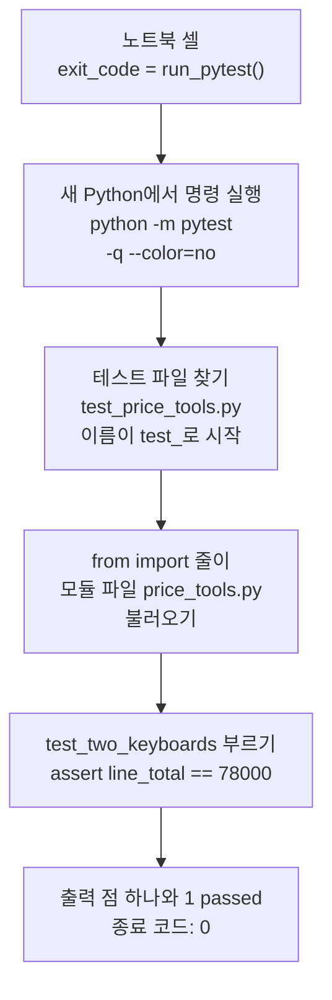
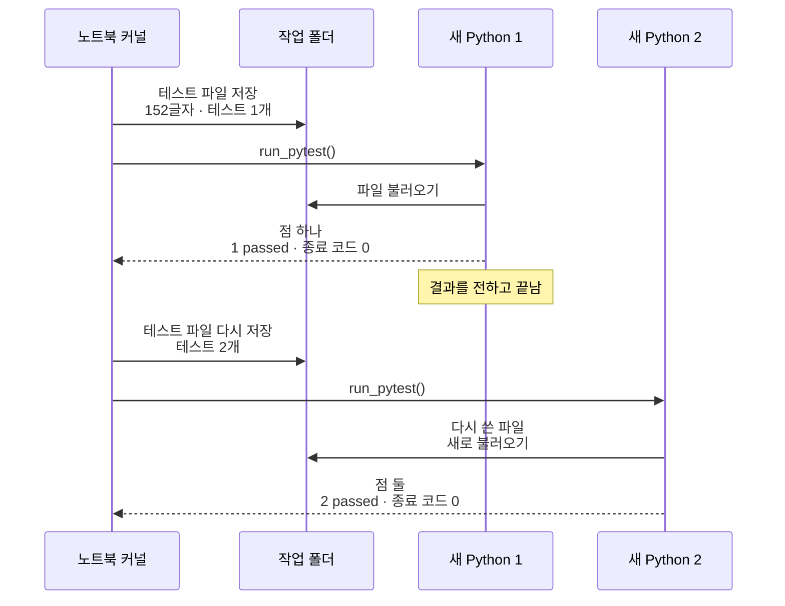
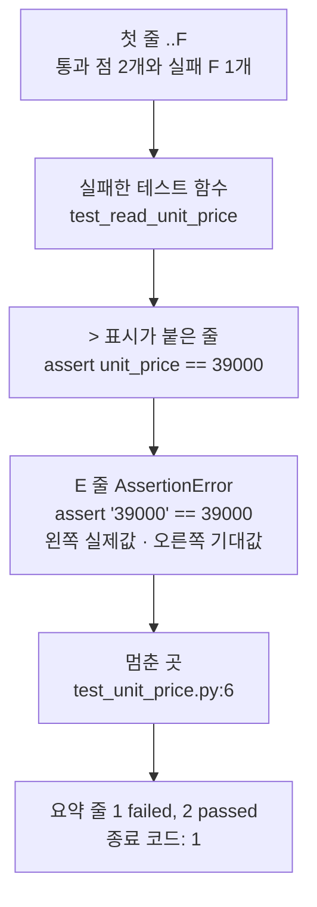
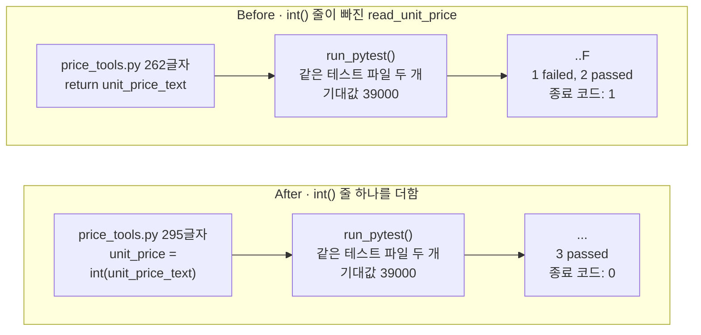

# 08-pytest

## _src 본문 (HTML 원본)

```html
<!--meta: 강의 1h | 실습 2h | 코드 Jupyter Notebook | 새 용어 8 -->
<h2 id="b1"><span class="no">1</span>학습 목표</h2>
<div class="goal"><ul><li>검사할 함수를 모듈 파일에 두고, 이름이 <code>test_</code>로 시작하는 테스트 파일과 테스트 함수를 <code>assert</code>로 작성할 수 있습니다.</li><li>새 Python에서 pytest를 실행하고, 통과 점과 F, 요약 줄, 종료 코드로 결과를 읽을 수 있습니다.</li><li>실패 설명에서 실제값과 기대값을 찾고, 기대값은 두고 함수만 고쳐 같은 테스트를 통과시킬 수 있습니다.</li></ul></div>
<h2 id="b2"><span class="no">2</span>이 내용을 배우는 이유</h2>
<p>7절 Before에서는 금액 3900039000을 출력해 보고 결과가 틀린 것을 알았습니다. 출력을 눈으로 읽어 비교하는 일은 함수를 고칠 때마다 다시 해야 합니다. 함수가 늘어나면 어떤 값을 확인했는지도 잊기 쉽습니다.</p>
<p>테스트는 기대값을 파일에 적어 두는 코드입니다. 명령 한 번으로 적어 둔 기대값을 모두 다시 비교합니다. 좋은 테스트는 결함이 있을 때 실패하고, 결함을 고치면 통과합니다.</p>
<p>흔한 실수는 테스트가 실패했을 때 기대값을 틀린 출력에 맞춰 바꾸는 것입니다. 그러면 테스트는 통과하지만 결함은 그대로 남습니다. <b>기대값은 두고 함수를 고칩니다.</b></p>
<p><strong>이 절의 질문</strong> — 단가를 꺼내는 함수에서 <code>int()</code> 줄을 빠뜨렸을 때, 기대값 39000을 적어 둔 테스트는 실패로 알려 줄까요? 함수만 고치면 같은 테스트가 통과할까요?</p>
<h2 id="b3"><span class="no">3</span>앞에서 배운 내용</h2>
<p>Ch 1과 1~7절에서 배운 것 가운데 이 절이 이어 쓰는 것을 표로 모았습니다.</p>
<table><thead><tr><th>앞 절</th><th>배운 것</th><th>이 절에서 이어 쓰는 곳</th></tr></thead><tbody>
<tr><td>Ch 1 1절, 1~7절</td><td>검사 줄 <code>assert</code>, 예상 → 실행 → 비교 순서, After 셀 끝의 assert</td><td>테스트 함수 안의 assert, After의 <code>assert exit_code == 0</code></td></tr>
<tr><td>Ch 1 3절</td><td><code>subprocess.run(목록, capture_output=True, text=True)</code>, <code>sys.executable</code>, 종료 코드</td><td>함수 <code>run_pytest()</code>의 명령과 반환값</td></tr>
<tr><td>4절</td><td>기본값이 있는 매개변수, 수량을 적지 않으면 39000</td><td>값 바꿔 보기의 테스트 함수 test_one_keyboard</td></tr>
<tr><td>5절</td><td>쓰기 모드 <code>"w"</code>와 <code>write()</code>, <code>split(",")</code>, 임시 폴더 준비 셀</td><td>모듈 파일·테스트 파일 저장, 함수 read_unit_price</td></tr>
<tr><td>7절</td><td>모듈 파일 order_tools.py와 from import 문, 모듈은 처음 불러올 때 한 번만 실행</td><td>모듈 파일 price_tools.py, 테스트 파일의 import 줄, 새 Python에서 실행하는 이유</td></tr>
<tr><td>7절</td><td>타입힌트 함수 <code>calculate_line_total()</code>의 39000·2 → 78000, 수량 3 → 117000, Before의 문자열 단가 '39000'</td><td>검사할 함수와 기대값, Before 결함, 원리 더 알아보기의 기대값</td></tr>
</tbody></table>
<p>이 절은 7절에 바로 이어집니다. 7절에서 만든 모듈 파일처럼, 검사할 함수와 테스트를 모두 파일에 적고 실행합니다. 7절 끝에서 예고한 내용입니다.</p>
<p>이 절의 새 내용은 테스트 파일과 테스트 함수, pytest 실행, 결과 읽기입니다. 모델을 부르지 않으므로 API 키가 필요 없습니다.</p>
<h2 id="b4"><span class="no">4</span>핵심 개념</h2>
<h3>비유로 시작하기</h3>
<p>동전이 진짜인지 볼 때, 기준 동전 하나를 양팔 저울 한쪽에 올립니다. 확인할 것은 다른 쪽에 올립니다. 저울이 수평이면 같고, 기울면 다릅니다.</p>
<p>테스트는 함수가 반환한 실제값과 미리 적어 둔 기대값을 저울 양쪽에 올려 보는 일입니다. 7절에서 동전 그림 스티커(타입힌트)는 종이 카드를 막지 못했습니다. 저울에 올리면 종이 카드는 기준 동전과 달라서 저울이 기웁니다.</p>
{{img:08-5-동전-저울|가운데 세로줄 왼쪽에는 한쪽 접시에 동전 그림 종이 카드, 다른 쪽 접시에 진짜 금색 동전을 올려 크게 기운 양팔 저울이 있고, 오른쪽에는 양쪽 접시에 같은 진짜 동전을 하나씩 올려 수평인 같은 저울과 탁자 위에 치운 종이 카드가 있는 삽화|동전 그림 종이 카드를 올린 왼쪽 저울이 기우는 것은 실패한 Before, 진짜 동전끼리 수평인 오른쪽은 통과한 After에 해당합니다.}}
<p><strong>그림 읽기</strong> — 가운데 세로줄 왼쪽 저울은 크게 기울었습니다. 내려간 오른쪽 접시의 진짜 동전은 테스트에 적은 기대값 39000입니다. 높이 뜬 왼쪽 접시의 종이 카드는 함수가 반환한 문자열 '39000'입니다.</p>
<p>세로줄 오른쪽에서는 왼쪽 접시에도 진짜 동전을 올려 저울이 수평입니다. 함수가 <code>int()</code>로 바꾼 정수 39000을 반환한 After에 해당합니다. 종이 카드는 탁자 위에 치웠습니다.</p>
<h3>이 절에서 쓰는 말</h3>
<table><thead><tr><th>용어</th><th>뜻</th><th>이 절에서 보이는 모습</th></tr></thead><tbody>
<tr><td>테스트(test)</td><td>함수가 기대한 값을 반환하는지 확인하는 코드</td><td>파일 test_price_tools.py, test_unit_price.py</td></tr>
<tr><td>기대값(expected value)</td><td>테스트에 미리 적어 둔 올바른 결과</td><td><code>assert line_total == 78000</code>의 78000</td></tr>
<tr><td>테스트 함수(test function)</td><td>검사할 함수를 부르고, 반환값을 assert로 기대값과 비교하는 함수. 이름이 test_로 시작</td><td>test_two_keyboards, test_read_unit_price</td></tr>
<tr><td>pytest</td><td>테스트 파일과 테스트 함수를 찾아 실행하고, 결과를 알려 주는 도구</td><td><code>python -m pytest -q --color=no</code></td></tr>
<tr><td>통과(passed)와 실패(failed)</td><td>테스트 함수의 assert가 모두 참이면 통과, 멈추면 실패</td><td>진행 줄의 점과 F, 요약 줄 <code>1 failed, 2 passed</code></td></tr>
<tr><td>종료 코드(exit code)</td><td>실행을 마친 프로그램이 알리는 숫자. pytest는 모두 통과하면 0, 실패가 있으면 1</td><td><code>종료 코드: 0</code>, <code>종료 코드: 1</code></td></tr>
<tr><td>회귀 테스트(regression test)</td><td>고친 결함이 나중에 다시 생기지 않는지 확인하려고 남겨 두는 테스트</td><td>After 뒤에도 남겨 둔 test_unit_price.py</td></tr>
<tr><td>매개변수화(parametrization)</td><td>입력만 다른 여러 검사를 테스트 함수 하나로 적는 pytest 기능</td><td>원리 더 알아보기 셀의 <code>6 passed</code></td></tr>
</tbody></table>
<h3>테스트 파일과 테스트 함수</h3>
<p>테스트를 하려면 검사받을 함수가 파일에 있어야 합니다. 노트북은 7절 함수 <code>calculate_line_total()</code>의 정의를 모듈 파일 price_tools.py에 저장했습니다. 쓴 글자 수는 130이었습니다.</p>
<p>테스트 파일 test_price_tools.py의 첫 줄은 <code>from price_tools import calculate_line_total</code>입니다. 7절 from import 문과 같습니다. 그 아래 테스트 함수 test_two_keyboards는 함수에 39000과 2를 넣습니다. 반환값이 기대값 78000과 같은지 <code>assert line_total == 78000</code>으로 확인합니다.</p>
<p>검사 줄 assert는 뒤의 비교가 참이면 지나가고, 거짓이면 그 줄에서 멈춥니다. 테스트 함수에는 결과를 눈으로 볼 <code>print()</code> 대신 assert를 적습니다. 비교는 사람이 아니라 pytest가 대신 확인합니다.</p>
<h3>pytest가 테스트를 찾아 실행하는 차례</h3>
<p>테스트 도구 pytest는 이름이 <code>test_</code>로 시작하는 .py 파일을 찾습니다. 파일 안에서는 이름이 <code>test_</code>로 시작하는 함수를 찾아 부릅니다. pytest 문서는 <code>_test.py</code>로 끝나는 파일도 찾는다고 적지만, 이번에는 test_로 시작하는 이름만 썼습니다.</p>
<p>노트북에서는 함수 <code>run_pytest()</code>가 명령 목록 <code>[sys.executable, "-m", "pytest", "-q", "--color=no"]</code>을 실행합니다. 값 <code>sys.executable</code>은 지금 커널의 Python 파일 경로입니다. 옵션 <code>-m pytest</code>는 모듈 pytest를 실행하라는 뜻입니다.</p>
<p>옵션 <code>-q</code>는 출력을 짧게 줄입니다. 옵션 <code>--color=no</code>는 출력 글에 색을 나타내는 기호를 넣지 않습니다. 테스트 파일이 있는 폴더의 터미널에서 <code>uv run python -m pytest -q --color=no</code>를 입력하는 것과 같은 일입니다. 노트북은 두 파일을 임시 폴더에 두었으므로, 실습 폴더에서 그대로 입력하면 찾을 테스트가 없습니다. 터미널에서는 이번에 실행하지 않았습니다.</p>
{{mermaid:08-1-테스트-실행-흐름|노트북 셀이 run_pytest()를 부르면 새 Python이 python -m pytest -q --color=no를 실행하고, 현재 작업 폴더에서 test_price_tools.py를 찾아 price_tools.py를 불러온 뒤 test_two_keyboards를 불러 assert line_total == 78000을 확인하고, 점 하나와 1 passed, 종료 코드 0이 출력되는 흐름도|테스트 한 번 실행의 차례. 새 Python에서 실행한 pytest가 테스트 파일을 찾고, 모듈 파일을 불러와 테스트 함수를 부릅니다.}}
<p><strong>도식 읽기</strong> — 위에서 아래로 읽습니다. 파란 상자는 우리가 적은 코드, 초록 상자는 파일, 노란 상자는 출력입니다. 맨 위 노트북 셀이 함수를 부르면, 둘째 파란 상자처럼 새 Python이 명령을 실행합니다.</p>
<p>두 초록 상자에서 pytest는 테스트 파일을 찾고, 그 파일의 from import 줄이 모듈 파일을 불러옵니다. 셋째 파란 상자에서 테스트 함수를 부르고 assert 줄을 확인합니다. 비교가 참이라 맨 아래 노란 상자에 점 하나와 <code>1 passed</code>, <code>종료 코드: 0</code>이 나왔습니다.</p>
<h3>노트북에서 pytest를 새 Python으로 실행하는 이유</h3>
<p>이 노트북은 테스트 파일과 모듈 파일을 고쳐 쓰고, 테스트를 다시 실행합니다. 7절 주의할 점에 적은 것처럼, 모듈은 한 커널에서 처음 불러올 때 한 번만 실행됩니다. 커널 안에서 pytest를 여러 번 부르면 고친 파일이 반영되지 않을 수 있습니다.</p>
<p>pytest 문서도 같은 이유로, 한 Python 실행 안에서 pytest를 여러 번 부르는 방법을 권하지 않습니다. 이 장면은 이번에 실행하지 않았습니다. 그래서 함수 <code>run_pytest()</code>는 부를 때마다 Ch 1 3절의 <code>subprocess.run()</code>으로 새 Python을 실행합니다.</p>
<p>테스트 파일의 import 줄이 모듈 파일을 찾은 것도 이 명령 덕분입니다. Python 문서는 <code>python -m</code>으로 실행하면 현재 작업 폴더가 모듈을 찾는 폴더 목록에 들어간다고 설명합니다. 노트북은 준비 셀에서 작업 위치를 두 파일이 있는 임시 폴더로 옮겼습니다.</p>
<h2 id="b5"><span class="no">5</span>실행 예제</h2>
<p>노트북은 먼저 pytest 버전 9.1.1을 확인하고, 5절·7절처럼 빈 임시 폴더로 작업 위치를 옮깁니다. 모듈 파일 price_tools.py(130글자)와 테스트 파일 test_price_tools.py(152글자)를 저장합니다. 이어서 함수 <code>run_pytest()</code>를 정의하고 불러, 테스트 한 개를 실행합니다.</p>
<p>값 바꿔 보기에서는 테스트 파일에 테스트 함수 test_one_keyboard를 더합니다. 4절처럼 수량을 적지 않으면 39000이어야 한다는 기대값입니다. 모듈 파일은 그대로 두고, 테스트 파일만 다시 써서 같은 함수로 실행합니다.</p>
{{notebook:08-pytest|example}}
<p class="look"><b>확인할 점</b> — 첫 실행의 진행 줄에 점이 하나이고, 요약 줄이 <code>1 passed</code>인지 봅니다. 종료 코드가 0인지도 확인합니다. 테스트 함수를 더한 뒤에는 점이 <code>..</code> 두 개, 요약 줄이 <code>2 passed</code>인지 봅니다.</p>
<h3>결과 줄 읽기</h3>
<p>진행 줄의 점 하나는 테스트 함수 하나가 통과했다는 표시입니다. 줄 끝 <code>[100%]</code>는 찾은 테스트를 모두 실행했다는 진행 표시입니다. 요약 줄 끝의 시간(0.00s)은 실행할 때마다 달라질 수 있습니다.</p>
<p>테스트 도구 pytest의 문서는 종료 코드 0을 「테스트를 모두 찾았고 모두 통과함」으로 설명합니다. 종료 코드 1은 「테스트를 실행했고 일부가 실패함」입니다. 노트북은 함수 <code>run_pytest()</code>가 반환한 이 숫자를 <code>종료 코드:</code> 줄로 출력했습니다.</p>
{{mermaid:08-2-새-Python-두-번|노트북 커널, 작업 폴더, 새 Python 1, 새 Python 2 네 줄로 이루어진 순서도. 커널이 테스트 파일 152글자를 저장하고 run_pytest()를 부르면 새 Python 1이 파일을 불러와 점 하나, 1 passed, 종료 코드 0을 전하고 끝나고, 커널이 테스트 2개로 파일을 다시 저장한 뒤 run_pytest()를 부르면 새 Python 2가 다시 쓴 파일을 새로 불러와 점 둘, 2 passed, 종료 코드 0을 전함|pytest를 두 번 실행한 차례. 실행마다 새 Python이 작업 폴더의 파일을 불러와, 테스트 파일을 다시 쓴 뒤에는 2 passed가 나옵니다.}}
<p><strong>도식 읽기</strong> — 위에서 아래로 시간 순서입니다. 세로줄 네 개는 노트북 커널, 작업 폴더, 새 Python 1, 새 Python 2입니다. 커널이 테스트 파일(152글자, 테스트 1개)을 저장하고 <code>run_pytest()</code>를 부릅니다.</p>
<p>새 Python 1은 파일을 불러와 점 하나와 1 passed, 종료 코드 0을 커널에 전합니다. 노란 메모처럼 결과를 전한 뒤에는 끝납니다. 테스트 파일을 테스트 2개로 다시 쓴 뒤에는, 새 Python 2가 다시 쓴 파일을 새로 불러와 2 passed를 전합니다.</p>
<h2 id="b6"><span class="no">6</span>일부러 실패해 보기</h2>
<p>7절 Before에서는 주문 줄 「무선 키보드,39000」을 쉼표로 나눈 단가 글자를 그대로 함수에 넣었습니다. 이 절 Before 셀은 단가를 꺼내는 일을 함수 <code>read_unit_price()</code>로 만들어 모듈 파일에 더합니다. 그런데 7절처럼 <code>int()</code>로 바꾸는 줄을 빠뜨려, 문자열을 그대로 반환합니다.</p>
<p>모듈 파일을 두 함수로 다시 쓰자 262글자가 되었습니다. 새 테스트 파일 test_unit_price.py(150글자)에는 기대값을 정수 39000으로 적었습니다. 새 함수의 반환값 표시는 <code>-&gt; int</code>이지만, 7절에서 본 것처럼 타입힌트는 값을 검사하지 않습니다.</p>
<p>파일 이름을 적지 않고 실행하자, pytest는 테스트 파일 두 개에서 테스트 함수 세 개를 찾았습니다. 진행 줄은 <code>..F</code>, 요약 줄은 <code>1 failed, 2 passed</code>, 종료 코드는 1이었습니다. 점 두 개는 test_price_tools.py의 두 테스트이고, F는 실패한 test_read_unit_price입니다.</p>
{{mermaid:08-3-실패-설명-읽기|첫 줄 ..F에서 시작해, 실패한 테스트 함수 test_read_unit_price, > 표시가 붙은 줄 assert unit_price == 39000, E 줄 AssertionError assert '39000' == 39000(왼쪽 실제값, 오른쪽 기대값), 멈춘 곳 test_unit_price.py:6, 요약 줄 1 failed, 2 passed와 종료 코드 1로 이어지는 흐름도|Before 출력을 위에서부터 읽는 차례. E 줄의 왼쪽 '39000'이 함수가 반환한 실제값, 오른쪽 39000이 테스트에 적은 기대값입니다.}}
<p><strong>도식 읽기</strong> — 위에서 아래로, 출력에 나온 순서대로 읽습니다. 파란 상자는 우리가 적은 테스트 함수와 assert 줄, 초록 상자는 멈춘 파일과 줄 번호입니다. 빨간 상자는 실제로 실패를 알린 출력입니다.</p>
<p>둘째 파란 상자의 &gt; 표시가 붙은 줄이 멈춘 줄 <code>assert unit_price == 39000</code>입니다. 바로 아래 빨간 E 줄에는 변수 이름 대신 실제값이 들어 있습니다. 왼쪽 '39000'은 함수가 반환한 문자열, 오른쪽 39000은 테스트에 적은 정수입니다. 초록 상자 <code>test_unit_price.py:6</code>은 테스트 파일의 6번째 줄에서 멈췄다는 뜻입니다.</p>
<p>After 셀은 함수 <code>read_unit_price()</code> 안에 <code>unit_price = int(unit_price_text)</code> 줄 하나를 더했습니다. 모듈 파일은 295글자가 되었고, 테스트 파일 두 개와 기대값 39000은 그대로입니다. 같은 함수 <code>run_pytest()</code>로 다시 실행하자 진행 줄 <code>...</code>, 요약 줄 <code>3 passed</code>, 종료 코드 0이 나왔습니다.</p>
<p>함수가 부를 때마다 새 Python을 실행해서, pytest는 고친 모듈 파일을 새로 불러왔습니다. After 셀 끝의 <code>assert exit_code == 0</code>에서도 멈추지 않았습니다.</p>
{{mermaid:08-4-before-after-비교|Before는 return unit_price_text로 끝나는 262글자 price_tools.py에 run_pytest()로 같은 테스트 파일 두 개(기대값 39000)를 실행해 ..F, 1 failed, 2 passed, 종료 코드 1이 나오고, After는 unit_price = int(unit_price_text) 줄을 더한 295글자 파일에 같은 테스트를 실행해 ..., 3 passed, 종료 코드 0이 나오는 비교 그림|기대값은 두고 함수만 고쳤습니다. int() 줄이 빠진 Before는 ..F와 종료 코드 1, 한 줄을 더한 After는 3 passed와 종료 코드 0입니다.}}
<p><strong>도식 읽기</strong> — 위 칸이 Before, 아래 칸이 After이고, 칸 안은 왼쪽에서 오른쪽으로 읽습니다. 초록 상자는 모듈 파일, 파란 상자는 같은 테스트를 실행한 <code>run_pytest()</code>입니다. 두 칸의 파란 상자는 테스트 파일도 기대값도 같습니다.</p>
<p>Before 칸의 초록 상자는 문자열을 그대로 반환하는 262글자 파일이고, 빨간 상자(..F, 종료 코드 1)로 이어집니다. After 칸의 초록 상자는 <code>int()</code> 줄을 더한 295글자 파일이고, 노란 상자(3 passed, 종료 코드 0)로 이어집니다.</p>
{{notebook:08-pytest|failure}}
<h3>확인한 범위</h3>
<p>이번에 확인한 입력은 「무선 키보드,39000」 한 줄입니다. 쉼표가 없는 줄이나 「삼만구천」처럼 정수로 바꿀 수 없는 단가는 테스트하지 않았습니다. 테스트 하나가 통과해도 모든 입력이 맞다고 보장하지는 않습니다.</p>
<p>원리 더 알아보기 셀에서는 <code>@pytest.mark.parametrize</code> 줄로 수량 1·2·3의 입력 묶음 세 개를 테스트 함수 하나에 넣었습니다. 앞의 세 테스트와 함께 <code>6 passed</code>가 나왔습니다. 기호 <code>@</code>로 시작하는 줄의 뜻은 9절에서 배우므로, 이 절에서는 출력만 읽었습니다.</p>
<p>커널 안에서 pytest를 여러 번 부르는 장면과, 터미널에서 pytest를 실행하는 장면은 이번에 실행하지 않았습니다. 테스트 이름을 한 줄씩 보여 주는 다른 출력 옵션도 쓰지 않았습니다.</p>
<h2 id="b7"><span class="no">7</span>주의할 점과 실무 메모</h2>
<ul><li>테스트가 실패하면 기대값을 틀린 출력에 맞춰 바꾸지 않습니다. Before에서 기대값을 '39000'으로 바꾸면 통과하지만, 단가가 문자열인 결함은 남습니다.</li>
<li>테스트 파일과 테스트 함수의 이름은 <code>test_</code>로 시작하게 짓습니다. 이름 규칙에 맞지 않는 함수는 pytest가 찾지 않습니다. 이 장면은 이번에 실행하지 않았습니다.</li>
<li>테스트 함수 하나에는 확인할 동작 하나를 둡니다. 이번 Before에서도 실패한 함수 이름 test_read_unit_price만 보고 어느 함수가 틀렸는지 알 수 있었습니다.</li>
<li>고친 뒤에도 실패했던 테스트를 지우지 않고 남겨 둡니다. 나중에 모듈 파일을 다시 고쳐도, 같은 결함이 돌아오면 이 회귀 테스트가 실패로 알립니다.</li>
<li>pytest 9.1.1과 Python 3.12에서 실행한 결과입니다. 버전은 실습 폴더의 pyproject.toml과 잠금 파일에 고정되어 있습니다.</li></ul>
<h2 id="b8"><span class="no">8</span>정리와 다음 절</h2>
<ul><li>테스트 함수는 검사할 함수를 부르고 <code>assert</code>로 기대값과 비교합니다. 테스트 도구 pytest는 이름이 test_로 시작하는 파일과 함수를 찾아 부릅니다.</li><li>결과는 진행 줄의 점(통과)과 F(실패), 요약 줄, 종료 코드 0·1로 읽습니다. 노트북에서는 고친 파일을 새로 읽도록 새 Python에서 실행했습니다.</li><li><code>int()</code> 줄을 빠뜨린 함수에서 테스트가 <code>..F</code>로 실패했습니다. 기대값은 두고 함수만 고치자 같은 테스트가 <code>3 passed</code>로 통과했습니다.</li></ul>
<p><strong>다음 학습과 이어지는 지점</strong> — 확장 경로(B)는 <a href="09-데코레이터와-컨텍스트-매니저.html">9절 데코레이터와 컨텍스트 매니저</a>로 이어집니다. 9절에서 <code>@</code> 줄의 뜻을 배우면 원리 더 알아보기의 매개변수화도 읽을 수 있습니다. 기본 경로(A)는 <a href="12-async와-await.html">12절 async와 await</a>로 이동합니다.</p>
<h2 id="b9"><span class="no">9</span>복습 문제</h2><details class="quiz"><summary>문제와 해설</summary>
<p class="quiz-q">1. 파일 이름 test_price_tools.py와 함수 이름 test_two_keyboards는 왜 test_로 시작하나요? · 기초</p><p class="quiz-a"><b>해설</b> — 테스트 도구 pytest는 이름이 test_로 시작하는 파일을 찾기 때문입니다. 그 파일 안에서도 이름이 test_로 시작하는 함수를 찾아 부릅니다. 노트북은 파일 이름을 적지 않고 실행했지만 pytest가 이 파일과 함수를 찾아 <code>1 passed</code>를 출력했습니다.</p>
<p class="quiz-q">2. 테스트 함수를 하나 더한 뒤 진행 줄과 요약 줄은 어떻게 바뀌었나요? · 기초</p><p class="quiz-a"><b>해설</b> — 점이 하나에서 <code>..</code> 두 개로 늘고, 요약 줄이 <code>1 passed</code>에서 <code>2 passed</code>로 바뀌었습니다. 점 하나가 통과한 테스트 함수 하나입니다. 종료 코드는 두 번 모두 0이었습니다.</p>
<p class="quiz-q">3. 함수 <code>run_pytest()</code>는 커널 안에서 pytest를 부르지 않고, 부를 때마다 새 Python을 실행합니다. 이유를 7절에서 배운 말로 쓰세요. · 적용</p><p class="quiz-a"><b>해설</b> — 모듈은 한 커널에서 처음 불러올 때 한 번만 실행되기 때문입니다. 이 노트북은 모듈 파일과 테스트 파일을 고쳐 쓰고 다시 실행합니다. 새 Python은 매번 파일을 새로 불러오므로, After에서 고친 모듈 파일로 <code>3 passed</code>를 얻었습니다.</p>
<p class="quiz-q">4. Before 출력의 <code>E       AssertionError: assert '39000' == 39000</code> 줄에서 실제값과 기대값을 구분해 쓰세요. · 적용</p><p class="quiz-a"><b>해설</b> — 멈춘 줄은 <code>assert unit_price == 39000</code>입니다. E 줄은 변수 unit_price 자리에 실제값을 넣어 보여 줍니다. 왼쪽 '39000'은 함수가 반환한 문자열(실제값)이고, 오른쪽 39000은 테스트에 적은 정수(기대값)입니다.</p>
<p class="quiz-q">5. Before에서 종료 코드 1이 나온 것을 「테스트가 제 역할을 했다」고 말할 수 있는 이유는 무엇인가요? 7절 Before와 비교해 쓰세요. · 분석</p><p class="quiz-a"><b>해설</b> — 함수에 실제로 결함(<code>int()</code> 줄 빠짐)이 있었고, 테스트가 그 결함에서 실패했기 때문입니다. 7절에서는 타입힌트가 문자열 단가를 막지 못해 금액을 직접 출력해 보고 찾았습니다. 이번에는 기대값을 적어 둔 테스트가 <code>1 failed, 2 passed</code>로 어느 테스트가 틀렸는지 알렸습니다.</p>
<p class="quiz-q">6. After에서 테스트의 기대값을 문자열 '39000'으로 바꾸지 않고 함수를 고친 이유를 쓰세요. 고친 뒤에도 test_unit_price.py를 남겨 두는 이유도 함께 쓰세요. · 분석</p><p class="quiz-a"><b>해설</b> — 단가는 정수여야 금액을 계산할 수 있고, 결함은 함수에 있기 때문입니다. 기대값을 바꾸면 테스트는 통과해도 틀린 결과를 맞다고 적은 셈입니다. 테스트를 남겨 두면 나중에 모듈 파일을 고치다 같은 결함이 다시 생겨도 실패로 알 수 있습니다. 이런 테스트가 회귀 테스트입니다.</p>
</details>
<h2 id="b10"><span class="no">10</span>참고 자료</h2>
<ul><li><a href="https://docs.pytest.org/en/stable/getting-started.html">pytest 문서 · 시작하기</a> · 확인 2026-09-16 · 기준 pytest 9.1.1</li><li><a href="https://docs.pytest.org/en/stable/explanation/goodpractices.html#conventions-for-python-test-discovery">pytest 문서 · 테스트 찾기 규칙</a> · 확인 2026-09-16 · 기준 pytest 9.1.1</li><li><a href="https://docs.pytest.org/en/stable/how-to/assert.html">pytest 문서 · assert 쓰기</a> · 확인 2026-09-16 · 기준 pytest 9.1.1</li><li><a href="https://docs.pytest.org/en/stable/how-to/usage.html#calling-pytest-through-python-m-pytest">pytest 문서 · 실행 방법(python -m pytest)</a> · 확인 2026-09-16 · 기준 pytest 9.1.1</li><li><a href="https://docs.pytest.org/en/stable/reference/exit-codes.html">pytest 문서 · 종료 코드</a> · 확인 2026-09-16 · 기준 pytest 9.1.1</li><li><a href="https://docs.pytest.org/en/stable/how-to/parametrize.html">pytest 문서 · 매개변수화</a> · 확인 2026-09-16 · 기준 pytest 9.1.1</li><li><a href="https://docs.python.org/3.12/using/cmdline.html#cmdoption-m">Python 3.12 문서 · 명령줄 옵션 -m</a> · 확인 2026-09-16 · 기준 Python 3.12</li><li><a href="https://pypi.org/project/pytest/">PyPI · pytest</a> · 확인 2026-09-16 · pytest 9.1.1 · MIT</li></ul>
```

## 노트북 셀 (순서대로)

### [0] markdown {'html': 'skip'}

# pytest

**이 노트북에서 할 일**

1. 7절 함수 `calculate_line_total()`을 모듈 파일에 저장하고, 기대값을 적은 테스트 파일을 만듭니다.
2. 새 Python에서 pytest를 실행해, 통과 표시와 요약 줄, 종료 코드를 읽습니다.
3. 7절과 같은 `int()` 빠뜨림 결함을 테스트로 찾고, 함수만 고쳐 같은 테스트를 통과시킵니다.

**준비물** — API 키 불필요. 모델 호출은 0번이고 비용은 들지 않습니다. 실행 시간은 1분 이내입니다.

테스트 도구 pytest 9.1.1은 실습 폴더에서 `uv sync --locked`를 실행할 때 함께 설치됩니다.
1~7절과 같은 실습 폴더 `labs/part1/ch02-python`의 `.venv`를 커널로 고르고, 첫 셀부터 순서대로 실행합니다.

### [1] markdown {'html': 'skip'}

## 오늘 볼 그림


위에서 아래로 읽습니다. 파란 상자는 우리가 적은 코드, 초록 상자는 파일, 노란 상자는 출력입니다.

노트북 셀은 테스트를 직접 부르지 않습니다. 새 Python에서 실행한 pytest가 test_로 시작하는 파일과 함수를 찾아 부르고, 결과만 노트북에 전합니다.

### [2] markdown {}

## 1. 준비

테스트 도구 pytest는 실습 폴더의 pyproject.toml에 9.1.1 버전으로 적혀 있습니다.
첫 준비 셀은 커널에서 pytest를 불러와 버전을 출력합니다.

오류 `ModuleNotFoundError`가 나오면, Ch 1 3절처럼 커널이 실습 폴더의 `.venv`인지 확인합니다.

### [3] code {'execution': {'iopub.execute_input': '2026-09-16T09:01:56.843728Z', 'iopub.status.busy': '2026-09-16T09:01:56.843473Z', 'iopub.status.idle': '2026-09-16T09:01:56.894470Z', 'shell.execute_reply': '2026-09-16T09:01:56.893952Z'}, 'lesson_role': 'setup'}

```python
# 실습 폴더 가상환경에 설치된 pytest를 불러와 버전을 확인합니다
import pytest

# __version__은 패키지에 적어 둔 버전 글자입니다
print("pytest 버전:", pytest.__version__)
```

출력:
```
pytest 버전: 9.1.1

```

### [4] markdown {}

**결과 읽기** — pytest 버전은 `9.1.1`로, pyproject.toml에 적은 버전과 같습니다.

### [5] markdown {}

이 노트북은 모듈 파일과 테스트 파일을 만듭니다. 5절·7절처럼 빈 임시 폴더를 만들고, 그 폴더로 작업 위치를 옮깁니다.

첫 두 줄은 7절에서 배운 import 문으로, 표준 라이브러리 모듈 os와 tempfile을 불러옵니다.

### [6] code {'execution': {'iopub.execute_input': '2026-09-16T09:01:56.895364Z', 'iopub.status.busy': '2026-09-16T09:01:56.895287Z', 'iopub.status.idle': '2026-09-16T09:01:56.897536Z', 'shell.execute_reply': '2026-09-16T09:01:56.897118Z'}, 'lesson_role': 'setup'}

```python
# 파일을 둘 빈 임시 폴더를 만들고, 그 폴더로 작업 위치를 옮깁니다
import os
import tempfile

# mkdtemp()는 운영체제 임시 폴더 안에 새 폴더를 만들고 그 경로를 반환합니다
practice_folder = tempfile.mkdtemp(prefix="ch02-08-")
# chdir()는 터미널의 cd처럼 현재 작업 폴더를 옮깁니다
os.chdir(practice_folder)
file_names = os.listdir()
print("현재 작업 폴더의 파일:", file_names)
```

출력:
```
현재 작업 폴더의 파일: []

```

### [7] markdown {}

**결과 읽기** — 현재 작업 폴더의 파일은 `[]`로, 빈 폴더에서 시작합니다.
폴더의 경로는 컴퓨터마다 달라서 출력하지 않았습니다.

### [8] markdown {}

## 2. 검사할 함수를 모듈 파일에 저장하기

테스트(test)는 함수가 기대한 값을 반환하는지 확인하는 코드입니다.
먼저 검사받을 함수를 파일에 둡니다. 7절 order_tools.py처럼 정의를 글로 적어 모듈 파일 price_tools.py에 저장합니다.

함수는 7절에서 타입힌트를 적은 `calculate_line_total()`입니다. 7절 노트북에서 단가 39000, 수량 2를 넣어 78000을 얻었습니다.

실행 전에 예상합니다. 현재 작업 폴더에 파일 price_tools.py 하나가 보일 것입니다.

### [9] code {'execution': {'iopub.execute_input': '2026-09-16T09:01:56.898409Z', 'iopub.status.busy': '2026-09-16T09:01:56.898335Z', 'iopub.status.idle': '2026-09-16T09:01:56.900781Z', 'shell.execute_reply': '2026-09-16T09:01:56.900350Z'}}

```python
# 7절 함수 calculate_line_total()의 정의를 글로 적어 모듈 파일 price_tools.py에 저장합니다
module_text = """def calculate_line_total(unit_price: int, quantity: int = 1) -> int:
    line_total = unit_price * quantity
    return line_total
"""
with open("price_tools.py", "w", encoding="utf-8") as file:
    written_count = file.write(module_text)
file_names = os.listdir()
print("쓴 글자 수:", written_count)
print("현재 작업 폴더의 파일:", file_names)
```

출력:
```
쓴 글자 수: 130
현재 작업 폴더의 파일: ['price_tools.py']

```

### [10] markdown {}

**결과 읽기** — 쓴 글자 수는 `130`이고, 현재 작업 폴더의 파일은 `['price_tools.py']`로 예상과 같습니다.
7절 order_tools.py와 같은 방법으로 저장한 모듈 파일입니다.

### [11] markdown {}

## 3. 기대값을 적은 테스트 파일 만들기

테스트 함수(test function)는 검사할 함수를 부르고, 반환값이 기대값과 같은지 `assert`로 확인하는 함수입니다.
검사 줄 `assert`는 Ch 1 1절에서 처음 썼고, 1~7절 After 셀 끝에서도 썼습니다. 뒤의 비교가 참이면 지나가고, 거짓이면 그 줄에서 멈춥니다.

테스트 도구 pytest는 이름이 `test_`로 시작하는 파일을 찾습니다. 그 파일 안에서 이름이 `test_`로 시작하는 함수를 찾아 부릅니다.
그래서 파일 이름은 test_price_tools.py, 함수 이름은 test_two_keyboards로 짓습니다.

테스트 파일의 첫 줄은 7절에서 배운 from import 문입니다. 모듈 price_tools에서 함수 이름만 가져옵니다.
이 셀도 글을 저장만 하고, 테스트는 아직 실행하지 않습니다.

실행 전에 예상합니다. 현재 작업 폴더의 파일은 두 개가 될 것입니다.

### [12] code {'execution': {'iopub.execute_input': '2026-09-16T09:01:56.901573Z', 'iopub.status.busy': '2026-09-16T09:01:56.901499Z', 'iopub.status.idle': '2026-09-16T09:01:56.903976Z', 'shell.execute_reply': '2026-09-16T09:01:56.903610Z'}}

```python
# 단가 39000, 수량 2의 기대값 78000을 적은 테스트 파일을 저장합니다
test_text = """from price_tools import calculate_line_total


def test_two_keyboards():
    line_total = calculate_line_total(39000, 2)
    assert line_total == 78000
"""
with open("test_price_tools.py", "w", encoding="utf-8") as file:
    written_count = file.write(test_text)
# listdir()는 순서를 정하지 않고 반환하므로 sorted()로 이름 순서로 정렬합니다
file_names = sorted(os.listdir())
print("쓴 글자 수:", written_count)
print("현재 작업 폴더의 파일:", file_names)
```

출력:
```
쓴 글자 수: 152
현재 작업 폴더의 파일: ['price_tools.py', 'test_price_tools.py']

```

### [13] markdown {}

**결과 읽기** — 쓴 글자 수는 `152`이고, 현재 작업 폴더의 파일은 `['price_tools.py', 'test_price_tools.py']`로 예상과 같습니다.
테스트 파일도 모듈 파일처럼 글자로 된 .py 파일입니다.

### [14] markdown {}

## 4. 새 Python에서 pytest를 실행하는 함수 만들기

테스트 파일은 노트북 셀이 아니라 pytest가 불러와 실행합니다. 이 노트북은 뒤에서 price_tools.py를 고쳐 쓰고 테스트를 다시 실행합니다.

7절 주의할 점에 적은 것처럼, 모듈은 한 커널에서 처음 불러올 때 한 번만 실행됩니다.
그래서 커널 안에서 pytest를 여러 번 부르면 고친 파일이 반영되지 않을 수 있습니다. pytest 문서도 이 방법을 권하지 않습니다.
이 노트북은 pytest를 부를 때마다 새 Python을 하나 실행합니다. Ch 1 3절에서 `subprocess.run()`으로 Python을 따로 실행한 방법과 같습니다.

함수 `run_pytest()`가 실행하는 목록은 `[sys.executable, "-m", "pytest", "-q", "--color=no"]`입니다.
값 `sys.executable`은 지금 커널의 Python 파일 경로입니다. 옵션 `-m pytest`는 모듈 pytest를 실행하라는 뜻입니다.
옵션 `-q`는 출력을 짧게 줄이고, 옵션 `--color=no`는 출력 글에 색을 나타내는 기호를 넣지 않습니다.

테스트 파일이 있는 폴더의 터미널에서 `uv run python -m pytest -q --color=no`를 입력하는 것과 같은 일입니다.
노트북은 두 파일을 임시 폴더에 두었으므로, 실습 폴더에서 그대로 입력하면 찾을 테스트가 없습니다. 터미널에서는 이번에 실행하지 않았습니다.

파일 이름을 적지 않았으므로, pytest는 현재 작업 폴더에서 테스트 파일을 찾습니다.
함수는 pytest가 화면에 쓴 글(`stdout`)을 출력하고, 종료 코드(`returncode`)를 반환합니다.

실행 전에 예상합니다. 정의 셀이라 출력은 없을 것입니다.

### [15] code {'execution': {'iopub.execute_input': '2026-09-16T09:01:56.904652Z', 'iopub.status.busy': '2026-09-16T09:01:56.904589Z', 'iopub.status.idle': '2026-09-16T09:01:56.906373Z', 'shell.execute_reply': '2026-09-16T09:01:56.905962Z'}}

```python
# 현재 작업 폴더의 테스트를 새 Python에서 pytest로 실행하고, 종료 코드를 반환합니다
import subprocess
import sys


def run_pytest() -> int:
    # 터미널에서 python -m pytest -q --color=no를 입력하는 것과 같은 명령 목록입니다
    command = [sys.executable, "-m", "pytest", "-q", "--color=no"]
    # Ch 1 3절처럼 capture_output=True, text=True로 출력을 글로 받아 둡니다
    result = subprocess.run(command, capture_output=True, text=True)
    print(result.stdout)
    return result.returncode
```

출력:
```

```

### [16] markdown {}

**결과 읽기** — 예상대로 출력이 없습니다. 함수 `run_pytest()`는 부를 때마다 새 Python에서 pytest를 실행합니다.

### [17] markdown {}

## 5. 테스트 실행하고 결과 읽기

함수 `run_pytest()`를 불러 테스트를 실행합니다. 테스트 도구 pytest는 test_price_tools.py를 찾아 불러옵니다. 이어서 그 파일 안의 함수 test_two_keyboards를 부릅니다.
테스트 파일의 from import 줄은 같은 폴더의 price_tools.py를 불러옵니다.

실행 전에 예상합니다. 반환값 78000이 기대값 78000과 같으므로 테스트는 통과하고, 종료 코드는 0일 것입니다.

### [18] code {'execution': {'iopub.execute_input': '2026-09-16T09:01:56.907116Z', 'iopub.status.busy': '2026-09-16T09:01:56.907045Z', 'iopub.status.idle': '2026-09-16T09:01:56.988352Z', 'shell.execute_reply': '2026-09-16T09:01:56.988030Z'}}

```python
# 테스트 파일 하나, 테스트 함수 하나를 pytest로 실행합니다
exit_code = run_pytest()
print("종료 코드:", exit_code)
```

출력:
```
.                                                                        [100%]
1 passed in 0.00s

종료 코드: 0

```

### [19] markdown {}

**결과 읽기** — 첫 줄의 점 `.` 하나는 테스트 함수 하나가 통과했다는 표시입니다. 줄 끝 `[100%]`는 찾은 테스트를 모두 실행했다는 진행 표시입니다. 요약 줄은 `1 passed`이고, 종료 코드는 `0`입니다.

요약 줄 끝의 시간은 실행할 때마다 달라질 수 있습니다.
pytest 문서는 종료 코드 0을 「테스트를 모두 찾았고 모두 통과함」으로 설명합니다.

### [20] markdown {}

## 6. 값 바꿔 보기 — 테스트 함수 하나 더하기

테스트 파일에 테스트 함수를 하나 더합니다. 4절에서 수량을 적지 않고 부르면 기본값 1이 들어가 39000이 나왔습니다.
이 기대값을 새 테스트 함수 test_one_keyboard에 적습니다. 앞의 테스트 함수와 모듈 파일은 그대로 둡니다.

실행 전에 예상합니다. 통과 표시 점이 두 개가 되고, 요약 줄은 2 passed일 것입니다.

### [21] code {'execution': {'iopub.execute_input': '2026-09-16T09:01:56.989099Z', 'iopub.status.busy': '2026-09-16T09:01:56.989038Z', 'iopub.status.idle': '2026-09-16T09:01:57.066862Z', 'shell.execute_reply': '2026-09-16T09:01:57.066379Z'}}

```python
# 앞 테스트는 그대로 두고, 수량을 적지 않은 테스트 함수를 더해 테스트 파일을 다시 씁니다
two_tests_text = """from price_tools import calculate_line_total


def test_two_keyboards():
    line_total = calculate_line_total(39000, 2)
    assert line_total == 78000


def test_one_keyboard():
    line_total = calculate_line_total(39000)
    assert line_total == 39000
"""
with open("test_price_tools.py", "w", encoding="utf-8") as file:
    file.write(two_tests_text)
exit_code = run_pytest()
print("종료 코드:", exit_code)
```

출력:
```
..                                                                       [100%]
2 passed in 0.00s

종료 코드: 0

```

### [22] markdown {}

**결과 읽기** — 점이 `..` 두 개로 늘었고, 요약 줄은 `2 passed`, 종료 코드는 `0`으로 예상과 같습니다.

테스트 파일에 기대값 두 개가 남았습니다. 다음에 모듈 파일을 고친 뒤에도 같은 명령 한 번으로 두 기대값을 함께 확인합니다.

### [23] markdown {'lesson_part': 'before'}

## 7. Before — 단가를 꺼내는 함수에서 int()를 빠뜨림

7절 Before에서는 주문 줄 「무선 키보드,39000」을 쉼표로 나눈 단가 글자를 그대로 함수에 넣었습니다.
이번에는 단가를 꺼내는 일을 함수 `read_unit_price()`로 만들어 모듈 파일에 더합니다. 그런데 7절 Before처럼 `int()`로 바꾸는 줄을 빠뜨렸습니다.

아래 셀은 두 함수를 담은 글로 price_tools.py를 다시 씁니다. 함수 calculate_line_total은 앞과 같습니다.
새 함수의 반환값 표시는 `-> int`이지만, 7절에서 본 것처럼 타입힌트는 값을 검사하지 않습니다.

### [24] code {'execution': {'iopub.execute_input': '2026-09-16T09:01:57.067823Z', 'iopub.status.busy': '2026-09-16T09:01:57.067736Z', 'iopub.status.idle': '2026-09-16T09:01:57.070216Z', 'shell.execute_reply': '2026-09-16T09:01:57.069849Z'}, 'lesson_part': 'before'}

```python
# 단가를 꺼내는 함수 read_unit_price()를 더해 모듈 파일을 다시 씁니다(int() 줄이 빠짐)
module_text = """def calculate_line_total(unit_price: int, quantity: int = 1) -> int:
    line_total = unit_price * quantity
    return line_total


def read_unit_price(price_line: str) -> int:
    product_name, unit_price_text = price_line.split(",")
    return unit_price_text
"""
with open("price_tools.py", "w", encoding="utf-8") as file:
    written_count = file.write(module_text)
print("쓴 글자 수:", written_count)
```

출력:
```
쓴 글자 수: 262

```

### [25] markdown {'lesson_part': 'before'}

**결과 읽기** — 쓴 글자 수는 `262`입니다. 함수 하나만 담았던 앞의 글보다 함수 read_unit_price만큼 늘었습니다.

### [26] markdown {'lesson_part': 'before'}

새 함수의 기대값을 적은 테스트 파일 test_unit_price.py를 따로 만듭니다.
주문 줄 「무선 키보드,39000」을 넣으면 정수 39000이 나와야 하므로, 기대값을 정수 39000으로 적습니다.
이 셀도 글을 저장만 합니다.

### [27] code {'execution': {'iopub.execute_input': '2026-09-16T09:01:57.070891Z', 'iopub.status.busy': '2026-09-16T09:01:57.070836Z', 'iopub.status.idle': '2026-09-16T09:01:57.072710Z', 'shell.execute_reply': '2026-09-16T09:01:57.072407Z'}, 'lesson_part': 'before'}

```python
# 주문 줄에서 꺼낸 단가의 기대값 39000(정수)을 적은 테스트 파일을 저장합니다
unit_test_text = """from price_tools import read_unit_price


def test_read_unit_price():
    unit_price = read_unit_price("무선 키보드,39000")
    assert unit_price == 39000
"""
with open("test_unit_price.py", "w", encoding="utf-8") as file:
    written_count = file.write(unit_test_text)
print("쓴 글자 수:", written_count)
```

출력:
```
쓴 글자 수: 150

```

### [28] markdown {'lesson_part': 'before'}

**결과 읽기** — 쓴 글자 수는 `150`입니다. 이제 테스트 파일은 두 개, 테스트 함수는 모두 세 개입니다.

### [29] markdown {'lesson_part': 'before'}

파일 이름을 적지 않았으므로, pytest는 테스트 파일 두 개를 모두 찾아 실행합니다.

실행 전에 예상해 봅니다. 7절에서 타입힌트는 문자열 단가를 막지 않았습니다. 이번에는 테스트가 이 결함을 알려 줄까요?

### [30] code {'execution': {'iopub.execute_input': '2026-09-16T09:01:57.073363Z', 'iopub.status.busy': '2026-09-16T09:01:57.073307Z', 'iopub.status.idle': '2026-09-16T09:01:57.146396Z', 'shell.execute_reply': '2026-09-16T09:01:57.145979Z'}, 'lesson_part': 'before'}

```python
# 테스트 파일 두 개, 테스트 함수 세 개를 pytest로 실행합니다
exit_code = run_pytest()
print("종료 코드:", exit_code)
```

출력:
```
..F                                                                      [100%]
=================================== FAILURES ===================================
_____________________________ test_read_unit_price _____________________________

    def test_read_unit_price():
        unit_price = read_unit_price("무선 키보드,39000")
>       assert unit_price == 39000
E       AssertionError: assert '39000' == 39000

test_unit_price.py:6: AssertionError
=========================== short test summary info ============================
FAILED test_unit_price.py::test_read_unit_price - AssertionError: assert '390...
1 failed, 2 passed in 0.01s

종료 코드: 1

```

### [31] markdown {'lesson_part': 'before'}

**결과 읽기** — 첫 줄은 `..F`이고, 요약 줄은 `1 failed, 2 passed`, 종료 코드는 `1`입니다.
점 두 개는 test_price_tools.py의 두 테스트가 통과했다는 표시입니다. 글자 F는 실패(failed)한 테스트 하나입니다.

실패 설명에서 `>` 표시가 붙은 줄이 멈춘 줄 `assert unit_price == 39000`입니다.
바로 아래 `E` 줄 `AssertionError: assert '39000' == 39000`에는 변수 이름 대신 실제값이 들어 있습니다.
왼쪽 '39000'은 함수가 반환한 문자열, 오른쪽 39000은 테스트에 적은 정수입니다.

그 아래 `test_unit_price.py:6`은 테스트 파일의 6번째 줄에서 멈췄다는 뜻입니다.
7절에서는 틀린 금액을 출력해 보고 결함을 찾았습니다. 이번에는 기대값을 적어 둔 테스트가 실패로 알렸습니다.

### [32] markdown {'lesson_part': 'after'}

## 8. After — int()로 바꾸는 줄 하나 더하기

Before 셀과 달라진 곳은 함수 `read_unit_price()` 안에 `int()` 줄 하나를 더한 것입니다. 테스트 파일 두 개와 기대값 39000은 그대로 둡니다.
테스트를 통과시키려고 기대값을 문자열 '39000'으로 바꾸면, 결함을 고친 것이 아니라 틀린 결과를 맞다고 적은 것입니다.

아래 셀은 고친 글로 price_tools.py를 다시 씁니다. 실행 전에 예상합니다. 줄 하나가 늘었으므로 쓴 글자 수는 Before보다 클 것입니다.

### [33] code {'execution': {'iopub.execute_input': '2026-09-16T09:01:57.147041Z', 'iopub.status.busy': '2026-09-16T09:01:57.146977Z', 'iopub.status.idle': '2026-09-16T09:01:57.149255Z', 'shell.execute_reply': '2026-09-16T09:01:57.148899Z'}, 'lesson_part': 'after'}

```python
# read_unit_price()가 단가 글자를 int()로 바꿔 반환하도록 모듈 파일을 고쳐 씁니다
module_text = """def calculate_line_total(unit_price: int, quantity: int = 1) -> int:
    line_total = unit_price * quantity
    return line_total


def read_unit_price(price_line: str) -> int:
    product_name, unit_price_text = price_line.split(",")
    unit_price = int(unit_price_text)
    return unit_price
"""
with open("price_tools.py", "w", encoding="utf-8") as file:
    written_count = file.write(module_text)
print("쓴 글자 수:", written_count)
```

출력:
```
쓴 글자 수: 295

```

### [34] markdown {'lesson_part': 'after'}

**결과 읽기** — 쓴 글자 수는 `295`로, Before의 262보다 큽니다. 모듈 파일만 고쳤고 테스트 파일은 쓰지 않았습니다.

### [35] markdown {'lesson_part': 'after'}

Before 셀과 같은 함수 `run_pytest()`로 같은 테스트 파일 두 개를 다시 실행합니다.
함수는 부를 때마다 새 Python을 실행하므로, pytest는 고친 price_tools.py를 새로 불러옵니다.

실행 전에 예상합니다. 세 테스트가 모두 통과해 점 세 개와 3 passed, 종료 코드 0이 나올 것입니다.

### [36] code {'execution': {'iopub.execute_input': '2026-09-16T09:01:57.149863Z', 'iopub.status.busy': '2026-09-16T09:01:57.149798Z', 'iopub.status.idle': '2026-09-16T09:01:57.224411Z', 'shell.execute_reply': '2026-09-16T09:01:57.223984Z'}, 'lesson_part': 'after'}

```python
# 테스트 파일은 그대로 두고, 고친 모듈 파일로 같은 테스트를 다시 실행합니다
exit_code = run_pytest()
print("종료 코드:", exit_code)
# 테스트가 하나라도 실패해 종료 코드가 0이 아니면 이 줄에서 멈춥니다
assert exit_code == 0
```

출력:
```
...                                                                      [100%]
3 passed in 0.00s

종료 코드: 0

```

### [37] markdown {'lesson_part': 'after'}

**결과 읽기** — 첫 줄은 `...`, 요약 줄은 `3 passed`, 종료 코드는 `0`입니다. 검사 줄 `assert`에서도 멈추지 않았습니다.

Before 셀의 ..F와 비교하면 F 자리가 점으로 바뀌었습니다. 달라진 곳은 모듈 파일의 `int()` 줄 하나이고, 테스트 파일과 기대값은 그대로입니다.

이번에 확인한 입력은 「무선 키보드,39000」 한 줄입니다. 쉼표가 없는 줄이나 「삼만구천」처럼 정수로 바꿀 수 없는 단가는 테스트하지 않았습니다.

### [38] markdown {'lesson_part': 'after'}

### 원리 더 알아보기 — 매개변수화

입력만 다른 테스트를 함수 하나로 적는 pytest 기능을 매개변수화(parametrization)라고 합니다. 이 셀은 수량 1·2·3을 한 함수로 검사합니다.
테스트 함수 위에 `@pytest.mark.parametrize` 줄을 적습니다. 이 줄은 아래 테스트 함수를 입력 묶음마다 한 번씩 실행하도록 등록합니다.

기호 `@`로 시작하는 줄의 뜻은 9절 데코레이터에서 배우므로, 지금은 출력만 읽습니다.
이 셀은 테스트 파일을 하나 더 만들어, 앞의 세 테스트와 함께 실행합니다.

### [39] code {'execution': {'iopub.execute_input': '2026-09-16T09:01:57.225274Z', 'iopub.status.busy': '2026-09-16T09:01:57.225207Z', 'iopub.status.idle': '2026-09-16T09:01:57.294357Z', 'shell.execute_reply': '2026-09-16T09:01:57.293970Z'}, 'lesson_level': 'deep-dive', 'lesson_part': 'after'}

```python
# 원리 더 알아보기: 수량 1·2·3의 입력 묶음 세 개를 테스트 함수 하나에 넣어 실행합니다
quantity_test_text = """import pytest
from price_tools import calculate_line_total


@pytest.mark.parametrize("quantity, expected", [(1, 39000), (2, 78000), (3, 117000)])
def test_quantities(quantity, expected):
    line_total = calculate_line_total(39000, quantity)
    assert line_total == expected
"""
with open("test_quantities.py", "w", encoding="utf-8") as file:
    file.write(quantity_test_text)
deep_exit_code = run_pytest()
print("종료 코드:", deep_exit_code)
```

출력:
```
......                                                                   [100%]
6 passed in 0.00s

종료 코드: 0

```

### [40] markdown {'lesson_part': 'after'}

**결과 읽기** — 점이 `......` 여섯 개이고, 요약 줄은 `6 passed`입니다.
앞의 세 테스트에, 테스트 함수 test_quantities가 입력 묶음 세 개로 세 번 실행되어 더해졌습니다.
수량 3의 기대값 117000은 7절 값 바꿔 보기에서 얻은 금액입니다.

### [41] markdown {'html': 'skip', 'lesson_part': 'after'}

## 정리

- 테스트 함수는 검사할 함수를 부르고 `assert`로 기대값과 비교합니다. 테스트 도구 pytest는 이름이 test_로 시작하는 파일과 함수를 찾아 부릅니다.
- 결과는 점(통과)과 F(실패), 요약 줄의 passed·failed 수, 종료 코드 0·1로 읽습니다.
- `int()` 줄을 빠뜨린 함수에서 테스트가 ..F로 실패했고, 기대값은 두고 함수만 고치자 3 passed가 되었습니다.

확장 경로(B)는 9절 데코레이터와 컨텍스트 매니저로, 기본 경로(A)는 12절 async와 await로 이어집니다.

## 그림

### 08-1-테스트-실행-흐름.mmd



- 설명 대상 문장: 노트북 셀이 함수 run_pytest()를 부르면, 새 Python이 pytest를 실행합니다. pytest는 이름이 test_로 시작하는 파일과 함수를 찾아 부르고, 결과와 종료 코드를 노트북에 전합니다.
- 캡션: 테스트 한 번 실행의 차례. 새 Python에서 실행한 pytest가 테스트 파일을 찾고, 모듈 파일을 불러와 테스트 함수를 부릅니다.
- 읽는 법: 위에서 아래로 읽습니다. 파란 상자는 우리가 적은 코드, 초록 상자는 파일, 노란 상자는 출력입니다. 테스트 함수 test_two_keyboards의 비교가 참이라 맨 아래 출력은 점 하나와 1 passed, 종료 코드: 0입니다.
- alt: 노트북 셀이 run_pytest()를 부르면 새 Python이 python -m pytest -q --color=no를 실행하고, 현재 작업 폴더에서 test_price_tools.py를 찾아 price_tools.py를 불러온 뒤 test_two_keyboards를 불러 assert line_total == 78000을 확인하고, 점 하나와 1 passed, 종료 코드 0이 출력되는 흐름도

### 08-2-새-Python-두-번.mmd



- 설명 대상 문장: 함수 run_pytest()는 부를 때마다 새 Python을 실행하므로, pytest는 다시 쓴 테스트 파일을 새로 불러옵니다.
- 캡션: pytest를 두 번 실행한 차례. 실행마다 새 Python이 작업 폴더의 파일을 불러와, 테스트 파일을 다시 쓴 뒤에는 2 passed가 나옵니다.
- 읽는 법: 위에서 아래로 시간 순서입니다. 노트북 커널이 테스트 파일(152글자, 테스트 1개)을 저장하고 run_pytest()를 부르자, 새 Python 1이 파일을 불러와 1 passed와 종료 코드 0을 전하고 끝납니다. 노란 메모는 그 뒤에 둡니다. 테스트 파일을 테스트 2개로 다시 쓴 뒤에는 새 Python 2가 파일을 새로 불러와 2 passed를 전합니다.
- alt: 노트북 커널, 작업 폴더, 새 Python 1, 새 Python 2 네 줄로 이루어진 순서도. 커널이 테스트 파일 152글자를 저장하고 run_pytest()를 부르면 새 Python 1이 파일을 불러와 점 하나, 1 passed, 종료 코드 0을 전하고 끝나고, 커널이 테스트 2개로 파일을 다시 저장한 뒤 run_pytest()를 부르면 새 Python 2가 다시 쓴 파일을 새로 불러와 점 둘, 2 passed, 종료 코드 0을 전함

### 08-3-실패-설명-읽기.mmd



- 설명 대상 문장: 실패 설명에서 > 표시가 붙은 줄이 멈춘 줄이고, 바로 아래 E 줄에는 변수 이름 대신 실제값이 들어 있습니다.
- 캡션: Before 출력을 위에서부터 읽는 차례. E 줄의 왼쪽 '39000'이 함수가 반환한 실제값, 오른쪽 39000이 테스트에 적은 기대값입니다.
- 읽는 법: 위에서 아래로, 출력에 나온 순서대로 읽습니다. 파란 상자는 우리가 적은 테스트 함수와 그 안의 assert 줄, 초록 상자는 멈춘 파일과 줄 번호입니다. 빨간 상자는 실제로 실패를 알린 출력으로, 맨 위 진행 줄 ..F와 E 줄, 요약 줄(1 failed, 2 passed, 종료 코드: 1)입니다.
- alt: 첫 줄 ..F에서 시작해, 실패한 테스트 함수 test_read_unit_price, > 표시가 붙은 줄 assert unit_price == 39000, E 줄 AssertionError assert '39000' == 39000(왼쪽 실제값, 오른쪽 기대값), 멈춘 곳 test_unit_price.py:6, 요약 줄 1 failed, 2 passed와 종료 코드 1로 이어지는 흐름도

### 08-4-before-after-비교.mmd



- 설명 대상 문장: Before와 달라진 곳은 모듈 파일의 int() 줄 하나이고, 테스트 파일과 기대값은 그대로입니다.
- 캡션: 기대값은 두고 함수만 고쳤습니다. int() 줄이 빠진 Before는 ..F와 종료 코드 1, 한 줄을 더한 After는 3 passed와 종료 코드 0입니다.
- 읽는 법: 위 칸이 Before, 아래 칸이 After이고, 칸 안은 왼쪽에서 오른쪽으로 읽습니다. 초록 상자는 모듈 파일(262글자, 295글자), 파란 상자는 같은 테스트를 실행한 run_pytest()입니다. Before는 빨간 상자(..F, 1 failed, 2 passed), After는 노란 상자(..., 3 passed)로 이어집니다.
- alt: Before는 return unit_price_text로 끝나는 262글자 price_tools.py에 run_pytest()로 같은 테스트 파일 두 개(기대값 39000)를 실행해 ..F, 1 failed, 2 passed, 종료 코드 1이 나오고, After는 unit_price = int(unit_price_text) 줄을 더한 295글자 파일에 같은 테스트를 실행해 ..., 3 passed, 종료 코드 0이 나오는 비교 그림

### 08-5-동전-저울.prompt.md

# 삽화 — 08-5 동전 저울

- 상태: 2026-09-16 생성·검수 통과(1회 생성, 탈락 0). 모델 nano_banana_pro(서버 표기 nano_banana_2), 16:9, 2k(2752×1536), 2크레딧(생성 전 잔액 2948). job bc358c9c-634f-4430-a7db-1afc73f4e3d0. 교재 파일은 폭 1100px로 줄여 저장.
- 검수 메모: 가운데 회색 세로줄로 왼쪽·오른쪽이 나뉨. 왼쪽 저울은 크게 기울었고, 높이 뜬 왼쪽 접시에 동전 그림을 그린 흰 종이 카드, 내려간 오른쪽 접시에 진짜 금색 동전이 있어 「실제값과 기대값이 다름」이 읽힘. 오른쪽 저울은 수평이고 두 접시에 같은 크기의 진짜 동전이 하나씩 있으며, 같은 종이 카드가 탁자 위에 치워져 있어 「바꾼 뒤 같아짐」이 읽힘. 동전이 접시 안에 세워져 있음(채택에 문제없음). 글자·숫자·화면·손 없음, 동전에 새김 없음.
- 설명 대상 문장: 기준 동전 하나를 저울 한쪽에 올리고, 확인할 것을 다른 쪽에 올립니다. 테스트는 함수가 반환한 실제값과 미리 적어 둔 기대값을 저울 양쪽에 올려 보는 일입니다.
- 넣을 자리: 08절 핵심 개념 「비유로 시작하기」 둘째 단락 바로 아래(3~7절 삽화의 좌우 Before/After 구도를 이어 쓰고, 7절 삽화의 동전 그림 종이 카드를 다시 씀)
- 구성 요소와 배치(왼쪽 → 오른쪽): 기운 양팔 저울(왼쪽 접시 종이 카드, 오른쪽 접시 진짜 동전) | 세로줄 | 수평인 같은 저울(양쪽 접시 진짜 동전), 탁자 위에 치운 종이 카드
- 시선 순서: 왼쪽 저울의 기운 막대 → 높이 뜬 종이 카드 → 세로줄 너머 수평인 막대 → 양쪽 진짜 동전 → 치운 종이 카드
- 대응: 저울 = assert의 == 비교, 오른쪽 접시 기준 동전 = 테스트에 적은 기대값 39000, 왼쪽 접시 = 함수가 반환한 실제값(E 줄에서 왼쪽), 동전 그림 종이 카드 = 문자열 '39000', 진짜 동전 = 정수 39000, 기운 저울 = 실패 F, 수평 = 통과 점, 왼쪽 = Before, 오른쪽 = After

## 프롬프트

Simple flat educational illustration, white background, limited soft palette, clean outlines, plain everyday objects, no text, no letters, no numbers, no logos.
The image is divided into a left half and a right half by one thin light gray vertical line. Both halves show the same plain light wooden table top.
Left half: exactly one simple classic two-pan balance scale with a central post, a horizontal beam and two round shallow metal pans hanging from the beam ends. On the right pan lies one real shiny round gold metal coin. On the left pan lies one flat thin white paper card with a simple flat drawing of a gold coin printed on it. The balance is clearly and strongly tilted: the right pan with the real coin hangs low, and the left pan with the light paper card is lifted high up.
Right half: exactly the same two-pan balance scale. On the right pan lies the same kind of real shiny round gold metal coin. On the left pan lies another real shiny round gold metal coin of exactly the same size. The beam is perfectly level and both pans hang at exactly the same height. The same paper card with the coin drawing lies set aside flat on the table next to the scale.
All coins are plain with no engravings and no symbols. No monitors, no screens, no computers, no people, no hands, no arrows, no piggy banks, no stickers, no banknotes, no digital scales, no weights, no extra coins, no extra cards.

