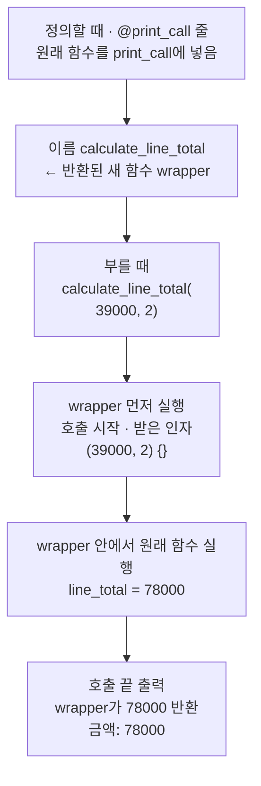
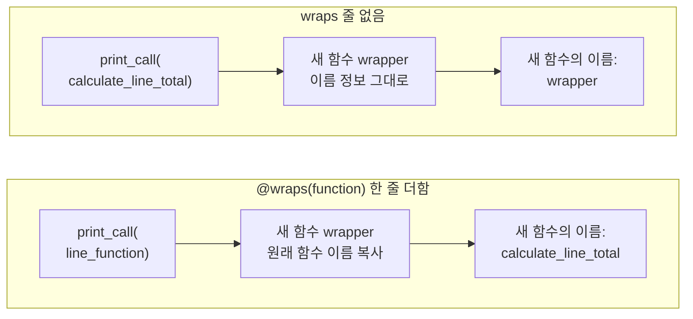
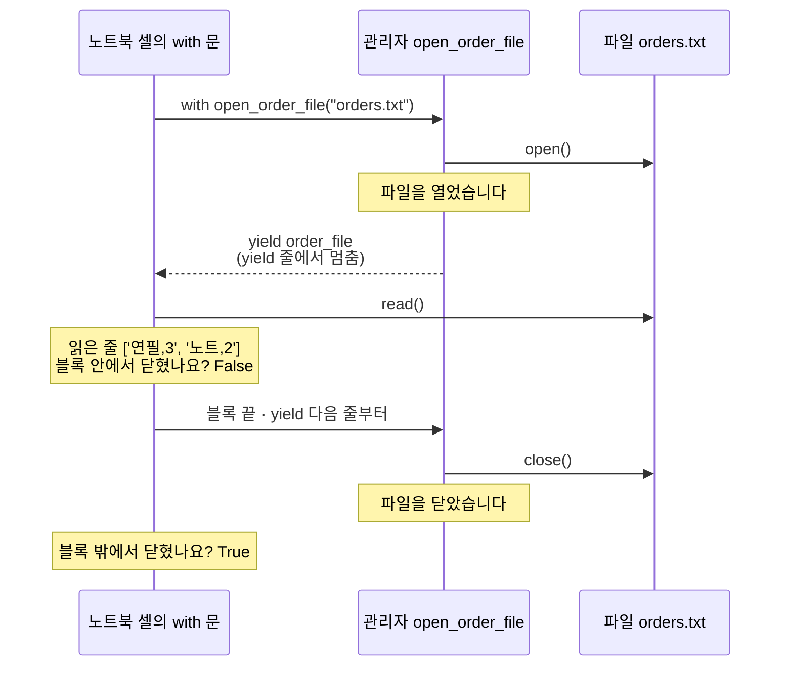
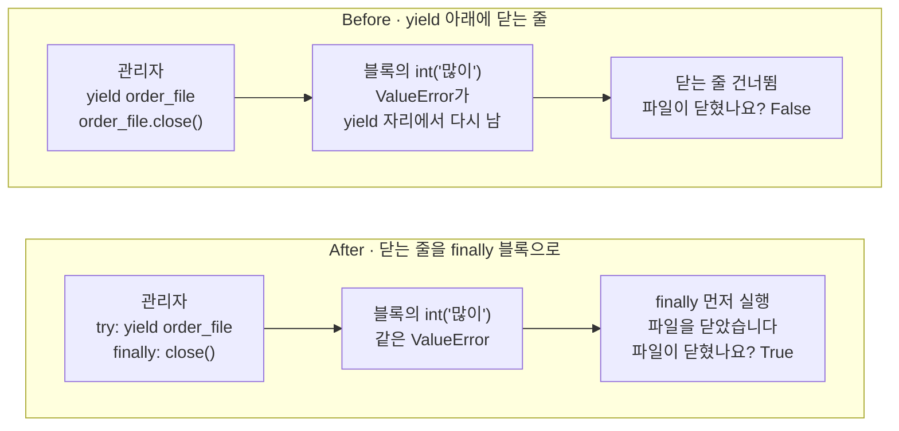

# 09-데코레이터와-컨텍스트-매니저

## _src 본문 (HTML 원본)

```html
<!--meta: 강의 1h | 실습 3h | 코드 Jupyter Notebook | 새 용어 8 -->
<h2 id="b1"><span class="no">1</span>학습 목표</h2>
<div class="goal"><ul><li>함수를 받아 새 함수를 반환하는 데코레이터를 정의하고, 정의 위의 <code>@</code> 줄이 하는 일을 출력으로 설명할 수 있습니다.</li><li><code>@wraps(function)</code> 줄로 장식한 함수의 이름을 원래 함수 이름으로 지킬 수 있습니다.</li><li>데코레이터 <code>@contextmanager</code>로 파일을 여닫는 관리자를 만들고, 닫는 줄을 <code>finally</code> 블록에 둘 수 있습니다.</li></ul></div>
<h2 id="b2"><span class="no">2</span>이 내용을 배우는 이유</h2>
<p>함수를 부를 때마다 기록을 출력하고 싶다면, 지금까지는 함수 본문을 고쳐야 했습니다. 같은 기록을 여러 함수에 붙이면 같은 줄을 여러 번 적게 됩니다. 데코레이터는 이 일을 함수 하나에 적어 두고, 정의 위 <code>@</code> 줄 하나로 붙입니다.</p>
<p>파일은 열었으면 닫아야 합니다. 5절 <code>with open()</code> 블록은 끝나면 파일을 닫았습니다. 우리가 직접 만든 관리자도 같은 약속을 지켜야 합니다.</p>
<p>흔한 실수는 정리하는 줄을 작업하는 줄 아래에 적어 두기만 하는 것입니다. 작업 중 오류가 나면 그 줄까지 가지 못합니다. <b>오류가 나도 실행해야 하는 줄은 finally 블록에 둡니다.</b></p>
<p><strong>이 절의 질문</strong> — 관리자로 연 파일에서 수량 글자 '많이'를 정수로 바꾸다 오류가 나면, 파일은 닫힐까요? 닫히게 하려면 닫는 줄을 어디에 두어야 할까요?</p>
<p>이 절은 확장 경로(B)입니다. 기본 경로(A)는 8절에서 12절로 이동합니다. Ch 19에서 쓰는 <code>@tool</code> 줄도 아래 함수를 감싸는 데코레이터라서, 이 절의 <code>@</code> 줄과 같은 규칙으로 읽습니다.</p>
<h2 id="b3"><span class="no">3</span>앞에서 배운 내용</h2>
<p>Ch 1과 1~8절에서 배운 것 가운데 이 절이 이어 쓰는 것을 표로 모았습니다.</p>
<table><thead><tr><th>앞 절</th><th>배운 것</th><th>이 절에서 이어 쓰는 곳</th></tr></thead><tbody>
<tr><td>1절</td><td>이름에 값을 담는 대입</td><td>함수를 이름 line_function에 담기</td></tr>
<tr><td>3절</td><td>튜플과 딕셔너리</td><td>새 함수가 받은 인자 <code>(39000, 2) {}</code></td></tr>
<tr><td>4절</td><td>함수 정의와 호출, <code>return</code>, 함수 안에서 만든 이름</td><td>데코레이터 print_call과 그 안의 함수 wrapper</td></tr>
<tr><td>5절</td><td>키워드 인자, <code>with open()</code>과 <code>file.closed</code>, <code>try</code>/<code>except ValueError</code>, bad_orders.txt의 '많이'</td><td>값 바꿔 보기 <code>quantity=3</code>, 관리자 open_order_file, Before/After의 오류</td></tr>
<tr><td>6절</td><td>밑줄 두 개로 둘러싼 특별한 이름 <code>__init__</code></td><td>원리 더 알아보기의 <code>__enter__</code>·<code>__exit__</code></td></tr>
<tr><td>7절</td><td>타입힌트 함수 <code>calculate_line_total(unit_price: int, quantity: int = 1) -&gt; int</code>의 78000·117000, 모듈 이름 <code>__name__</code></td><td>장식할 함수, 함수 이름 <code>__name__</code>, 관리자의 <code>file_name: str</code></td></tr>
<tr><td>8절</td><td>원리 더 알아보기의 <code>@pytest.mark.parametrize</code> 줄(출력만 읽음)</td><td>「@ 줄로 장식하기」에서 같은 규칙으로 되짚기</td></tr>
</tbody></table>
<p>7절에서 타입힌트를 기본 경로로 배웠으므로, 이 절도 장식할 함수와 관리자의 매개변수에 타입힌트를 적습니다. 함수를 받는 매개변수 function과 wrapper의 매개변수에는 적지 않습니다. 함수를 가리키는 자료형 이름은 아직 배우지 않았습니다.</p>
<p>이 절의 새 문법은 함수 안의 함수, <code>*args</code>·<code>**kwargs</code>, <code>@</code> 줄, <code>yield</code>, <code>finally</code> 블록입니다. 5절 끝에서 「with 블록의 원리는 9절에서 다시 본다」고 예고한 내용도 다룹니다. 모델을 부르지 않으므로 API 키가 필요 없습니다.</p>
<h2 id="b4"><span class="no">4</span>핵심 개념</h2>
<h3>비유로 시작하기</h3>
<p>창고 문을 열고 상자를 옮기다 상자를 떨어뜨렸다고 생각해 봅니다. 쏟아진 종이를 줍다 보면 문 닫는 일을 잊기 쉽습니다. 문 위에 문 닫힘 장치를 달아 두면, 무슨 일이 있어도 문은 저절로 닫힙니다.</p>
<p>파일을 여는 일은 문을 여는 일이고, 수량 글자를 정수로 바꾸다 난 오류는 떨어뜨린 상자입니다. finally 블록은 문 닫힘 장치입니다. 오류가 나도 그 안의 닫는 줄은 실행됩니다.</p>
{{img:09-5-문-닫힘-장치|가운데 세로줄 왼쪽에는 닫힘 장치가 없는 파란 문이 열린 채 서 있고 문 앞에 열린 상자와 쏟아진 종이가 있으며, 오른쪽에는 문 위에 회색 닫힘 장치를 단 같은 문이 닫혀 있고 문 앞에 같은 상자와 종이가 쏟아져 있는 삽화|상자가 쏟아졌는데 열린 채 남은 왼쪽 문은 파일이 닫히지 않은 Before, 같은 일이 있어도 닫힘 장치로 닫힌 오른쪽 문은 finally 블록이 파일을 닫은 After에 해당합니다.}}
<p><strong>그림 읽기</strong> — 가운데 세로줄 왼쪽 문에는 닫힘 장치가 없습니다. 문 앞에 열린 상자가 있고, 종이가 바닥에 쏟아졌습니다. 문은 열린 채 안쪽이 어둡게 보입니다. 오류가 난 뒤 <code>파일이 닫혔나요? False</code>가 나온 Before에 해당합니다.</p>
<p>세로줄 오른쪽 문 위에는 회색 닫힘 장치가 달려 있습니다. 문 앞의 상자와 종이는 왼쪽과 같지만 문은 닫혀 있습니다. 같은 오류가 났어도 finally 블록이 파일을 닫은 After에 해당합니다.</p>
<h3>이 절에서 쓰는 말</h3>
<table><thead><tr><th>용어</th><th>뜻</th><th>이 절에서 보이는 모습</th></tr></thead><tbody>
<tr><td>데코레이터(decorator)</td><td>함수를 인자로 받아, 기능을 더한 새 함수를 반환하는 함수</td><td>print_call, wraps, contextmanager</td></tr>
<tr><td>장식하기</td><td>함수 정의 바로 위에 @와 데코레이터를 적어, 원래 함수를 넣은 결과를 같은 이름에 저장하는 일</td><td><code>@print_call</code></td></tr>
<tr><td>감싸는 함수(wrapper)</td><td>데코레이터 안에서 정의해, 원래 함수 대신 불리는 새 함수</td><td><code>새 함수의 이름: wrapper</code></td></tr>
<tr><td>*args와 **kwargs</td><td>위치 인자를 튜플 하나로, 키워드 인자를 딕셔너리 하나로 모아 받는 매개변수</td><td><code>받은 인자: (39000,) {'quantity': 3}</code></td></tr>
<tr><td>wraps</td><td>원래 함수의 이름 같은 정보를 새 함수에 복사하는 데코레이터(모듈 functools)</td><td><code>새 함수의 이름: calculate_line_total</code></td></tr>
<tr><td>컨텍스트 매니저(context manager)</td><td>with 블록에 들어갈 때 준비하고, 나올 때 정리하는 규칙을 가진 값. 이 절에서는 줄여서 관리자</td><td><code>open_order_file("orders.txt")</code></td></tr>
<tr><td>yield 줄</td><td>값을 with 블록에 건네고, 블록이 끝날 때까지 그 자리에서 멈추는 줄</td><td><code>yield order_file</code></td></tr>
<tr><td>finally 블록</td><td>try 블록이 오류로 멈춰도, 오류 없이 끝나도 마지막에 실행되는 블록</td><td><code>파일을 닫았습니다: bad_orders.txt</code></td></tr>
</tbody></table>
<h3>함수를 값처럼 이름에 담기</h3>
<p>함수 이름 뒤에 괄호를 붙이면 함수가 실행됩니다. 괄호 없이 이름만 적으면 실행하지 않은 함수 자체를 가리킵니다. 노트북은 <code>line_function = calculate_line_total</code> 줄로 7절 함수를 다른 이름에 담았습니다.</p>
<p>새 이름으로 불러도 금액은 78000이었습니다. 함수의 속성 <code>__name__</code>에는 정의 줄에 적은 이름 calculate_line_total이 들어 있었습니다. 7절에서 모듈 이름을 읽은 속성과 같은 이름입니다.</p>
<h3>데코레이터와 감싸는 함수</h3>
<p>데코레이터(decorator)는 함수를 인자로 받아, 기능을 더한 새 함수를 반환하는 함수입니다. 여러 함수에 똑같이 붙일 일을 한곳에 적어 둘 때 씁니다. 노트북의 데코레이터 print_call은 원래 함수를 부르기 앞뒤에 기록을 한 줄씩 출력합니다.</p>
<p>함수 print_call의 본문은 함수 wrapper를 하나 더 정의하고, 괄호 없이 <code>return wrapper</code>로 반환합니다. 새 함수 wrapper는 print_call이 받은 원래 함수 function을 기억해 둡니다. 그리고 불릴 때마다 그 함수를 부릅니다.</p>
<p>매개변수 <code>*args</code>는 위치로 넣은 인자를 튜플 하나로 모읍니다. 매개변수 <code>**kwargs</code>는 이름을 붙여 넣은 키워드 인자를 딕셔너리 하나로 모읍니다. 줄 <code>function(*args, **kwargs)</code>는 모은 인자를 다시 풀어 원래 함수에 그대로 넘깁니다.</p>
<p>노트북에서 <code>print_call(calculate_line_total)</code>이 반환한 새 함수에 39000과 2를 넣었습니다. 출력은 <code>호출 시작: calculate_line_total</code>, <code>받은 인자: (39000, 2) {}</code>, <code>호출 끝: calculate_line_total</code>, <code>금액: 78000</code> 순서였습니다. 새 함수의 이름은 wrapper였습니다.</p>
<h3>@ 줄로 장식하기</h3>
<p>함수 정의 바로 위에 <code>@print_call</code>을 적으면, 정의가 끝나자마자 원래 함수가 print_call에 들어갑니다. 반환된 새 함수는 같은 이름 calculate_line_total에 저장됩니다. Python 문서는 정의 뒤에 <code>calculate_line_total = print_call(calculate_line_total)</code> 줄을 적는 것과 거의 같다고 설명합니다.</p>
<p>장식한 뒤에는 부르는 줄이 7절과 같아도 기록 세 줄이 붙었습니다. 부르는 곳을 고치지 않고, 정의 위에 줄 하나를 더해 기능을 붙인 것입니다.</p>
{{mermaid:09-1-데코레이터-호출-차례|정의할 때 @print_call 줄이 원래 함수를 print_call에 넣어 반환된 wrapper를 이름 calculate_line_total에 저장하고, 부를 때 calculate_line_total(39000, 2)가 wrapper를 먼저 실행해 호출 시작과 받은 인자 (39000, 2)와 빈 딕셔너리를 출력한 뒤 원래 함수가 78000을 계산하고, 호출 끝을 출력한 wrapper가 78000을 반환해 금액 78000이 출력되는 흐름도|장식한 함수를 한 번 부른 차례. 이름 calculate_line_total에는 wrapper가 들어 있어, 원래 함수는 wrapper 안에서 불립니다.}}
<p><strong>도식 읽기</strong> — 위에서 아래로 읽습니다. 파란 상자는 우리가 적은 코드, 초록 상자는 이름에 저장된 값, 노란 상자는 출력입니다. 맨 위 파란 상자는 정의할 때 한 번 일어납니다. 그 결과 초록 상자처럼 이름 calculate_line_total에 wrapper가 들어갑니다.</p>
<p>둘째 파란 상자부터는 부를 때마다 일어납니다. 첫 노란 상자에서 wrapper가 먼저 호출 시작과 받은 인자 <code>(39000, 2) {}</code>를 출력합니다. 셋째 파란 상자에서 원래 함수가 78000을 계산합니다. 마지막 노란 상자에서 호출 끝을 출력한 wrapper가 78000을 반환합니다.</p>
<p>8절 원리 더 알아보기의 <code>@pytest.mark.parametrize(...)</code> 줄도 같은 <code>@</code> 줄입니다. 괄호 안 입력 묶음을 담은 데코레이터가 아래 테스트 함수를 받고, 그 결과가 같은 이름에 저장됩니다. pytest 9.1.1 소스를 보면 이 데코레이터는 함수를 감싸지 않고, 입력 묶음 표시만 붙인 같은 함수를 반환합니다.</p>
<h3>컨텍스트 매니저와 yield</h3>
<p>컨텍스트 매니저(context manager)는 with 블록에 들어갈 때 준비하고, 나올 때 정리하는 규칙을 가진 값입니다. 이 절에서는 줄여서 관리자라고 부릅니다. 5절에서 <code>open()</code>이 반환한 파일도 관리자라서, with 블록이 끝나면 닫혔습니다.</p>
<p>모듈 contextlib의 <code>contextmanager</code>는 함수 하나로 관리자를 만들게 해 주는 데코레이터입니다. 줄 <code>@contextmanager</code>는 아래 함수를 with 문에서 쓸 수 있는 함수로 바꿔 같은 이름에 저장합니다. 앞에서 본 <code>@</code> 줄과 같은 규칙입니다.</p>
<p>함수 본문의 <code>yield</code> 줄은 값을 with 블록에 건네고, 블록이 끝날 때까지 그 자리에서 멈춥니다. 건넨 값은 with 줄의 <code>as</code> 뒤 이름에 들어갑니다. 블록이 끝나면 함수는 멈춘 자리 다음 줄부터 이어서 실행합니다. 그래서 yield 줄 위에는 준비하는 줄을, 아래에는 정리하는 줄을 적습니다.</p>
<h3>오류가 나도 실행되는 finally 블록</h3>
<p>try 블록 뒤에는 except 블록 말고 finally 블록도 붙일 수 있습니다. 이 블록은 try 블록이 오류로 멈춰도, 오류 없이 끝나도 마지막에 실행됩니다. 5절에서는 오류를 받는 except 블록만 붙였습니다.</p>
<p>Python 문서는 with 블록에서 오류가 나면, 그 오류가 관리자 함수의 yield 자리에서 다시 일어난다고 설명합니다. 그래서 yield 줄을 try 블록에 넣고 정리하는 줄을 finally 블록에 두면, 오류가 나도 정리하는 줄이 실행됩니다. 이 절의 After가 이 모양입니다.</p>
<h2 id="b5"><span class="no">5</span>실행 예제</h2>
<p>노트북은 5절·7절·8절처럼 빈 임시 폴더로 작업 위치를 옮기고 시작합니다. 7절 타입힌트 함수 <code>calculate_line_total()</code>을 정의하고, 이름 line_function에 담아 금액 78000을 얻습니다. 이어서 데코레이터 print_call을 정의해 원래 함수를 직접 넣어 보고, <code>@</code> 줄로 장식해 부릅니다.</p>
<p>값 바꿔 보기에서는 수량을 키워드 인자 <code>quantity=3</code>으로 넣습니다. 그다음 wraps 줄을 더한 데코레이터로 새 함수의 이름을 확인합니다. 마지막으로 5절과 같은 주문 파일 두 개를 만들고, 관리자 open_order_file로 orders.txt를 읽습니다.</p>
{{notebook:09-데코레이터와-컨텍스트-매니저|example}}
<p class="look"><b>확인할 점</b> — <code>@</code> 줄로 장식한 뒤 부르는 줄은 7절과 같은데, 기록 세 줄이 붙었는지 봅니다. 값 바꿔 보기에서 받은 인자가 <code>(39000,) {'quantity': 3}</code>, 금액이 117000인지 확인합니다. 관리자 셀에서는 <code>블록 안에서 닫혔나요? False</code> 뒤에 파일을 닫았습니다 줄이 나오는지 봅니다.</p>
<h3>키워드 인자가 들어간 자리</h3>
<p>값 바꿔 보기의 받은 인자 줄은 <code>받은 인자: (39000,) {'quantity': 3}</code>이었습니다. 위치로 넣은 단가 39000은 값 하나짜리 튜플 (39000,)에 들어갔습니다. 이름을 붙여 넣은 수량은 딕셔너리 {'quantity': 3}에 들어갔습니다.</p>
<p>줄 <code>function(*args, **kwargs)</code>는 튜플을 위치 인자로, 딕셔너리를 같은 이름의 키워드 인자로 풀어 넘깁니다. 원래 함수는 수량 3을 받아, 7절 값 바꿔 보기와 같은 117000을 반환했습니다.</p>
<h3>wraps로 원래 함수의 이름 지키기</h3>
<p>장식한 함수의 이름이 wrapper로 바뀌면, 출력이나 오류 메시지에서 어느 함수인지 알아보기 어렵습니다. 모듈 functools의 <code>wraps</code>는 원래 함수의 이름 같은 정보를 새 함수에 복사하는 데코레이터입니다. 노트북은 wrapper 정의 바로 위에 <code>@wraps(function)</code> 줄 하나를 더했습니다. 괄호가 붙은 <code>@wraps(function)</code> 줄은 원래 함수 function으로 만든 데코레이터를 씁니다. 이 데코레이터는 새 함수를 만들지 않고, 이름을 복사한 같은 wrapper를 반환합니다.</p>
<p>이름 line_function에 담아 둔 원래 함수를 넣자, 기록 세 줄과 금액 78000은 그대로 나왔습니다. 새 함수의 이름만 <code>calculate_line_total</code>로 바뀌었습니다. Python 문서는 wraps가 이름 말고도 함수 설명 글 같은 정보를 복사한다고 적지만, 이 절에서는 이름만 확인했습니다.</p>
{{mermaid:09-2-wraps-이름-비교|위 칸은 wraps 줄이 없는 print_call에 calculate_line_total을 넣어 새 함수 wrapper가 이름 정보를 그대로 가져 새 함수의 이름이 wrapper로 출력되고, 아래 칸은 @wraps(function) 줄을 더한 print_call에 line_function을 넣어 wrapper에 원래 함수 이름이 복사되어 새 함수의 이름이 calculate_line_total로 출력되는 비교 그림|wraps 줄 하나의 차이. 두 칸 모두 새 함수는 wrapper이지만, wraps 줄을 더하면 원래 함수의 이름이 복사됩니다.}}
<p><strong>도식 읽기</strong> — 위 칸은 wraps 줄이 없는 데코레이터, 아래 칸은 wraps 줄을 더한 데코레이터입니다. 칸 안은 왼쪽에서 오른쪽으로 읽습니다. 파란 상자는 데코레이터를 부른 줄, 초록 상자는 반환된 새 함수, 노란 상자는 출력입니다.</p>
<p>두 칸의 초록 상자는 모두 새 함수 wrapper입니다. 위 칸 노란 상자의 이름은 wrapper입니다. 원래 함수 이름을 복사한 아래 칸 노란 상자에는 calculate_line_total이 나왔습니다.</p>
<h3>관리자가 실행되는 차례</h3>
<p>관리자 셀의 출력은 <code>파일을 열었습니다: orders.txt</code>로 시작했습니다. 이어서 <code>읽은 줄: ['연필,3', '노트,2']</code>와 <code>블록 안에서 닫혔나요? False</code>가 나왔습니다. 마지막은 <code>파일을 닫았습니다: orders.txt</code>와 <code>블록 밖에서 닫혔나요? True</code>였습니다.</p>
{{mermaid:09-3-with-블록-차례|노트북 셀의 with 문, 관리자 open_order_file, 파일 orders.txt 세 줄로 이루어진 순서도. with 문이 관리자를 쓰면 관리자가 파일을 열어 파일을 열었습니다를 출력하고 yield 줄에서 파일을 건넨 뒤 멈추고, with 블록이 파일을 읽어 읽은 줄과 블록 안 닫힘 False를 출력하고, 블록이 끝나면 관리자가 yield 다음 줄부터 이어서 파일을 닫아 파일을 닫았습니다를 출력하고 블록 밖 닫힘 True가 나옴|관리자로 파일 하나를 읽은 차례. 관리자는 yield 줄에서 멈췄다가, with 블록이 끝난 뒤 이어서 파일을 닫습니다.}}
<p><strong>도식 읽기</strong> — 위에서 아래로 시간 순서입니다. 세로줄 세 개는 노트북 셀의 with 문, 관리자 open_order_file, 파일 orders.txt입니다. 관리자는 파일을 열고, yield 줄에서 파일을 with 문에 건넨 뒤 멈춥니다.</p>
<p>노란 메모처럼 with 블록은 파일을 읽었고, 블록 안에서는 파일이 닫히지 않았습니다. 블록이 끝나자 관리자가 yield 다음 줄부터 이어서 파일을 닫았습니다. 그래서 마지막 메모의 블록 밖 결과는 True입니다.</p>
<h2 id="b6"><span class="no">6</span>일부러 실패해 보기</h2>
<p>Before 셀은 같은 관리자로 bad_orders.txt를 열고, 첫 줄의 수량 글자 '많이'를 <code>int()</code>로 바꿉니다. 5절에서 본 것처럼 이 줄에서 <code>ValueError</code>가 납니다. 오류를 관찰하려고 5절처럼 <code>try</code>와 <code>except ValueError</code>로 감쌌습니다.</p>
<p>출력은 <code>파일을 열었습니다: bad_orders.txt</code>, <code>오류 메시지: invalid literal for int() with base 10: '많이'</code>, <code>파일이 닫혔나요? False</code> 세 줄이었습니다. 파일을 닫았습니다 줄은 나오지 않았습니다. 블록에서 난 오류가 yield 자리에서 다시 일어나, 관리자 함수가 아래의 닫는 두 줄을 건너뛰었습니다.</p>
<p>After 셀은 관리자 함수에서 yield 줄을 try 블록에 넣고, 닫는 두 줄을 finally 블록으로 옮겼습니다. 파일과 오류가 나는 줄은 Before와 같습니다. 출력은 <code>파일을 열었습니다: bad_orders.txt</code>, <code>파일을 닫았습니다: bad_orders.txt</code>, 같은 오류 메시지, <code>파일이 닫혔나요? True</code> 순서였습니다.</p>
<p>파일을 닫았습니다 줄이 오류 메시지보다 먼저 나왔습니다. 오류가 셀의 except 블록에 닿기 전에, 관리자 안의 finally 블록이 먼저 실행되었습니다. 오류는 사라지지 않았고 같은 메시지가 나왔습니다. After 셀 끝의 <code>assert order_file.closed</code>에서도 멈추지 않았습니다.</p>
{{mermaid:09-4-before-after-비교|Before는 yield order_file 아래에 order_file.close()를 둔 관리자에서 블록의 int('많이') ValueError가 yield 자리에서 다시 일어나 닫는 줄을 건너뛰고 파일이 닫혔나요? False가 나오고, After는 try: yield order_file과 finally: close()로 고친 관리자에서 같은 ValueError가 나도 finally가 먼저 실행되어 파일을 닫았습니다와 파일이 닫혔나요? True가 나오는 비교 그림|같은 오류, 다른 정리. 닫는 줄이 yield 아래에만 있으면 False, finally 블록에 있으면 True입니다.}}
<p><strong>도식 읽기</strong> — 위 칸이 Before, 아래 칸이 After이고, 칸 안은 왼쪽에서 오른쪽으로 읽습니다. 파란 상자는 우리가 적은 관리자와 블록의 줄입니다. 두 칸의 가운데 파란 상자는 같은 <code>int('많이')</code>에서 난 같은 ValueError입니다.</p>
<p>Before 칸은 닫는 줄을 건너뛰어 빨간 상자 <code>파일이 닫혔나요? False</code>로 이어집니다. After 칸은 finally 블록이 먼저 실행되어 노란 상자 <code>파일이 닫혔나요? True</code>로 이어집니다. 두 칸에서 달라진 곳은 왼쪽 파란 상자의 try와 finally뿐입니다.</p>
{{notebook:09-데코레이터와-컨텍스트-매니저|failure}}
<h3>확인한 범위</h3>
<p>이번에 확인한 오류는 수량 글자 '많이'에서 난 ValueError 한 가지입니다. 파일이 없어 <code>open()</code> 줄에서 오류가 나는 경우는 실행하지 않았습니다. 코드에서 open() 줄은 try 블록보다 위에 있습니다.</p>
<p>원리 더 알아보기 셀에서는 with 문이 부르는 두 메서드 <code>__enter__</code>와 <code>__exit__</code>를 찾아보았습니다. 5절 open() 파일과 우리 관리자 모두 네 줄이 <code>True</code>였습니다. 관리자 함수를 with 문 없이 부르기만 했을 때는 파일을 열었습니다 줄이 나오지 않았습니다.</p>
<p>데코레이터 print_call은 매개변수가 두 개인 함수 calculate_line_total에만 붙였습니다. 인자 개수가 다른 함수에 같은 데코레이터를 붙이는 장면은 이번에 실행하지 않았습니다.</p>
<h2 id="b7"><span class="no">7</span>주의할 점과 실무 메모</h2>
<ul><li>데코레이터의 wrapper에는 원래 함수의 반환값을 반환하는 <code>return result</code> 줄을 둡니다. 4절에서 본 것처럼 return 줄이 없으면 None이 반환됩니다. return 줄이 없는 wrapper로 장식하는 장면은 이번에 실행하지 않았습니다.</li>
<li>데코레이터를 만들 때는 wrapper 위에 <code>@wraps(function)</code> 줄을 적습니다. 노트북에서 이 줄이 없을 때 새 함수의 이름이 wrapper로 나왔습니다.</li>
<li>관리자에서 정리하는 줄은 finally 블록에 둡니다. yield 줄 아래에만 두면, Before처럼 블록에서 오류가 날 때 실행되지 않습니다.</li>
<li>finally 블록은 오류를 없애지 않습니다. After에서도 같은 오류 메시지가 나왔고, 오류는 셀의 except 블록이 받았습니다.</li>
<li>파일을 열고 닫기만 한다면 5절처럼 <code>with open()</code>을 그대로 씁니다. 이 절의 관리자는 with 문의 규칙을 보려고 open()을 한 번 감싼 예입니다.</li>
<li>Python 3.12에서 실행한 결과입니다. 모듈 functools와 contextlib는 Python에 들어 있어 따로 설치하지 않습니다.</li></ul>
<h2 id="b8"><span class="no">8</span>정리와 다음 절</h2>
<ul><li>데코레이터는 함수를 받아 새 함수를 반환합니다. 정의 위의 <code>@print_call</code>은 원래 함수를 넣고, 반환된 wrapper를 같은 이름에 저장합니다.</li><li><code>@wraps(function)</code> 줄 하나로 새 함수의 이름이 wrapper에서 calculate_line_total로 바뀌었습니다.</li><li>관리자의 yield 아래에 둔 닫는 줄은 블록의 오류 때문에 실행되지 않았습니다. 닫는 줄을 finally 블록으로 옮기자 같은 오류에서도 <code>파일이 닫혔나요? True</code>가 나왔습니다.</li></ul>
<p><strong>다음 학습과 이어지는 지점</strong> — 확장 경로(B)는 <a href="10-Pydantic.html">10절 Pydantic</a>으로 이어집니다. 기본 경로(A)는 <a href="12-async와-await.html">12절 async와 await</a>로 이동합니다. Ch 19에서 쓰는 <code>@tool</code> 줄도 이 절에서 배운 <code>@</code> 줄입니다.</p>
<h2 id="b9"><span class="no">9</span>복습 문제</h2><details class="quiz"><summary>문제와 해설</summary>
<p class="quiz-q">1. 줄 <code>line_function = calculate_line_total</code>과 줄 <code>line_total = calculate_line_total(39000, 2)</code>는 무엇이 다른가요? · 기초</p><p class="quiz-a"><b>해설</b> — 괄호 없이 이름만 적은 첫 줄은 함수를 실행하지 않고, 함수 자체를 다른 이름에 담습니다. 괄호와 인자를 붙인 둘째 줄은 함수를 실행해 반환값 78000을 담습니다. 노트북에서 line_function으로 불러도 금액 78000이 나왔습니다.</p>
<p class="quiz-q">2. 장식한 함수를 <code>calculate_line_total(39000, 2)</code>로 불렀을 때 나온 네 줄의 순서를 쓰고, 그 순서가 된 이유를 쓰세요. · 기초</p><p class="quiz-a"><b>해설</b> — 호출 시작, 받은 인자 (39000, 2) {}, 호출 끝, 금액 78000 순서입니다. 이름 calculate_line_total에는 wrapper가 들어 있어 wrapper가 먼저 실행됩니다. 새 함수 wrapper는 기록 두 줄을 출력한 뒤 원래 함수를 부르고, 호출 끝을 출력한 다음 78000을 반환합니다. 금액 줄은 반환값을 받은 셀이 마지막에 출력했습니다.</p>
<p class="quiz-q">3. 값 바꿔 보기에서 받은 인자 줄이 <code>(39000,) {'quantity': 3}</code>으로 나온 이유를 매개변수 <code>*args</code>와 <code>**kwargs</code>로 설명하세요. · 적용</p><p class="quiz-a"><b>해설</b> — 단가 39000은 위치로 넣었으므로 <code>*args</code>의 튜플에 들어갔습니다. 값이 하나라서 (39000,)으로 나옵니다. 수량은 <code>quantity=3</code>으로 이름을 붙여 넣었으므로 <code>**kwargs</code>의 딕셔너리에 들어갔습니다. 새 함수 wrapper는 둘을 다시 풀어 원래 함수에 넘겨 117000을 받았습니다.</p>
<p class="quiz-q">4. wraps 줄이 없는 데코레이터로 장식하면 함수의 이름이 무엇으로 나오나요? 그 이유와 고친 방법을 쓰세요. · 적용</p><p class="quiz-a"><b>해설</b> — 이름은 wrapper로 나옵니다. 데코레이터가 반환한 새 함수가 데코레이터 안에서 이름 wrapper로 정의한 함수이기 때문입니다. wrapper 정의 위에 <code>@wraps(function)</code> 줄을 더하면 원래 함수의 이름이 복사되어 calculate_line_total로 나옵니다.</p>
<p class="quiz-q">5. Before에서 파일을 닫았습니다 줄이 나오지 않고 <code>파일이 닫혔나요? False</code>가 나온 이유를 yield 줄과 오류로 설명하세요. · 분석</p><p class="quiz-a"><b>해설</b> — 관리자 함수는 yield 줄에서 멈춘 채 with 블록을 기다렸습니다. 블록의 <code>int('많이')</code>에서 난 ValueError가 yield 자리에서 다시 일어나, 관리자 함수도 그 줄에서 멈췄습니다. 그래서 yield 아래의 닫는 두 줄이 실행되지 않았습니다.</p>
<p class="quiz-q">6. After 출력에서 파일을 닫았습니다 줄이 오류 메시지보다 먼저 나왔습니다. 이 순서가 알려 주는 것을 쓰고, 오류가 사라지지 않았다는 근거도 함께 쓰세요. · 분석</p><p class="quiz-a"><b>해설</b> — 오류가 셀의 except 블록에 닿기 전에 관리자 안의 finally 블록이 먼저 실행되었다는 뜻입니다. 오류는 finally 블록을 지난 뒤 셀까지 전해졌습니다. 그 근거로 Before와 같은 <code>오류 메시지: invalid literal for int() with base 10: '많이'</code>가 After에서도 출력되었습니다.</p>
</details>
<h2 id="b10"><span class="no">10</span>참고 자료</h2>
<ul><li><a href="https://docs.python.org/3.12/reference/compound_stmts.html#function-definitions">Python 3.12 언어 참조 8.7: 함수 정의(데코레이터)</a> · 확인 2026-09-16 · 기준 Python 3.12</li><li><a href="https://docs.python.org/3.12/reference/compound_stmts.html#the-try-statement">Python 3.12 언어 참조 8.4: try 문</a> · 확인 2026-09-16 · 기준 Python 3.12</li><li><a href="https://docs.python.org/3.12/reference/compound_stmts.html#the-with-statement">Python 3.12 언어 참조 8.5: with 문</a> · 확인 2026-09-16 · 기준 Python 3.12</li><li><a href="https://docs.python.org/3.12/tutorial/controlflow.html#unpacking-argument-lists">Python 3.12 자습서 4.9.5: 인자 목록 풀기</a> · 확인 2026-09-16 · 기준 Python 3.12</li><li><a href="https://docs.python.org/3.12/library/functools.html#functools.wraps">Python 3.12 functools.wraps</a> · 확인 2026-09-16 · 기준 Python 3.12</li><li><a href="https://docs.python.org/3.12/library/contextlib.html#contextlib.contextmanager">Python 3.12 contextlib.contextmanager</a> · 확인 2026-09-16 · 기준 Python 3.12</li><li><a href="https://docs.pytest.org/en/stable/how-to/parametrize.html">pytest 문서 · 매개변수화</a> · 확인 2026-09-16 · 기준 pytest 9.1.1</li></ul>
```

## 노트북 셀 (순서대로)

### [0] markdown {'html': 'skip'}

# 데코레이터와 컨텍스트 매니저

**이 노트북에서 할 일**

1. 함수를 받아 앞뒤에 기록을 출력하는 새 함수를 만들고, `@` 줄로 7절 함수에 붙입니다.
2. 파일을 열고 닫는 관리자를 `@contextmanager`로 만들어 with 문에서 씁니다.
3. 오류가 나도 파일이 닫히도록, 닫는 줄을 `finally` 블록으로 옮깁니다.

**준비물** — API 키 불필요. 모델 호출은 0번이고 비용은 들지 않습니다. 실행 시간은 1분 이내입니다.

이 절은 확장 경로(B)입니다. 쓰는 모듈은 Python에 들어 있는 functools와 contextlib뿐입니다.
1~8절과 같은 실습 폴더 `labs/part1/ch02-python`의 `.venv`를 커널로 고르고, 첫 셀부터 순서대로 실행합니다.

### [1] markdown {'html': 'skip'}

## 오늘 볼 그림


위에서 아래로 읽습니다. 파란 상자는 우리가 적은 코드, 초록 상자는 이름에 저장된 값, 노란 상자는 출력입니다.

이름 calculate_line_total로 부르면 원래 함수보다 새 함수 wrapper가 먼저 실행됩니다. 원래 함수는 wrapper 안에서 불립니다.

### [2] markdown {}

## 1. 준비

이 노트북은 뒤에서 주문 파일 두 개를 만듭니다. 5절·7절·8절처럼 빈 임시 폴더를 만들고, 그 폴더로 작업 위치를 옮깁니다.

### [3] code {'execution': {'iopub.execute_input': '2026-09-16T09:00:00.908627Z', 'iopub.status.busy': '2026-09-16T09:00:00.908445Z', 'iopub.status.idle': '2026-09-16T09:00:00.913592Z', 'shell.execute_reply': '2026-09-16T09:00:00.913068Z'}, 'lesson_role': 'setup'}

```python
# 파일을 둘 빈 임시 폴더를 만들고, 그 폴더로 작업 위치를 옮깁니다
import os
import tempfile

# mkdtemp()는 운영체제 임시 폴더 안에 새 폴더를 만들고 그 경로를 반환합니다
practice_folder = tempfile.mkdtemp(prefix="ch02-09-")
# chdir()는 터미널의 cd처럼 현재 작업 폴더를 옮깁니다
os.chdir(practice_folder)
file_names = os.listdir()
print("현재 작업 폴더의 파일:", file_names)
```

출력:
```
현재 작업 폴더의 파일: []

```

### [4] markdown {}

**결과 읽기** — 현재 작업 폴더의 파일은 `[]`로, 빈 폴더에서 시작합니다.
폴더의 경로는 컴퓨터마다 달라서 출력하지 않았습니다.

### [5] markdown {}

## 2. 함수도 값처럼 이름에 담기

먼저 7절에서 타입힌트를 적은 함수 `calculate_line_total()`을 다시 정의합니다. 정의 줄은 7절과 같습니다.
7절 노트북에서 단가 39000, 수량 2를 넣어 78000을 얻었습니다.

실행 전에 예상합니다. 정의 셀이라 출력은 없을 것입니다.

### [6] code {'execution': {'iopub.execute_input': '2026-09-16T09:00:00.914740Z', 'iopub.status.busy': '2026-09-16T09:00:00.914625Z', 'iopub.status.idle': '2026-09-16T09:00:00.916883Z', 'shell.execute_reply': '2026-09-16T09:00:00.916281Z'}}

```python
# 7절과 같은 타입힌트 함수를 정의합니다
def calculate_line_total(unit_price: int, quantity: int = 1) -> int:
    line_total = unit_price * quantity
    return line_total
```

출력:
```

```

### [7] markdown {}

**결과 읽기** — 예상대로 출력이 없습니다. 정의 셀은 함수를 만들어 이름에 저장만 합니다.

### [8] markdown {}

함수 이름 뒤에 괄호를 붙이면 함수가 실행됩니다. 괄호 없이 이름만 적으면, 실행하지 않은 함수 자체를 가리킵니다.
그래서 1절에서 숫자를 이름에 담은 것처럼, 함수도 다른 이름에 담을 수 있습니다.

7절에서 모듈 이름을 속성 `__name__`으로 읽었습니다. 함수에도 같은 속성이 있고, 정의 줄에 적은 이름이 들어 있습니다.

실행 전에 예상합니다. 새 이름 line_function으로 불러도 금액은 78000일 것입니다.

### [9] code {'execution': {'iopub.execute_input': '2026-09-16T09:00:00.918070Z', 'iopub.status.busy': '2026-09-16T09:00:00.917960Z', 'iopub.status.idle': '2026-09-16T09:00:00.920591Z', 'shell.execute_reply': '2026-09-16T09:00:00.920051Z'}}

```python
# 함수 이름을 괄호 없이 적어, 함수 자체를 다른 이름에 담습니다
line_function = calculate_line_total
# 속성 __name__에는 정의 줄에 적은 함수 이름이 들어 있습니다
print("담긴 함수의 이름:", line_function.__name__)
# 새 이름 뒤에 괄호와 인자를 붙이면 담긴 함수가 실행됩니다
line_total = line_function(39000, 2)
print("금액:", line_total)
```

출력:
```
담긴 함수의 이름: calculate_line_total
금액: 78000

```

### [10] markdown {}

**결과 읽기** — 담긴 함수의 이름은 `calculate_line_total`이고, 금액은 `78000`으로 예상과 같습니다.
이름 line_function과 calculate_line_total은 같은 함수를 가리킵니다. 뒤에서 이름 line_function에 담아 둔 이 원래 함수를 다시 씁니다.

### [11] markdown {}

## 3. 함수를 받아 새 함수를 반환하는 데코레이터

데코레이터(decorator)는 함수를 인자로 받아, 기능을 더한 새 함수를 반환하는 함수입니다.
여러 함수에 똑같이 붙일 기록 출력 같은 일을 한곳에 적어 둘 때 씁니다.

아래 함수 `print_call()`은 매개변수 function으로 함수를 받습니다. 본문에서는 함수 wrapper를 하나 더 정의합니다.
함수 안에서 정의한 wrapper가 원래 함수 대신 불릴 새 함수입니다. 새 함수 wrapper는 원래 함수를 부르기 앞뒤에 한 줄씩 출력합니다.

새 함수 wrapper의 매개변수 `*args`는 위치로 넣은 인자를 튜플 하나로 받습니다. 매개변수 `**kwargs`는 이름을 붙여 넣은 키워드 인자를 딕셔너리 하나로 받습니다.
호출 줄 `function(*args, **kwargs)`는 받은 인자를 다시 풀어 원래 함수에 그대로 넘깁니다. 그래서 인자 개수가 다른 함수에도 붙일 수 있습니다. 이 장면은 이번에 실행하지 않았습니다.

매개변수 function과 wrapper에는 타입힌트를 적지 않습니다. 함수를 가리키는 자료형 이름은 7절에서 배우지 않았습니다.
실행 전에 예상합니다. 정의 셀이라 출력은 없을 것입니다.

### [12] code {'execution': {'iopub.execute_input': '2026-09-16T09:00:00.921706Z', 'iopub.status.busy': '2026-09-16T09:00:00.921597Z', 'iopub.status.idle': '2026-09-16T09:00:00.924277Z', 'shell.execute_reply': '2026-09-16T09:00:00.923820Z'}, 'upgrade_allow': ['nested_def', 'varargs_def']}

```python
# 함수를 받아, 부르기 앞뒤에 기록을 출력하는 새 함수를 반환하는 데코레이터를 정의합니다
def print_call(function):
    # 함수 안에서 정의한 wrapper가 원래 함수 대신 불릴 새 함수입니다
    def wrapper(*args, **kwargs):
        print("호출 시작:", function.__name__)
        # args는 위치 인자의 튜플, kwargs는 키워드 인자의 딕셔너리입니다
        print("받은 인자:", args, kwargs)
        # 받은 인자를 풀어 원래 함수에 넘기고, 반환값을 받아 둡니다
        result = function(*args, **kwargs)
        print("호출 끝:", function.__name__)
        return result
    # 괄호 없이 적어, 부르지 않은 wrapper 함수 자체를 반환합니다
    return wrapper
```

출력:
```

```

### [13] markdown {}

**결과 읽기** — 예상대로 출력이 없습니다. 함수 wrapper는 print_call을 부를 때마다 새로 만들어집니다.

### [14] markdown {}

데코레이터 `print_call()`에 원래 함수를 괄호 없이 넣어 새 함수를 받습니다. 받은 새 함수에 이름 logged_total을 붙입니다.
그다음 logged_total에 단가 39000과 수량 2를 넣어 부릅니다.

실행 전에 예상합니다. 호출 시작과 받은 인자, 호출 끝이 출력되고 금액은 78000일 것입니다. 새 함수의 이름은 무엇일까요?

### [15] code {'execution': {'iopub.execute_input': '2026-09-16T09:00:00.925322Z', 'iopub.status.busy': '2026-09-16T09:00:00.925230Z', 'iopub.status.idle': '2026-09-16T09:00:00.927516Z', 'shell.execute_reply': '2026-09-16T09:00:00.926987Z'}}

```python
# 데코레이터에 원래 함수를 넣어 새 함수를 받고, 새 함수를 부릅니다
logged_total = print_call(calculate_line_total)
line_total = logged_total(39000, 2)
print("금액:", line_total)
print("새 함수의 이름:", logged_total.__name__)
```

출력:
```
호출 시작: calculate_line_total
받은 인자: (39000, 2) {}
호출 끝: calculate_line_total
금액: 78000
새 함수의 이름: wrapper

```

### [16] markdown {}

**결과 읽기** — 출력 첫 줄은 `호출 시작: calculate_line_total`, 둘째 줄은 `받은 인자: (39000, 2) {}`입니다. 이어서 `호출 끝: calculate_line_total`과 `금액: 78000`이 나왔습니다.

튜플 (39000, 2)는 위치로 넣은 두 인자이고, 빈 딕셔너리 {}는 키워드 인자가 없다는 뜻입니다.
새 함수의 이름은 `wrapper`입니다. 기록 줄에는 원래 함수 이름이 나오지만, 반환된 함수 자체는 wrapper입니다.

### [17] markdown {}

## 4. @ 줄로 장식하기

함수 정의 바로 위에 `@print_call`을 적으면, 정의가 끝나자마자 원래 함수가 print_call에 들어갑니다.
반환된 새 함수는 같은 이름 calculate_line_total에 저장됩니다. 줄 `calculate_line_total = print_call(calculate_line_total)`을 정의 뒤에 적는 것과 거의 같습니다.
이렇게 함수 위에 `@`와 데코레이터 이름을 적는 일을 「장식한다」고 합니다.

8절 원리 더 알아보기의 `@pytest.mark.parametrize(...)` 줄도 같은 `@` 줄입니다.
괄호 안 입력 묶음을 담은 데코레이터가 아래 테스트 함수를 받아 처리한 결과가 같은 이름에 저장됩니다.

실행 전에 예상합니다. 장식은 정의할 때 일어나지만 print_call은 출력하는 줄이 없으므로, 출력은 없을 것입니다.

### [18] code {'execution': {'iopub.execute_input': '2026-09-16T09:00:00.928553Z', 'iopub.status.busy': '2026-09-16T09:00:00.928453Z', 'iopub.status.idle': '2026-09-16T09:00:00.930453Z', 'shell.execute_reply': '2026-09-16T09:00:00.929996Z'}}

```python
# @ 줄로 calculate_line_total을 print_call에 넣고, 새 함수를 같은 이름에 저장합니다
@print_call
def calculate_line_total(unit_price: int, quantity: int = 1) -> int:
    line_total = unit_price * quantity
    return line_total
```

출력:
```

```

### [19] markdown {}

**결과 읽기** — 예상대로 출력이 없습니다. 이제 이름 calculate_line_total에는 장식한 새 함수가 들어 있습니다.

### [20] markdown {}

장식한 함수를 7절과 같은 방법으로 부릅니다. 부르는 줄에는 print_call이 보이지 않습니다.

실행 전에 예상합니다. 3번에서 본 기록 세 줄과 금액 78000이 나오고, 함수의 이름은 wrapper일 것입니다.

### [21] code {'execution': {'iopub.execute_input': '2026-09-16T09:00:00.931412Z', 'iopub.status.busy': '2026-09-16T09:00:00.931299Z', 'iopub.status.idle': '2026-09-16T09:00:00.933449Z', 'shell.execute_reply': '2026-09-16T09:00:00.932955Z'}}

```python
# 장식한 함수를 7절처럼 단가 39000, 수량 2로 부릅니다
line_total = calculate_line_total(39000, 2)
print("금액:", line_total)
print("함수의 이름:", calculate_line_total.__name__)
```

출력:
```
호출 시작: calculate_line_total
받은 인자: (39000, 2) {}
호출 끝: calculate_line_total
금액: 78000
함수의 이름: wrapper

```

### [22] markdown {}

**결과 읽기** — `호출 시작: calculate_line_total`부터 `금액: 78000`까지 3번과 같은 네 줄이 나왔습니다. 함수의 이름은 `wrapper`로 예상과 같습니다.

부르는 줄을 바꾸지 않고, 정의 위에 `@` 줄 하나를 더해 기록 출력이 붙었습니다.

### [23] markdown {}

## 5. 값 바꿔 보기 — 수량을 키워드 인자로 넣기

5절에서 매개변수 이름을 붙여 인자를 넣는 키워드 인자를 배웠습니다. 이번에는 수량을 `quantity=3`으로 넣습니다.
바꾸는 것은 호출 줄의 수량 인자 하나입니다.

실행 전에 예상합니다. 받은 인자의 튜플에는 39000만, 딕셔너리에는 quantity와 3이 들어갈 것입니다. 금액은 7절 값 바꿔 보기와 같은 117000일 것입니다.

### [24] code {'execution': {'iopub.execute_input': '2026-09-16T09:00:00.934422Z', 'iopub.status.busy': '2026-09-16T09:00:00.934342Z', 'iopub.status.idle': '2026-09-16T09:00:00.936581Z', 'shell.execute_reply': '2026-09-16T09:00:00.936046Z'}}

```python
# 값 바꿔 보기: 수량을 키워드 인자 quantity=3으로 넣습니다
line_total = calculate_line_total(39000, quantity=3)
print("금액:", line_total)
```

출력:
```
호출 시작: calculate_line_total
받은 인자: (39000,) {'quantity': 3}
호출 끝: calculate_line_total
금액: 117000

```

### [25] markdown {}

**결과 읽기** — 받은 인자 줄은 `받은 인자: (39000,) {'quantity': 3}`이고, 금액은 `117000`으로 예상과 같습니다.

튜플 (39000,)은 값이 하나인 튜플입니다. 키워드 인자는 딕셔너리 {'quantity': 3}에 들어갔다가, 원래 함수에 같은 이름으로 넘어갔습니다.

### [26] markdown {}

## 6. wraps로 원래 함수의 이름 지키기

장식한 함수의 이름이 wrapper로 바뀌면, 출력이나 오류 메시지에서 어느 함수인지 알아보기 어렵습니다.
모듈 functools의 `wraps`는 이 문제를 고치는 데코레이터입니다.

아래 셀은 3번의 print_call과 같은 정의에 `@wraps(function)` 줄 하나를 더합니다.
이 줄은 아래 wrapper 함수에 원래 함수 function의 이름 같은 정보를 복사해 붙입니다. 같은 이름 print_call로 다시 정의하므로, 앞의 정의는 덮어씁니다.
괄호가 붙은 `@wraps(function)` 줄은 원래 함수 function으로 만든 데코레이터를 씁니다. 이 데코레이터는 새 함수를 만들지 않고, 이름을 복사한 같은 wrapper를 반환합니다.

실행 전에 예상합니다. 정의 셀이라 출력은 없을 것입니다.

### [27] code {'execution': {'iopub.execute_input': '2026-09-16T09:00:00.937936Z', 'iopub.status.busy': '2026-09-16T09:00:00.937830Z', 'iopub.status.idle': '2026-09-16T09:00:00.940523Z', 'shell.execute_reply': '2026-09-16T09:00:00.940006Z'}, 'upgrade_allow': ['nested_def', 'varargs_def']}

```python
# wraps 줄을 더해, 원래 함수의 이름을 새 함수에 복사하도록 데코레이터를 다시 정의합니다
from functools import wraps


def print_call(function):
    # 이 줄은 아래 wrapper 함수에 원래 함수의 이름 같은 정보를 복사해 붙입니다
    @wraps(function)
    def wrapper(*args, **kwargs):
        print("호출 시작:", function.__name__)
        print("받은 인자:", args, kwargs)
        result = function(*args, **kwargs)
        print("호출 끝:", function.__name__)
        return result
    return wrapper
```

출력:
```

```

### [28] markdown {}

**결과 읽기** — 예상대로 출력이 없습니다. 3번의 정의와 달라진 곳은 `@wraps(function)` 줄 하나입니다.

### [29] markdown {}

2번에서 이름 line_function에 담아 둔 원래 함수를 새 print_call에 넣습니다. 받은 새 함수에는 이름 named_total을 붙입니다.

실행 전에 예상합니다. 기록 세 줄과 금액 78000은 3번과 같고, 새 함수의 이름만 calculate_line_total로 바뀔 것입니다.

### [30] code {'execution': {'iopub.execute_input': '2026-09-16T09:00:00.941572Z', 'iopub.status.busy': '2026-09-16T09:00:00.941472Z', 'iopub.status.idle': '2026-09-16T09:00:00.943951Z', 'shell.execute_reply': '2026-09-16T09:00:00.943405Z'}}

```python
# 원래 함수를 wraps를 쓴 데코레이터에 넣고, 새 함수의 이름을 확인합니다
named_total = print_call(line_function)
line_total = named_total(39000, 2)
print("금액:", line_total)
print("새 함수의 이름:", named_total.__name__)
```

출력:
```
호출 시작: calculate_line_total
받은 인자: (39000, 2) {}
호출 끝: calculate_line_total
금액: 78000
새 함수의 이름: calculate_line_total

```

### [31] markdown {}

**결과 읽기** — 기록 세 줄과 `금액: 78000`은 3번과 같습니다. 새 함수의 이름은 `calculate_line_total`로, 3번의 wrapper에서 바뀌었습니다.

함수는 여전히 wrapper가 먼저 실행되는 새 함수입니다. 바뀐 것은 이름 같은 함수 정보뿐입니다.

### [32] markdown {}

## 7. 파일을 열고 닫는 관리자 만들기

5절에서 `with open(...) as file:` 블록이 끝나면 파일이 닫혔습니다. 이번에는 이 규칙을 가진 함수를 직접 만듭니다.
먼저 5절과 같은 주문 파일 두 개를 만듭니다. 파일 bad_orders.txt는 첫 줄 수량이 정수로 바꿀 수 없는 글자 '많이'입니다.

실행 전에 예상합니다. 현재 작업 폴더에 파일 두 개가 보이고, 5절처럼 파일은 닫혀 있을 것입니다.

### [33] code {'execution': {'iopub.execute_input': '2026-09-16T09:00:00.944976Z', 'iopub.status.busy': '2026-09-16T09:00:00.944865Z', 'iopub.status.idle': '2026-09-16T09:00:00.947945Z', 'shell.execute_reply': '2026-09-16T09:00:00.947469Z'}}

```python
# 5절과 같은 주문 파일 두 개를 만듭니다(bad_orders.txt는 첫 줄 수량이 '많이')
with open("orders.txt", "w", encoding="utf-8") as file:
    file.write("연필,3\n노트,2\n")
with open("bad_orders.txt", "w", encoding="utf-8") as file:
    file.write("연필,많이\n노트,2\n")
# listdir()는 순서를 정하지 않고 반환하므로 sorted()로 이름 순서로 정렬합니다
file_names = sorted(os.listdir())
print("현재 작업 폴더의 파일:", file_names)
print("마지막 파일이 닫혔나요?", file.closed)
```

출력:
```
현재 작업 폴더의 파일: ['bad_orders.txt', 'orders.txt']
마지막 파일이 닫혔나요? True

```

### [34] markdown {}

**결과 읽기** — 현재 작업 폴더의 파일은 `['bad_orders.txt', 'orders.txt']`이고, 마지막 파일이 닫혔나요? 줄은 `True`입니다.
5절처럼 with 블록이 끝나자 파일이 닫혔습니다.

### [35] markdown {}

컨텍스트 매니저(context manager)는 with 블록에 들어갈 때 준비하고, 나올 때 정리하는 규칙을 가진 값입니다. 줄여서 관리자라고 부르겠습니다.
모듈 contextlib의 `contextmanager`는 함수 하나로 관리자를 만들게 해 주는 데코레이터입니다.

줄 `@contextmanager`는 아래 함수를 with 문에서 쓸 수 있는 함수로 바꿔 같은 이름에 저장합니다. 4번에서 배운 `@` 줄과 같은 규칙입니다.
함수 본문의 `yield` 줄은 값을 with 블록에 건네고, 블록이 끝날 때까지 그 자리에서 멈춥니다. 블록이 끝나면 멈춘 자리 다음 줄부터 이어서 실행합니다.

그래서 yield 줄 위에는 준비하는 줄을, 아래에는 정리하는 줄을 적습니다. 매개변수에는 7절처럼 `file_name: str`을 적습니다.
실행 전에 예상합니다. 정의 셀이라 출력은 없을 것입니다.

### [36] code {'execution': {'iopub.execute_input': '2026-09-16T09:00:00.949110Z', 'iopub.status.busy': '2026-09-16T09:00:00.949009Z', 'iopub.status.idle': '2026-09-16T09:00:00.951612Z', 'shell.execute_reply': '2026-09-16T09:00:00.951006Z'}}

```python
# 파일을 열어 with 블록에 건네고, 블록이 끝나면 닫는 관리자 함수를 정의합니다
from contextlib import contextmanager


# 이 줄은 아래 함수를 with 문에서 쓸 수 있는 함수로 바꿔 같은 이름에 저장합니다
@contextmanager
def open_order_file(file_name: str):
    order_file = open(file_name, "r", encoding="utf-8")
    print("파일을 열었습니다:", file_name)
    # 파일을 with 블록에 건네고, 블록이 끝날 때까지 여기서 멈춥니다
    yield order_file
    order_file.close()
    print("파일을 닫았습니다:", file_name)
```

출력:
```

```

### [37] markdown {}

**결과 읽기** — 예상대로 출력이 없습니다. 함수 본문은 with 문에서 쓸 때 실행됩니다.

### [38] markdown {}

관리자로 orders.txt를 열어 줄 목록을 읽습니다. yield 줄이 건넨 파일은 with 줄의 `as` 뒤 이름 order_file에 들어갑니다.
블록 안과 블록 밖에서 파일이 닫혔는지 한 번씩 출력합니다.

실행 전에 예상합니다. 블록 안에서는 닫히지 않았고, 파일을 닫았습니다 줄이 나온 뒤 블록 밖에서는 닫혔을 것입니다.

### [39] code {'execution': {'iopub.execute_input': '2026-09-16T09:00:00.952616Z', 'iopub.status.busy': '2026-09-16T09:00:00.952520Z', 'iopub.status.idle': '2026-09-16T09:00:00.955179Z', 'shell.execute_reply': '2026-09-16T09:00:00.954688Z'}}

```python
# 관리자로 orders.txt를 열어 줄 목록을 읽고, 블록 안과 밖에서 닫혔는지 봅니다
with open_order_file("orders.txt") as order_file:
    lines = order_file.read().splitlines()
    print("읽은 줄:", lines)
    print("블록 안에서 닫혔나요?", order_file.closed)
print("블록 밖에서 닫혔나요?", order_file.closed)
```

출력:
```
파일을 열었습니다: orders.txt
읽은 줄: ['연필,3', '노트,2']
블록 안에서 닫혔나요? False
파일을 닫았습니다: orders.txt
블록 밖에서 닫혔나요? True

```

### [40] markdown {}

**결과 읽기** — 출력 순서는 `파일을 열었습니다: orders.txt`, `읽은 줄: ['연필,3', '노트,2']`, `블록 안에서 닫혔나요? False`입니다. 그다음 `파일을 닫았습니다: orders.txt`와 `블록 밖에서 닫혔나요? True`가 나왔습니다.

관리자의 준비 줄이 먼저, 블록의 줄이 가운데, yield 아래 정리 줄이 마지막에 실행되었습니다. 5절 `with open()`과 같은 결과입니다.

### [41] markdown {'lesson_part': 'before'}

## 8. Before — 블록에서 오류가 나면 닫는 줄까지 가지 못함

같은 관리자로 bad_orders.txt를 열고, 첫 줄의 수량 글자를 `int()`로 바꿉니다. 5절에서 본 것처럼 글자 '많이'는 정수로 바꿀 수 없어 `ValueError`가 납니다.
오류를 관찰하려고 5절처럼 `try`와 `except ValueError`로 감쌉니다. 마지막 줄은 try 블록 밖에서 파일이 닫혔는지 출력합니다.

실행 전에 예상해 봅니다. 오류 메시지가 나올 것입니다. 관리자의 yield 아래 닫는 줄도 실행될까요?

### [42] code {'execution': {'iopub.execute_input': '2026-09-16T09:00:00.956140Z', 'iopub.status.busy': '2026-09-16T09:00:00.956049Z', 'iopub.status.idle': '2026-09-16T09:00:00.959099Z', 'shell.execute_reply': '2026-09-16T09:00:00.958381Z'}, 'lesson_part': 'before'}

```python
# 같은 관리자로 bad_orders.txt를 열고, 첫 줄의 수량 글자를 정수로 바꿉니다
try:
    with open_order_file("bad_orders.txt") as order_file:
        lines = order_file.read().splitlines()
        name, count_text = lines[0].split(",")
        # 수량 글자가 '많이'라서 이 줄에서 ValueError가 납니다
        count = int(count_text)
        print("첫 줄 수량:", count)
except ValueError as error:
    print("오류 메시지:", error)
print("파일이 닫혔나요?", order_file.closed)
```

출력:
```
파일을 열었습니다: bad_orders.txt
오류 메시지: invalid literal for int() with base 10: '많이'
파일이 닫혔나요? False

```

### [43] markdown {'lesson_part': 'before'}

**결과 읽기** — 출력은 `파일을 열었습니다: bad_orders.txt`, `오류 메시지: invalid literal for int() with base 10: '많이'`, `파일이 닫혔나요? False` 세 줄입니다.
파일을 닫았습니다 줄은 나오지 않았고, 파일은 열린 채 남았습니다.

Python 문서는 with 블록에서 난 오류가 관리자 함수의 yield 자리에서 다시 일어난다고 설명합니다.
그래서 관리자 함수도 yield 줄에서 멈추고, 아래의 닫는 두 줄을 건너뛰었습니다. 오류는 셀의 `except` 블록까지 전해졌습니다.

### [44] markdown {'lesson_part': 'after'}

## 9. After — finally 블록에서 닫기

`finally` 블록은 `try` 블록 뒤에 붙이는 블록입니다. try 블록이 끝나는 방법과 관계없이 마지막에 실행됩니다. 오류로 멈춰도, 오류 없이 끝나도 실행됩니다.

Before 셀과 달라진 곳은 관리자 함수 한 곳입니다. yield 줄을 try 블록에 넣고, 닫는 두 줄을 finally 블록으로 옮깁니다.
여기에는 `except` 블록이 없으므로 오류는 잡지 않고 그대로 셀에 전해집니다. 같은 이름 open_order_file로 다시 정의합니다.

실행 전에 예상합니다. 정의 셀이라 출력은 없을 것입니다.

### [45] code {'execution': {'iopub.execute_input': '2026-09-16T09:00:00.960186Z', 'iopub.status.busy': '2026-09-16T09:00:00.960072Z', 'iopub.status.idle': '2026-09-16T09:00:00.962398Z', 'shell.execute_reply': '2026-09-16T09:00:00.961971Z'}, 'lesson_part': 'after'}

```python
# yield 줄을 try 블록에 넣고, 닫는 두 줄을 finally 블록으로 옮겨 관리자를 다시 정의합니다
@contextmanager
def open_order_file(file_name: str):
    order_file = open(file_name, "r", encoding="utf-8")
    print("파일을 열었습니다:", file_name)
    try:
        yield order_file
    # finally 블록은 with 블록이 오류로 끝나도 실행됩니다
    finally:
        order_file.close()
        print("파일을 닫았습니다:", file_name)
```

출력:
```

```

### [46] markdown {'lesson_part': 'after'}

**결과 읽기** — 예상대로 출력이 없습니다. 준비하는 두 줄과 파일, 오류가 나는 줄은 Before와 같습니다.

### [47] markdown {'lesson_part': 'after'}

Before 셀과 같은 파일, 같은 줄로 다시 실행합니다. 셀 끝에 파일이 닫혔는지 확인하는 `assert` 줄을 더합니다.

실행 전에 예상합니다. 이번에는 파일을 닫았습니다 줄이 나오고, 파일이 닫혔나요? 줄은 True일 것입니다. 오류 메시지와 어느 줄이 먼저 나올까요?

### [48] code {'execution': {'iopub.execute_input': '2026-09-16T09:00:00.963663Z', 'iopub.status.busy': '2026-09-16T09:00:00.963558Z', 'iopub.status.idle': '2026-09-16T09:00:00.966581Z', 'shell.execute_reply': '2026-09-16T09:00:00.966062Z'}, 'lesson_part': 'after'}

```python
# Before 셀과 같은 파일, 같은 줄로 고친 관리자를 다시 씁니다
try:
    with open_order_file("bad_orders.txt") as order_file:
        lines = order_file.read().splitlines()
        name, count_text = lines[0].split(",")
        count = int(count_text)
        print("첫 줄 수량:", count)
except ValueError as error:
    print("오류 메시지:", error)
print("파일이 닫혔나요?", order_file.closed)
# 파일이 닫히지 않았으면 이 줄에서 멈춥니다
assert order_file.closed
```

출력:
```
파일을 열었습니다: bad_orders.txt
파일을 닫았습니다: bad_orders.txt
오류 메시지: invalid literal for int() with base 10: '많이'
파일이 닫혔나요? True

```

### [49] markdown {'lesson_part': 'after'}

**결과 읽기** — 출력은 `파일을 열었습니다: bad_orders.txt`, `파일을 닫았습니다: bad_orders.txt`, `오류 메시지: invalid literal for int() with base 10: '많이'`, `파일이 닫혔나요? True` 네 줄입니다. 검사 줄 `assert`에서도 멈추지 않았습니다.

파일을 닫았습니다 줄이 오류 메시지보다 먼저 나왔습니다. 오류가 셀의 except 블록에 닿기 전에, 관리자 안의 finally 블록이 먼저 실행되었습니다.
오류는 사라지지 않았고 같은 메시지가 나왔습니다. 달라진 것은 파일이 닫혔다는 것입니다.

이번에 확인한 오류는 수량 글자 '많이'에서 난 ValueError 한 가지입니다. 파일이 없어 open() 줄에서 오류가 나는 경우는 실행하지 않았습니다.

### [50] markdown {'lesson_part': 'after'}

### 원리 더 알아보기 — with 문이 부르는 두 메서드

Python 문서는 with 문이 관리자의 특별한 메서드 두 개를 부른다고 설명합니다. 블록에 들어갈 때 `__enter__`, 나올 때 `__exit__`입니다.
6절의 `__init__`처럼 밑줄 두 개로 둘러싼 이름입니다. 이 셀은 두 이름이 있는지 확인하는 함수 `hasattr()`을 씁니다. 지금은 출력만 읽습니다.

### [51] code {'execution': {'iopub.execute_input': '2026-09-16T09:00:00.967660Z', 'iopub.status.busy': '2026-09-16T09:00:00.967570Z', 'iopub.status.idle': '2026-09-16T09:00:00.970364Z', 'shell.execute_reply': '2026-09-16T09:00:00.969843Z'}, 'lesson_level': 'deep-dive', 'lesson_part': 'after'}

```python
# 원리 더 알아보기: with 문이 부르는 두 메서드가 open() 파일과 우리 관리자에 있는지 봅니다
plain_file = open("orders.txt", "r", encoding="utf-8")
print("open() 파일의 __enter__:", hasattr(plain_file, "__enter__"))
print("open() 파일의 __exit__:", hasattr(plain_file, "__exit__"))
plain_file.close()
# 관리자 함수를 with 문 없이 부르기만 합니다
manager = open_order_file("orders.txt")
print("관리자의 __enter__:", hasattr(manager, "__enter__"))
print("관리자의 __exit__:", hasattr(manager, "__exit__"))
```

출력:
```
open() 파일의 __enter__: True
open() 파일의 __exit__: True
관리자의 __enter__: True
관리자의 __exit__: True

```

### [52] markdown {'lesson_part': 'after'}

**결과 읽기** — 네 줄 모두 `True`입니다. 5절 open() 파일과 우리가 만든 관리자 모두 with 문이 부를 두 메서드를 가지고 있습니다.
관리자 함수를 부르기만 했을 때는 파일을 열었습니다 줄이 나오지 않았습니다. 함수 본문은 with 문이 `__enter__`를 부를 때 실행을 시작합니다.

### [53] markdown {'html': 'skip', 'lesson_part': 'after'}

## 정리

- 데코레이터는 함수를 받아 새 함수를 반환합니다. 정의 위의 `@print_call`은 원래 함수를 넣고 반환된 wrapper를 같은 이름에 저장합니다.
- `@wraps(function)` 한 줄로 새 함수의 이름이 wrapper에서 calculate_line_total로 바뀌었습니다.
- 관리자의 yield 아래에 둔 닫는 줄은 블록에서 오류가 나자 실행되지 않아 False가 나왔습니다. 닫는 줄을 finally 블록으로 옮기자 True가 되었습니다.

확장 경로(B)는 10절 Pydantic으로, 기본 경로(A)는 12절 async와 await로 이어집니다.

## 그림

### 09-1-데코레이터-호출-차례.mmd



- 설명 대상 문장: 함수 정의 바로 위에 @print_call을 적으면, 정의가 끝나자마자 원래 함수가 print_call에 들어갑니다. 반환된 새 함수는 같은 이름 calculate_line_total에 저장됩니다.
- 캡션: 장식한 함수를 한 번 부른 차례. 이름 calculate_line_total에는 wrapper가 들어 있어, 원래 함수는 wrapper 안에서 불립니다.
- 읽는 법: 위에서 아래로 읽습니다. 파란 상자는 우리가 적은 코드, 초록 상자는 이름에 저장된 값, 노란 상자는 출력입니다. 부를 때 wrapper가 먼저 받은 인자 (39000, 2) {}를 출력하고, 원래 함수가 계산한 78000을 반환합니다.
- alt: 정의할 때 @print_call 줄이 원래 함수를 print_call에 넣어 반환된 wrapper를 이름 calculate_line_total에 저장하고, 부를 때 calculate_line_total(39000, 2)가 wrapper를 먼저 실행해 호출 시작과 받은 인자 (39000, 2)와 빈 딕셔너리를 출력한 뒤 원래 함수가 78000을 계산하고, 호출 끝을 출력한 wrapper가 78000을 반환해 금액 78000이 출력되는 흐름도

### 09-2-wraps-이름-비교.mmd



- 설명 대상 문장: 모듈 functools의 wraps는 원래 함수의 이름 같은 정보를 새 함수에 복사하는 데코레이터입니다.
- 캡션: wraps 줄 하나의 차이. 두 칸 모두 새 함수는 wrapper이지만, wraps 줄을 더하면 원래 함수의 이름이 복사됩니다.
- 읽는 법: 위 칸은 wraps 줄이 없는 데코레이터, 아래 칸은 wraps 줄을 더한 데코레이터입니다. 위 칸 노란 상자는 새 함수의 이름: wrapper, 아래 칸 노란 상자는 새 함수의 이름: calculate_line_total입니다.
- alt: 위 칸은 wraps 줄이 없는 print_call에 calculate_line_total을 넣어 새 함수 wrapper가 이름 정보를 그대로 가져 새 함수의 이름이 wrapper로 출력되고, 아래 칸은 @wraps(function) 줄을 더한 print_call에 line_function을 넣어 wrapper에 원래 함수 이름이 복사되어 새 함수의 이름이 calculate_line_total로 출력되는 비교 그림

### 09-3-with-블록-차례.mmd



- 설명 대상 문장: 함수 본문의 yield 줄은 값을 with 블록에 건네고, 블록이 끝날 때까지 그 자리에서 멈춥니다. 블록이 끝나면 함수는 멈춘 자리 다음 줄부터 이어서 실행합니다.
- 캡션: 관리자로 파일 하나를 읽은 차례. 관리자는 yield 줄에서 멈췄다가, with 블록이 끝난 뒤 이어서 파일을 닫습니다.
- 읽는 법: 위에서 아래로 시간 순서입니다. 노란 메모의 블록 안에서 닫혔나요? False는 yield 줄에서 멈춘 동안의 출력이고, 파일을 닫았습니다 뒤의 블록 밖에서 닫혔나요? True는 블록이 끝난 뒤의 출력입니다.
- alt: 노트북 셀의 with 문, 관리자 open_order_file, 파일 orders.txt 세 줄로 이루어진 순서도. with 문이 관리자를 쓰면 관리자가 파일을 열어 파일을 열었습니다를 출력하고 yield 줄에서 파일을 건넨 뒤 멈추고, with 블록이 파일을 읽어 읽은 줄과 블록 안 닫힘 False를 출력하고, 블록이 끝나면 관리자가 yield 다음 줄부터 이어서 파일을 닫아 파일을 닫았습니다를 출력하고 블록 밖 닫힘 True가 나옴

### 09-4-before-after-비교.mmd



- 설명 대상 문장: Before와 달라진 곳은 관리자 함수 한 곳입니다. yield 줄을 try 블록에 넣고, 닫는 두 줄을 finally 블록으로 옮깁니다.
- 캡션: 같은 오류, 다른 정리. 닫는 줄이 yield 아래에만 있으면 False, finally 블록에 있으면 True입니다.
- 읽는 법: 위 칸이 Before, 아래 칸이 After이고 칸 안은 왼쪽에서 오른쪽으로 읽습니다. 가운데 파란 상자의 int('많이') ValueError는 두 칸이 같고, 빨간 상자 False와 노란 상자 True만 다릅니다.
- alt: Before는 yield order_file 아래에 order_file.close()를 둔 관리자에서 블록의 int('많이') ValueError가 yield 자리에서 다시 일어나 닫는 줄을 건너뛰고 파일이 닫혔나요? False가 나오고, After는 try: yield order_file과 finally: close()로 고친 관리자에서 같은 ValueError가 나도 finally가 먼저 실행되어 파일을 닫았습니다와 파일이 닫혔나요? True가 나오는 비교 그림

### 09-5-문-닫힘-장치.prompt.md

# 삽화 — 09-5 문 닫힘 장치

- 상태: 2026-09-16 생성·검수 통과(1회 생성, 탈락 0). 모델 nano_banana_pro(서버 표기 nano_banana_2), 16:9, 2k(2752×1536), 2크레딧(생성 전 잔액 2946). job ebfd4db6-924d-41c2-92cb-ce9b762e4b84. 교재 파일은 폭 1100px로 줄여 저장.
- 검수 메모: 가운데 회색 세로줄로 왼쪽·오른쪽이 나뉨. 왼쪽 파란 문은 닫힘 장치 없이 열려 있고 안쪽이 어둡게 보이며, 문 앞에 덮개가 열린 상자와 쏟아진 흰 종이가 있음. 오른쪽은 같은 문 위쪽에 회색 문 닫힘 장치(접히는 팔)가 달려 있고 문이 닫혀 있으며, 문 앞 상자와 종이는 왼쪽과 같음. 「같은 사고(오류)가 났는데 장치가 있는 쪽만 닫힘」이 읽힘. 왼쪽 문은 활짝보다는 반쯤 열림(열린 것이 분명해 채택). 글자·숫자·사람·손·화면 없음.
- 설명 대상 문장: 창고 문을 열고 상자를 옮기다 상자를 떨어뜨리면 문 닫는 일을 잊기 쉽습니다. 파일을 여는 일은 문을 여는 일이고, 오류는 떨어뜨린 상자, finally 블록은 문 닫힘 장치입니다.
- 넣을 자리: 09절 핵심 개념 「비유로 시작하기」 둘째 단락 바로 아래(3~8절 삽화의 좌우 Before/After 구도를 이어 씀)
- 구성 요소와 배치(왼쪽 → 오른쪽): 장치 없이 열린 문, 문 앞 쓰러진 상자와 종이 | 세로줄 | 문 위 닫힘 장치, 닫힌 같은 문, 같은 상자와 종이
- 시선 순서: 왼쪽 쏟아진 종이 → 열린 문 → 세로줄 너머 같은 종이 → 닫힌 문 → 문 위 닫힘 장치
- 대응: 문 = 파일, 문을 연 상태 = open() 뒤, 쓰러진 상자와 종이 = with 블록의 int('많이') ValueError(양쪽 같음), 열린 채 남은 문 = 파일이 닫혔나요? False(Before), 문 닫힘 장치 = finally 블록, 닫힌 문 = True(After)

## 프롬프트

Simple flat educational illustration, white background, limited soft palette, clean outlines, plain everyday objects, no text, no letters, no numbers, no logos.
The image is divided into a left half and a right half by one thin light gray vertical line. Both halves show exactly the same plain light blue single wooden door set in a plain white wall, seen from the front, with the same plain light gray floor.
Left half: the door has no closing device at all. The door is swung wide open, clearly standing open and showing the dark empty doorway. On the floor right in front of the doorway lies one dropped open cardboard box with several loose white paper sheets spilled out and scattered on the floor.
Right half: exactly the same door, but one simple gray metal door closer with a folding metal arm is clearly mounted on the top edge of the door and the wall above it. The door is fully shut. On the floor right in front of the closed door lies the same dropped open cardboard box with the same loose white paper sheets spilled out and scattered.
No people, no hands, no arrows, no monitors, no screens, no computers, no signs, no windows, no furniture, no plants, no extra doors, no keys, no locks.

