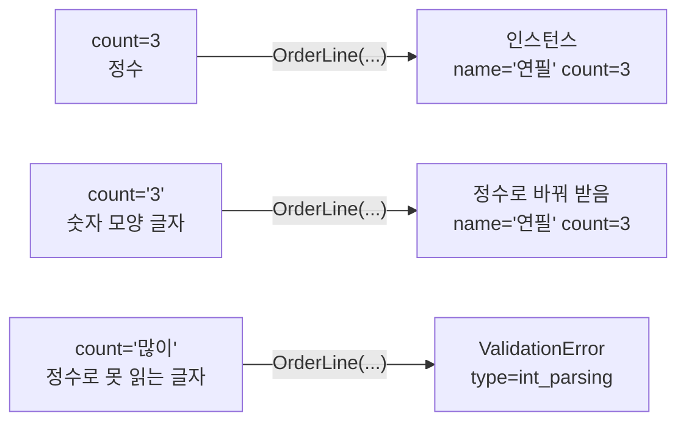
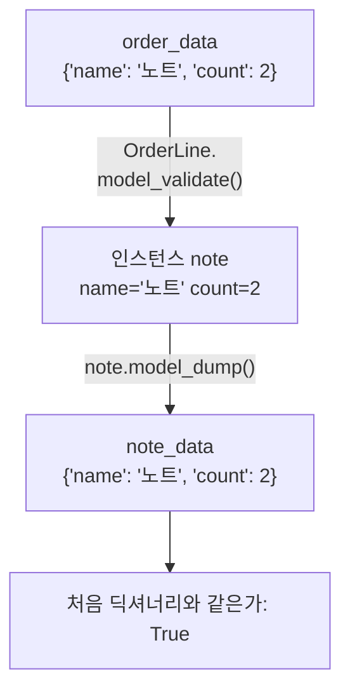
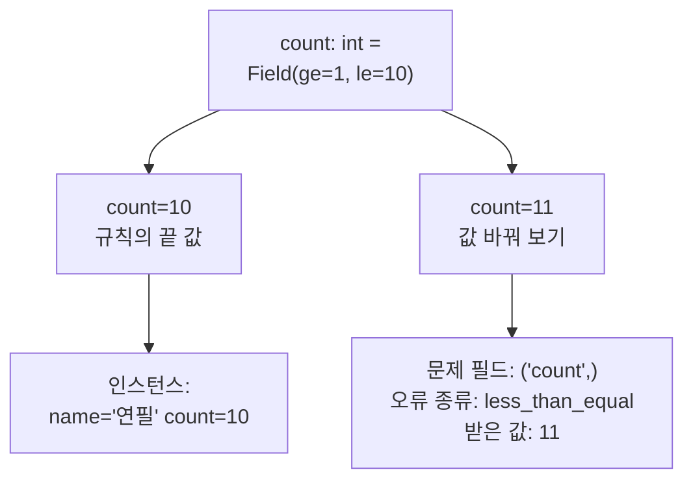
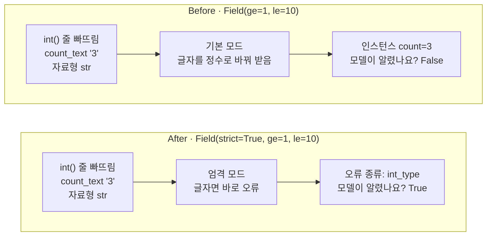

# 10-Pydantic

## _src 본문 (HTML 원본)

```html
<!--meta: 강의 1h | 실습 3h | 코드 Jupyter Notebook | 새 용어 8 -->
<h2 id="b1"><span class="no">1</span>학습 목표</h2>
<div class="goal"><ul><li>클래스 <code>BaseModel</code>을 물려받은 모델에 필드와 범위 규칙을 적고, 키워드 인자나 딕셔너리로 인스턴스를 만들 수 있습니다.</li><li>검증 오류의 메시지와 <code>errors()</code>의 <code>loc</code>·<code>type</code>을 읽고, 어느 필드가 어떤 규칙을 어겼는지 설명할 수 있습니다.</li><li>기본 모드의 자동 변환과 <code>Field(strict=True)</code>의 차이를 같은 글자 '3'의 출력으로 설명할 수 있습니다.</li></ul></div>
<h2 id="b2"><span class="no">2</span>이 내용을 배우는 이유</h2>
<p>7절에서 정의 줄에 <code>unit_price: int</code>라고 적어도, 글자 '39000'이 그대로 들어가 금액이 3900039000이 되었습니다. 8절에서는 테스트를 적어 이 결함을 찾았습니다. 값이 들어오는 입구에서 바로 검사할 수는 없을까요?</p>
<p>데이터 검사 라이브러리 Pydantic은 클래스에 적은 필드 이름과 자료형으로 들어온 값을 검사합니다. 규칙에 맞지 않는 값은 인스턴스로 만들지 않고 오류로 알립니다. 숫자 모양 글자처럼 바꿀 수 있는 값은 정수로 바꿔 받기도 합니다.</p>
<p>흔한 실수는 이 자동 변환을 모른 채 모델에 맡기는 것입니다. 수량 글자를 <code>int()</code>로 바꾸는 줄을 빠뜨려도, 기본 모드의 모델은 알리지 않습니다. <b>자료형까지 약속으로 지켜야 하는 필드에는 strict=True를 더합니다.</b></p>
<p><strong>이 절의 질문</strong> — 수량 글자를 <code>int()</code>로 바꾸는 줄을 빠뜨렸을 때, 모델이 입구에서 알리게 하려면 무엇을 더해야 할까요? 수량 1~10 범위 규칙은 그대로 둘 수 있을까요?</p>
<p>이 절은 확장 경로(B)입니다. 기본 경로(A)는 8절에서 12절로 이동합니다. Ch 6의 구조화 출력과 Ch 19의 도구 입력 규칙에서 <code>BaseModel</code>과 <code>Field()</code>를 다시 만납니다.</p>
<h2 id="b3"><span class="no">3</span>앞에서 배운 내용</h2>
<p>Ch 1과 1~9절에서 배운 것 가운데 이 절이 이어 쓰는 것을 표로 모았습니다.</p>
<table><thead><tr><th>앞 절</th><th>배운 것</th><th>이 절에서 이어 쓰는 곳</th></tr></thead><tbody>
<tr><td>1절</td><td><code>int()</code>로 글자 "2"를 정수 2로 바꾸기, <code>type()</code></td><td>글자 "3"이 정수 3으로 바뀌는 자동 변환, <code>수량의 자료형: &lt;class 'int'&gt;</code></td></tr>
<tr><td>3절</td><td>딕셔너리와 <code>==</code> 비교</td><td><code>model_validate()</code>에 넣은 딕셔너리와 <code>model_dump()</code>로 꺼낸 딕셔너리 비교</td></tr>
<tr><td>5절</td><td>키워드 인자, <code>try</code>/<code>except 오류이름</code>, <code>split(",")</code>와 풀어 담기, bad_orders.txt의 '많이'</td><td>필드 이름을 붙여 값 넣기, <code>ValidationError</code> 받기, Before/After의 줄 "연필,3"</td></tr>
<tr><td>6절</td><td>클래스, <code>__init__</code>, 인스턴스, 속성 읽기, <code>OrderLine(name, count)</code></td><td>필드만 적은 모델 OrderLine, 점 뒤 필드 이름으로 값 읽기</td></tr>
<tr><td>7절</td><td>타입힌트 <code>unit_price: int</code>는 값을 검사하지 않음, <code>quantity: int = 1</code></td><td>필드 줄 <code>count: int</code>와 <code>count: int = Field(ge=1, le=10)</code></td></tr>
<tr><td>8절</td><td><code>int()</code> 줄을 빠뜨린 결함을 테스트로 찾기</td><td>Before에서 같은 결함을 모델이 알리는지 보기</td></tr>
<tr><td>9절</td><td>같은 이름으로 다시 정의하기, 값이 하나인 튜플 <code>(39000,)</code></td><td>모델 OrderLine을 두 번 다시 정의하기, 필드 위치 <code>('count',)</code></td></tr>
</tbody></table>
<p>이 절의 새 문법은 클래스 이름 뒤 괄호에 적은 <code>BaseModel</code>과, 클래스 본문의 필드 줄입니다. 모델에는 필드만 적고 메서드는 넣지 않습니다. 함수를 정의하지 않으므로 타입힌트는 필드 줄에만 나옵니다.</p>
<p>이 절에서 말하는 모델은 데이터 규칙을 적은 클래스입니다. 언어 모델을 부르지 않으므로 API 키가 필요 없습니다.</p>
<h2 id="b4"><span class="no">4</span>핵심 개념</h2>
<h3>비유로 시작하기</h3>
<p>7절 저금통의 동전 그림 스티커는 종이 카드를 막지 못했습니다. 이번에는 동전을 받는 검사기를 둔다고 생각해 봅니다. 검사기는 넣은 것을 살펴보고, 받을 수 없는 것은 앞쪽 반환구로 내보냅니다.</p>
<p>친절한 검사기는 동전 그림 종이 카드를 받으면, 같은 값의 진짜 동전으로 바꿔 통에 넣습니다. 편하지만, 넣은 사람은 종이 카드를 넣었다는 사실을 모릅니다. 진짜 동전만 받는 검사기는 종이 카드를 반환구로 내보냅니다.</p>
<p>검사기는 Pydantic 모델, 종이 카드는 숫자 모양 글자 '3', 진짜 동전은 정수 3입니다. 친절한 검사기는 기본 모드이고, 진짜 동전만 받는 검사기는 strict=True를 더한 엄격 모드입니다.</p>
{{img:10-5-동전-검사기|가운데 세로줄 양쪽에 같은 회색 동전 검사기와 유리병이 있고, 왼쪽은 투입구에 동전 그림 종이 카드가 반쯤 들어가 있고 유리병 안에 진짜 금색 동전 하나가 있으며, 오른쪽은 같은 종이 카드가 앞쪽 반환구에 나와 있고 투입구에는 진짜 금색 동전이 반쯤 들어가 있는 삽화|종이 카드를 받아 진짜 동전으로 바꿔 넣은 왼쪽 검사기는 기본 모드의 Before, 종이 카드를 반환구로 내보내고 진짜 동전만 받는 오른쪽 검사기는 strict=True를 더한 After에 해당합니다.}}
<p><strong>그림 읽기</strong> — 가운데 세로줄 왼쪽 검사기의 투입구에는 동전 그림 종이 카드가 들어가고 있습니다. 아래 유리병에는 진짜 동전이 들어 있습니다. 글자 '3'을 정수 3으로 바꿔 받고 <code>모델이 알렸나요? False</code>가 나온 Before에 해당합니다.</p>
<p>세로줄 오른쪽 검사기는 같은 종이 카드를 앞쪽 반환구로 내보냈습니다. 투입구에는 진짜 동전이 들어가고 있습니다. 글자 '3'은 오류로 알리고, <code>int()</code>로 바꾼 정수 3은 받은 After에 해당합니다.</p>
<h3>이 절에서 쓰는 말</h3>
<table><thead><tr><th>용어</th><th>뜻</th><th>이 절에서 보이는 모습</th></tr></thead><tbody>
<tr><td>데이터 검증(data validation)</td><td>들어온 값이 약속한 자료형과 범위에 맞는지 확인하는 일</td><td><code>OrderLine(name="연필", count="많이")</code></td></tr>
<tr><td>모델(model)</td><td>필드 이름과 자료형 규칙을 적은 클래스. 이 절에서는 언어 모델과 다른 뜻</td><td><code>class OrderLine(BaseModel):</code></td></tr>
<tr><td>상속(inheritance)</td><td>클래스 이름 뒤 괄호에 적은 클래스의 기능을 새 클래스가 물려받는 일</td><td>괄호 안의 <code>BaseModel</code></td></tr>
<tr><td>필드(field)</td><td>모델의 클래스 본문에 이름과 자료형을 적은 줄</td><td><code>name: str</code>, <code>count: int</code></td></tr>
<tr><td>검증 오류(ValidationError)</td><td>값이 필드 규칙에 맞지 않을 때 모델이 내는 오류</td><td><code>1 validation error for OrderLine</code></td></tr>
<tr><td>자동 변환(coercion)</td><td>기본 모드가 바꿀 수 있는 값을 필드 자료형으로 바꿔 받는 일</td><td><code>수량의 자료형: &lt;class 'int'&gt;</code></td></tr>
<tr><td>범위 규칙(ge·le)</td><td>함수 Field()에 적는 규칙. ge는 이상, le는 이하</td><td><code>오류 종류: less_than_equal</code></td></tr>
<tr><td>엄격 모드(strict mode)</td><td>값을 바꾸지 않고, 들어온 값의 자료형이 맞는지만 확인하는 방법</td><td><code>오류 종류: int_type</code></td></tr>
</tbody></table>
<h3>데이터 검증과 모델</h3>
<p>데이터 검증(data validation)은 들어온 값이 약속한 자료형과 범위에 맞는지 확인하는 일입니다. 택배 창구에서 상자의 무게와 크기를 확인한 뒤에 받는 것과 비슷합니다. 노트북에서는 모델 OrderLine을 부르는 줄에서 검증이 일어납니다.</p>
<p>이 절의 모델(model)은 필드 이름과 자료형 규칙을 적은 클래스입니다. 뒤 챕터에서 부르는 언어 모델과는 다른 뜻입니다. Pydantic 문서도 모델을 클래스 <code>BaseModel</code>을 물려받고 필드를 적은 클래스라고 설명합니다.</p>
<h3>BaseModel을 물려받고 필드만 적기</h3>
<p>상속(inheritance)은 클래스 이름 뒤 괄호에 적은 클래스의 기능을 새 클래스가 물려받는 일입니다. 인쇄소가 만든 빈 양식 용지에 칸 이름만 적어 우리 가게 주문서를 만드는 것과 비슷합니다. 노트북의 <code>class OrderLine(BaseModel):</code> 줄이 검사 기능을 물려받습니다.</p>
<p>클래스 본문에 <code>name: str</code>처럼 이름과 자료형을 적은 줄을 필드(field)라고 합니다. 7절 매개변수 타입힌트와 같은 모양입니다. 6절 OrderLine은 <code>__init__</code> 안에 <code>self.name = name</code>을 적었지만, 이번 모델은 필드 두 줄만 적습니다.</p>
<p>인스턴스는 필드 이름을 키워드 인자로 적어 만듭니다. 노트북의 <code>OrderLine(name="연필", count=3)</code>은 <code>인스턴스: name='연필' count=3</code>을 출력했습니다. 상속으로 클래스를 직접 설계하는 방법은 이 절에서 다루지 않습니다.</p>
{{mermaid:10-1-세-입력-검사|왼쪽의 입력 count=3 정수, count='3' 숫자 모양 글자, count='많이' 정수로 못 읽는 글자가 각각 OrderLine(...)을 지나, 앞의 둘은 name='연필' count=3인 인스턴스가 되고 마지막은 ValidationError type=int_parsing이 되는 그림|같은 모델에 세 값을 넣은 결과. 숫자 모양 글자 '3'은 정수 3으로 바뀌어 들어가고, 글자 '많이'는 오류로 알려집니다.}}
<p><strong>도식 읽기</strong> — 왼쪽에서 오른쪽으로 읽습니다. 왼쪽 초록 상자 세 개는 수량에 넣은 값이고, 화살표 위의 <code>OrderLine(...)</code>은 모델을 부른 줄입니다. 오른쪽 초록 상자는 만들어진 인스턴스이고, 노란 상자는 출력입니다.</p>
<p>첫 줄의 정수 3과 둘째 줄의 글자 '3'은 모두 <code>count=3</code>인 인스턴스가 되었습니다. 셋째 줄의 글자 '많이'는 인스턴스가 되지 못하고, 노란 상자처럼 <code>type=int_parsing</code> 오류가 났습니다.</p>
<h3>검증 오류 읽기</h3>
<p>글자 '많이'를 넣은 셀의 오류 메시지 첫 줄은 <code>1 validation error for OrderLine</code>이었습니다. 모델 OrderLine에서 검증 오류가 1개 났다는 뜻입니다. 둘째 줄 <code>count</code>는 문제가 난 필드 이름입니다.</p>
<p>셋째 줄 대괄호 안의 <code>type=int_parsing</code>은 오류 종류이고, <code>input_value='많이'</code>는 받은 값입니다. 5절에서 <code>int('많이')</code>가 낸 <code>ValueError</code>와 같은 글자에서 난 오류입니다.</p>
<p>검증 오류의 메서드 <code>errors()</code>는 문제 하나마다 딕셔너리 하나를 담은 목록을 반환합니다. 키 <code>loc</code>은 필드 위치, <code>type</code>은 오류 종류, <code>input</code>은 받은 값입니다. 메시지에서 눈으로 읽은 내용을 코드에서 키로 꺼낼 수 있습니다.</p>
<h3>자동 변환과 엄격 모드</h3>
<p>라이브러리 Pydantic의 기본 모드는 바꿀 수 있는 값을 필드 자료형으로 바꿔 받습니다. 이것을 자동 변환(coercion)이라고 합니다. 노트북에서 글자 "3"을 넣자 <code>수량의 자료형: &lt;class 'int'&gt;</code>가 나왔습니다.</p>
<p>문서는 이 기본 모드를 느슨한 모드(lax mode)라고 부릅니다. 환경 변수나 URL 매개변수처럼 글자로 들어오는 값에 이 변환이 쓸모 있다고 설명합니다.</p>
<p>엄격 모드(strict mode)는 값을 바꾸지 않고, 들어온 값의 자료형이 맞는지만 확인하는 방법입니다. 함수 <code>Field()</code>의 괄호에 <code>strict=True</code>를 적으면 그 필드에 엄격 모드를 씁니다. 같은 글자 '3'이 이번에는 <code>int_type</code> 오류가 됩니다.</p>
<p>엄격 모드가 언제나 더 좋은 것은 아닙니다. 글자로 들어오는 값을 편하게 받을 곳인지, 자료형까지 약속한 곳인지를 먼저 정합니다.</p>
<h2 id="b5"><span class="no">5</span>실행 예제</h2>
<p>노트북은 8절처럼 설치된 라이브러리의 버전을 출력하고 시작합니다. 필드 두 줄만 적은 모델 OrderLine을 정의하고, 수량에 정수 3, 글자 '많이', 글자 "3"을 차례로 넣습니다. 그다음 딕셔너리로 인스턴스를 만들고 다시 딕셔너리로 꺼냅니다.</p>
<p>이어서 범위 규칙 <code>Field(ge=1, le=10)</code>을 더해 모델을 다시 정의합니다. 규칙의 끝 값 10을 넣어 보고, 값 바꿔 보기에서 수량 인자만 11로 바꿉니다.</p>
{{notebook:10-Pydantic|example}}
<p class="look"><b>확인할 점</b> — 글자 '많이'는 <code>type=int_parsing</code> 오류가 되고, 글자 "3"은 <code>&lt;class 'int'&gt;</code>로 저장되었는지 봅니다. 값 바꿔 보기에서 수량 10은 인스턴스가 되고, 11은 <code>less_than_equal</code> 오류가 되는지 확인합니다.</p>
<h3>딕셔너리로 받고 딕셔너리로 꺼내기</h3>
<p>메서드 <code>model_validate()</code>는 딕셔너리를 받아 같은 검사를 하고 인스턴스를 반환합니다. 이 메서드는 인스턴스가 아니라 클래스 이름 뒤에 점을 찍고 부릅니다. 메서드 <code>model_dump()</code>는 반대로 인스턴스의 필드를 딕셔너리로 반환합니다.</p>
<p>노트북에서 딕셔너리 order_data로 만든 인스턴스는 <code>name='노트' count=2</code>였습니다. 꺼낸 딕셔너리는 <code>{'name': '노트', 'count': 2}</code>였고, 처음 딕셔너리와 같은가 줄은 <code>True</code>였습니다.</p>
{{mermaid:10-2-딕셔너리-오가기|딕셔너리 order_data가 OrderLine.model_validate()를 지나 인스턴스 note name='노트' count=2가 되고, note.model_dump()를 지나 딕셔너리 note_data가 된 뒤 처음 딕셔너리와 같은가 True가 출력되는 흐름도|딕셔너리와 인스턴스 사이를 오간 차례. 들어간 딕셔너리와 꺼낸 딕셔너리가 같습니다.}}
<p><strong>도식 읽기</strong> — 위에서 아래로 읽습니다. 초록 상자 세 개는 값이고, 화살표에 부른 메서드를 적었습니다. 맨 위 딕셔너리가 가운데 인스턴스 note가 되고, 셋째 상자의 딕셔너리 note_data로 다시 나옵니다. 맨 아래 노란 상자는 두 딕셔너리를 비교한 출력 True입니다.</p>
<h3>범위 규칙과 값 바꿔 보기</h3>
<p>함수 <code>Field()</code>는 필드에 붙일 규칙 묶음을 만듭니다. 인자 <code>ge=1</code>은 1 이상, <code>le=10</code>은 10 이하라는 규칙입니다. 필드 줄 <code>count: int = Field(ge=1, le=10)</code>은 7절 <code>quantity: int = 1</code>과 모양이 같지만, 등호 뒤는 기본값이 아니라 규칙 묶음입니다.</p>
<p>수량 10은 <code>인스턴스: name='연필' count=10</code>으로 받았습니다. 값 바꿔 보기의 수량 11은 문제 필드 <code>('count',)</code>, 오류 종류 <code>less_than_equal</code>, 받은 값 <code>11</code>이 나왔습니다. 자료형은 정수로 맞았지만 범위 규칙에서 걸렸습니다.</p>
{{mermaid:10-3-범위-규칙|필드 줄 count: int = Field(ge=1, le=10)에서 두 갈래로 나뉘어, 규칙의 끝 값 count=10은 인스턴스 name='연필' count=10이 되고, 값 바꿔 보기 count=11은 문제 필드 ('count',), 오류 종류 less_than_equal, 받은 값 11이 출력되는 흐름도|같은 범위 규칙에 10과 11을 넣은 결과. 끝 값 10은 규칙 안이고, 11은 10 이하 규칙을 어깁니다.}}
<p><strong>도식 읽기</strong> — 위에서 아래로 읽습니다. 맨 위 파란 상자는 우리가 적은 필드 줄이고, 초록 상자는 넣은 값과 인스턴스입니다. 아래로 두 갈래가 나뉩니다. 왼쪽 갈래의 수량 10은 초록 상자의 인스턴스가 되었습니다. 오른쪽 갈래의 수량 11은 노란 상자처럼 오류 정보 세 줄을 출력했습니다.</p>
<h2 id="b6"><span class="no">6</span>일부러 실패해 보기</h2>
<p>Before 셀은 줄 "연필,3"을 <code>split(",")</code>로 나누고, 수량 글자를 <code>int()</code>로 바꾸지 않은 채 모델에 넣습니다. 7절과 8절에서 본 것과 같은 빠뜨림입니다. 모델은 범위 규칙 <code>Field(ge=1, le=10)</code>이 있는 기본 모드입니다.</p>
<p>출력은 <code>인스턴스: name='연필' count=3</code>, <code>넣은 수량의 자료형: &lt;class 'str'&gt;</code>, <code>모델이 알렸나요? False</code> 세 줄이었습니다. 모델은 글자 '3'을 정수로 바꿔 받았습니다. 그러나 이름 count_text에는 여전히 글자가 들어 있어, 빠뜨린 줄이 드러나지 않았습니다.</p>
<p>After 셀은 모델 정의의 괄호에 <code>strict=True</code> 하나만 더했습니다. 범위 규칙 <code>ge=1, le=10</code>은 그대로 두었습니다. 같은 코드로 다시 실행한 셀의 출력은 <code>오류 종류: int_type</code>, 같은 자료형 줄, <code>모델이 알렸나요? True</code>였습니다.</p>
<p>마지막 셀은 빠뜨린 <code>int()</code> 줄을 더해 같은 엄격한 모델에 넣었습니다. 출력은 <code>인스턴스: name='연필' count=3</code>과 <code>넣은 수량의 자료형: &lt;class 'int'&gt;</code>였습니다. 엄격한 모델도 범위 안의 정수는 받았습니다.</p>
{{mermaid:10-4-before-after-비교|Before는 int() 줄을 빠뜨린 글자 '3'이 Field(ge=1, le=10) 기본 모드에서 정수로 바뀌어 인스턴스 count=3이 되고 모델이 알렸나요? False가 나오고, After는 같은 글자 '3'이 Field(strict=True, ge=1, le=10) 엄격 모드에서 바로 오류가 되어 오류 종류 int_type과 모델이 알렸나요? True가 나오는 비교 그림|같은 빠뜨림, 다른 결과. 기본 모드는 글자를 바꿔 받아 False, strict=True를 더한 필드는 오류로 알려 True입니다.}}
<p><strong>도식 읽기</strong> — 위 칸이 Before, 아래 칸이 After이고, 칸 안은 왼쪽에서 오른쪽으로 읽습니다. 두 칸의 초록 상자는 <code>int()</code> 줄을 빠뜨린 같은 글자 '3'입니다. 가운데 파란 상자가 기본 모드와 엄격 모드로 다릅니다.</p>
<p>Before 칸은 글자를 정수로 바꿔 받아, 빨간 상자 <code>모델이 알렸나요? False</code>로 이어집니다. After 칸은 글자라서 바로 오류가 나, 노란 상자 <code>모델이 알렸나요? True</code>로 이어집니다. 두 칸 제목의 차이는 <code>strict=True</code> 하나입니다.</p>
{{notebook:10-Pydantic|failure}}
<h3>오류 종류 int_parsing과 int_type</h3>
<p>글자 '많이'는 기본 모드에서 <code>int_parsing</code> 오류가 났습니다. 글자를 정수로 읽어 보려 했지만 읽을 수 없었다는 뜻입니다. 글자 '3'은 엄격한 필드에서 <code>int_type</code> 오류가 났습니다. 읽어 보지 않고, 자료형이 정수가 아니라서 알렸다는 뜻입니다.</p>
<h3>확인한 범위</h3>
<p>엄격한 모델에 넣은 값은 글자 '3'과 정수 3 두 가지입니다. 범위를 벗어난 정수를 엄격한 모델에 넣는 장면은 실행하지 않았습니다. 필드 name에 글자가 아닌 값을 넣는 장면도 실행하지 않았습니다.</p>
<p>원리 더 알아보기 셀에서는 메서드 <code>model_json_schema()</code>로 모델의 규칙표를 꺼냈습니다. 반드시 넣을 필드는 <code>['name', 'count']</code>였고, 수량 규칙에는 minimum 1과 maximum 10이 적혔습니다. 엄격 모드를 뜻하는 항목은 이 규칙표에 나오지 않았습니다.</p>
<h2 id="b7"><span class="no">7</span>주의할 점과 실무 메모</h2>
<ul><li>모델을 부를 때는 필드 이름을 키워드 인자로 적습니다. Pydantic 2.13.5 소스의 초기화 메서드는 키워드 인자만 받습니다. 6절처럼 위치 인자로 넣는 장면은 이번에 실행하지 않았습니다.</li>
<li>기본 모드는 글자 '3'을 정수로 바꿔 받습니다. 값을 <code>int()</code>로 바꾸는 줄을 빠뜨렸는지는 기본 모드의 모델이 알려 주지 않습니다.</li>
<li>엄격 모드는 필드 하나, 모델 전체, 호출 한 번에 줄 수 있다고 문서가 설명합니다. 이번에는 <code>Field(strict=True)</code>로 필드 하나에만 썼습니다.</li>
<li>오류를 코드에서 확인할 때는 메시지 글 전체보다 <code>errors()</code>의 <code>type</code>과 <code>loc</code>을 봅니다. 메시지의 마지막 줄 주소에는 버전 2.13이 들어 있었습니다.</li>
<li>인터넷 예제에서 보이는 <code>parse_obj()</code>는 Pydantic v1의 메서드 이름입니다. Pydantic v1에서 v2로 옮기는 안내 문서는 이 이름이 <code>model_validate()</code>로 바뀌었다고 적습니다.</li>
<li>7절 타입힌트는 표시일 뿐이고, 모델은 부를 때 값을 검사합니다. 함수 매개변수의 타입힌트는 이 절에서도 값을 검사하지 않습니다.</li>
<li>Python 3.12.13과 Pydantic 2.13.5에서 실행한 결과입니다.</li></ul>
<h2 id="b8"><span class="no">8</span>정리와 다음 절</h2>
<ul><li>클래스 <code>BaseModel</code>을 물려받은 모델은 필드 두 줄로 값을 검사합니다. 글자 '많이'는 <code>int_parsing</code> 오류가 났고, 글자 "3"은 정수 3으로 바뀌었습니다.</li><li>범위 규칙 <code>Field(ge=1, le=10)</code>은 수량 10을 받고, 11은 <code>less_than_equal</code> 오류로 알렸습니다.</li><li>기본 모드는 <code>int()</code> 줄을 빠뜨린 글자 '3'을 받아 False가 나왔습니다. 인자 <code>strict=True</code>를 더하자 <code>int_type</code> 오류로 알려 True가 되었습니다.</li></ul>
<p><strong>다음 학습과 이어지는 지점</strong> — 확장 경로(B)는 <a href="11-패키징과-테스트-격리.html">11절 패키징과 테스트 격리</a>로 이어집니다. 기본 경로(A)는 <a href="12-async와-await.html">12절 async와 await</a>로 이동합니다. Ch 6의 구조화 출력과 Ch 19의 도구 입력 규칙에서 이 절의 모델과 범위 규칙을 다시 씁니다.</p>
<h2 id="b9"><span class="no">9</span>복습 문제</h2><details class="quiz"><summary>문제와 해설</summary>
<p class="quiz-q">1. 7절의 <code>unit_price: int</code>와 이 절의 필드 <code>count: int</code>는 모양이 같습니다. 숫자 모양 글자를 넣었을 때 두 곳의 결과는 어떻게 달랐나요? · 기초</p><p class="quiz-a"><b>해설</b> — 7절 함수에서는 글자 '39000'이 그대로 들어가 금액이 글자 3900039000이 되었습니다. 이 절의 모델에서는 글자 "3"이 정수 3으로 바뀌어 저장되었습니다. 타입힌트는 표시일 뿐이고, 모델은 부를 때 값을 검사하기 때문입니다.</p>
<p class="quiz-q">2. 글자 '많이'를 넣은 셀의 오류 메시지에서 문제가 난 필드 이름과 오류 종류를 찾아 쓰세요. · 기초</p><p class="quiz-a"><b>해설</b> — 필드 이름은 둘째 줄의 count이고, 오류 종류는 대괄호 안의 int_parsing입니다. 첫 줄은 모델 OrderLine에서 검증 오류가 1개 났다는 뜻입니다.</p>
<p class="quiz-q">3. 딕셔너리 order_data로 인스턴스를 만든 뒤 다시 꺼냈더니 처음 딕셔너리와 같았습니다. 두 메서드가 한 일을 쓰세요. · 기초</p><p class="quiz-a"><b>해설</b> — 메서드 <code>model_validate()</code>는 딕셔너리를 검사해 인스턴스 note를 만들었습니다. 메서드 <code>model_dump()</code>는 note의 필드를 딕셔너리로 꺼냈습니다. 딕셔너리의 키 이름이 필드 이름과 같아서 비교 결과가 True였습니다.</p>
<p class="quiz-q">4. 범위 규칙 <code>Field(ge=1, le=10)</code>에서 수량 10과 11의 결과가 달랐던 이유를 쓰고, 11의 오류 종류를 쓰세요. · 적용</p><p class="quiz-a"><b>해설</b> — 인자 le=10은 10 이하라는 규칙이라 끝 값 10은 규칙 안이고, 11은 규칙 밖입니다. 11의 오류 종류는 이하 규칙을 어겼다는 less_than_equal이었습니다. 자료형은 정수로 맞았으므로 범위 검사에서 걸렸습니다.</p>
<p class="quiz-q">5. Before에서 <code>int()</code> 줄을 빠뜨렸는데도 모델이 알리지 않은 이유를 쓰세요. 이때 이름 count_text의 자료형은 무엇이었나요? · 분석</p><p class="quiz-a"><b>해설</b> — 기본 모드는 정수로 바꿀 수 있는 글자 '3'을 정수 3으로 바꿔 받기 때문입니다. 그래서 오류가 나지 않았고 모델이 알렸나요? 줄은 False였습니다. 이름 count_text의 자료형은 여전히 &lt;class 'str'&gt;이었습니다.</p>
<p class="quiz-q">6. After의 오류 종류 int_type과 글자 '많이'의 int_parsing은 무엇이 다른가요? 엄격 모드를 모든 필드에 쓰지 않는 이유도 쓰세요. · 분석</p><p class="quiz-a"><b>해설</b> — 오류 종류 int_parsing은 글자를 정수로 읽어 보려 했지만 읽지 못했다는 뜻입니다. 오류 종류 int_type은 자료형이 정수가 아니라서 읽어 보지 않고 알렸다는 뜻입니다. 환경 변수처럼 글자로 들어오는 값은 자동 변환이 쓸모 있으므로, 자료형까지 약속한 필드에만 엄격 모드를 씁니다.</p>
</details>
<h2 id="b10"><span class="no">10</span>참고 자료</h2>
<ul><li><a href="https://pydantic.dev/docs/validation/latest/concepts/models/">Pydantic 문서 · Models</a> · 확인 2026-09-16 · 기준 Pydantic 2.13.5</li><li><a href="https://pydantic.dev/docs/validation/latest/concepts/fields/">Pydantic 문서 · Fields</a> · 확인 2026-09-16 · 기준 Pydantic 2.13.5</li><li><a href="https://pydantic.dev/docs/validation/latest/concepts/strict_mode/">Pydantic 문서 · Strict Mode</a> · 확인 2026-09-16 · 기준 Pydantic 2.13.5</li><li><a href="https://pydantic.dev/docs/validation/latest/errors/validation_errors/">Pydantic 문서 · Validation Errors</a> · 확인 2026-09-16 · 기준 Pydantic 2.13.5</li><li><a href="https://pydantic.dev/docs/validation/latest/concepts/json_schema/">Pydantic 문서 · JSON Schema</a> · 확인 2026-09-16 · 기준 Pydantic 2.13.5</li><li><a href="https://pydantic.dev/docs/validation/latest/get-started/migration/">Pydantic 문서 · Migration Guide</a> · 확인 2026-09-16 · v1에서 v2로 바뀐 메서드 이름</li><li><a href="https://pypi.org/project/pydantic/">PyPI Pydantic</a> · 확인 2026-09-16 · 버전 2.13.5 · MIT</li></ul>
```

## 노트북 셀 (순서대로)

### [0] markdown {'html': 'skip'}

# Pydantic

**이 노트북에서 할 일**

1. 클래스 `BaseModel`을 물려받은 주문 줄 모델을 만들고, 규칙에 맞지 않는 값에서 나는 검증 오류를 읽습니다.
2. 수량 범위 규칙 `Field(ge=1, le=10)`을 더하고, 수량 10과 11을 넣어 봅니다.
3. 수량 글자를 `int()`로 바꾸지 않고 넣었을 때 모델이 알리도록 `strict=True`를 더합니다.

**준비물** — API 키 불필요. 언어 모델 호출은 0번이고 비용은 들지 않습니다. 실행 시간은 1분 이내입니다.

데이터 검사 라이브러리 Pydantic 2.13.5는 실습 폴더에서 `uv sync --locked`를 실행할 때 함께 설치됩니다.
이 절은 확장 경로(B)입니다. 1~9절과 같은 실습 폴더 `labs/part1/ch02-python`의 `.venv`를 커널로 고르고, 첫 셀부터 순서대로 실행합니다.

### [1] markdown {'html': 'skip'}

## 오늘 볼 그림


왼쪽의 입력이 오른쪽의 결과가 됩니다. 왼쪽 초록 상자는 우리가 넣은 값, 오른쪽 초록 상자는 만들어진 인스턴스, 노란 상자는 출력입니다.

세 입력 모두 같은 모델 OrderLine을 지납니다. 글자 '3'은 정수 3으로 바뀌어 들어가고, 글자 '많이'는 오류로 알려집니다.

### [2] markdown {}

## 1. 준비

데이터 검사 라이브러리 Pydantic은 실습 폴더의 pyproject.toml에 2.13.5 버전으로 적혀 있습니다.
준비 셀은 8절 pytest처럼 커널에서 패키지를 불러와 버전을 출력합니다.

오류 `ModuleNotFoundError`가 나오면, Ch 1 3절처럼 커널이 실습 폴더의 `.venv`인지 확인합니다.

### [3] code {'execution': {'iopub.execute_input': '2026-09-16T09:00:02.400294Z', 'iopub.status.busy': '2026-09-16T09:00:02.400108Z', 'iopub.status.idle': '2026-09-16T09:00:02.422473Z', 'shell.execute_reply': '2026-09-16T09:00:02.421824Z'}, 'lesson_role': 'setup'}

```python
# 실습 폴더 가상환경에 설치된 Pydantic을 불러와 버전을 확인합니다
import pydantic

# __version__은 패키지에 적어 둔 버전 글자입니다
print("pydantic 버전:", pydantic.__version__)
```

출력:
```
pydantic 버전: 2.13.5

```

### [4] markdown {}

**결과 읽기** — pydantic 버전은 `2.13.5`로, pyproject.toml에 적은 버전과 같습니다.
이 절은 파일을 만들지 않으므로 임시 폴더로 옮기지 않습니다.

### [5] markdown {}

## 2. 필드만 적은 모델 정의하기

7절에서 `unit_price: int`라고 적어도 글자 '39000'이 그대로 들어가 금액이 3900039000이 되었습니다. 타입힌트는 표시일 뿐 값을 검사하지 않았습니다.
라이브러리 Pydantic은 같은 모양의 표시를 읽고, 들어온 값을 실제로 검사합니다.

데이터 검증(data validation)은 들어온 값이 약속한 자료형과 범위에 맞는지 확인하는 일입니다.
이 절에서 모델(model)은 필드 이름과 자료형 규칙을 적은 클래스를 말합니다. 뒤 챕터에서 부르는 언어 모델과는 다른 뜻입니다.

클래스 이름 뒤 괄호에 다른 클래스를 적으면, 새 클래스가 그 클래스의 기능을 물려받습니다. 이것을 상속(inheritance)이라고 합니다.
인쇄소가 만든 빈 양식 용지에 칸 이름만 적어 우리 가게 주문서를 만드는 것과 비슷합니다.
아래 셀의 `class OrderLine(BaseModel):` 줄은 Pydantic의 클래스 `BaseModel`이 가진 검사 기능을 물려받습니다. 상속으로 클래스를 직접 설계하는 방법은 이 절에서 다루지 않습니다.

클래스 본문에 `이름: 자료형`만 적은 줄을 필드(field)라고 합니다. 7절 매개변수 타입힌트와 같은 모양입니다.
6절 OrderLine은 `__init__` 안에 `self.name = name`을 적었지만, 이번에는 필드 두 줄만 적습니다.

실행 전에 예상합니다. 정의 셀이라 출력은 없을 것입니다.

### [6] code {'execution': {'iopub.execute_input': '2026-09-16T09:00:02.423832Z', 'iopub.status.busy': '2026-09-16T09:00:02.423679Z', 'iopub.status.idle': '2026-09-16T09:00:02.457424Z', 'shell.execute_reply': '2026-09-16T09:00:02.456995Z'}}

```python
# 상품 이름과 수량, 두 필드를 적은 주문 줄 모델을 정의합니다
from pydantic import BaseModel


# 괄호 안 BaseModel의 검사 기능을 물려받고, 필드는 이름과 자료형만 적습니다
class OrderLine(BaseModel):
    name: str
    count: int
```

출력:
```

```

### [7] markdown {}

**결과 읽기** — 예상대로 출력이 없습니다. 모델 OrderLine에는 필드 name(글자)과 count(정수)가 있습니다.
메서드는 적지 않았습니다. 이 절의 모델은 필드만 적습니다.

### [8] markdown {}

## 3. 키워드 인자로 인스턴스 만들기

6절처럼 클래스 이름을 함수처럼 부르면 인스턴스가 만들어집니다. 이번에는 5절 키워드 인자로 필드 이름을 붙여 값을 넣습니다.
Pydantic 문서는 모델을 부를 때 필드 값을 키워드 인자로 넣어야 한다고 설명합니다.

만들어진 인스턴스는 6절처럼 점 뒤에 필드 이름을 적어 읽습니다.
실행 전에 예상합니다. 상품 이름은 연필, 수량은 3일 것입니다.

### [9] code {'execution': {'iopub.execute_input': '2026-09-16T09:00:02.458299Z', 'iopub.status.busy': '2026-09-16T09:00:02.458231Z', 'iopub.status.idle': '2026-09-16T09:00:02.460392Z', 'shell.execute_reply': '2026-09-16T09:00:02.460028Z'}}

```python
# 필드 이름을 키워드 인자로 적어 인스턴스를 만듭니다
pencil = OrderLine(name="연필", count=3)
print("인스턴스:", pencil)
# 6절처럼 점 뒤에 필드 이름을 적어 값을 읽습니다
print("상품 이름:", pencil.name)
print("수량:", pencil.count)
```

출력:
```
인스턴스: name='연필' count=3
상품 이름: 연필
수량: 3

```

### [10] markdown {}

**결과 읽기** — 인스턴스를 출력한 줄은 `인스턴스: name='연필' count=3`이고, 상품 이름은 `연필`, 수량은 `3`으로 예상과 같습니다.
클래스 BaseModel을 물려받은 인스턴스는 print로 필드 이름과 값을 함께 보여 줍니다.

### [11] markdown {}

## 4. 규칙에 맞지 않는 값 넣기 — 글자 '많이'

5절 bad_orders.txt의 첫 줄은 수량 자리에 글자 '많이'가 있었습니다. 그 글자를 `int()`로 바꾸자 `ValueError`가 났습니다.
이번에는 같은 글자를 정수 필드 count에 넣습니다.

값이 필드 규칙에 맞지 않으면 모델은 인스턴스를 만들지 않고 검증 오류 `ValidationError`를 냅니다. 이 오류 이름은 Pydantic이 정한 이름이라 pydantic에서 가져옵니다.
오류를 관찰하려고 5절처럼 그 오류 이름만 받는 `try`와 `except`로 감쌉니다.

실행 전에 예상합니다. 인스턴스 줄은 나오지 않고 오류 메시지가 나올 것입니다.

### [12] code {'execution': {'iopub.execute_input': '2026-09-16T09:00:02.461093Z', 'iopub.status.busy': '2026-09-16T09:00:02.461008Z', 'iopub.status.idle': '2026-09-16T09:00:02.463219Z', 'shell.execute_reply': '2026-09-16T09:00:02.462832Z'}}

```python
# 수량에 5절 bad_orders.txt의 글자 '많이'를 넣어 인스턴스를 만들어 봅니다
from pydantic import ValidationError

try:
    bad_line = OrderLine(name="연필", count="많이")
    print("인스턴스:", bad_line)
except ValidationError as error:
    print("오류 메시지:", error)
```

출력:
```
오류 메시지: 1 validation error for OrderLine
count
  Input should be a valid integer, unable to parse string as an integer [type=int_parsing, input_value='많이', input_type=str]
    For further information visit https://errors.pydantic.dev/2.13/v/int_parsing

```

### [13] markdown {}

**결과 읽기** — 인스턴스 줄은 나오지 않았고, 오류 메시지의 첫 줄은 `1 validation error for OrderLine`입니다. 모델 OrderLine에서 검증 오류가 1개 났다는 뜻입니다.
둘째 줄 `count`는 문제가 난 필드 이름입니다. 셋째 줄 영어 설명은 정수가 와야 하는데 글자를 정수로 읽을 수 없다는 뜻입니다.

셋째 줄 대괄호 안의 `type=int_parsing`은 오류 종류, `input_value='많이'`는 받은 값입니다. 마지막 줄은 이 오류 종류를 설명한 문서 주소입니다.

### [14] markdown {}

## 5. 숫자 모양 글자 넣기 — 글자 "3"

1절에서 `int()`로 글자 "2"를 정수 2로 바꿨습니다. 7절에서는 바꾸지 않은 글자 '39000'이 함수에 그대로 들어갔습니다.
이번에는 숫자 모양 글자 "3"을 정수 필드 count에 넣고, 인스턴스에 저장된 수량의 자료형을 봅니다.

실행 전에 예상해 봅니다. 7절처럼 글자가 그대로 저장될까요, 아니면 오류가 날까요?

### [15] code {'execution': {'iopub.execute_input': '2026-09-16T09:00:02.464064Z', 'iopub.status.busy': '2026-09-16T09:00:02.463984Z', 'iopub.status.idle': '2026-09-16T09:00:02.466141Z', 'shell.execute_reply': '2026-09-16T09:00:02.465728Z'}}

```python
# 수량에 숫자 모양 글자 "3"을 넣어 인스턴스를 만듭니다
text_line = OrderLine(name="연필", count="3")
print("수량:", text_line.count)
count_type = type(text_line.count)
print("수량의 자료형:", count_type)
```

출력:
```
수량: 3
수량의 자료형: <class 'int'>

```

### [16] markdown {}

**결과 읽기** — 오류 없이 수량 `3`이 저장되었고, 수량의 자료형은 `<class 'int'>`입니다.

라이브러리 Pydantic의 기본 모드는 정수로 바꿀 수 있는 글자를 정수로 바꿔 받습니다. 이것을 자동 변환(coercion)이라고 합니다.
문서는 이 기본 모드를 느슨한 모드(lax mode)라고 부릅니다. 4번의 글자 '많이'는 정수로 바꿀 수 없어서 오류가 났습니다.

### [17] markdown {}

## 6. 딕셔너리로 받고 딕셔너리로 꺼내기

주문 자료를 3절 딕셔너리 모양으로 받을 때도 있습니다. 메서드 `model_validate()`는 딕셔너리를 받아 같은 검사를 하고 인스턴스를 반환합니다.
이 메서드는 인스턴스가 아니라 클래스 이름 뒤에 점을 찍고 부릅니다.

거꾸로 메서드 `model_dump()`는 인스턴스의 필드를 딕셔너리로 반환합니다.
실행 전에 예상합니다. 꺼낸 딕셔너리는 처음 딕셔너리와 같을 것입니다.

### [18] code {'execution': {'iopub.execute_input': '2026-09-16T09:00:02.466906Z', 'iopub.status.busy': '2026-09-16T09:00:02.466832Z', 'iopub.status.idle': '2026-09-16T09:00:02.468994Z', 'shell.execute_reply': '2026-09-16T09:00:02.468618Z'}}

```python
# 딕셔너리로 인스턴스를 만들고, 인스턴스를 다시 딕셔너리로 꺼냅니다
order_data = {"name": "노트", "count": 2}
# model_validate()는 딕셔너리를 검사해 인스턴스를 반환합니다
note = OrderLine.model_validate(order_data)
print("인스턴스:", note)
# model_dump()는 인스턴스의 필드를 딕셔너리로 반환합니다
note_data = note.model_dump()
is_same = note_data == order_data
print("꺼낸 딕셔너리:", note_data)
print("처음 딕셔너리와 같은가:", is_same)
```

출력:
```
인스턴스: name='노트' count=2
꺼낸 딕셔너리: {'name': '노트', 'count': 2}
처음 딕셔너리와 같은가: True

```

### [19] markdown {}

**결과 읽기** — 인스턴스는 `name='노트' count=2`이고, 꺼낸 딕셔너리는 `{'name': '노트', 'count': 2}`입니다. 처음 딕셔너리와 같은가 줄은 `True`로 예상과 같습니다.
딕셔너리의 키 이름이 필드 이름과 같아서 그대로 들어가고 그대로 나왔습니다.

### [20] markdown {}

## 7. 수량 범위 규칙 더하기 — Field

가게에서 「한 줄에 수량은 1개 이상 10개 이하」로 정했다고 합니다. 자료형만으로는 이 규칙을 적을 수 없습니다.
함수 `Field()`는 필드에 붙일 규칙 묶음을 만듭니다. 인자 `ge=1`은 1 이상, `le=10`은 10 이하라는 규칙입니다.

필드 줄 `count: int = Field(ge=1, le=10)`은 7절 매개변수 `quantity: int = 1`과 모양이 같습니다. 다만 등호 뒤는 기본값이 아니라 규칙 묶음입니다.
9절처럼 같은 이름 OrderLine으로 다시 정의하므로, 앞의 정의는 덮어씁니다.

실행 전에 예상합니다. 정의 셀이라 출력은 없을 것입니다.

### [21] code {'execution': {'iopub.execute_input': '2026-09-16T09:00:02.469752Z', 'iopub.status.busy': '2026-09-16T09:00:02.469670Z', 'iopub.status.idle': '2026-09-16T09:00:02.472366Z', 'shell.execute_reply': '2026-09-16T09:00:02.471987Z'}}

```python
# 수량은 1 이상 10 이하라는 범위 규칙을 더해 모델을 다시 정의합니다
from pydantic import Field


class OrderLine(BaseModel):
    name: str
    # ge=1은 1 이상, le=10은 10 이하라는 규칙입니다
    count: int = Field(ge=1, le=10)
```

출력:
```

```

### [22] markdown {}

**결과 읽기** — 예상대로 출력이 없습니다. 이제 이름 OrderLine에는 범위 규칙이 있는 모델이 들어 있습니다.

### [23] markdown {}

## 8. 경계 값 10 넣기

수량에 규칙의 끝 값 10을 넣어 봅니다. 규칙을 어기면 오류 정보를 출력하도록 except 블록도 미리 적어 둡니다.

검증 오류의 메서드 `errors()`는 문제 하나마다 딕셔너리 하나를 담은 목록을 반환합니다.
딕셔너리의 키 `loc`에는 문제가 난 필드 위치가, `type`에는 오류 종류가, `input`에는 받은 값이 들어 있습니다. 4번 메시지에서 읽은 내용을 키로 꺼내는 방법입니다.

실행 전에 예상합니다. 10은 「10 이하」에 맞으므로 인스턴스가 만들어질 것입니다.

### [24] code {'execution': {'iopub.execute_input': '2026-09-16T09:00:02.473104Z', 'iopub.status.busy': '2026-09-16T09:00:02.473026Z', 'iopub.status.idle': '2026-09-16T09:00:02.475160Z', 'shell.execute_reply': '2026-09-16T09:00:02.474831Z'}}

```python
# 수량 10을 넣어 범위 규칙을 확인합니다(규칙을 어기면 오류 정보를 출력합니다)
try:
    checked_line = OrderLine(name="연필", count=10)
    print("인스턴스:", checked_line)
except ValidationError as error:
    # errors()는 문제 하나마다 딕셔너리 하나를 담은 목록을 반환합니다
    problems = error.errors()
    print("문제 필드:", problems[0]["loc"])
    print("오류 종류:", problems[0]["type"])
    print("받은 값:", problems[0]["input"])
```

출력:
```
인스턴스: name='연필' count=10

```

### [25] markdown {}

**결과 읽기** — 출력은 `인스턴스: name='연필' count=10` 한 줄로 예상과 같습니다. 끝 값 10도 규칙 안에 들어갑니다.
except 블록의 줄은 실행되지 않았습니다.

### [26] markdown {}

## 9. 값 바꿔 보기 — 수량 11

8번 셀에서 수량 인자 하나만 10에서 11로 바꿉니다.

실행 전에 예상합니다. 인스턴스 줄은 나오지 않고, 문제 필드는 count일 것입니다. 오류 종류는 10 이하 규칙을 어겼다는 이름일 것입니다.

### [27] code {'execution': {'iopub.execute_input': '2026-09-16T09:00:02.475846Z', 'iopub.status.busy': '2026-09-16T09:00:02.475772Z', 'iopub.status.idle': '2026-09-16T09:00:02.477906Z', 'shell.execute_reply': '2026-09-16T09:00:02.477488Z'}}

```python
# 값 바꿔 보기: 수량 인자만 10에서 11로 바꿉니다
try:
    checked_line = OrderLine(name="연필", count=11)
    print("인스턴스:", checked_line)
except ValidationError as error:
    # errors()는 문제 하나마다 딕셔너리 하나를 담은 목록을 반환합니다
    problems = error.errors()
    print("문제 필드:", problems[0]["loc"])
    print("오류 종류:", problems[0]["type"])
    print("받은 값:", problems[0]["input"])
```

출력:
```
문제 필드: ('count',)
오류 종류: less_than_equal
받은 값: 11

```

### [28] markdown {}

**결과 읽기** — 문제 필드는 `('count',)`, 오류 종류는 `less_than_equal`, 받은 값은 `11`입니다.

오류 종류 less_than_equal은 「이하」 규칙을 어겼다는 뜻입니다. 필드 위치 ('count',)는 값이 하나인 튜플로, 9절의 (39000,)과 같은 모양입니다.
자료형은 정수로 맞았지만 범위 규칙에서 걸렸습니다. 자료형 검사와 범위 검사는 따로 일어납니다.

### [29] markdown {'lesson_part': 'before'}

## 10. Before — int() 줄을 빠뜨려도 모델이 알리지 않음

5절에서는 줄 "연필,3"을 `split(",")`로 나눈 뒤 수량 글자를 `int()`로 바꿨습니다. 7절과 8절에서는 이 `int()` 줄을 빠뜨린 결함을 보았습니다.
이 프로그램은 수량을 `int()`로 바꾼 뒤 모델에 넣기로 약속했다고 합니다. 줄을 빠뜨리면 모델이 입구에서 알려 주면 좋겠습니다.

아래 셀은 `int()` 줄을 빠뜨린 채 수량 글자를 범위 규칙이 있는 모델에 넣습니다. 오류로 알리면 표시 was_reported를 True로 바꿉니다.

실행 전에 예상해 봅니다. 5번에서 글자 "3"은 정수로 바뀌었습니다. 모델이 빠뜨린 줄을 알려 줄까요?

### [30] code {'execution': {'iopub.execute_input': '2026-09-16T09:00:02.478579Z', 'iopub.status.busy': '2026-09-16T09:00:02.478510Z', 'iopub.status.idle': '2026-09-16T09:00:02.480550Z', 'shell.execute_reply': '2026-09-16T09:00:02.480279Z'}, 'lesson_part': 'before'}

```python
# 줄 "연필,3"을 나누고, 수량 글자를 int()로 바꾸지 않은 채 모델에 넣습니다
line = "연필,3"
name, count_text = line.split(",")
was_reported = False
try:
    order_line = OrderLine(name=name, count=count_text)
    print("인스턴스:", order_line)
except ValidationError as error:
    problems = error.errors()
    print("오류 종류:", problems[0]["type"])
    # 모델이 오류로 알렸다는 표시를 남깁니다
    was_reported = True
print("넣은 수량의 자료형:", type(count_text))
print("모델이 알렸나요?", was_reported)
```

출력:
```
인스턴스: name='연필' count=3
넣은 수량의 자료형: <class 'str'>
모델이 알렸나요? False

```

### [31] markdown {'lesson_part': 'before'}

**결과 읽기** — 출력은 `인스턴스: name='연필' count=3`, `넣은 수량의 자료형: <class 'str'>`, `모델이 알렸나요? False` 세 줄입니다.

모델은 글자 '3'을 정수 3으로 바꿔 받고, 오류를 내지 않았습니다. 그런데 이름 count_text에는 여전히 글자가 들어 있습니다.
7절처럼 이 글자를 다른 계산에 그대로 쓰면 결함이 생깁니다. 자동 변환이 빠뜨린 `int()` 줄을 가렸습니다.

### [32] markdown {'lesson_part': 'after'}

## 11. After — 수량 필드에 strict=True 더하기

엄격 모드(strict mode)는 값을 바꾸지 않고, 들어온 값의 자료형이 맞는지만 확인하는 방법입니다.
함수 `Field()`의 괄호에 `strict=True`를 더하면 그 필드 하나에 엄격 모드를 씁니다.

Before 모델과 달라진 곳은 인자 `strict=True` 하나입니다. 범위 규칙 `ge=1, le=10`은 그대로 둡니다.
같은 이름 OrderLine으로 다시 정의합니다.

실행 전에 예상합니다. 정의 셀이라 출력은 없을 것입니다.

### [33] code {'execution': {'iopub.execute_input': '2026-09-16T09:00:02.481256Z', 'iopub.status.busy': '2026-09-16T09:00:02.481193Z', 'iopub.status.idle': '2026-09-16T09:00:02.483404Z', 'shell.execute_reply': '2026-09-16T09:00:02.482996Z'}, 'lesson_part': 'after'}

```python
# 수량 필드에 strict=True를 더해 모델을 다시 정의합니다(범위 규칙은 그대로)
class OrderLine(BaseModel):
    name: str
    # strict=True는 글자를 정수로 바꾸지 않고, 정수가 아니면 오류를 냅니다
    count: int = Field(strict=True, ge=1, le=10)
```

출력:
```

```

### [34] markdown {'lesson_part': 'after'}

**결과 읽기** — 예상대로 출력이 없습니다. 필드 name과 범위 규칙은 Before 모델과 같습니다.

### [35] markdown {'lesson_part': 'after'}

Before 셀과 같은 줄, 같은 코드로 다시 실행합니다. 셀 끝에 모델이 알렸는지 확인하는 `assert` 줄을 더합니다.

실행 전에 예상합니다. 이번에는 인스턴스 줄 대신 오류 종류가 나오고, 모델이 알렸나요? 줄은 True일 것입니다. 오류 종류는 4번의 int_parsing과 같을까요?

### [36] code {'execution': {'iopub.execute_input': '2026-09-16T09:00:02.484071Z', 'iopub.status.busy': '2026-09-16T09:00:02.483999Z', 'iopub.status.idle': '2026-09-16T09:00:02.486322Z', 'shell.execute_reply': '2026-09-16T09:00:02.485961Z'}, 'lesson_part': 'after'}

```python
# 줄 "연필,3"을 나누고, 수량 글자를 int()로 바꾸지 않은 채 모델에 넣습니다
line = "연필,3"
name, count_text = line.split(",")
was_reported = False
try:
    order_line = OrderLine(name=name, count=count_text)
    print("인스턴스:", order_line)
except ValidationError as error:
    problems = error.errors()
    print("오류 종류:", problems[0]["type"])
    # 모델이 오류로 알렸다는 표시를 남깁니다
    was_reported = True
print("넣은 수량의 자료형:", type(count_text))
print("모델이 알렸나요?", was_reported)
# 모델이 오류로 알리지 않았으면 이 줄에서 멈춥니다
assert was_reported
```

출력:
```
오류 종류: int_type
넣은 수량의 자료형: <class 'str'>
모델이 알렸나요? True

```

### [37] markdown {'lesson_part': 'after'}

**결과 읽기** — 출력은 `오류 종류: int_type`, `넣은 수량의 자료형: <class 'str'>`, `모델이 알렸나요? True` 세 줄입니다. 검사 줄 `assert`에서도 멈추지 않았습니다.

오류 종류 int_type은 정수 자료형이 아니라는 뜻입니다. 4번의 int_parsing은 글자를 정수로 읽을 수 없다는 뜻이었습니다.
엄격한 필드는 글자 '3'을 읽어 보지 않고, 자료형이 글자라서 바로 오류를 냈습니다.

### [38] markdown {'lesson_part': 'after'}

빠뜨린 `int()` 줄을 더해, 수량을 정수로 바꾼 뒤 같은 엄격한 모델에 넣습니다.

실행 전에 예상합니다. 이번에는 인스턴스가 만들어지고, 넣은 수량의 자료형은 int일 것입니다.

### [39] code {'execution': {'iopub.execute_input': '2026-09-16T09:00:02.487050Z', 'iopub.status.busy': '2026-09-16T09:00:02.486978Z', 'iopub.status.idle': '2026-09-16T09:00:02.489194Z', 'shell.execute_reply': '2026-09-16T09:00:02.488749Z'}, 'lesson_part': 'after'}

```python
# 빠뜨린 int() 줄을 더해, 수량을 정수로 바꾼 뒤 엄격한 모델에 넣습니다
count = int(count_text)
fixed_line = OrderLine(name=name, count=count)
print("인스턴스:", fixed_line)
print("넣은 수량의 자료형:", type(count))
# 엄격한 모델도 범위 안의 정수는 받습니다
assert fixed_line.count == 3
```

출력:
```
인스턴스: name='연필' count=3
넣은 수량의 자료형: <class 'int'>

```

### [40] markdown {'lesson_part': 'after'}

**결과 읽기** — 출력은 `인스턴스: name='연필' count=3`과 `넣은 수량의 자료형: <class 'int'>`입니다. 검사 줄 `assert`에서도 멈추지 않았습니다.

엄격한 모델은 `int()` 줄을 빠뜨린 코드는 알리고, 줄을 더한 코드는 받았습니다.
이번에 엄격한 모델에 넣은 값은 글자 '3'과 정수 3 두 가지입니다. 범위를 벗어난 정수를 엄격한 모델에 넣는 장면은 실행하지 않았습니다.

### [41] markdown {'lesson_part': 'after'}

### 원리 더 알아보기 — 모델이 적어 둔 규칙표

메서드 `model_json_schema()`는 모델의 필드 규칙을 JSON 스키마(JSON Schema)라는 약속된 모양의 딕셔너리로 반환합니다.
Ch 19에서 도구의 입력 규칙을 볼 때 같은 메서드를 다시 만납니다. 지금은 출력만 읽습니다.

### [42] code {'execution': {'iopub.execute_input': '2026-09-16T09:00:02.489878Z', 'iopub.status.busy': '2026-09-16T09:00:02.489807Z', 'iopub.status.idle': '2026-09-16T09:00:02.492404Z', 'shell.execute_reply': '2026-09-16T09:00:02.492038Z'}, 'lesson_level': 'deep-dive', 'lesson_part': 'after'}

```python
# 원리 더 알아보기: 모델 OrderLine의 필드 규칙을 딕셔너리로 꺼내 봅니다
rule_table = OrderLine.model_json_schema()
print("반드시 넣을 필드:", rule_table["required"])
count_rule = rule_table["properties"]["count"]
print("수량 필드의 규칙:", count_rule)
```

출력:
```
반드시 넣을 필드: ['name', 'count']
수량 필드의 규칙: {'maximum': 10, 'minimum': 1, 'title': 'Count', 'type': 'integer'}

```

### [43] markdown {'lesson_part': 'after'}

**결과 읽기** — 반드시 넣을 필드는 `['name', 'count']`입니다. 수량 필드의 규칙은 `{'maximum': 10, 'minimum': 1, 'title': 'Count', 'type': 'integer'}`입니다.
규칙표에서 인자 ge=1은 minimum 1로, 인자 le=10은 maximum 10으로 적혔습니다. 엄격 모드를 뜻하는 항목은 이 규칙표에 나오지 않았습니다.

### [44] markdown {'html': 'skip', 'lesson_part': 'after'}

## 정리

- 클래스 `BaseModel`을 물려받은 모델은 필드 두 줄로 값을 검사합니다. 글자 '많이'는 `int_parsing` 오류가 났고, 글자 "3"은 정수 3으로 바뀌었습니다.
- 범위 규칙 `Field(ge=1, le=10)`은 수량 10을 받고, 11은 `less_than_equal` 오류로 알렸습니다.
- `int()` 줄을 빠뜨린 수량 글자를 기본 모드는 받아 False가 나왔습니다. 인자 `strict=True`를 더하자 `int_type` 오류로 알려 True가 되었습니다.

확장 경로(B)는 11절 패키징과 테스트 격리로, 기본 경로(A)는 12절 async와 await로 이어집니다.

## 그림

### 10-1-세-입력-검사.mmd



- 설명 대상 문장: 같은 모델에 수량 3, 글자 '3', 글자 '많이'를 넣으면, 앞의 둘은 인스턴스가 되고 글자 '많이'만 인스턴스가 되지 못하고 오류가 됩니다.
- 캡션: 같은 모델에 세 값을 넣은 결과. 숫자 모양 글자 '3'은 정수 3으로 바뀌어 들어가고, 글자 '많이'는 오류로 알려집니다.
- 읽는 법: 왼쪽에서 오른쪽으로 읽습니다. 왼쪽 초록 상자는 넣은 값, 오른쪽 초록 상자는 만들어진 인스턴스, 노란 상자는 출력입니다. 둘째 줄의 글자 '3'도 count=3인 인스턴스가 되고, 셋째 줄의 글자 '많이'는 type=int_parsing 오류가 됩니다.
- alt: 왼쪽의 입력 count=3 정수, count='3' 숫자 모양 글자, count='많이' 정수로 못 읽는 글자가 각각 OrderLine(...)을 지나, 앞의 둘은 name='연필' count=3인 인스턴스가 되고 마지막은 ValidationError type=int_parsing이 되는 그림

### 10-2-딕셔너리-오가기.mmd



- 설명 대상 문장: 메서드 model_validate()는 딕셔너리를 검사해 인스턴스를 만들고, 메서드 model_dump()는 인스턴스의 필드를 딕셔너리로 반환합니다.
- 캡션: 딕셔너리와 인스턴스 사이를 오간 차례. 들어간 딕셔너리와 꺼낸 딕셔너리가 같습니다.
- 읽는 법: 위에서 아래로 읽습니다. 초록 상자 세 개는 값이고, 화살표에 부른 메서드를 적었습니다. 맨 아래 노란 상자는 두 딕셔너리를 비교한 출력 True입니다.
- alt: 딕셔너리 order_data가 OrderLine.model_validate()를 지나 인스턴스 note name='노트' count=2가 되고, note.model_dump()를 지나 딕셔너리 note_data가 된 뒤 처음 딕셔너리와 같은가 True가 출력되는 흐름도

### 10-3-범위-규칙.mmd



- 설명 대상 문장: 인자 ge=1은 1 이상, le=10은 10 이하라는 규칙입니다. 수량 10은 인스턴스가 되고, 수량 11은 less_than_equal 오류가 됩니다.
- 캡션: 같은 범위 규칙에 10과 11을 넣은 결과. 끝 값 10은 규칙 안이고, 11은 10 이하 규칙을 어깁니다.
- 읽는 법: 위에서 아래로 읽습니다. 맨 위 파란 상자는 필드 줄이고, 초록 상자는 넣은 값과 인스턴스입니다. 두 갈래로 나뉩니다. 왼쪽 갈래의 수량 10은 초록 상자의 인스턴스, 오른쪽 갈래의 수량 11은 노란 상자의 오류 정보 세 줄(('count',), less_than_equal, 11)입니다.
- alt: 필드 줄 count: int = Field(ge=1, le=10)에서 두 갈래로 나뉘어, 규칙의 끝 값 count=10은 인스턴스 name='연필' count=10이 되고, 값 바꿔 보기 count=11은 문제 필드 ('count',), 오류 종류 less_than_equal, 받은 값 11이 출력되는 흐름도

### 10-4-before-after-비교.mmd



- 설명 대상 문장: Before 모델과 달라진 곳은 인자 strict=True 하나입니다. 같은 글자 '3'이 Before에서는 False, After에서는 int_type 오류와 True가 됩니다.
- 캡션: 같은 빠뜨림, 다른 결과. 기본 모드는 글자를 바꿔 받아 False, strict=True를 더한 필드는 오류로 알려 True입니다.
- 읽는 법: 위 칸이 Before, 아래 칸이 After이고 칸 안은 왼쪽에서 오른쪽으로 읽습니다. 초록 상자의 빠뜨린 글자 '3'은 두 칸이 같고, 가운데 파란 상자(기본 모드·엄격 모드)와 결과 상자(빨간 False·노란 True)만 다릅니다.
- alt: Before는 int() 줄을 빠뜨린 글자 '3'이 Field(ge=1, le=10) 기본 모드에서 정수로 바뀌어 인스턴스 count=3이 되고 모델이 알렸나요? False가 나오고, After는 같은 글자 '3'이 Field(strict=True, ge=1, le=10) 엄격 모드에서 바로 오류가 되어 오류 종류 int_type과 모델이 알렸나요? True가 나오는 비교 그림

### 10-5-동전-검사기.prompt.md

# 삽화 — 10-5 동전 검사기

- 상태: 2026-09-16 생성·검수 통과(1회 생성, 탈락 0). 모델 nano_banana_pro(서버 표기 nano_banana_2), 16:9, 2k(2752×1536), 2크레딧(생성 전 잔액 2944). job 9b6e7a33-6abb-49d7-8a04-2ed826aa1cdb. 교재 파일은 폭 1100px로 줄여 저장.
- 검수 메모: 가운데 회색 세로줄로 왼쪽·오른쪽이 나뉨. 두 쪽 모두 같은 회색 상자형 검사기가 유리병 위에 올라가 있음. 왼쪽은 동전 그림 흰 종이 카드가 윗면 투입구에 반쯤 들어가 있고, 앞면 컵 모양 반환구는 비었으며, 유리병 바닥에 진짜 금색 동전 하나가 있어 「종이 카드를 받아 진짜 동전으로 넣음」이 읽힘. 오른쪽은 진짜 금색 동전이 투입구에 반쯤 들어가 있고, 같은 종이 카드가 앞면 반환구에서 비스듬히 밀려 나와 있으며, 유리병은 비어 있어 「종이 카드는 내보내고 진짜 동전만 받음」이 읽힘. 오른쪽 반환구는 컵보다 가로 틈 모양이지만 앞쪽으로 나온 것이 분명해 채택. 글자·숫자·화면·버튼·손 없음, 동전에 새김 없음.
- 설명 대상 문장: 친절한 검사기는 동전 그림 종이 카드를 받으면, 같은 값의 진짜 동전으로 바꿔 통에 넣습니다. 진짜 동전만 받는 검사기는 종이 카드를 반환구로 내보냅니다.
- 넣을 자리: 10절 핵심 개념 「비유로 시작하기」 셋째 단락 바로 아래(3~9절 삽화의 좌우 Before/After 구도, 7·8절의 동전 그림 종이 카드와 진짜 동전을 이어 씀)
- 구성 요소와 배치(왼쪽 → 오른쪽): 검사기 투입구의 종이 카드, 빈 반환구, 동전 하나가 든 유리병 | 세로줄 | 같은 검사기 투입구의 진짜 동전, 반환구에서 나온 종이 카드, 빈 유리병
- 시선 순서: 왼쪽 투입구의 종이 카드 → 유리병 속 진짜 동전 → 세로줄 너머 반환구로 나온 종이 카드 → 투입구의 진짜 동전
- 대응: 검사기 = 모델 OrderLine, 동전 그림 종이 카드 = 글자 '3'(count_text), 진짜 동전 = 정수 3, 유리병 속 동전 = 인스턴스의 count=3, 왼쪽 = Before 기본 모드(자동 변환, 모델이 알렸나요? False), 반환구로 나온 종이 카드 = After 엄격 모드의 int_type 오류(True), 투입구의 진짜 동전 = int()로 바꿔 넣은 정수 3

## 프롬프트

Simple flat educational illustration, white background, limited soft palette, clean outlines, plain everyday objects, no text, no letters, no numbers, no logos.
The image is divided into a left half and a right half by one thin light gray vertical line. Both halves show the same plain light wooden table top.
In each half stands exactly the same simple object: one plain light gray box-shaped coin checking machine with one narrow slot on its top and one small open cup-shaped return tray built into the lower front of the box. The box sits directly on top of one clear glass jar, so whatever the box accepts drops down into the jar.
Left half: one flat thin white paper card with a simple flat drawing of a gold coin printed on it is clearly sticking halfway out of the top slot, being accepted. Inside the glass jar below lies exactly one real shiny round gold metal coin. The front return tray is empty.
Right half: exactly the same machine and glass jar. The same flat white paper card with the coin drawing is clearly sticking halfway out of the front return tray, pushed back out and not accepted. One real shiny round gold metal coin is clearly sticking halfway out of the top slot, being accepted. The glass jar below is empty.
All coins are plain with no engravings and no symbols. No monitors, no screens, no buttons, no lights, no displays, no computers, no people, no hands, no arrows, no piggy banks, no stickers, no banknotes, no scales, no extra coins, no extra cards, no extra machines.
- 설명 대상 문장: 친절한 검사기는 동전 그림 종이 카드를 받으면 진짜 동전으로 바꿔 통에 넣습니다. 진짜 동전만 받는 검사기는 종이 카드를 반환구로 내보냅니다.
- 캡션: 종이 카드를 받아 진짜 동전으로 바꿔 넣은 왼쪽 검사기는 기본 모드의 Before, 종이 카드를 반환구로 내보내고 진짜 동전만 받는 오른쪽 검사기는 strict=True를 더한 After에 해당합니다.
- 읽는 법: 가운데 세로줄 왼쪽 검사기는 종이 카드를 받아 유리병에 진짜 동전이 들어 있습니다(기본 모드, 모델이 알렸나요? False). 오른쪽 검사기는 같은 종이 카드를 반환구로 내보내고 진짜 동전만 받습니다(strict=True, int_type 오류와 True).
- alt: 가운데 세로줄 양쪽에 같은 회색 동전 검사기와 유리병이 있고, 왼쪽은 투입구에 동전 그림 종이 카드가 반쯤 들어가 있고 유리병 안에 진짜 금색 동전 하나가 있으며, 오른쪽은 같은 종이 카드가 앞쪽 반환구에 나와 있고 투입구에는 진짜 금색 동전이 반쯤 들어가 있는 삽화

