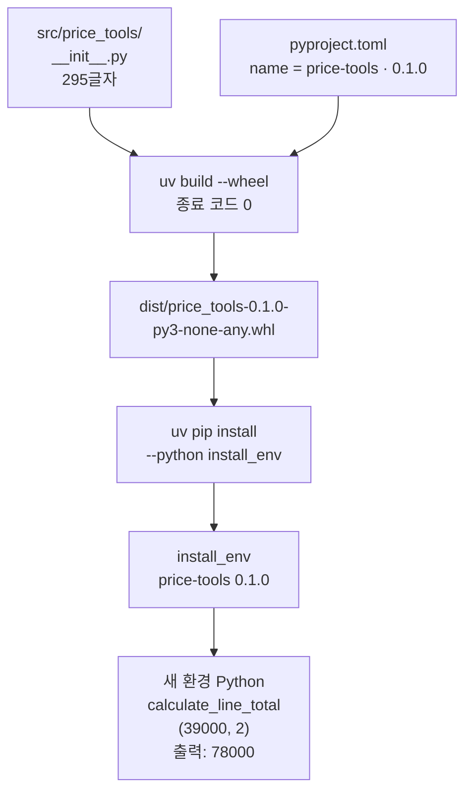
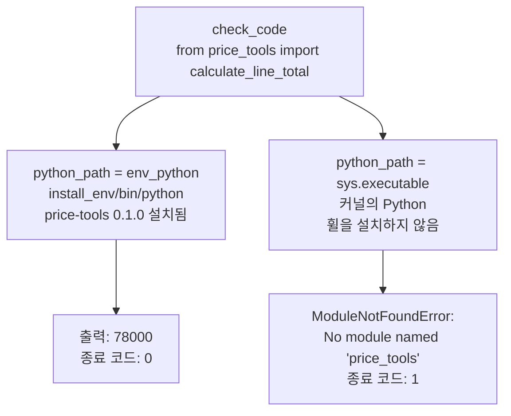
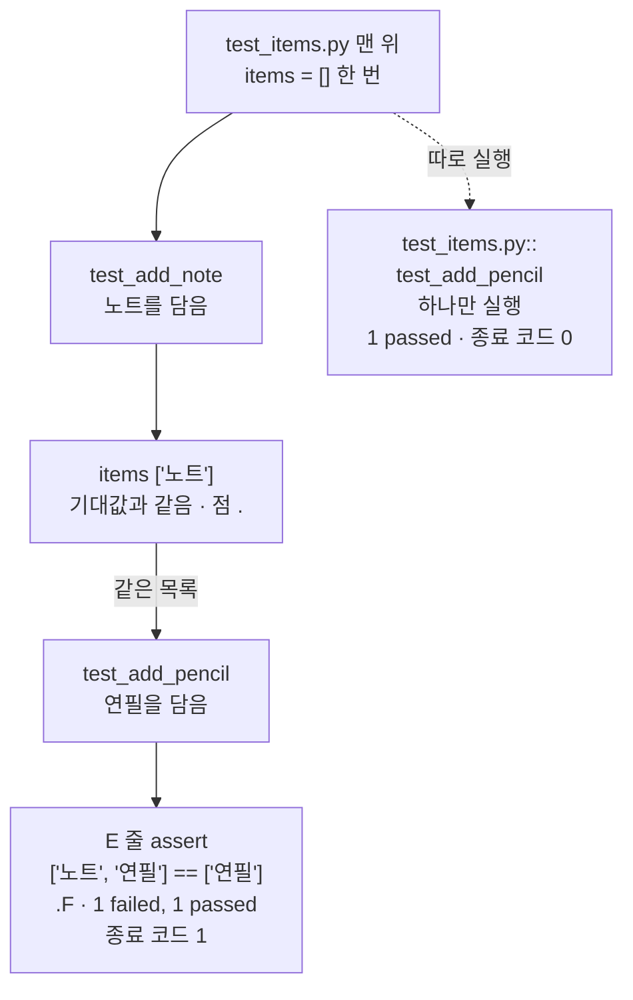
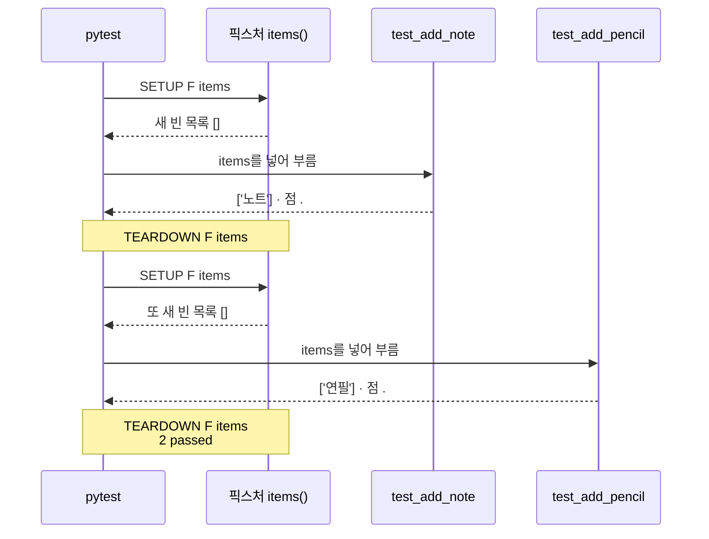
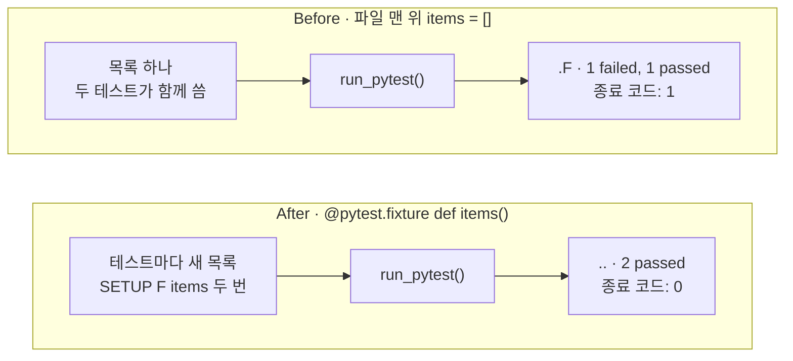

# 11-패키징과-테스트-격리

## _src 본문 (HTML 원본)

```html
<!--meta: 강의 1h | 실습 3h | 코드 Jupyter Notebook | 새 용어 8 -->
<h2 id="b1"><span class="no">1</span>학습 목표</h2>
<div class="goal"><ul><li>폴더 <code>src/price_tools</code>와 pyproject.toml의 <code>[project]</code>·<code>[build-system]</code>을 적고, <code>uv build --wheel</code>로 휠 파일을 만들 수 있습니다.</li><li>휠을 새 가상환경에 설치하고, 그 환경의 Python에서만 패키지가 불러와지는 것을 출력으로 설명할 수 있습니다.</li><li>목록 하나를 함께 쓴 두 테스트의 실패를 읽고, 픽스처로 테스트마다 새 목록을 받게 고칠 수 있습니다.</li></ul></div>
<h2 id="b2"><span class="no">2</span>이 내용을 배우는 이유</h2>
<p>7절과 8절에서는 모듈 파일을 노트북과 같은 폴더에 두고 불러왔습니다. 다른 폴더나 다른 가상환경의 Python은 이 파일을 찾지 못합니다. pytest나 pydantic처럼 설치해서 쓰려면, 코드를 패키지로 묶어 설치용 파일을 만들어야 합니다.</p>
<p>테스트는 한 번 통과했다고 끝나지 않습니다. 테스트끼리 값을 함께 쓰면, 어떤 테스트가 먼저 실행됐는지에 따라 결과가 바뀝니다. 혼자 실행하면 통과하던 테스트가 함께 실행하면 실패하기도 합니다.</p>
<p>흔한 실수는 실패한 테스트만 따로 실행하거나, 테스트 순서를 바꿔 통과시키는 것입니다. 값을 함께 쓰는 문제는 그대로 남습니다. <b>테스트에 필요한 값은 픽스처로 테스트마다 새로 준비합니다.</b></p>
<p><strong>이 절의 질문</strong> — 두 테스트가 파일 맨 위의 목록 하나를 함께 쓰면, 둘째 테스트는 왜 실패할까요? 상품을 담는 줄과 기대값은 그대로 두고 테스트마다 새 목록을 받게 하려면, 무엇을 바꿔야 할까요?</p>
<p>이 절은 확장 경로(B)입니다. 기본 경로(A)는 8절에서 12절로 이동합니다. 두 경로 모두 다음은 12절입니다.</p>
<h2 id="b3"><span class="no">3</span>앞에서 배운 내용</h2>
<p>Ch 1과 1~10절에서 배운 것 가운데 이 절이 이어 쓰는 것을 표로 모았습니다.</p>
<table><thead><tr><th>앞 절</th><th>배운 것</th><th>이 절에서 이어 쓰는 곳</th></tr></thead><tbody>
<tr><td>Ch 1 3절</td><td>패키지의 뜻, <code>uv venv</code>와 pyvenv.cfg, <code>sys.platform</code>에 따른 Python 위치, <code>python -c</code>, <code>ModuleNotFoundError</code></td><td>새 가상환경 install_env, 새 환경 Python으로 불러오기, 값 바꿔 보기의 오류</td></tr>
<tr><td>4절·6절</td><td>기본값 <code>tags=[]</code>와 클래스 본문 <code>items = []</code>를 여러 호출·주문이 함께 씀, 두 주문 모두 <code>['노트', '연필']</code></td><td>Before 테스트 파일 맨 위의 <code>items = []</code></td></tr>
<tr><td>5·7절</td><td>임시 폴더 준비 셀, <code>with open()</code>과 <code>write()</code>, 모듈 파일과 from import 문</td><td>패키지 폴더·설정 파일·테스트 파일 저장, <code>from price_tools import calculate_line_total</code></td></tr>
<tr><td>7·8절</td><td>함수 <code>calculate_line_total()</code>의 39000·2 → 78000, 8절 After의 price_tools.py(295글자)</td><td>패키지에 담을 코드, 설치한 패키지에서 부른 금액</td></tr>
<tr><td>8절</td><td>함수 <code>run_pytest()</code>, 진행 줄의 점과 F, E 줄, <code>파일:줄번호</code>, 종료 코드</td><td>Before/After 테스트 실행과 결과 읽기</td></tr>
<tr><td>9절</td><td>함수 위의 <code>@</code> 줄</td><td>픽스처를 등록하는 <code>@pytest.fixture</code></td></tr>
</tbody></table>
<p>이 절에는 새 문법이 없습니다. 새로 나오는 것은 패키지 폴더와 설정 파일, 빌드와 설치 명령, pytest의 픽스처입니다. 함수 정의는 8절과 같은 <code>run_pytest()</code> 하나입니다.</p>
<p>10절 Pydantic은 이 절에서 쓰지 않습니다. 모델을 부르지 않으므로 API 키가 필요 없습니다.</p>
<h2 id="b4"><span class="no">4</span>핵심 개념</h2>
<h3>비유로 시작하기</h3>
<p>6절에서는 바구니 하나를 두 주문서가 함께 써서 공책과 연필이 섞였습니다. 마트 입구에는 빈 바구니가 겹겹이 쌓여 있습니다. 손님은 들어올 때마다 더미에서 빈 바구니를 하나 꺼냅니다.</p>
<p>앞 손님이 쓰던 바구니를 그대로 받으면, 내가 담지 않은 공책이 이미 들어 있습니다. 더미에서 새 바구니를 꺼내면 내가 담은 연필 하나만 들어 있습니다.</p>
<p>바구니는 목록 items이고, 손님은 테스트 함수입니다. 테스트마다 더미에서 새 바구니를 꺼내 주는 일을 픽스처가 합니다.</p>
{{img:11-6-바구니-더미|가운데 세로줄 왼쪽 탁자에는 바구니 하나에 파란 공책과 노란 연필이 함께 들어 있고, 오른쪽 탁자에는 빈 바구니 네 개를 쌓은 더미 옆에 공책 하나만 든 바구니와 연필 하나만 든 바구니가 떨어져 놓인 삽화|바구니 하나에 공책과 연필이 섞인 왼쪽은 목록 하나를 함께 쓴 Before, 더미에서 꺼낸 바구니마다 상품이 하나씩 든 오른쪽은 픽스처로 테스트마다 새 목록을 받은 After에 해당합니다.}}
<p><strong>그림 읽기</strong> — 가운데 세로줄 왼쪽에는 바구니가 하나뿐이고, 공책과 연필이 같이 들어 있습니다. 둘째 테스트가 받은 목록 <code>['노트', '연필']</code>에 해당합니다.</p>
<p>세로줄 오른쪽에는 빈 바구니 더미가 있습니다. 더미 옆의 두 바구니에는 공책 하나, 연필 하나만 들었습니다. 픽스처가 테스트마다 새 빈 목록을 만들어 <code>2 passed</code>가 나온 After에 해당합니다.</p>
<h3>이 절에서 쓰는 말</h3>
<table><thead><tr><th>용어</th><th>뜻</th><th>이 절에서 보이는 모습</th></tr></thead><tbody>
<tr><td>패키지(package)</td><td>불러올 모듈 폴더와 이름·버전 정보를 묶어 설치할 수 있게 만든 것</td><td>폴더 <code>src/price_tools</code>와 pyproject.toml</td></tr>
<tr><td>배포 이름과 import 이름</td><td>설치할 때 부르는 이름과 import 줄에 적는 이름</td><td><code>price-tools</code>와 <code>price_tools</code></td></tr>
<tr><td>빌드(build)</td><td>코드와 설정을 읽어 설치용 파일을 만드는 일</td><td><code>uv build --wheel</code></td></tr>
<tr><td>빌드 백엔드(build backend)</td><td>빌드를 실제로 맡는 도구. pyproject.toml에 적음</td><td><code>build-backend = "uv_build"</code></td></tr>
<tr><td>휠(wheel)</td><td>설치할 코드와 정보 파일을 묶은 zip 형식 파일. 확장자는 .whl</td><td><code>price_tools-0.1.0-py3-none-any.whl</code></td></tr>
<tr><td>테스트 격리(test isolation)</td><td>테스트마다 따로 준비한 값으로 실행해, 다른 테스트가 남긴 값이 끼어들지 않게 하는 일</td><td>Before <code>.F</code> → After <code>..</code></td></tr>
<tr><td>픽스처(fixture)</td><td>테스트 함수에 넣어 줄 값을 준비하는 함수. 테스트 함수는 매개변수 이름으로 받음</td><td><code>@pytest.fixture</code>와 <code>def test_add_note(items):</code></td></tr>
<tr><td>monkeypatch</td><td>테스트 동안만 이름이 가리키는 값을 바꾸고, 테스트가 끝나면 되돌리는 pytest 픽스처</td><td>원리 더 알아보기의 <code>4 passed</code></td></tr>
</tbody></table>
<h3>패키지 폴더와 설정 파일</h3>
<p>Ch 1 3절에서 패키지를 따로 설치하는 기능 묶음이라고 했습니다. 요리법 메모를 제목과 판 번호가 붙은 책으로 묶으면, 다른 집 책장에 꽂아도 찾아 읽을 수 있습니다. 노트북에서는 폴더 <code>src/price_tools</code>와 파일 pyproject.toml이 책의 재료입니다.</p>
<p>도구 uv의 문서는 기본으로 <code>src/패키지 이름/__init__.py</code> 자리에 모듈이 있다고 봅니다. 폴더 이름 price_tools가 import에 쓰는 이름이 됩니다. 파일 <code>__init__.py</code>는 <code>import price_tools</code>를 할 때 실행되는 파일이고, 노트북은 8절 After 글 295글자를 여기에 저장했습니다.</p>
<p>설정 파일 pyproject.toml에서 대괄호 줄은 구역 이름이고, 그 아래에 키와 값을 한 줄씩 적습니다. 구역 <code>[project]</code>에는 이름 <code>price-tools</code>와 버전 <code>0.1.0</code>을 적었습니다. 구역 <code>[build-system]</code>에는 빌드를 맡을 도구 uv_build와 그 버전을 적었습니다.</p>
<p>설치할 때 부르는 이름은 하이픈을 쓴 price-tools이고, import 줄에는 밑줄을 쓴 price_tools를 적습니다. uv 문서는 이름을 소문자로 바꾸고 하이픈과 점을 밑줄로 바꿔 모듈 이름을 정한다고 설명합니다. 노트북의 <code>uv pip list</code> 출력에는 <code>price-tools 0.1.0</code>이 나왔습니다.</p>
<h3>빌드와 휠</h3>
<p>빌드(build)는 코드와 설정을 읽어 설치용 파일을 만드는 일입니다. 이삿짐을 상자에 담고 겉에 이름표를 붙이는 것과 비슷합니다. 노트북에서는 명령 <code>uv build --wheel</code>이 폴더 dist에 휠 파일을 만들었습니다.</p>
<p>휠(wheel)은 zip 형식으로 묶은 파일이고, 확장자는 .whl입니다. 파일 이름 <code>price_tools-0.1.0-py3-none-any.whl</code>에는 이름과 버전 뒤에 표시 세 개가 붙습니다. 패키징 규격 문서는 py3을 Python 3용으로 설명합니다. 표시 none은 Python 확장 규약(ABI)에 매이지 않는다는 뜻입니다. 표시 any는 운영체제와 컴퓨터 종류를 가리지 않는다는 뜻입니다.</p>
<p>노트북은 휠을 zip 파일로 열어 안에 든 이름 여섯 개를 출력했습니다. 폴더 price_tools와 <code>__init__.py</code>, 폴더 dist-info와 METADATA·WHEEL·RECORD 세 파일입니다. 폴더 src는 휠에 들어가지 않았습니다.</p>
<p>규격 문서는 METADATA에 패키지 정보가, RECORD에 휠 안의 파일 목록이 들어 있다고 설명합니다. 이번에는 세 파일의 내용을 열어 보지 않았습니다. uv 문서에 따르면 uv에는 빌드 백엔드가 들어 있어서, 버전이 맞으면 <code>uv build</code>가 그것을 씁니다.</p>
{{mermaid:11-1-휠-만들고-설치|초록 상자 src/price_tools/__init__.py 295글자와 pyproject.toml name = price-tools 0.1.0이 파란 상자 uv build --wheel 종료 코드 0으로 들어가 초록 상자 휠 파일 dist/price_tools-0.1.0-py3-none-any.whl이 되고, 파란 상자 uv pip install --python install_env를 지나 초록 상자 install_env price-tools 0.1.0이 된 뒤, 노란 상자 새 환경 Python calculate_line_total(39000, 2) 출력 78000으로 이어지는 흐름도|코드 두 파일을 휠 하나로 묶고, 새 가상환경에 설치해 불러온 차례. 새 환경의 Python이 설치한 패키지로 78000을 출력합니다.}}
<p><strong>도식 읽기</strong> — 위에서 아래로 읽습니다. 초록 상자는 파일과 환경 폴더, 파란 상자는 우리가 실행한 명령, 노란 상자는 출력입니다. 맨 위 두 초록 상자가 첫 파란 상자 <code>uv build --wheel</code>로 들어가 휠 파일이 됩니다.</p>
<p>둘째 파란 상자 <code>uv pip install</code>이 휠을 환경 install_env에 설치합니다. 맨 아래 노란 상자는 그 환경의 Python이 함수를 불러 출력한 <code>78000</code>입니다.</p>
<h3>테스트 격리와 픽스처</h3>
<p>테스트 격리(test isolation)는 테스트마다 따로 준비한 값으로 실행하는 일입니다. 시험을 볼 때마다 새 답안지를 받아, 앞사람의 표시가 남지 않게 하는 것과 비슷합니다. 노트북 Before에서는 이 격리가 깨져 둘째 테스트가 앞 테스트의 노트를 받았습니다.</p>
<p>픽스처(fixture)는 테스트 함수에 넣어 줄 값을 준비하는 함수입니다. 함수 위의 <code>@pytest.fixture</code> 줄은 아래 함수 items를 픽스처로 등록합니다. 9절에서 배운 <code>@</code> 줄과 같은 규칙으로 읽습니다.</p>
<p>테스트 함수의 괄호에 픽스처 이름 items를 매개변수로 적습니다. 그러면 pytest가 테스트를 부르기 전에 픽스처 함수를 실행하고, 반환값을 매개변수에 넣습니다. pytest 9.1.1 소스에서 픽스처의 기본 범위는 function이라, 픽스처 함수는 테스트 함수마다 다시 실행됩니다.</p>
<h2 id="b5"><span class="no">5</span>실행 예제</h2>
<p>노트북은 uv 버전 0.12.11을 확인하고, 5·7·8절처럼 빈 임시 폴더로 작업 위치를 옮깁니다. 8절 After의 모듈 글을 패키지 폴더에 저장하고, pyproject.toml을 씁니다. 이어서 휠을 만들고, 휠 안의 파일 이름을 출력합니다.</p>
<p>그다음 Ch 1 3절처럼 빈 가상환경 install_env를 만들고 휠을 설치합니다. 새 환경의 Python에서 함수를 불러 78000을 얻습니다. 값 바꿔 보기에서는 실행할 Python만 커널의 Python으로 바꿉니다.</p>
{{notebook:11-패키징과-테스트-격리|example}}
<p class="look"><b>확인할 점</b> — 빌드 셀의 종료 코드가 0이고, dist에 휠 파일이 생겼는지 봅니다. 새 환경의 Python은 <code>출력: 78000</code>, 커널의 Python은 <code>ModuleNotFoundError</code>가 나오는지 확인합니다.</p>
<h3>설치한 환경의 Python에서만 불러와짐</h3>
<p>새 환경 Python으로 실행한 코드 글의 첫 줄은 7절 from import 문입니다. 현재 작업 폴더에서 폴더 price_tools는 src 안에 있어 바로 보이지 않습니다. 그래서 <code>출력: 78000</code>과 <code>종료 코드: 0</code>은 설치한 휠에서 함수를 불러온 결과입니다.</p>
<p>값 바꿔 보기는 이름 python_path의 값만 <code>sys.executable</code>로 바꿨습니다. 휠을 설치하지 않은 커널의 Python은 종료 코드 1로 끝났습니다. stderr 마지막 줄은 <code>ModuleNotFoundError: No module named 'price_tools'</code>였습니다.</p>
{{mermaid:11-2-두-Python-비교|파란 상자 check_code에서 두 갈래로 나뉘어, 왼쪽 초록 상자 python_path = env_python install_env/bin/python price-tools 0.1.0 설치됨은 노란 상자 출력 78000 종료 코드 0으로, 오른쪽 초록 상자 python_path = sys.executable 커널의 Python 휠을 설치하지 않음은 빨간 상자 ModuleNotFoundError No module named 'price_tools' 종료 코드 1로 이어지는 흐름도|같은 코드 글을 두 Python으로 실행한 결과. 휠을 설치한 환경의 Python만 price_tools를 불러옵니다.}}
<p><strong>도식 읽기</strong> — 위에서 아래로 읽습니다. 맨 위 파란 상자는 두 번 모두 같은 코드 글 check_code입니다. 가운데 초록 상자 두 개가 이름 python_path에 담은 Python입니다.</p>
<p>왼쪽 갈래의 install_env Python은 노란 상자 <code>출력: 78000</code>으로 이어집니다. 오른쪽 갈래의 커널 Python은 빨간 상자 <code>ModuleNotFoundError</code>와 종료 코드 1로 이어집니다. 빨간색은 이 Python이 불러오기에 실패해 종료 코드 1로 끝났다는 뜻입니다. 휠을 설치한 곳을 확인하려고 일부러 만든 결과입니다.</p>
<h3>새 가상환경에 설치한 이유</h3>
<p>실습 폴더의 .venv는 <code>uv sync --locked</code>가 잠금 파일대로 맞추는 환경이라, 휠을 넣지 않았습니다. 새 환경 install_env는 비어 있어서 <code>uv pip list</code> 목록에 price-tools 한 줄만 나왔습니다. 휠 하나만으로 설치되는지 확인하기에 알맞은 자리입니다.</p>
<p>명령 <code>uv venv</code>의 옵션 <code>--python</code>에는 커널의 Python을 적어 같은 3.12 버전을 썼습니다. 새 환경 안의 Python 위치는 Linux에서 <code>install_env/bin/python</code>이었습니다. Windows에서는 실행하지 않았고, Scripts 폴더 경로가 쓰일 것으로 봅니다.</p>
<h2 id="b6"><span class="no">6</span>일부러 실패해 보기</h2>
<p>Before 셀은 8절과 같은 함수 <code>run_pytest()</code>를 정의하고, 테스트 파일 test_items.py(159글자)를 저장합니다. 파일 맨 위에 빈 목록 <code>items = []</code>가 한 번 있습니다. 테스트 함수 test_add_note는 노트를, test_add_pencil은 연필을 담습니다. 두 테스트 모두 자기가 담은 상품 하나만 있기를 기대합니다.</p>
<p>실행 결과 진행 줄은 <code>.F</code>, 요약 줄은 <code>1 failed, 1 passed</code>, 종료 코드는 1이었습니다. E 줄은 <code>AssertionError: assert ['노트', '연필'] == ['연필']</code>입니다. 앞 테스트가 담은 노트가 같은 목록에 남아 있었습니다.</p>
<p>실패한 test_add_pencil만 <code>test_items.py::test_add_pencil</code>로 따로 실행하자, <code>1 passed</code>와 종료 코드 0이 나왔습니다. 같은 테스트가 혼자면 통과하고, 다른 테스트 뒤면 실패했습니다. 테스트 함수 안의 줄이 아니라, 함께 쓴 목록이 결과를 바꿨습니다.</p>
{{mermaid:11-3-공유-목록-차례|초록 상자 test_items.py 맨 위 items = [] 한 번에서 파란 상자 test_add_note 노트를 담음, 노란 상자 items ['노트'] 기대값과 같음 점, 같은 목록 화살표, 파란 상자 test_add_pencil 연필을 담음, 빨간 상자 E 줄 assert ['노트', '연필'] == ['연필'] .F 1 failed, 1 passed 종료 코드 1로 이어지고, 맨 위 상자에서 점선 따로 실행 화살표가 노란 상자 test_items.py::test_add_pencil 하나만 실행 1 passed 종료 코드 0으로 이어지는 흐름도|Before에서 목록 하나가 두 테스트를 지나간 차례. 함께 실행하면 둘째 테스트가 노트가 남은 목록을 받고, 혼자 실행하면 통과합니다.}}
<p><strong>도식 읽기</strong> — 위에서 아래로 읽습니다. 맨 위 초록 상자는 파일에 한 번만 만든 목록입니다. 왼쪽 세로줄에서 파란 상자 두 개가 차례로 이 목록에 상품을 담습니다.</p>
<p>첫 노란 상자에서 목록은 <code>['노트']</code>로 통과합니다. 「같은 목록」 화살표를 따라 둘째 테스트가 연필을 더하자, 빨간 상자처럼 기대값과 달라 실패합니다. 오른쪽 점선은 둘째 테스트만 따로 실행한 경우로, 노란 상자 <code>1 passed</code>입니다.</p>
<p>After 셀은 목록 줄을 픽스처 함수로 바꾸고, 두 테스트 함수의 괄호에 items를 적습니다. 같은 파일을 217글자로 다시 썼습니다. 상품을 담는 줄과 기대값은 그대로입니다. 같은 함수 <code>run_pytest()</code>로 실행하자 진행 줄 <code>..</code>, 요약 줄 <code>2 passed</code>, 종료 코드 0이 나왔습니다.</p>
<p>옵션 <code>--setup-show</code>를 더해 다시 실행하면, 픽스처를 준비하고 치운 줄이 함께 나옵니다. 출력에는 <code>SETUP    F items</code> 줄이 두 번, <code>TEARDOWN F items</code> 줄이 두 번 있었습니다. 글자 F는 픽스처 범위 function의 첫 글자입니다.</p>
{{mermaid:11-4-픽스처-준비-차례|pytest, 픽스처 items(), test_add_note, test_add_pencil 네 세로줄의 순서도. pytest가 SETUP F items로 픽스처를 실행해 새 빈 목록을 받고 test_add_note에 넣어 부르면 ['노트']와 점이 오고 노란 메모 TEARDOWN F items가 붙은 뒤, 다시 SETUP F items로 또 새 빈 목록을 받아 test_add_pencil에 넣어 부르면 ['연필']과 점이 오고 노란 메모 TEARDOWN F items와 2 passed가 붙음|After에서 --setup-show로 본 픽스처 실행 차례. 테스트마다 SETUP이 한 번씩 있어, 둘째 테스트도 새 빈 목록을 받습니다.}}
<p><strong>도식 읽기</strong> — 위에서 아래로 시간 순서입니다. 세로줄 네 개는 pytest, 픽스처 함수 items(), 두 테스트 함수입니다. 테스트 도구 pytest는 SETUP에서 픽스처 함수를 실행해 새 빈 목록을 받습니다. 그 목록을 test_add_note에 넣어 부릅니다.</p>
<p>테스트가 끝나 점을 전한 뒤 노란 메모 TEARDOWN이 붙습니다. 이어서 다시 SETUP이 있고, test_add_pencil은 또 새 빈 목록을 받습니다. 마지막 노란 메모에 <code>2 passed</code>가 있습니다.</p>
{{mermaid:11-5-before-after-비교|Before 칸은 파일 맨 위 items = []의 목록 하나를 두 테스트가 함께 쓰는 초록 상자가 run_pytest()를 지나 빨간 상자 .F 1 failed, 1 passed 종료 코드 1로 이어지고, After 칸은 @pytest.fixture def items()로 테스트마다 새 목록 SETUP F items 두 번인 초록 상자가 run_pytest()를 지나 노란 상자 .. 2 passed 종료 코드 0으로 이어지는 비교 그림|목록을 준비하는 자리만 바꾼 결과. 목록 하나를 함께 쓴 Before는 .F와 종료 코드 1, 픽스처로 테스트마다 새 목록을 받은 After는 2 passed와 종료 코드 0입니다.}}
<p><strong>도식 읽기</strong> — 위 칸이 Before, 아래 칸이 After이고, 칸 안은 왼쪽에서 오른쪽으로 읽습니다. 두 칸의 파란 상자는 같은 함수 <code>run_pytest()</code>입니다. 달라진 것은 칸 제목에 적은 목록 준비 자리와, 초록 상자의 목록 수입니다.</p>
<p>Before 칸의 초록 상자는 목록 하나를 두 테스트가 함께 쓰고, 빨간 상자 <code>.F</code>와 종료 코드 1로 이어집니다. After 칸의 초록 상자는 SETUP이 두 번 있는 새 목록이고, 노란 상자 <code>2 passed</code>와 종료 코드 0으로 이어집니다.</p>
{{notebook:11-패키징과-테스트-격리|failure}}
<h3>확인한 범위</h3>
<p>이번 Before/After는 글자 상품 하나를 담는 목록 한 사례입니다. 픽스처는 기본 범위 function으로만 썼고, 다른 범위는 실행하지 않았습니다. 테스트 순서를 무작위로 바꿔 실행하는 장면도 없었습니다.</p>
<p>원리 더 알아보기 셀에서는 픽스처 monkeypatch를 썼습니다. 첫 테스트는 메서드 <code>setattr()</code>로 함수 fetch_status를 테스트 동안만 바꿔 「처리 상태: 완료」를 얻었습니다. 둘째 테스트는 원래 함수의 「처리 상태: 대기」를 얻었고, 앞 파일과 함께 <code>4 passed</code>가 나왔습니다.</p>
<p>pytest 소스의 설명은 monkeypatch가 바꾼 것을 테스트 함수가 끝난 뒤 모두 되돌린다고 적습니다. 이번에는 함수 이름 하나만 바꿔 보았고, 환경 변수를 바꾸는 장면은 실행하지 않았습니다.</p>
<h2 id="b7"><span class="no">7</span>주의할 점과 실무 메모</h2>
<ul><li>실패한 테스트만 골라 실행하거나 순서를 바꿔 통과시키지 않습니다. Before에서 test_add_pencil을 혼자 실행하면 <code>1 passed</code>였지만, 목록을 함께 쓰는 문제는 남아 있었습니다.</li>
<li>테스트 함수가 쓸 목록처럼 바뀌는 값은 픽스처 함수 안에서 새로 만들어 반환합니다. 파일 맨 위에 만든 값은 그 파일의 테스트들이 함께 씁니다.</li>
<li>테스트 도구 pytest는 설정 파일 pyvenv.cfg가 있는 폴더를 가상환경으로 봅니다. 그 폴더 안에서는 테스트 파일을 찾지 않습니다. 설치된 pytest 9.1.1 소스에서 확인했습니다.</li>
<li>uv 문서는 빌드 백엔드 uv_build가 순수 Python 코드만 지원한다고 설명합니다. 다른 언어로 만든 확장 코드가 든 패키지는 다른 빌드 백엔드를 알아봅니다.</li>
<li>만든 휠을 패키지 저장소에 올려 다른 사람과 나누는 과정은 이번에 실행하지 않았습니다. 실습 폴더 .venv에 휠을 설치하는 장면도 실행하지 않았습니다.</li>
<li>Linux에서 Python 3.12.13, uv 0.12.11, pytest 9.1.1로 실행한 결과입니다. 도구 uv의 버전 줄 괄호에는 컴퓨터 종류가 나와서, 사람마다 다를 수 있습니다.</li></ul>
<h2 id="b8"><span class="no">8</span>정리와 다음 절</h2>
<ul><li>폴더 <code>src/price_tools</code>와 pyproject.toml을 <code>uv build --wheel</code>이 읽어 휠 파일을 만들었습니다. 휠 안에는 폴더 price_tools와 정보 파일이 들었고, 폴더 src는 없었습니다.</li><li>새 가상환경에 휠을 설치하자 그 환경의 Python은 <code>78000</code>을 출력했습니다. 휠을 설치하지 않은 커널의 Python은 <code>ModuleNotFoundError</code>를 냈습니다.</li><li>목록 하나를 함께 쓴 두 테스트는 <code>.F</code>로 실패했습니다. 픽스처로 테스트마다 새 목록을 받게 하자 같은 두 테스트가 <code>2 passed</code>로 통과했습니다.</li></ul>
<p><strong>다음 학습과 이어지는 지점</strong> — 기본 경로(A)와 확장 경로(B) 모두 <a href="12-async와-await.html">12절 async와 await</a>로 이어집니다. Ch 30 2절에서는 한 테스트가 남긴 대체 설정이 다음 질문까지 이어지는 실패를 다룹니다. Ch 33 1절에서는 pytest와 휠 빌드를 종료 코드로 확인하는 단계를 자동 검사로 묶습니다.</p>
<h2 id="b9"><span class="no">9</span>복습 문제</h2><details class="quiz"><summary>문제와 해설</summary>
<p class="quiz-q">1. 설정 파일 pyproject.toml의 구역 <code>[project]</code>와 <code>[build-system]</code>에는 각각 무엇을 적었나요? · 기초</p><p class="quiz-a"><b>해설</b> — 구역 <code>[project]</code>에는 패키지 이름 price-tools와 버전 0.1.0을 적었습니다. 구역 <code>[build-system]</code>에는 빌드를 맡을 도구 uv_build와 그 버전을 적었습니다. 명령 <code>uv build --wheel</code>은 이 파일을 읽어 휠을 만들었습니다.</p>
<p class="quiz-q">2. 설치할 때 부르는 이름은 price-tools인데, import 줄에는 price_tools를 적었습니다. 두 이름은 어디에서 정해졌나요? · 기초</p><p class="quiz-a"><b>해설</b> — 이름 price-tools는 pyproject.toml의 name에 적은 배포 이름이고, <code>uv pip list</code> 목록에 나왔습니다. 이름 price_tools는 폴더 <code>src/price_tools</code>의 이름입니다. uv 문서는 배포 이름의 하이픈을 밑줄로 바꿔 이 폴더 이름을 찾는다고 설명합니다.</p>
<p class="quiz-q">3. 휠 안의 파일 이름 여섯 개 가운데 우리가 쓴 코드는 무엇이고, 폴더 src는 휠에 있었나요? · 기초</p><p class="quiz-a"><b>해설</b> — 우리가 쓴 코드는 <code>price_tools/__init__.py</code>입니다. 나머지는 폴더 두 개와, dist-info 폴더의 METADATA·WHEEL·RECORD 정보 파일입니다. 폴더 src는 휠에 없었고, import 이름 폴더 price_tools가 맨 위에 있었습니다.</p>
<p class="quiz-q">4. 같은 코드 글을 새 환경의 Python과 커널의 Python으로 실행한 결과가 달랐습니다. 두 출력과 그 이유를 쓰세요. · 적용</p><p class="quiz-a"><b>해설</b> — 새 환경의 Python은 <code>78000</code>과 종료 코드 0을 냈습니다. 커널의 Python은 <code>ModuleNotFoundError: No module named 'price_tools'</code>와 종료 코드 1로 끝났습니다. 휠은 install_env에만 설치했기 때문입니다. 현재 작업 폴더의 src 때문에 불러와진 것이 아니라는 것도 이 비교로 알 수 있습니다.</p>
<p class="quiz-q">5. Before에서 test_add_pencil은 함께 실행하면 실패하고 혼자 실행하면 통과했습니다. E 줄의 실제 목록을 쓰고, 실패한 이유를 설명하세요. · 분석</p><p class="quiz-a"><b>해설</b> — E 줄의 실제 목록은 <code>['노트', '연필']</code>입니다. 파일 맨 위의 목록 items 하나를 두 테스트가 함께 써서, 앞 테스트가 담은 노트가 남아 있었습니다. 혼자 실행할 때는 노트를 담는 테스트가 실행되지 않아 <code>['연필']</code>이 되었습니다. 6절 Before에서 두 주문이 목록 하나를 함께 쓴 것과 같은 구조입니다.</p>
<p class="quiz-q">6. After에서 바꾼 두 곳을 쓰고, <code>--setup-show</code> 출력에서 SETUP 줄이 두 번 나온 것이 무엇을 보여 주는지 설명하세요. · 분석</p><p class="quiz-a"><b>해설</b> — 파일 맨 위의 목록 줄을 <code>@pytest.fixture</code>를 붙인 함수 items로 바꾸고, 두 테스트 함수의 괄호에 items를 적었습니다. 상품을 담는 줄과 기대값은 그대로입니다. SETUP 줄이 테스트마다 한 번씩 나온 것은 픽스처 함수가 테스트마다 다시 실행되어 새 빈 목록을 넣어 주었다는 뜻입니다.</p>
</details>
<h2 id="b10"><span class="no">10</span>참고 자료</h2>
<ul><li><a href="https://docs.astral.sh/uv/concepts/build-backend/">uv 문서 · The uv build backend</a> · 확인 2026-09-16 · 기준 uv/uv_build 0.12.11</li><li><a href="https://packaging.python.org/en/latest/guides/writing-pyproject-toml/">Packaging 안내 · pyproject.toml 쓰기</a> · 확인 2026-09-16</li><li><a href="https://packaging.python.org/en/latest/specifications/binary-distribution-format/">Python Packaging 규격 · Binary distribution format(휠)</a> · 확인 2026-09-16</li><li><a href="https://docs.python.org/3.12/library/zipfile.html">Python 3.12 문서 · zipfile</a> · 확인 2026-09-16 · 기준 Python 3.12</li><li><a href="https://docs.pytest.org/en/stable/how-to/fixtures.html">pytest 문서 · How to use fixtures</a> · 확인 2026-09-16 · 기준 pytest 9.1.1</li><li><a href="https://docs.pytest.org/en/stable/how-to/usage.html">pytest 문서 · 실행할 테스트 고르기</a> · 확인 2026-09-16 · 기준 pytest 9.1.1</li><li><a href="https://docs.pytest.org/en/stable/how-to/monkeypatch.html">pytest 문서 · How to monkeypatch</a> · 확인 2026-09-16 · 기준 pytest 9.1.1</li></ul>
```

## 노트북 셀 (순서대로)

### [0] markdown {'html': 'skip'}

# 패키징과 테스트 격리

**이 노트북에서 할 일**

1. 8절 모듈 price_tools를 패키지로 묶어 휠 파일을 만들고, 새 가상환경에 설치해 불러옵니다.
2. 두 테스트가 목록 하나를 함께 쓸 때 둘째 테스트가 실패하는 장면을 pytest로 봅니다.
3. 픽스처로 테스트마다 새 목록을 받게 해, 같은 두 테스트를 통과시킵니다.

**준비물** — API 키 불필요. 언어 모델 호출은 0번이고 비용은 들지 않습니다. 실행 시간은 1분 이내입니다.

패키지 도구 uv 0.12.11과 테스트 도구 pytest 9.1.1은 실습 폴더에서 `uv sync --locked`를 실행할 때 함께 설치됩니다.
이 절은 확장 경로(B)입니다. 1~10절과 같은 실습 폴더 `labs/part1/ch02-python`의 `.venv`를 커널로 고르고, 첫 셀부터 순서대로 실행합니다.

### [1] markdown {'html': 'skip'}

## 오늘 볼 그림


위에서 아래로 읽습니다. 초록 상자는 파일과 환경 폴더, 파란 상자는 우리가 실행한 명령, 노란 상자는 출력입니다.

코드 파일을 그대로 옮기지 않습니다. 휠 파일 하나로 묶은 뒤, 다른 가상환경에 설치해서 불러옵니다.

### [2] markdown {}

## 1. 준비

패키지 도구 uv는 실습 폴더의 pyproject.toml에 0.12.11 버전으로 적혀 있습니다.
8절에서 `python -m pytest`로 pytest를 실행한 것처럼, `python -m uv`로 uv를 실행합니다. 첫 준비 셀은 uv의 버전을 출력합니다.

오류 `No module named uv`가 나오면, Ch 1 3절처럼 커널이 실습 폴더의 `.venv`인지 확인합니다.

### [3] code {'execution': {'iopub.execute_input': '2026-09-16T09:00:05.300502Z', 'iopub.status.busy': '2026-09-16T09:00:05.299998Z', 'iopub.status.idle': '2026-09-16T09:00:05.339657Z', 'shell.execute_reply': '2026-09-16T09:00:05.339052Z'}, 'lesson_role': 'setup'}

```python
# 실습 폴더 가상환경에 설치된 패키지 도구 uv의 버전을 확인합니다
import subprocess
import sys

# 8절 run_pytest()처럼 지금 커널의 Python으로 모듈 uv를 실행합니다
version_command = [sys.executable, "-m", "uv", "--version"]
version_result = subprocess.run(version_command, capture_output=True, text=True)
# strip()으로 출력 끝의 줄바꿈을 지웁니다
version_text = version_result.stdout.strip()
print("uv 버전:", version_text)
```

출력:
```
uv 버전: uv 0.12.11 (aarch64-unknown-linux-gnu)

```

### [4] markdown {}

**결과 읽기** — uv 버전 줄은 `uv 0.12.11`로 시작하고, pyproject.toml에 적은 버전과 같습니다.
괄호 안은 컴퓨터 종류를 나타내서 사람마다 다를 수 있습니다.

### [5] markdown {}

이 노트북은 패키지 폴더와 휠 파일, 가상환경 폴더, 테스트 파일을 만듭니다. 5·7·8절처럼 빈 임시 폴더를 만들고, 그 폴더로 작업 위치를 옮깁니다.

### [6] code {'execution': {'iopub.execute_input': '2026-09-16T09:00:05.340883Z', 'iopub.status.busy': '2026-09-16T09:00:05.340744Z', 'iopub.status.idle': '2026-09-16T09:00:05.343504Z', 'shell.execute_reply': '2026-09-16T09:00:05.342979Z'}, 'lesson_role': 'setup'}

```python
# 파일을 둘 빈 임시 폴더를 만들고, 그 폴더로 작업 위치를 옮깁니다
import os
import tempfile

# mkdtemp()는 운영체제 임시 폴더 안에 새 폴더를 만들고 그 경로를 반환합니다
practice_folder = tempfile.mkdtemp(prefix="ch02-11-")
# chdir()는 터미널의 cd처럼 현재 작업 폴더를 옮깁니다
os.chdir(practice_folder)
file_names = os.listdir()
print("현재 작업 폴더의 파일:", file_names)
```

출력:
```
현재 작업 폴더의 파일: []

```

### [7] markdown {}

**결과 읽기** — 현재 작업 폴더의 파일은 `[]`로, 빈 폴더에서 시작합니다.
폴더의 경로는 컴퓨터마다 달라서 출력하지 않았습니다.

### [8] markdown {}

## 2. 모듈을 패키지 폴더에 담기

지금까지 모듈 파일은 노트북과 같은 폴더에 두고 불러왔습니다. 다른 폴더의 Python이나 다른 가상환경은 이 파일을 찾지 못합니다.
Ch 1 3절에서 패키지는 따로 설치하는 기능 묶음이라고 했습니다. pytest나 pydantic처럼, 우리 코드도 설치할 수 있게 묶어 봅니다.

패키지 도구 uv는 기본으로 `src/패키지 이름/__init__.py` 자리에서 코드를 찾습니다.
폴더 이름은 뒤에서 설정 파일에 적을 패키지 이름 price-tools의 하이픈을 밑줄로 바꾼 price_tools입니다.
이 폴더 이름이 import에 쓰는 이름이 됩니다. 파일 `__init__.py`는 `import price_tools`를 할 때 실행되는 파일입니다.

아래 셀은 8절 After의 price_tools.py 글을 그대로 이 파일에 저장합니다.
실행 전에 예상합니다. 쓴 글자 수는 8절 After와 같은 295일 것입니다.

### [9] code {'execution': {'iopub.execute_input': '2026-09-16T09:00:05.344630Z', 'iopub.status.busy': '2026-09-16T09:00:05.344528Z', 'iopub.status.idle': '2026-09-16T09:00:05.347443Z', 'shell.execute_reply': '2026-09-16T09:00:05.346991Z'}}

```python
# 8절 After의 price_tools.py 글을 폴더 src/price_tools 안의 __init__.py에 저장합니다
module_text = """def calculate_line_total(unit_price: int, quantity: int = 1) -> int:
    line_total = unit_price * quantity
    return line_total


def read_unit_price(price_line: str) -> int:
    product_name, unit_price_text = price_line.split(",")
    unit_price = int(unit_price_text)
    return unit_price
"""
# makedirs()는 폴더 price_tools를 만들 때 중간 폴더 src도 함께 만듭니다
os.makedirs("src/price_tools")
with open("src/price_tools/__init__.py", "w", encoding="utf-8") as file:
    written_count = file.write(module_text)
print("쓴 글자 수:", written_count)
print("src/price_tools 안의 파일:", os.listdir("src/price_tools"))
```

출력:
```
쓴 글자 수: 295
src/price_tools 안의 파일: ['__init__.py']

```

### [10] markdown {}

**결과 읽기** — 쓴 글자 수는 `295`이고, src/price_tools 안의 파일은 `['__init__.py']`로 예상과 같습니다.
함수 두 개는 8절 After와 같습니다. 파일의 자리만 패키지 폴더로 바뀌었습니다.

### [11] markdown {}

## 3. 설정 파일 pyproject.toml 쓰기

설치 도구는 코드 파일만 보고 패키지 이름과 버전을 알 수 없습니다. 그래서 설정 파일 pyproject.toml에 적어 둡니다.
대괄호로 둘러싼 줄 `[project]`는 구역 이름입니다. 그 아래에 `name = "price-tools"`처럼 키와 값을 한 줄씩 적습니다.

구역 `[project]`에는 패키지 이름과 버전을 적습니다. 설치할 때 부르는 이름은 하이픈을 쓴 price-tools입니다.
uv 문서는 이름의 하이픈을 밑줄로 바꿔 모듈 이름을 정한다고 설명합니다. 그래서 import 이름은 price_tools입니다.

구역 `[build-system]`에는 설치용 파일을 만들 도구를 적습니다. 이런 도구를 빌드 백엔드(build backend)라고 합니다.
키 `requires`는 그 도구의 패키지와 버전이고, 키 `build-backend`는 그 도구의 이름 uv_build입니다.

실행 전에 예상합니다. 현재 작업 폴더에는 pyproject.toml과 src 두 개가 보일 것입니다.

### [12] code {'execution': {'iopub.execute_input': '2026-09-16T09:00:05.348354Z', 'iopub.status.busy': '2026-09-16T09:00:05.348258Z', 'iopub.status.idle': '2026-09-16T09:00:05.350881Z', 'shell.execute_reply': '2026-09-16T09:00:05.350376Z'}}

```python
# 패키지 이름·버전과 빌드 도구를 적은 설정 파일 pyproject.toml을 저장합니다
project_text = """[project]
name = "price-tools"
version = "0.1.0"

[build-system]
requires = ["uv_build==0.12.11"]
build-backend = "uv_build"
"""
with open("pyproject.toml", "w", encoding="utf-8") as file:
    written_count = file.write(project_text)
# listdir()는 순서를 정하지 않고 반환하므로 sorted()로 이름 순서로 정렬합니다
file_names = sorted(os.listdir())
print("쓴 글자 수:", written_count)
print("현재 작업 폴더의 파일:", file_names)
```

출력:
```
쓴 글자 수: 125
현재 작업 폴더의 파일: ['pyproject.toml', 'src']

```

### [13] markdown {}

**결과 읽기** — 쓴 글자 수는 `125`이고, 현재 작업 폴더의 파일은 `['pyproject.toml', 'src']`로 예상과 같습니다.
실습 폴더에도 같은 이름의 설정 파일이 있습니다. 그 파일에는 이 실습에 쓰는 패키지와 버전이 적혀 있습니다.

### [14] markdown {}

## 4. 휠 파일 만들기 — uv build

빌드(build)는 코드와 설정을 읽어 설치용 파일을 만드는 일입니다. 만든 파일을 휠(wheel)이라고 부르고, 확장자는 `.whl`입니다.
명령 `uv build --wheel`은 현재 작업 폴더의 pyproject.toml을 읽고, 폴더 dist에 휠 파일을 만듭니다.

도구 uv는 진행 안내를 stdout이 아니라 stderr에 씁니다. Ch 1 3절에서 본 것처럼, stderr는 오류와 안내 글이 나오는 곳입니다.
그래서 이 셀은 `build_result.stderr`를 출력합니다. 옵션 `--color never`는 8절 `--color=no`처럼 출력 글에 색 기호를 넣지 않습니다.

실행 전에 예상합니다. 종료 코드는 0이고, 폴더 dist에 이름이 price_tools로 시작하는 파일이 생길 것입니다.

### [15] code {'execution': {'iopub.execute_input': '2026-09-16T09:00:05.351685Z', 'iopub.status.busy': '2026-09-16T09:00:05.351607Z', 'iopub.status.idle': '2026-09-16T09:00:05.372789Z', 'shell.execute_reply': '2026-09-16T09:00:05.372333Z'}}

```python
# 현재 작업 폴더의 pyproject.toml을 읽어 휠 파일을 만듭니다
build_command = [sys.executable, "-m", "uv", "build", "--wheel", "--color", "never"]
build_result = subprocess.run(build_command, capture_output=True, text=True)
# uv는 진행 안내를 stderr에 씁니다
print(build_result.stderr)
print("종료 코드:", build_result.returncode)
dist_names = sorted(os.listdir("dist"))
print("dist 안의 파일:", dist_names)
```

출력:
```
Building wheel...
Successfully built dist/price_tools-0.1.0-py3-none-any.whl

종료 코드: 0
dist 안의 파일: ['.gitignore', 'price_tools-0.1.0-py3-none-any.whl']

```

### [16] markdown {}

**결과 읽기** — 안내 둘째 줄은 `Successfully built dist/price_tools-0.1.0-py3-none-any.whl`이고, 종료 코드는 `0`입니다.
dist 안의 파일은 `['.gitignore', 'price_tools-0.1.0-py3-none-any.whl']`입니다.

휠 파일 이름은 패키지 이름, 버전 0.1.0, 표시 py3-none-any를 붙여 만듭니다. 표시 py3-none-any는 Python 3이면 운영체제와 상관없이 설치할 수 있다는 뜻입니다.
파일 .gitignore는 uv가 함께 만든 Git 설정 파일입니다. Git 설정은 Ch 3에서 배웁니다.

### [17] markdown {}

## 5. 휠 안의 파일 보기

휠 파일은 여러 파일을 하나로 묶은 zip 압축 파일입니다. 표준 라이브러리 모듈 zipfile로 열면 안에 든 파일 이름을 볼 수 있습니다.
클래스 `zipfile.ZipFile`을 부르면 5절 `open()`처럼 with 블록에서 압축 파일을 엽니다. 메서드 `namelist()`는 안에 든 파일 이름 목록을 반환합니다.

실행 전에 예상합니다. 우리가 쓴 `__init__.py`가 들어 있을 것입니다. 폴더 src도 휠에 들어갈까요?

### [18] code {'execution': {'iopub.execute_input': '2026-09-16T09:00:05.373664Z', 'iopub.status.busy': '2026-09-16T09:00:05.373565Z', 'iopub.status.idle': '2026-09-16T09:00:05.375928Z', 'shell.execute_reply': '2026-09-16T09:00:05.375529Z'}}

```python
# 휠 파일을 zip 압축 파일로 열어, 안에 든 파일 이름을 한 줄씩 출력합니다
import zipfile

wheel_path = "dist/price_tools-0.1.0-py3-none-any.whl"
# ZipFile()은 압축 파일을 열고, namelist()는 안에 든 파일 이름 목록을 반환합니다
with zipfile.ZipFile(wheel_path) as wheel_file:
    inside_names = wheel_file.namelist()
for inside_name in inside_names:
    print("휠 안:", inside_name)
```

출력:
```
휠 안: price_tools/
휠 안: price_tools/__init__.py
휠 안: price_tools-0.1.0.dist-info/
휠 안: price_tools-0.1.0.dist-info/WHEEL
휠 안: price_tools-0.1.0.dist-info/METADATA
휠 안: price_tools-0.1.0.dist-info/RECORD

```

### [19] markdown {}

**결과 읽기** — 출력은 여섯 줄입니다. 첫 두 줄은 `price_tools/`와 `price_tools/__init__.py`입니다. 나머지 네 줄은 `price_tools-0.1.0.dist-info/`로 시작합니다.

슬래시로 끝나는 이름은 폴더입니다. 폴더 src는 휠에 없고, import 이름 폴더 price_tools가 맨 위에 있습니다.
폴더 dist-info에는 `METADATA`, `WHEEL`, `RECORD` 세 파일이 있습니다. 패키징 문서는 METADATA에 이름과 버전이 적힌다고 설명합니다. 이번에는 세 파일의 내용을 열어 보지 않았습니다.

### [20] markdown {}

## 6. 설치할 새 가상환경 만들기

휠이 제대로 만들어졌는지는 설치하고 불러와 봐야 압니다.
실습 폴더의 .venv는 `uv sync --locked`가 잠금 파일대로 맞추는 환경이라 건드리지 않습니다. Ch 1 3절처럼 빈 가상환경을 새로 만듭니다.

명령 `uv venv install_env --python`은 폴더 install_env에 가상환경을 만듭니다. 옵션 `--python` 뒤에는 지금 커널의 Python을 적어 같은 버전을 씁니다.
Ch 1 3절처럼 운영체제에 따라 환경 안의 Python 위치가 다릅니다. 함수 `os.path.join()`은 폴더 이름들을 운영체제에 맞는 구분 기호로 이어 줍니다.

실행 전에 예상합니다. 종료 코드는 0이고, 설정 파일 pyvenv.cfg가 생길 것입니다.

### [21] code {'execution': {'iopub.execute_input': '2026-09-16T09:00:05.376570Z', 'iopub.status.busy': '2026-09-16T09:00:05.376504Z', 'iopub.status.idle': '2026-09-16T09:00:05.393372Z', 'shell.execute_reply': '2026-09-16T09:00:05.392987Z'}}

```python
# Ch 1 3절처럼 폴더 install_env에 빈 가상환경을 만듭니다(지금 커널과 같은 Python 사용)
venv_command = [sys.executable, "-m", "uv", "venv", "install_env", "--python", sys.executable]
venv_result = subprocess.run(venv_command, capture_output=True, text=True)
print("종료 코드:", venv_result.returncode)
# 운영체제에 맞게 새 환경 안의 Python 실행 파일 위치를 정합니다
if sys.platform == "win32":
    env_python = os.path.join("install_env", "Scripts", "python.exe")
else:
    env_python = os.path.join("install_env", "bin", "python")
env_files = os.listdir("install_env")
print("새 환경의 Python:", env_python)
print("pyvenv.cfg 파일이 있는가:", "pyvenv.cfg" in env_files)
```

출력:
```
종료 코드: 0
새 환경의 Python: install_env/bin/python
pyvenv.cfg 파일이 있는가: True

```

### [22] markdown {}

**결과 읽기** — 종료 코드는 `0`, 새 환경의 Python은 `install_env/bin/python`, pyvenv.cfg 파일이 있는가는 `True`입니다.
교재 출력은 Linux 방식의 경로입니다. Windows에서는 실행하지 않았고, `Scripts` 폴더 경로가 나올 것으로 봅니다.

### [23] markdown {}

## 7. 휠 설치하기 — uv pip install

명령 `uv pip install`은 휠 파일을 받아 가상환경에 설치합니다. 옵션 `--python` 뒤에 새 환경의 Python을 적어, 그 환경에 설치하게 합니다.
설치가 끝나면 명령 `uv pip list`로 같은 환경에 설치된 패키지 목록을 출력합니다.

실행 전에 예상합니다. 목록에는 이름 price-tools와 버전 0.1.0이 보일 것입니다.

### [24] code {'execution': {'iopub.execute_input': '2026-09-16T09:00:05.394272Z', 'iopub.status.busy': '2026-09-16T09:00:05.394179Z', 'iopub.status.idle': '2026-09-16T09:00:05.444174Z', 'shell.execute_reply': '2026-09-16T09:00:05.443794Z'}}

```python
# 새 환경의 Python을 골라 휠 파일을 설치합니다
install_command = [sys.executable, "-m", "uv", "pip", "install", "--python", env_python, wheel_path]
install_result = subprocess.run(install_command, capture_output=True, text=True)
print("종료 코드:", install_result.returncode)
# 같은 환경에 설치된 패키지 목록을 출력합니다
list_command = [sys.executable, "-m", "uv", "pip", "list", "--python", env_python]
list_result = subprocess.run(list_command, capture_output=True, text=True)
print(list_result.stdout)
```

출력:
```
종료 코드: 0
Package     Version
----------- -------
price-tools 0.1.0


```

### [25] markdown {}

**결과 읽기** — 종료 코드는 `0`입니다. 패키지 목록의 마지막 줄은 `price-tools 0.1.0`입니다.
목록에는 pyproject.toml에 적은 이름 price-tools가 나옵니다. import 이름 price_tools와 다릅니다. 빈 환경에 설치해서 다른 패키지는 없습니다.

### [26] markdown {}

## 8. 새 환경의 Python에서 불러오기

Ch 1 3절처럼, 실행할 코드를 글로 적어 옵션 `-c` 뒤에 넣습니다. 글 안의 `\n`은 줄바꿈입니다.
첫 줄은 7절 from import 문이고, 둘째 줄은 7·8절의 단가 39000, 수량 2로 금액을 출력합니다.

현재 작업 폴더에서 폴더 price_tools는 src 안에 있어 바로 보이지 않습니다.
그래서 불러오기에 성공하면, 새 환경에 설치된 패키지를 불러온 것입니다.

실행할 Python은 이름 python_path에 담아 둡니다. 실행 전에 예상합니다. 출력은 78000, 종료 코드는 0일 것입니다.

### [27] code {'execution': {'iopub.execute_input': '2026-09-16T09:00:05.444958Z', 'iopub.status.busy': '2026-09-16T09:00:05.444898Z', 'iopub.status.idle': '2026-09-16T09:00:05.454254Z', 'shell.execute_reply': '2026-09-16T09:00:05.453947Z'}}

```python
# 설치한 패키지에서 함수를 불러와 금액을 출력하는 코드 글을, 새 환경의 Python으로 실행합니다
check_code = "from price_tools import calculate_line_total\nprint(calculate_line_total(39000, 2))"
python_path = env_python
check_result = subprocess.run([python_path, "-c", check_code], capture_output=True, text=True)
# strip()으로 출력 끝의 줄바꿈을 지웁니다
check_output = check_result.stdout.strip()
print("출력:", check_output)
print("종료 코드:", check_result.returncode)
```

출력:
```
출력: 78000
종료 코드: 0

```

### [28] markdown {}

**결과 읽기** — 출력은 `78000`, 종료 코드는 `0`으로 예상과 같습니다.
7·8절과 같은 금액입니다. 이번에는 노트북 옆의 모듈 파일이 아니라, 휠로 설치한 패키지에서 함수를 불러왔습니다.

### [29] markdown {}

## 9. 값 바꿔 보기 — 커널의 Python으로 실행하기

8번 셀에서 이름 python_path의 값 하나만 env_python에서 `sys.executable`로 바꿉니다. 코드 글 check_code는 그대로 둡니다.
값 `sys.executable`은 지금 커널의 Python입니다. 휠은 install_env에만 설치했습니다.

실행 전에 예상합니다. 출력은 비고 종료 코드는 0이 아닐 것입니다. 오류 설명은 stderr에 있으므로, 그 마지막 줄을 출력합니다.

### [30] code {'execution': {'iopub.execute_input': '2026-09-16T09:00:05.455004Z', 'iopub.status.busy': '2026-09-16T09:00:05.454936Z', 'iopub.status.idle': '2026-09-16T09:00:05.463245Z', 'shell.execute_reply': '2026-09-16T09:00:05.462927Z'}}

```python
# 값 바꿔 보기: 실행할 Python만 지금 커널의 Python으로 바꿉니다
python_path = sys.executable
check_result = subprocess.run([python_path, "-c", check_code], capture_output=True, text=True)
check_output = check_result.stdout.strip()
print("출력:", check_output)
print("종료 코드:", check_result.returncode)
# 오류 설명의 마지막 줄에 오류 이름과 메시지가 있습니다
error_lines = check_result.stderr.splitlines()
print("stderr 마지막 줄:", error_lines[-1])
```

출력:
```
출력: 
종료 코드: 1
stderr 마지막 줄: ModuleNotFoundError: No module named 'price_tools'

```

### [31] markdown {}

**결과 읽기** — 출력은 비었고, 종료 코드는 `1`입니다. stderr 마지막 줄은 `ModuleNotFoundError: No module named 'price_tools'`입니다.

Ch 1 3절에서 커널에 없는 패키지를 불렀을 때와 같은 오류 이름입니다. 같은 코드 글도 설치한 환경의 Python에서만 실행됩니다.
폴더 src가 있다고 불러와지는 것이 아닙니다. 8번 셀의 78000은 설치한 휠에서 나온 결과입니다.

### [32] markdown {'lesson_part': 'before'}

## 10. Before — 두 테스트가 목록 하나를 함께 씀

이제 테스트로 넘어갑니다. 8절과 같은 함수 `run_pytest()`로, 현재 작업 폴더의 테스트를 새 Python에서 실행합니다.
테스트 도구 pytest는 설정 파일 pyvenv.cfg가 있는 폴더를 가상환경으로 봅니다. 그 폴더 안에서는 테스트 파일을 찾지 않습니다.

실행 전에 예상합니다. 정의 셀이라 출력은 없을 것입니다.

### [33] code {'execution': {'iopub.execute_input': '2026-09-16T09:00:05.463824Z', 'iopub.status.busy': '2026-09-16T09:00:05.463750Z', 'iopub.status.idle': '2026-09-16T09:00:05.465402Z', 'shell.execute_reply': '2026-09-16T09:00:05.465084Z'}, 'lesson_part': 'before'}

```python
# 8절과 같은 함수: 현재 작업 폴더의 테스트를 새 Python에서 pytest로 실행하고, 종료 코드를 반환합니다
def run_pytest() -> int:
    # 터미널에서 python -m pytest -q --color=no를 입력하는 것과 같은 명령 목록입니다
    command = [sys.executable, "-m", "pytest", "-q", "--color=no"]
    result = subprocess.run(command, capture_output=True, text=True)
    print(result.stdout)
    return result.returncode
```

출력:
```

```

### [34] markdown {'lesson_part': 'before'}

**결과 읽기** — 예상대로 출력이 없습니다. 함수 본문은 8절 `run_pytest()`와 같습니다.

### [35] markdown {'lesson_part': 'before'}

주문 줄의 상품을 목록에 담는 동작을 테스트한다고 합니다. 테스트 파일 맨 위에 빈 목록 items를 한 번만 만들어 둡니다.
테스트 함수 test_add_note는 목록에 노트를, test_add_pencil은 연필을 담습니다. 두 테스트 모두 자기가 담은 상품 하나만 목록에 있기를 기대합니다.

6절 Before에서 클래스 본문에 `items = []`를 두자, 두 주문이 목록 하나를 함께 썼습니다. 이 테스트 파일의 목록도 파일에 하나뿐입니다.
이 셀은 글을 저장만 하고, 테스트는 아직 실행하지 않습니다.

### [36] code {'execution': {'iopub.execute_input': '2026-09-16T09:00:05.466104Z', 'iopub.status.busy': '2026-09-16T09:00:05.466049Z', 'iopub.status.idle': '2026-09-16T09:00:05.468049Z', 'shell.execute_reply': '2026-09-16T09:00:05.467724Z'}, 'lesson_part': 'before'}

```python
# 파일 맨 위의 목록 items 하나를 두 테스트 함수가 함께 쓰는 테스트 파일을 저장합니다
test_text = """items = []


def test_add_note():
    items.append("노트")
    assert items == ["노트"]


def test_add_pencil():
    items.append("연필")
    assert items == ["연필"]
"""
with open("test_items.py", "w", encoding="utf-8") as file:
    written_count = file.write(test_text)
print("쓴 글자 수:", written_count)
```

출력:
```
쓴 글자 수: 159

```

### [37] markdown {'lesson_part': 'before'}

**결과 읽기** — 쓴 글자 수는 `159`입니다. 테스트 파일 하나에 테스트 함수가 두 개 있습니다.

### [38] markdown {'lesson_part': 'before'}

파일 이름을 적지 않았으므로, pytest는 현재 작업 폴더에서 test_items.py를 찾아 두 테스트를 차례로 실행합니다.

실행 전에 예상해 봅니다. 각 테스트는 상품을 하나만 담습니다. 두 테스트 모두 통과할까요?

### [39] code {'execution': {'iopub.execute_input': '2026-09-16T09:00:05.468681Z', 'iopub.status.busy': '2026-09-16T09:00:05.468622Z', 'iopub.status.idle': '2026-09-16T09:00:05.542388Z', 'shell.execute_reply': '2026-09-16T09:00:05.541990Z'}, 'lesson_part': 'before'}

```python
# 목록 하나를 함께 쓰는 두 테스트를 pytest로 실행합니다
exit_code = run_pytest()
print("종료 코드:", exit_code)
```

출력:
```
.F                                                                       [100%]
=================================== FAILURES ===================================
_______________________________ test_add_pencil ________________________________

    def test_add_pencil():
        items.append("연필")
>       assert items == ["연필"]
E       AssertionError: assert ['노트', '연필'] == ['연필']
E         
E         At index 0 diff: '노트' != '연필'
E         Left contains one more item: '연필'
E         Use -v to get more diff

test_items.py:11: AssertionError
=========================== short test summary info ============================
FAILED test_items.py::test_add_pencil - AssertionError: assert ['노트', '연필...
1 failed, 1 passed in 0.01s

종료 코드: 1

```

### [40] markdown {'lesson_part': 'before'}

**결과 읽기** — 진행 줄은 `.F`이고, 요약 줄은 `1 failed, 1 passed`, 종료 코드는 `1`입니다. 점 하나는 먼저 실행한 test_add_note의 통과입니다.

실패한 테스트는 test_add_pencil입니다. E 줄 `AssertionError: assert ['노트', '연필'] == ['연필']`의 왼쪽이 실제 목록입니다.
앞 테스트가 담은 노트가 목록에 남아 있었고, 그 뒤에 연필이 더해졌습니다.

줄 `test_items.py:11`은 테스트 파일의 11번째 줄에서 멈췄다는 뜻입니다. 함수 test_add_pencil 안의 줄은 틀리지 않았습니다. 앞 테스트가 남긴 값이 결과를 바꿨습니다.

### [41] markdown {'lesson_part': 'before'}

실패한 test_add_pencil만 따로 실행해 봅니다. 파일 이름 뒤에 `::`와 함수 이름을 붙이면, pytest는 그 테스트 함수 하나만 실행합니다.
이 셀은 명령 목록 끝에 `test_items.py::test_add_pencil`을 더해 subprocess로 바로 실행합니다.

실행 전에 예상합니다. 이번에는 앞에서 노트를 담는 테스트가 실행되지 않으므로 통과할 것입니다.

### [42] code {'execution': {'iopub.execute_input': '2026-09-16T09:00:05.543073Z', 'iopub.status.busy': '2026-09-16T09:00:05.543010Z', 'iopub.status.idle': '2026-09-16T09:00:05.610479Z', 'shell.execute_reply': '2026-09-16T09:00:05.610035Z'}, 'lesson_part': 'before'}

```python
# 실패한 테스트 함수 test_add_pencil 하나만 새 Python에서 실행합니다
single_command = [sys.executable, "-m", "pytest", "-q", "--color=no", "test_items.py::test_add_pencil"]
single_result = subprocess.run(single_command, capture_output=True, text=True)
print(single_result.stdout)
print("종료 코드:", single_result.returncode)
```

출력:
```
.                                                                        [100%]
1 passed in 0.00s

종료 코드: 0

```

### [43] markdown {'lesson_part': 'before'}

**결과 읽기** — 진행 줄은 점 `.` 하나, 요약 줄은 `1 passed`, 종료 코드는 `0`입니다.

같은 테스트 함수가 혼자 실행하면 통과하고, 다른 테스트 뒤에 실행하면 실패했습니다. 테스트 결과가 앞에서 실행된 테스트에 달려 있습니다.
테스트를 고르거나 순서를 바꿔 통과시키면, 목록을 함께 쓰는 문제는 그대로 남습니다.

### [44] markdown {'lesson_part': 'after'}

## 11. After — 픽스처로 테스트마다 새 목록 받기

테스트 격리(test isolation)는 테스트마다 따로 준비한 값으로 실행하는 일입니다. 다른 테스트가 남긴 값이 끼어들지 않게 합니다.
마트 입구에서 손님마다 빈 바구니를 새로 꺼내 주는 것과 비슷합니다. 아래 테스트 파일에서는 픽스처가 테스트마다 빈 목록을 새로 만듭니다.

픽스처(fixture)는 테스트 함수에 넣어 줄 값을 준비하는 함수입니다. 함수 위의 `@pytest.fixture` 줄은 아래 함수 items를 픽스처로 등록합니다. 9절에서 배운 `@` 줄과 같은 규칙으로 읽습니다.
테스트 함수의 괄호에 픽스처 이름 items를 매개변수로 적습니다. 그러면 pytest가 테스트를 부르기 전에 픽스처 함수를 실행하고, 반환한 빈 목록을 넣어 줍니다.

Before 파일과 달라진 곳은 두 가지입니다. 맨 위의 목록 줄을 픽스처 함수로 바꾸고, 두 테스트 함수의 괄호에 items를 적었습니다. 상품을 담는 줄과 기대값은 그대로입니다.
실행 전에 예상합니다. 줄이 늘었으므로 쓴 글자 수는 Before의 159보다 클 것입니다.

### [45] code {'execution': {'iopub.execute_input': '2026-09-16T09:00:05.611243Z', 'iopub.status.busy': '2026-09-16T09:00:05.611184Z', 'iopub.status.idle': '2026-09-16T09:00:05.613377Z', 'shell.execute_reply': '2026-09-16T09:00:05.613013Z'}, 'lesson_part': 'after'}

```python
# 목록 줄을 픽스처 함수로 바꾸고, 두 테스트 함수가 매개변수 items로 받게 테스트 파일을 다시 씁니다
test_text = """import pytest


@pytest.fixture
def items():
    return []


def test_add_note(items):
    items.append("노트")
    assert items == ["노트"]


def test_add_pencil(items):
    items.append("연필")
    assert items == ["연필"]
"""
with open("test_items.py", "w", encoding="utf-8") as file:
    written_count = file.write(test_text)
print("쓴 글자 수:", written_count)
```

출력:
```
쓴 글자 수: 217

```

### [46] markdown {'lesson_part': 'after'}

**결과 읽기** — 쓴 글자 수는 `217`로, Before의 159보다 큽니다. 같은 파일 이름 test_items.py에 다시 썼습니다.

### [47] markdown {'lesson_part': 'after'}

Before 셀과 같은 함수 `run_pytest()`로 같은 파일을 다시 실행합니다. 셀 끝에 종료 코드를 확인하는 `assert` 줄을 더합니다.

실행 전에 예상합니다. 두 테스트가 모두 통과해 점 두 개와 2 passed, 종료 코드 0이 나올 것입니다.

### [48] code {'execution': {'iopub.execute_input': '2026-09-16T09:00:05.613953Z', 'iopub.status.busy': '2026-09-16T09:00:05.613901Z', 'iopub.status.idle': '2026-09-16T09:00:05.683337Z', 'shell.execute_reply': '2026-09-16T09:00:05.682922Z'}, 'lesson_part': 'after'}

```python
# 픽스처로 바꾼 두 테스트를 같은 함수로 다시 실행합니다
exit_code = run_pytest()
print("종료 코드:", exit_code)
# 테스트가 하나라도 실패해 종료 코드가 0이 아니면 이 줄에서 멈춥니다
assert exit_code == 0
```

출력:
```
..                                                                       [100%]
2 passed in 0.00s

종료 코드: 0

```

### [49] markdown {'lesson_part': 'after'}

**결과 읽기** — 진행 줄은 `..`, 요약 줄은 `2 passed`, 종료 코드는 `0`입니다. 검사 줄 `assert`에서도 멈추지 않았습니다.

Before 셀의 .F와 비교하면 F 자리가 점으로 바뀌었습니다. 이번에는 test_add_pencil을 따로 실행하지 않고, 두 테스트를 함께 실행해서 통과했습니다.

### [50] markdown {'lesson_part': 'after'}

픽스처 함수가 정말 테스트마다 다시 실행되는지 봅니다. 옵션 `--setup-show`를 더하면, pytest는 테스트 앞뒤에 픽스처를 준비하고 치운 줄을 함께 출력합니다.
출력의 SETUP은 준비, TEARDOWN은 치움입니다.

실행 전에 예상합니다. SETUP 줄이 테스트마다 한 번씩, 모두 두 번 나올 것입니다.

### [51] code {'execution': {'iopub.execute_input': '2026-09-16T09:00:05.684057Z', 'iopub.status.busy': '2026-09-16T09:00:05.683992Z', 'iopub.status.idle': '2026-09-16T09:00:05.752372Z', 'shell.execute_reply': '2026-09-16T09:00:05.751992Z'}, 'lesson_part': 'after'}

```python
# 옵션 --setup-show를 더해, 테스트마다 픽스처를 준비하고 치우는 줄을 함께 출력합니다
show_command = [sys.executable, "-m", "pytest", "-q", "--color=no", "--setup-show"]
show_result = subprocess.run(show_command, capture_output=True, text=True)
print(show_result.stdout)
print("종료 코드:", show_result.returncode)
```

출력:
```

        SETUP    F items
        test_items.py::test_add_note (fixtures used: items) .
        TEARDOWN F items
        SETUP    F items
        test_items.py::test_add_pencil (fixtures used: items) .
        TEARDOWN F items
2 passed in 0.00s

종료 코드: 0

```

### [52] markdown {'lesson_part': 'after'}

**결과 읽기** — `SETUP    F items` 줄이 두 번 나오고, 요약 줄은 `2 passed`입니다. 출력은 준비, 테스트, 치움 세 줄이 테스트마다 한 번씩 되풀이됩니다.

테스트 줄의 `(fixtures used: items)`는 그 테스트가 픽스처 items를 받았다는 뜻입니다.
글자 F는 픽스처가 테스트 함수 하나(function) 동안만 쓰인다는 표시입니다. pytest 소스에서 픽스처의 기본 범위는 function입니다.

두 번째 SETUP에서 픽스처 함수가 다시 실행되어, test_add_pencil은 노트가 없는 새 빈 목록을 받았습니다.

### [53] markdown {'lesson_part': 'after'}

### 원리 더 알아보기 — 테스트 동안만 이름 바꾸기(monkeypatch)

주문 처리 상태를 알려 주는 함수가 실제로는 다른 컴퓨터에 물어본다고 해 봅니다. 테스트할 때마다 물어보지 않도록, 테스트 동안만 다른 함수로 바꿔 끼울 수 있습니다.
테스트 도구 pytest가 미리 만들어 둔 픽스처 monkeypatch가 이 일을 합니다. 지금은 출력만 읽습니다.

아래 셀의 함수 fetch_status는 다른 컴퓨터에 묻지 않고, 글자 '대기'를 반환하는 연습용 함수입니다.

### [54] code {'execution': {'iopub.execute_input': '2026-09-16T09:00:05.753167Z', 'iopub.status.busy': '2026-09-16T09:00:05.753096Z', 'iopub.status.idle': '2026-09-16T09:00:05.755257Z', 'shell.execute_reply': '2026-09-16T09:00:05.754877Z'}, 'lesson_level': 'deep-dive', 'lesson_part': 'after'}

```python
# 원리 더 알아보기: 처리 상태를 알려 주는 연습용 모듈 파일 order_status.py를 저장합니다
status_text = """def fetch_status() -> str:
    return "대기"


def report_status() -> str:
    status = fetch_status()
    return "처리 상태: " + status
"""
with open("order_status.py", "w", encoding="utf-8") as file:
    written_count = file.write(status_text)
print("쓴 글자 수:", written_count)
```

출력:
```
쓴 글자 수: 131

```

### [55] markdown {'lesson_part': 'after'}

**결과 읽기** — 쓴 글자 수는 `131`입니다. 함수 report_status는 함수 fetch_status가 반환한 글자를 붙여 반환합니다.

### [56] markdown {'lesson_part': 'after'}

첫 테스트는 매개변수에 픽스처 이름 monkeypatch를 적습니다. 메서드 `setattr()`은 모듈 order_status의 이름 fetch_status가 테스트 동안 fake_status를 가리키게 합니다.
pytest 소스의 설명은 테스트 함수가 끝나면 바꾼 것을 모두 되돌린다고 적습니다. 둘째 테스트는 원래 함수의 '대기'가 나오는지 확인합니다.

이 셀은 테스트 파일을 하나 더 만들어, 앞의 test_items.py와 함께 실행합니다.

### [57] code {'execution': {'iopub.execute_input': '2026-09-16T09:00:05.755876Z', 'iopub.status.busy': '2026-09-16T09:00:05.755812Z', 'iopub.status.idle': '2026-09-16T09:00:05.826320Z', 'shell.execute_reply': '2026-09-16T09:00:05.825858Z'}, 'lesson_level': 'deep-dive', 'lesson_part': 'after'}

```python
# 원리 더 알아보기: 첫 테스트에서만 함수를 바꿔 끼우고, 둘째 테스트에서 원래 함수를 확인합니다
patch_test_text = """import order_status


def fake_status():
    return "완료"


def test_fake_status(monkeypatch):
    monkeypatch.setattr(order_status, "fetch_status", fake_status)
    assert order_status.report_status() == "처리 상태: 완료"


def test_original_status():
    assert order_status.report_status() == "처리 상태: 대기"
"""
with open("test_order_status.py", "w", encoding="utf-8") as file:
    file.write(patch_test_text)
deep_exit_code = run_pytest()
print("종료 코드:", deep_exit_code)
```

출력:
```
....                                                                     [100%]
4 passed in 0.00s

종료 코드: 0

```

### [58] markdown {'lesson_part': 'after'}

**결과 읽기** — 진행 줄은 점 `....` 네 개이고, 요약 줄은 `4 passed`입니다.
앞의 test_items.py 두 테스트에, test_order_status.py의 두 테스트가 더해졌습니다.
첫 테스트는 바꿔 끼운 함수로 「처리 상태: 완료」를 얻었습니다. 둘째 테스트는 되돌려진 원래 함수로 「처리 상태: 대기」를 얻었습니다.

### [59] markdown {'html': 'skip', 'lesson_part': 'after'}

## 정리

- 폴더 `src/price_tools/__init__.py`와 pyproject.toml을 `uv build --wheel`이 읽어 휠 파일을 만들었습니다. 휠 안에는 폴더 price_tools와 dist-info가 들었습니다.
- 새 가상환경에 휠을 설치하자 그 환경의 Python은 78000을 출력했고, 커널의 Python은 `ModuleNotFoundError`를 냈습니다.
- 목록 하나를 함께 쓴 두 테스트는 `.F`로 실패했고, 픽스처로 테스트마다 새 목록을 받게 하자 `2 passed`가 되었습니다.

기본 경로(A)와 확장 경로(B) 모두 12절 async와 await로 이어집니다.

## 그림

### 11-1-휠-만들고-설치.mmd



- 설명 대상 문장: 명령 uv build --wheel이 패키지 폴더와 pyproject.toml을 읽어 휠 파일을 만들고, uv pip install이 새 가상환경에 설치합니다. 그 환경의 Python이 함수를 불러 78000을 출력합니다.
- 캡션: 코드 두 파일을 휠 하나로 묶고, 새 가상환경에 설치해 불러온 차례. 새 환경의 Python이 설치한 패키지로 78000을 출력합니다.
- 읽는 법: 위에서 아래로 읽습니다. 초록 상자는 파일과 환경 폴더, 파란 상자는 실행한 명령, 노란 상자는 출력입니다. 맨 위 두 파일(295글자, price-tools 0.1.0)이 uv build --wheel을 지나 휠 파일이 되고, uv pip install을 지나 install_env에 설치된 뒤 출력 78000이 나옵니다.
- alt: 초록 상자 src/price_tools/__init__.py 295글자와 pyproject.toml name = price-tools 0.1.0이 파란 상자 uv build --wheel 종료 코드 0으로 들어가 초록 상자 휠 파일 dist/price_tools-0.1.0-py3-none-any.whl이 되고, 파란 상자 uv pip install --python install_env를 지나 초록 상자 install_env price-tools 0.1.0이 된 뒤, 노란 상자 새 환경 Python calculate_line_total(39000, 2) 출력 78000으로 이어지는 흐름도

### 11-2-두-Python-비교.mmd



- 설명 대상 문장: 값 바꿔 보기는 이름 python_path의 값만 sys.executable로 바꿨습니다. 휠을 설치하지 않은 커널의 Python은 ModuleNotFoundError와 종료 코드 1로 끝났습니다.
- 캡션: 같은 코드 글을 두 Python으로 실행한 결과. 휠을 설치한 환경의 Python만 price_tools를 불러옵니다.
- 읽는 법: 위에서 아래로 읽습니다. 맨 위 파란 상자는 같은 코드 글, 가운데 초록 상자 두 개는 python_path에 담은 Python입니다. 왼쪽 install_env Python은 노란 상자 출력 78000, 오른쪽 커널 Python은 빨간 상자 ModuleNotFoundError와 종료 코드 1로 이어집니다.
- alt: 파란 상자 check_code에서 두 갈래로 나뉘어, 왼쪽 초록 상자 python_path = env_python install_env/bin/python price-tools 0.1.0 설치됨은 노란 상자 출력 78000 종료 코드 0으로, 오른쪽 초록 상자 python_path = sys.executable 커널의 Python 휠을 설치하지 않음은 빨간 상자 ModuleNotFoundError No module named 'price_tools' 종료 코드 1로 이어지는 흐름도

### 11-3-공유-목록-차례.mmd



- 설명 대상 문장: 앞 테스트가 담은 노트가 같은 목록에 남아 있었습니다. 실패한 test_add_pencil만 따로 실행하자 1 passed와 종료 코드 0이 나왔습니다.
- 캡션: Before에서 목록 하나가 두 테스트를 지나간 차례. 함께 실행하면 둘째 테스트가 노트가 남은 목록을 받고, 혼자 실행하면 통과합니다.
- 읽는 법: 위에서 아래로 읽습니다. 맨 위 초록 상자는 파일에 한 번만 만든 목록입니다. 왼쪽 세로줄의 파란 상자 두 개가 차례로 상품을 담고, 첫 노란 상자 ['노트']에서 「같은 목록」 화살표를 따라 빨간 상자 ['노트', '연필'] == ['연필']과 .F로 이어집니다. 오른쪽 점선은 둘째 테스트만 따로 실행한 1 passed입니다.
- alt: 초록 상자 test_items.py 맨 위 items = [] 한 번에서 파란 상자 test_add_note 노트를 담음, 노란 상자 items ['노트'] 기대값과 같음 점, 같은 목록 화살표, 파란 상자 test_add_pencil 연필을 담음, 빨간 상자 E 줄 assert ['노트', '연필'] == ['연필'] .F 1 failed, 1 passed 종료 코드 1로 이어지고, 맨 위 상자에서 점선 따로 실행 화살표가 노란 상자 test_items.py::test_add_pencil 하나만 실행 1 passed 종료 코드 0으로 이어지는 흐름도

### 11-4-픽스처-준비-차례.mmd



- 설명 대상 문장: 옵션 --setup-show를 더해 다시 실행하면, 픽스처를 준비하고 치운 줄이 함께 나옵니다. 출력에는 SETUP    F items 줄이 두 번 있었습니다.
- 캡션: After에서 --setup-show로 본 픽스처 실행 차례. 테스트마다 SETUP이 한 번씩 있어, 둘째 테스트도 새 빈 목록을 받습니다.
- 읽는 법: 위에서 아래로 시간 순서입니다. 세로줄 네 개는 pytest, 픽스처 함수 items(), 두 테스트 함수입니다. SETUP → 새 빈 목록 → test_add_note → 노란 메모 TEARDOWN이 한 번, 같은 차례로 test_add_pencil이 한 번 더 있고, 마지막 메모에 2 passed가 있습니다.
- alt: pytest, 픽스처 items(), test_add_note, test_add_pencil 네 세로줄의 순서도. pytest가 SETUP F items로 픽스처를 실행해 새 빈 목록을 받고 test_add_note에 넣어 부르면 ['노트']와 점이 오고 노란 메모 TEARDOWN F items가 붙은 뒤, 다시 SETUP F items로 또 새 빈 목록을 받아 test_add_pencil에 넣어 부르면 ['연필']과 점이 오고 노란 메모 TEARDOWN F items와 2 passed가 붙음

### 11-5-before-after-비교.mmd



- 설명 대상 문장: After 셀은 목록 줄을 픽스처 함수로 바꾸고 두 테스트 함수의 괄호에 items를 적었습니다. 상품을 담는 줄과 기대값은 그대로이고, 2 passed와 종료 코드 0이 나왔습니다.
- 캡션: 목록을 준비하는 자리만 바꾼 결과. 목록 하나를 함께 쓴 Before는 .F와 종료 코드 1, 픽스처로 테스트마다 새 목록을 받은 After는 2 passed와 종료 코드 0입니다.
- 읽는 법: 위 칸이 Before, 아래 칸이 After이고 칸 안은 왼쪽에서 오른쪽으로 읽습니다. 두 칸의 파란 상자 run_pytest()는 같고, 초록 상자(목록 하나 / 테스트마다 새 목록)와 결과 상자(빨간 .F 종료 코드 1 / 노란 2 passed 종료 코드 0)만 다릅니다.
- alt: Before 칸은 파일 맨 위 items = []의 목록 하나를 두 테스트가 함께 쓰는 초록 상자가 run_pytest()를 지나 빨간 상자 .F 1 failed, 1 passed 종료 코드 1로 이어지고, After 칸은 @pytest.fixture def items()로 테스트마다 새 목록 SETUP F items 두 번인 초록 상자가 run_pytest()를 지나 노란 상자 .. 2 passed 종료 코드 0으로 이어지는 비교 그림

### 11-6-바구니-더미.prompt.md

# 삽화 — 11-6 바구니 더미

- 상태: 2026-09-16 생성·검수 통과(1회 생성, 탈락 0). 모델 nano_banana_pro(서버 표기 nano_banana_2), 16:9, 2k(2752×1536), 2크레딧(생성 전 잔액 2942). job 2af1bd3c-1fa4-4465-b1d4-d6c5301011b9. 교재 파일은 폭 1100px로 줄여 저장.
- 검수 메모: 가운데 회색 세로줄로 왼쪽·오른쪽이 나뉨. 왼쪽 탁자에는 바구니 하나에 파란 공책과 노란 연필이 함께 들어 있어 「바구니 하나를 함께 씀 → 상품이 섞임」이 읽힘. 오른쪽 탁자에는 같은 모양의 빈 바구니 네 개를 쌓은 더미가 있고, 그 옆에 떨어진 바구니 두 개에 공책 하나·연필 하나가 따로 들어 있어 「더미에서 꺼낸 새 바구니마다 상품 하나」가 읽힘. 더미는 포개기보다 위로 쌓은 모양이고 맨 위 바구니 속이 비어 보여 채택. 공책 표지의 빈 네모 라벨에 글자 없음. 글자·숫자·화면·손·주문서 없음. 6절 삽화(주문서 바구니)의 공책·연필·바구니와 좌우 Before/After 구도를 이어 씀.
- 설명 대상 문장: 앞 손님이 쓰던 바구니를 그대로 받으면, 내가 담지 않은 공책이 이미 들어 있습니다. 더미에서 새 바구니를 꺼내면 내가 담은 연필 하나만 들어 있습니다.
- 넣을 자리: 11절 핵심 개념 「비유로 시작하기」 셋째 단락 바로 아래(3~10절 삽화의 좌우 Before/After 구도, 6절 바구니·공책·연필을 이어 씀)
- 구성 요소와 배치(왼쪽 → 오른쪽): 탁자 위 바구니 하나 + 공책 + 연필 | 세로줄 | 빈 바구니 더미(네 개), 공책 하나만 든 바구니, 연필 하나만 든 바구니
- 시선 순서: 왼쪽 한 바구니에 함께 든 공책과 연필 → 세로줄 너머 빈 바구니 더미 → 떨어져 놓인 두 바구니의 상품 하나씩
- 대응: 바구니 = 목록 items, 공책 = '노트', 연필 = '연필', 왼쪽 바구니 = Before 파일 맨 위 `items = []`(둘째 테스트가 받은 ['노트', '연필']), 빈 바구니 더미 = 픽스처 함수 items(), 오른쪽 두 바구니 = 테스트마다 받은 새 목록(['노트'], ['연필'], 2 passed)

## 프롬프트

Simple flat educational illustration, white background, limited soft palette, clean outlines, plain everyday objects, no text, no letters, no numbers, no logos.
The image is divided into a left half and a right half by one thin light gray vertical line. Both halves show the same plain light wooden table top.
Left half: exactly one medium open wicker basket stands in the middle of the table. Inside this one basket, clearly visible over the rim, lies one small closed blue paper notebook, and one yellow wooden pencil is clearly sticking halfway out of the same basket next to the notebook, so the notebook and the pencil share the same basket. Nothing else is on the left table.
Right half: at the left side of the table stands one neat tall stack of exactly four identical empty wicker baskets nested inside each other. To the right of the stack stand exactly two identical separate open wicker baskets side by side with a wide clear gap between them. The first separate basket holds only one small closed blue paper notebook. The second separate basket holds only one yellow wooden pencil, clearly sticking halfway out of it. The two separate baskets do not touch each other or the stack.
All baskets look exactly the same. No order forms, no paper clips, no monitors, no screens, no computers, no laptops, no people, no hands, no arrows, no shelves, no extra notebooks, no extra pencils, no extra objects.

