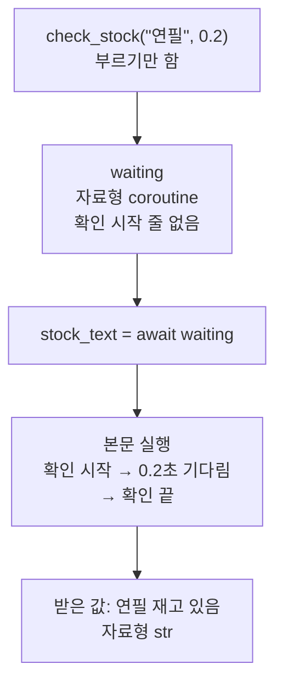
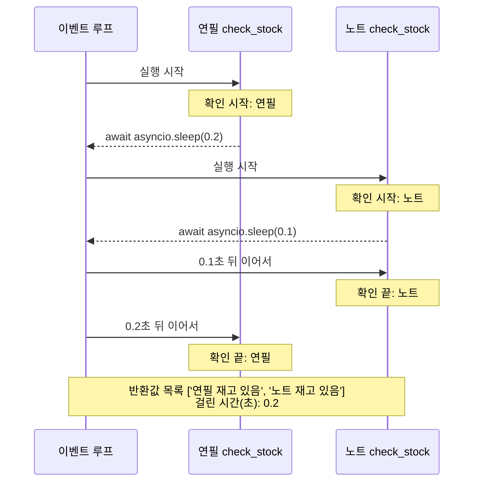
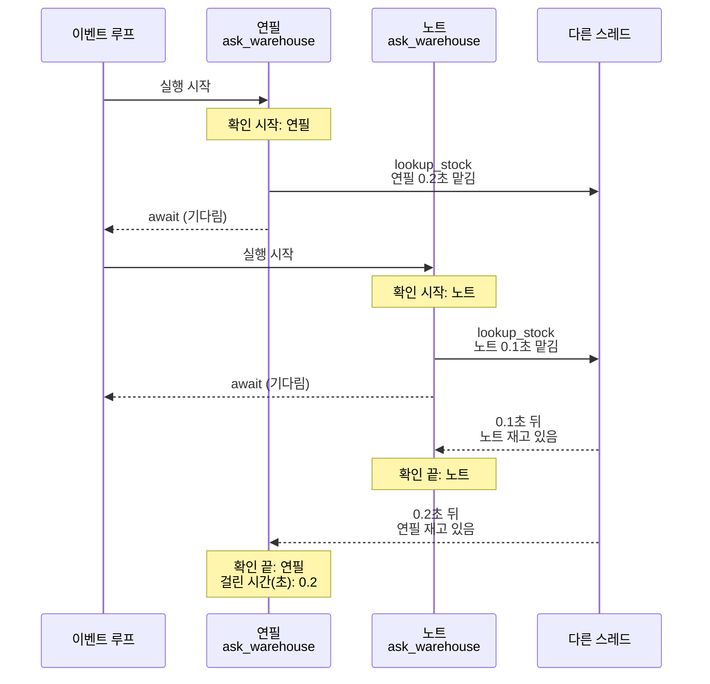
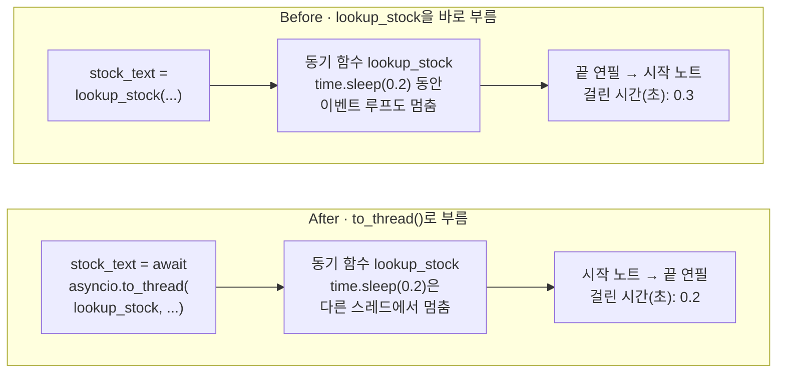

# 12-async와-await

## _src 본문 (HTML 원본)

```html
<!--meta: 강의 1h | 실습 3h | 코드 Jupyter Notebook | 새 용어 7 -->
<h2 id="b1"><span class="no">1</span>학습 목표</h2>
<div class="goal"><ul><li>비동기 함수를 부르면 코루틴이 나오고, <code>await</code> 줄에서 본문이 실행되어 반환값을 받는다는 것을 출력으로 설명할 수 있습니다.</li><li>연필·노트 두 확인을 <code>await</code> 두 줄과 <code>asyncio.gather()</code>로 기다려 걸린 시간과 반환값 목록의 순서를 비교할 수 있습니다.</li><li>비동기 함수 안의 <code>time.sleep()</code>이 다른 확인을 멈추는 장면을 읽고, <code>asyncio.to_thread()</code>로 고칠 수 있습니다.</li></ul></div>
<h2 id="b2"><span class="no">2</span>이 내용을 배우는 이유</h2>
<p>프로그램은 기다리는 시간이 많습니다. 파일을 읽고, 다른 컴퓨터에 요청을 보내고, 언어 모델의 답을 기다립니다. 주문 두 건을 하나씩 기다리면 두 시간을 더한 만큼 걸립니다.</p>
<p>한 주문을 기다리는 동안 다른 주문도 진행하면, 긴 쪽 시간만큼만 기다립니다. Python에서는 비동기 함수와 <code>await</code>, 모듈 asyncio로 이렇게 씁니다.</p>
<p>흔한 실수는 비동기 함수 안에서 기다리는 보통 함수를 그대로 부르는 것입니다. 코드는 오류 없이 실행되고 반환값도 맞습니다. 그런데 다른 작업이 함께 진행되지 않습니다. <b>비동기 함수 안에서 오래 기다리는 동기 함수는 다른 스레드로 옮겨 기다립니다.</b></p>
<p><strong>이 절의 질문</strong> — 비동기 함수 안에서 동기 함수 <code>time.sleep()</code>으로 기다리면, gather()에 함께 넣은 다른 확인이 진행될까요? 그 동기 함수는 그대로 두고 함께 진행하게 하려면, 무엇을 바꿔야 할까요?</p>
<p>이 절은 기본 경로(A)와 확장 경로(B) 모두 배우는 절입니다. 기본 경로는 8절에서 바로 이 절로 옵니다. 그래서 9~11절 내용은 쓰지 않습니다.</p>
<h2 id="b3"><span class="no">3</span>앞에서 배운 내용</h2>
<p>Ch 1과 1~8절에서 배운 것 가운데 이 절이 이어 쓰는 것을 표로 모았습니다.</p>
<table><thead><tr><th>앞 절</th><th>배운 것</th><th>이 절에서 이어 쓰는 곳</th></tr></thead><tbody>
<tr><td>Ch 1 4절</td><td>명령 <code>python hello.py</code>로 파일 실행</td><td>파일 stock_main.py를 새 Python으로 실행</td></tr>
<tr><td>4절</td><td>정의 셀과 호출 셀 나누기, 반환값, <code>round()</code></td><td>함수 check_stock·lookup_stock·ask_warehouse, 걸린 시간을 소수 첫째 자리로</td></tr>
<tr><td>5·6절</td><td>주문 연필과 노트</td><td>재고를 확인할 두 주문</td></tr>
<tr><td>7절</td><td>타입힌트 <code>product_name: str</code>·<code>-&gt; str</code>, <code>type()</code>, 모듈 파일 쓰기</td><td>비동기 함수의 정의 줄, 자료형 <code>&lt;class 'coroutine'&gt;</code>, stock_main.py 저장</td></tr>
<tr><td>8절</td><td><code>subprocess.run([sys.executable, ...])</code>, 종료 코드, 임시 폴더 준비 셀</td><td>.py 파일 실행과 종료 코드 0</td></tr>
</tbody></table>
<p>이 절의 새 문법은 <code>async def</code>와 <code>await</code>입니다. 새 함수는 <code>asyncio.sleep()</code>, <code>asyncio.gather()</code>, <code>asyncio.run()</code>, <code>asyncio.to_thread()</code>입니다.</p>
<p>9절의 <code>@</code> 줄, 10절 Pydantic, 11절 패키징과 픽스처는 쓰지 않습니다. 모델을 부르지 않으므로 API 키가 필요 없습니다.</p>
<h2 id="b4"><span class="no">4</span>핵심 개념</h2>
<h3>비유로 시작하기</h3>
<p>큰 모래시계와 작은 모래시계로 두 가지 일을 잰다고 해 봅니다. 큰 모래시계를 세우고 모래가 다 떨어질 때까지 작은 모래시계를 눕혀 두면, 두 시간을 더한 만큼 기다립니다.</p>
<p>두 모래시계를 함께 세워 두면, 모래는 둘 다 떨어집니다. 작은 모래시계가 먼저 끝나고, 기다리는 시간은 큰 모래시계 한 번뿐입니다.</p>
<p>큰 모래시계는 연필 확인 0.2초, 작은 모래시계는 노트 확인 0.1초입니다. 모래시계를 세우는 일은 <code>await</code>로 기다리기 시작하는 일입니다.</p>
{{img:12-6-모래시계-두-개|가운데 세로줄 왼쪽 탁자에는 모래가 떨어지는 큰 모래시계 옆에 작은 모래시계가 옆으로 누워 멈춰 있고, 오른쪽 탁자에는 같은 큰 모래시계와 작은 모래시계가 둘 다 서서 함께 모래가 떨어지는 삽화|큰 모래시계만 흐르고 작은 모래시계가 누워 기다리는 왼쪽은 차례로 기다린 Before, 두 모래시계가 함께 흐르는 오른쪽은 함께 기다린 After에 해당합니다.}}
<p><strong>그림 읽기</strong> — 가운데 세로줄 왼쪽에서는 큰 모래시계만 서서 모래가 떨어집니다. 작은 모래시계는 옆에 누워 아직 시작하지 못했습니다. 연필이 끝나야 노트가 시작해 0.3초가 걸린 Before에 해당합니다.</p>
<p>세로줄 오른쪽에서는 두 모래시계가 함께 서서 모래가 떨어집니다. 두 확인을 함께 기다려 긴 쪽 0.2초가 걸린 After에 해당합니다.</p>
<h3>이 절에서 쓰는 말</h3>
<table><thead><tr><th>용어</th><th>뜻</th><th>이 절에서 보이는 모습</th></tr></thead><tbody>
<tr><td>비동기 함수(async function)</td><td>기다리는 줄에서 멈췄다가, 기다림이 끝나면 이어서 실행할 수 있는 함수. 정의 줄에 async를 붙임</td><td><code>async def check_stock(...)</code></td></tr>
<tr><td>코루틴(coroutine)</td><td>비동기 함수를 불러서 만든, 아직 실행하지 않은 본문 실행 하나</td><td><code>&lt;class 'coroutine'&gt;</code></td></tr>
<tr><td>await</td><td>코루틴이 끝날 때까지 기다리고 반환값을 받는 예약어. 기다리는 동안 다른 코루틴이 실행될 수 있음</td><td><code>stock_text = await waiting</code></td></tr>
<tr><td>이벤트 루프(event loop)</td><td>기다리는 코루틴과 이어서 실행할 코루틴을 번갈아 챙기는 실행 담당자</td><td>gather()로 함께 넣은 두 확인</td></tr>
<tr><td>동기 함수</td><td>정의 줄에 async가 없는 보통 함수. 부르면 끝날 때까지 다음 줄로 가지 않음</td><td><code>def lookup_stock(...)</code></td></tr>
<tr><td>차단 호출(blocking call)</td><td>끝날 때까지 실행을 붙잡아, 이벤트 루프가 다른 코루틴을 실행하지 못하게 하는 호출</td><td>Before의 <code>time.sleep()</code>, 0.3초</td></tr>
<tr><td>스레드(thread)</td><td>한 Python 프로그램 안에서 따로 진행되는 실행 흐름</td><td><code>asyncio.to_thread()</code>, 심화 셀의 <code>MainThread</code>와 <code>asyncio_1</code></td></tr>
</tbody></table>
<h3>비동기 함수와 코루틴</h3>
<p>정의 줄의 <code>def</code> 앞에 <code>async</code>를 붙이면 비동기 함수가 됩니다. 노트북의 함수 check_stock은 상품 이름과 기다릴 초를 받습니다. 본문의 <code>await asyncio.sleep(seconds)</code> 줄에서 그 초만큼 기다린 뒤, 재고 글을 반환합니다.</p>
<p>함수 <code>asyncio.sleep()</code>은 창고의 답을 기다리는 시간을 대신합니다. 실제 창고나 다른 컴퓨터에는 묻지 않았습니다. 초는 0.2처럼 소수로 적어서, 7절 타입힌트 모양으로 <code>seconds: float</code>이라고 적었습니다.</p>
<p>코루틴(coroutine)은 비동기 함수를 불러서 만든, 아직 실행하지 않은 본문 실행 하나입니다. 식당에서 받은 주문 번호표와 비슷합니다. 번호표만 받았을 뿐, 음식은 아직 나오지 않았습니다.</p>
<p>노트북에서 <code>check_stock("연필", 0.2)</code>를 부르기만 하자 <code>&lt;class 'coroutine'&gt;</code>이 나왔습니다. 본문 첫 줄의 「확인 시작: 연필」은 출력되지 않았습니다. Python 문서도 코루틴을 부르기만 해서는 실행이 예약되지 않는다고 설명합니다.</p>
<p>예약어 await를 코루틴 앞에 붙이면, 본문이 실행되고 끝날 때까지 기다립니다. 노트북은 <code>await waiting</code> 줄에서 확인 시작과 확인 끝을 출력했습니다. 받은 값은 <code>연필 재고 있음</code>, 자료형은 <code>&lt;class 'str'&gt;</code>였습니다.</p>
{{mermaid:12-1-코루틴-만들고-기다리기|파란 상자 check_stock("연필", 0.2) 부르기만 함에서 초록 상자 waiting 자료형 coroutine 확인 시작 줄 없음으로, 파란 상자 stock_text = await waiting을 지나 파란 상자 본문 실행 확인 시작, 0.2초 기다림, 확인 끝을 거쳐 노란 상자 받은 값 연필 재고 있음 자료형 str로 이어지는 흐름도|비동기 함수를 부르고 기다리는 차례. 부르기만 한 waiting은 코루틴이고, await 줄에서 본문이 실행되어 「연필 재고 있음」을 받습니다.}}
<p><strong>도식 읽기</strong> — 위에서 아래로 읽습니다. 파란 상자는 우리가 적은 코드, 초록 상자는 이름에 담긴 값, 노란 상자는 출력입니다. 첫 파란 상자에서 부르기만 하면, 초록 상자 waiting은 자료형 coroutine이고 확인 시작 줄이 없습니다.</p>
<p>둘째 파란 상자의 await 줄을 지나야 셋째 파란 상자처럼 본문이 실행됩니다. 맨 아래 노란 상자에서 받은 값 「연필 재고 있음」이 나옵니다.</p>
<h3>이벤트 루프와 gather()</h3>
<p>함수 <code>asyncio.gather()</code>는 괄호에 넣은 코루틴들을 함께 진행합니다. 모두 끝나면 반환값을 모은 목록을 만들고, 이 목록도 await로 받습니다.</p>
<p>함께 진행하는 일은 이벤트 루프(event loop)가 맡습니다. 이벤트 루프는 기다리는 코루틴과 이어서 실행할 코루틴을 번갈아 챙기는 실행 담당자입니다. 주방 직원 한 명이 냄비 물이 끓기를 기다리는 동안 다른 냄비에 불을 켜는 것과 비슷합니다.</p>
<p>노트북에서는 연필 확인이 <code>await asyncio.sleep(0.2)</code>에서 기다리기 시작하자, 이벤트 루프가 노트 확인을 시작했습니다. 반환값 목록의 순서는 끝난 순서가 아니라 괄호에 넣은 순서입니다. Python 3.12 소스의 gather() 설명도 같은 내용입니다.</p>
<p>노트북 셀에서는 함수 밖에서도 await 줄을 바로 썼습니다. IPython 문서는 이것을 노트북 도구의 자동 await 기능으로 설명합니다. 파이썬 파일에서는 함수 밖에 await를 쓸 수 없어서, 함수 <code>asyncio.run()</code>으로 시작합니다.</p>
<h3>동기 함수와 차단 호출</h3>
<p>동기 함수는 정의 줄에 async가 없는 보통 함수입니다. 함수 <code>time.sleep()</code>은 정해진 초가 지날 때까지 그 줄에서 멈춥니다. 예약어 await가 없어서, 멈춘 동안 이벤트 루프에 실행 차례를 넘기지 않습니다.</p>
<p>차단 호출(blocking call)은 끝날 때까지 실행을 붙잡는 호출입니다. 그동안 이벤트 루프는 다른 코루틴을 실행하지 못합니다. 주방 직원이 반죽을 직접 치대는 동안에는 다른 냄비를 보지 못하는 것과 비슷합니다. Python 문서의 asyncio 개발 안내도 이런 코드를 직접 부르지 말라고 설명합니다.</p>
<p>스레드(thread)는 한 Python 프로그램 안에서 따로 진행되는 실행 흐름입니다. 반죽을 옆 조리대의 보조에게 맡기면, 직원은 다른 냄비를 챙길 수 있습니다. 함수 <code>asyncio.to_thread()</code>는 동기 함수를 다른 스레드에서 부르는 코루틴을 반환합니다.</p>
<h2 id="b5"><span class="no">5</span>실행 예제</h2>
<p>노트북은 Python 3.12.13을 확인하고, 5·7·8절처럼 빈 임시 폴더로 작업 위치를 옮깁니다. 비동기 함수 check_stock을 정의하고, 부르기만 했을 때와 await로 기다렸을 때를 비교합니다.</p>
<p>이어서 연필 0.2초와 노트 0.1초를 await 두 줄로 차례로 기다리고, 다음에는 gather()로 함께 기다립니다. 값 바꿔 보기에서는 노트의 초 값만 0.3으로 바꿉니다. 마지막으로 같은 흐름을 .py 파일에 적어 <code>asyncio.run()</code>으로 실행합니다.</p>
{{notebook:12-async와-await|example}}
<p class="look"><b>확인할 점</b> — 부르기만 한 셀에 「확인 시작」 줄이 없는지 봅니다. 차례로 기다린 셀은 <code>걸린 시간(초): 0.3</code>, gather() 셀은 <code>걸린 시간(초): 0.2</code>인지 확인합니다. 두 셀의 반환값 목록이 모두 연필, 노트 순서인지도 봅니다.</p>
<h3>함께 기다린 차례</h3>
<p>차례로 기다린 셀은 <code>확인 끝: 연필</code> 다음에 <code>확인 시작: 노트</code>가 나왔습니다. 첫 await 줄이 끝나야 둘째 줄로 넘어가기 때문입니다. 걸린 시간은 두 시간을 더한 0.3초였습니다.</p>
<p>gather() 셀은 확인 시작 두 줄이 먼저 나오고, 끝은 노트가 먼저였습니다. 반환값 목록은 <code>['연필 재고 있음', '노트 재고 있음']</code>으로 넣은 순서였고, 걸린 시간은 0.2초였습니다.</p>
{{mermaid:12-2-gather-함께-기다리기|이벤트 루프, 연필 check_stock, 노트 check_stock 세 세로줄의 순서도. 이벤트 루프가 연필을 실행하면 노란 메모 확인 시작: 연필 뒤 연필이 await asyncio.sleep(0.2)로 기다리고, 노트를 실행하면 확인 시작: 노트 뒤 await asyncio.sleep(0.1)로 기다림. 0.1초 뒤 노트를 이어서 확인 끝: 노트, 0.2초 뒤 연필을 이어서 확인 끝: 연필, 마지막 노란 메모에 반환값 목록 ['연필 재고 있음', '노트 재고 있음']과 걸린 시간(초): 0.2|gather()로 두 확인을 함께 기다린 차례. 노트가 먼저 끝나도 반환값 목록은 연필, 노트 순서이고, 0.2초가 걸렸습니다.}}
<p><strong>도식 읽기</strong> — 위에서 아래로 시간 순서입니다. 세로줄 세 개는 이벤트 루프와 두 코루틴입니다. 연필 코루틴이 <code>await asyncio.sleep(0.2)</code>에서 기다리자, 이벤트 루프는 노트 코루틴을 실행합니다.</p>
<p>노란 메모 다섯 개 가운데 앞의 네 개는 확인 시작·끝 줄이 찍힌 차례입니다. 짧게 기다린 노트가 0.1초 뒤 먼저 끝나고, 연필은 0.2초 뒤 끝납니다. 마지막 노란 메모의 반환값 목록은 그래도 연필, 노트 순서입니다.</p>
<h3>걸린 시간과 반환값 목록의 순서</h3>
<p>값 바꿔 보기에서는 노트의 초 값만 0.3으로 바꿨습니다. 이번에는 <code>확인 끝: 연필</code>이 먼저 나왔고, 걸린 시간은 긴 쪽 노트와 같은 0.3초였습니다. 반환값 목록은 6번과 같은 연필, 노트 순서였습니다.</p>
<p>끝나는 순서가 바뀌어도 반환값 목록의 순서는 그대로였습니다. 그래서 목록의 첫 값은 괄호에 처음 넣은 코루틴의 반환값이라고 읽습니다.</p>
{{mermaid:12-3-걸린-시간-비교|가로축 0초부터 0.3초까지의 막대 그림. 5번 차례로 await 걸린 시간 0.3은 연필 0.2초 막대 뒤에 노트 0.1초 막대가 이어지고, 6번 gather 걸린 시간 0.2는 연필 0.2초와 노트 0.1초 막대가 0에서 함께 시작하며, 7번 노트만 0.3초 걸린 시간 0.3은 연필 0.2초와 노트 0.3초 막대가 0에서 함께 시작함|노트북 5·6·7번의 기다린 구간. 막대가 이어지면 시간이 더해지고, 막대가 겹치면 긴 막대만큼 걸립니다.}}
<p><strong>도식 읽기</strong> — 가로축은 시작부터 지난 시간(초)이고, 한 줄에 연필과 노트 막대가 하나씩 있습니다. 맨 위 5번 줄은 연필 막대가 끝난 뒤 노트 막대가 시작해 0.3초까지 이어집니다.</p>
<p>가운데 6번 줄은 두 막대가 0에서 함께 시작해 0.2초에 끝납니다. 맨 아래 7번 줄은 노트 막대가 0.3초까지 길어졌습니다. 막대 길이는 코드에 적은 초 값이고, 줄 이름의 걸린 시간은 실제 출력입니다.</p>
<h3>.py 파일에서는 asyncio.run()</h3>
<p>파이썬 파일에서는 함수 밖에 await 줄을 쓸 수 없습니다. 그래서 파일 stock_main.py는 await 줄을 비동기 함수 main 안에 두었습니다. 파일 맨 아래 줄은 <code>asyncio.run(main())</code>입니다.</p>
<p>함수 <code>asyncio.run()</code>은 이벤트 루프를 새로 만들어 코루틴을 끝까지 실행하고, 끝나면 이벤트 루프를 닫습니다. 노트북은 7절처럼 파일 글(381글자)을 저장하고, 8절처럼 새 Python으로 실행했습니다. 출력은 <code>반환값 목록: ['연필 재고 있음', '노트 재고 있음']</code>, 종료 코드는 0이었습니다.</p>
<p>Python 문서는 이벤트 루프가 이미 실행 중인 곳에서는 <code>asyncio.run()</code>을 부를 수 없다고 적습니다. 노트북 셀에서 이 함수를 부르는 장면은 이번에 실행하지 않았습니다.</p>
<h2 id="b6"><span class="no">6</span>일부러 실패해 보기</h2>
<p>Before 셀은 창고 조회를 동기 함수 lookup_stock으로 만듭니다. 이 함수는 <code>time.sleep(seconds)</code>로 기다린 뒤 재고 글을 반환합니다. 오래 걸리는 파일 읽기처럼, 기다리는 동안 await를 쓰지 않는 함수를 대신합니다.</p>
<p>비동기 함수 ask_warehouse는 확인 시작을 출력한 뒤, 이 동기 함수를 바로 부릅니다. 본문에는 await 줄이 하나도 없습니다. 노트북은 6번과 같은 순서와 초 값(연필 0.2, 노트 0.1)으로 두 코루틴을 gather()에 넣었습니다.</p>
<p>출력은 <code>확인 끝: 연필</code> 다음에 <code>확인 시작: 노트</code>가 나왔고, 걸린 시간은 0.3초였습니다. 함수 gather()에 함께 넣었지만, 차례로 기다린 5번과 같았습니다. 연필의 <code>time.sleep()</code>이 멈춘 동안 이벤트 루프도 멈춰, 노트 확인을 시작하지 못했습니다.</p>
<p>반환값 목록은 6번과 같은 <code>['연필 재고 있음', '노트 재고 있음']</code>이었습니다. 오류도 나지 않았습니다. 그래서 반환값만 보면 차단 호출을 알아채지 못합니다.</p>
<p>After 셀은 lookup_stock은 그대로 두고, ask_warehouse를 다시 정의합니다. 달라진 곳은 동기 함수를 부르는 한 줄입니다. 새 줄은 <code>stock_text = await asyncio.to_thread(lookup_stock, product_name, seconds)</code>입니다.</p>
<p>괄호에는 함수 이름 lookup_stock을 괄호 없이 넣고, 그 뒤에 인자를 차례로 넣습니다. 함수 이름 뒤에 괄호를 붙이지 않으면, 함수를 부르지 않고 함수 자체를 넘깁니다. 함수 <code>asyncio.to_thread()</code>가 다른 스레드에서 그 함수를 부릅니다.</p>
<p>같은 코드로 다시 실행하자 <code>확인 시작: 노트</code>가 <code>확인 끝: 연필</code>보다 먼저 나왔습니다. 걸린 시간은 0.2초였고, 반환값 목록을 확인하는 <code>assert</code> 줄에서도 멈추지 않았습니다.</p>
{{mermaid:12-4-to_thread-차례|이벤트 루프, 연필 ask_warehouse, 노트 ask_warehouse, 다른 스레드 네 세로줄의 순서도. 노란 메모 확인 시작: 연필 뒤 연필이 lookup_stock 연필 0.2초를 다른 스레드에 맡기고 await로 기다리며, 이벤트 루프가 노트를 실행해 확인 시작: 노트 뒤 lookup_stock 노트 0.1초를 맡기고 기다림. 다른 스레드가 0.1초 뒤 노트 재고 있음을 전해 확인 끝: 노트, 0.2초 뒤 연필 재고 있음을 전해 확인 끝: 연필과 걸린 시간(초): 0.2|After에서 to_thread()로 동기 함수를 맡긴 차례. 연필이 다른 스레드의 답을 기다리는 동안 노트 확인이 시작되어 0.2초에 끝났습니다.}}
<p><strong>도식 읽기</strong> — 위에서 아래로 시간 순서입니다. 세로줄 네 개는 이벤트 루프, 두 ask_warehouse 코루틴, 다른 스레드입니다. 연필 코루틴이 lookup_stock을 다른 스레드에 맡기고 await로 기다립니다.</p>
<p>그동안 이벤트 루프는 노트 코루틴을 실행하고, 노트도 다른 스레드에 맡깁니다. 다른 스레드는 0.1초 뒤 노트, 0.2초 뒤 연필의 재고 글을 전합니다. 노란 메모는 출력 줄이 찍힌 차례이고, 마지막 메모에 걸린 시간 0.2가 있습니다.</p>
{{mermaid:12-5-before-after-비교|Before 칸은 파란 상자 stock_text = lookup_stock(...)이 초록 상자 동기 함수 lookup_stock time.sleep(0.2) 동안 이벤트 루프도 멈춤을 지나 빨간 상자 끝 연필 → 시작 노트 걸린 시간(초): 0.3으로 이어지고, After 칸은 파란 상자 stock_text = await asyncio.to_thread(lookup_stock, ...)가 초록 상자 동기 함수 lookup_stock time.sleep(0.2)은 다른 스레드에서 멈춤을 지나 노란 상자 시작 노트 → 끝 연필 걸린 시간(초): 0.2로 이어지는 비교 그림|동기 함수를 부르는 줄만 바꾼 결과. 바로 부른 Before는 연필이 끝난 뒤 노트가 시작해 0.3초, to_thread()로 부른 After는 노트가 먼저 시작해 0.2초입니다.}}
<p><strong>도식 읽기</strong> — 위 칸이 Before, 아래 칸이 After이고, 칸 안은 왼쪽에서 오른쪽으로 읽습니다. 파란 상자는 lookup_stock을 부르는 줄이고, 초록 상자는 두 칸 모두 같은 동기 함수 lookup_stock입니다.</p>
<p>Before 칸의 초록 상자는 이벤트 루프도 멈추게 해, 빨간 상자(끝 연필 → 시작 노트, 0.3초)로 이어집니다. After 칸의 초록 상자는 다른 스레드에서 멈춰, 노란 상자(시작 노트 → 끝 연필, 0.2초)로 이어집니다.</p>
{{notebook:12-async와-await|failure}}
<h3>확인한 범위</h3>
<p>이번 Before/After는 정해진 초만큼 멈추는 동기 함수 한 사례입니다. 실제 파일 읽기나 네트워크 요청은 실행하지 않았습니다. 오래 계산하는 함수를 스레드로 옮기는 장면도 없었습니다.</p>
<p>걸린 시간은 소수 첫째 자리로 줄여 비교했고, 컴퓨터와 실행마다 조금씩 다를 수 있습니다. Python 소스의 gather() 설명은 넣은 순서대로 시작한다고 보장하지 않습니다. 이번 실행에서는 연필이 먼저 시작했습니다.</p>
<p>원리 더 알아보기 셀에서는 스레드 이름을 출력했습니다. 셀에서 부른 함수는 <code>MainThread</code>, to_thread()로 부른 함수는 <code>asyncio_1</code>이었습니다. 이름 뒤의 번호는 실행마다 다를 수 있고, 스레드를 몇 개 만드는지는 확인하지 않았습니다.</p>
<h2 id="b7"><span class="no">7</span>주의할 점과 실무 메모</h2>
<ul><li>비동기 함수를 부르기만 하면 본문이 실행되지 않습니다. 노트북에서 부르기만 한 셀에는 「확인 시작」 줄이 없었습니다. 코루틴 앞에 await를 붙이거나, gather()에 넣습니다.</li>
<li>함수 gather()가 반환한 목록의 순서는 괄호에 넣은 순서입니다. 무엇이 먼저 끝났는지는 목록으로 알 수 없어서, 노트북은 확인 끝 줄을 따로 출력했습니다.</li>
<li>비동기 함수 안에서는 <code>time.sleep()</code> 대신 <code>await asyncio.sleep()</code>을 씁니다. 고칠 수 없는 동기 함수는 <code>asyncio.to_thread()</code>로 부릅니다.</li>
<li>Before 셀은 오류 없이 맞는 반환값을 냈습니다. 함께 진행되는지는 출력 줄의 차례와 걸린 시간으로 확인합니다.</li>
<li>함께 기다린다고 계산이 빨라지지는 않습니다. 이번에 줄어든 것은 기다리는 시간이 겹친 만큼입니다.</li>
<li>Python 3.12.13에서 실행한 결과입니다. 버전은 실습 폴더의 pyproject.toml과 잠금 파일에 고정되어 있습니다.</li></ul>
<h2 id="b8"><span class="no">8</span>정리와 다음 절</h2>
<ul><li>비동기 함수를 부르면 코루틴 <code>&lt;class 'coroutine'&gt;</code>이 나왔습니다. await 줄에서 본문이 실행되어 「연필 재고 있음」을 받았습니다.</li><li>연필 0.2초와 노트 0.1초를 차례로 기다리면 0.3초, gather()로 함께 기다리면 0.2초가 걸렸습니다. 반환값 목록은 넣은 순서였습니다.</li><li>비동기 함수 안의 <code>time.sleep()</code>은 노트 확인을 멈춰 0.3초가 걸렸습니다. 같은 함수를 <code>asyncio.to_thread()</code>로 부르자 0.2초가 걸렸습니다.</li></ul>
<p><strong>다음 학습과 이어지는 지점</strong> — <a href="13-파이썬-실습.html">13절 파이썬 실습</a>에서 1~7절의 부품을 한 함수로 조립합니다. Ch 3 노트북은 5·8절의 <code>with open()</code>과 <code>subprocess.run()</code>으로 Git 명령을 실행합니다. Ch 18 3절은 모델 호출 세 개를 <code>asyncio.gather()</code>로 함께 기다리고, 반환 목록이 입력 순서라고 적습니다. Ch 30 1절은 비동기 함수 안의 동기 호출이 이벤트 루프를 멈출 수 있다고 설명합니다. Ch 30 3절은 await로 Agent 실행을 기다립니다.</p>
<h2 id="b9"><span class="no">9</span>복습 문제</h2><details class="quiz"><summary>문제와 해설</summary>
<p class="quiz-q">1. 비동기 함수 check_stock을 부르기만 했을 때 나온 자료형은 무엇인가요? 「확인 시작: 연필」 줄은 왜 나오지 않았나요? · 기초</p><p class="quiz-a"><b>해설</b> — 나온 값의 자료형은 <code>&lt;class 'coroutine'&gt;</code>입니다. 비동기 함수를 부르면 본문을 실행하지 않고 코루틴만 만듭니다. 다음 셀의 <code>await waiting</code> 줄에서 본문이 실행되어 확인 시작 줄이 나왔습니다.</p>
<p class="quiz-q">2. 연필 0.2초·노트 0.1초를 await 두 줄로 기다린 셀과 gather()로 기다린 셀의 걸린 시간을 쓰세요. 차이가 난 이유도 설명하세요. · 기초</p><p class="quiz-a"><b>해설</b> — await 두 줄은 0.3초, gather()는 0.2초였습니다. await 두 줄은 첫 줄이 끝나야 둘째 줄이 시작해 두 시간이 더해졌습니다. gather()에서는 연필이 기다리는 동안 이벤트 루프가 노트를 실행해 기다림이 겹쳤습니다.</p>
<p class="quiz-q">3. 값 바꿔 보기에서 노트를 0.3초로 바꾸자 끝나는 순서와 반환값 목록은 어떻게 되었나요? · 적용</p><p class="quiz-a"><b>해설</b> — 이번에는 연필이 먼저 끝났고, 걸린 시간은 0.3초였습니다. 반환값 목록은 그대로 <code>['연필 재고 있음', '노트 재고 있음']</code>였습니다. 목록의 순서는 끝난 순서가 아니라 gather() 괄호에 넣은 순서이기 때문입니다.</p>
<p class="quiz-q">4. 파일 stock_main.py에서는 await 줄을 함수 main 안에 두고 <code>asyncio.run(main())</code>을 불렀습니다. 노트북 셀과 다르게 쓴 이유를 쓰세요. · 적용</p><p class="quiz-a"><b>해설</b> — 파이썬 파일에서는 함수 밖에 await를 쓸 수 없기 때문입니다. 노트북 셀의 함수 밖 await는 노트북 도구의 기능입니다. 함수 <code>asyncio.run()</code>이 이벤트 루프를 만들어 main을 실행했고, 종료 코드 0과 반환값 목록이 나왔습니다.</p>
<p class="quiz-q">5. Before에서 두 코루틴을 gather()에 함께 넣었는데도 0.3초가 걸렸습니다. 출력 줄의 차례를 근거로 이유를 설명하세요. · 분석</p><p class="quiz-a"><b>해설</b> — 출력은 <code>확인 끝: 연필</code> 다음에 <code>확인 시작: 노트</code>였습니다. 동기 함수 lookup_stock 안의 <code>time.sleep()</code>은 await가 아니라서, 멈춘 동안 이벤트 루프에 차례를 넘기지 않습니다. 그래서 연필이 끝날 때까지 노트 확인이 시작되지 못했습니다. 이런 호출이 차단 호출입니다.</p>
<p class="quiz-q">6. After에서 바꾼 한 줄을 쓰고, lookup_stock을 괄호 없이 넣은 이유와 달라진 결과를 설명하세요. · 분석</p><p class="quiz-a"><b>해설</b> — 바꾼 줄은 <code>stock_text = await asyncio.to_thread(lookup_stock, product_name, seconds)</code>입니다. 괄호를 붙이면 그 자리에서 함수를 불러 멈추므로, 함수 자체를 넘기고 to_thread()가 다른 스레드에서 부르게 했습니다. 결과는 확인 시작: 노트가 확인 끝: 연필보다 먼저 나왔고, 0.2초가 걸렸습니다.</p>
</details>
<h2 id="b10"><span class="no">10</span>참고 자료</h2>
<ul><li><a href="https://docs.python.org/3.12/library/asyncio-task.html">Python 3.12 문서 · 코루틴과 태스크</a> · 확인 2026-09-16</li><li><a href="https://docs.python.org/3.12/library/asyncio-runner.html#asyncio.run">Python 3.12 문서 · asyncio.run</a> · 확인 2026-09-16 · 기준 Python 3.12</li><li><a href="https://docs.python.org/3.12/library/asyncio-dev.html#running-blocking-code">Python 3.12 문서 · 차단 코드 실행</a> · 확인 2026-09-16</li><li><a href="https://docs.python.org/3.12/library/time.html#time.perf_counter">Python 3.12 문서 · time.perf_counter</a> · 확인 2026-09-16 · 기준 Python 3.12</li><li><a href="https://docs.python.org/3.12/library/threading.html#threading.current_thread">Python 3.12 문서 · current_thread</a> · 확인 2026-09-16</li><li><a href="https://ipython.readthedocs.io/en/stable/interactive/autoawait.html">IPython 문서 · Asynchronous in REPL: Autoawait</a> · 확인 2026-09-16</li></ul>
```

## 노트북 셀 (순서대로)

### [0] markdown {'html': 'skip'}

# async와 await

**이 노트북에서 할 일**

1. 비동기 함수를 부르면 나오는 코루틴을 보고, await로 기다려 반환값을 받습니다.
2. 연필·노트 두 주문의 재고 확인을 차례로 기다릴 때와 함께 기다릴 때 걸린 시간을 비교합니다.
3. 비동기 함수 안의 time.sleep()이 다른 확인을 멈추는 장면을 보고, to_thread()로 고칩니다.

**준비물** — API 키 불필요. 언어 모델 호출은 0번이고 비용은 들지 않습니다. 실행 시간은 1분 이내입니다.

Python 표준 라이브러리만 씁니다. 1~11절과 같은 실습 폴더 `labs/part1/ch02-python`의 `.venv`를 커널로 고르고, 첫 셀부터 순서대로 실행합니다.
기본 경로(A)는 8절에서 바로 이 절로 옵니다. 9~11절 내용은 쓰지 않습니다.

### [1] markdown {'html': 'skip'}

## 오늘 볼 그림


위에서 아래로 읽습니다. 파란 상자는 우리가 적은 코드, 초록 상자는 이름에 담긴 값, 노란 상자는 출력입니다.

비동기 함수를 부르기만 하면 본문이 아직 실행되지 않습니다. await 줄을 만나야 본문이 실행되고 반환값이 나옵니다.

### [2] markdown {}

## 1. 준비

비동기 실행에 쓰는 모듈 asyncio와 시간을 재는 모듈 time은 Python에 들어 있는 표준 라이브러리입니다. 따로 설치하지 않습니다.
첫 준비 셀은 두 모듈을 불러오고, 7절처럼 모듈 platform으로 Python 버전을 출력합니다.

### [3] code {'execution': {'iopub.execute_input': '2026-09-16T09:00:07.244494Z', 'iopub.status.busy': '2026-09-16T09:00:07.244229Z', 'iopub.status.idle': '2026-09-16T09:00:07.249575Z', 'shell.execute_reply': '2026-09-16T09:00:07.248800Z'}, 'lesson_role': 'setup'}

```python
# 비동기 실행 모듈 asyncio와 시간 모듈 time을 불러오고, Python 버전을 확인합니다
import asyncio
import platform
import time

python_version = platform.python_version()
print("Python 버전:", python_version)
```

출력:
```
Python 버전: 3.12.13

```

### [4] markdown {}

**결과 읽기** — Python 버전은 `3.12.13`입니다. 실습 폴더의 pyproject.toml에 적은 3.12 버전입니다.

### [5] markdown {}

이 노트북은 6번에서 .py 파일을 하나 만들어 실행합니다. 5·7·8절처럼 빈 임시 폴더를 만들고, 그 폴더로 작업 위치를 옮깁니다.
파일을 새 Python으로 실행할 때 쓰는 모듈 subprocess와 sys도 여기서 불러옵니다.

### [6] code {'execution': {'iopub.execute_input': '2026-09-16T09:00:07.251210Z', 'iopub.status.busy': '2026-09-16T09:00:07.251075Z', 'iopub.status.idle': '2026-09-16T09:00:07.254496Z', 'shell.execute_reply': '2026-09-16T09:00:07.253821Z'}, 'lesson_role': 'setup'}

```python
# 파일을 둘 빈 임시 폴더를 만들고, 그 폴더로 작업 위치를 옮깁니다
import os
import subprocess
import sys
import tempfile

# mkdtemp()는 운영체제 임시 폴더 안에 새 폴더를 만들고 그 경로를 반환합니다
practice_folder = tempfile.mkdtemp(prefix="ch02-12-")
os.chdir(practice_folder)
file_names = os.listdir()
print("현재 작업 폴더의 파일:", file_names)
```

출력:
```
현재 작업 폴더의 파일: []

```

### [7] markdown {}

**결과 읽기** — 현재 작업 폴더의 파일은 `[]`로, 빈 폴더에서 시작합니다.
폴더의 경로는 컴퓨터마다 달라서 출력하지 않았습니다.

### [8] markdown {}

## 2. 비동기 함수 만들기 — async def

창고에 연필 재고를 묻고 답을 기다린다고 해 봅니다. 실제 창고에 묻지 않고, 정해진 초만큼 기다리는 함수로 대신합니다.

정의 줄의 `def` 앞에 `async`를 붙이면 비동기 함수(async function)가 됩니다. 비동기 함수는 기다리는 줄에서 멈췄다가, 기다림이 끝나면 이어서 실행할 수 있는 함수입니다.
본문의 `await asyncio.sleep(seconds)` 줄은 seconds초 동안 기다립니다. 예약어 await는 「이 줄이 끝날 때까지 기다린다」는 표시입니다.

타입힌트는 7절 모양입니다. 기다릴 초는 0.2처럼 소수로 적으므로 자료형 float을 씁니다.
실행 전에 예상합니다. 정의 셀이라 출력은 없을 것입니다.

### [9] code {'execution': {'iopub.execute_input': '2026-09-16T09:00:07.255733Z', 'iopub.status.busy': '2026-09-16T09:00:07.255611Z', 'iopub.status.idle': '2026-09-16T09:00:07.258638Z', 'shell.execute_reply': '2026-09-16T09:00:07.257925Z'}}

```python
# 상품 이름과 기다릴 초를 받아, 기다린 뒤 재고 글을 반환하는 비동기 함수를 정의합니다
async def check_stock(product_name: str, seconds: float) -> str:
    print("확인 시작:", product_name)
    # asyncio.sleep()은 창고의 답을 기다리는 시간 대신, 정해진 초만큼 기다립니다
    await asyncio.sleep(seconds)
    print("확인 끝:", product_name)
    stock_text = product_name + " 재고 있음"
    return stock_text
```

출력:
```

```

### [10] markdown {}

**결과 읽기** — 예상대로 출력이 없습니다. 4절처럼 함수를 정의만 하고 아직 부르지 않았습니다.

### [11] markdown {}

## 3. 부르기만 하면 코루틴이 나옴

4절에서 보통 함수를 부르면 본문이 실행되고 반환값이 나왔습니다. 비동기 함수를 부르면 무엇이 나오는지 봅니다.
나온 값을 이름 waiting에 담고, 7절처럼 `type()`으로 자료형을 출력합니다.

실행 전에 예상해 봅니다. 본문 첫 줄의 「확인 시작: 연필」이 출력될까요?

### [12] code {'execution': {'iopub.execute_input': '2026-09-16T09:00:07.260063Z', 'iopub.status.busy': '2026-09-16T09:00:07.259891Z', 'iopub.status.idle': '2026-09-16T09:00:07.262558Z', 'shell.execute_reply': '2026-09-16T09:00:07.262039Z'}}

```python
# 비동기 함수를 부르기만 하고, 나온 값의 자료형을 출력합니다
waiting = check_stock("연필", 0.2)
waiting_type = type(waiting)
print("나온 값의 자료형:", waiting_type)
```

출력:
```
나온 값의 자료형: <class 'coroutine'>

```

### [13] markdown {}

**결과 읽기** — 나온 값의 자료형은 `<class 'coroutine'>`입니다. 「확인 시작: 연필」 줄은 출력되지 않았습니다.

코루틴(coroutine)은 비동기 함수를 불러서 만든, 아직 실행하지 않은 본문 실행 하나입니다. 식당에서 받은 주문 번호표와 비슷합니다. 번호표만 받았을 뿐, 음식은 아직 나오지 않았습니다.
Python 문서도 코루틴을 부르기만 해서는 실행이 예약되지 않는다고 설명합니다.

### [14] markdown {}

## 4. await로 기다려 반환값 받기

이름 waiting에 담긴 코루틴 앞에 `await`를 붙이면, 본문이 실행되고 끝날 때까지 기다립니다. 끝나면 return 줄의 값이 나옵니다.
노트북 셀에서는 함수 밖에서도 await 줄을 바로 쓸 수 있습니다. 노트북 도구(IPython)가 주는 기능입니다. .py 파일에서는 방법이 달라서 6번에서 봅니다.

실행 전에 예상합니다. 확인 시작과 확인 끝 두 줄 뒤에, 받은 값 「연필 재고 있음」이 나올 것입니다.

### [15] code {'execution': {'iopub.execute_input': '2026-09-16T09:00:07.263707Z', 'iopub.status.busy': '2026-09-16T09:00:07.263610Z', 'iopub.status.idle': '2026-09-16T09:00:07.470134Z', 'shell.execute_reply': '2026-09-16T09:00:07.468893Z'}}

```python
# 코루틴을 await로 기다려, 본문을 실행하고 반환값을 받습니다
stock_text = await waiting
print("받은 값:", stock_text)
print("받은 값의 자료형:", type(stock_text))
```

출력:
```
확인 시작: 연필
확인 끝: 연필
받은 값: 연필 재고 있음
받은 값의 자료형: <class 'str'>

```

### [16] markdown {}

**결과 읽기** — 출력은 `확인 시작: 연필`, `확인 끝: 연필`, `받은 값: 연필 재고 있음` 순서이고, 받은 값의 자료형은 `<class 'str'>`입니다.

await 줄에서 본문이 처음으로 실행되었습니다. 받은 값은 코루틴이 아니라, 정의 줄의 반환 표시 `-> str`과 같은 글자입니다.

### [17] markdown {}

## 5. 두 주문을 차례로 기다리기

주문이 두 건 있습니다. 5·6절처럼 연필과 노트입니다. 연필은 0.2초, 노트는 0.1초 기다린다고 합니다.
먼저 await 줄 두 개로 차례로 기다리고, 걸린 시간을 잽니다.

함수 `time.perf_counter()`는 시간을 재는 기준 숫자를 초 단위로 반환합니다. 끝난 뒤의 숫자에서 시작할 때의 숫자를 빼면 걸린 시간입니다. 4절 `round()`로 소수 첫째 자리까지 남깁니다.
실행 전에 예상합니다. 연필 확인이 끝난 뒤에 노트 확인이 시작하고, 걸린 시간은 0.2 + 0.1 = 0.3초쯤일 것입니다.

### [18] code {'execution': {'iopub.execute_input': '2026-09-16T09:00:07.472524Z', 'iopub.status.busy': '2026-09-16T09:00:07.472319Z', 'iopub.status.idle': '2026-09-16T09:00:07.783812Z', 'shell.execute_reply': '2026-09-16T09:00:07.782833Z'}}

```python
# 연필과 노트의 재고 확인을 await 줄 두 개로 차례로 기다리고, 걸린 시간을 잽니다
start_time = time.perf_counter()
pencil_text = await check_stock("연필", 0.2)
note_text = await check_stock("노트", 0.1)
# 끝난 뒤의 기준 숫자에서 시작할 때의 기준 숫자를 빼면 걸린 시간(초)입니다
elapsed = time.perf_counter() - start_time
elapsed_seconds = round(elapsed, 1)
print("받은 값:", pencil_text, "/", note_text)
print("걸린 시간(초):", elapsed_seconds)
```

출력:
```
확인 시작: 연필
확인 끝: 연필
확인 시작: 노트
확인 끝: 노트
받은 값: 연필 재고 있음 / 노트 재고 있음
걸린 시간(초): 0.3

```

### [19] markdown {}

**결과 읽기** — 출력은 `확인 끝: 연필` 다음에 `확인 시작: 노트`가 나옵니다. 걸린 시간은 `0.3`초로 예상과 같습니다.

첫 await 줄이 끝나야 둘째 줄로 넘어갑니다. 그래서 두 기다림이 이어져, 두 시간을 더한 만큼 걸렸습니다.

### [20] markdown {}

## 6. 함께 기다리기 — asyncio.gather()

함수 `asyncio.gather()`는 괄호에 넣은 코루틴들을 함께 진행합니다. 모두 끝나면 반환값을 모은 목록을 만듭니다. 이 목록도 await로 받습니다.

함께 진행하는 일은 이벤트 루프(event loop)가 맡습니다. 이벤트 루프는 기다리는 코루틴과 다시 이어서 실행할 코루틴을 번갈아 챙기는 실행 담당자입니다.
연필 확인이 await 줄에서 기다리기 시작하면, 이벤트 루프는 그동안 노트 확인을 실행합니다.

실행 전에 예상합니다. 두 확인 시작이 먼저 나오고, 짧은 노트가 먼저 끝날 것입니다. 걸린 시간은 긴 쪽인 0.2초쯤일 것입니다.

### [21] code {'execution': {'iopub.execute_input': '2026-09-16T09:00:07.786125Z', 'iopub.status.busy': '2026-09-16T09:00:07.785922Z', 'iopub.status.idle': '2026-09-16T09:00:07.992834Z', 'shell.execute_reply': '2026-09-16T09:00:07.991819Z'}}

```python
# 두 코루틴을 만들어 gather()에 함께 넣고, 반환값 목록과 걸린 시간을 봅니다
start_time = time.perf_counter()
pencil_waiting = check_stock("연필", 0.2)
note_waiting = check_stock("노트", 0.1)
# gather()는 넣은 코루틴을 함께 진행하고, 모두 끝나면 반환값 목록을 만듭니다
stock_texts = await asyncio.gather(pencil_waiting, note_waiting)
elapsed = time.perf_counter() - start_time
elapsed_seconds = round(elapsed, 1)
print("반환값 목록:", stock_texts)
print("걸린 시간(초):", elapsed_seconds)
```

출력:
```
확인 시작: 연필
확인 시작: 노트
확인 끝: 노트
확인 끝: 연필
반환값 목록: ['연필 재고 있음', '노트 재고 있음']
걸린 시간(초): 0.2

```

### [22] markdown {}

**결과 읽기** — `확인 시작: 연필`과 `확인 시작: 노트`가 먼저 나오고, 끝은 `확인 끝: 노트`가 먼저입니다. 반환값 목록은 `['연필 재고 있음', '노트 재고 있음']`이고, 걸린 시간은 `0.2`초입니다.

노트는 먼저 끝났지만, 반환값 목록에서는 연필 뒤에 있습니다. 5번 셀의 0.3초보다 짧게, 긴 쪽 연필의 기다림만큼 걸렸습니다.

### [23] markdown {}

## 7. 값 바꿔 보기 — 노트를 더 오래 기다리기

6번 셀에서 노트의 초 값 하나만 0.1에서 0.3으로 바꿉니다. 함수 gather()에 넣는 순서는 연필, 노트 그대로입니다.

실행 전에 예상합니다. 이번에는 연필이 먼저 끝나고, 걸린 시간은 긴 쪽인 0.3초쯤일 것입니다. 반환값 목록의 순서도 바뀔까요?

### [24] code {'execution': {'iopub.execute_input': '2026-09-16T09:00:07.995396Z', 'iopub.status.busy': '2026-09-16T09:00:07.995202Z', 'iopub.status.idle': '2026-09-16T09:00:08.309927Z', 'shell.execute_reply': '2026-09-16T09:00:08.308823Z'}}

```python
# 값 바꿔 보기: 노트의 초 값만 0.3으로 바꿔 gather()에 함께 넣습니다
start_time = time.perf_counter()
pencil_waiting = check_stock("연필", 0.2)
note_waiting = check_stock("노트", 0.3)
stock_texts = await asyncio.gather(pencil_waiting, note_waiting)
elapsed = time.perf_counter() - start_time
elapsed_seconds = round(elapsed, 1)
print("반환값 목록:", stock_texts)
print("걸린 시간(초):", elapsed_seconds)
```

출력:
```
확인 시작: 연필
확인 시작: 노트
확인 끝: 연필
확인 끝: 노트
반환값 목록: ['연필 재고 있음', '노트 재고 있음']
걸린 시간(초): 0.3

```

### [25] markdown {}

**결과 읽기** — 이번에는 `확인 끝: 연필`이 먼저 나왔고, 걸린 시간은 `0.3`초입니다. 반환값 목록은 6번 셀과 같은 `['연필 재고 있음', '노트 재고 있음']`입니다.

끝나는 순서는 바뀌었지만, 반환값 목록의 순서는 그대로입니다. 목록은 끝난 순서가 아니라 gather() 괄호에 넣은 순서를 따릅니다. Python 소스의 gather() 설명도 같은 내용입니다.

### [26] markdown {}

## 8. .py 파일에서 시작하기 — asyncio.run()

파이썬 파일에서는 함수 밖에 await 줄을 쓸 수 없습니다. 그래서 await 줄은 비동기 함수 main 안에 두고, 파일 맨 아래에서 `asyncio.run(main())`을 부릅니다.
함수 `asyncio.run()`은 이벤트 루프를 새로 만들어 코루틴을 끝까지 실행하고, 끝나면 이벤트 루프를 닫습니다.

7·8절처럼 파일 글을 따옴표 세 개로 적어 저장합니다. 함수 main은 반환값이 없어서 반환 표시를 적지 않았습니다.
실행 전에 예상합니다. 쓴 글자 수만 출력되고, 파일은 아직 실행하지 않습니다.

### [27] code {'execution': {'iopub.execute_input': '2026-09-16T09:00:08.312517Z', 'iopub.status.busy': '2026-09-16T09:00:08.312320Z', 'iopub.status.idle': '2026-09-16T09:00:08.316576Z', 'shell.execute_reply': '2026-09-16T09:00:08.315900Z'}}

```python
# 비동기 함수 main을 asyncio.run()으로 시작하는 파일 stock_main.py를 저장합니다
script_text = """import asyncio


async def check_stock(product_name: str, seconds: float) -> str:
    await asyncio.sleep(seconds)
    return product_name + " 재고 있음"


async def main():
    pencil_waiting = check_stock("연필", 0.2)
    note_waiting = check_stock("노트", 0.1)
    stock_texts = await asyncio.gather(pencil_waiting, note_waiting)
    print("반환값 목록:", stock_texts)


asyncio.run(main())
"""
with open("stock_main.py", "w", encoding="utf-8") as file:
    written_count = file.write(script_text)
print("쓴 글자 수:", written_count)
```

출력:
```
쓴 글자 수: 381

```

### [28] markdown {}

**결과 읽기** — 쓴 글자 수는 `381`입니다. 파일 안의 check_stock은 출력 줄을 뺀 판입니다.

### [29] markdown {}

Ch 1 4절에서 `python hello.py`로 파일을 실행했습니다. 8절 `run_pytest()`처럼 명령 목록을 subprocess로 실행하고, 출력과 종료 코드를 봅니다.

실행 전에 예상합니다. 반환값 목록은 6번 셀과 같고, 종료 코드는 0일 것입니다.

### [30] code {'execution': {'iopub.execute_input': '2026-09-16T09:00:08.317952Z', 'iopub.status.busy': '2026-09-16T09:00:08.317813Z', 'iopub.status.idle': '2026-09-16T09:00:08.592173Z', 'shell.execute_reply': '2026-09-16T09:00:08.591439Z'}}

```python
# 새 Python으로 파일 stock_main.py를 실행하고, 출력과 종료 코드를 봅니다
run_command = [sys.executable, "stock_main.py"]
run_result = subprocess.run(run_command, capture_output=True, text=True)
print(run_result.stdout)
print("종료 코드:", run_result.returncode)
```

출력:
```
반환값 목록: ['연필 재고 있음', '노트 재고 있음']

종료 코드: 0

```

### [31] markdown {}

**결과 읽기** — 출력은 `반환값 목록: ['연필 재고 있음', '노트 재고 있음']`이고, 종료 코드는 `0`입니다.

노트북이 아닌 새 Python에서도 6번 셀과 같은 반환값 목록이 나왔습니다. .py 파일에서는 asyncio.run()이 이벤트 루프를 만들어 main을 실행했습니다.

### [32] markdown {'lesson_part': 'before'}

## 9. Before — 비동기 함수 안에서 동기 함수로 기다림

창고 조회를 이미 보통 함수로 만들어 둔 경우가 있습니다. 정의 줄에 async가 없는 함수입니다. 비동기 함수와 구분해 동기 함수라고 부릅니다.

아래 함수 lookup_stock은 `time.sleep(seconds)`로 기다립니다. 함수 `time.sleep()`은 정해진 초가 지날 때까지 그 줄에서 멈춥니다. 예약어 await가 없어서, 멈춘 동안 이벤트 루프에 실행 차례를 넘기지 않습니다.
오래 걸리는 파일 읽기처럼, 기다리는 동안 await를 쓰지 않는 함수를 대신합니다.

실행 전에 예상합니다. 정의 셀이라 출력은 없을 것입니다.

### [33] code {'execution': {'iopub.execute_input': '2026-09-16T09:00:08.593789Z', 'iopub.status.busy': '2026-09-16T09:00:08.593654Z', 'iopub.status.idle': '2026-09-16T09:00:08.596243Z', 'shell.execute_reply': '2026-09-16T09:00:08.595712Z'}, 'lesson_part': 'before'}

```python
# 동기 함수: time.sleep()으로 멈춰 기다린 뒤 재고 글을 반환합니다
def lookup_stock(product_name: str, seconds: float) -> str:
    # time.sleep()은 await 없이, 정해진 초가 지날 때까지 이 줄에서 멈춥니다
    time.sleep(seconds)
    stock_text = product_name + " 재고 있음"
    return stock_text
```

출력:
```

```

### [34] markdown {'lesson_part': 'before'}

**결과 읽기** — 예상대로 출력이 없습니다. 이 함수는 async가 없는 동기 함수입니다.

### [35] markdown {'lesson_part': 'before'}

비동기 함수 ask_warehouse는 확인 시작을 출력한 뒤, 동기 함수 lookup_stock을 바로 부릅니다. 출력 줄과 반환값은 check_stock과 같습니다.

실행 전에 예상합니다. 정의 셀이라 출력은 없을 것입니다.

### [36] code {'execution': {'iopub.execute_input': '2026-09-16T09:00:08.597435Z', 'iopub.status.busy': '2026-09-16T09:00:08.597305Z', 'iopub.status.idle': '2026-09-16T09:00:08.599651Z', 'shell.execute_reply': '2026-09-16T09:00:08.599118Z'}, 'lesson_part': 'before'}

```python
# Before: 비동기 함수 안에서 동기 함수 lookup_stock을 바로 부릅니다
async def ask_warehouse(product_name: str, seconds: float) -> str:
    print("확인 시작:", product_name)
    stock_text = lookup_stock(product_name, seconds)
    print("확인 끝:", product_name)
    return stock_text
```

출력:
```

```

### [37] markdown {'lesson_part': 'before'}

**결과 읽기** — 예상대로 출력이 없습니다. 이 함수의 본문에는 await 줄이 하나도 없습니다.

### [38] markdown {'lesson_part': 'before'}

6번 셀과 같은 순서와 초 값(연필 0.2, 노트 0.1)으로, 두 코루틴을 gather()에 함께 넣습니다.

실행 전에 예상해 봅니다. 6번 셀처럼 두 확인이 함께 진행되어, 0.2초쯤 걸릴까요?

### [39] code {'execution': {'iopub.execute_input': '2026-09-16T09:00:08.600689Z', 'iopub.status.busy': '2026-09-16T09:00:08.600595Z', 'iopub.status.idle': '2026-09-16T09:00:08.911699Z', 'shell.execute_reply': '2026-09-16T09:00:08.910816Z'}, 'lesson_part': 'before'}

```python
# Before: 동기 함수로 기다리는 두 코루틴을 gather()에 함께 넣습니다
start_time = time.perf_counter()
pencil_waiting = ask_warehouse("연필", 0.2)
note_waiting = ask_warehouse("노트", 0.1)
stock_texts = await asyncio.gather(pencil_waiting, note_waiting)
elapsed = time.perf_counter() - start_time
elapsed_seconds = round(elapsed, 1)
print("반환값 목록:", stock_texts)
print("걸린 시간(초):", elapsed_seconds)
```

출력:
```
확인 시작: 연필
확인 끝: 연필
확인 시작: 노트
확인 끝: 노트
반환값 목록: ['연필 재고 있음', '노트 재고 있음']
걸린 시간(초): 0.3

```

### [40] markdown {'lesson_part': 'before'}

**결과 읽기** — 출력은 `확인 끝: 연필` 다음에 `확인 시작: 노트`가 나옵니다. 걸린 시간은 `0.3`초로, 5번 셀의 차례로 기다리기와 같습니다.

함수 gather()에 함께 넣었지만, 두 확인이 함께 진행되지 않았습니다. 연필의 time.sleep() 줄이 멈춘 동안 이벤트 루프도 함께 멈춰, 노트 확인을 시작하지 못했습니다.
이렇게 끝날 때까지 실행을 붙잡아 두는 호출을 차단 호출(blocking call)이라고 합니다. 반환값 목록은 6번 셀과 같아서, 목록만 보면 문제를 알 수 없습니다.

### [41] markdown {'lesson_part': 'after'}

## 10. After — 동기 함수를 다른 스레드에서 기다리기

동기 함수 lookup_stock은 고칠 수 없다고 합시다. 다른 사람이 만든 함수일 수 있습니다. 이때는 함수를 다른 스레드에서 부르게 합니다.

스레드(thread)는 한 Python 프로그램 안에서 따로 진행되는 실행 흐름입니다. 주방 직원이 반죽을 옆 조리대의 보조에게 맡기고, 다른 냄비를 챙기는 것과 비슷합니다.
함수 `asyncio.to_thread()`는 괄호에 넣은 동기 함수를 다른 스레드에서 부르는 코루틴을 반환합니다. 그래서 await로 기다립니다.

괄호에는 함수 이름 lookup_stock을 괄호 없이 넣고, 그 뒤에 인자를 차례로 넣습니다. 함수 이름 뒤에 괄호를 붙이지 않으면 함수를 부르지 않고 함수 자체를 넘깁니다.
Before 셀과 달라진 곳은 lookup_stock을 부르는 한 줄입니다. 실행 전에 예상합니다. 정의 셀이라 출력은 없을 것입니다.

### [42] code {'execution': {'iopub.execute_input': '2026-09-16T09:00:08.913827Z', 'iopub.status.busy': '2026-09-16T09:00:08.913628Z', 'iopub.status.idle': '2026-09-16T09:00:08.917469Z', 'shell.execute_reply': '2026-09-16T09:00:08.916878Z'}, 'lesson_part': 'after'}

```python
# After: 같은 동기 함수를 asyncio.to_thread()로 다른 스레드에서 부르고, await로 기다립니다
async def ask_warehouse(product_name: str, seconds: float) -> str:
    print("확인 시작:", product_name)
    # to_thread(함수, 인자들)는 그 함수를 다른 스레드에서 부르는 코루틴을 반환합니다
    stock_text = await asyncio.to_thread(lookup_stock, product_name, seconds)
    print("확인 끝:", product_name)
    return stock_text
```

출력:
```

```

### [43] markdown {'lesson_part': 'after'}

**결과 읽기** — 예상대로 출력이 없습니다. 같은 이름 ask_warehouse를 고친 판으로 다시 정의했습니다. 함수 lookup_stock은 그대로입니다.

### [44] markdown {'lesson_part': 'after'}

Before 셀과 같은 코드로 다시 실행합니다. 셀 끝에 반환값 목록을 확인하는 `assert` 줄을 더합니다.

실행 전에 예상합니다. 두 확인 시작이 먼저 나오고, 걸린 시간은 0.2초쯤일 것입니다.

### [45] code {'execution': {'iopub.execute_input': '2026-09-16T09:00:08.919477Z', 'iopub.status.busy': '2026-09-16T09:00:08.919300Z', 'iopub.status.idle': '2026-09-16T09:00:09.126005Z', 'shell.execute_reply': '2026-09-16T09:00:09.125237Z'}, 'lesson_part': 'after'}

```python
# After: 고친 ask_warehouse로 만든 두 코루틴을 gather()에 함께 넣습니다
start_time = time.perf_counter()
pencil_waiting = ask_warehouse("연필", 0.2)
note_waiting = ask_warehouse("노트", 0.1)
stock_texts = await asyncio.gather(pencil_waiting, note_waiting)
elapsed = time.perf_counter() - start_time
elapsed_seconds = round(elapsed, 1)
print("반환값 목록:", stock_texts)
print("걸린 시간(초):", elapsed_seconds)
# 반환값 목록은 gather()에 넣은 순서여야 합니다. 다르면 이 줄에서 멈춥니다
assert stock_texts == ["연필 재고 있음", "노트 재고 있음"]
```

출력:
```
확인 시작: 연필
확인 시작: 노트
확인 끝: 노트
확인 끝: 연필
반환값 목록: ['연필 재고 있음', '노트 재고 있음']
걸린 시간(초): 0.2

```

### [46] markdown {'lesson_part': 'after'}

**결과 읽기** — `확인 시작: 노트`가 `확인 끝: 연필`보다 먼저 나왔고, 걸린 시간은 `0.2`초입니다. 검사 줄 `assert`에서도 멈추지 않았습니다.

출력 순서와 걸린 시간이 6번 셀의 asyncio.sleep() 판과 같습니다. 연필의 time.sleep()이 다른 스레드에서 멈춘 동안, 이벤트 루프는 노트 확인을 시작했습니다.
동기 함수 lookup_stock은 한 글자도 바꾸지 않았습니다. 바꾼 것은 그 함수를 부르는 줄 하나입니다.

### [47] markdown {'lesson_part': 'after'}

### 원리 더 알아보기 — 어느 스레드에서 실행되었나

정말 다른 스레드에서 실행되었는지 스레드 이름으로 확인해 봅니다. 모듈 threading의 `current_thread()`는 지금 실행 중인 스레드를 반환하고, 속성 name에 이름이 있습니다.
지금은 출력만 읽습니다.

### [48] code {'execution': {'iopub.execute_input': '2026-09-16T09:00:09.127944Z', 'iopub.status.busy': '2026-09-16T09:00:09.127745Z', 'iopub.status.idle': '2026-09-16T09:00:09.131567Z', 'shell.execute_reply': '2026-09-16T09:00:09.130998Z'}, 'lesson_level': 'deep-dive', 'lesson_part': 'after'}

```python
# 원리 더 알아보기: 셀에서 부른 함수와 to_thread()로 부른 함수의 스레드 이름을 비교합니다
import threading


def thread_name() -> str:
    current = threading.current_thread()
    return current.name


cell_thread = thread_name()
worker_thread = await asyncio.to_thread(thread_name)
print("셀에서 부름:", cell_thread)
print("to_thread()로 부름:", worker_thread)
```

출력:
```
셀에서 부름: MainThread
to_thread()로 부름: asyncio_1

```

### [49] markdown {'lesson_part': 'after'}

**결과 읽기** — 셀에서 부른 스레드 이름은 `MainThread`, to_thread()로 부른 스레드 이름은 `asyncio_1`입니다.
두 이름이 다릅니다. 이름 앞의 asyncio는 이벤트 루프가 준비한 스레드라는 표시입니다. Python 3.12 소스에서 이 스레드들의 이름 앞부분을 asyncio로 정합니다. 뒤의 번호는 실행마다 다를 수 있습니다.

### [50] markdown {'html': 'skip', 'lesson_part': 'after'}

## 정리

- 비동기 함수를 부르면 코루틴 `<class 'coroutine'>`이 나오고, await를 붙여야 본문이 실행되어 반환값을 받습니다.
- 함수 asyncio.gather()로 함께 기다리자, 0.3초 걸리던 두 확인이 0.2초에 끝났습니다. 반환값 목록은 괄호에 넣은 순서였습니다.
- 비동기 함수 안의 time.sleep()은 다른 확인을 멈춰 0.3초가 걸렸습니다. 같은 함수를 to_thread()로 부르자 0.2초가 걸렸습니다.

다음 13절은 이 챕터의 실습입니다. 1~7절에서 배운 파일 읽기, 예외, 클래스, 함수를 한 함수로 조립해 주문 파일의 합계를 냅니다.

## 그림

### 12-1-코루틴-만들고-기다리기.mmd



- 설명 대상 문장: 비동기 함수를 부르기만 하면 코루틴이 나오고, 본문은 아직 실행되지 않습니다. await 줄을 만나야 본문이 실행되고 반환값이 나옵니다.
- 캡션: 비동기 함수를 부르고 기다리는 차례. 부르기만 한 waiting은 코루틴이고, await 줄에서 본문이 실행되어 「연필 재고 있음」을 받습니다.
- 읽는 법: 위에서 아래로 읽습니다. 파란 상자는 우리가 적은 코드, 초록 상자는 이름에 담긴 값, 노란 상자는 출력입니다. 첫 파란 상자에서 부르기만 하면 초록 상자 waiting(자료형 coroutine)이 되고, 확인 시작 줄은 없습니다. 파란 상자 await 줄을 지나야 본문이 실행되고, 노란 상자에서 받은 값 연필 재고 있음(자료형 str)이 나옵니다.
- alt: 파란 상자 check_stock("연필", 0.2) 부르기만 함에서 초록 상자 waiting 자료형 coroutine 확인 시작 줄 없음으로, 파란 상자 stock_text = await waiting을 지나 파란 상자 본문 실행 확인 시작, 0.2초 기다림, 확인 끝을 거쳐 노란 상자 받은 값 연필 재고 있음 자료형 str로 이어지는 흐름도

### 12-2-gather-함께-기다리기.mmd



- 설명 대상 문장: 연필 확인이 await 줄에서 기다리기 시작하면, 이벤트 루프는 그동안 노트 확인을 실행합니다. 반환값 목록은 괄호에 넣은 순서입니다.
- 캡션: gather()로 두 확인을 함께 기다린 차례. 노트가 먼저 끝나도 반환값 목록은 연필, 노트 순서이고, 0.2초가 걸렸습니다.
- 읽는 법: 위에서 아래로 시간 순서입니다. 세로줄 세 개는 이벤트 루프와 두 코루틴입니다. 연필이 await asyncio.sleep(0.2)에서 기다리자 이벤트 루프가 노트를 시작합니다. 노란 메모 네 개는 출력 줄이 찍힌 차례이고, 노트가 먼저 끝납니다. 마지막 메모에 반환값 목록과 걸린 시간 0.2가 있습니다.
- alt: 이벤트 루프, 연필 check_stock, 노트 check_stock 세 세로줄의 순서도. 이벤트 루프가 연필을 실행하면 노란 메모 확인 시작: 연필 뒤 연필이 await asyncio.sleep(0.2)로 기다리고, 노트를 실행하면 확인 시작: 노트 뒤 await asyncio.sleep(0.1)로 기다림. 0.1초 뒤 노트를 이어서 확인 끝: 노트, 0.2초 뒤 연필을 이어서 확인 끝: 연필, 마지막 노란 메모에 반환값 목록 ['연필 재고 있음', '노트 재고 있음']과 걸린 시간(초): 0.2

### 12-3-걸린-시간-비교.mmd

```mermaid
%%{init: {'themeCSS': '.tick text { font-size: 15px; }', "gantt": {"leftPadding": 190, "barHeight": 28, "barGap": 8, "fontSize": 15, "sectionFontSize": 15}}}%%
gantt
  dateFormat x
  axisFormat 0.%L초
  tickInterval 100millisecond
  todayMarker off
  section 5번 차례로 await<br>걸린 시간(초): 0.3
    연필 0.2초 : p1, 0, 200ms
    노트 0.1초 : n1, after p1, 100ms
  section 6번 gather<br>걸린 시간(초): 0.2
    연필 0.2초 : p2, 0, 200ms
    노트 0.1초 : n2, 0, 100ms
  section 7번 노트만 0.3초<br>걸린 시간(초): 0.3
    연필 0.2초 : p3, 0, 200ms
    노트 0.3초 : n3, 0, 300ms
```



- 설명 대상 문장: 차례로 기다리면 두 시간을 더한 0.3초, gather()로 함께 기다리면 긴 쪽 시간인 0.2초가 걸렸습니다. 노트만 0.3초로 바꾸면 0.3초였습니다.
- 캡션: 노트북 5·6·7번의 기다린 구간. 막대가 이어지면 시간이 더해지고, 막대가 겹치면 긴 막대만큼 걸립니다.
- 읽는 법: 가로축은 시작부터 지난 시간(초)이고, 한 줄에 막대 두 개(연필, 노트)가 있습니다. 5번은 연필 막대가 끝난 뒤 노트 막대가 시작해 0.3초까지 이어집니다. 6번은 두 막대가 0에서 함께 시작해 0.2초에 끝납니다. 7번은 노트 막대가 0.3초까지 길어졌습니다. 막대 길이는 코드에 적은 초 값이고, 줄 이름의 걸린 시간은 실제 출력입니다.
- alt: 가로축 0초부터 0.3초까지의 막대 그림. 5번 차례로 await 걸린 시간 0.3은 연필 0.2초 막대 뒤에 노트 0.1초 막대가 이어지고, 6번 gather 걸린 시간 0.2는 연필 0.2초와 노트 0.1초 막대가 0에서 함께 시작하며, 7번 노트만 0.3초 걸린 시간 0.3은 연필 0.2초와 노트 0.3초 막대가 0에서 함께 시작함

### 12-4-to_thread-차례.mmd



- 설명 대상 문장: 연필의 time.sleep()이 다른 스레드에서 멈춘 동안, 이벤트 루프는 노트 확인을 시작했습니다.
- 캡션: After에서 to_thread()로 동기 함수를 맡긴 차례. 연필이 다른 스레드의 답을 기다리는 동안 노트 확인이 시작되어 0.2초에 끝났습니다.
- 읽는 법: 위에서 아래로 시간 순서입니다. 세로줄 네 개는 이벤트 루프, 두 ask_warehouse 코루틴, 다른 스레드입니다. 연필 코루틴이 lookup_stock을 다른 스레드에 맡기고 await로 기다리자, 이벤트 루프가 노트 코루틴을 실행합니다. 다른 스레드는 0.1초 뒤 노트, 0.2초 뒤 연필의 재고 글을 전합니다. 노란 메모는 출력 줄이 찍힌 차례입니다.
- alt: 이벤트 루프, 연필 ask_warehouse, 노트 ask_warehouse, 다른 스레드 네 세로줄의 순서도. 노란 메모 확인 시작: 연필 뒤 연필이 lookup_stock 연필 0.2초를 다른 스레드에 맡기고 await로 기다리며, 이벤트 루프가 노트를 실행해 확인 시작: 노트 뒤 lookup_stock 노트 0.1초를 맡기고 기다림. 다른 스레드가 0.1초 뒤 노트 재고 있음을 전해 확인 끝: 노트, 0.2초 뒤 연필 재고 있음을 전해 확인 끝: 연필과 걸린 시간(초): 0.2

### 12-5-before-after-비교.mmd



- 설명 대상 문장: Before와 달라진 곳은 lookup_stock을 부르는 한 줄입니다. Before는 0.3초, After는 0.2초가 걸렸습니다.
- 캡션: 동기 함수를 부르는 줄만 바꾼 결과. 바로 부른 Before는 연필이 끝난 뒤 노트가 시작해 0.3초, to_thread()로 부른 After는 노트가 먼저 시작해 0.2초입니다.
- 읽는 법: 위 칸이 Before, 아래 칸이 After이고, 칸 안은 왼쪽에서 오른쪽으로 읽습니다. 파란 상자는 lookup_stock을 부르는 줄, 초록 상자는 같은 동기 함수 lookup_stock입니다. Before의 초록 상자는 이벤트 루프도 멈추게 해 빨간 상자(끝 연필 → 시작 노트, 0.3)로, After의 초록 상자는 다른 스레드에서 멈춰 노란 상자(시작 노트 → 끝 연필, 0.2)로 이어집니다.
- alt: Before 칸은 파란 상자 stock_text = lookup_stock(...)이 초록 상자 동기 함수 lookup_stock time.sleep(0.2) 동안 이벤트 루프도 멈춤을 지나 빨간 상자 끝 연필 → 시작 노트 걸린 시간(초): 0.3으로 이어지고, After 칸은 파란 상자 stock_text = await asyncio.to_thread(lookup_stock, ...)가 초록 상자 동기 함수 lookup_stock time.sleep(0.2)은 다른 스레드에서 멈춤을 지나 노란 상자 시작 노트 → 끝 연필 걸린 시간(초): 0.2로 이어지는 비교 그림

### 12-6-모래시계-두-개.prompt.md

# 삽화 — 12-6 모래시계 두 개

- 상태: 2026-09-16 생성·검수 통과(1회 생성, 탈락 0). 모델 nano_banana_pro(서버 표기 nano_banana_2), 16:9, 2k(2752×1536), 2크레딧(생성 전 잔액 2940). job b0084744-36d2-4291-8924-7faacbec8980. 교재 파일은 폭 1100px로 줄여 저장.
- 검수 메모: 가운데 회색 세로줄로 왼쪽·오른쪽이 나뉨. 왼쪽 탁자에는 큰 모래시계가 서서 모래가 떨어지고, 작은 모래시계는 옆으로 누워 모래가 한쪽에 가만히 있어 「하나가 끝나야 다음 차례」가 읽힘. 오른쪽 탁자에는 같은 두 모래시계가 모두 서서 동시에 모래가 떨어져 「함께 기다림」이 읽힘. 작은 모래시계는 모래가 적음. 글자·숫자·시계·화면·손 없음. 3~11절 좌우 Before/After 구도를 이어 씀.
- 설명 대상 문장: 첫 모래시계의 모래가 다 떨어질 때까지 둘째 모래시계를 눕혀 두면, 두 시간을 더한 만큼 기다립니다. 두 모래시계를 함께 세워 두면, 긴 쪽 시간만큼만 기다립니다.
- 넣을 자리: 12절 핵심 개념 「비유로 시작하기」 셋째 단락 바로 아래
- 구성 요소와 배치(왼쪽 → 오른쪽): 탁자 위 서서 흐르는 큰 모래시계 + 누운 작은 모래시계 | 세로줄 | 탁자 위 서서 흐르는 큰 모래시계 + 서서 흐르는 작은 모래시계
- 시선 순서: 왼쪽 큰 모래시계의 떨어지는 모래 → 옆에 누운 작은 모래시계 → 세로줄 너머 함께 흐르는 두 모래시계
- 대응: 큰 모래시계 = 연필 0.2초, 작은 모래시계 = 노트 0.1초, 서서 흐름 = 기다리는 중, 누움 = 아직 시작하지 못함, 왼쪽 = 5번 차례로 await·Before time.sleep()(0.3초), 오른쪽 = 6번 gather·After to_thread()(0.2초)

## 프롬프트

Simple flat educational illustration, white background, limited soft palette, clean outlines, plain everyday objects, no text, no letters, no numbers, no logos.
The image is divided into a left half and a right half by one thin light gray vertical line. Both halves show the same plain light wooden table top.
Left half: on the table stand exactly two sand hourglasses with wooden frames side by side with a clear gap. The left one is a tall hourglass standing upright, with a thin stream of sand clearly falling from the top bulb into the bottom bulb, the top and bottom bulbs both partly filled. Next to it, a smaller hourglass lies flat on its side on the table, not standing, with all of its sand resting still along one side of the glass and no falling stream, clearly waiting and not running.
Right half: on the table stand the same two hourglasses side by side with a clear gap, both standing upright at the same time. The tall hourglass has a thin stream of sand clearly falling, top and bottom bulbs both partly filled. The smaller hourglass also has a thin stream of sand clearly falling at the same time, with less sand than the tall one.
The tall hourglass is identical in both halves, and the small hourglass is identical in both halves. No clocks, no watches, no phones, no monitors, no screens, no computers, no people, no hands, no arrows, no eggs, no pots, no extra hourglasses, no extra objects.

