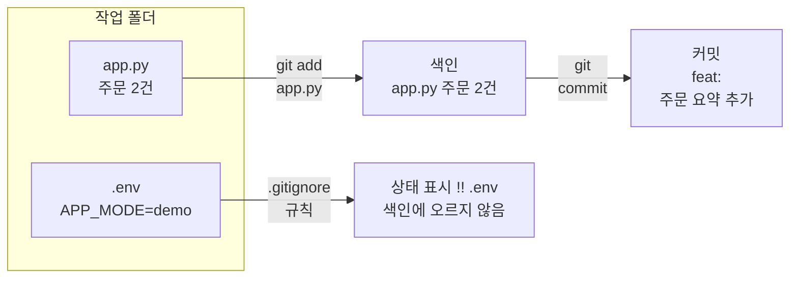
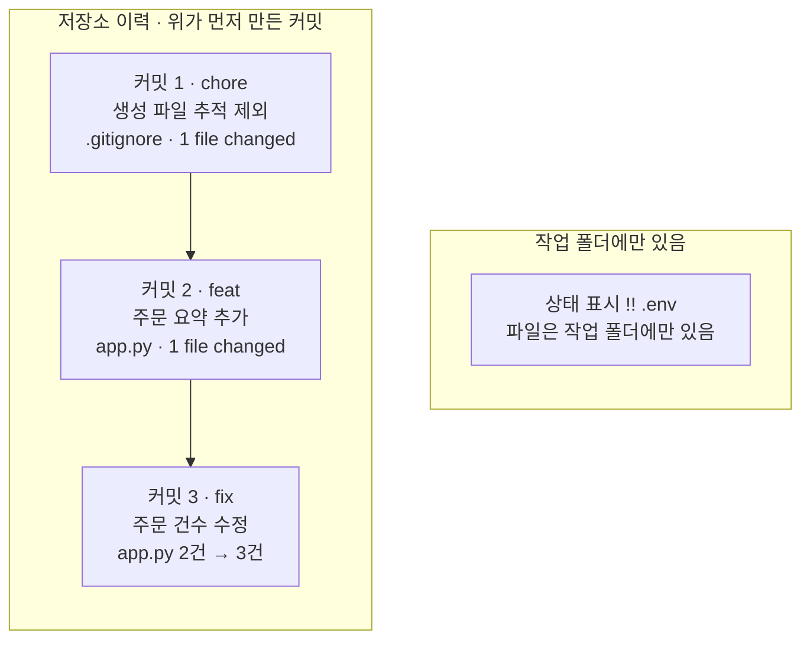
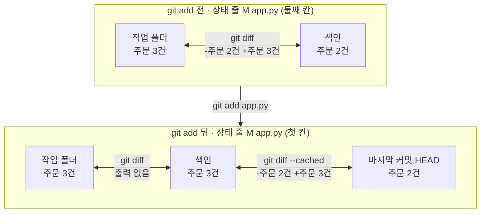
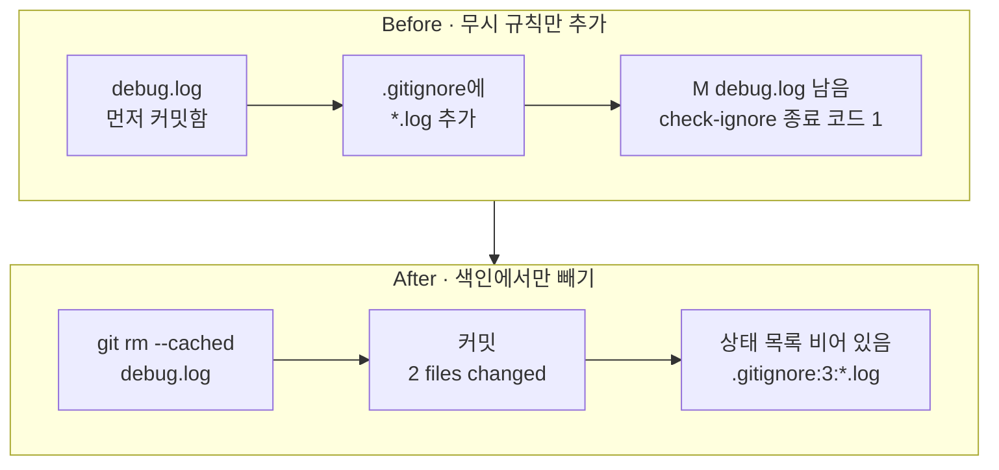

# 01-커밋과-gitignore

## _src 본문 (HTML 원본)

```html
<!--meta: 강의 1h | 실습 2h | 코드 Jupyter Notebook | 새 용어 7 -->
<h2 id="b1"><span class="no">1</span>학습 목표</h2>
<div class="goal"><ul><li>작업 폴더, 색인, 커밋이 어떻게 다른지 <code>git status</code>와 <code>git diff</code> 출력으로 설명할 수 있습니다.</li><li>목적이 다른 변경을 커밋 두 개로 나누고, 메시지에 변경 목적을 적을 수 있습니다.</li><li>무시 규칙 파일 <code>.gitignore</code>를 쓰고, 이미 추적하는 파일은 색인에서만 뺄 수 있습니다.</li></ul></div>
<h2 id="b2"><span class="no">2</span>이 내용을 배우는 이유</h2>
<p>프로그램을 고치다 보면 소스 코드 말고도 여러 파일이 생깁니다. 실행 로그, 캐시 폴더, 개인 설정 파일이 그런 예입니다.</p>
<p>이 파일까지 모두 기록하면 리뷰할 변경이 흐려집니다. 컴퓨터마다 다른 값이 저장소에 섞이기도 합니다. 반대로 필요한 소스를 빠뜨리면 다른 사람이 같은 결과를 만들 수 없습니다.</p>
<p>그래서 기록하기 전에 두 가지를 정합니다. 첫째는 어떤 변경을 한 커밋으로 묶을지입니다. 둘째는 어떤 파일을 아예 기록하지 않을지입니다.</p>
<p><strong>이 절의 질문</strong> — 무시 규칙을 나중에 추가하면 이미 커밋한 파일도 기록 대상에서 빠질까요?</p>
<h2 id="b3"><span class="no">3</span>앞에서 배운 내용</h2>
<p>Ch 1 05절에서는 임시 폴더에서 <code>git init</code>, <code>git add</code>, <code>git commit</code>을 한 번씩 실행했습니다. 상태 표시 <code>??</code>·<code>A</code>·<code>M</code>을 읽었고, 명령 <code>git diff</code>로 바뀐 한 줄을 봤습니다.</p>
<p>그때 작성자 이름은 커밋 명령마다 옵션 <code>-c</code>로 넣었습니다. 이름을 저장소에 적는 방법은 Ch 3에서 배운다고 미뤄 두었습니다. 이 절의 <code>git config</code>가 그 방법이고, 이번에도 연습 저장소에만 적습니다.</p>
<p>Ch 2 05절에서는 <code>with open()</code> 블록으로 파일에 글을 저장했습니다. Ch 2 08절에서는 함수 <code>run_pytest()</code> 안에서 <code>subprocess.run()</code>으로 pytest를 실행했습니다. 같은 절 준비 셀은 빈 임시 폴더를 만들고 작업 위치를 옮겼습니다.</p>
<p>이번 노트북은 이 모양을 그대로 써서 git 명령을 실행하는 함수 <code>run_git()</code>을 만듭니다. 저장소는 운영체제의 임시 폴더에 만들고, GitHub 계정이나 원격 저장소는 쓰지 않습니다.</p>
<h2 id="b4"><span class="no">4</span>핵심 개념</h2>
<h3>비유로 시작하기</h3>
<p>택배를 보낼 때를 떠올려 봅니다. 책상 위에는 보낼 책과 쓰던 컵, 구겨진 휴지가 함께 놓여 있습니다.</p>
<p>보낼 책만 골라 열린 상자에 넣습니다. 상자를 테이프로 봉하고 송장을 붙이면 한 번의 발송이 됩니다. 컵과 휴지는 처음부터 상자에 넣지 않습니다.</p>
<p>Git도 같습니다. 책상이 작업 폴더, 열린 상자가 색인, 봉한 상자가 커밋입니다. 휴지처럼 기록하지 않을 파일은 무시 규칙에 적어 둡니다.</p>
{{img:01-5-택배-상자|책상 위에 책, 컵, 휴지가 있고 같은 책 한 권이 열린 상자에 담기며, 오른쪽에는 테이프로 봉한 상자가 선반에 놓인 삽화|보낼 물건만 열린 상자에 담고 봉합니다. 작업 폴더에서 고른 파일만 색인에 올리고 커밋으로 기록하는 모습과 같습니다.}}
<p><strong>그림 읽기</strong> — 왼쪽 책상에서 오른쪽 선반까지 화살표를 따라갑니다. 책상의 물건 가운데 책만 손에 들려 열린 상자에 들어갑니다. 책상에 같은 책이 그대로 있는 것처럼, <code>git add</code> 뒤에도 파일은 작업 폴더에 남습니다. 선반의 봉한 상자는 <code>git commit</code>으로 남긴 기록이고, 책상에 남은 휴지는 무시 규칙에 적은 파일에 해당합니다.</p>
<h3>이 절에서 쓰는 말</h3>
<table><thead><tr><th>용어</th><th>뜻</th><th>이 절에서 보이는 모습</th></tr></thead><tbody>
<tr><td>저장소(repository)</td><td>Git이 변경을 기록하는 폴더. 기록은 안의 <code>.git</code> 폴더에 모입니다</td><td>준비 셀이 만든 임시 폴더, <code>git init</code> 뒤의 <code>['.git']</code></td></tr>
<tr><td>작업 폴더(working tree)</td><td>지금 파일을 고치는 자리</td><td><code>app.py</code>를 주문 3건으로 고친 상태</td></tr>
<tr><td>색인(index)</td><td>다음 커밋에 넣을 파일 상태를 골라 두는 자리. Ch 1 05절의 「기록할 목록」이고, 스테이징 영역(staging area)이라고도 부릅니다</td><td><code>git add .gitignore</code> 뒤의 <code>A  .gitignore</code></td></tr>
<tr><td>커밋(commit)</td><td>색인에 고른 파일 상태와 설명 메시지를 묶어 이력에 남긴 기록</td><td><code>feat: 주문 요약 추가</code></td></tr>
<tr><td>추적(tracking)</td><td>Git이 파일의 변경을 기록 대상으로 삼는 것</td><td><code>git ls-files</code> 목록에 나오는 파일</td></tr>
<tr><td>무시 규칙</td><td>추적하지 않을 파일 이름 패턴. <code>.gitignore</code> 파일에 적습니다</td><td><code>.env</code>, <code>*.log</code></td></tr>
<tr><td>HEAD</td><td>지금 기준이 되는 마지막 커밋을 가리키는 이름</td><td><code>git diff --cached</code>가 비교하는 커밋</td></tr>
</tbody></table>
<h3>세 자리와 두 명령</h3>
<p>파일 상태는 세 자리를 거쳐 기록됩니다. 작업 폴더에서 고친 파일을 <code>git add</code> 명령으로 색인에 올립니다. 그다음 <code>git commit</code> 명령으로 색인의 상태를 커밋으로 남깁니다.</p>
<p>작업 폴더의 파일이 모두 커밋되는 것은 아닙니다. 색인에 올린 파일만 커밋에 들어갑니다. 이 절의 첫 커밋에는 무시 규칙 파일 하나만 들어갔습니다.</p>
{{mermaid:01-1-세-자리|작업 폴더의 app.py가 git add로 색인에, git commit으로 커밋에 들어가고, .env는 .gitignore 규칙 때문에 무시 표시를 받는 흐름도|파일 상태가 머무는 세 자리. 프로그램 파일은 색인을 거쳐 커밋되고, 환경 설정 파일은 !! 표시를 받아 색인에 오르지 않습니다.}}
<p><strong>도식 읽기</strong> — 왼쪽에서 오른쪽으로 읽습니다. 초록 상자는 파일 상태가 머무는 자리이고, 화살표 위 글자는 자리를 옮기는 명령입니다.</p>
<p>위 줄에서 프로그램 파일의 「주문 2건」 상태가 색인을 거쳐 <code>feat: 주문 요약 추가</code> 커밋이 됩니다. 아래 줄의 회색 상자는 환경 설정 파일입니다. 이 파일은 규칙에 걸려 노란 상자의 <code>!! .env</code> 표시를 받고, 색인으로 가지 않습니다.</p>
<h3>명령과 상태 표시 읽기</h3>
<p>명령은 왼쪽부터 <code>git</code>, 하위 명령, 옵션, 대상 순서로 읽습니다. 예를 들어 <code>git status --short --ignored</code>의 하위 명령은 <code>status</code>입니다. 옵션 <code>--short</code>는 짧은 형식으로, <code>--ignored</code>는 무시된 파일까지 보여 달라는 뜻입니다.</p>
<p>짧은 상태 목록에서 줄 앞의 두 칸이 파일 상태입니다. Ch 1 05절 노트북은 앞 빈칸을 떼어 내고 글자 하나만 읽었습니다. 이번에는 두 칸을 나눠 읽습니다. 첫 칸은 색인의 변화, 둘째 칸은 작업 폴더의 변화입니다.</p>
<p>노트북에서 나온 표시를 표로 모았습니다. 앞의 세 줄은 Ch 1 05절에서 본 표시이고, 나머지는 이 절에서 처음 나옵니다.</p>
<table><thead><tr><th>표시</th><th>뜻</th><th>노트북에 나온 줄</th></tr></thead><tbody>
<tr><td><code>??</code></td><td>아직 추적하지 않는 새 파일(Ch 1 05절의 「처음 보는 파일」)</td><td><code>?? app.py</code></td></tr>
<tr><td>첫 칸 <code>A</code></td><td>새 파일을 색인에 올림</td><td><code>A  .gitignore</code></td></tr>
<tr><td>둘째 칸 <code>M</code></td><td>작업 폴더에서만 고침</td><td><code> M app.py</code></td></tr>
<tr><td>첫 칸 <code>M</code></td><td>고친 내용을 색인에 올림</td><td><code>M  app.py</code></td></tr>
<tr><td>첫 칸 <code>D</code></td><td>다음 커밋에서 추적 목록에서 뺌</td><td><code>D  debug.log</code></td></tr>
<tr><td><code>!!</code></td><td>무시 규칙에 걸린 파일</td><td><code>!! .env</code></td></tr>
</tbody></table>
<h3>두 가지 비교</h3>
<p>비교 명령 <code>git diff</code>는 작업 폴더와 색인을 비교합니다. 옵션을 붙인 <code>git diff --cached</code>는 색인과 HEAD를 비교합니다.</p>
<p>어느 두 자리를 비교하는지 먼저 정해야 결과를 바르게 읽습니다. 빼기(-) 줄은 비교 기준 쪽 내용이고, 더하기(+) 줄은 새 내용입니다.</p>
<h2 id="b5"><span class="no">5</span>실행 예제</h2>
<p>노트북은 준비 셀이 만든 빈 임시 폴더를 저장소로 만들고 파일 세 개의 상태를 봅니다. 그다음 무시 규칙과 프로그램을 커밋 두 개로 나눠 기록합니다. 마지막으로 주문 건수를 바꿔 두 가지 비교를 읽습니다.</p>
<p>모든 git 명령은 함수 <code>run_git()</code> 한 가지 방식으로 실행합니다. 이 함수는 Ch 2 08절 <code>run_pytest()</code>처럼 <code>subprocess.run()</code>으로 명령을 실행합니다. 출력에는 터미널처럼 <code>$ git</code> 뒤에 실행한 명령을 적고, 그 아래에 결과를 보여 줍니다.</p>
<p>출력을 글로 받는 인자는 Ch 2 08절의 <code>text=True</code> 대신 <code>encoding="utf-8"</code>을 적었습니다. 한글 커밋 메시지를 UTF-8 규칙으로 읽게 정한 것입니다.</p>
<p>모델을 부르지 않으므로 API 키가 필요 없고 비용도 들지 않습니다. 커밋 번호(해시)와 임시 폴더 경로는 실행할 때마다 달라집니다. 결과를 읽을 때는 커밋 메시지와 상태 표시를 봅니다.</p>
{{notebook:01-커밋과-gitignore|example}}
<p class="look"><b>확인할 점</b> — 첫 상태 목록에서 환경 설정 파일만 <code>!!</code> 표시를 받았는지 봅니다. <code>git add</code> 뒤의 <code>git diff</code> 아래가 비어 있는지도 확인합니다. 같은 변경은 <code>git diff --cached</code> 쪽에 나와야 합니다.</p>
<h3>목적별로 나눈 커밋</h3>
<p>노트북에서 만든 커밋 세 개를 먼저 만든 순서대로 모았습니다. 커밋마다 변경 목적이 하나입니다.</p>
{{mermaid:01-2-목적별-커밋|chore, feat, fix 커밋 세 개가 위에서 아래로 이어지고, 옆 칸의 .env는 커밋에 없이 !! 표시만 받은 그림|목적별로 나눈 커밋 세 개. 환경 설정 파일은 어느 커밋에도 들어가지 않았습니다.}}
<p><strong>도식 읽기</strong> — 왼쪽 칸을 위에서 아래로 읽습니다. 초록 상자 하나가 커밋 하나이고, 아래로 갈수록 나중에 만든 커밋입니다.</p>
<p>커밋 1에는 무시 규칙 파일, 커밋 2에는 프로그램 파일이 들어갔습니다. 두 커밋 모두 요약 줄이 <code>1 file changed</code>였습니다. 커밋 3은 같은 프로그램 파일의 주문 건수를 2건에서 3건으로 고쳤습니다. 오른쪽 노란 상자는 환경 설정 파일의 상태 표시 <code>!! .env</code>이고, 이 파일은 작업 폴더에만 있습니다.</p>
<h3>두 비교가 보는 자리</h3>
<p>값 하나 바꿔 보기에서는 <code>git add</code> 전과 뒤에 같은 비교를 했습니다. 바뀐 것은 색인의 내용 하나입니다.</p>
{{mermaid:01-3-diff-두-비교|git add 전에는 git diff가 작업 폴더 3건과 색인 2건의 차이를 보이고, git add 뒤에는 git diff가 비고 git diff --cached가 색인 3건과 마지막 커밋 2건의 차이를 보이는 그림|같은 변경이 git add 전에는 git diff에, git add 뒤에는 git diff --cached에 나옵니다.}}
<p><strong>도식 읽기</strong> — 위 칸이 <code>git add</code> 전, 아래 칸이 뒤입니다. 양쪽 화살표 위 글자는 두 자리를 비교한 명령과 그 결과입니다.</p>
<p>위 칸에서는 작업 폴더가 3건, 색인이 2건이라 <code>git diff</code>에 차이가 나옵니다. 아래 칸에서는 색인도 3건이 되어 <code>git diff</code> 출력이 없습니다. 이제 차이는 색인과 마지막 커밋 HEAD 사이에 있고, <code>git diff --cached</code>가 그 차이를 보여 줍니다.</p>
<h2 id="b6"><span class="no">6</span>일부러 실패해 보기</h2>
<p>Before에서는 로그 파일 <code>debug.log</code>를 먼저 커밋합니다. 그 뒤에 무시 규칙 <code>*.log</code>를 추가하고 로그 내용을 바꿉니다. 별표 <code>*</code>는 아무 글자와 일치하므로 이 규칙은 <code>.log</code>로 끝나는 파일을 가리킵니다.</p>
<p>After에서는 같은 파일을 <code>git rm --cached</code> 명령으로 색인에서만 뺍니다. 규칙 파일, 로그 파일, 로그 내용 바꾸기는 Before와 같습니다.</p>
{{notebook:01-커밋과-gitignore|failure}}
<p>규칙만 추가한 Before의 상태 목록에는 <code>M debug.log</code> 줄이 남았습니다. 규칙 확인 명령은 규칙 줄 없이 <code>종료 코드: 1</code>로 끝났습니다.</p>
<p>원인은 이 파일을 이미 추적하고 있었다는 점입니다. 무시 규칙은 아직 추적하지 않는 파일에만 적용됩니다.</p>
<p>After에서는 로그 내용을 바꿔도 상태 목록이 비었습니다. 규칙 확인 결과는 <code>.gitignore:3:*.log</code>였습니다. 실제 파일은 폴더에 남아 있었고, 지난 커밋 안의 <code>first run</code> 내용도 그대로 나왔습니다.</p>
{{mermaid:01-4-추적-해제-비교|Before는 debug.log 커밋, *.log 규칙 추가, M debug.log가 남는 빨간 결과로 이어지고, After는 git rm --cached, 커밋, 상태 목록이 빈 노란 결과로 이어지는 비교 그림|규칙만 추가한 Before와 색인에서 뺀 After. 같은 로그 파일의 결과가 달라졌습니다.}}
<p><strong>도식 읽기</strong> — 위 칸이 Before, 아래 칸이 After이고, 칸마다 왼쪽에서 오른쪽으로 읽습니다. 파란 상자는 우리가 실행한 일, 초록 상자는 커밋입니다.</p>
<p>위 칸 Before의 끝은 빨간 상자입니다. 규칙을 추가했는데도 <code>M debug.log</code>가 남고 규칙 확인은 종료 코드 1이었습니다. 아래 칸 After의 끝은 노란 상자입니다. <code>2 files changed</code> 커밋 뒤에는 상태 목록이 비었고, 3번째 줄의 <code>*.log</code> 규칙이 걸렸습니다.</p>
<h2 id="b7"><span class="no">7</span>주의할 점과 실무 메모</h2>
<ul><li>무시 규칙은 보안 도구가 아닙니다. 노트북에서 본 것처럼 지난 커밋 안의 내용은 남습니다. 비밀 값을 실수로 커밋했을 때의 처리는 05절에서 다룹니다.</li>
<li>명령 <code>git add .</code>는 폴더의 변경을 한꺼번에 색인에 올립니다. 쓰기 전에 <code>git status --short</code>와 <code>git diff</code>로 목록을 먼저 읽습니다.</li>
<li>서식 정리와 기능 변경을 한 커밋에 섞으면 리뷰어가 실제 동작 차이를 찾기 어렵습니다. 목적별로 커밋을 나눕니다.</li>
<li>명령 <code>git rm --cached</code>로 뺀 파일은 그 커밋을 받은 팀원의 작업 폴더에서 지워질 수 있습니다. 이 장면은 이번에 실행하지 않았습니다. 팀원에게 필요한 설정 파일이면 값을 비운 예시 파일을 따로 커밋합니다.</li>
<li>커밋 메시지 앞머리 feat·fix·chore는 이 교재가 쓰는 팀 관례입니다. 필수 문법은 아니므로 저장소가 정한 규칙을 따릅니다.</li>
<li>교재 출력은 Linux의 Git 2.34.1에서 실행한 결과입니다. 다른 운영체제인 Windows와 macOS에서는 실행하지 않았습니다. 버전에 따라 출력 문구가 조금 다를 수 있습니다.</li></ul>
<h2 id="b8"><span class="no">8</span>정리와 다음 절</h2>
<ul><li>명령 <code>git add</code>로 다음 커밋에 넣을 파일을 색인에 고르고, <code>git commit</code>으로 고른 상태를 기록합니다.</li><li>비교 명령 <code>git diff</code>는 작업 폴더와 색인을, <code>git diff --cached</code>는 색인과 마지막 커밋을 비교합니다.</li><li>무시 규칙은 추적하지 않는 파일에만 적용됩니다. 이미 추적하는 파일은 <code>git rm --cached</code>로 추적을 멈춥니다.</li></ul>
<p><strong>다음 학습과 이어지는 지점</strong> — 02절에서는 목적이 분명한 커밋을 기능 브랜치에 쌓습니다. 그 변경을 PR 단위로 비교하고 검토합니다.</p>
<h2 id="b9"><span class="no">9</span>복습 문제</h2><details class="quiz"><summary>문제와 해설</summary>
<p class="quiz-q">1. 명령 <code>git add</code>와 <code>git commit</code>은 각각 어느 자리를 바꾸나요? · 기초</p><p class="quiz-a"><b>해설</b> — <code>git add</code> 명령은 작업 폴더의 파일 상태를 색인에 올립니다. <code>git commit</code> 명령은 색인에 고른 상태를 새 커밋으로 기록합니다.</p>
<p class="quiz-q">2. 노트북의 첫 상태 목록에서 환경 설정 파일에 <code>!!</code> 표시가 붙은 이유는 무엇인가요? · 기초</p><p class="quiz-a"><b>해설</b> — 무시 규칙 파일에 적은 <code>.env</code> 규칙과 일치했기 때문입니다. 그래서 같은 폴더에 있어도 색인에 오르지 않았습니다.</p>
<p class="quiz-q">3. 주문 건수를 3건으로 고친 뒤 <code>git add</code>를 하자 <code>git diff</code> 출력이 사라졌습니다. 변경이 없어진 것인가요? · 적용</p><p class="quiz-a"><b>해설</b> — 아닙니다. 작업 폴더와 색인이 같아져서 비교할 차이가 없어진 것입니다. 같은 변경은 색인과 마지막 커밋을 비교하는 <code>git diff --cached</code>에 나왔습니다.</p>
<p class="quiz-q">4. 이미 커밋한 로그 파일이 <code>*.log</code> 규칙을 추가한 뒤에도 <code>M debug.log</code>로 나온 이유는 무엇인가요? · 적용</p><p class="quiz-a"><b>해설</b> — 무시 규칙은 아직 추적하지 않는 파일에만 적용됩니다. 로그 파일은 이미 추적하고 있었으므로 규칙 확인 명령도 종료 코드 1로 끝났습니다.</p>
<p class="quiz-q">5. 추적을 멈춘 로그 파일의 내용이 저장소에서 완전히 사라졌다고 말할 수 있나요? 그 파일에 비밀 값이 들어 있었다면 어떨까요? · 분석</p><p class="quiz-a"><b>해설</b> — 말할 수 없습니다. 노트북의 <code>git show HEAD~1:debug.log</code> 결과처럼 지난 커밋에 저장된 내용은 남습니다. 비밀 값이 든 파일도 같아서, 기록에서 지우는 절차는 05절에서 따로 확인합니다.</p>
</details>
<h2 id="b10"><span class="no">10</span>참고 자료</h2>
<ul><li><a href="https://git-scm.com/docs/git-add">Git 공식 문서: git-add</a> · 확인 2026-09-16 · 실행 Git 2.34.1</li><li><a href="https://git-scm.com/docs/git-commit">Git 공식 문서: git-commit</a> · 확인 2026-09-16 · 실행 Git 2.34.1</li><li><a href="https://git-scm.com/docs/git-status">Git 공식 문서: git-status(짧은 형식)</a> · 확인 2026-09-16 · 실행 Git 2.34.1</li><li><a href="https://git-scm.com/docs/gitignore">Git 공식 문서: gitignore</a> · 확인 2026-09-16 · 실행 Git 2.34.1</li><li><a href="https://git-scm.com/docs/git-check-ignore">Git 공식 문서: git-check-ignore</a> · 확인 2026-09-16 · 실행 Git 2.34.1</li></ul>
```

## 노트북 셀 (순서대로)

### [0] markdown {'html': 'skip'}

# 커밋과 .gitignore

**이 노트북에서 할 일**

1. 임시 폴더에 연습용 Git 저장소를 만들고 파일 세 개의 상태를 확인합니다.
2. 무시 규칙과 프로그램을 커밋 두 개로 나눠 기록하고, 바뀐 줄을 `git diff`로 읽습니다.
3. 이미 커밋한 로그 파일에 무시 규칙을 늦게 추가해 보고, 추적을 멈추는 방법으로 고칩니다.

**준비물** — API 키 불필요. 데이터 파일도 없습니다. 모델 호출은 0번이고 비용은 들지 않습니다.
실행 시간은 1분 이내입니다. Ch 1 05절에서 설치를 확인한 Git이 필요합니다.

**기준 Git 버전** — Git은 2.28 이상이 필요합니다. 교재 출력은 Git 2.34.1로 만들었고, 새 버전에서는 안내 문구가 조금 다를 수 있습니다.

실습 폴더 `labs/part1/ch03-git-github`에서 Ch 1 3절처럼 `uv sync --locked`로 환경을 만듭니다.
커널에서 이 폴더의 `.venv`를 고른 뒤 첫 셀부터 순서대로 실행합니다.
저장소는 운영체제의 임시 폴더에 만들고, GitHub 계정이나 원격 저장소는 쓰지 않습니다.

### [1] markdown {'html': 'skip'}

## 오늘 볼 그림


왼쪽에서 오른쪽으로 읽습니다. 초록 상자는 파일 상태가 머무는 자리이고, 화살표 위 글자는 자리를 옮기는 명령입니다.
회색 상자 `.env`는 무시 규칙에 걸려 노란 상자의 `!!` 표시를 받고, 색인으로 가지 않습니다.

### [2] markdown {}

## 1. 준비

이 절은 설치할 패키지가 없습니다. 이 노트북은 파일을 만들고 Git 저장소에 기록합니다.
Ch 2 08절처럼 빈 임시 폴더를 만들고, 그 폴더로 작업 위치를 옮깁니다. 실습 폴더에는 파일이 생기지 않습니다.

코드의 import 두 줄은 Ch 2 07절에서 배운 import 문입니다. 표준 라이브러리 모듈 os와 tempfile을 불러옵니다.

### [3] code {'execution': {'iopub.execute_input': '2026-09-16T12:28:15.168519Z', 'iopub.status.busy': '2026-09-16T12:28:15.168335Z', 'iopub.status.idle': '2026-09-16T12:28:15.174881Z', 'shell.execute_reply': '2026-09-16T12:28:15.173934Z'}, 'lesson_role': 'setup'}

```python
# 저장소로 쓸 빈 임시 폴더를 만들고, 그 폴더로 작업 위치를 옮깁니다
import os
import tempfile

# mkdtemp()는 운영체제 임시 폴더 안에 새 폴더를 만들고 그 경로를 반환합니다
practice_folder = tempfile.mkdtemp(prefix="ch03-01-")
# chdir()는 터미널의 cd처럼 현재 작업 폴더를 옮깁니다
os.chdir(practice_folder)
file_names = os.listdir()
print("현재 작업 폴더의 파일:", file_names)
```

출력:
```
현재 작업 폴더의 파일: []

```

### [4] markdown {}

**결과 읽기** — 현재 작업 폴더의 파일은 `[]`로, 빈 폴더에서 시작합니다.
폴더의 경로는 컴퓨터마다 달라서 출력하지 않았습니다. 뒤에서 이 빈 폴더를 Git 저장소로 만듭니다.

### [5] markdown {}

## 2. git 명령을 실행하는 함수

터미널에 치는 git 명령을 노트북에서도 같은 모양으로 실행하려고 함수 하나를 만듭니다.
예를 들어 셀에 `run_git("status --short")`라고 쓰면 터미널의 `git status --short`를 실행합니다.

함수의 뼈대는 Ch 2 08절의 `run_pytest()`와 같습니다. 명령 목록을 `subprocess.run()` 함수로 실행하고 출력을 보여 줍니다.
달라진 곳은 세 군데입니다.

- 명령 글 앞에 `"git "`을 붙입니다. 글자와 글자 사이의 `+`는 두 글을 이어 붙인 새 글을 만듭니다.
- 모듈 shlex의 `split()` 함수가 명령 글을 낱말 목록으로 나눕니다. 따옴표로 묶은 커밋 메시지는 공백이 있어도 한 낱말로 남습니다.
- 인자 `text=True` 대신 `encoding="utf-8"`을 적습니다. 출력을 글로 받는 것은 같고, 글자를 읽는 규칙을 UTF-8로 정합니다.

인자 `text=True`는 컴퓨터에 정해진 기본 규칙으로 글자를 읽습니다. 그 규칙이 UTF-8이 아니면 한글 커밋 메시지가 깨질 수 있습니다.
Ch 2 05절 `open()`에 적은 것과 같은 `encoding` 인자입니다. 다른 운영체제에서는 이번에 실행하지 않았습니다.

함수는 화면에 쓴 글(`stdout`)과 오류 글(`stderr`)을 이어서 출력합니다. 종료 코드가 0이 아닐 때만 그 숫자도 출력합니다.
반환하는 값이 없으므로 정의 줄에 `->` 표시를 적지 않았습니다.

실행 전에 예상합니다. 정의 셀이라 출력은 없을 것입니다.

### [6] code {'execution': {'iopub.execute_input': '2026-09-16T12:28:15.176394Z', 'iopub.status.busy': '2026-09-16T12:28:15.176255Z', 'iopub.status.idle': '2026-09-16T12:28:15.179651Z', 'shell.execute_reply': '2026-09-16T12:28:15.179070Z'}}

```python
# git 명령 한 줄을 실행하고, 터미널처럼 명령과 출력을 함께 보여 주는 함수
import shlex
import subprocess


def run_git(command: str):
    # "git " 뒤에 명령 글을 이어 붙입니다
    full_command = "git " + command
    # split()은 따옴표로 묶은 메시지를 공백이 있어도 한 낱말로 둡니다
    arguments = shlex.split(full_command)
    # Ch 2 08절처럼 출력을 모아 두고, 글자는 UTF-8 규칙으로 읽습니다
    result = subprocess.run(arguments, capture_output=True, encoding="utf-8")
    print("$", full_command)
    print(result.stdout + result.stderr)
    # 종료 코드 0은 오류 없이 끝났다는 뜻입니다. 0이 아닐 때만 숫자를 보여 줍니다
    if result.returncode != 0:
        print("종료 코드:", result.returncode)
```

출력:
```

```

### [7] markdown {}

**결과 읽기** — 예상대로 출력이 없습니다. 함수를 만들기만 했습니다.

먼저 Git 버전을 출력해 함수가 동작하는지 확인합니다. 명령 `git --version`은 Ch 1 05절에서 버전을 물은 명령입니다.

### [8] code {'execution': {'iopub.execute_input': '2026-09-16T12:28:15.181079Z', 'iopub.status.busy': '2026-09-16T12:28:15.180941Z', 'iopub.status.idle': '2026-09-16T12:28:15.191943Z', 'shell.execute_reply': '2026-09-16T12:28:15.191308Z'}}

```python
# 설치된 Git 버전을 출력해 함수가 동작하는지 확인합니다
run_git("--version")
```

출력:
```
$ git --version
git version 2.34.1


```

### [9] markdown {}

**결과 읽기** — 첫 줄 `$ git --version`은 실행한 명령이고, 둘째 줄 `git version 2.34.1`이 결과입니다.
버전 숫자는 컴퓨터마다 다를 수 있습니다. 다음 셀의 `git init -b main` 명령은 Git 2.28 이상에서 동작합니다.

### [10] markdown {}

## 3. 임시 폴더를 저장소로 만들기

Ch 1 05절에서는 명령 `git init`으로 임시 폴더를 저장소로 만들었습니다. 이번에는 옵션 `-b main`을 붙입니다.
이 옵션은 첫 브랜치 이름을 main으로 정합니다. 브랜치(branch)는 커밋이 이어지는 줄기의 이름이고, 02절에서 배웁니다.
준비 셀에서 작업 위치를 옮겼으므로 명령은 그 임시 폴더에서 실행됩니다.

실행 전에 예상합니다. 빈 저장소를 만들었다는 줄이 나오고, 파일 목록에 `.git` 폴더가 생길 것입니다.

### [11] code {'execution': {'iopub.execute_input': '2026-09-16T12:28:15.193370Z', 'iopub.status.busy': '2026-09-16T12:28:15.193233Z', 'iopub.status.idle': '2026-09-16T12:28:15.201573Z', 'shell.execute_reply': '2026-09-16T12:28:15.200978Z'}}

```python
# 현재 작업 폴더를 Git 저장소로 만들고, 첫 브랜치 이름을 main으로 정합니다
run_git("init -b main")
# 저장소를 만들면 변경 기록을 담을 .git 폴더가 생깁니다
file_names = os.listdir()
print("현재 작업 폴더의 파일:", file_names)
```

출력:
```
$ git init -b main
Initialized empty Git repository in [사용자 폴더]/tmp/ch03-01-qn70t8ku/.git/

현재 작업 폴더의 파일: ['.git']

```

### [12] markdown {}

**결과 읽기** — 둘째 줄 `Initialized empty Git repository`는 빈 저장소를 만들었다는 뜻입니다.
줄 끝의 임시 폴더 경로는 실행할 때마다 달라집니다. 출력의 `[사용자 폴더]`는 교재를 실행한 컴퓨터의 사용자 폴더를 가린 표시입니다.
파일 목록은 `['.git']`입니다. 이 `.git` 폴더에 변경 기록이 모이고, Ch 1 05절처럼 직접 고치거나 지우지 않습니다.

### [13] markdown {}

커밋에는 작성자 이름과 전자우편 주소가 함께 기록됩니다. Ch 1 05절에서는 커밋할 때마다 옵션 `-c`로 이 두 값을 넣었습니다.
옵션 `-c`는 그 명령 한 번에만 쓰였습니다.

이번에는 명령 `git config`로 이 연습 저장소에 작성자 정보를 적어 둡니다.
그러면 뒤의 커밋마다 다시 적지 않아도 됩니다. 옵션 `--global`을 붙이지 않았으므로 내 컴퓨터의 다른 저장소 설정은 바뀌지 않습니다.

### [14] code {'execution': {'iopub.execute_input': '2026-09-16T12:28:15.202782Z', 'iopub.status.busy': '2026-09-16T12:28:15.202646Z', 'iopub.status.idle': '2026-09-16T12:28:15.210230Z', 'shell.execute_reply': '2026-09-16T12:28:15.209744Z'}}

```python
# 이 저장소에만 작성자 이름과 전자우편 주소를 적습니다
run_git('config user.name "Ch3 Student"')
run_git("config user.email student@example.com")
# 값 없이 설정 이름만 주면 저장된 값을 보여 줍니다
run_git("config user.name")
```

출력:
```
$ git config user.name "Ch3 Student"

$ git config user.email student@example.com

$ git config user.name
Ch3 Student


```

### [15] markdown {}

**결과 읽기** — 설정하는 두 명령은 출력이 없습니다. 마지막 명령의 결과 `Ch3 Student`가 저장된 작성자 이름입니다.

### [16] markdown {}

## 4. 파일 세 개를 만들고 상태 보기

작업 폴더에 파일 세 개를 만듭니다. 프로그램 파일 `app.py`는 주문 건수를 출력합니다.
무시 규칙 파일 `.gitignore`에는 `.env`와 `__pycache__/` 두 줄을 적습니다. 환경 설정 파일 `.env`에는 연습용 값 `APP_MODE=demo`만 넣습니다.

파일은 Ch 2 05절의 쓰기 모드 `"w"`와 `with open()` 블록으로 저장합니다. 두 줄짜리 무시 규칙은 Ch 1 04절에서 본 여러 줄 글 `"""…"""`로 적습니다.
한 줄짜리 글 끝의 `\n`은 Ch 1 03절에서 본 줄바꿈 한 글자입니다.

명령 `git status --short`는 Ch 1 05절에서 쓴 짧은 상태 목록입니다. 옵션 `--ignored`를 붙이면 무시 규칙에 걸린 파일도 목록에 나옵니다.
실행 전에 예상합니다. 새 파일에는 Ch 1 05절처럼 `??` 표시가 붙고, 무시 규칙에 적은 `.env`만 다른 표시를 받을 것입니다.

### [17] code {'execution': {'iopub.execute_input': '2026-09-16T12:28:15.211346Z', 'iopub.status.busy': '2026-09-16T12:28:15.211245Z', 'iopub.status.idle': '2026-09-16T12:28:15.215750Z', 'shell.execute_reply': '2026-09-16T12:28:15.215188Z'}}

```python
# 작업 폴더에 프로그램, 무시 규칙, 환경 설정 파일을 만듭니다
ignore_text = """.env
__pycache__/
"""
with open("app.py", "w", encoding="utf-8") as file:
    file.write('print("주문 2건")\n')
with open(".gitignore", "w", encoding="utf-8") as file:
    file.write(ignore_text)
with open(".env", "w", encoding="utf-8") as file:
    file.write("APP_MODE=demo\n")
# 세 파일이 Git에게 어떤 상태로 보이는지 확인합니다
run_git("status --short --ignored")
```

출력:
```
$ git status --short --ignored
?? .gitignore
?? app.py
!! .env


```

### [18] markdown {}

**결과 읽기** — 줄 앞의 두 글자가 파일 상태입니다. 물음표 두 개 `?? app.py`는 아직 추적하지 않는 새 파일이라는 뜻입니다.
느낌표 두 개 `!! .env`는 무시 규칙에 걸린 파일입니다. 같은 폴더에 있어도 환경 설정 파일만 다른 표시를 받았습니다.

추적한다는 말은 Git이 그 파일의 변경을 기록 대상으로 삼는다는 뜻입니다. Ch 1 05절에서 「처음 보는 파일」로 읽은 표시가 `??`입니다.

### [19] markdown {}

## 5. 무시 규칙을 첫 커밋으로 기록하기

커밋에 넣을 파일은 `git add` 명령으로 먼저 고릅니다. 고른 파일 상태는 색인(index)에 올라갑니다.

색인은 다음 커밋에 넣을 파일 상태를 모아 두는 자리입니다. Ch 1 05절에서 「기록할 목록」이라고 부른 자리입니다.
스테이징 영역(staging area)이라고도 부릅니다. 이번에는 무시 규칙 파일 하나만 고릅니다.

### [20] code {'execution': {'iopub.execute_input': '2026-09-16T12:28:15.216706Z', 'iopub.status.busy': '2026-09-16T12:28:15.216611Z', 'iopub.status.idle': '2026-09-16T12:28:15.221955Z', 'shell.execute_reply': '2026-09-16T12:28:15.221475Z'}}

```python
# 무시 규칙 파일 하나만 색인에 올리고 상태를 다시 봅니다
run_git("add .gitignore")
run_git("status --short")
```

출력:
```
$ git add .gitignore

$ git status --short
A  .gitignore
?? app.py


```

### [21] markdown {}

**결과 읽기** — 상태 줄 `A  .gitignore`의 A는 색인에 새로 올린 파일이라는 뜻입니다.
프로그램 파일은 여전히 `?? app.py`로 남았습니다. 이번 목록에는 옵션 `--ignored`를 빼서 `.env` 줄이 보이지 않습니다.

### [22] markdown {}

색인에 고른 상태를 커밋으로 기록합니다. Ch 1 05절에서는 커밋을 지금 파일의 모습을 한 번 기록하는 일이라고 했습니다.
이제 색인을 알았으니 뜻을 더 정확히 적습니다. 커밋(commit)은 색인에 고른 파일 상태와 설명 메시지를 묶어 이력에 남긴 기록입니다.

옵션 `-m` 뒤의 따옴표 안 글이 커밋 메시지입니다. 앞머리 `chore:`는 변경 목적을 표시하는 이 교재의 팀 관례입니다.
필수 문법은 아니며, 저장소마다 규칙이 다를 수 있습니다.

### [23] code {'execution': {'iopub.execute_input': '2026-09-16T12:28:15.222830Z', 'iopub.status.busy': '2026-09-16T12:28:15.222743Z', 'iopub.status.idle': '2026-09-16T12:28:15.227577Z', 'shell.execute_reply': '2026-09-16T12:28:15.227085Z'}}

```python
# 색인에 올린 무시 규칙 파일을 첫 커밋으로 기록합니다
run_git('commit -m "chore: 생성 파일 추적 제외"')
```

출력:
```
$ git commit -m "chore: 생성 파일 추적 제외"
[main (root-commit) 8f5623d] chore: 생성 파일 추적 제외
 1 file changed, 2 insertions(+)
 create mode 100644 .gitignore


```

### [24] markdown {}

**결과 읽기** — 요약 줄 `1 file changed`는 이 커밋에 파일 하나가 들어갔다는 뜻입니다. 마지막 줄에 `.gitignore`가 보입니다.
대괄호 안 끝의 일곱 글자는 커밋 번호(해시)의 앞부분이며 실행할 때마다 달라집니다. 표시 `root-commit`은 저장소의 첫 커밋이라는 뜻입니다.

### [25] markdown {}

## 6. 프로그램을 두 번째 커밋으로 기록하기

이번에는 프로그램 파일만 고르고, 새 기능을 알리는 `feat:` 메시지로 커밋합니다.
목적이 다른 변경을 커밋 두 개로 나누면 메시지만 읽어도 무엇을 바꿨는지 알 수 있습니다.
명령 `git log --oneline`은 커밋을 최신 순서로 한 줄씩 보여 줍니다.

### [26] code {'execution': {'iopub.execute_input': '2026-09-16T12:28:15.228454Z', 'iopub.status.busy': '2026-09-16T12:28:15.228377Z', 'iopub.status.idle': '2026-09-16T12:28:15.236455Z', 'shell.execute_reply': '2026-09-16T12:28:15.236061Z'}}

```python
# 프로그램 파일을 두 번째 커밋으로 기록하고 이력과 상태를 봅니다
run_git("add app.py")
run_git('commit -m "feat: 주문 요약 추가"')
run_git("log --oneline")
run_git("status --short --ignored")
```

출력:
```
$ git add app.py

$ git commit -m "feat: 주문 요약 추가"
[main 4a81f12] feat: 주문 요약 추가
 1 file changed, 1 insertion(+)
 create mode 100644 app.py

$ git log --oneline
4a81f12 feat: 주문 요약 추가
8f5623d chore: 생성 파일 추적 제외

$ git status --short --ignored
!! .env


```

### [27] markdown {}

**결과 읽기** — 이력의 첫 줄은 방금 만든 `feat: 주문 요약 추가`이고, 둘째 줄은 `chore: 생성 파일 추적 제외`입니다.
마지막 상태 목록에는 `!! .env` 한 줄만 남았습니다. 추적하는 두 파일은 커밋과 내용이 같아서 목록에 나오지 않습니다.
커밋 번호는 실행마다 달라지므로 메시지로 커밋을 구분합니다.

### [28] markdown {}

## 7. 값 하나 바꿔 보기 — 주문 2건을 3건으로

프로그램의 숫자 하나만 2에서 3으로 바꿉니다. Ch 1 05절에서 `hello.py`의 수량을 2에서 3으로 바꾼 것과 같은 실험입니다.
아직 `git add`를 하지 않았으므로 바뀐 내용은 작업 폴더에만 있습니다.

실행 전에 예상합니다. 명령 `git diff`는 작업 폴더와 색인을 비교합니다.
색인에는 아직 2건이 있으므로 빼기(-) 줄에 2건, 더하기(+) 줄에 3건이 나올 것입니다.

### [29] code {'execution': {'iopub.execute_input': '2026-09-16T12:28:15.237281Z', 'iopub.status.busy': '2026-09-16T12:28:15.237194Z', 'iopub.status.idle': '2026-09-16T12:28:15.241596Z', 'shell.execute_reply': '2026-09-16T12:28:15.241317Z'}}

```python
# 주문 건수를 3건으로 고치고, 작업 폴더의 변경을 확인합니다
with open("app.py", "w", encoding="utf-8") as file:
    file.write('print("주문 3건")\n')
run_git("status --short")
# 작업 폴더와 색인을 비교합니다
run_git("diff")
```

출력:
```
$ git status --short
 M app.py

$ git diff
diff --git a/app.py b/app.py
index 0bde456..4333761 100644
--- a/app.py
+++ b/app.py
@@ -1 +1 @@
-print("주문 2건")
+print("주문 3건")


```

### [30] markdown {}

**결과 읽기** — 상태 줄 `M app.py`의 M은 수정된 파일이라는 뜻입니다.
상태 표시는 두 칸입니다. Ch 1 05절 노트북은 앞 빈칸을 떼어 내 글자 하나만 읽었고, 이번에는 두 칸을 모두 읽습니다.
첫 칸은 색인의 변화, 둘째 칸은 작업 폴더의 변화입니다. 이번 M은 둘째 칸에 있습니다.

비교 결과의 `-print("주문 2건")` 줄은 색인의 내용이고, `+print("주문 3건")` 줄은 작업 폴더의 내용입니다.

### [31] markdown {}

이번에는 변경을 색인에 올린 뒤 같은 비교를 다시 합니다. Ch 1 05절 주의 메모에서 기기 셸로만 확인한 장면입니다.
실행 전에 예상합니다. 작업 폴더와 색인이 같아지므로 `git diff`에는 아무것도 나오지 않을 것입니다.

옵션을 붙인 `git diff --cached`는 색인과 마지막 커밋을 비교합니다.
지금 기준이 되는 마지막 커밋을 가리키는 이름이 HEAD입니다.

### [32] code {'execution': {'iopub.execute_input': '2026-09-16T12:28:15.242387Z', 'iopub.status.busy': '2026-09-16T12:28:15.242304Z', 'iopub.status.idle': '2026-09-16T12:28:15.248644Z', 'shell.execute_reply': '2026-09-16T12:28:15.248326Z'}}

```python
# 변경을 색인에 올리고, 두 가지 비교를 다시 봅니다
run_git("add app.py")
run_git("status --short")
run_git("diff")
# 색인과 마지막 커밋(HEAD)을 비교합니다
run_git("diff --cached")
```

출력:
```
$ git add app.py

$ git status --short
M  app.py

$ git diff

$ git diff --cached
diff --git a/app.py b/app.py
index 0bde456..4333761 100644
--- a/app.py
+++ b/app.py
@@ -1 +1 @@
-print("주문 2건")
+print("주문 3건")


```

### [33] markdown {}

**결과 읽기** — 상태 줄이 `M  app.py`로 바뀌어 M이 첫 칸으로 옮겨졌습니다.
명령 `git diff` 아래에는 아무 줄도 없습니다. 작업 폴더와 색인이 같아졌기 때문입니다.
옵션을 붙인 비교에는 앞 셀과 같은 `+print("주문 3건")` 줄이 나왔습니다. 이제 차이는 색인과 마지막 커밋 사이에 있습니다.

### [34] markdown {}

색인에 올린 수정을 세 번째 커밋으로 기록합니다. 메시지 앞머리 `fix:`는 잘못된 값을 고쳤다는 표시입니다.
메시지에는 파일 이름보다 바꾼 이유를 적습니다.

### [35] code {'execution': {'iopub.execute_input': '2026-09-16T12:28:15.249322Z', 'iopub.status.busy': '2026-09-16T12:28:15.249249Z', 'iopub.status.idle': '2026-09-16T12:28:15.254321Z', 'shell.execute_reply': '2026-09-16T12:28:15.253977Z'}}

```python
# 건수 수정을 세 번째 커밋으로 기록하고 이력을 봅니다
run_git('commit -m "fix: 주문 건수 수정"')
run_git("log --oneline")
```

출력:
```
$ git commit -m "fix: 주문 건수 수정"
[main b9e27b4] fix: 주문 건수 수정
 1 file changed, 1 insertion(+), 1 deletion(-)

$ git log --oneline
b9e27b4 fix: 주문 건수 수정
4a81f12 feat: 주문 요약 추가
8f5623d chore: 생성 파일 추적 제외


```

### [36] markdown {}

**결과 읽기** — 요약 줄 `1 insertion(+), 1 deletion(-)`은 한 줄을 더하고 한 줄을 지웠다는 뜻입니다.
이력에는 커밋 세 개가 최신 순서로 있고, 맨 위가 `fix: 주문 건수 수정`입니다.

### [37] markdown {'lesson_part': 'before'}

## 8. Before — 이미 커밋한 로그 파일에 무시 규칙 추가하기

실행 기록 파일 `debug.log`를 실수로 먼저 커밋했다고 해 봅니다. 그 뒤에 무시 규칙 `*.log`를 추가합니다.
별표 `*`는 아무 글자와 일치하므로 `.log`로 끝나는 모든 파일을 가리킵니다. 먼저 로그 파일을 만들고 커밋합니다.

### [38] code {'execution': {'iopub.execute_input': '2026-09-16T12:28:15.254975Z', 'iopub.status.busy': '2026-09-16T12:28:15.254907Z', 'iopub.status.idle': '2026-09-16T12:28:15.260392Z', 'shell.execute_reply': '2026-09-16T12:28:15.259991Z'}, 'lesson_part': 'before'}

```python
# Before: 로그 파일을 먼저 커밋합니다
with open("debug.log", "w", encoding="utf-8") as file:
    file.write("first run\n")
run_git("add debug.log")
run_git('commit -m "chore: 디버그 로그 기록"')
```

출력:
```
$ git add debug.log

$ git commit -m "chore: 디버그 로그 기록"
[main 8effaf6] chore: 디버그 로그 기록
 1 file changed, 1 insertion(+)
 create mode 100644 debug.log


```

### [39] markdown {'lesson_part': 'before'}

**결과 읽기** — 마지막 줄의 `debug.log`로 로그 파일이 커밋에 들어간 것을 확인합니다. 이제 이 파일은 추적하는 파일입니다.

무시 규칙 파일 끝에 `*.log` 한 줄을 덧붙이고 로그 내용도 바꿉니다. Ch 2 05절의 쓰기 모드 `"w"`는 내용을 지우고 새로 씁니다.
이어 쓰기 모드 `"a"`는 기존 내용을 두고 그 뒤에 이어 씁니다. Ch 2 05절에서 실행하지 않은 모드입니다.

실행 전에 예상합니다. 규칙이 로그 파일에도 적용된다면 상태 목록에서 로그 파일 줄이 사라져야 합니다.

### [40] code {'execution': {'iopub.execute_input': '2026-09-16T12:28:15.261067Z', 'iopub.status.busy': '2026-09-16T12:28:15.260995Z', 'iopub.status.idle': '2026-09-16T12:28:15.264319Z', 'shell.execute_reply': '2026-09-16T12:28:15.263987Z'}, 'lesson_part': 'before'}

```python
# Before: 무시 규칙을 추가한 뒤 로그 내용을 바꾸고 상태를 봅니다
with open(".gitignore", "a", encoding="utf-8") as file:
    file.write("*.log\n")
with open("debug.log", "w", encoding="utf-8") as file:
    file.write("second run\n")
run_git("status --short")
```

출력:
```
$ git status --short
 M .gitignore
 M debug.log


```

### [41] markdown {'lesson_part': 'before'}

**결과 읽기** — 예상과 달리 `M debug.log` 줄이 목록에 남았습니다. 규칙을 추가했는데도 로그 파일의 변경이 계속 기록 대상입니다.
위 줄의 `M .gitignore`는 규칙 파일을 고쳤다는 표시입니다.

명령 `git check-ignore -v`는 파일에 걸린 무시 규칙과 그 규칙의 줄 번호를 보여 줍니다. 로그 파일에 규칙이 걸리는지 확인합니다.

### [42] code {'execution': {'iopub.execute_input': '2026-09-16T12:28:15.264943Z', 'iopub.status.busy': '2026-09-16T12:28:15.264879Z', 'iopub.status.idle': '2026-09-16T12:28:15.267372Z', 'shell.execute_reply': '2026-09-16T12:28:15.267006Z'}, 'lesson_part': 'before'}

```python
# Before: 로그 파일에 무시 규칙이 적용되는지 확인합니다
run_git("check-ignore -v debug.log")
```

출력:
```
$ git check-ignore -v debug.log

종료 코드: 1

```

### [43] markdown {'lesson_part': 'before'}

**결과 읽기** — 규칙 줄은 나오지 않고 `종료 코드: 1`만 나왔습니다. 이 명령에서 종료 코드 1은 적용된 무시 규칙이 없다는 뜻입니다.
무시 규칙은 아직 추적하지 않는 파일에만 적용됩니다. 로그 파일은 이미 추적하고 있었기 때문에 규칙이 걸리지 않았습니다.

### [44] markdown {'lesson_part': 'after'}

## 9. After — 색인에서만 빼서 추적 멈추기

명령 `git rm --cached debug.log`는 파일을 색인에서만 뺍니다. 옵션 `--cached`가 있으면 작업 폴더의 실제 파일은 지우지 않습니다.
실제 파일이 남았는지는 `os.listdir()` 목록에 이름이 있는지 연산자 `in`으로 확인합니다. 연산자 `in`은 Ch 2 03절에서 배웠습니다.

실행 전에 예상합니다. 상태 목록에 삭제 표시 D가 나오고, 로그 파일은 폴더에 그대로 있어야 합니다.

### [45] code {'execution': {'iopub.execute_input': '2026-09-16T12:28:15.268023Z', 'iopub.status.busy': '2026-09-16T12:28:15.267955Z', 'iopub.status.idle': '2026-09-16T12:28:15.271620Z', 'shell.execute_reply': '2026-09-16T12:28:15.271282Z'}, 'lesson_part': 'after'}

```python
# After: 로그 파일을 색인에서만 빼고 상태를 봅니다
run_git("rm --cached debug.log")
run_git("status --short")
# 작업 폴더에 실제 파일이 남았는지 확인합니다
file_names = os.listdir()
print("debug.log가 폴더에 있는가:", "debug.log" in file_names)
```

출력:
```
$ git rm --cached debug.log
rm 'debug.log'

$ git status --short
 M .gitignore
D  debug.log

debug.log가 폴더에 있는가: True

```

### [46] markdown {'lesson_part': 'after'}

**결과 읽기** — 상태 줄 `D  debug.log`는 다음 커밋에서 이 파일을 추적 목록에서 뺀다는 뜻입니다.
마지막 줄 `debug.log가 폴더에 있는가: True`로 실제 파일이 남아 있음을 확인합니다.

규칙 파일도 색인에 올리고 두 변경을 한 커밋으로 기록합니다. 두 변경은 「로그 파일 추적을 멈춘다」는 한 가지 목적입니다.

### [47] code {'execution': {'iopub.execute_input': '2026-09-16T12:28:15.272216Z', 'iopub.status.busy': '2026-09-16T12:28:15.272152Z', 'iopub.status.idle': '2026-09-16T12:28:15.276467Z', 'shell.execute_reply': '2026-09-16T12:28:15.276196Z'}, 'lesson_part': 'after'}

```python
# After: 추적 해제와 무시 규칙을 한 커밋으로 기록합니다
run_git("add .gitignore")
run_git('commit -m "chore: 로그 파일 추적 제외"')
```

출력:
```
$ git add .gitignore

$ git commit -m "chore: 로그 파일 추적 제외"
[main 24c6146] chore: 로그 파일 추적 제외
 2 files changed, 1 insertion(+), 1 deletion(-)
 delete mode 100644 debug.log


```

### [48] markdown {'lesson_part': 'after'}

**결과 읽기** — 요약 줄 `2 files changed`는 규칙 파일과 로그 파일이 함께 이 커밋에 들어갔다는 뜻입니다.
마지막 줄 `delete mode 100644 debug.log`는 저장소의 추적 목록에서 로그 파일을 뺐다는 표시입니다.

로그 내용을 한 번 더 바꾸고 세 가지를 확인합니다. 명령 `git ls-files`는 추적 중인 파일 목록을 보여 줍니다.
추적이 멈췄다면 추적 목록과 상태 목록은 비어 있고, 규칙 확인에는 규칙 줄이 나와야 합니다.

### [49] code {'execution': {'iopub.execute_input': '2026-09-16T12:28:15.277037Z', 'iopub.status.busy': '2026-09-16T12:28:15.276985Z', 'iopub.status.idle': '2026-09-16T12:28:15.281407Z', 'shell.execute_reply': '2026-09-16T12:28:15.281078Z'}, 'lesson_part': 'after'}

```python
# After: 로그 내용을 다시 바꾼 뒤 추적 목록, 무시 규칙, 상태를 확인합니다
with open("debug.log", "w", encoding="utf-8") as file:
    file.write("third run\n")
run_git("ls-files debug.log")
run_git("check-ignore -v debug.log")
run_git("status --short")
```

출력:
```
$ git ls-files debug.log

$ git check-ignore -v debug.log
.gitignore:3:*.log	debug.log

$ git status --short


```

### [50] markdown {'lesson_part': 'after'}

**결과 읽기** — 추적 목록 명령 아래가 비어 있습니다. 규칙 확인 결과는 `.gitignore:3:*.log`입니다.
무시 규칙 파일의 3번째 줄 규칙이 로그 파일에 걸렸다는 뜻입니다. 마지막 상태 목록도 비어 있습니다.

추적을 멈춰도 지난 커밋에 저장된 내용은 남는지 확인합니다. 이름 `HEAD~1`은 마지막 커밋의 바로 앞 커밋입니다.
명령 `git show` 뒤에 커밋 이름과 콜론, 파일 경로를 적으면 그 커밋에 저장된 파일 내용을 보여 줍니다.

### [51] code {'execution': {'iopub.execute_input': '2026-09-16T12:28:15.282062Z', 'iopub.status.busy': '2026-09-16T12:28:15.282003Z', 'iopub.status.idle': '2026-09-16T12:28:15.284550Z', 'shell.execute_reply': '2026-09-16T12:28:15.284239Z'}, 'lesson_part': 'after'}

```python
# After: 로그 파일을 커밋했던 지난 커밋에서 파일 내용을 꺼내 봅니다
run_git("show HEAD~1:debug.log")
```

출력:
```
$ git show HEAD~1:debug.log
first run


```

### [52] markdown {'lesson_part': 'after'}

**결과 읽기** — 지난 커밋 안의 로그 파일 내용 `first run`이 그대로 나왔습니다.
색인에서 빼고 무시 규칙을 적어도 이미 만든 커밋은 바뀌지 않습니다. 기록에서 내용을 지우는 방법은 05절에서 다룹니다.

## 정리

- 명령 `git add`로 다음 커밋에 넣을 파일을 색인에 고르고, `git commit`으로 고른 상태를 기록합니다.
- 비교 명령 `git diff`는 작업 폴더와 색인을, `git diff --cached`는 색인과 마지막 커밋을 비교합니다.
- 무시 규칙은 추적하지 않는 파일에만 적용됩니다. 이미 추적하는 파일은 `git rm --cached`로 추적을 멈춥니다.

이번에는 Linux의 Git 2.34.1로 실행했습니다. 다른 운영체제에서는 실행하지 않았습니다.
다음 절에서는 기능 브랜치에 커밋을 쌓고 PR로 변경을 검토합니다.

## 그림

### 01-1-세-자리.mmd



- 설명 대상 문장: 작업 폴더에서 고친 파일을 `git add` 명령으로 색인에 올립니다. 그다음 `git commit` 명령으로 색인의 상태를 커밋으로 남깁니다.
- 캡션: 파일 상태가 머무는 세 자리. 프로그램 파일은 색인을 거쳐 커밋되고, 환경 설정 파일은 !! 표시를 받아 색인에 오르지 않습니다.
- 읽는 법: 왼쪽에서 오른쪽으로 읽습니다. 초록 상자(app.py 주문 2건, 색인, 커밋)는 파일 상태가 머무는 자리이고, 화살표 위 글자는 자리를 옮기는 명령입니다. 작업 폴더 칸 아래의 회색 상자 .env는 .gitignore 규칙에 걸려 노란 상자의 `!! .env` 표시를 받습니다. 노트북 출력 `!! .env`, `feat: 주문 요약 추가`와 같습니다.
- alt: 작업 폴더의 app.py가 git add로 색인에, git commit으로 커밋에 들어가고, .env는 .gitignore 규칙 때문에 무시 표시를 받는 흐름도

### 01-2-목적별-커밋.mmd



- 설명 대상 문장: 목적이 다른 변경을 커밋 두 개로 나누면 메시지만 읽어도 무엇을 바꿨는지 알 수 있습니다.
- 캡션: 목적별로 나눈 커밋 세 개. 환경 설정 파일은 어느 커밋에도 들어가지 않았습니다.
- 읽는 법: 왼쪽 칸을 위에서 아래로 읽습니다. 초록 상자 하나가 커밋 하나이고 아래로 갈수록 나중 커밋입니다. 커밋 1(.gitignore)과 커밋 2(app.py)는 요약 줄이 `1 file changed`, 커밋 3은 주문 2건을 3건으로 고친 `1 insertion(+), 1 deletion(-)` 커밋입니다. 오른쪽 노란 상자는 마지막 상태 목록의 `!! .env` 표시이고, 파일 자체는 작업 폴더에만 있습니다(01-1과 같이 파일은 회색, 상태 표시는 노랑).
- alt: chore, feat, fix 커밋 세 개가 위에서 아래로 이어지고, 옆 칸의 .env는 커밋에 없이 !! 표시만 받은 그림

### 01-3-diff-두-비교.mmd



- 설명 대상 문장: 명령 `git diff`는 작업 폴더와 색인을 비교합니다. 옵션을 붙인 `git diff --cached`는 색인과 마지막 커밋을 비교합니다.
- 캡션: 같은 변경이 git add 전에는 git diff에, git add 뒤에는 git diff --cached에 나옵니다.
- 읽는 법: 위 칸이 git add 전(상태 줄 ` M app.py`), 아래 칸이 뒤(상태 줄 `M  app.py`)입니다. 초록 상자는 세 자리의 내용, 양쪽 화살표 위 글자는 비교 명령과 결과입니다. 아래 칸에서 `git diff`는 출력이 없고, `git diff --cached`에 `-print("주문 2건")`, `+print("주문 3건")`이 나옵니다.
- alt: git add 전에는 git diff가 작업 폴더 3건과 색인 2건의 차이를 보이고, git add 뒤에는 git diff가 비고 git diff --cached가 색인 3건과 마지막 커밋 2건의 차이를 보이는 그림

### 01-4-추적-해제-비교.mmd



- 설명 대상 문장: 무시 규칙은 아직 추적하지 않는 파일에만 적용됩니다.
- 캡션: 규칙만 추가한 Before와 색인에서 뺀 After. 같은 로그 파일의 결과가 달라졌습니다.
- 읽는 법: 위 칸이 Before, 아래 칸이 After이고 칸마다 왼쪽에서 오른쪽으로 읽습니다. 파란 상자는 우리가 실행한 일, 초록 상자는 커밋입니다. Before 끝의 빨간 상자는 `M debug.log`와 `종료 코드: 1`, After 끝의 노란 상자는 빈 상태 목록과 `.gitignore:3:*.log`입니다. After 커밋의 요약 줄은 `2 files changed`입니다.
- alt: Before는 debug.log 커밋, *.log 규칙 추가, M debug.log가 남는 빨간 결과로 이어지고, After는 git rm --cached, 커밋, 상태 목록이 빈 노란 결과로 이어지는 비교 그림

### 01-5-택배-상자.prompt.md

# 삽화 — 01-5 택배 상자

- 상태: 2026-09-16 생성·검수 통과(1회 생성, 탈락 0). 모델 nano_banana_pro(서버 표기 nano_banana_2), 16:9, 2k(2752×1536), 2크레딧. job 58012150-8940-442c-96f6-7b61aa476953. 교재 파일은 폭 1100px로 줄여 저장.
- 검수 메모: 책상 → 화살표 → 열린 상자(손이 책을 넣음) → 화살표 → 선반의 봉한 상자 순서로 관계가 읽힘. 컵과 휴지는 책상에 남음. 프롬프트와 달리 책상에도 같은 책이 한 권 남았으나, git add 뒤에도 파일이 작업 폴더에 남는 동작과 맞아 채택하고 본문 「그림 읽기」에 그렇게 적음. 책상 왼쪽 끝이 화면 밖으로 조금 잘림(관계 판독에는 영향 없음).
- 설명 대상 문장: 책상이 작업 폴더, 열린 상자가 색인, 봉한 상자가 커밋입니다. 휴지처럼 기록하지 않을 파일은 무시 규칙에 적어 둡니다.
- 넣을 자리: 01절 핵심 개념 「비유로 시작하기」 단락 바로 아래
- 구성 요소와 배치(왼쪽 → 오른쪽): ① 책상(파란 책, 노란 컵, 구겨진 휴지) ② 열린 상자에 손이 파란 책을 넣는 장면 ③ 테이프로 봉하고 빈 라벨을 붙인 상자가 낮은 선반 위에. 구역 사이에 가는 회색 화살표.
- 시선 순서: 책상 → 화살표 → 열린 상자 → 화살표 → 봉한 상자
- 대응: 책상 = 작업 폴더, 열린 상자 = 색인, 봉한 상자 = 커밋, 휴지 = 무시 규칙에 적은 파일

## 프롬프트

Simple flat educational illustration, white background, limited soft palette, clean outlines, plain everyday objects, no text, no letters, no numbers, no logos.
Three zones in one row from left to right on a plain light floor, with a thin gray arrow between each zone. (1) Left: a plain wooden desk with three loose objects on it: one blue book, one yellow mug, and one crumpled white tissue. (2) Middle: a single open cardboard box with its flaps open; exactly one blue book, identical to the book on the desk, is clearly sticking halfway out of the open box. A hand is placing the book into the box. (3) Right: one closed cardboard box sealed with a strip of tape across the top, with a blank white label sticker on its side, standing on a low shelf. The yellow mug and the crumpled tissue stay on the desk and are not in any box. No people other than one hand, no monitors, no screens, no computers, no signs, no writing on the label, no other boxes, no shelves except the one low shelf.

