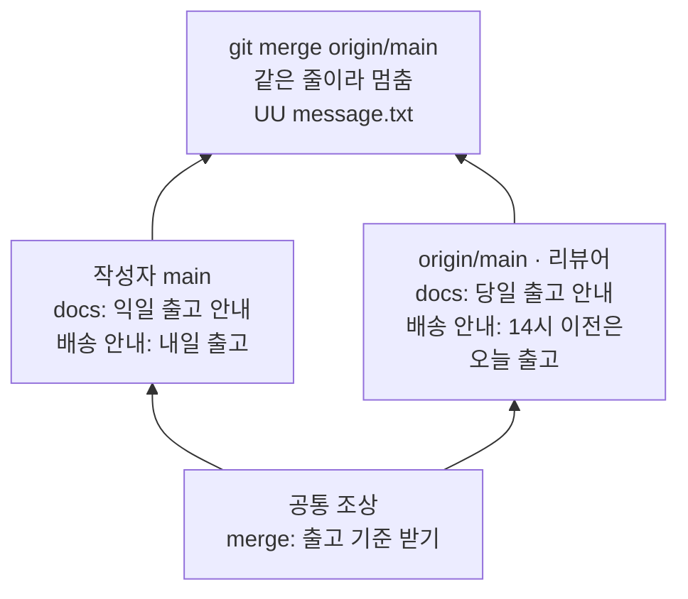
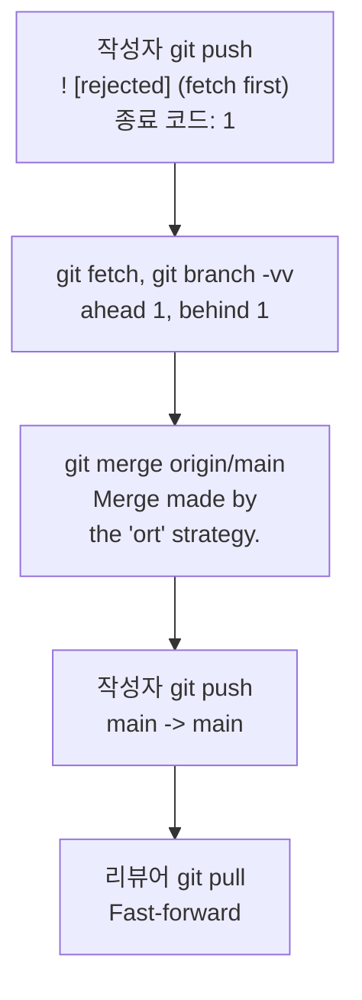
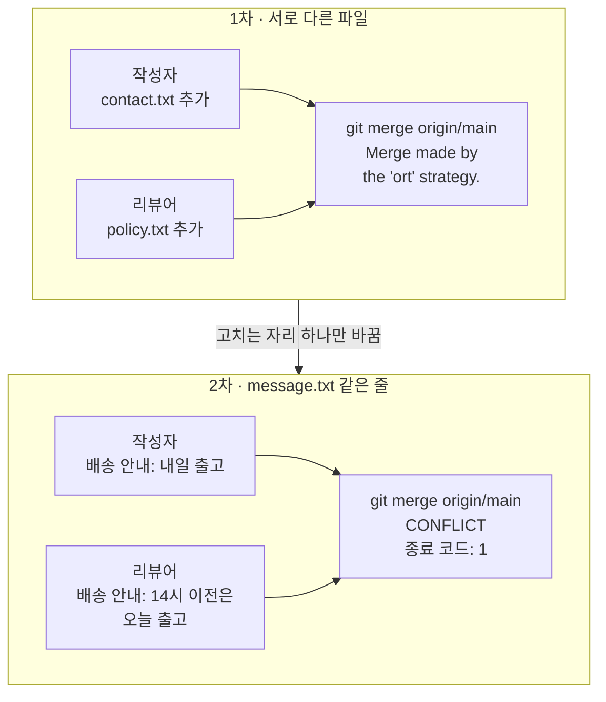
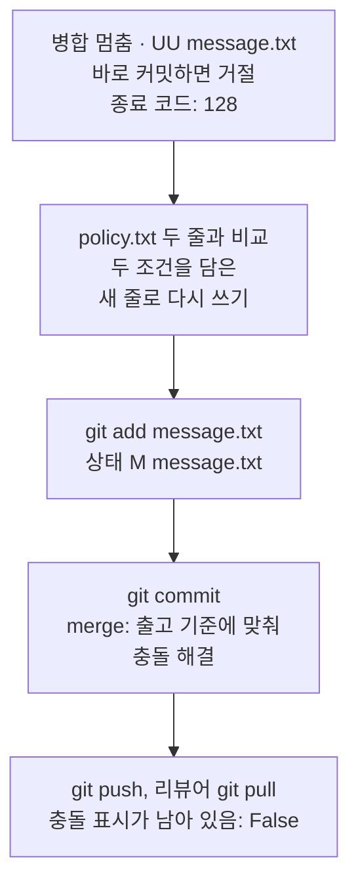
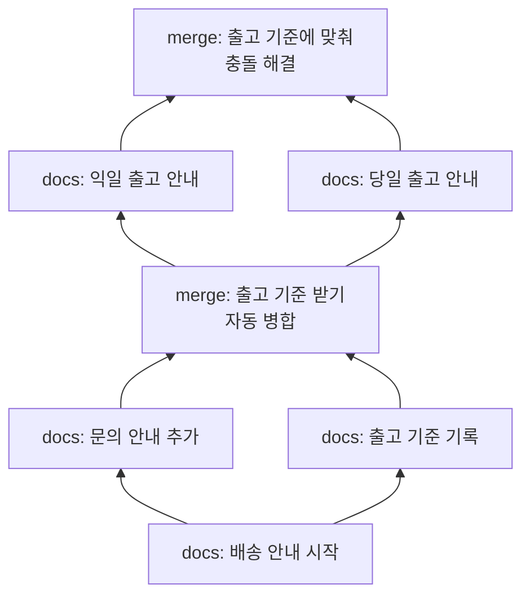

# 03-병합-충돌-해결

## _src 본문 (HTML 원본)

```html
<!--meta: 강의 1h | 실습 3h | 코드 Jupyter Notebook | 새 용어 7 -->
<h2 id="b1"><span class="no">1</span>학습 목표</h2>
<div class="goal"><ul><li>올리기가 거절된 까닭을 <code>git branch -vv</code>의 <code>ahead 1, behind 1</code>로 설명할 수 있습니다.</li><li>같은 공통 조상에서 갈라진 두 커밋이 병합 충돌을 내는 조건을 두 번의 병합 결과로 설명할 수 있습니다.</li><li>충돌 표시를 읽고 팀 기준에 맞는 줄로 파일을 고친 뒤, 병합 커밋을 만들어 원격까지 올릴 수 있습니다.</li></ul></div>
<h2 id="b2"><span class="no">2</span>이 내용을 배우는 이유</h2>
<p>팀에서는 여러 사람이 같은 저장소를 동시에 고칩니다. 내가 커밋하는 동안 다른 사람이 먼저 원격에 올리는 일이 흔합니다. 그러면 내 올리기는 거절되고, 받아 와서 합쳐야 합니다.</p>
<p>대부분은 자동으로 합쳐집니다. 그러나 두 사람이 같은 줄을 서로 다르게 고쳤다면 어느 쪽이 맞는지 코드만 보고 정할 수 없습니다. 이때 병합이 멈추고, 사람이 결과를 정해야 합니다.</p>
<p>충돌 표시만 지우고 한쪽 줄을 고르면 병합은 끝납니다. 하지만 팀이 바란 동작과 다를 수 있습니다. 두 변경의 목적을 확인하고 기준에 맞는 줄을 직접 정하는 순서를 익힙니다.</p>
<p><strong>이 절의 질문</strong> — 두 사람이 같은 줄을 다르게 고쳤다면, 원격 main까지 어떤 순서로 해결할까요?</p>
<h2 id="b3"><span class="no">3</span>앞에서 배운 내용</h2>
<p>02절에서는 임시 폴더에 원격 저장소 <code>team.git</code>을 만들었습니다. 작성자 <code>Ch3 Student</code>와 리뷰어 <code>Ch3 Reviewer</code>가 각자 복제해 커밋을 주고받았습니다. 이번 절도 같은 폴더 이름과 작성자 정보를 씁니다.</p>
<p>명령 <code>git fetch</code>는 <code>origin/</code>으로 시작하는 이름만 옮겼습니다. 받아 온 뒤에는 <code>git branch -vv</code>의 <code>behind</code>·<code>ahead</code> 표시로 짝과 비교했습니다. 리뷰어는 원격 이름을 병합했고, 병합 커밋은 부모 커밋이 둘이었습니다. fast-forward 병합은 이름만 봤습니다.</p>
<p>01절에서는 상태 표시 두 칸을 읽었습니다. 첫 칸이 색인, 둘째 칸이 작업 폴더입니다. 커밋 요약 줄의 <code>1 insertion(+), 1 deletion(-)</code>은 줄 하나를 고친 결과였습니다. 이름 <code>HEAD</code>는 지금 기준인 마지막 커밋입니다.</p>
<p>git 명령은 02절의 함수 <code>run_git()</code>을 도구 파일 <code>git_tools.py</code>에서 가져와 실행합니다. 이 함수는 git이 실패해도 셀을 멈추지 않고 <code>종료 코드: 1</code> 같은 줄을 보여 줍니다. 종료 코드는 Ch 1 03절에서 배웠습니다. 파일은 Ch 2 05절의 <code>with open(...)</code>으로 쓰고 읽고, 글 안에 표시가 있는지는 Ch 2 03절의 <code>in</code>으로 봅니다.</p>
<h2 id="b4"><span class="no">4</span>핵심 개념</h2>
<h3>비유로 시작하기</h3>
<p>02절의 창고 선반을 이어 떠올립니다. 선반 끝에는 안내 카드를 꽂는 칸이 하나 있습니다. 칸은 하나인데, 두 동료가 서로 다른 카드를 들고 왔습니다.</p>
<p>한 사람의 카드에는 해가, 다른 사람의 카드에는 달이 그려져 있습니다. 둘 중 하나를 그냥 꽂으면 다른 사람의 뜻이 사라집니다. 그래서 탁자에서 팀의 기준표를 보고, 해와 달을 함께 그린 새 카드를 만들어 꽂습니다.</p>
<p>저장소에서는 칸 하나가 파일의 한 줄이고, 두 카드가 같은 줄을 다르게 고친 두 커밋입니다. 기준표를 보고 새 카드를 만드는 일이 충돌 해결이고, 칸에 꽂는 일이 병합 커밋입니다.</p>
{{img:03-6-한-칸의-두-카드|왼쪽에서 두 사람이 해 그림 파란 카드와 달 그림 주황 카드를 들고 곤란한 얼굴로 마주 보고, 가운데 탁자에서 기준표를 보며 해와 달이 함께 그려진 흰 카드를 만든 뒤 오른쪽 위 선반 끝 하나뿐인 칸에 그 카드가 꽂힌 삽화|이름표 칸은 하나인데 카드가 두 장입니다. 기준표를 보고 두 조건을 담은 새 카드 한 장을 꽂습니다.}}
<p><strong>그림 읽기</strong> — 아래 줄을 왼쪽에서 오른쪽으로 따라갑니다. 왼쪽 두 사람은 해 카드와 달 카드를 들고 어느 쪽을 꽂을지 몰라 멈춰 있습니다. 가운데 사람은 해 줄과 달 줄이 그려진, 받침에 세워 둔 기준판을 보며 흰 카드에 해와 달을 함께 그립니다. 오른쪽 화살표를 따라가면 선반 끝 하나뿐인 칸에 흰 카드가 꽂혀 있고, 쓰지 않은 두 카드는 바닥 상자에 남았습니다.</p>
<h3>이 절에서 쓰는 말</h3>
<table><thead><tr><th>용어</th><th>뜻</th><th>이 절에서 보이는 모습</th></tr></thead><tbody>
<tr><td>올리기 거절(rejected push)</td><td>원격 브랜치에 내 저장소에 없는 커밋이 있어 원격이 올리기를 받지 않은 것</td><td><code>! [rejected]</code>, <code>(fetch first)</code>, <code>종료 코드: 1</code></td></tr>
<tr><td>갈라진 이력(diverged history)</td><td>내 브랜치와 짝이 같은 커밋에서 갈라져 각자 커밋을 더한 상태</td><td><code>[origin/main: ahead 1, behind 1]</code></td></tr>
<tr><td>공통 조상(merge base)</td><td>두 줄기가 갈라지기 전의 마지막 커밋. 병합은 이 커밋과 두 쪽을 비교합니다</td><td>2차 병합의 공통 조상 <code>merge: 출고 기준 받기</code></td></tr>
<tr><td>풀(pull)</td><td>원격 커밋을 받아 온 뒤 이어서 병합까지 하는 명령</td><td>리뷰어의 <code>git pull</code></td></tr>
<tr><td>fast-forward 병합</td><td>병합 커밋을 만들지 않고 브랜치 이름만 앞으로 옮기는 병합</td><td><code>Fast-forward</code> 줄</td></tr>
<tr><td>병합 충돌(merge conflict)</td><td>두 쪽의 변경을 자동으로 합치지 못해 병합을 멈춘 상태</td><td><code>CONFLICT (content)</code>, 상태 <code>UU message.txt</code></td></tr>
<tr><td>충돌 표시(conflict marker)</td><td>충돌한 두 쪽의 줄을 나눠 보여 주려고 파일에 넣는 표시 줄</td><td><code>&lt;&lt;&lt;&lt;&lt;&lt;&lt; HEAD</code>, <code>=======</code>, <code>&gt;&gt;&gt;&gt;&gt;&gt;&gt; origin/main</code></td></tr>
</tbody></table>
<h3>거절은 커밋 줄기를 보고 정합니다</h3>
<p>명령 <code>git push</code>는 원격 브랜치 이름을 내 커밋으로 옮겨 달라는 요청입니다. 원격 브랜치에 내가 모르는 커밋이 있으면, 이름을 옮기는 순간 그 커밋이 브랜치에서 빠집니다. 그래서 원격은 올리기를 거절합니다.</p>
<p>이 판단에는 파일 내용이 들어가지 않습니다. 노트북에서도 두 사람이 서로 다른 파일을 고쳤는데 거절됐습니다. 거절되면 먼저 받아 와서 합치고, 합친 커밋을 다시 올립니다.</p>
<h3>공통 조상과 같은 줄</h3>
<p>병합할 때는 공통 조상과 비교해 두 쪽이 각각 무엇을 바꿨는지 봅니다. 한쪽만 바꾼 파일이나 줄은 그 변경을 그대로 가져옵니다. 두 쪽이 같은 줄을 서로 다르게 바꿨다면 어느 쪽을 고를지 정하지 못하고 멈춥니다.</p>
{{mermaid:03-1-갈라진-두-줄기|아래 공통 조상 커밋에서 작성자 커밋과 리뷰어 커밋 두 줄기가 올라가고, 두 줄기가 만나는 맨 위 병합 상자가 빨간색으로 멈춘 흐름도|같은 공통 조상에서 갈라진 두 커밋. 두 커밋이 message.txt의 같은 줄을 다르게 고쳐 병합이 멈췄습니다.}}
<p><strong>도식 읽기</strong> — 아래에서 위로 읽습니다. 맨 아래 초록 상자가 공통 조상 <code>merge: 출고 기준 받기</code>입니다. 그 위 왼쪽이 작성자 main의 커밋, 오른쪽이 리뷰어가 올린 <code>origin/main</code>의 커밋이고, 커밋이라서 초록입니다.</p>
<p>왼쪽 커밋은 안내 줄을 <code>배송 안내: 내일 출고</code>로, 오른쪽 커밋은 <code>배송 안내: 14시 이전은 오늘 출고</code>로 고쳤습니다. 맨 위 빨간 상자는 두 줄기를 합치려던 병합이 멈춘 자리입니다. 멈춘 실패라서 빨강으로 칠했습니다.</p>
<h2 id="b5"><span class="no">5</span>실행 예제</h2>
<p>노트북은 02절처럼 원격 저장소와 작성자·리뷰어 저장소를 만듭니다. 작성자가 배송 안내 파일 <code>message.txt</code>를 첫 커밋으로 올리고, 리뷰어가 복제합니다. 파일에는 <code>배송 안내: 준비 중</code> 한 줄만 있습니다.</p>
<p>1차에서는 두 사람이 서로 다른 파일을 고칩니다. 리뷰어는 출고 기준 파일 <code>policy.txt</code>를 올리고, 작성자는 문의 안내 파일 <code>contact.txt</code>를 커밋합니다. 작성자의 올리기가 거절되면 받아 와서 병합하고 다시 올립니다. 끝으로 리뷰어가 <code>git pull</code>로 결과를 받습니다.</p>
<p>값 하나 바꿔 보기에서는 고치는 자리만 바꿉니다. 두 사람이 <code>message.txt</code>의 같은 줄을 서로 다르게 고치고, 작성자가 받아 와 짝과 비교하는 데까지 실행합니다. 모델을 부르지 않으므로 API 키가 필요 없고 비용도 들지 않습니다.</p>
{{notebook:03-병합-충돌-해결|example}}
<p class="look"><b>확인할 점</b> — 1차 올리기 출력의 <code>! [rejected]</code>와 <code>종료 코드: 1</code>을 봅니다. 받아 온 뒤 짝 비교가 1차와 2차 모두 <code>ahead 1, behind 1</code>로 같은지도 확인합니다.</p>
<h3>거절에서 병합까지 실제 순서</h3>
<p>1차에서 작성자는 거절된 올리기를 세 단계로 마무리했습니다. 받아 와서 짝과 비교하고, 원격 이름을 병합한 뒤 다시 올렸습니다.</p>
{{mermaid:03-2-거절에서-병합까지|위에서 아래로 빨간 작성자 git push 거절 상자, 노란 fetch와 branch -vv ahead 1 behind 1 상자, 파란 git merge 자동 병합 상자, 파란 git push 상자, 파란 리뷰어 git pull Fast-forward 상자가 이어지는 흐름도|1차(서로 다른 파일)에서 실행한 순서. 거절된 올리기는 받아 오기와 병합을 거쳐 성공했습니다.}}
<p><strong>도식 읽기</strong> — 위에서 아래로 실행한 순서입니다. 맨 위 빨간 상자는 거절된 <code>git push</code>로, git이 <code>종료 코드: 1</code>로 멈춘 실패입니다. 노란 상자는 받아 온 뒤의 짝 비교 표시 <code>ahead 1, behind 1</code>입니다.</p>
<p>파란 상자 셋은 성공한 명령입니다. 병합은 <code>Merge made by the 'ort' strategy.</code>로 자동으로 끝났고, 다시 올린 출력은 <code>main -&gt; main</code>이었습니다. 맨 아래 리뷰어의 <code>git pull</code>은 병합 커밋을 새로 만들지 않고 이름만 앞으로 옮기는 <code>Fast-forward</code>였습니다.</p>
<h2 id="b6"><span class="no">6</span>일부러 실패해 보기</h2>
<p>Before에서는 작성자가 같은 줄을 고친 원격 main을 1차와 같은 명령으로 병합합니다. 병합이 멈춘 상태에서 저장소 상태를 보고, 해결하지 않은 채 커밋해 봅니다. 마지막으로 충돌이 난 파일을 읽습니다.</p>
<p>After에서는 출고 기준 파일과 두 줄을 비교해 새 줄로 파일을 다시 씁니다. 그다음 <code>git add</code>로 해결을 표시하고 병합 커밋을 만들어 올립니다. 끝으로 리뷰어가 받아 Before와 같은 방법으로 파일을 확인합니다.</p>
{{notebook:03-병합-충돌-해결|failure}}
<p>병합은 <code>CONFLICT (content): Merge conflict in message.txt</code>를 출력하고 <code>종료 코드: 1</code>로 멈췄습니다. 상태 표시는 <code>UU message.txt</code>였습니다. git 문서에 따르면 <code>UU</code>는 두 쪽이 모두 고쳐 아직 병합하지 못한 파일이라는 뜻입니다.</p>
<p>이 상태에서 커밋하자 <code>Committing is not possible because you have unmerged files.</code>로 거절됐고, 종료 코드는 128이었습니다. 파일에는 두 쪽의 줄과 충돌 표시 세 종류가 함께 들어 있었습니다. 표시 <code>&lt;&lt;&lt;&lt;&lt;&lt;&lt; HEAD</code> 아래가 작성자 쪽, <code>=======</code> 아래가 리뷰어 쪽입니다.</p>
<p>작성자의 줄 「내일 출고」는 14시 이전 결제에 맞지 않았습니다. 리뷰어의 줄은 14시 이후 결제를 말하지 않았습니다. 그래서 둘 중 하나를 고르지 않고, 기준의 두 조건을 모두 담은 새 줄을 썼습니다.</p>
<p>해결한 뒤 리뷰어 폴더의 파일은 <code>배송 안내: 14시 이전 결제는 오늘 출고, 14시 이후 결제는 내일 출고</code> 한 줄이었습니다. 같은 확인이 Before의 <code>True</code>에서 <code>충돌 표시가 남아 있음: False</code>로 바뀌었습니다. 이번 기준 파일은 두 줄뿐이라, 실제 팀에서는 휴일 같은 다른 조건도 담당자에게 확인해야 합니다.</p>
<h3>고치는 자리 하나만 바꾼 두 병합</h3>
<p>1차와 2차는 병합 전까지 같은 모양이었습니다. 두 번 모두 올리기 전에 짝 비교가 <code>ahead 1, behind 1</code>이었습니다. 결과를 가른 것은 두 커밋이 고친 자리 하나였습니다.</p>
{{mermaid:03-3-다른-파일과-같은-줄|위 1차 칸은 작성자 contact.txt와 리뷰어 policy.txt 초록 상자가 파란 자동 병합 상자로 모이고, 아래 2차 칸은 같은 줄을 고친 두 초록 상자가 빨간 CONFLICT 종료 코드 1 상자로 모이는 비교 그림|고치는 자리 하나만 바꾼 두 병합. 서로 다른 파일은 자동으로 합쳐졌고, 같은 줄은 병합이 멈췄습니다.}}
<p><strong>도식 읽기</strong> — 위 칸이 1차, 아래 칸이 2차이고, 칸마다 왼쪽에서 오른쪽으로 읽습니다. 왼쪽 초록 상자 둘은 두 사람의 커밋이 고친 자리입니다. 1차는 서로 다른 파일 <code>contact.txt</code>와 <code>policy.txt</code>였고, 2차는 <code>message.txt</code>의 같은 줄이었습니다.</p>
<p>위 칸 끝의 파란 상자는 자동으로 끝난 병합입니다. 아래 칸 끝의 빨간 상자는 <code>CONFLICT</code>와 <code>종료 코드: 1</code>로 멈춘 병합입니다. 두 칸 사이 화살표 위 글자는 두 실행에서 바꾼 한 가지입니다.</p>
<h3>멈춘 병합을 마친 순서</h3>
<p>충돌 없이 끝난 1차 병합은 git이 병합 커밋까지 만들었습니다. 멈춘 병합은 사람이 파일을 고치고 <code>git add</code>로 표시한 뒤 <code>git commit</code>으로 마쳤습니다.</p>
{{mermaid:03-4-멈춘-병합-마치기|위에서 아래로 빨간 병합 멈춤 UU 상자, 파란 기준과 비교해 다시 쓰기 상자, 노란 git add 상태 M 상자, 초록 git commit 병합 커밋 상자, 노란 push와 pull 뒤 충돌 표시 False 상자가 이어지는 흐름도|멈춘 병합을 마친 순서. 해결했다는 표시는 git add로 하고, 병합 커밋은 사람이 git commit으로 만듭니다.}}
<p><strong>도식 읽기</strong> — 위에서 아래로 실행한 순서입니다. 맨 위 빨간 상자는 Before의 멈춘 상태로, 상태 <code>UU message.txt</code>와 거절된 커밋의 <code>종료 코드: 128</code>입니다. 파란 상자는 우리가 기준 파일과 비교해 파일을 다시 쓴 일입니다.</p>
<p>노란 상자는 확인한 표시입니다. 가운데는 <code>git add</code> 뒤 상태 <code>M  message.txt</code>이고, 맨 아래는 리뷰어 쪽 확인 결과 <code>충돌 표시가 남아 있음: False</code>입니다. 초록 상자는 새로 만든 병합 커밋 <code>merge: 출고 기준에 맞춰 충돌 해결</code>입니다.</p>
<h2 id="b7"><span class="no">7</span>주의할 점과 실무 메모</h2>
<ul><li>충돌 표시를 지웠다고 해결이 끝나지 않습니다. 남긴 줄이 두 변경의 목적과 팀 기준에 맞는지 확인합니다. 코드 파일이라면 실행과 테스트도 다시 합니다.</li>
<li>올리기가 거절됐다고 강제로 덮어 올리지 않습니다. 옵션 <code>--force</code>는 원격에 있던 다른 사람의 커밋을 브랜치에서 뺄 수 있습니다. 이 옵션은 이번에 실행하지 않았습니다.</li>
<li>병합을 시작 전 상태로 되돌리려면 커밋하기 전에 <code>git merge --abort</code>를 쓸 수 있다고 git 문서에 적혀 있습니다. 이번에는 실행하지 않았습니다.</li>
<li>충돌 중 <code>git checkout --ours 파일</code>·<code>--theirs 파일</code>은 파일 전체를 한쪽 내용으로 고릅니다. 충돌하지 않은 다른 쪽 변경까지 사라질 수 있어 이번에는 쓰지 않았습니다.</li>
<li>명령 <code>git pull</code>은 받아 오기와 병합을 한 번에 합니다. 교재 환경의 Git 2.34.1에서 갈라진 상태로 설정 없이 <code>git pull</code>을 따로 실행해 봤습니다. 그러자 <code>Need to specify how to reconcile divergent branches</code>로 멈췄습니다. 노트북에서는 실행하지 않았고, 이때는 <code>git fetch</code>와 <code>git merge</code>를 나눠 실행합니다.</li>
<li>충돌을 줄이려면 기능 브랜치를 짧게 유지하고, 같은 파일의 같은 부분을 고칠 사람을 미리 정합니다.</li>
<li>교재 출력은 Linux의 Git 2.34.1에서 실행한 결과입니다. 다른 운영체제인 Windows와 macOS, GitHub 화면의 충돌 해결 기능은 실행하지 않았습니다.</li></ul>
<h2 id="b8"><span class="no">8</span>정리와 다음 절</h2>
<ul><li>올리기가 거절되면 <code>git fetch</code>와 <code>git branch -vv</code>로 갈라진 이력인지 봅니다. 거절은 고친 파일이 아니라 커밋 줄기를 보고 정합니다.</li><li>병합은 공통 조상과 두 쪽을 비교합니다. 서로 다른 파일은 자동으로 합쳐졌고, 같은 줄을 다르게 고친 병합은 <code>UU</code> 상태로 멈췄습니다.</li><li>멈춘 병합은 팀 기준으로 남길 줄을 정해 파일을 고친 뒤, <code>git add</code>와 <code>git commit</code>으로 마치고 원격에 올립니다.</li></ul>
{{mermaid:03-5-두-번의-병합-이력|아래 첫 커밋에서 두 줄기가 갈라져 자동 병합 커밋에서 만나고, 그 위에서 다시 두 줄기가 갈라져 충돌 해결 병합 커밋에서 만나는 초록 상자 일곱 개의 이력 그림|노트북 끝의 이력. 자동으로 끝난 병합과 충돌을 해결한 병합이 같은 모양으로 두 번 쌓였습니다.}}
<p><strong>도식 읽기</strong> — 아래에서 위로 읽습니다. 노트북의 <code>git log --oneline --graph</code> 출력을 옮긴 그림이고, 초록 상자 하나가 커밋 하나입니다. 왼쪽 줄기가 작성자, 오른쪽 줄기가 리뷰어의 커밋입니다.</p>
<p>맨 아래 첫 커밋에서 갈라진 두 줄기는 <code>merge: 출고 기준 받기</code>에서 만납니다. 이 커밋이 다시 공통 조상이 되어 두 줄기가 갈라지고, 맨 위 <code>merge: 출고 기준에 맞춰 충돌 해결</code>에서 만납니다. 두 병합 커밋은 모양이 같습니다. 다른 점은 사람이 파일을 고쳤는지뿐입니다.</p>
<p><strong>다음 학습과 이어지는 지점</strong> — 04절에서는 이미 원격에 올린 잘못된 변경을 새 커밋으로 취소합니다. 로컬에서 보이지 않게 된 커밋을 기록에서 찾아 복구하는 방법도 봅니다.</p>
<h2 id="b9"><span class="no">9</span>복습 문제</h2><details class="quiz"><summary>문제와 해설</summary>
<p class="quiz-q">1. 1차에서 두 사람은 서로 다른 파일을 고쳤는데 작성자의 올리기가 거절됐습니다. 까닭은 무엇인가요? · 기초</p><p class="quiz-a"><b>해설</b> — 원격 main에 작성자 저장소에 없는 리뷰어의 커밋이 있었기 때문입니다. 받아 온 뒤 <code>git branch -vv</code>는 <code>ahead 1, behind 1</code>이었습니다. 거절은 파일 내용이 아니라 커밋 줄기를 보고 정합니다.</p>
<p class="quiz-q">2. 상태 표시 <code>UU message.txt</code>는 무엇을 뜻하나요? · 기초</p><p class="quiz-a"><b>해설</b> — 두 쪽이 모두 고쳐 아직 해결하지 않은 파일이라는 뜻입니다. 이 상태에서 커밋하면 노트북처럼 <code>unmerged files</code> 안내와 함께 거절됩니다.</p>
<p class="quiz-q">3. 두 사람의 커밋이 갈라지면 항상 충돌하나요? · 적용</p><p class="quiz-a"><b>해설</b> — 아닙니다. 1차처럼 서로 다른 파일을 고쳤을 때는 <code>Merge made by the 'ort' strategy.</code>로 자동으로 합쳐졌습니다. 2차처럼 같은 줄을 서로 다르게 고쳤을 때 병합이 멈췄습니다. 병합 전 짝 비교는 두 번 모두 같았습니다.</p>
<p class="quiz-q">4. 충돌 표시만 지우고 <code>배송 안내: 내일 출고</code> 줄만 남기면 어떤 문제가 생기나요? · 적용</p><p class="quiz-a"><b>해설</b> — 표시가 사라져 병합은 마칠 수 있습니다. 하지만 기준 파일의 <code>14시 이전 결제: 오늘 출고</code>와 맞지 않는 안내가 main에 들어갑니다. 리뷰어가 고친 뜻도 사라집니다. 이 경우는 노트북에서 실행하지 않았고, 기준 파일과 비교해 판단한 것입니다.</p>
<p class="quiz-q">5. 해결 결과가 팀의 main까지 들어갔다는 것을 노트북에서는 무엇으로 확인했나요? · 분석</p><p class="quiz-a"><b>해설</b> — 작성자 쪽에서 올린 뒤 <code>git branch -vv</code>가 <code>[origin/main]</code>만 보여 원격 main과 같아졌습니다. 그다음 리뷰어가 <code>git pull</code>로 받은 파일을 읽었습니다. 파일에는 두 조건을 담은 한 줄만 있었고, 확인 결과는 <code>충돌 표시가 남아 있음: False</code>였습니다.</p>
</details>
<h2 id="b10"><span class="no">10</span>참고 자료</h2>
<ul><li><a href="https://git-scm.com/docs/git-merge">Git 공식 문서: git-merge(충돌 표시와 해결)</a> · 확인 2026-09-16 · 실행 Git 2.34.1</li><li><a href="https://git-scm.com/docs/git-status">Git 공식 문서: git-status(짧은 형식의 UU)</a> · 확인 2026-09-16 · 실행 Git 2.34.1</li><li><a href="https://git-scm.com/docs/git-pull">Git 공식 문서: git-pull(받아 오기와 병합)</a> · 확인 2026-09-16 · 실행 Git 2.34.1</li><li><a href="https://git-scm.com/docs/git-push">Git 공식 문서: git-push(올리기 거절)</a> · 확인 2026-09-16 · 실행 Git 2.34.1</li><li><a href="https://docs.github.com/en/pull-requests/collaborating-with-pull-requests/addressing-merge-conflicts/about-merge-conflicts">GitHub Docs: 병합 충돌</a> · 확인 2026-09-09 · 웹 문서</li><li><a href="https://docs.github.com/en/pull-requests/collaborating-with-pull-requests/addressing-merge-conflicts/resolving-a-merge-conflict-using-the-command-line">GitHub Docs: 명령줄에서 충돌 해결</a> · 확인 2026-09-09 · 웹 문서</li></ul>
```

## 노트북 셀 (순서대로)

### [0] markdown {'html': 'skip'}

# 병합 충돌 해결

**이 노트북에서 할 일**

1. 02절처럼 임시 폴더에 팀 원격 저장소와 작성자·리뷰어 저장소를 만듭니다.
2. 두 사람이 서로 다른 파일을 고친 뒤, 올리기 거절에서 병합까지의 순서를 봅니다.
3. 두 사람이 같은 줄을 고쳐 병합이 멈추면, 팀의 출고 기준으로 한 줄을 정해 병합을 마칩니다.

**준비물** — API 키 불필요. 데이터 파일도 없습니다. 모델 호출은 0번이고 비용은 들지 않습니다.
실행 시간은 1분 이내입니다. 02절에서 쓴 Git이 필요합니다.

실습 폴더 `labs/part1/ch03-git-github`에서 `uv sync --locked`로 만든 `.venv`를 커널로 고릅니다.
첫 셀부터 순서대로 실행합니다. GitHub 계정과 네트워크는 쓰지 않습니다.

### [1] markdown {'html': 'skip'}

## 오늘 볼 그림


아래에서 위로 읽습니다. 맨 아래 커밋에서 두 사람의 줄기가 갈라지고, 두 커밋이 같은 줄을 서로 다르게 고쳤습니다.
맨 위 빨간 상자는 두 줄기를 합치려던 병합이 멈춘 자리입니다. 이 노트북은 이 상태를 직접 만들고 마무리합니다.

### [2] markdown {}

## 1. 준비

이 절도 설치할 패키지가 없습니다. 02절처럼 빈 임시 폴더를 만들고 그 폴더로 작업 위치를 옮깁니다.
그 안에 원격 저장소 하나와 두 사람의 저장소를 만듭니다. 폴더 이름의 앞머리만 `ch03-03-`으로 바꿨습니다.

앞에서 배운 함수는 `git_tools.py`에 모아 두었습니다. 파일을 열면 코드를 볼 수 있습니다. 노트북과 같은 폴더(`notebooks/`)에 있는 파일입니다.
이 노트북은 02절 `run_git()`을 가져옵니다.

가져오는 줄은 작업 위치를 옮기기 전에 둡니다. 도구 파일을 현재 작업 폴더에서 찾기 때문입니다.

### [3] code {'execution': {'iopub.execute_input': '2026-09-21T10:18:55.905433Z', 'iopub.status.busy': '2026-09-21T10:18:55.905286Z', 'iopub.status.idle': '2026-09-21T10:18:55.911888Z', 'shell.execute_reply': '2026-09-21T10:18:55.911205Z'}, 'lesson_role': 'setup'}

```python
# 02절 run_git()을 도구 파일에서 가져오고, 저장소 세 개를 담을 빈 임시 폴더로 작업 위치를 옮깁니다
import os
import tempfile

# 작업 위치를 옮기기 전에 가져옵니다. 도구 파일은 노트북과 같은 폴더에 있습니다
from git_tools import run_git

# mkdtemp()는 운영체제 임시 폴더 안에 새 폴더를 만들고 그 경로를 반환합니다
practice_folder = tempfile.mkdtemp(prefix="ch03-03-")
os.chdir(practice_folder)
file_names = os.listdir()
print("현재 작업 폴더의 파일:", file_names)
```

출력:
```
현재 작업 폴더의 파일: []

```

### [4] markdown {}

**결과 읽기** — 현재 작업 폴더의 파일은 `[]`로, 빈 폴더에서 시작합니다.

### [5] markdown {}

## 2. 가져온 git 명령 함수

1번 준비 셀에서 가져온 `run_git()`은 02절에서 만든 함수입니다. 두 번째 매개변수 `folder`는 명령을 실행할 폴더이고, 기본값 `"."`은 현재 작업 폴더입니다.

이 함수에는 `check=True` 인자가 없습니다. 그래서 git 명령이 실패해도 셀은 멈추지 않고 `종료 코드: 1` 같은 줄을 보여 줍니다.
이 절에서는 실패한 명령의 출력과 이 줄을 여러 번 읽습니다.

### [6] markdown {}

## 3. 팀 원격 저장소와 작성자 저장소 만들기

02절과 같은 순서로 준비합니다. 원격 저장소 `team.git`을 bare 저장소로 만들고, 작성자가 `author` 폴더로 복제합니다.
작성자 정보도 02절과 같은 `Ch3 Student`를 이 저장소에만 적습니다.

실행 전에 예상합니다. 빈 저장소를 복제했다는 경고가 한 번 나오고, 종료 코드 줄은 없을 것입니다.

### [7] code {'execution': {'iopub.execute_input': '2026-09-21T10:18:55.913737Z', 'iopub.status.busy': '2026-09-21T10:18:55.913596Z', 'iopub.status.idle': '2026-09-21T10:18:55.934486Z', 'shell.execute_reply': '2026-09-21T10:18:55.933708Z'}}

```python
# 팀 원격 저장소를 만들고, 작성자가 복제한 저장소에 이름과 전자우편 주소를 적습니다
run_git("init --bare -b main team.git")
run_git("clone team.git author")
run_git('config user.name "Ch3 Student"', "author")
run_git("config user.email student@example.com", "author")
```

출력:
```
. $ git init --bare -b main team.git
Initialized empty Git repository in [사용자 폴더]/tmp/ch03-03-0ol3p4h1/team.git/

. $ git clone team.git author
Cloning into 'author'...
warning: You appear to have cloned an empty repository.
done.

author $ git config user.name "Ch3 Student"

author $ git config user.email student@example.com


```

### [8] markdown {}

**결과 읽기** — 줄 `Initialized empty Git repository`로 원격 저장소가 생긴 것을 확인합니다.
경고 `You appear to have cloned an empty repository`는 02절에서 본 것과 같은 안내입니다.
종료 코드 줄이 없으므로 네 명령 모두 성공했습니다.

### [9] markdown {}

## 4. 첫 커밋을 올리고 리뷰어도 복제하기

작성자가 배송 안내 파일 `message.txt`를 만들어 main의 첫 커밋으로 올립니다. 파일에는 `배송 안내: 준비 중` 한 줄만 적습니다.
이 한 줄이 뒤에서 두 사람이 함께 고칠 줄입니다.
메시지 앞머리 `docs:`는 문서 파일을 고친 커밋에 붙이는 이 교재의 팀 관례입니다.

실행 전에 예상합니다. 02절처럼 첫 커밋 표시와 새 브랜치 표시가 나올 것입니다.

### [10] code {'execution': {'iopub.execute_input': '2026-09-21T10:18:55.936065Z', 'iopub.status.busy': '2026-09-21T10:18:55.935923Z', 'iopub.status.idle': '2026-09-21T10:18:55.952875Z', 'shell.execute_reply': '2026-09-21T10:18:55.952331Z'}}

```python
# 작성자가 배송 안내 파일을 만들어 첫 커밋으로 기록하고 원격에 올립니다
with open("author/message.txt", "w", encoding="utf-8") as file:
    file.write("배송 안내: 준비 중\n")
run_git("add message.txt", "author")
run_git('commit -m "docs: 배송 안내 시작"', "author")
run_git("push -u origin main", "author")
```

출력:
```
author $ git add message.txt

author $ git commit -m "docs: 배송 안내 시작"
[main (root-commit) 294fb53] docs: 배송 안내 시작
 1 file changed, 1 insertion(+)
 create mode 100644 message.txt

author $ git push -u origin main
Branch 'main' set up to track remote branch 'main' from 'origin'.
To [사용자 폴더]/tmp/ch03-03-0ol3p4h1/team.git
 * [new branch]      main -> main


```

### [11] markdown {}

**결과 읽기** — 표시 `main (root-commit)`은 main 브랜치의 첫 커밋이라는 뜻입니다.
올리기 출력의 `[new branch]`로 원격 저장소에도 main이 생긴 것을 확인합니다.

### [12] markdown {}

리뷰어도 원격 저장소를 복제합니다. 02절의 리뷰어 `Ch3 Reviewer`가 이번에는 팀원으로서 파일을 직접 고칩니다.
폴더 이름과 작성자 정보는 02절과 같게 둡니다.

실행 전에 예상합니다. 원격에 커밋이 있으니 빈 저장소 경고 없이 복제될 것입니다.

### [13] code {'execution': {'iopub.execute_input': '2026-09-21T10:18:55.953912Z', 'iopub.status.busy': '2026-09-21T10:18:55.953813Z', 'iopub.status.idle': '2026-09-21T10:18:55.965047Z', 'shell.execute_reply': '2026-09-21T10:18:55.964606Z'}}

```python
# 리뷰어가 원격 저장소를 복제하고, 리뷰어 저장소에만 이름과 전자우편 주소를 적습니다
run_git("clone team.git reviewer")
run_git('config user.name "Ch3 Reviewer"', "reviewer")
run_git("config user.email reviewer@example.com", "reviewer")
```

출력:
```
. $ git clone team.git reviewer
Cloning into 'reviewer'...
done.

reviewer $ git config user.name "Ch3 Reviewer"

reviewer $ git config user.email reviewer@example.com


```

### [14] markdown {}

**결과 읽기** — 복제 출력은 `Cloning into 'reviewer'...`와 `done.`뿐이고 경고가 없습니다.
이제 두 사람의 main은 같은 첫 커밋에서 출발합니다.

### [15] markdown {}

## 5. 두 사람이 서로 다른 파일을 고치기

이제 두 사람이 서로의 작업을 모르는 채로 각자 커밋합니다. 먼저 리뷰어가 출고 기준 파일 `policy.txt`를 더해 원격에 올립니다.
이 파일은 결제 시각에 따라 출고일이 달라진다는 팀의 기준입니다.

리뷰어의 main은 02절에서 본 것처럼 복제할 때 이미 원격 main과 짝이 됐습니다. 그래서 원격과 브랜치 이름 없이 `git push`만 적습니다.
실행 전에 예상합니다. 원격 main이 새 커밋으로 옮겨 갔다는 줄이 나올 것입니다.

### [16] code {'execution': {'iopub.execute_input': '2026-09-21T10:18:55.965920Z', 'iopub.status.busy': '2026-09-21T10:18:55.965841Z', 'iopub.status.idle': '2026-09-21T10:18:55.976906Z', 'shell.execute_reply': '2026-09-21T10:18:55.976455Z'}}

```python
# 리뷰어가 출고 기준 파일을 커밋하고 원격에 올립니다
policy_text = """14시 이전 결제: 오늘 출고
14시 이후 결제: 내일 출고
"""
with open("reviewer/policy.txt", "w", encoding="utf-8") as file:
    file.write(policy_text)
run_git("add policy.txt", "reviewer")
run_git('commit -m "docs: 출고 기준 기록"', "reviewer")
run_git("push", "reviewer")
```

출력:
```
reviewer $ git add policy.txt

reviewer $ git commit -m "docs: 출고 기준 기록"
[main c66124a] docs: 출고 기준 기록
 1 file changed, 2 insertions(+)
 create mode 100644 policy.txt

reviewer $ git push
To [사용자 폴더]/tmp/ch03-03-0ol3p4h1/team.git
   294fb53..c66124a  main -> main


```

### [17] markdown {}

**결과 읽기** — 커밋 요약 줄은 `1 file changed, 2 insertions(+)`입니다.
올리기 출력의 `main -> main`은 원격 main이 리뷰어의 새 커밋으로 옮겨 갔다는 뜻입니다.

### [18] markdown {}

같은 시간에 작성자는 다른 파일 `contact.txt`에 문의 안내를 적어 커밋합니다. 작성자 저장소는 리뷰어가 방금 올린 커밋을 아직 모릅니다.
커밋한 뒤 02절처럼 `git push`로 올려 봅니다.

실행 전에 예상합니다. 고친 파일은 달라도, 원격 main에 작성자가 모르는 커밋이 있어 올리기가 거절될 것입니다.

### [19] code {'execution': {'iopub.execute_input': '2026-09-21T10:18:55.977652Z', 'iopub.status.busy': '2026-09-21T10:18:55.977579Z', 'iopub.status.idle': '2026-09-21T10:18:55.984197Z', 'shell.execute_reply': '2026-09-21T10:18:55.983851Z'}}

```python
# 작성자가 다른 파일에 문의 안내를 커밋하고, 원격에 올려 봅니다
with open("author/contact.txt", "w", encoding="utf-8") as file:
    file.write("문의 안내: 주문 번호와 함께 남겨 주세요\n")
run_git("add contact.txt", "author")
run_git('commit -m "docs: 문의 안내 추가"', "author")
run_git("push", "author")
```

출력:
```
author $ git add contact.txt

author $ git commit -m "docs: 문의 안내 추가"
[main 3e6ca49] docs: 문의 안내 추가
 1 file changed, 1 insertion(+)
 create mode 100644 contact.txt

author $ git push
To [사용자 폴더]/tmp/ch03-03-0ol3p4h1/team.git
 ! [rejected]        main -> main (fetch first)
error: failed to push some refs to '[사용자 폴더]/tmp/ch03-03-0ol3p4h1/team.git'
hint: Updates were rejected because the remote contains work that you do
hint: not have locally. This is usually caused by another repository pushing
hint: to the same ref. You may want to first integrate the remote changes
hint: (e.g., 'git pull ...') before pushing again.
hint: See the 'Note about fast-forwards' in 'git push --help' for details.

종료 코드: 1

```

### [20] markdown {}

**결과 읽기** — 표시 `! [rejected]`와 `(fetch first)`는 원격 저장소가 올리기를 거절했다는 뜻입니다.
마지막 줄 `종료 코드: 1`로 git 명령이 실패한 것을 확인합니다.

안내 줄 `the remote contains work that you do`는 원격에 내 저장소에 없는 커밋이 있다는 설명입니다.
원격 main을 작성자의 커밋으로 옮기면 리뷰어의 커밋이 main에서 빠집니다. 그래서 파일이 달라도 올리기를 거절했습니다.

### [21] markdown {}

## 6. 받아 와서 갈라진 모양 보기

거절 안내는 원격의 변경을 먼저 합친 뒤 다시 올리라고 합니다. 02절처럼 `git fetch`로 원격의 새 커밋을 받아 오고, `git branch -vv`로 짝과 비교합니다.

실행 전에 예상합니다. 02절에서 따로 본 `ahead`와 `behind`가 한 줄에 함께 나올 것입니다.

### [22] code {'execution': {'iopub.execute_input': '2026-09-21T10:18:55.985043Z', 'iopub.status.busy': '2026-09-21T10:18:55.984908Z', 'iopub.status.idle': '2026-09-21T10:18:55.992096Z', 'shell.execute_reply': '2026-09-21T10:18:55.991752Z'}}

```python
# 작성자 저장소에서 원격의 새 커밋을 받아 오고, 짝과 비교한 결과를 봅니다
run_git("fetch", "author")
run_git("branch -vv", "author")
```

출력:
```
author $ git fetch
From [사용자 폴더]/tmp/ch03-03-0ol3p4h1/team
   294fb53..c66124a  main       -> origin/main

author $ git branch -vv
* main 3e6ca49 [origin/main: ahead 1, behind 1] docs: 문의 안내 추가


```

### [23] markdown {}

**결과 읽기** — 목록의 `[origin/main: ahead 1, behind 1]`은 내 main이 짝보다 커밋 1개 앞서고 1개 뒤처졌다는 뜻입니다.
앞선 커밋은 작성자의 `docs: 문의 안내 추가`이고, 뒤처진 커밋은 리뷰어가 올린 커밋입니다.

두 줄기가 첫 커밋에서 갈라져 각자 커밋을 하나씩 더한 모양입니다. 이런 상태를 갈라진 이력이라고 부릅니다.

### [24] markdown {}

## 7. 병합하고 다시 올리기

갈라진 두 줄기는 병합으로 합칩니다. 02절에서 리뷰어가 원격 이름을 병합했듯이, 작성자는 `origin/main`을 내 main에 병합합니다.
두 줄기가 이미 갈라져 있으므로 옵션 `--no-ff`가 없어도 병합 커밋이 생깁니다. 옵션 `-m`으로 병합 커밋의 메시지를 적습니다.

실행 전에 예상합니다. 서로 다른 파일을 고쳤으니 자동으로 합쳐지고, 이번에는 올리기가 성공할 것입니다.

### [25] code {'execution': {'iopub.execute_input': '2026-09-21T10:18:55.992713Z', 'iopub.status.busy': '2026-09-21T10:18:55.992645Z', 'iopub.status.idle': '2026-09-21T10:18:56.002145Z', 'shell.execute_reply': '2026-09-21T10:18:56.001664Z'}}

```python
# 원격 main을 작성자 main에 병합하고, 병합 커밋을 원격에 올립니다
run_git('merge origin/main -m "merge: 출고 기준 받기"', "author")
run_git("push", "author")
```

출력:
```
author $ git merge origin/main -m "merge: 출고 기준 받기"
Merge made by the 'ort' strategy.
 policy.txt | 2 ++
 1 file changed, 2 insertions(+)
 create mode 100644 policy.txt

author $ git push
To [사용자 폴더]/tmp/ch03-03-0ol3p4h1/team.git
   c66124a..0a8182d  main -> main


```

### [26] markdown {}

**결과 읽기** — 줄 `Merge made by the 'ort' strategy.`는 병합 커밋을 만들었다는 뜻입니다.
요약 줄의 `policy.txt | 2 ++`는 리뷰어가 더한 파일이 작성자 폴더에 들어왔다는 뜻입니다.
올리기 출력에는 `main -> main`이 나오고, 거절 표시와 종료 코드 줄은 없습니다.

### [27] markdown {}

## 8. 리뷰어가 git pull로 받기

이번에는 리뷰어 저장소가 원격보다 뒤처졌습니다. 명령 `git pull`은 `git fetch`로 받아 온 뒤 이어서 병합까지 하는 명령입니다.

리뷰어는 받아 온 커밋 뒤로 새로 커밋한 것이 없습니다. 이럴 때 병합은 병합 커밋을 새로 만들지 않고 main 이름만 앞으로 옮깁니다.
이런 병합을 fast-forward 병합이라고 부릅니다. 02절에서는 이름만 봤습니다.

실행 전에 예상합니다. 출력에 fast-forward 표시가 나오고, 작성자가 만든 파일이 리뷰어 폴더에 들어올 것입니다.

### [28] code {'execution': {'iopub.execute_input': '2026-09-21T10:18:56.002898Z', 'iopub.status.busy': '2026-09-21T10:18:56.002825Z', 'iopub.status.idle': '2026-09-21T10:18:56.011164Z', 'shell.execute_reply': '2026-09-21T10:18:56.010853Z'}}

```python
# 리뷰어 저장소에서 원격 main을 받아 와 합칩니다
run_git("pull", "reviewer")
```

출력:
```
reviewer $ git pull
Updating c66124a..0a8182d
Fast-forward
 contact.txt | 1 +
 1 file changed, 1 insertion(+)
 create mode 100644 contact.txt
From [사용자 폴더]/tmp/ch03-03-0ol3p4h1/team
   c66124a..0a8182d  main       -> origin/main


```

### [29] markdown {}

**결과 읽기** — 줄 `Fast-forward`는 병합 커밋 없이 main 이름만 앞으로 옮겼다는 뜻입니다.
요약 줄의 `contact.txt | 1 +`로 작성자의 파일이 들어온 것을 확인합니다.

아래쪽 `main       -> origin/main` 줄은 앞 단계인 받아 오기의 출력입니다. 함수가 `result.stdout`을 먼저, `result.stderr`를 나중에 출력해서 순서가 바뀌어 보입니다.
이제 세 저장소의 main이 모두 작성자의 병합 커밋을 가리킵니다.

### [30] markdown {}

## 9. 값 하나 바꿔 보기 — 같은 줄을 두 사람이 고치기

5번에서는 두 사람이 서로 다른 파일을 고쳤습니다. 이번에는 고치는 자리 하나만 바꿔, 두 사람이 `message.txt`의 같은 줄을 서로 다르게 고칩니다.
나머지 순서는 5~7번과 같습니다.

먼저 리뷰어가 출고 기준의 첫 줄을 보고 안내를 `배송 안내: 14시 이전은 오늘 출고`로 고쳐 올립니다.
실행 전에 예상합니다. 리뷰어는 방금 받아 왔으므로 올리기가 성공할 것입니다.

### [31] code {'execution': {'iopub.execute_input': '2026-09-21T10:18:56.011825Z', 'iopub.status.busy': '2026-09-21T10:18:56.011761Z', 'iopub.status.idle': '2026-09-21T10:18:56.021019Z', 'shell.execute_reply': '2026-09-21T10:18:56.020729Z'}}

```python
# 리뷰어가 배송 안내 줄을 고쳐 커밋하고 원격에 올립니다
with open("reviewer/message.txt", "w", encoding="utf-8") as file:
    file.write("배송 안내: 14시 이전은 오늘 출고\n")
run_git("add message.txt", "reviewer")
run_git('commit -m "docs: 당일 출고 안내"', "reviewer")
run_git("push", "reviewer")
```

출력:
```
reviewer $ git add message.txt

reviewer $ git commit -m "docs: 당일 출고 안내"
[main 2fc8c52] docs: 당일 출고 안내
 1 file changed, 1 insertion(+), 1 deletion(-)

reviewer $ git push
To [사용자 폴더]/tmp/ch03-03-0ol3p4h1/team.git
   0a8182d..2fc8c52  main -> main


```

### [32] markdown {}

**결과 읽기** — 커밋 요약 줄 `1 file changed, 1 insertion(+), 1 deletion(-)`은 한 줄을 지우고 새 줄을 넣었다는 뜻입니다.
01절에서 본 것처럼 줄 하나를 고치면 이렇게 셉니다. 올리기 출력의 `main -> main`으로 원격 main이 옮겨 갔습니다.

### [33] markdown {}

작성자는 리뷰어의 새 커밋을 모른 채 같은 줄을 `배송 안내: 내일 출고`로 고쳐 커밋합니다.
이번에는 올리기 전에 6번처럼 먼저 받아 와 짝과 비교합니다.

실행 전에 예상합니다. 6번과 똑같이 한 커밋 앞서고 한 커밋 뒤처졌다는 표시가 나올 것입니다.

### [34] code {'execution': {'iopub.execute_input': '2026-09-21T10:18:56.021705Z', 'iopub.status.busy': '2026-09-21T10:18:56.021644Z', 'iopub.status.idle': '2026-09-21T10:18:56.030700Z', 'shell.execute_reply': '2026-09-21T10:18:56.030394Z'}}

```python
# 작성자가 같은 줄을 다르게 고쳐 커밋하고, 원격의 새 커밋을 받아 와 짝과 비교합니다
with open("author/message.txt", "w", encoding="utf-8") as file:
    file.write("배송 안내: 내일 출고\n")
run_git("add message.txt", "author")
run_git('commit -m "docs: 익일 출고 안내"', "author")
run_git("fetch", "author")
run_git("branch -vv", "author")
```

출력:
```
author $ git add message.txt

author $ git commit -m "docs: 익일 출고 안내"
[main b36dfbc] docs: 익일 출고 안내
 1 file changed, 1 insertion(+), 1 deletion(-)

author $ git fetch
From [사용자 폴더]/tmp/ch03-03-0ol3p4h1/team
   0a8182d..2fc8c52  main       -> origin/main

author $ git branch -vv
* main b36dfbc [origin/main: ahead 1, behind 1] docs: 익일 출고 안내


```

### [35] markdown {}

**결과 읽기** — 목록은 6번과 같은 `[origin/main: ahead 1, behind 1]`입니다. 앞선 커밋은 `docs: 익일 출고 안내`입니다.

짝 비교 표시만 봐서는 5번과 무엇이 다른지 알 수 없습니다. 달라진 것은 두 커밋이 고친 자리이고, 그 차이는 병합할 때 드러납니다.

### [36] markdown {'lesson_part': 'before'}

## 10. Before — 같은 줄을 병합하면 멈춥니다

7번과 같은 명령으로 `origin/main`을 병합합니다. 병합은 두 줄기가 갈라지기 전의 마지막 커밋을 기준으로 삼습니다.
이 커밋을 공통 조상(merge base)이라고 부릅니다. 이번 공통 조상은 7번에서 만든 병합 커밋 `merge: 출고 기준 받기`입니다.

병합할 때는 공통 조상과 비교해 두 쪽이 각각 무엇을 바꿨는지 봅니다. 한쪽만 바꾼 줄은 그 변경을 가져옵니다.
두 쪽이 같은 줄을 서로 다르게 바꾸면 어느 쪽을 고를지 정하지 못합니다.
실행 전에 예상합니다. 병합이 멈추고 `종료 코드: 1` 줄이 나올 것입니다.

### [37] code {'execution': {'iopub.execute_input': '2026-09-21T10:18:56.031301Z', 'iopub.status.busy': '2026-09-21T10:18:56.031238Z', 'iopub.status.idle': '2026-09-21T10:18:56.034185Z', 'shell.execute_reply': '2026-09-21T10:18:56.033820Z'}, 'lesson_part': 'before'}

```python
# Before: 같은 줄을 다르게 고친 원격 main을 작성자 main에 병합합니다
run_git('merge origin/main -m "merge: 당일 출고 안내 받기"', "author")
```

출력:
```
author $ git merge origin/main -m "merge: 당일 출고 안내 받기"
Auto-merging message.txt
CONFLICT (content): Merge conflict in message.txt
Automatic merge failed; fix conflicts and then commit the result.

종료 코드: 1

```

### [38] markdown {'lesson_part': 'before'}

**결과 읽기** — 줄 `CONFLICT (content): Merge conflict in message.txt`는 이 파일의 내용에서 병합 충돌이 났다는 뜻입니다.
마지막 줄은 `종료 코드: 1`이고, 7번과 달리 병합 커밋을 만들었다는 줄이 없습니다.

병합 충돌(merge conflict)은 두 쪽의 변경을 자동으로 합치지 못해 병합을 멈춘 상태입니다.
줄 `Automatic merge failed; fix conflicts and then commit the result.`는 충돌을 고친 뒤 결과를 커밋하라는 안내입니다.

### [39] markdown {'lesson_part': 'before'}

병합이 멈춘 동안 저장소 상태를 보고, 해결하지 않은 채로 바로 커밋해 봅니다. 상태 표시 두 칸은 01절에서 배웠습니다.

실행 전에 예상합니다. 해결하지 않은 파일이 있으니 커밋이 거절될 것입니다.

### [40] code {'execution': {'iopub.execute_input': '2026-09-21T10:18:56.034851Z', 'iopub.status.busy': '2026-09-21T10:18:56.034786Z', 'iopub.status.idle': '2026-09-21T10:18:56.038137Z', 'shell.execute_reply': '2026-09-21T10:18:56.037716Z'}, 'lesson_part': 'before'}

```python
# Before: 멈춘 병합의 상태를 보고, 해결하지 않은 채로 커밋해 봅니다
run_git("status --short", "author")
run_git('commit -m "merge: 충돌 그대로 기록"', "author")
```

출력:
```
author $ git status --short
UU message.txt

author $ git commit -m "merge: 충돌 그대로 기록"
U	message.txt
error: Committing is not possible because you have unmerged files.
hint: Fix them up in the work tree, and then use 'git add/rm <file>'
hint: as appropriate to mark resolution and make a commit.
fatal: Exiting because of an unresolved conflict.

종료 코드: 128

```

### [41] markdown {'lesson_part': 'before'}

**결과 읽기** — 상태 표시는 `UU message.txt`입니다. 충돌 중에는 두 칸의 뜻이 01절과 달라집니다.
두 칸 모두 U인 표시는 두 쪽이 모두 고쳐 아직 해결하지 않은 파일이라는 뜻입니다.
커밋은 `error: Committing is not possible because you have unmerged files.`로 거절됐고, 종료 코드는 `128`입니다.

안내 줄 `use 'git add/rm <file>'`은 파일을 고친 뒤 `git add`로 해결했다고 표시하라는 뜻입니다.

### [42] markdown {'lesson_part': 'before'}

충돌이 난 파일을 읽어 봅니다. 병합이 멈추면 두 쪽의 줄이 모두 파일에 적히고, 그 앞뒤와 사이에 충돌 표시가 들어갑니다.
Ch 2 03절의 `in`으로 충돌 표시 `<<<<<<<`가 글 안에 있는지도 확인합니다.

실행 전에 예상합니다. 작성자의 `내일 출고` 줄과 리뷰어의 `오늘 출고` 줄이 함께 보일 것입니다.

### [43] code {'execution': {'iopub.execute_input': '2026-09-21T10:18:56.038727Z', 'iopub.status.busy': '2026-09-21T10:18:56.038664Z', 'iopub.status.idle': '2026-09-21T10:18:56.040457Z', 'shell.execute_reply': '2026-09-21T10:18:56.040138Z'}, 'lesson_part': 'before'}

```python
# Before: 충돌이 난 배송 안내 파일을 읽고, 충돌 표시가 남아 있는지 확인합니다
with open("author/message.txt", "r", encoding="utf-8") as file:
    message_text = file.read()
print("작성자의 message.txt:")
print(message_text)
print("충돌 표시가 남아 있음:", "<<<<<<<" in message_text)
```

출력:
```
작성자의 message.txt:
<<<<<<< HEAD
배송 안내: 내일 출고
=======
배송 안내: 14시 이전은 오늘 출고
>>>>>>> origin/main

충돌 표시가 남아 있음: True

```

### [44] markdown {'lesson_part': 'before'}

**결과 읽기** — 표시 `<<<<<<< HEAD`와 `=======` 사이는 지금 브랜치 쪽인 작성자의 `배송 안내: 내일 출고`입니다.
표시 `=======`과 `>>>>>>> origin/main` 사이는 병합하려는 쪽인 리뷰어의 `배송 안내: 14시 이전은 오늘 출고`입니다.
마지막 줄 `충돌 표시가 남아 있음: True`로 표시가 파일에 들어 있음을 확인합니다.

표시 줄은 사람이 지워야 합니다. 그리고 두 줄 중 무엇을 남길지도 사람이 정해야 합니다.

### [45] markdown {'lesson_part': 'after'}

## 11. After — 출고 기준으로 한 줄을 정하고 병합 마치기

충돌 표시를 지우는 것만으로는 해결이 끝나지 않습니다. 남길 줄을 고르기 전에 두 줄을 팀의 기준과 비교합니다.
이 저장소의 기준은 5번에서 리뷰어가 올리고 7번에서 작성자 폴더에 들어온 `policy.txt`입니다.

작성자의 줄 「내일 출고」는 14시 이전 결제에 맞지 않습니다. 리뷰어의 줄은 14시 이후 결제를 말하지 않습니다.
그래서 기준의 두 조건을 모두 담은 새 줄로 파일 전체를 다시 쓰고, `git add`로 해결했다고 표시합니다.
실행 전에 예상합니다. 상태 표시가 `UU`에서 색인에 올린 변경 표시로 바뀔 것입니다.

### [46] code {'execution': {'iopub.execute_input': '2026-09-21T10:18:56.041042Z', 'iopub.status.busy': '2026-09-21T10:18:56.040983Z', 'iopub.status.idle': '2026-09-21T10:18:56.044507Z', 'shell.execute_reply': '2026-09-21T10:18:56.044208Z'}, 'lesson_part': 'after'}

```python
# After: 출고 기준을 읽고, 두 조건을 모두 담은 줄로 배송 안내 파일을 다시 씁니다
with open("author/policy.txt", "r", encoding="utf-8") as file:
    policy_text = file.read()
print("출고 기준 policy.txt:")
print(policy_text)
resolved_line = "배송 안내: 14시 이전 결제는 오늘 출고, 14시 이후 결제는 내일 출고\n"
with open("author/message.txt", "w", encoding="utf-8") as file:
    file.write(resolved_line)
run_git("add message.txt", "author")
run_git("status --short", "author")
```

출력:
```
출고 기준 policy.txt:
14시 이전 결제: 오늘 출고
14시 이후 결제: 내일 출고

author $ git add message.txt

author $ git status --short
M  message.txt


```

### [47] markdown {'lesson_part': 'after'}

**결과 읽기** — 기준 파일의 두 줄은 `14시 이전 결제: 오늘 출고`와 `14시 이후 결제: 내일 출고`입니다. 새 줄은 두 조건을 모두 담았습니다.
상태 표시는 `M  message.txt`로 바뀌었습니다. 01절에서 본 것처럼 첫 칸의 M은 색인에 올린 변경이라는 뜻입니다.
해결하지 않은 파일 표시는 사라졌습니다.

### [48] markdown {'lesson_part': 'after'}

이제 병합 커밋을 만듭니다. 7번의 병합은 자동으로 커밋까지 마쳤지만, 멈춘 병합은 사람이 `git commit`으로 마칩니다.
커밋한 뒤 `git log --oneline --graph`로 이력을 봅니다.

실행 전에 예상합니다. 이력 맨 위에 새 병합 커밋이 있고, 그 아래로 줄기가 둘로 갈라질 것입니다.

### [49] code {'execution': {'iopub.execute_input': '2026-09-21T10:18:56.045067Z', 'iopub.status.busy': '2026-09-21T10:18:56.044999Z', 'iopub.status.idle': '2026-09-21T10:18:56.049101Z', 'shell.execute_reply': '2026-09-21T10:18:56.048725Z'}, 'lesson_part': 'after'}

```python
# After: 해결한 파일로 병합 커밋을 만들고, 줄기 모양 이력을 봅니다
run_git('commit -m "merge: 출고 기준에 맞춰 충돌 해결"', "author")
run_git("log --oneline --graph", "author")
```

출력:
```
author $ git commit -m "merge: 출고 기준에 맞춰 충돌 해결"
[main a717807] merge: 출고 기준에 맞춰 충돌 해결

author $ git log --oneline --graph
*   a717807 merge: 출고 기준에 맞춰 충돌 해결
|\  
| * 2fc8c52 docs: 당일 출고 안내
* | b36dfbc docs: 익일 출고 안내
|/  
*   0a8182d merge: 출고 기준 받기
|\  
| * c66124a docs: 출고 기준 기록
* | 3e6ca49 docs: 문의 안내 추가
|/  
* 294fb53 docs: 배송 안내 시작


```

### [50] markdown {'lesson_part': 'after'}

**결과 읽기** — 이번에는 커밋이 거절되지 않았고, 이력 맨 위가 `merge: 출고 기준에 맞춰 충돌 해결`입니다.
그 아래 왼쪽 줄기에 `docs: 익일 출고 안내`, 오른쪽 줄기에 `docs: 당일 출고 안내`가 있습니다.

두 줄기는 공통 조상 `merge: 출고 기준 받기`에서 다시 만납니다. 그 아래에는 5~7번에서 같은 모양으로 합친 줄기가 하나 더 있습니다.
맨 아래가 첫 커밋 `docs: 배송 안내 시작`입니다.

### [51] markdown {'lesson_part': 'after'}

병합 커밋을 원격에 올리고 짝과 비교합니다.

실행 전에 예상합니다. 원격에 작성자가 모르는 커밋이 없으므로 거절 없이 올라가고, 짝 표시에서 앞섬·뒤처짐 표시가 사라질 것입니다.

### [52] code {'execution': {'iopub.execute_input': '2026-09-21T10:18:56.049694Z', 'iopub.status.busy': '2026-09-21T10:18:56.049635Z', 'iopub.status.idle': '2026-09-21T10:18:56.057141Z', 'shell.execute_reply': '2026-09-21T10:18:56.056781Z'}, 'lesson_part': 'after'}

```python
# After: 병합 커밋을 원격에 올리고, 짝과 비교한 결과를 봅니다
run_git("push", "author")
run_git("branch -vv", "author")
```

출력:
```
author $ git push
To [사용자 폴더]/tmp/ch03-03-0ol3p4h1/team.git
   2fc8c52..a717807  main -> main

author $ git branch -vv
* main a717807 [origin/main] merge: 출고 기준에 맞춰 충돌 해결


```

### [53] markdown {'lesson_part': 'after'}

**결과 읽기** — 올리기 출력은 `main -> main`이고, 거절 표시와 종료 코드 줄이 없습니다.
목록의 `[origin/main]`에는 ahead나 behind 표시가 없습니다. 작성자 main과 원격 main이 같은 커밋을 가리킵니다.

### [54] markdown {'lesson_part': 'after'}

마지막으로 리뷰어가 `git pull`로 해결 결과를 받습니다. 파일은 Before와 같은 방법으로 읽고, 충돌 표시가 남았는지 봅니다.

실행 전에 예상합니다. 8번처럼 fast-forward 병합으로 받고, 파일에는 새 줄 하나만 있을 것입니다.

### [55] code {'execution': {'iopub.execute_input': '2026-09-21T10:18:56.057923Z', 'iopub.status.busy': '2026-09-21T10:18:56.057855Z', 'iopub.status.idle': '2026-09-21T10:18:56.066042Z', 'shell.execute_reply': '2026-09-21T10:18:56.065789Z'}, 'lesson_part': 'after'}

```python
# After: 리뷰어가 해결 결과를 받아 오고, Before와 같은 방법으로 배송 안내 파일을 확인합니다
run_git("pull", "reviewer")
with open("reviewer/message.txt", "r", encoding="utf-8") as file:
    message_text = file.read()
print("리뷰어의 message.txt:")
print(message_text)
print("충돌 표시가 남아 있음:", "<<<<<<<" in message_text)
```

출력:
```
reviewer $ git pull
Updating 2fc8c52..a717807
Fast-forward
 message.txt | 2 +-
 1 file changed, 1 insertion(+), 1 deletion(-)
From [사용자 폴더]/tmp/ch03-03-0ol3p4h1/team
   2fc8c52..a717807  main       -> origin/main

리뷰어의 message.txt:
배송 안내: 14시 이전 결제는 오늘 출고, 14시 이후 결제는 내일 출고

충돌 표시가 남아 있음: False

```

### [56] markdown {'lesson_part': 'after'}

**결과 읽기** — 줄 `Fast-forward`로 리뷰어의 main도 해결한 병합 커밋으로 옮겨 갔습니다.
파일은 `배송 안내: 14시 이전 결제는 오늘 출고, 14시 이후 결제는 내일 출고` 한 줄입니다.
마지막 줄은 `충돌 표시가 남아 있음: False`입니다.

Before에서 `True`였던 확인이 바뀌었습니다. 표시 없이 두 조건을 담은 안내가 팀의 main에 들어갔습니다.

## 정리

- 올리기가 거절되면 `git fetch`와 `git branch -vv`로 갈라진 이력인지 봅니다. 거절은 고친 파일이 아니라 커밋 줄기를 보고 정합니다.
- 서로 다른 파일을 고친 병합은 자동으로 끝났고, 같은 줄을 다르게 고친 병합은 `UU` 상태로 멈췄습니다.
- 멈춘 병합은 팀 기준으로 남길 줄을 정해 파일을 고친 뒤, `git add`와 `git commit`으로 마치고 원격에 올립니다.

이번에는 Linux의 Git 2.34.1로, 임시 폴더의 원격 저장소를 써서 실행했습니다. GitHub 화면과 다른 운영체제에서는 실행하지 않았습니다.
다음 절에서는 이미 원격에 올린 잘못된 변경을 새 커밋으로 취소하고, 보이지 않게 된 커밋을 기록에서 찾아 복구합니다.

## 그림

### 03-1-갈라진-두-줄기.mmd



- 설명 대상 문장: 두 쪽이 같은 줄을 서로 다르게 바꾸면 어느 쪽을 고를지 정하지 못합니다.
- 캡션: 같은 공통 조상에서 갈라진 두 커밋. 두 커밋이 message.txt의 같은 줄을 다르게 고쳐 병합이 멈췄습니다.
- 읽는 법: 아래에서 위로. 맨 아래 초록 상자가 공통 조상 `merge: 출고 기준 받기`(코드 9에서 만든 병합 커밋). 왼쪽 위 작성자 main의 `docs: 익일 출고 안내`(`배송 안내: 내일 출고`), 오른쪽 위 origin/main의 리뷰어 커밋 `docs: 당일 출고 안내`(`배송 안내: 14시 이전은 오늘 출고`). 맨 위 빨간 상자는 코드 13 `git merge origin/main`이 `CONFLICT`·`종료 코드: 1`로 멈추고 코드 14 상태가 `UU message.txt`인 자리(멈춘 실패, 규격 §5-3).
- alt: 아래 공통 조상 커밋에서 작성자 커밋과 리뷰어 커밋 두 줄기가 올라가고, 두 줄기가 만나는 맨 위 병합 상자가 빨간색으로 멈춘 흐름도

### 03-2-거절에서-병합까지.mmd



- 설명 대상 문장: 올리기가 거절되면 받아 와서 갈라진 모양을 보고, 병합한 뒤 다시 올립니다.
- 캡션: 1차(서로 다른 파일)에서 실행한 순서. 거절된 올리기는 받아 오기와 병합을 거쳐 성공했습니다.
- 읽는 법: 위에서 아래로. 빨간 상자는 코드 7 `git push`의 `! [rejected]`·`(fetch first)`·`종료 코드: 1`(git이 멈춘 실패). 노란 상자는 코드 8 `[origin/main: ahead 1, behind 1]` 짝 비교 표시. 파란 상자는 우리가 실행해 성공한 명령: 코드 9 `Merge made by the 'ort' strategy.`와 `main -> main`, 코드 10 리뷰어 `git pull`의 `Fast-forward`.
- alt: 위에서 아래로 빨간 작성자 git push 거절 상자, 노란 fetch와 branch -vv ahead 1 behind 1 상자, 파란 git merge 자동 병합 상자, 파란 git push 상자, 파란 리뷰어 git pull Fast-forward 상자가 이어지는 흐름도

### 03-3-다른-파일과-같은-줄.mmd



- 설명 대상 문장: 짝 비교 표시만 봐서는 5번과 무엇이 다른지 알 수 없습니다. 달라진 것은 두 커밋이 고친 자리이고, 그 차이는 병합할 때 드러납니다.
- 캡션: 고치는 자리 하나만 바꾼 두 병합. 서로 다른 파일은 자동으로 합쳐졌고, 같은 줄은 병합이 멈췄습니다.
- 읽는 법: 위 칸이 1차, 아래 칸이 2차이고 칸마다 왼쪽에서 오른쪽으로 읽음. 초록 상자는 두 사람의 커밋이 고친 자리(1차 코드 6·7 `policy.txt`·`contact.txt`, 2차 코드 11·12 `배송 안내: 14시 이전은 오늘 출고`·`배송 안내: 내일 출고`). 위 칸 끝 파란 상자는 성공한 병합 `Merge made by the 'ort' strategy.`(코드 9), 아래 칸 끝 빨간 상자는 `CONFLICT`·`종료 코드: 1`(코드 13). 두 번 모두 병합 전 짝 비교는 `ahead 1, behind 1`로 같았음.
- alt: 위 1차 칸은 작성자 contact.txt와 리뷰어 policy.txt 초록 상자가 파란 자동 병합 상자로 모이고, 아래 2차 칸은 같은 줄을 고친 두 초록 상자가 빨간 CONFLICT 종료 코드 1 상자로 모이는 비교 그림

### 03-4-멈춘-병합-마치기.mmd



- 설명 대상 문장: 멈춘 병합은 팀 기준으로 남길 줄을 정해 파일을 고친 뒤, git add와 git commit으로 마치고 원격에 올립니다.
- 캡션: 멈춘 병합을 마친 순서. 해결했다는 표시는 git add로 하고, 병합 커밋은 사람이 git commit으로 만듭니다.
- 읽는 법: 위에서 아래로. 빨간 상자는 Before 코드 14의 `UU message.txt`와 커밋 거절 `종료 코드: 128`(멈춘 실패). 파란 상자는 코드 16에서 우리가 한 일(`policy.txt` 두 줄과 비교해 새 줄로 다시 쓰기). 노란 상자는 코드 16 상태 `M  message.txt`와 코드 19 `충돌 표시가 남아 있음: False`. 초록 상자는 코드 17의 병합 커밋 `merge: 출고 기준에 맞춰 충돌 해결`.
- alt: 위에서 아래로 빨간 병합 멈춤 UU 상자, 파란 기준과 비교해 다시 쓰기 상자, 노란 git add 상태 M 상자, 초록 git commit 병합 커밋 상자, 노란 push와 pull 뒤 충돌 표시 False 상자가 이어지는 흐름도

### 03-5-두-번의-병합-이력.mmd



- 설명 대상 문장: 멈춘 병합은 팀 기준으로 남길 줄을 정해 파일을 고친 뒤, git add와 git commit으로 마치고 원격에 올립니다.
- 캡션: 노트북 끝의 이력. 자동으로 끝난 병합과 충돌을 해결한 병합이 같은 모양으로 두 번 쌓였습니다.
- 읽는 법: 아래에서 위로. 코드 17 `git log --oneline --graph` 출력을 옮김. 맨 아래 첫 커밋 `docs: 배송 안내 시작`에서 작성자 `docs: 문의 안내 추가`(왼쪽)와 리뷰어 `docs: 출고 기준 기록`(오른쪽)이 갈라져 `merge: 출고 기준 받기`에서 만남. 그 위에서 작성자 `docs: 익일 출고 안내`(왼쪽)와 리뷰어 `docs: 당일 출고 안내`(오른쪽)가 다시 갈라져 `merge: 출고 기준에 맞춰 충돌 해결`에서 만남. 모두 커밋이라 초록. 코드 18 뒤 main과 origin/main이 맨 위 커밋을 함께 가리킴(`[origin/main]`).
- alt: 아래 첫 커밋에서 두 줄기가 갈라져 자동 병합 커밋에서 만나고, 그 위에서 다시 두 줄기가 갈라져 충돌 해결 병합 커밋에서 만나는 초록 상자 일곱 개의 이력 그림

### 03-6-한-칸의-두-카드.prompt.md

# 삽화 — 03-6 한 칸의 두 카드

- 상태: 2026-09-16 생성·검수 통과(2회 생성, 탈락 1). 모델 nano_banana_pro(서버 표기 nano_banana_2), 16:9, 2k(2752×1536), 장당 2크레딧·합계 4크레딧. 교재 파일은 폭 1100px로 줄여 저장.
  - 1차 job 5e604986-5409-4db5-9d40-d1374215f57a — 탈락. 선반 앞면에 빈 칸이 하나 더 생겨 칸이 두 개로 보이고, 두 사람이 가리킨 빈 칸과 흰 카드가 꽂힌 칸이 서로 달라 「칸 하나에 카드 두 장」이 읽히지 않음.
  - 2차 job f1db1a79-79e8-4c0a-9f9c-3b8eaada5d6e — 채택. 프롬프트에 「칸은 그림 전체에 하나」를 적고, 1구역을 「같은 자리에 넣으려다 서로 마주 보고 멈춤」으로 바꿈.
- 검수 메모(2차): 선반 오른쪽 끝 이름표 칸 하나 → 왼쪽 두 사람이 해 파란 카드·달 주황 카드를 들고 곤란한 표정(물음표 기호 두 개, 글자 없음) → 화살표 → 탁자에서 해·상자/달·상자 두 줄 기준판을 보며 해와 달이 함께 있는 흰 카드를 그림 → 화살표 → 위로 꺾여 칸에 꽂힌 흰 카드, 바닥 상자에 두 카드. 기준판이 받침 달린 판이라 화면처럼도 보이지만 기준표 그림 두 줄이 그대로 보여 관계와 연결됨.
- 검토 1차 반영(2026-09-16, 03-4): 다시 만들지 않고 그대로 둡니다. 본문 그림 읽기와 캡션 읽는 법의 「기준표」를 「받침에 세워 둔 기준판」으로 고쳐 그림 모양과 맞췄습니다. 다시 만들 일이 생기면 「a paper chart pinned flat on the wall behind the table」로 바꿉니다.
- 설명 대상 문장: 선반 끝 이름표 칸은 하나인데, 두 사람이 서로 다른 카드를 들고 왔습니다. 한 사람이 기준표를 보고 두 조건을 모두 담은 새 카드를 만들어 칸에 꽂습니다.
- 넣을 자리: 03절 핵심 개념 「비유로 시작하기」 단락 바로 아래
- 구성 요소와 배치: 위쪽 가로로 긴 선반(02-6과 같은 갈색 테이프 상자 줄), 선반 오른쪽 끝 앞면에 작은 이름표 칸 하나. 아래 줄 왼쪽 → 오른쪽: ① 두 사람이 해 그림 파란 카드와 달 그림 주황 카드를 들고 어느 쪽을 꽂을지 몰라 마주 보고 멈춤 ② 탁자에서 한 사람이 두 카드를 나란히 놓고, 해·상자 줄과 달·상자 줄이 그려진 기준표를 보며 해와 달이 함께 그려진 흰 카드를 씀 ③ 위로 꺾인 화살표, 이름표 칸에 꽂힌 흰 카드 한 장.
- 시선 순서: 멈춘 두 사람과 두 카드 → 탁자와 기준표 → 새 카드 → 칸에 꽂힌 새 카드
- 대응: 선반 = main(02-6 이어 씀), 이름표 칸 하나 = `message.txt`의 한 줄, 해 그림 파란 카드 = 리뷰어의 `14시 이전은 오늘 출고`, 달 그림 주황 카드 = 작성자의 `내일 출고`, 기준표 = `policy.txt` 두 줄, 해와 달이 함께 있는 흰 카드 = 해결한 줄(두 조건을 모두 담음).

## 프롬프트 (2차, 채택)

Simple flat educational illustration, white background, limited soft palette, clean outlines, plain everyday objects, no text, no letters, no numbers, no logos.
A small storeroom scene read from left to right. Across the top of the image runs one long wooden shelf with a neat row of cardboard boxes sealed with brown tape. The front edge of the shelf is plain wood with no plates, no labels and no slots, except exactly one small card holder at the far right end of the shelf.
Below the shelf, three zones in one row on a plain light floor, with a thin gray arrow from each zone to the next:
(1) Left: two people standing side by side. One holds up a blue card showing a simple yellow sun picture. The other holds up an orange card showing a simple crescent moon picture. They are facing each other with puzzled faces, each offering their own card, as if both want to put their card into the same one place.
(2) Middle: a plain table. One person sits at it with the blue sun card and the orange moon card laid side by side. Standing on the table is a small reference board with two rows of simple pictures: the top row is a sun next to a small cardboard box, the bottom row is a crescent moon next to a small cardboard box. The person is drawing on a new white card that shows both a small sun and a small crescent moon.
(3) Right: a thin gray arrow rises straight up to the single card holder at the far right end of the shelf, where the one white card with both the sun and the moon sits clearly inside the holder. The blue card and the orange card lie together in a small tray on the floor below.
Exactly three people in total. Only one card holder in the whole image. No monitors, no screens, no computers, no signs, no writing, no clocks, no other shelves, no trucks, no conveyor belts.

## 프롬프트 (1차, 탈락)

1구역 문장만 달랐습니다: 「(1) Left: two people ... Both of them point up at the same single empty card holder on the shelf.」 선반 칸 문장은 「On the front edge of the shelf, at its right end, there is exactly one small rectangular card holder, a slot that fits only one card.」, 마지막 줄에 「Only one card holder in the whole image.」가 없었습니다.

