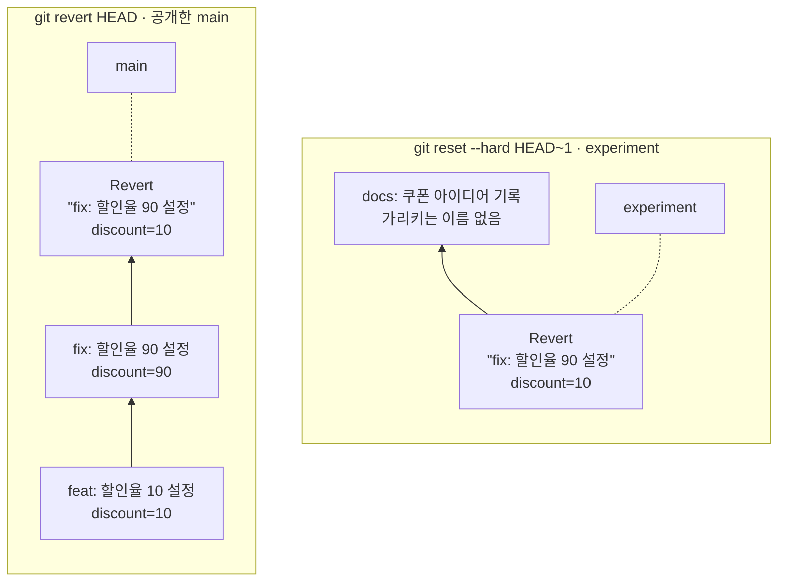
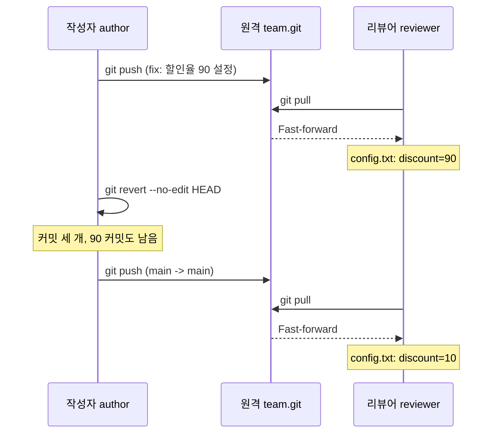
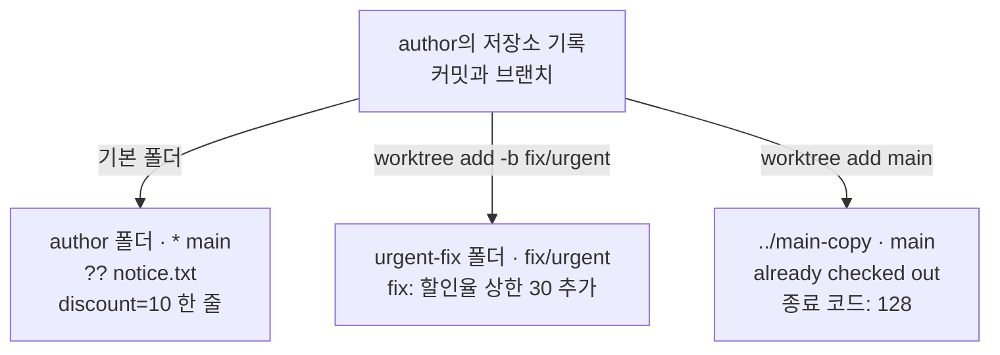
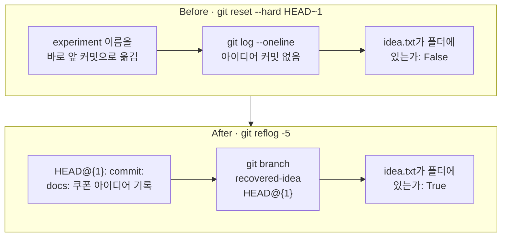
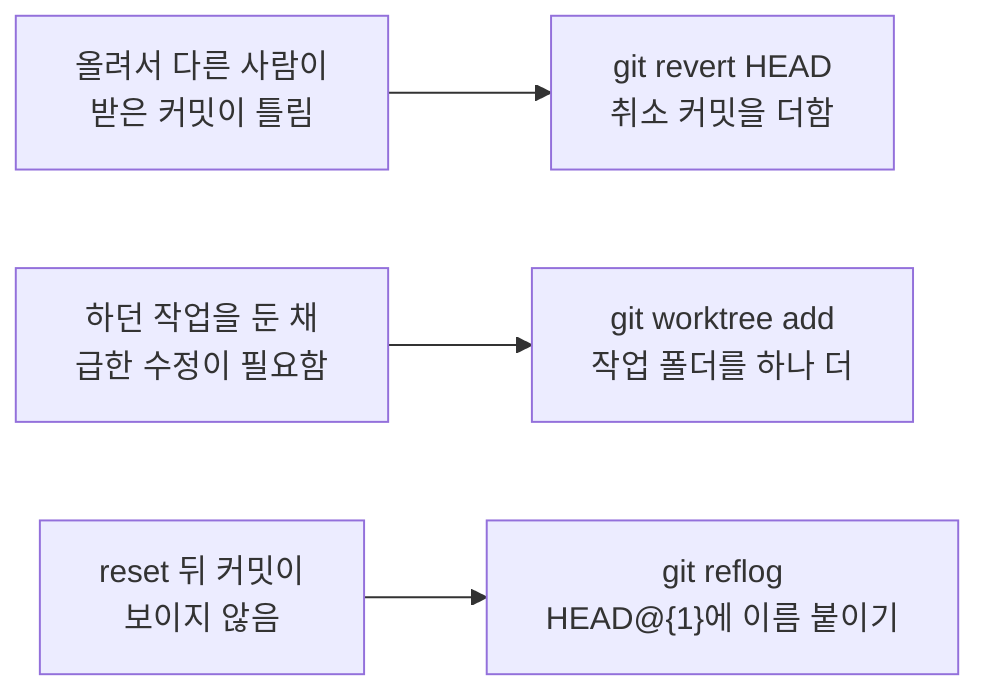

# 04-revert-reflog-worktree

## _src 본문 (HTML 원본)

```html
<!--meta: 강의 1h | 실습 2h | 코드 Jupyter Notebook | 새 용어 6 -->
<h2 id="b1"><span class="no">1</span>학습 목표</h2>
<div class="goal"><ul><li>리뷰어가 이미 받은 잘못된 커밋을 <code>git revert</code>로 취소하고, 이력에 두 커밋이 모두 남는 까닭을 설명할 수 있습니다.</li><li>명령 <code>git reset --hard</code>로 보이지 않게 된 커밋을 <code>git reflog</code>에서 찾아 새 브랜치 이름으로 되살릴 수 있습니다.</li><li>명령 <code>git worktree add</code>로 하던 작업을 둔 채 다른 브랜치를 새 폴더에서 열 수 있습니다.</li></ul></div>
<h2 id="b2"><span class="no">2</span>이 내용을 배우는 이유</h2>
<p>「되돌린다」는 말에는 서로 다른 상황이 섞여 있습니다. 팀원이 이미 받은 커밋을 취소해야 할 때가 있습니다. 내 컴퓨터에서 브랜치 이름을 잘못 옮겨 커밋이 보이지 않을 때도 있습니다.</p>
<p>두 상황에 같은 방법을 쓰면 문제가 생깁니다. 공개한 커밋을 이력에서 빼면 팀원이 받은 이력과 어긋납니다. 반대로 혼자 쓰던 커밋에서 이름만 옮겼다면, 저장소의 기록에서 그 커밋을 다시 찾을 수 있습니다.</p>
<p>하던 작업을 커밋하지 않은 채 급한 수정을 부탁받을 때도 있습니다. 이때는 지금 폴더의 브랜치를 바꾸지 않고 작업 폴더를 하나 더 엽니다.</p>
<p><strong>이 절의 질문</strong> — 이미 올린 잘못된 커밋과 실수로 보이지 않게 된 커밋은 각각 어떤 기록을 써서 되살릴까요?</p>
<h2 id="b3"><span class="no">3</span>앞에서 배운 내용</h2>
<p>03절에서는 임시 폴더의 원격 저장소 <code>team.git</code>에 작성자와 리뷰어가 커밋을 올렸습니다. 원격에 내가 모르는 커밋이 있으면 올리기가 거절됐습니다. 주의 메모에는 옵션 <code>--force</code>로 덮어 올리지 않는다고 적었습니다. 이번 절도 같은 폴더 이름과 작성자 <code>Ch3 Student</code>·리뷰어 <code>Ch3 Reviewer</code>를 씁니다.</p>
<p>02절에서는 <code>git switch -c</code>로 새 브랜치를 만들고, <code>git branch</code> 목록의 <code>*</code> 표시로 지금 브랜치를 읽었습니다. 브랜치는 줄기 끝 커밋을 가리키는 이름이었습니다. 03절에서는 뒤처진 쪽이 <code>git pull</code>로 받으면 fast-forward 병합이 되는 것을 봤습니다.</p>
<p>01절에서는 이름 <code>HEAD</code>가 지금 기준인 마지막 커밋이고, <code>HEAD~1</code>이 그 바로 앞 커밋이라고 배웠습니다. 명령 <code>git show HEAD~1:debug.log</code>로 지난 커밋의 파일 내용도 읽었습니다. 상태 표시 <code>??</code>는 추적하지 않는 파일이었습니다.</p>
<p>git 명령은 03절처럼 02절의 함수 <code>run_git()</code>을 도구 파일 <code>git_tools.py</code>에서 가져와 실행합니다. 파일은 Ch 2 05절의 <code>with open(...)</code>으로 쓰고 읽습니다. 폴더에 파일이 있는지는 01절처럼 <code>os.listdir()</code> 목록과 Ch 2 03절의 <code>in</code>으로 봅니다.</p>
<h2 id="b4"><span class="no">4</span>핵심 개념</h2>
<h3>비유로 시작하기</h3>
<p>03절의 창고 선반을 이어 떠올립니다. 팀 선반에 잘못 포장한 상자가 이미 올라갔고, 동료가 그 선반을 보고 갔습니다. 그 상자를 몰래 빼면 동료가 본 선반과 지금 선반이 달라집니다. 그래서 잘못 포장한 상자는 그대로 두고, 되돌리기 화살표를 그린 상자를 끝에 하나 더 올립니다.</p>
<p>내 책상 위 작은 선반은 사정이 다릅니다. 깃발을 한 칸 앞 상자로 옮겼더니 끝 상자에 깃발이 없어 눈에 띄지 않습니다. 하지만 책상 수첩에는 깃발을 옮길 때마다 그린 기록이 있습니다. 수첩을 보고 끝 상자에 새 깃발을 꽂습니다.</p>
<p>저장소에서는 화살표를 그린 상자가 취소 커밋, 깃발이 브랜치 이름, 수첩이 참조 기록입니다. 작업 폴더를 하나 더 여는 방법은 이 비유와 따로 실행 예제에서 봅니다.</p>
{{img:04-6-취소-상자와-깃발-수첩|왼쪽 팀 선반에는 잘못 포장한 상자가 그대로 있고 그 뒤에 되돌리기 화살표가 그려진 상자를 올리며, 오른쪽 책상에서는 깃발이 빠진 끝 상자에 수첩을 보며 새 깃발을 꽂는 삽화|팀 선반의 잘못은 상자를 더해 취소하고, 내 책상에서 놓친 상자는 깃발 기록을 보고 다시 찾습니다.}}
<p><strong>그림 읽기</strong> — 왼쪽 칸이 팀 선반, 오른쪽 칸이 내 책상입니다. 왼쪽에서는 구겨진 종이가 삐져나온 상자가 선반에 남고, 바로 뒤에 되돌리기 화살표를 그린 초록 테이프 상자가 올라갑니다. 클립보드를 든 동료는 선반 전체를 보고 있습니다. 오른쪽에서는 노란 깃발이 가운데 상자로 옮겨져 끝 상자에 깃발이 없습니다. 앉은 사람이 깃발 그림 수첩을 보고 끝 상자에 파란 새 깃발을 꽂습니다.</p>
<h3>이 절에서 쓰는 말</h3>
<table><thead><tr><th>용어</th><th>뜻</th><th>이 절에서 보이는 모습</th></tr></thead><tbody>
<tr><td>공개한 커밋</td><td>팀 원격 저장소에 올려 다른 사람이 받을 수 있게 된 커밋</td><td>리뷰어가 <code>git pull</code>로 받은 <code>fix: 할인율 90 설정</code></td></tr>
<tr><td>취소 커밋(revert commit)</td><td>지정한 커밋의 변경을 거꾸로 적용해 새로 만든 커밋</td><td><code>Revert "fix: 할인율 90 설정"</code></td></tr>
<tr><td>리셋(reset)</td><td>지금 브랜치 이름을 다른 커밋으로 옮기는 명령. 옵션 <code>--hard</code>는 추적하는 파일도 그 커밋 상태로 맞춥니다</td><td><code>HEAD is now at</code></td></tr>
<tr><td>참조 기록(reflog)</td><td>HEAD가 옮겨 갈 때마다(커밋, 브랜치 전환, reset 등) 이 저장소가 적어 두는 기록</td><td><code>git reflog -5</code>의 다섯 줄</td></tr>
<tr><td><code>HEAD@{n}</code></td><td>참조 기록에서 HEAD가 n번 옮기기 전에 가리키던 커밋</td><td><code>HEAD@{1}: commit: docs: 쿠폰 아이디어 기록</code></td></tr>
<tr><td>추가 작업 폴더(worktree)</td><td>한 저장소에 연결한 두 번째 작업 폴더. 폴더마다 브랜치를 하나씩 꺼내 놓습니다</td><td><code>urgent-fix</code> 폴더의 <code>[fix/urgent]</code></td></tr>
</tbody></table>
<h3>공개한 커밋은 더해서 취소합니다</h3>
<p>명령 <code>git revert</code>는 지정한 커밋의 변경을 거꾸로 적용한 새 커밋을 만듭니다. 노트북에서는 <code>discount=90</code>으로 바꾼 커밋을 취소해, 파일이 다시 <code>discount=10</code>이 됐습니다. 그래도 잘못된 커밋은 이력 가운데에 남았습니다.</p>
<p>커밋을 더하기만 했으므로 원격 main에서 빠지는 커밋이 없습니다. 그래서 올리기는 거절되지 않았고, 리뷰어는 평소처럼 받았습니다. 공개한 커밋을 이력에서 빼고 올리면 원격이 거절하고, 억지로 올리려면 <code>--force</code>가 필요합니다. 이 경우는 이번에 실행하지 않았습니다.</p>
<h3>이름을 옮긴 커밋은 참조 기록에서 찾습니다</h3>
<p>명령 <code>git reset --hard HEAD~1</code>은 지금 브랜치 이름을 바로 앞 커밋으로 옮깁니다. 명령 <code>git log</code>는 지금 커밋에서 부모 커밋 쪽으로 따라가며 보여 줍니다. 그래서 이름보다 뒤에 남은 커밋은 목록에 나오지 않습니다.</p>
<p>저장소는 HEAD가 옮겨 갈 때마다 참조 기록에 한 줄씩 적습니다. 커밋이 그대로여도 브랜치를 바꾸면 한 줄이 생깁니다. 노트북은 둘째 줄 <code>HEAD@{1}</code>에서 아이디어 커밋을 찾아 <code>recovered-idea</code> 이름을 붙였습니다. 이름이 생기자 커밋과 파일을 다시 읽을 수 있었습니다.</p>
{{mermaid:04-1-더하기와-옮기기|왼쪽 칸은 할인율 10 커밋 위에 90 커밋과 취소 커밋이 쌓이고 회색 main 이름이 맨 위를 가리키며, 오른쪽 칸은 회색 experiment 이름이 아래 취소 커밋을 가리키고 위의 쿠폰 아이디어 커밋에는 이름이 없는 비교 그림|취소 커밋은 커밋을 더하고, reset은 이름을 옮깁니다. 이름에서 떨어진 커밋은 이력 목록에서 빠집니다.}}
<p><strong>도식 읽기</strong> — 왼쪽 칸은 공개한 main에서, 오른쪽 칸은 혼자 쓰는 experiment에서 쓴 방법입니다. 두 칸 모두 아래에서 위로 읽습니다. 초록 상자는 커밋, 회색 상자는 브랜치 이름이고, 점선은 이름이 가리키는 커밋을 잇습니다.</p>
<p>왼쪽은 <code>discount=90</code> 커밋 위에 취소 커밋이 더해져 커밋이 셋입니다. 이름 main은 맨 위 취소 커밋을 가리킵니다. 오른쪽은 이름 experiment가 점선으로 아래 커밋을 가리키고, 위의 <code>docs: 쿠폰 아이디어 기록</code>에는 이어진 이름이 없습니다.</p>
<h2 id="b5"><span class="no">5</span>실행 예제</h2>
<p>노트북은 03절처럼 원격 저장소와 작성자·리뷰어 저장소를 만듭니다. 작성자가 설정 파일 <code>config.txt</code>에 할인율 <code>discount=10</code>을 적어 첫 커밋으로 올리고, 리뷰어가 복제합니다. 할인율 10은 10%라서 Ch 2 04절의 할인율 0.1과 같은 값입니다.</p>
<p>작성자가 할인율을 90으로 잘못 바꿔 올리고, 리뷰어가 받습니다. 작성자는 <code>git revert --no-edit HEAD</code>로 취소 커밋을 만들어 다시 올립니다. 이어서 공지 초안을 커밋하지 않은 채 <code>urgent-fix</code> 폴더를 열어 할인율 상한 커밋을 만듭니다.</p>
<p>값 하나 바꿔 보기에서는 새 폴더에 꺼낼 브랜치를 <code>fix/urgent</code>에서 기본 폴더가 쓰는 <code>main</code>으로 바꿉니다. 끝으로 추가 작업 폴더를 정리합니다. 모델을 부르지 않으므로 API 키가 필요 없고 비용도 들지 않습니다.</p>
{{notebook:04-revert-reflog-worktree|example}}
<p class="look"><b>확인할 점</b> — 취소한 뒤 <code>git log --oneline</code>의 커밋이 세 개이고 <code>fix: 할인율 90 설정</code>도 남았는지 봅니다. 추가 폴더의 브랜치 목록에서 <code>+ main</code> 표시도 확인합니다.</p>
<h3>공개한 커밋을 취소한 순서</h3>
<p>잘못된 커밋은 이미 리뷰어에게 갔습니다. 작성자는 이력을 고치지 않고 커밋을 하나 더해 올렸습니다.</p>
{{mermaid:04-2-공개한-커밋-취소|세로선 셋은 작성자, 원격 team.git, 리뷰어이고, 위에서 아래로 90 커밋 올리기와 리뷰어 받기, 작성자의 git revert, 다시 올리기와 리뷰어 받기가 이어지며 노란 메모에 리뷰어 파일 값 discount=90과 discount=10이 적힌 순서도|공개한 커밋을 취소한 순서. 리뷰어는 두 번 모두 Fast-forward로 받았고, 파일은 discount=10으로 돌아왔습니다.}}
<p><strong>도식 읽기</strong> — 위에서 아래로 시간 순서입니다. 세로선 셋은 왼쪽부터 작성자, 원격 <code>team.git</code>, 리뷰어입니다. 실선 화살표는 요청한 명령, 점선 화살표는 받아 온 결과입니다. 노란 메모는 그 시점에 확인한 값입니다.</p>
<p>첫 받기 뒤 리뷰어의 파일은 <code>discount=90</code>이었습니다. 작성자가 자기 세로선에서 취소 커밋을 만든 뒤 커밋은 세 개였고, 90 커밋도 남았습니다. 다시 올린 출력은 <code>main -&gt; main</code>이었고, 리뷰어는 <code>Fast-forward</code>로 받아 <code>discount=10</code>을 읽었습니다.</p>
<h3>두 작업 폴더와 거절된 세 번째 폴더</h3>
<p>급한 수정은 기본 폴더를 건드리지 않고 새 폴더에서 했습니다. 같은 main으로 폴더를 하나 더 열려던 값 바꿔 보기는 거절됐습니다.</p>
{{mermaid:04-3-두-작업-폴더|위 초록 저장소 기록 상자에서 아래로 기본 폴더 author, 새 폴더 urgent-fix 두 초록 상자와, main으로 열려다 종료 코드 128로 거절된 빨간 상자 하나로 화살표가 나뉘는 흐름도|한 저장소에 연결한 두 작업 폴더. 다른 폴더가 쓰는 main으로는 폴더를 열 수 없었습니다.}}
<p><strong>도식 읽기</strong> — 위 초록 상자는 <code>author</code> 폴더에 있는 저장소 기록입니다. 아래 상자 셋은 이 기록에 연결하려던 작업 폴더이고, 화살표 위 글자는 실행한 명령입니다.</p>
<p>왼쪽 기본 폴더는 <code>* main</code>이고, 공지 초안 <code>?? notice.txt</code>가 그대로 남았습니다. 설정 파일은 <code>discount=10</code> 한 줄입니다. 가운데 <code>urgent-fix</code> 폴더에서는 <code>fix: 할인율 상한 30 추가</code>를 커밋했습니다. 오른쪽 빨간 상자는 main을 이미 쓰고 있어 <code>종료 코드: 128</code>로 거절된 폴더입니다.</p>
<h2 id="b6"><span class="no">6</span>일부러 실패해 보기</h2>
<p>Before에서는 작성자가 새 브랜치 <code>experiment</code>에 쿠폰 아이디어 파일 <code>idea.txt</code>를 커밋합니다. 이어서 그 커밋을 지우려고 <code>git reset --hard HEAD~1</code>을 실행하고, 이력과 폴더를 봅니다.</p>
<p>After에서는 <code>git reflog -5</code>로 참조 기록을 읽습니다. 찾은 커밋에 <code>HEAD@{1}</code>로 브랜치 이름 <code>recovered-idea</code>를 붙입니다. 그 브랜치로 옮겨 가 Before와 같은 방법으로 확인합니다.</p>
{{notebook:04-revert-reflog-worktree|failure}}
<p>리셋 출력은 <code>HEAD is now at</code> 뒤에 <code>Revert "fix: 할인율 90 설정"</code>을 보였습니다. 이력 목록에 아이디어 커밋이 없었고, 확인 결과는 <code>idea.txt가 폴더에 있는가: False</code>였습니다. 명령은 종료 코드 줄 없이 성공했습니다. 성공한 명령이 커밋을 목록에서 감춘 것입니다.</p>
<p>참조 기록의 첫 줄은 <code>HEAD@{0}: reset: moving to HEAD~1</code>이었습니다. 둘째 줄이 <code>HEAD@{1}: commit: docs: 쿠폰 아이디어 기록</code>입니다. 기록은 최근 것부터 나오므로 한 줄 아래가 reset 바로 전 자리입니다. 해시를 옮겨 적지 않고 이름 <code>HEAD@{1}</code>을 그대로 썼습니다.</p>
<p>새 브랜치의 파일 내용은 <code>첫 주문 쿠폰 아이디어</code>였습니다. 옮겨 간 뒤 같은 확인은 <code>idea.txt가 폴더에 있는가: True</code>로 바뀌었습니다. 이 커밋은 원격에 올리지 않았으므로 리뷰어 저장소에는 없습니다.</p>
<h3>감춰진 커밋을 되살린 순서</h3>
<p>실패 장면과 고친 장면은 같은 확인으로 끝납니다. 사이에 한 일은 참조 기록을 읽고 이름을 하나 붙인 것뿐입니다.</p>
{{mermaid:04-4-사라진-커밋-되살리기|위 Before 칸은 파란 이름 옮김 상자, 노란 git log 상자, 빨간 False 상자가 이어지고, 아래 After 칸은 노란 참조 기록 둘째 줄 상자, 파란 git branch 상자, 노란 True 상자가 이어지는 비교 그림|reset으로 감춰진 커밋을 되살린 순서. 참조 기록에서 찾은 커밋에 이름을 붙이자 같은 확인이 True로 바뀌었습니다.}}
<p><strong>도식 읽기</strong> — 위 칸이 Before, 아래 칸이 After이고, 칸마다 왼쪽에서 오른쪽으로 읽습니다. 파란 상자는 우리가 실행한 명령이고, 노란 상자는 확인한 출력입니다.</p>
<p>위 칸 끝의 빨간 상자 <code>idea.txt가 폴더에 있는가: False</code>는 Before의 결함 결과입니다. 아래 칸은 참조 기록 줄 <code>HEAD@{1}</code>에서 시작합니다. 그 커밋에 이름을 붙이자 마지막 노란 상자에서 같은 확인이 <code>True</code>로 바뀌었습니다.</p>
<h2 id="b7"><span class="no">7</span>주의할 점과 실무 메모</h2>
<ul><li>공개한 커밋에는 <code>git reset</code>과 <code>git push --force</code>를 쓰지 않습니다. 팀원이 받은 이력과 원격 이력이 어긋나기 때문입니다. 이 경우는 이번에 실행하지 않았습니다.</li>
<li>뒤의 커밋이 같은 줄을 또 고쳤다면, 취소 커밋을 만들 때도 03절 같은 충돌이 날 수 있습니다. git 문서에는 충돌을 해결한 뒤 이어 가는 옵션 <code>--continue</code>가 있습니다. 이번에는 실행하지 않았습니다.</li>
<li>git 문서는 취소 커밋을 만들기 전에 작업 폴더를 깨끗하게 두라고 안내합니다. 교재 환경에서 따로 해 보니, 취소할 파일을 고쳐 둔 경우에는 <code>revert failed</code>로 멈췄습니다. 노트북은 취소를 먼저 마치고 공지 초안을 만들었습니다.</li>
<li>옵션 <code>--hard</code>는 커밋하지 않은 추적 파일의 변경도 지웁니다. 참조 기록은 HEAD가 옮겨 간 기록이라 커밋하지 않은 변경은 여기서 찾을 수 없습니다. 이번에는 실행하지 않았습니다.</li>
<li>참조 기록은 각 저장소에만 적힙니다. git 문서에는 기본 설정에서 90일, 이름에서 떨어진 커밋의 줄은 30일이 지나면 정리될 수 있다고 적혀 있습니다. 백업이 아니므로 남길 커밋에는 브랜치 이름을 붙이거나 원격에 올립니다.</li>
<li>이름 <code>HEAD@{1}</code>의 번호는 HEAD를 옮기는 명령을 실행하면 달라집니다. 쓰기 직전에 <code>git reflog</code>를 다시 보고 메시지로 커밋을 확인합니다. 노트북은 기록을 읽은 바로 다음 셀에서 썼습니다.</li>
<li>추가 작업 폴더는 파일 탐색기로 지우지 않고 <code>git worktree remove</code>로 정리합니다. git 문서에 따르면 고치다 만 파일이 있는 폴더는 이 명령이 지우지 않습니다. 이번에는 커밋을 마친 폴더만 정리했습니다.</li>
<li>교재 출력은 Linux의 Git 2.34.1에서 실행한 결과입니다. 다른 운영체제인 Windows와 macOS, GitHub 화면의 되돌리기 버튼은 실행하지 않았습니다.</li></ul>
<h2 id="b8"><span class="no">8</span>정리와 다음 절</h2>
<ul><li>리뷰어가 받은 커밋은 <code>git revert</code>로 취소 커밋을 더해 되돌렸습니다. 잘못된 커밋도 이력에 남았고, 올리기와 받기는 평소처럼 성공했습니다.</li><li>명령 <code>git reset --hard</code>로 이름을 옮기면 커밋이 이력 목록에서 빠집니다. 참조 기록의 <code>HEAD@{1}</code>로 찾아 새 브랜치 이름을 붙여 되살렸습니다.</li><li>명령 <code>git worktree add</code>로 하던 작업을 둔 채 다른 브랜치를 새 폴더에 열었습니다. 다른 폴더가 쓰는 브랜치는 <code>종료 코드: 128</code>로 거절됐습니다.</li></ul>
{{mermaid:04-5-상황별-도구|세 줄마다 왼쪽 회색 상황 상자에서 오른쪽 파란 명령 상자로 이어지고, 위부터 git revert HEAD, git worktree add, git reflog가 적힌 그림|세 명령은 순서대로 실행하는 절차가 아니라, 상황에 따라 고르는 도구입니다.}}
<p><strong>도식 읽기</strong> — 세 줄은 이어서 실행하는 절차가 아니라 서로 다른 상황입니다. 줄마다 왼쪽 회색 상자가 상황이고, 오른쪽 파란 상자가 이 절에서 실행한 명령입니다.</p>
<p>첫 줄은 리뷰어가 받은 할인율 90 커밋의 경우입니다. 둘째 줄은 공지 초안을 둔 채 할인율 상한을 고친 경우입니다. 셋째 줄은 reset 뒤 보이지 않던 쿠폰 아이디어 커밋의 경우입니다.</p>
<p><strong>다음 학습과 이어지는 지점</strong> — 05절에서는 비밀 값이 커밋에 들어간 경우를 다룹니다. 이 절에서 본 것처럼 취소 커밋을 더해도 지난 커밋에는 값이 남습니다. 그래서 기록 자체를 정리하는 절차와 값을 바꾸는 조치를 함께 봅니다.</p>
<h2 id="b9"><span class="no">9</span>복습 문제</h2><details class="quiz"><summary>문제와 해설</summary>
<p class="quiz-q">1. 리뷰어가 받은 <code>fix: 할인율 90 설정</code>을 취소한 뒤, <code>git log --oneline</code>에는 커밋이 몇 개였고 잘못된 커밋은 어디에 있었나요? · 기초</p><p class="quiz-a"><b>해설</b> — 세 개였습니다. 맨 위가 <code>Revert "fix: 할인율 90 설정"</code>, 가운데가 잘못된 커밋, 맨 아래가 첫 커밋입니다. 취소 커밋은 변경을 거꾸로 적용한 새 커밋이라 잘못된 커밋을 지우지 않습니다.</p>
<p class="quiz-q">2. 취소 커밋을 올릴 때 거절되지 않은 까닭은 무엇인가요? · 적용</p><p class="quiz-a"><b>해설</b> — 원격 main의 커밋 위에 새 커밋을 하나 더했을 뿐이라, 원격 main에서 빠지는 커밋이 없었기 때문입니다. 리뷰어도 <code>Fast-forward</code>로 받았습니다. 공개한 커밋을 이력에서 빼고 올리는 경우는 이번에 실행하지 않았습니다.</p>
<p class="quiz-q">3. 명령 <code>git reset --hard HEAD~1</code> 뒤 쿠폰 아이디어 커밋이 이력 목록에 없었던 까닭은 무엇인가요? · 기초</p><p class="quiz-a"><b>해설</b> — 브랜치 이름 experiment가 바로 앞 커밋으로 옮겨 가, 목록이 따라가는 줄기에서 그 커밋이 빠졌기 때문입니다. 커밋은 저장소에 남아 있어서 참조 기록의 <code>HEAD@{1}</code>로 찾을 수 있었습니다.</p>
<p class="quiz-q">4. 기본 폴더가 main을 쓰는 동안 main으로 작업 폴더를 하나 더 열면 어떻게 되었나요? 급한 수정용 폴더는 어떻게 열었나요? · 적용</p><p class="quiz-a"><b>해설</b> — <code>fatal: 'main' is already checked out at</code>과 <code>종료 코드: 128</code>로 거절됐고, 작업 폴더 목록은 두 줄 그대로였습니다. 급한 수정용 폴더는 옵션 <code>-b fix/urgent</code>로 새 브랜치를 만들며 열었습니다.</p>
<p class="quiz-q">5. 이 절의 질문에 답해 봅시다. 이미 올린 잘못된 커밋과 실수로 보이지 않게 된 커밋은 각각 어떤 기록을 써서 되살렸나요? · 분석</p><p class="quiz-a"><b>해설</b> — 이미 올린 커밋은 이력 자체에 취소 커밋을 더했습니다. 이 기록은 원격을 거쳐 리뷰어에게도 갔습니다. 보이지 않게 된 커밋은 작성자 저장소의 참조 기록에서 <code>HEAD@{1}</code>로 찾아 브랜치 이름을 붙였습니다. 참조 기록은 git 문서대로 각 저장소에만 적히는 기록입니다.</p>
</details>
<h2 id="b10"><span class="no">10</span>참고 자료</h2>
<ul><li><a href="https://git-scm.com/docs/git-revert">Git 공식 문서: git-revert</a> · 확인 2026-09-16 · 실행 Git 2.34.1</li><li><a href="https://git-scm.com/docs/git-reset">Git 공식 문서: git-reset</a> · 확인 2026-09-16 · 실행 Git 2.34.1</li><li><a href="https://git-scm.com/docs/git-reflog">Git 공식 문서: git-reflog</a> · 확인 2026-09-16 · 실행 Git 2.34.1</li><li><a href="https://git-scm.com/docs/git-worktree">Git 공식 문서: git-worktree</a> · 확인 2026-09-16 · 실행 Git 2.34.1</li><li><a href="https://git-scm.com/docs/git-branch">Git 공식 문서: git-branch</a> · 확인 2026-09-16 · 실행 Git 2.34.1</li></ul>
```

## 노트북 셀 (순서대로)

### [0] markdown {'html': 'skip'}

# revert, reflog, worktree

**이 노트북에서 할 일**

1. 03절처럼 임시 폴더에 팀 원격 저장소와 작성자·리뷰어 저장소를 만듭니다.
2. 이미 원격에 올린 잘못된 커밋을 취소 커밋으로 되돌리고, 작업 폴더를 하나 더 열어 급한 수정을 합니다.
3. 명령 `git reset --hard`로 보이지 않게 된 커밋을 참조 기록에서 찾아 되살립니다.

**준비물** — API 키 불필요. 데이터 파일도 없습니다. 모델 호출은 0번이고 비용은 들지 않습니다.
실행 시간은 1분 이내입니다. 03절에서 쓴 Git이 필요합니다.

실습 폴더 `labs/part1/ch03-git-github`에서 `uv sync --locked`로 만든 `.venv`를 커널로 고릅니다.
첫 셀부터 순서대로 실행합니다. GitHub 계정과 네트워크는 쓰지 않습니다.

### [1] markdown {'html': 'skip'}

## 오늘 볼 그림


왼쪽 칸이 공개한 main에서 쓴 방법, 오른쪽 칸이 혼자 쓰는 브랜치에서 쓴 방법입니다. 두 칸 모두 아래에서 위로 읽습니다.
왼쪽은 커밋을 하나 더해 취소하므로 잘못된 커밋도 남습니다. 오른쪽은 이름표만 한 커밋 아래로 옮겨, 맨 위 커밋을 가리키는 이름이 없어집니다.

### [2] markdown {}

## 1. 준비

이 절도 설치할 패키지가 없습니다. 03절처럼 빈 임시 폴더를 만들고 그 폴더로 작업 위치를 옮깁니다.
그 안에 원격 저장소 하나와 두 사람의 저장소를 만듭니다. 폴더 이름의 앞머리만 `ch03-04-`로 바꿨습니다.

앞에서 배운 함수는 `git_tools.py`에 모아 두었습니다. 파일을 열면 코드를 볼 수 있습니다. 노트북과 같은 폴더(`notebooks/`)에 있는 파일입니다.
이 노트북은 03절처럼 02절 `run_git()`을 가져옵니다.

가져오는 줄은 작업 위치를 옮기기 전에 둡니다. 도구 파일을 현재 작업 폴더에서 찾기 때문입니다.

### [3] code {'execution': {'iopub.execute_input': '2026-09-21T10:18:57.173975Z', 'iopub.status.busy': '2026-09-21T10:18:57.173768Z', 'iopub.status.idle': '2026-09-21T10:18:57.182442Z', 'shell.execute_reply': '2026-09-21T10:18:57.181847Z'}, 'lesson_role': 'setup'}

```python
# 02절 run_git()을 도구 파일에서 가져오고, 저장소와 작업 폴더를 담을 빈 임시 폴더로 작업 위치를 옮깁니다
import os
import tempfile

# 작업 위치를 옮기기 전에 가져옵니다. 도구 파일은 노트북과 같은 폴더에 있습니다
from git_tools import run_git

# mkdtemp()는 운영체제 임시 폴더 안에 새 폴더를 만들고 그 경로를 반환합니다
practice_folder = tempfile.mkdtemp(prefix="ch03-04-")
os.chdir(practice_folder)
file_names = os.listdir()
print("현재 작업 폴더의 파일:", file_names)
```

출력:
```
현재 작업 폴더의 파일: []

```

### [4] markdown {}

**결과 읽기** — 현재 작업 폴더의 파일은 `[]`로, 빈 폴더에서 시작합니다.

### [5] markdown {}

## 2. 가져온 git 명령 함수

1번 준비 셀에서 가져온 `run_git()`은 02절에서 만든 함수입니다. 두 번째 매개변수 `folder`는 명령을 실행할 폴더이고, 기본값 `"."`은 현재 작업 폴더입니다.

이 함수에는 `check=True` 인자가 없습니다. 그래서 git 명령이 실패해도 셀은 멈추지 않고 `종료 코드: 128` 같은 줄을 보여 줍니다.

### [6] markdown {}

## 3. 팀 원격 저장소와 작성자의 첫 커밋

03절과 같은 순서로 준비합니다. 원격 저장소 `team.git`을 bare 저장소로 만들고, 작성자가 `author` 폴더로 복제합니다.
작성자 정보도 03절과 같은 `Ch3 Student`를 이 저장소에만 적습니다.

실행 전에 예상합니다. 빈 저장소를 복제했다는 경고가 한 번 나오고, 종료 코드 줄은 없을 것입니다.

### [7] code {'execution': {'iopub.execute_input': '2026-09-21T10:18:57.184208Z', 'iopub.status.busy': '2026-09-21T10:18:57.184042Z', 'iopub.status.idle': '2026-09-21T10:18:57.206135Z', 'shell.execute_reply': '2026-09-21T10:18:57.205635Z'}}

```python
# 팀 원격 저장소를 만들고, 작성자가 복제한 저장소에 이름과 전자우편 주소를 적습니다
run_git("init --bare -b main team.git")
run_git("clone team.git author")
run_git('config user.name "Ch3 Student"', "author")
run_git("config user.email student@example.com", "author")
```

출력:
```
. $ git init --bare -b main team.git
Initialized empty Git repository in [사용자 폴더]/tmp/ch03-04-knwtbftj/team.git/

. $ git clone team.git author
Cloning into 'author'...
warning: You appear to have cloned an empty repository.
done.

author $ git config user.name "Ch3 Student"

author $ git config user.email student@example.com


```

### [8] markdown {}

**결과 읽기** — 줄 `Initialized empty Git repository`로 원격 저장소가 생긴 것을 확인합니다.
경고 `You appear to have cloned an empty repository`는 03절에서 본 것과 같은 안내입니다.
종료 코드 줄이 없으므로 네 명령 모두 성공했습니다.

### [9] markdown {}

작성자가 설정 파일 `config.txt`를 만들어 main의 첫 커밋으로 올립니다. 파일에는 할인율 한 줄 `discount=10`만 적습니다.
숫자 10은 10%를 뜻합니다. Ch 2 04절에서 결제 금액을 계산할 때 쓴 할인율 0.1과 같은 값입니다.

실행 전에 예상합니다. 03절처럼 첫 커밋 표시와 새 브랜치 표시가 나올 것입니다.

### [10] code {'execution': {'iopub.execute_input': '2026-09-21T10:18:57.207152Z', 'iopub.status.busy': '2026-09-21T10:18:57.207055Z', 'iopub.status.idle': '2026-09-21T10:18:57.220308Z', 'shell.execute_reply': '2026-09-21T10:18:57.219812Z'}}

```python
# 작성자가 할인율 설정 파일을 만들어 첫 커밋으로 기록하고 원격에 올립니다
with open("author/config.txt", "w", encoding="utf-8") as file:
    file.write("discount=10\n")
run_git("add config.txt", "author")
run_git('commit -m "feat: 할인율 10 설정"', "author")
run_git("push -u origin main", "author")
```

출력:
```
author $ git add config.txt

author $ git commit -m "feat: 할인율 10 설정"
[main (root-commit) ecd00a9] feat: 할인율 10 설정
 1 file changed, 1 insertion(+)
 create mode 100644 config.txt

author $ git push -u origin main
Branch 'main' set up to track remote branch 'main' from 'origin'.
To [사용자 폴더]/tmp/ch03-04-knwtbftj/team.git
 * [new branch]      main -> main


```

### [11] markdown {}

**결과 읽기** — 표시 `main (root-commit)`은 main 브랜치의 첫 커밋이라는 뜻입니다.
올리기 출력의 `[new branch]`로 원격 저장소에도 main이 생긴 것을 확인합니다.

### [12] markdown {}

리뷰어도 원격 저장소를 복제합니다. 폴더 이름과 작성자 정보는 03절과 같은 `reviewer`와 `Ch3 Reviewer`입니다.

실행 전에 예상합니다. 원격에 커밋이 있으니 빈 저장소 경고 없이 복제될 것입니다.

### [13] code {'execution': {'iopub.execute_input': '2026-09-21T10:18:57.221240Z', 'iopub.status.busy': '2026-09-21T10:18:57.221144Z', 'iopub.status.idle': '2026-09-21T10:18:57.231817Z', 'shell.execute_reply': '2026-09-21T10:18:57.231396Z'}}

```python
# 리뷰어가 원격 저장소를 복제하고, 리뷰어 저장소에만 이름과 전자우편 주소를 적습니다
run_git("clone team.git reviewer")
run_git('config user.name "Ch3 Reviewer"', "reviewer")
run_git("config user.email reviewer@example.com", "reviewer")
```

출력:
```
. $ git clone team.git reviewer
Cloning into 'reviewer'...
done.

reviewer $ git config user.name "Ch3 Reviewer"

reviewer $ git config user.email reviewer@example.com


```

### [14] markdown {}

**결과 읽기** — 복제 출력은 `Cloning into 'reviewer'...`와 `done.`뿐이고 경고가 없습니다.
이제 두 사람의 main은 같은 첫 커밋에서 출발합니다.

### [15] markdown {}

## 4. 잘못된 할인율을 원격에 올리기

작성자가 설정을 고치다가 할인율을 90으로 적었습니다. 90% 할인은 상품을 원래 값의 10%에 파는 셈이라 잘못된 값입니다.
작성자는 실수를 알아채지 못한 채 `fix: 할인율 90 설정`으로 커밋하고 원격에 올립니다.

실행 전에 예상합니다. 원격에 작성자가 모르는 커밋이 없으므로 거절 없이 올라갈 것입니다.

### [16] code {'execution': {'iopub.execute_input': '2026-09-21T10:18:57.232698Z', 'iopub.status.busy': '2026-09-21T10:18:57.232615Z', 'iopub.status.idle': '2026-09-21T10:18:57.243196Z', 'shell.execute_reply': '2026-09-21T10:18:57.242798Z'}}

```python
# 작성자가 할인율을 잘못된 값 90으로 바꿔 커밋하고 원격에 올립니다
with open("author/config.txt", "w", encoding="utf-8") as file:
    file.write("discount=90\n")
run_git("add config.txt", "author")
run_git('commit -m "fix: 할인율 90 설정"', "author")
run_git("push", "author")
```

출력:
```
author $ git add config.txt

author $ git commit -m "fix: 할인율 90 설정"
[main 0c2d754] fix: 할인율 90 설정
 1 file changed, 1 insertion(+), 1 deletion(-)

author $ git push
To [사용자 폴더]/tmp/ch03-04-knwtbftj/team.git
   ecd00a9..0c2d754  main -> main


```

### [17] markdown {}

**결과 읽기** — 커밋 요약 줄 `1 file changed, 1 insertion(+), 1 deletion(-)`은 한 줄을 고쳤다는 뜻입니다.
올리기 출력의 `main -> main`으로 원격 main이 이 커밋으로 옮겨 갔습니다.

### [18] markdown {}

리뷰어가 `git pull`로 원격의 새 커밋을 받고, 받은 설정 파일을 읽습니다.
이렇게 원격에 올려 다른 사람이 받은 커밋을 이 절에서는 공개한 커밋이라고 부릅니다.

실행 전에 예상합니다. 03절처럼 fast-forward 병합으로 받고, 파일에는 90이 보일 것입니다.

### [19] code {'execution': {'iopub.execute_input': '2026-09-21T10:18:57.243987Z', 'iopub.status.busy': '2026-09-21T10:18:57.243918Z', 'iopub.status.idle': '2026-09-21T10:18:57.252248Z', 'shell.execute_reply': '2026-09-21T10:18:57.251882Z'}}

```python
# 리뷰어가 원격 main을 받아 오고, 받은 설정 파일을 읽습니다
run_git("pull", "reviewer")
with open("reviewer/config.txt", "r", encoding="utf-8") as file:
    config_text = file.read()
print("리뷰어의 config.txt:", config_text)
```

출력:
```
reviewer $ git pull
Updating ecd00a9..0c2d754
Fast-forward
 config.txt | 2 +-
 1 file changed, 1 insertion(+), 1 deletion(-)
From [사용자 폴더]/tmp/ch03-04-knwtbftj/team
   ecd00a9..0c2d754  main       -> origin/main

리뷰어의 config.txt: discount=90


```

### [20] markdown {}

**결과 읽기** — 줄 `Fast-forward`로 리뷰어의 main이 새 커밋으로 옮겨 갔습니다.
마지막 줄 `리뷰어의 config.txt: discount=90`으로 잘못된 값이 리뷰어 폴더에도 들어온 것을 확인합니다.

이제 이 커밋은 작성자 혼자의 것이 아닙니다. 원격과 리뷰어 저장소에도 같은 커밋이 있습니다.

### [21] markdown {}

## 5. git revert로 취소 커밋 더하기

작성자가 이 커밋을 이력에서 빼고 올리면, 원격에는 작성자 저장소에 없는 커밋이 남습니다. 03절에서 본 것처럼 원격은 이런 올리기를 거절합니다.
억지로 덮어 올리는 옵션 `--force`는 리뷰어가 이미 받은 커밋과 이력이 어긋나게 만듭니다. 이 두 경우는 이번에 실행하지 않았습니다.

명령 `git revert`는 지정한 커밋의 변경을 거꾸로 적용한 새 커밋을 만듭니다. 대상 `HEAD`는 01절에서 배운 지금 기준인 마지막 커밋입니다.
옵션 `--no-edit`는 메시지 편집기를 열지 않고 git이 정한 메시지를 그대로 씁니다.

실행 전에 예상합니다. 이력에 커밋이 하나 더 생기고, 잘못된 커밋도 그대로 남을 것입니다.

### [22] code {'execution': {'iopub.execute_input': '2026-09-21T10:18:57.252973Z', 'iopub.status.busy': '2026-09-21T10:18:57.252893Z', 'iopub.status.idle': '2026-09-21T10:18:57.257004Z', 'shell.execute_reply': '2026-09-21T10:18:57.256662Z'}}

```python
# 마지막 커밋의 변경을 거꾸로 적용한 새 커밋을 만들고, 이력과 파일을 확인합니다
run_git("revert --no-edit HEAD", "author")
run_git("log --oneline", "author")
with open("author/config.txt", "r", encoding="utf-8") as file:
    config_text = file.read()
print("작성자의 config.txt:", config_text)
```

출력:
```
author $ git revert --no-edit HEAD
[main ff8bc1c] Revert "fix: 할인율 90 설정"
 Date: Mon Sep 21 10:18:57 2026 +0000
 1 file changed, 1 insertion(+), 1 deletion(-)

author $ git log --oneline
ff8bc1c Revert "fix: 할인율 90 설정"
0c2d754 fix: 할인율 90 설정
ecd00a9 feat: 할인율 10 설정

작성자의 config.txt: discount=10


```

### [23] markdown {}

**결과 읽기** — 새 커밋의 메시지는 `Revert "fix: 할인율 90 설정"`입니다. 줄 `Date:`에는 이 커밋을 만든 시각이 나옵니다.
이력은 커밋 세 개이고, 잘못된 커밋 `fix: 할인율 90 설정`도 가운데에 그대로 있습니다.
마지막 줄은 `작성자의 config.txt: discount=10`입니다.

파일은 첫 커밋과 같아졌지만 이력은 뒤로 가지 않았습니다. 「90으로 바꿈」과 「그 변경을 취소함」이 둘 다 기록에 남습니다.

### [24] markdown {}

취소 커밋을 원격에 올리고, 리뷰어가 받습니다. 파일은 앞에서와 같은 방법으로 읽습니다.

실행 전에 예상합니다. 새 커밋을 더했을 뿐이므로 올리기는 거절되지 않고, 리뷰어는 fast-forward 병합으로 받을 것입니다.

### [25] code {'execution': {'iopub.execute_input': '2026-09-21T10:18:57.257718Z', 'iopub.status.busy': '2026-09-21T10:18:57.257647Z', 'iopub.status.idle': '2026-09-21T10:18:57.270208Z', 'shell.execute_reply': '2026-09-21T10:18:57.269796Z'}}

```python
# 취소 커밋을 원격에 올리고, 리뷰어가 받아 설정 파일을 다시 읽습니다
run_git("push", "author")
run_git("pull", "reviewer")
with open("reviewer/config.txt", "r", encoding="utf-8") as file:
    config_text = file.read()
print("리뷰어의 config.txt:", config_text)
```

출력:
```
author $ git push
To [사용자 폴더]/tmp/ch03-04-knwtbftj/team.git
   0c2d754..ff8bc1c  main -> main

reviewer $ git pull
Updating 0c2d754..ff8bc1c
Fast-forward
 config.txt | 2 +-
 1 file changed, 1 insertion(+), 1 deletion(-)
From [사용자 폴더]/tmp/ch03-04-knwtbftj/team
   0c2d754..ff8bc1c  main       -> origin/main

리뷰어의 config.txt: discount=10


```

### [26] markdown {}

**결과 읽기** — 올리기 출력은 `main -> main`이고, 거절 표시와 종료 코드 줄이 없습니다.
리뷰어 쪽은 `Fast-forward`로 받았고, 마지막 줄은 `리뷰어의 config.txt: discount=10`입니다.

리뷰어는 따로 할 일이 없었습니다. 평소처럼 받기만 해도 할인율이 10으로 돌아왔습니다.

### [27] markdown {}

## 6. git worktree로 작업 폴더 하나 더 열기

작성자는 기본 폴더 `author`에서 할인 행사 공지 초안 `notice.txt`를 쓰는 중입니다. 아직 커밋하지 않은 파일입니다.
이때 할인율에 상한을 두는 급한 수정을 부탁받았습니다.

명령 `git worktree add`는 같은 저장소에 작업 폴더를 하나 더 만듭니다. 옵션 `-b fix/urgent`는 새 브랜치를 만듭니다.
마지막 `../urgent-fix`는 새 폴더 경로입니다. 앞의 `..`은 한 칸 위 폴더라서 새 폴더는 `author` 옆에 생깁니다.
명령 `git worktree list`는 이 저장소에 연결된 작업 폴더 목록을 보여 줍니다.

실행 전에 예상합니다. 목록에 폴더가 두 줄 나오고, 두 줄의 브랜치가 서로 다를 것입니다.

### [28] code {'execution': {'iopub.execute_input': '2026-09-21T10:18:57.270924Z', 'iopub.status.busy': '2026-09-21T10:18:57.270863Z', 'iopub.status.idle': '2026-09-21T10:18:57.276246Z', 'shell.execute_reply': '2026-09-21T10:18:57.275960Z'}}

```python
# 기본 폴더에 커밋하지 않은 공지 초안을 둔 채, 급한 수정용 작업 폴더를 하나 더 엽니다
with open("author/notice.txt", "w", encoding="utf-8") as file:
    file.write("공지 초안: 할인 행사 안내\n")
# 새 브랜치 fix/urgent를 만들어 author 옆 urgent-fix 폴더에 꺼내 놓습니다
run_git("worktree add -b fix/urgent ../urgent-fix", "author")
run_git("worktree list", "author")
```

출력:
```
author $ git worktree add -b fix/urgent ../urgent-fix
Preparing worktree (new branch 'fix/urgent')
HEAD is now at ff8bc1c Revert "fix: 할인율 90 설정"

author $ git worktree list
[사용자 폴더]/tmp/ch03-04-knwtbftj/author      ff8bc1c [main]
[사용자 폴더]/tmp/ch03-04-knwtbftj/urgent-fix  ff8bc1c [fix/urgent]


```

### [29] markdown {}

**결과 읽기** — 줄 `Preparing worktree (new branch 'fix/urgent')`는 새 브랜치로 새 폴더를 준비했다는 뜻입니다.
목록은 두 줄입니다. 첫 줄 끝은 `[main]`, 둘째 줄 끝은 `[fix/urgent]`입니다.

앞쪽 경로는 실행할 때마다 달라지는 임시 폴더라 읽지 않습니다. 경로 앞 `[사용자 폴더]`는 실행 도구가 사용자 폴더 이름을 가린 표시입니다.
가운데 글자는 커밋 해시이고 두 줄이 같습니다.
두 폴더가 같은 커밋에서 출발했다는 뜻입니다.

### [30] markdown {}

새 폴더 `urgent-fix`에서 급한 수정을 커밋합니다. 설정 파일에 할인율 상한 줄 `max_discount=30`을 더합니다.
함수 `run_git()`의 두 번째 인자에 새 폴더 이름을 넣으면 그 폴더에서 명령이 실행됩니다.

실행 전에 예상합니다. 커밋 출력의 대괄호 안에 main이 아니라 새 브랜치 이름이 보일 것입니다.

### [31] code {'execution': {'iopub.execute_input': '2026-09-21T10:18:57.276906Z', 'iopub.status.busy': '2026-09-21T10:18:57.276849Z', 'iopub.status.idle': '2026-09-21T10:18:57.282133Z', 'shell.execute_reply': '2026-09-21T10:18:57.281773Z'}}

```python
# 새 작업 폴더에서 설정 파일에 할인율 상한을 더해 커밋하고, 브랜치 목록을 봅니다
urgent_config = """discount=10
max_discount=30
"""
with open("urgent-fix/config.txt", "w", encoding="utf-8") as file:
    file.write(urgent_config)
run_git("add config.txt", "urgent-fix")
run_git('commit -m "fix: 할인율 상한 30 추가"', "urgent-fix")
run_git("branch", "urgent-fix")
```

출력:
```
urgent-fix $ git add config.txt

urgent-fix $ git commit -m "fix: 할인율 상한 30 추가"
[fix/urgent 4ab70b4] fix: 할인율 상한 30 추가
 1 file changed, 1 insertion(+)

urgent-fix $ git branch
* fix/urgent
+ main


```

### [32] markdown {}

**결과 읽기** — 커밋 출력은 `[fix/urgent`로 시작하고, 요약 줄은 `1 file changed, 1 insertion(+)`입니다.
브랜치 목록의 `* fix/urgent`는 이 폴더가 지금 쓰는 브랜치입니다.
목록의 `+ main`에서 더하기 표시는 다른 작업 폴더가 쓰는 브랜치라는 뜻입니다.

### [33] markdown {}

기본 폴더 `author`의 상태와 브랜치 목록을 봅니다. 설정 파일도 읽어 급한 수정이 이 폴더에 들어왔는지 확인합니다.

실행 전에 예상합니다. 공지 초안은 추적하지 않는 파일로 그대로 있고, 설정 파일은 한 줄일 것입니다.

### [34] code {'execution': {'iopub.execute_input': '2026-09-21T10:18:57.282803Z', 'iopub.status.busy': '2026-09-21T10:18:57.282733Z', 'iopub.status.idle': '2026-09-21T10:18:57.286006Z', 'shell.execute_reply': '2026-09-21T10:18:57.285744Z'}}

```python
# 기본 폴더의 상태와 브랜치 목록을 보고, 설정 파일을 읽습니다
run_git("status --short", "author")
run_git("branch", "author")
with open("author/config.txt", "r", encoding="utf-8") as file:
    config_text = file.read()
print("작성자의 config.txt:", config_text)
```

출력:
```
author $ git status --short
?? notice.txt

author $ git branch
+ fix/urgent
* main

작성자의 config.txt: discount=10


```

### [35] markdown {}

**결과 읽기** — 상태 표시 `?? notice.txt`로 공지 초안이 그대로 남아 있습니다. 브랜치 목록은 `+ fix/urgent`와 `* main`입니다.
마지막 줄은 `작성자의 config.txt: discount=10`이고, 상한 줄이 없습니다.

두 폴더는 커밋과 브랜치 기록을 함께 쓰지만 작업 파일은 따로 가집니다.
그래서 공지 초안을 커밋하거나 치우지 않고도 다른 브랜치에서 커밋할 수 있었습니다.

### [36] markdown {}

## 7. 값 하나 바꿔 보기 — 이미 쓰는 브랜치로 폴더 열기

6번에서는 새 브랜치 `fix/urgent`로 작업 폴더를 열었습니다. 이번에는 브랜치만 바꿔, 기본 폴더가 쓰는 `main`으로 폴더를 엽니다.
옵션 `-b`는 새 브랜치를 만들 때 적으므로 뺍니다. 새 폴더 경로는 `../main-copy`로 둡니다.

실행 전에 예상합니다. 기본 폴더가 main을 이미 쓰고 있으니 거절되고, 목록은 그대로 두 줄일 것입니다.

### [37] code {'execution': {'iopub.execute_input': '2026-09-21T10:18:57.286654Z', 'iopub.status.busy': '2026-09-21T10:18:57.286598Z', 'iopub.status.idle': '2026-09-21T10:18:57.289629Z', 'shell.execute_reply': '2026-09-21T10:18:57.289252Z'}}

```python
# 기본 폴더가 이미 쓰는 main 브랜치로 작업 폴더를 하나 더 열어 보고, 목록을 봅니다
run_git("worktree add ../main-copy main", "author")
run_git("worktree list", "author")
```

출력:
```
author $ git worktree add ../main-copy main
Preparing worktree (checking out 'main')
fatal: 'main' is already checked out at '[사용자 폴더]/tmp/ch03-04-knwtbftj/author'

종료 코드: 128
author $ git worktree list
[사용자 폴더]/tmp/ch03-04-knwtbftj/author      ff8bc1c [main]
[사용자 폴더]/tmp/ch03-04-knwtbftj/urgent-fix  4ab70b4 [fix/urgent]


```

### [38] markdown {}

**결과 읽기** — 줄 `fatal: 'main' is already checked out at`은 main을 이미 다른 작업 폴더에서 쓰고 있다는 뜻입니다.
그 뒤 경로는 기본 폴더 `author`입니다. 줄 `종료 코드: 128`이 나오고, 이어진 목록은 여전히 두 줄입니다.

작업 폴더를 하나 더 열 때는 다른 폴더가 쓰지 않는 브랜치를 고릅니다. 6번처럼 새 브랜치를 만들며 여는 방법이 그 예입니다.

### [39] markdown {}

## 8. 추가 작업 폴더 정리하기

급한 수정 커밋은 `fix/urgent` 브랜치에 남았으니 추가 작업 폴더는 이제 필요 없습니다.
명령 `git worktree remove`는 추가 작업 폴더를 지우고 저장소와의 연결도 풉니다.
이 브랜치를 main에 병합하고 올리는 일은 02절 순서와 같아 이번에는 실행하지 않았습니다.

실행 전에 예상합니다. 작업 폴더 목록은 한 줄로 줄고, 브랜치 목록에는 `fix/urgent`가 남을 것입니다.

### [40] code {'execution': {'iopub.execute_input': '2026-09-21T10:18:57.290220Z', 'iopub.status.busy': '2026-09-21T10:18:57.290151Z', 'iopub.status.idle': '2026-09-21T10:18:57.294575Z', 'shell.execute_reply': '2026-09-21T10:18:57.294282Z'}}

```python
# 급한 수정용 작업 폴더를 정리하고, 작업 폴더 목록과 브랜치 목록, 파일 목록을 봅니다
run_git("worktree remove ../urgent-fix", "author")
run_git("worktree list", "author")
run_git("branch", "author")
file_names = os.listdir()
print("현재 작업 폴더의 파일:", sorted(file_names))
```

출력:
```
author $ git worktree remove ../urgent-fix

author $ git worktree list
[사용자 폴더]/tmp/ch03-04-knwtbftj/author  ff8bc1c [main]

author $ git branch
  fix/urgent
* main

현재 작업 폴더의 파일: ['author', 'reviewer', 'team.git']

```

### [41] markdown {}

**결과 읽기** — 작업 폴더 목록은 `[main]`으로 끝나는 한 줄입니다. 브랜치 목록에는 더하기 표시 없는 `fix/urgent`와 `* main`이 있습니다.
현재 작업 폴더의 파일은 `['author', 'reviewer', 'team.git']`이고, `urgent-fix` 폴더는 없습니다.

폴더를 지워도 그 폴더에서 만든 커밋과 브랜치는 저장소에 남습니다.

### [42] markdown {'lesson_part': 'before'}

## 9. Before — reset --hard로 커밋 지우기

작성자가 기본 폴더에서 새 브랜치 `experiment`를 만들고, 쿠폰 아이디어를 `idea.txt`에 적어 커밋합니다.
명령 `git switch -c`는 02절에서 배웠습니다. 이 브랜치는 원격에 올리지 않은 작성자 혼자의 브랜치입니다.

실행 전에 예상합니다. 대괄호 안에 experiment가 보이는 커밋 출력이 나올 것입니다.

### [43] code {'execution': {'iopub.execute_input': '2026-09-21T10:18:57.295171Z', 'iopub.status.busy': '2026-09-21T10:18:57.295106Z', 'iopub.status.idle': '2026-09-21T10:18:57.299968Z', 'shell.execute_reply': '2026-09-21T10:18:57.299656Z'}, 'lesson_part': 'before'}

```python
# Before: 새 브랜치에서 쿠폰 아이디어 파일을 만들어 커밋합니다
run_git("switch -c experiment", "author")
with open("author/idea.txt", "w", encoding="utf-8") as file:
    file.write("첫 주문 쿠폰 아이디어\n")
run_git("add idea.txt", "author")
run_git('commit -m "docs: 쿠폰 아이디어 기록"', "author")
```

출력:
```
author $ git switch -c experiment
Switched to a new branch 'experiment'

author $ git add idea.txt

author $ git commit -m "docs: 쿠폰 아이디어 기록"
[experiment 7637e1a] docs: 쿠폰 아이디어 기록
 1 file changed, 1 insertion(+)
 create mode 100644 idea.txt


```

### [44] markdown {'lesson_part': 'before'}

**결과 읽기** — 줄 `Switched to a new branch 'experiment'`로 새 브랜치로 옮겨 갔습니다.
커밋 출력은 `[experiment`로 시작하고, `create mode 100644 idea.txt`로 새 파일이 기록됐습니다.

### [45] markdown {'lesson_part': 'before'}

작성자는 이 아이디어를 쓰지 않기로 하고, 마지막 커밋을 지우려고 `git reset --hard HEAD~1`을 실행합니다.
명령 `git reset`은 지금 브랜치 이름을 지정한 커밋으로 옮깁니다. 대상 `HEAD~1`은 01절에서 배운 마지막 커밋의 바로 앞 커밋입니다.
옵션 `--hard`는 색인과 작업 폴더의 추적하는 파일까지 그 커밋 상태로 맞춥니다.

실행 전에 예상합니다. 이력에서 아이디어 커밋이 보이지 않고, 폴더에서 `idea.txt`도 사라질 것입니다.

### [46] code {'execution': {'iopub.execute_input': '2026-09-21T10:18:57.300632Z', 'iopub.status.busy': '2026-09-21T10:18:57.300569Z', 'iopub.status.idle': '2026-09-21T10:18:57.303919Z', 'shell.execute_reply': '2026-09-21T10:18:57.303645Z'}, 'lesson_part': 'before'}

```python
# Before: 브랜치 이름을 한 커밋 앞으로 옮기고, 이력과 폴더의 파일을 확인합니다
run_git("reset --hard HEAD~1", "author")
run_git("log --oneline", "author")
file_names = os.listdir("author")
print("idea.txt가 폴더에 있는가:", "idea.txt" in file_names)
```

출력:
```
author $ git reset --hard HEAD~1
HEAD is now at ff8bc1c Revert "fix: 할인율 90 설정"

author $ git log --oneline
ff8bc1c Revert "fix: 할인율 90 설정"
0c2d754 fix: 할인율 90 설정
ecd00a9 feat: 할인율 10 설정

idea.txt가 폴더에 있는가: False

```

### [47] markdown {'lesson_part': 'before'}

**결과 읽기** — 줄 `HEAD is now at` 뒤에는 브랜치가 옮겨 간 커밋 `Revert "fix: 할인율 90 설정"`이 나옵니다.
이력 맨 위도 같은 커밋이고, 쿠폰 아이디어 커밋은 목록에 없습니다. 마지막 줄은 `idea.txt가 폴더에 있는가: False`입니다.

잠시 뒤 작성자에게 이 아이디어가 다시 필요해졌습니다. 이력에도 폴더에도 보이지 않아 커밋이 사라진 것처럼 보입니다.

### [48] markdown {'lesson_part': 'after'}

## 10. After — 참조 기록에서 찾아 브랜치 이름 붙이기

커밋은 저장소에 남아 있지만, 가리키는 이름이 없어 이력 목록에 나오지 않습니다. 그래서 이름이 가리켰던 기록에서 찾습니다.
명령 `git reflog`는 이 저장소에서 HEAD가 옮겨 간 기록을 최근 것부터 보여 줍니다.
이 기록을 참조 기록(reflog)이라고 부릅니다. 옵션 `-5`는 최근 다섯 줄만 보여 달라는 뜻입니다.

실행 전에 예상합니다. 맨 위에 방금 한 reset 줄이 있고, 그 아래에 아이디어 커밋 줄이 있을 것입니다.

### [49] code {'execution': {'iopub.execute_input': '2026-09-21T10:18:57.304543Z', 'iopub.status.busy': '2026-09-21T10:18:57.304473Z', 'iopub.status.idle': '2026-09-21T10:18:57.306879Z', 'shell.execute_reply': '2026-09-21T10:18:57.306563Z'}, 'lesson_part': 'after'}

```python
# After: HEAD가 옮겨 간 기록을 최근 다섯 줄만 봅니다
run_git("reflog -5", "author")
```

출력:
```
author $ git reflog -5
ff8bc1c HEAD@{0}: reset: moving to HEAD~1
7637e1a HEAD@{1}: commit: docs: 쿠폰 아이디어 기록
ff8bc1c HEAD@{2}: checkout: moving from main to experiment
ff8bc1c HEAD@{3}: revert: Revert "fix: 할인율 90 설정"
0c2d754 HEAD@{4}: commit: fix: 할인율 90 설정


```

### [50] markdown {'lesson_part': 'after'}

**결과 읽기** — 맨 위 줄은 `HEAD@{0}: reset: moving to HEAD~1`로, 방금 실행한 reset입니다.
둘째 줄 `HEAD@{1}: commit: docs: 쿠폰 아이디어 기록`이 찾던 커밋입니다. 그 아래로 브랜치 전환, revert, 잘못된 커밋 줄이 이어집니다. 셋째 줄 `checkout`은 커밋은 그대로이고 브랜치만 바꾼 기록입니다.

이름 `HEAD@{1}`은 HEAD가 한 번 전에 가리키던 커밋이라는 뜻입니다. 줄 앞의 해시 대신 이 이름으로 커밋을 가리킬 수 있습니다.

### [51] markdown {'lesson_part': 'after'}

찾은 커밋에 새 브랜치 이름 `recovered-idea`를 붙입니다. 명령 `git branch 이름 커밋`은 지정한 커밋을 가리키는 브랜치를 만듭니다.
지금 브랜치는 옮기지 않습니다. 이름이 생기면 02절의 `git log --oneline -1`과 01절의 `git show 커밋:파일`로 그 커밋을 읽을 수 있습니다.

실행 전에 예상합니다. 새 브랜치의 마지막 커밋이 아이디어 커밋이고, 파일 내용이 보일 것입니다.

### [52] code {'execution': {'iopub.execute_input': '2026-09-21T10:18:57.307353Z', 'iopub.status.busy': '2026-09-21T10:18:57.307303Z', 'iopub.status.idle': '2026-09-21T10:18:57.311071Z', 'shell.execute_reply': '2026-09-21T10:18:57.310769Z'}, 'lesson_part': 'after'}

```python
# After: 찾은 커밋에 브랜치 이름을 붙이고, 그 커밋의 메시지와 파일 내용을 봅니다
run_git("branch recovered-idea HEAD@{1}", "author")
run_git("log --oneline -1 recovered-idea", "author")
run_git("show recovered-idea:idea.txt", "author")
```

출력:
```
author $ git branch recovered-idea HEAD@{1}

author $ git log --oneline -1 recovered-idea
7637e1a docs: 쿠폰 아이디어 기록

author $ git show recovered-idea:idea.txt
첫 주문 쿠폰 아이디어


```

### [53] markdown {'lesson_part': 'after'}

**결과 읽기** — 브랜치를 만든 명령 아래는 비어 있고 종료 코드 줄도 없습니다.
새 브랜치의 마지막 커밋은 `docs: 쿠폰 아이디어 기록`이고, 파일 내용은 `첫 주문 쿠폰 아이디어`입니다.

이제 이 커밋은 이름이 있어 이력 목록에서 다시 찾을 수 있습니다.

### [54] markdown {'lesson_part': 'after'}

마지막으로 새 브랜치로 옮겨 가 작업 폴더에 파일이 돌아왔는지 봅니다. 확인은 Before와 같은 방법으로 합니다.

실행 전에 예상합니다. Before에서 `False`였던 확인이 `True`로 바뀔 것입니다.

### [55] code {'execution': {'iopub.execute_input': '2026-09-21T10:18:57.311705Z', 'iopub.status.busy': '2026-09-21T10:18:57.311651Z', 'iopub.status.idle': '2026-09-21T10:18:57.314076Z', 'shell.execute_reply': '2026-09-21T10:18:57.313759Z'}, 'lesson_part': 'after'}

```python
# After: 되살린 브랜치로 옮겨 가고, Before와 같은 방법으로 폴더의 파일을 확인합니다
run_git("switch recovered-idea", "author")
file_names = os.listdir("author")
print("idea.txt가 폴더에 있는가:", "idea.txt" in file_names)
```

출력:
```
author $ git switch recovered-idea
Switched to branch 'recovered-idea'

idea.txt가 폴더에 있는가: True

```

### [56] markdown {'lesson_part': 'after'}

**결과 읽기** — 줄 `Switched to branch 'recovered-idea'`로 새 브랜치로 옮겨 갔습니다.
마지막 줄은 `idea.txt가 폴더에 있는가: True`입니다. Before에서 본 `False`가 바뀌어, 지웠던 커밋의 파일이 폴더에 돌아왔습니다.

## 정리

- 원격에 올려 다른 사람이 받은 커밋은 `git revert`로 취소 커밋을 더해 되돌렸습니다. 잘못된 커밋과 취소 커밋이 둘 다 이력에 남았고, 리뷰어는 `Fast-forward`로 받았습니다.
- 명령 `git worktree add`로 같은 저장소의 다른 브랜치를 폴더 하나에 따로 열었습니다. 다른 폴더가 이미 쓰는 브랜치는 `종료 코드: 128`로 거절됐습니다.
- 명령 `git reset --hard`로 이름을 옮겨 보이지 않게 된 커밋은 `git reflog`에서 `HEAD@{1}`로 찾아 새 브랜치 이름을 붙였습니다.

이번에는 Linux의 Git 2.34.1로, 임시 폴더의 원격 저장소를 써서 실행했습니다. 기한이 지나 참조 기록이 지워지는 경우와 GitHub 화면은 실행하지 않았습니다.
다음 절에서는 비밀 값이 커밋에 들어간 경우를 다룹니다. 취소 커밋을 더해도 지난 커밋에는 값이 남으므로, 기록 자체를 정리하는 절차를 봅니다.

## 그림

### 04-1-더하기와-옮기기.mmd



- 설명 대상 문장: 취소 커밋은 커밋을 더하고, reset은 이름을 옮깁니다. 이름에서 떨어진 커밋은 이력 목록에 나오지 않습니다.
- 캡션: 취소 커밋은 커밋을 더하고, reset은 이름을 옮깁니다. 이름에서 떨어진 커밋은 이력 목록에서 빠집니다.
- 읽는 법: 두 칸 모두 아래에서 위로. 왼쪽 칸(공개한 main)은 코드 8 `git log --oneline`의 세 커밋 `feat: 할인율 10 설정`(discount=10) → `fix: 할인율 90 설정`(discount=90) → `Revert "fix: 할인율 90 설정"`(discount=10)이고, 회색 이름 main이 점선으로 맨 위를 가리킴. 오른쪽 칸(experiment)은 코드 16 reset 뒤 이름 experiment가 점선으로 아래 취소 커밋(`HEAD is now at` 뒤 커밋)을 가리키고, 위의 코드 15 커밋 `docs: 쿠폰 아이디어 기록`에는 이어진 이름이 없음. 커밋 초록(tool), 브랜치 이름 회색(클래스 없음, 02절 규칙).
- alt: 왼쪽 칸은 할인율 10 커밋 위에 90 커밋과 취소 커밋이 쌓이고 회색 main 이름이 맨 위를 가리키며, 오른쪽 칸은 회색 experiment 이름이 아래 취소 커밋을 가리키고 위의 쿠폰 아이디어 커밋에는 이름이 없는 비교 그림

### 04-2-공개한-커밋-취소.mmd



- 설명 대상 문장: 잘못된 커밋은 이미 리뷰어에게 갔습니다. 작성자는 이력을 고치지 않고 커밋을 하나 더해 올렸습니다.
- 캡션: 공개한 커밋을 취소한 순서. 리뷰어는 두 번 모두 Fast-forward로 받았고, 파일은 discount=10으로 돌아왔습니다.
- 읽는 법: 위에서 아래로 시간 순서. 세로선은 왼쪽부터 작성자 author, 원격 team.git, 리뷰어 reviewer. 코드 6 `git push`(`fix: 할인율 90 설정`) → 코드 7 리뷰어 `git pull` `Fast-forward`, 노란 메모 `discount=90`(받은 뒤 확인) → 코드 8 작성자 자기 세로선의 `git revert --no-edit HEAD`, 노란 메모 커밋 세 개와 90 커밋 남음(`git log --oneline` 뒤) → 코드 9 `git push`(`main -> main`) → 리뷰어 `git pull` `Fast-forward`, 노란 메모 `discount=10`. 메모는 모두 확인한 시점 뒤(규격 §5-3 메모 노랑). 실선은 요청한 명령, 점선은 받아 온 결과(02-3·05-3·06-2와 같은 규칙). 라벨은 왼쪽 정렬로 세로선과 겹치지 않게 했습니다(검토 1차 C-3).
- alt: 세로선 셋은 작성자, 원격 team.git, 리뷰어이고, 위에서 아래로 90 커밋 올리기와 리뷰어 받기, 작성자의 git revert, 다시 올리기와 리뷰어 받기가 이어지며 노란 메모에 리뷰어 파일 값 discount=90과 discount=10이 적힌 순서도

### 04-3-두-작업-폴더.mmd



- 설명 대상 문장: 두 폴더는 커밋과 브랜치 기록을 함께 쓰지만 작업 파일은 따로 가집니다. 다른 폴더가 쓰는 main으로는 폴더를 열 수 없었습니다.
- 캡션: 한 저장소에 연결한 두 작업 폴더. 다른 폴더가 쓰는 main으로는 폴더를 열 수 없었습니다.
- 읽는 법: 위 초록 상자는 author 폴더에 있는 저장소 기록(커밋과 브랜치). 아래로 화살표 셋, 화살표 위 글자는 실행한 명령. 왼쪽 기본 폴더: 코드 12 `* main`, `?? notice.txt`, `작성자의 config.txt: discount=10`. 가운데 urgent-fix 폴더: 코드 10 `worktree add -b fix/urgent`, 코드 11 커밋 `fix: 할인율 상한 30 추가`. 오른쪽 빨간 상자: 코드 13 `worktree add ../main-copy main`의 `fatal: 'main' is already checked out at`·`종료 코드: 128`(멈춘 실패, 규격 §5-3). 폴더·저장소 초록(tool).
- alt: 위 초록 저장소 기록 상자에서 아래로 기본 폴더 author, 새 폴더 urgent-fix 두 초록 상자와, main으로 열려다 종료 코드 128로 거절된 빨간 상자 하나로 화살표가 나뉘는 흐름도

### 04-4-사라진-커밋-되살리기.mmd



- 설명 대상 문장: Before와 After는 같은 확인으로 끝납니다. 사이에 한 일은 참조 기록을 읽고 이름을 하나 붙인 것뿐입니다.
- 캡션: reset으로 감춰진 커밋을 되살린 순서. 참조 기록에서 찾은 커밋에 이름을 붙이자 같은 확인이 True로 바뀌었습니다.
- 읽는 법: 위 칸 Before, 아래 칸 After, 칸마다 왼쪽에서 오른쪽. Before(코드 16): 파란 `git reset --hard HEAD~1`로 experiment 이름을 바로 앞 커밋으로 옮김 → 노란 `git log --oneline`에 아이디어 커밋 없음 → 빨간 `idea.txt가 폴더에 있는가: False`(Before 결함 결과). After: 노란 코드 17 `HEAD@{1}: commit: docs: 쿠폰 아이디어 기록` → 파란 코드 18 `git branch recovered-idea HEAD@{1}` → 노란 코드 19 `idea.txt가 폴더에 있는가: True`.
- alt: 위 Before 칸은 파란 이름 옮김 상자, 노란 git log 상자, 빨간 False 상자가 이어지고, 아래 After 칸은 노란 참조 기록 둘째 줄 상자, 파란 git branch 상자, 노란 True 상자가 이어지는 비교 그림

### 04-5-상황별-도구.mmd



- 설명 대상 문장: 세 명령은 순서대로 실행하는 절차가 아니라, 상황에 따라 고르는 도구입니다.
- 캡션: 세 명령은 순서대로 실행하는 절차가 아니라, 상황에 따라 고르는 도구입니다.
- 읽는 법: 세 줄이 서로 다른 상황. 줄마다 왼쪽 회색 상자(상황, 클래스 없음) → 오른쪽 파란 상자(이 절에서 실행한 명령, flow). 첫 줄: 리뷰어가 받은 `fix: 할인율 90 설정` → 코드 8 `git revert HEAD`. 둘째 줄: 공지 초안 `?? notice.txt`를 둔 채 할인율 상한 수정 → 코드 10 `git worktree add`. 셋째 줄: reset 뒤 보이지 않던 쿠폰 아이디어 커밋 → 코드 17·18 `git reflog`와 `HEAD@{1}`. 옛 Excalidraw 도식 04-recovery-tools(세 행 상황별 도구)를 Mermaid로 바꿈.
- alt: 세 줄마다 왼쪽 회색 상황 상자에서 오른쪽 파란 명령 상자로 이어지고, 위부터 git revert HEAD, git worktree add, git reflog가 적힌 그림

### 04-6-취소-상자와-깃발-수첩.prompt.md

# 삽화 — 04-6 취소 상자와 깃발 수첩

- 상태: 2026-09-16 생성·검수 통과(1회 생성, 탈락 0). 모델 nano_banana_pro(서버 표기 nano_banana_2), 16:9, 2k(2752×1536), 2크레딧. job 48a3c1b7-3912-46ed-88bc-4f4d9d4401e0. 교재 파일은 폭 1100px로 줄여 저장.
- 검수 메모: 가운데 흰 벽 모서리로 두 칸이 나뉨. 왼쪽 긴 선반의 갈색 테이프 상자 줄 끝에서 구겨진 종이가 삐져나온 상자가 그대로 있고, 그 바로 뒤에 한 사람이 되돌리기 화살표가 그려진 초록 테이프 상자를 올림. 선반 반대쪽 끝에서 클립보드를 든 동료가 줄을 봄. 오른쪽 책상 위 낮은 선반에 상자 셋, 노란 깃발은 가운데 상자에 꽂혀 있고 끝 상자 위에는 점선 깃발 윤곽(옛 자리), 앉은 사람이 깃발 그림과 화살표만 있는 수첩을 보며 파란 새 깃발을 끝 상자에 꽂음. 글자·화면 없음. 상자 셋의 높이가 계단처럼 달라 보이지만 관계 읽기에는 영향 없음.
- 설명 대상 문장: 팀 선반의 잘못 포장한 상자는 그대로 두고 되돌리기 화살표를 그린 상자를 끝에 하나 더 올립니다. 내 책상에서는 깃발을 한 칸 앞 상자로 옮겨 끝 상자가 눈에 띄지 않지만, 수첩의 깃발 기록을 보고 끝 상자에 새 깃발을 꽂습니다.
- 넣을 자리: 04절 핵심 개념 「비유로 시작하기」 단락 바로 아래
- 구성 요소와 배치: 두 칸 좌우 배치. ① 왼쪽: 긴 팀 선반(02-6·03-6과 같은 갈색 테이프 상자 줄), 끝의 잘못 포장한 상자, 그 뒤에 올리는 초록 테이프·되돌리기 화살표 상자, 반대쪽 끝의 클립보드 든 동료 ② 오른쪽: 책상 위 낮은 선반과 상자 셋, 가운데 상자의 노란 깃발, 끝 상자 위 점선 깃발 윤곽, 깃발 그림 수첩, 끝 상자에 꽂는 파란 새 깃발.
- 시선 순서: 왼쪽 잘못 포장한 상자 → 뒤에 올리는 화살표 상자 → 오른쪽 옮겨진 노란 깃발과 빈 끝 상자 → 수첩 → 파란 새 깃발
- 대응: 팀 선반 = 원격 main, 잘못 포장한 상자 = `fix: 할인율 90 설정`, 화살표 상자 = 취소 커밋 `Revert "fix: 할인율 90 설정"`, 클립보드 동료 = 이미 받은 리뷰어, 깃발 = 브랜치 이름 experiment, 끝 상자 = `docs: 쿠폰 아이디어 기록`, 점선 윤곽 = reset 전 이름 자리, 수첩 = 참조 기록(reflog), 파란 새 깃발 = `recovered-idea`. worktree는 이 삽화에 넣지 않고 Mermaid 04-3으로 보여 줌.

## 프롬프트

Simple flat educational illustration, white background, limited soft palette, clean outlines, plain everyday objects, no text, no letters, no numbers, no logos.
A small storeroom scene split into two zones side by side, with a clear empty white gap between the left zone and the right zone.
(1) Left zone, a shared team shelf: one long wooden shelf holding a neat row of cardboard boxes sealed with brown tape. The last brown box in the row is badly packed: its flaps are crooked and a crumpled piece of paper sticks out of the top, and it stays on the shelf. Directly after it, at the very end of the row, one person is placing a new box sealed with green tape that has a large curved backward-pointing arrow drawn on its side. A second person stands at the other end of the same shelf, holding a clipboard and calmly looking along the row.
(2) Right zone, a personal desk: a small plain desk with a short low shelf standing on it that holds exactly three small cardboard boxes in a row. A small yellow triangular flag on a thin stick is stuck into the middle box. The third box at the right end has no flag, and just above it a faint dashed outline shows where the yellow flag used to stand. A third person sits at the desk reading an open notebook whose pages show only a row of tiny flag doodles joined by small arrows, no writing. With the other hand this person is pushing a new small blue flag on a stick into the third box.
Exactly three people in total. No monitors, no screens, no computers, no signs, no writing, no clocks, no trucks, no conveyor belts.

