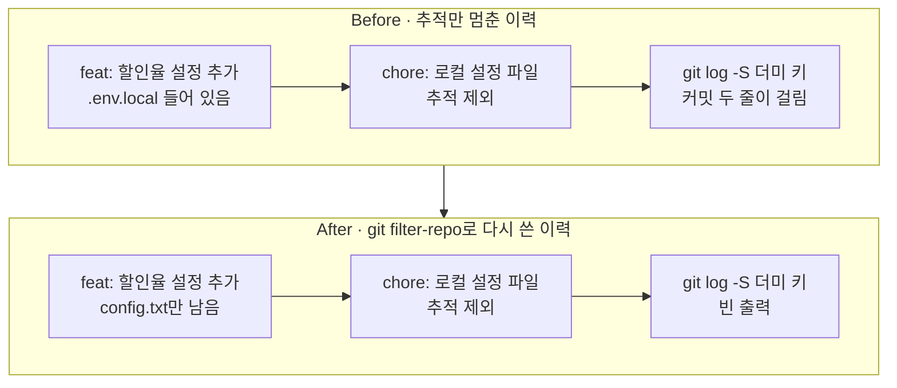
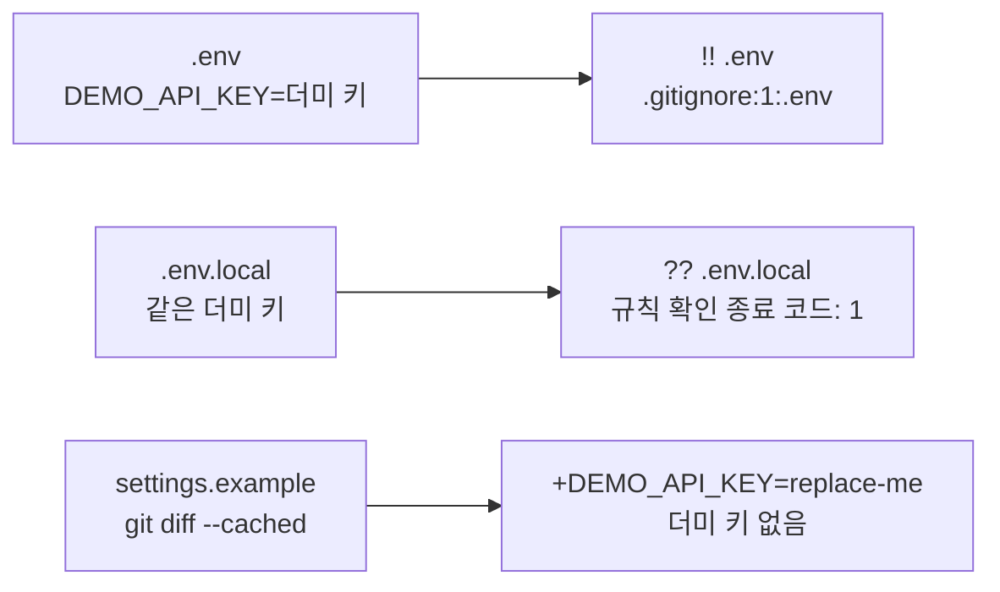
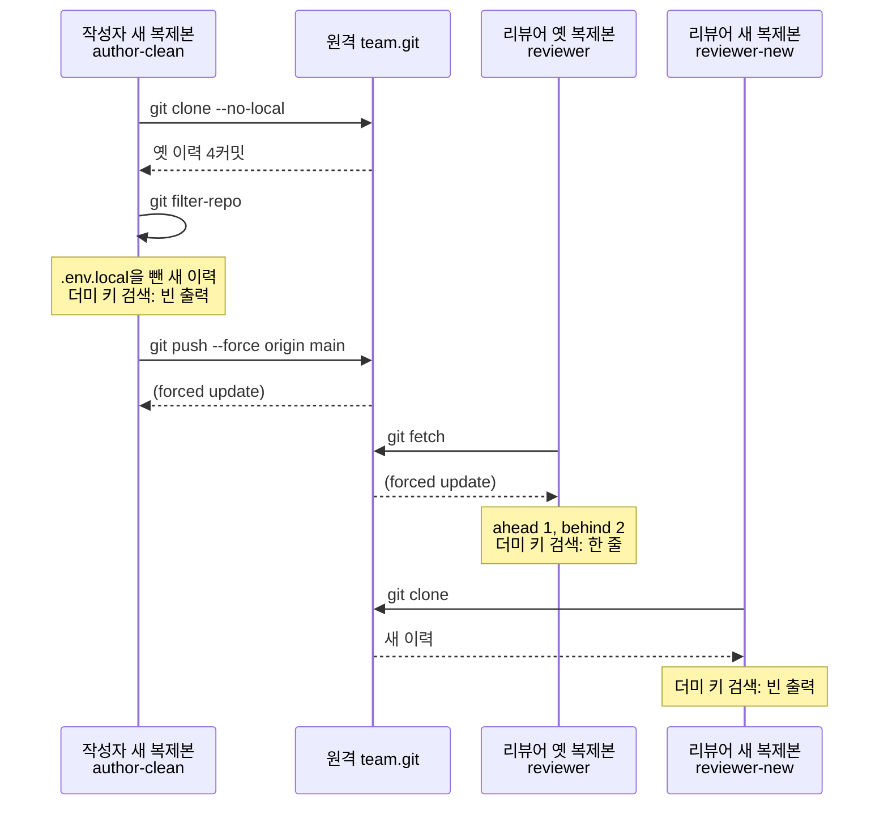
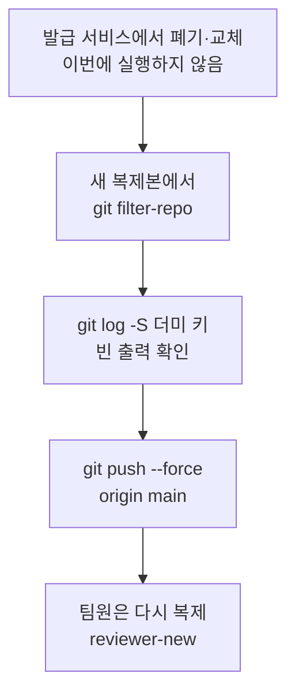

# 05-시크릿-이력-정리와-예방

## _src 본문 (HTML 원본)

```html
<!--meta: 강의 1h | 실습 2h | 코드 Jupyter Notebook | 새 용어 6 -->
<h2 id="b1"><span class="no">1</span>학습 목표</h2>
<div class="goal"><ul><li>파일 추적만 멈춘 경우와 이력을 다시 쓴 경우의 차이를 <code>git log -S</code> 검색 결과로 설명할 수 있습니다.</li><li>이력 정리 도구 <code>git-filter-repo</code>로 새 복제본의 이력에서 경로를 빼고, <code>git push --force</code>로 원격에 올릴 수 있습니다.</li><li>실제 시크릿이 커밋에 들어갔을 때 폐기·교체, 이력 정리, 팀원 다시 복제의 순서를 설명할 수 있습니다.</li></ul></div>
<h2 id="b2"><span class="no">2</span>이 내용을 배우는 이유</h2>
<p>API 키가 든 파일을 커밋해 올렸다면, 다음 커밋에서 그 파일을 빼는 것만으로는 부족합니다. 04절에서 본 것처럼 새 커밋을 더해도 지난 커밋은 그대로 남습니다. 원격을 받은 사람은 지난 커밋에서 값을 읽을 수 있습니다.</p>
<p>누군가 이미 값을 복사했을 수도 있습니다. 그래서 실제 사고에서는 저장소보다 키를 발급한 서비스에서 먼저 조치합니다. 이력 정리는 그다음 일이고, 팀원의 복제본까지 챙겨야 끝납니다.</p>
<p>가장 좋은 것은 처음부터 커밋에 들어가지 않게 막는 것입니다. 이 절은 막는 방법과, 막지 못했을 때 치우는 순서를 함께 봅니다.</p>
<p><strong>이 절의 질문</strong> — 비밀 값이 든 파일을 올렸다면, 추적을 멈추는 것과 이력을 다시 쓰는 것은 무엇이 다를까요? 그리고 어떤 순서로 조치할까요?</p>
<h2 id="b3"><span class="no">3</span>앞에서 배운 내용</h2>
<p>01절에서는 무시 규칙 파일 <code>.gitignore</code>에 <code>.env</code>를 적었습니다. 상태 표시 <code>!!</code>와 <code>git check-ignore -v</code>로 걸린 규칙도 읽었습니다. 이미 추적한 파일은 <code>git rm --cached</code>로 색인에서만 뺐지만, <code>git show HEAD~1:debug.log</code>로 지난 커밋의 내용은 여전히 읽혔습니다. 그때 기록 자체를 지우는 일은 05절에서 다룬다고 적었습니다.</p>
<p>02절에서는 bare 원격 저장소를 복제해 올렸고, <code>git fetch</code>와 <code>git branch -vv</code>로 짝과 비교했습니다. 03절에서는 원격에 내가 모르는 커밋이 있으면 올리기가 거절되는 것을 봤습니다. 짝 비교에 <code>ahead 1, behind 1</code>이 나오는 갈라진 이력도 봤습니다.</p>
<p>04절에서는 공개한 커밋을 취소 커밋으로 처리했고, 잘못된 커밋은 이력 가운데에 남았습니다. 주의 메모에는 공개한 커밋에 <code>push --force</code>를 쓰지 않는다고 적었습니다. 이번 절은 강제 올리기를 처음 실행하는 자리이고, 원격 <code>team.git</code>과 작성자 <code>Ch3 Student</code>, 폴더 <code>reviewer</code>, 함수 <code>run_git()</code>을 그대로 씁니다. 함수는 03·04절처럼 도구 파일 <code>git_tools.py</code>에서 가져옵니다.</p>
<p>Python 쪽에서는 Ch 2 08절의 <code>sys.executable</code>과 <code>-m</code> 모양을 새 함수에 씁니다. 빈 목록에 <code>for</code>와 <code>append()</code>로 붙이는 Ch 2 03절 모양도 씁니다.</p>
<h2 id="b4"><span class="no">4</span>핵심 개념</h2>
<h3>비유로 시작하기</h3>
<p>04절의 팀 선반을 이어 떠올립니다. 셋째 상자에 창고 열쇠가 반쯤 삐져나온 채 선반에 올라갔습니다. 동료는 벌써 그 줄을 자기 수레에 옮겨 실었습니다. 넷째 상자에 「열쇠 빼기」 쪽지를 붙여도 셋째 상자 속 열쇠는 그대로입니다.</p>
<p>그래서 먼저 창고 문의 자물쇠를 바꿉니다. 복사된 열쇠가 있어도 문이 열리지 않게 하려는 것입니다. 그다음 셋째 상자에서 열쇠를 꺼내고, 셋째와 넷째 상자를 다시 쌉니다. 동료는 옛 줄을 실어 둔 수레를 비웁니다.</p>
<p>저장소에서는 열쇠가 시크릿, 셋째 상자가 더미 키를 넣은 커밋, 자물쇠 교체가 폐기·교체입니다. 다시 싼 상자가 새로 쓴 커밋이고, 수레에 실린 옛 줄이 리뷰어의 옛 복제본입니다.</p>
{{img:05-5-자물쇠와-다시-싼-상자|왼쪽에서는 한 사람이 창고 문에 새 자물쇠를 달고 옛 자물쇠와 열쇠가 바닥에 놓여 있으며, 오른쪽 선반에서는 열린 셋째 상자에서 열쇠를 꺼내고 셋째와 넷째 상자에 초록 테이프가 붙었고, 옆의 동료는 열쇠가 삐져나온 옛 상자를 실은 수레에서 상자를 내리는 삽화|열쇠가 복사됐을 수 있으니 자물쇠부터 바꾸고, 그다음 상자를 다시 싸고 옛 수레를 비웁니다.}}
<p><strong>그림 읽기</strong> — 왼쪽이 창고 문, 오른쪽이 팀 선반입니다. 왼쪽에서는 한 사람이 문에 새 은색 자물쇠를 달고, 바닥에는 떼어 낸 옛 자물쇠와 옛 열쇠가 놓여 있습니다. 오른쪽 선반의 상자 넷 가운데 셋째 상자가 열려 있고, 뒤에 선 사람이 그 안에서 열쇠를 꺼내 듭니다. 셋째와 넷째 상자에는 새 초록 테이프가 붙었습니다. 선반 끝의 동료는 열쇠가 삐져나온 옛 상자를 실은 수레에서 상자를 내리고 있습니다.</p>
<h3>이 절에서 쓰는 말</h3>
<table><thead><tr><th>용어</th><th>뜻</th><th>이 절에서 보이는 모습</th></tr></thead><tbody>
<tr><td>시크릿(secret)</td><td>API 키나 비밀번호처럼, 가진 사람에게 권한을 주는 값</td><td>대신 쓴 더미 문자열 <code>DEMO-ONLY-NOT-A-REAL-SECRET</code></td></tr>
<tr><td>폐기와 교체(revoke·rotate)</td><td>키를 발급한 서비스에서 그 키를 못 쓰게 하거나 새 키로 바꾸는 일</td><td>더미 키라서 이번에 실행하지 않은 첫 단계</td></tr>
<tr><td>이력 재작성(history rewriting)</td><td>조건에 맞춰 커밋을 새로 만들어 이력을 다시 세우는 작업. 바뀐 커밋과 그 뒤 커밋의 해시가 달라집니다</td><td>새 이력의 <code>feat: 할인율 설정 추가</code></td></tr>
<tr><td>git-filter-repo</td><td>이력 재작성 도구. git에 들어 있지 않아 실습 폴더의 가상환경에 따로 설치했습니다</td><td><code>--invert-paths --path .env.local</code></td></tr>
<tr><td>강제 올리기(force push)</td><td>원격에만 있는 커밋을 버리고 원격 브랜치 이름을 내 커밋으로 옮기는 올리기</td><td><code>main -&gt; main (forced update)</code></td></tr>
<tr><td>글자 검색(<code>git log -S</code>)</td><td>지정한 글자를 넣거나 뺀 커밋만 보여 주는 이력 검색</td><td>Before 두 줄, After 빈 출력</td></tr>
</tbody></table>
<h3>추적을 멈춰도 지난 커밋에는 값이 남습니다</h3>
<p>Before에서 작성자는 01절 방법대로 무시 규칙에 <code>.env.local</code>을 더하고 <code>git rm --cached</code>로 추적을 멈췄습니다. 이 방법은 커밋을 하나 더할 뿐이라 앞 커밋 <code>feat: 할인율 설정 추가</code>는 그대로입니다. 그래서 <code>git show HEAD~1:.env.local</code>이 더미 키를 보였습니다.</p>
<p>명령 <code>git log -S 글자</code>는 지정한 글자를 넣거나 뺀 커밋을 찾습니다. 옵션 <code>--all</code>은 모든 브랜치와 원격 이름에서 찾으라는 뜻입니다. Before 검색에는 더미 키를 넣은 커밋과 추적을 멈춘 커밋 두 줄이 걸렸습니다.</p>
<h3>이력을 다시 쓰면 해시가 바뀌고 팀원도 조치해야 합니다</h3>
<p>도구 <code>git-filter-repo</code>는 모든 커밋에서 <code>.env.local</code> 경로를 뺀 새 커밋을 만듭니다. 파일 목록이 바뀐 <code>feat: 할인율 설정 추가</code>와 그 뒤 커밋은 메시지가 같아도 해시가 달라졌습니다. 그보다 앞의 두 커밋은 바뀐 것이 없어 해시도 그대로였습니다.</p>
<p>원격 main에는 옛 커밋이 있으므로 새 이력은 <code>--force</code>를 붙여 올렸습니다. 이미 옛 이력을 받은 리뷰어 복제본은 이 올리기로 바뀌지 않았습니다. 받아 온 뒤 짝 비교는 <code>ahead 1, behind 2</code>였고, 더미 키 검색에 한 줄이 걸렸습니다.</p>
{{mermaid:05-1-추적-해제와-다시-쓴-이력|위 Before 칸은 더미 키가 든 커밋과 추적 해제 커밋 뒤에 빨간 검색 결과 상자가 이어지고, 아래 After 칸은 config.txt만 남은 커밋과 추적 해제 커밋 뒤에 노란 빈 출력 상자가 이어지는 비교 그림|추적만 멈추면 더미 키 검색에 커밋 두 줄이 걸리고, 이력을 다시 쓰면 같은 검색이 빈 출력입니다.}}
<p><strong>도식 읽기</strong> — 위 칸이 Before, 아래 칸이 After이고, 칸마다 왼쪽에서 오른쪽으로 읽습니다. 초록 상자는 원격 main의 마지막 두 커밋이고, 두 칸 사이 화살표는 이력을 다시 쓴 일입니다.</p>
<p>위 칸의 첫 커밋에는 <code>.env.local</code>이 들어 있습니다. 끝의 빨간 상자는 검색에 커밋 두 줄이 걸린 Before 결과입니다. 아래 칸의 같은 메시지 커밋에는 <code>config.txt</code>만 남았고, 끝의 노란 상자는 같은 검색의 빈 출력입니다.</p>
<h2 id="b5"><span class="no">5</span>실행 예제</h2>
<p>노트북은 04절처럼 원격 저장소 <code>team.git</code>과 작성자 저장소를 만듭니다. 작성자가 01절과 같은 무시 규칙 세 줄을 첫 커밋으로 올립니다. 이어서 더미 키를 <code>.env</code>에 적고 무시되는지 확인합니다.</p>
<p>팀원에게 설정 이름을 알리는 예시 파일 <code>settings.example</code>에는 값 자리에 <code>replace-me</code>만 적습니다. 커밋 전에는 <code>git diff --cached</code>로 들어갈 내용을 읽습니다. 값 하나 바꿔 보기에서는 환경 파일 이름만 <code>.env.local</code>로 바꿉니다. 모델을 부르지 않으므로 API 키가 필요 없고 비용도 들지 않습니다.</p>
{{notebook:05-시크릿-이력-정리와-예방|example}}
<p class="look"><b>확인할 점</b> — 상태 표시가 <code>!! .env</code>인지 봅니다. 이름을 바꾼 뒤에는 <code>?? .env.local</code>과 <code>종료 코드: 1</code>이 나오는지 확인합니다.</p>
<h3>무시 규칙과 비교 읽기가 막은 것</h3>
<p>무시 규칙은 이름이 맞는 파일만 막습니다. 커밋 전 비교 읽기는 사람이 출력을 읽어야 효과가 있습니다.</p>
{{mermaid:05-2-무시-규칙과-비교-읽기|세 줄마다 왼쪽 초록 파일 상자에서 오른쪽 확인 출력 상자로 이어지며, .env 줄은 노란 무시 표시, .env.local 줄은 빨간 종료 코드 1, settings.example 줄은 노란 비교 출력인 그림|같은 더미 키라도 이름이 .env.local이면 무시 규칙에 걸리지 않았습니다.}}
<p><strong>도식 읽기</strong> — 세 줄마다 왼쪽 초록 상자가 파일, 오른쪽 상자가 확인한 출력입니다. 노란 상자는 막은 결과, 빨간 상자는 막지 못한 결과입니다.</p>
<p>첫 줄 <code>.env</code>는 규칙 <code>.gitignore:1:.env</code>에 걸려 <code>!! .env</code>로 보였습니다. 둘째 줄 <code>.env.local</code>은 같은 더미 키를 담았지만 <code>?? .env.local</code>이었고, 규칙 확인은 <code>종료 코드: 1</code>이었습니다. 셋째 줄 <code>settings.example</code>의 비교 출력에는 <code>+DEMO_API_KEY=replace-me</code>만 있었습니다.</p>
<h2 id="b6"><span class="no">6</span>일부러 실패해 보기</h2>
<p>Before에서는 작성자가 <code>config.txt</code>를 만들고 <code>git add .</code>로 폴더 전체를 색인에 올립니다. 값 바꿔 보기에서 만든 <code>.env.local</code>이 함께 커밋되어 원격과 리뷰어 폴더로 갑니다. 작성자는 01절 방법으로 추적을 멈추고, 이력에서 더미 키를 검색합니다.</p>
<p>After에서는 실제 키라면 먼저 폐기·교체한다는 점을 적고 넘어갑니다. 원격을 새로 복제해 <code>git filter-repo</code>로 이력을 다시 쓰고, <code>git push --force</code>로 올립니다. 리뷰어의 옛 복제본과 새로 복제한 폴더에서 같은 검색을 합니다.</p>
{{notebook:05-시크릿-이력-정리와-예방|failure}}
<p>Before 커밋의 상태 표시는 <code>A  .env.local</code>과 <code>A  config.txt</code>였습니다. 추적을 멈춘 뒤 상태는 <code>!! .env.local</code>이었지만, 검색은 <code>feat: 할인율 설정 추가</code>를 포함한 두 줄을 찾았습니다. 앞 커밋의 파일은 <code>DEMO_API_KEY=DEMO-ONLY-NOT-A-REAL-SECRET</code>이었습니다.</p>
<p>이력 도구는 <code>run_git()</code>이 아니라 이 커널의 Python으로 실행했습니다. 교재를 만들 때 가상환경을 켜지 않은 Python에서 따로 부르자 git이 <code>filter-repo</code> 명령을 찾지 못했기 때문입니다. 노트북에서 도구는 <code>Parsed 4 commits</code>로 커밋 네 개를 읽고 원격 이름 origin을 지웠습니다. 새 이력의 검색은 빈 출력이었습니다.</p>
<p>원격 이름을 다시 적고 올린 출력은 <code>main -&gt; main (forced update)</code>였습니다. 리뷰어의 옛 복제본은 <code>ahead 1, behind 2</code>였고 검색에 한 줄이 걸렸습니다. 새로 복제한 <code>reviewer-new</code>는 검색이 빈 출력이고, 파일 목록에 <code>.env.local</code>이 없었습니다.</p>
<h3>다시 쓴 이력을 팀에 퍼뜨린 순서</h3>
<p>원격을 고친 뒤에도 옛 복제본은 그대로입니다. 어느 복제본에서 무엇을 확인했는지 시간 순서로 봅니다.</p>
{{mermaid:05-3-다시-쓴-이력-퍼뜨리기|세로선 넷은 작성자 새 복제본, 원격 team.git, 리뷰어 옛 복제본, 리뷰어 새 복제본이고, 위에서 아래로 복제와 git filter-repo, 강제 올리기, 리뷰어 받아 오기, 새 복제가 이어지며 노란 메모에 검색 결과와 ahead 1, behind 2가 적힌 순서도|원격을 강제로 바꿔도 리뷰어 옛 복제본에는 더미 키 커밋이 남았고, 새로 복제한 폴더에서만 검색이 빈 출력이었습니다.}}
<p><strong>도식 읽기</strong> — 위에서 아래로 시간 순서입니다. 세로선 넷은 왼쪽부터 작성자 새 복제본, 원격 <code>team.git</code>, 리뷰어 옛 복제본, 리뷰어 새 복제본입니다. 실선 화살표는 요청한 명령, 점선 화살표는 받아 온 결과입니다. 노란 메모는 그 시점에 확인한 출력입니다.</p>
<p>작성자 새 복제본은 이력을 다시 쓴 뒤 검색이 빈 출력이었고, 강제로 올려 <code>(forced update)</code>를 받았습니다. 리뷰어 옛 복제본은 받아 온 뒤 <code>ahead 1, behind 2</code>였고 검색에 한 줄이 남았습니다. 맨 아래 리뷰어 새 복제본만 검색이 빈 출력이었습니다.</p>
<h2 id="b7"><span class="no">7</span>주의할 점과 실무 메모</h2>
<ul><li>실제 키나 토큰은 실습 파일, 명령 인자, 채팅, 이슈에 붙여 넣지 않습니다. 이 절은 어디에서도 쓸 수 없는 더미 문자열만 썼습니다.</li>
<li>GitHub 문서는 시크릿이 드러나면 먼저 폐기·교체하라고 안내합니다. 그것만으로 충분해 이력 재작성이 필요 없을 수도 있다고 적혀 있습니다. 폐기·교체는 이번에 실행하지 않았습니다.</li>
<li>이력 재작성은 바뀐 커밋과 그 뒤 커밋의 해시를 바꿉니다. GitHub 문서는 열린 PR, 브랜치 보호, 커밋 서명에도 영향이 있다고 적습니다. 팀과 시점을 정한 뒤에 합니다.</li>
<li>옛 복제본에서 받아 합친 뒤 올리면 값이 원격에 다시 들어갈 수 있다고 GitHub 문서와 도구 설명서가 경고합니다. 설명서는 옛 복제본을 버리고 다시 복제하는 방법을 먼저 권합니다. 받아 합치는 경우는 이번에 실행하지 않았습니다.</li>
<li>원격이 GitHub이라면 포크, 캐시된 화면, PR 참조에 값이 남을 수 있습니다. GitHub 문서는 이런 부분을 지원 창구에 요청하라고 안내합니다. 이번에는 GitHub을 쓰지 않았습니다.</li>
<li>GitHub 문서의 절차는 도구 옵션 <code>--sensitive-data-removal</code>을 함께 씁니다. 교재 실행 환경의 Git 2.34.1에서 따로 실행하니 <code>unknown option</code> 오류로 멈춰 노트북에 넣지 않았습니다. 도구 설명서는 Git 2.36.0 이상을 요구합니다. 도구 소스를 보면 이 옵션은 원격 이름 origin을 지우지 않습니다. 그래서 노트북의 <code>git remote add</code> 단계가 필요 없고, 이 경우는 실행하지 않았습니다.</li>
<li>도구 설명서는 막 복제한 저장소에서만 실행하게 하고, 같은 컴퓨터의 폴더는 <code>git clone --no-local</code>로 복제하라고 안내합니다. 노트북도 이렇게 복제했습니다. 도구가 복제본을 거부하는 경우는 실행하지 않았습니다.</li>
<li>노트북은 도구를 <code>sys.executable</code>과 <code>-m git_filter_repo</code>로 실행했습니다. 설치 문서에 따르면 프로그램이 PATH 폴더에 있을 때 터미널에서 <code>git filter-repo</code>로 같은 옵션을 줄 수 있습니다. VS Code 커널에서 PATH가 어떻게 잡히는지는 실행하지 않았습니다.</li>
<li>명령 <code>git add .</code>는 무시 규칙에 걸리지 않은 변경을 모두 올립니다. GitHub 문서는 파일 이름으로 올리고 <code>git diff --cached</code>로 읽으라고 권합니다. 커밋 전 검사 도구와 GitHub의 푸시 보호(push protection)는 이번에 실행하지 않았습니다.</li>
<li>교재 출력은 Linux의 Git 2.34.1과 git-filter-repo 2.47.0에서 실행한 결과입니다. 다른 운영체제인 Windows와 macOS는 실행하지 않았습니다.</li></ul>
<h2 id="b8"><span class="no">8</span>정리와 다음 절</h2>
<ul><li>무시 규칙은 <code>.env</code>를 <code>!! .env</code>로 막았지만, 이름이 다른 <code>.env.local</code>은 막지 못했습니다. 커밋 전에 <code>git diff --cached</code>로 들어갈 내용을 읽습니다.</li><li>추적만 멈추면 커밋이 하나 늘 뿐이라, <code>git log -S</code>가 더미 키 커밋 두 줄을 찾았습니다. 앞 커밋의 파일에서 값도 읽혔습니다.</li><li>실제 키라면 먼저 폐기·교체합니다. 그다음 새 복제본에서 이력을 다시 쓰고 <code>--force</code>로 올리며, 팀원은 다시 복제합니다.</li></ul>
{{mermaid:05-4-대응-순서|위에서 아래로 회색 폐기·교체 상자, 파란 git filter-repo 상자, 노란 빈 출력 확인 상자, 파란 git push --force 상자, 파란 팀원 다시 복제 상자가 이어지는 순서도|실제 시크릿이 커밋에 들어갔을 때의 순서. 맨 위 폐기·교체는 더미 키라서 이번에 실행하지 않았습니다.}}
<p><strong>도식 읽기</strong> — 위에서 아래로 실제 사고에서 할 순서입니다. 맨 위 회색 상자는 더미 키라서 이번에 실행하지 않은 단계입니다. 파란 상자는 노트북에서 실행한 명령이고, 노란 상자는 확인한 출력입니다.</p>
<p>둘째부터 넷째 상자까지는 <code>author-clean</code> 폴더에서 실행했습니다. 마지막 상자의 <code>reviewer-new</code>는 옛 복제본 대신 새로 받은 리뷰어 폴더입니다.</p>
<p><strong>다음 학습과 이어지는 지점</strong> — 이 절에서 본 것처럼 올린 뒤에 치우려면 폐기·교체와 팀원 다시 복제까지 해야 합니다. 그래서 <a href="06-Git-실습.html">06절 Git 실습</a>에서는 커밋 전 비교 읽기를 할인율 설정 PR 흐름에 넣어, 더미 키를 커밋하기 전에 막습니다. 환경 파일 이름 하나만 바꿔 두 번 실행하고 기록장을 비교합니다. 다음 챕터로 이어지는 지점은 06절 끝에 적었습니다.</p>
<h2 id="b9"><span class="no">9</span>복습 문제</h2><details class="quiz"><summary>문제와 해설</summary>
<p class="quiz-q">1. Before에서 추적을 멈춘 뒤 더미 키 검색에 걸린 커밋은 무엇이었고, 왜 걸렸나요? · 기초</p><p class="quiz-a"><b>해설</b> — <code>chore: 로컬 설정 파일 추적 제외</code>와 <code>feat: 할인율 설정 추가</code> 두 줄입니다. 앞 커밋은 더미 키 파일을 넣었고, 뒤 커밋은 그 파일을 뺐기 때문입니다. 추적을 멈춘 커밋을 더해도 앞 커밋은 그대로라서 <code>git show HEAD~1:.env.local</code>이 값을 보였습니다.</p>
<p class="quiz-q">2. 값 하나 바꿔 보기에서 <code>.env.local</code>이 무시 규칙에 걸리지 않은 까닭은 무엇이고, 그 뒤 Before에서 무슨 일이 생겼나요? · 적용</p><p class="quiz-a"><b>해설</b> — 별표 없는 규칙 <code>.env</code>는 이름이 정확히 같은 파일에만 걸리기 때문입니다. 상태 표시는 <code>?? .env.local</code>, 규칙 확인은 <code>종료 코드: 1</code>이었습니다. 그래서 Before에서 <code>git add .</code>를 실행하자 이 파일이 함께 올라가 원격과 리뷰어 폴더로 갔습니다.</p>
<p class="quiz-q">3. 새 이력을 올릴 때 <code>--force</code>를 붙인 까닭은 무엇이고, 올린 뒤 리뷰어 옛 복제본은 어땠나요? · 적용</p><p class="quiz-a"><b>해설</b> — 원격 main에 새 이력에 없는 옛 커밋이 있었기 때문입니다. 03절에서 거절된 올리기와 같은 조건이며, 이번 절에서 붙이지 않고 올리는 경우는 실행하지 않았습니다. 리뷰어 옛 복제본은 받아 온 뒤 <code>ahead 1, behind 2</code>였고, 검색에 <code>feat: 할인율 설정 추가</code> 한 줄이 남았습니다.</p>
<p class="quiz-q">4. 노트북에서 <code>run_git()</code> 대신 <code>run_filter_repo()</code> 함수를 만들어 도구를 실행한 까닭은 무엇인가요? · 기초</p><p class="quiz-a"><b>해설</b> — 명령 <code>git filter-repo</code>는 PATH 폴더에 도구 프로그램이 있어야 실행됩니다. 교재를 만들 때 가상환경을 켜지 않은 Python에서 부르자 <code>git: 'filter-repo' is not a git command</code>가 나왔습니다. 커널의 Python으로 모듈을 직접 실행하면 가상환경 폴더가 PATH에 없어도 도구가 실행됩니다.</p>
<p class="quiz-q">5. 이 절의 질문에 답해 봅시다. 추적을 멈추는 것과 이력을 다시 쓰는 것은 무엇이 다르고, 실제 사고에서는 어떤 순서로 조치하나요? · 분석</p><p class="quiz-a"><b>해설</b> — 추적을 멈추면 커밋을 하나 더할 뿐이라 지난 커밋에 값이 남습니다. Before 검색에 두 줄이 걸린 것이 그 증거입니다. 이력을 다시 쓰면 경로를 뺀 새 커밋으로 바뀌어 After 검색이 빈 출력이었습니다. 순서는 폐기·교체, 새 복제본에서 재작성, 강제 올리기, 팀원 다시 복제입니다. 첫 단계는 GitHub 문서의 안내이고 이번에 실행하지 않았습니다.</p>
</details>
<h2 id="b10"><span class="no">10</span>참고 자료</h2>
<ul><li><a href="https://docs.github.com/en/authentication/keeping-your-account-and-data-secure/removing-sensitive-data-from-a-repository">GitHub Docs: 민감 정보 제거</a> · 확인 2026-09-16 · 웹 문서</li><li><a href="https://htmlpreview.github.io/?https://github.com/newren/git-filter-repo/blob/docs/html/git-filter-repo.html">git-filter-repo 설명서</a> · 확인 2026-09-16 · 실행 2.47.0</li><li><a href="https://github.com/newren/git-filter-repo/blob/main/INSTALL.md">git-filter-repo 설치 문서</a>와 <a href="https://github.com/newren/git-filter-repo#prerequisites">요구 사항(Git 2.36.0 이상)</a> · 확인 2026-09-16</li><li><a href="https://git-scm.com/docs/git-log">Git 공식 문서: git-log(-S, --all)</a> · 확인 2026-09-16 · 실행 Git 2.34.1</li><li><a href="https://git-scm.com/docs/git-push">Git 공식 문서: git-push(--force)</a> · 확인 2026-09-16 · 실행 Git 2.34.1</li><li><a href="https://git-scm.com/docs/git-clone">Git 공식 문서: git-clone(--no-local)</a> · 확인 2026-09-16 · 실행 Git 2.34.1</li><li><a href="https://git-scm.com/docs/gitignore">Git 공식 문서: gitignore</a> · 확인 2026-09-16 · 실행 Git 2.34.1</li><li><a href="https://docs.github.com/en/code-security/concepts/secret-security/push-protection">GitHub Docs: Push protection</a> · 확인 2026-09-16 · 웹 문서</li></ul>
```

## 노트북 셀 (순서대로)

### [0] markdown {'html': 'skip'}

# 시크릿 이력 정리와 예방

**이 노트북에서 할 일**

1. 04절처럼 임시 폴더에 팀 원격 저장소와 작성자·리뷰어 저장소를 만듭니다.
2. 무시 규칙과 커밋 전 비교 읽기로 더미 키가 커밋에 들어가지 않게 막아 봅니다.
3. 커밋에 들어간 더미 키를 추적 해제와 이력 재작성으로 각각 치워 보고 결과를 비교합니다.

**준비물** — API 키 불필요. 실제 비밀 값은 쓰지 않습니다. 어디에서도 쓸 수 없는 더미 문자열 `DEMO-ONLY-NOT-A-REAL-SECRET`만 씁니다.
모델 호출은 0번이고 비용은 들지 않습니다. 실행 시간은 1분 이내입니다.

**기준 Git 버전** — Git은 2.28 이상이 필요하고, 교재 출력은 Git 2.34.1로 만들었습니다.
이력 정리 도구 설명서는 Git 2.36.0 이상을 요구 사항으로 적어 두었으므로, 새로 설치한다면 2.36 이상을 권합니다.
이 노트북이 쓰는 옵션은 Git 2.34.1에서도 끝까지 실행됐습니다.

실습 폴더 `labs/part1/ch03-git-github`에서 `uv sync --locked`로 만든 `.venv`를 커널로 고릅니다.
이 가상환경에 이력 정리 도구 `git-filter-repo` 2.47.0이 들어 있습니다. 첫 셀부터 순서대로 실행하고, GitHub 계정과 네트워크는 쓰지 않습니다.

### [1] markdown {'html': 'skip'}

## 오늘 볼 그림


위 칸이 Before, 아래 칸이 After이고 칸마다 왼쪽에서 오른쪽으로 읽습니다. 초록 상자는 커밋입니다.
Before 칸은 추적을 멈춘 커밋을 더했을 뿐이라, 더미 키 검색에 커밋 두 줄이 걸립니다. After 칸은 이력을 다시 써서 같은 검색이 빈 출력입니다.

### [2] markdown {}

## 1. 준비

이 절도 설치할 패키지가 없습니다. 이력 정리 도구는 실습 폴더의 `.venv`에 이미 들어 있습니다.
04절처럼 빈 임시 폴더를 만들고 그 폴더로 작업 위치를 옮깁니다. 폴더 이름의 앞머리만 `ch03-05-`로 바꿨습니다.

앞에서 배운 함수는 `git_tools.py`에 모아 두었습니다. 파일을 열면 코드를 볼 수 있습니다. 노트북과 같은 폴더(`notebooks/`)에 있는 파일입니다.
이 노트북은 03·04절처럼 02절 `run_git()`을 가져옵니다.

가져오는 줄은 작업 위치를 옮기기 전에 둡니다. 도구 파일을 현재 작업 폴더에서 찾기 때문입니다.

### [3] code {'execution': {'iopub.execute_input': '2026-09-21T10:18:58.474965Z', 'iopub.status.busy': '2026-09-21T10:18:58.474825Z', 'iopub.status.idle': '2026-09-21T10:18:58.481393Z', 'shell.execute_reply': '2026-09-21T10:18:58.480769Z'}, 'lesson_role': 'setup'}

```python
# 02절 run_git()을 도구 파일에서 가져오고, 저장소들을 담을 빈 임시 폴더로 작업 위치를 옮깁니다
import os
import tempfile

# 작업 위치를 옮기기 전에 가져옵니다. 도구 파일은 노트북과 같은 폴더에 있습니다
from git_tools import run_git

# mkdtemp()는 운영체제 임시 폴더 안에 새 폴더를 만들고 그 경로를 반환합니다
practice_folder = tempfile.mkdtemp(prefix="ch03-05-")
os.chdir(practice_folder)
file_names = os.listdir()
print("현재 작업 폴더의 파일:", file_names)
```

출력:
```
현재 작업 폴더의 파일: []

```

### [4] markdown {}

**결과 읽기** — 현재 작업 폴더의 파일은 `[]`로, 빈 폴더에서 시작합니다.

### [5] markdown {}

## 2. 가져온 git 명령 함수

1번 준비 셀에서 가져온 `run_git()`은 02절에서 만든 함수입니다. 두 번째 매개변수 `folder`는 명령을 실행할 폴더이고, 기본값 `"."`은 현재 작업 폴더입니다.
git 명령이 실패해도 셀은 멈추지 않고 종료 코드 줄을 보여 줍니다.

### [6] markdown {}

## 3. 팀 원격 저장소와 무시 규칙

04절과 같은 순서로 원격 저장소 `team.git`을 만들고, 작성자가 `author` 폴더로 복제합니다.
작성자 정보도 04절과 같은 `Ch3 Student`를 이 저장소에만 적습니다.

실행 전에 예상합니다. 빈 저장소를 복제했다는 경고가 한 번 나오고, 종료 코드 줄은 없을 것입니다.

### [7] code {'execution': {'iopub.execute_input': '2026-09-21T10:18:58.482678Z', 'iopub.status.busy': '2026-09-21T10:18:58.482561Z', 'iopub.status.idle': '2026-09-21T10:18:58.502092Z', 'shell.execute_reply': '2026-09-21T10:18:58.501568Z'}}

```python
# 팀 원격 저장소를 만들고, 작성자가 복제한 저장소에 이름과 전자우편 주소를 적습니다
run_git("init --bare -b main team.git")
run_git("clone team.git author")
run_git('config user.name "Ch3 Student"', "author")
run_git("config user.email student@example.com", "author")
```

출력:
```
. $ git init --bare -b main team.git
Initialized empty Git repository in [사용자 폴더]/tmp/ch03-05-ji6wd5tm/team.git/

. $ git clone team.git author
Cloning into 'author'...
warning: You appear to have cloned an empty repository.
done.

author $ git config user.name "Ch3 Student"

author $ git config user.email student@example.com


```

### [8] markdown {}

**결과 읽기** — 줄 `Initialized empty Git repository`로 원격 저장소가 생겼습니다.
경고 `You appear to have cloned an empty repository`는 04절에서도 본 안내입니다. 종료 코드 줄이 없으므로 네 명령 모두 성공했습니다.
경로 앞 `[사용자 폴더]`는 실행 도구가 사용자 폴더 이름을 가린 표시입니다.

### [9] markdown {}

작성자가 01절과 같은 무시 규칙 세 줄을 `.gitignore`에 적어 첫 커밋으로 올립니다.
첫 줄 `.env`는 비밀 값을 적어 두는 환경 파일의 이름입니다. 여러 줄 글은 01절처럼 `"""`로 적습니다.

실행 전에 예상합니다. 첫 커밋 표시와 새 브랜치 표시가 나올 것입니다.

### [10] code {'execution': {'iopub.execute_input': '2026-09-21T10:18:58.503153Z', 'iopub.status.busy': '2026-09-21T10:18:58.503057Z', 'iopub.status.idle': '2026-09-21T10:18:58.516188Z', 'shell.execute_reply': '2026-09-21T10:18:58.515801Z'}}

```python
# 작성자가 01절의 무시 규칙 세 줄을 첫 커밋으로 기록하고 원격에 올립니다
ignore_text = """.env
__pycache__/
*.log
"""
with open("author/.gitignore", "w", encoding="utf-8") as file:
    file.write(ignore_text)
run_git("add .gitignore", "author")
run_git('commit -m "chore: 환경 파일 추적 제외"', "author")
run_git("push -u origin main", "author")
```

출력:
```
author $ git add .gitignore

author $ git commit -m "chore: 환경 파일 추적 제외"
[main (root-commit) 47367f7] chore: 환경 파일 추적 제외
 1 file changed, 3 insertions(+)
 create mode 100644 .gitignore

author $ git push -u origin main
Branch 'main' set up to track remote branch 'main' from 'origin'.
To [사용자 폴더]/tmp/ch03-05-ji6wd5tm/team.git
 * [new branch]      main -> main


```

### [11] markdown {}

**결과 읽기** — 표시 `main (root-commit)`은 main 브랜치의 첫 커밋이라는 뜻입니다. 요약 줄은 `1 file changed, 3 insertions(+)`입니다.
올리기 출력의 `[new branch]`로 원격 저장소에도 main이 생겼습니다.

### [12] markdown {}

## 4. 예방 1 — 무시 규칙으로 .env 막기

시크릿(secret)은 API 키나 비밀번호처럼, 가진 사람에게 권한을 주는 값입니다. 복사해도 문이 열리는 집 열쇠와 같습니다.
이 절에서는 어디에서도 쓸 수 없는 더미 문자열을 시크릿 대신 씁니다.

변수 `dummy_key`에 더미 문자열을 담고, 환경 파일 `.env`에 `DEMO_API_KEY=` 뒤에 붙여 적습니다. 글자 사이 `+`는 01절에서 본 이어 붙이기입니다.
명령 `git status --short --ignored`와 `git check-ignore -v`도 01절에서 배웠습니다.

실행 전에 예상합니다. 상태 표시에 무시한 파일이 나오고, 걸린 규칙은 `.gitignore`의 첫 줄일 것입니다.

### [13] code {'execution': {'iopub.execute_input': '2026-09-21T10:18:58.517231Z', 'iopub.status.busy': '2026-09-21T10:18:58.517146Z', 'iopub.status.idle': '2026-09-21T10:18:58.521162Z', 'shell.execute_reply': '2026-09-21T10:18:58.520772Z'}}

```python
# 쓸 수 없는 더미 키를 .env에 적고, git이 이 파일을 무시하는지 확인합니다
dummy_key = "DEMO-ONLY-NOT-A-REAL-SECRET"
with open("author/.env", "w", encoding="utf-8") as file:
    file.write("DEMO_API_KEY=" + dummy_key + "\n")
run_git("status --short --ignored", "author")
run_git("check-ignore -v .env", "author")
```

출력:
```
author $ git status --short --ignored
!! .env

author $ git check-ignore -v .env
.gitignore:1:.env	.env


```

### [14] markdown {}

**결과 읽기** — 상태 표시는 `!! .env` 한 줄입니다. 추적하지 않는 새 파일 `??`가 아니라 무시한 파일로 봅니다.
줄 `.gitignore:1:.env`는 `.gitignore` 파일 첫 줄의 규칙 `.env`에 걸렸다는 뜻입니다.

### [15] markdown {}

## 5. 예방 2 — 커밋 전에 색인 비교 읽기

팀원에게는 어떤 설정 이름이 필요한지 알려야 합니다. 그래서 값 자리에 `replace-me`만 적은 예시 파일 `settings.example`을 커밋합니다.
커밋하기 전에 01절의 `git diff --cached`로 색인에 올린 변경을 읽습니다. 이번 커밋에 실제로 들어갈 내용입니다.

실행 전에 예상합니다. 비교 출력의 더하기 줄은 하나이고, 더미 키는 보이지 않을 것입니다.

### [16] code {'execution': {'iopub.execute_input': '2026-09-21T10:18:58.522002Z', 'iopub.status.busy': '2026-09-21T10:18:58.521920Z', 'iopub.status.idle': '2026-09-21T10:18:58.533950Z', 'shell.execute_reply': '2026-09-21T10:18:58.533574Z'}}

```python
# 값 자리를 비운 예시 파일을 색인에 올리고, 커밋 전에 들어갈 내용을 읽은 뒤 올립니다
with open("author/settings.example", "w", encoding="utf-8") as file:
    file.write("DEMO_API_KEY=replace-me\n")
run_git("add settings.example", "author")
run_git("diff --cached", "author")
run_git('commit -m "docs: 설정 예시 추가"', "author")
run_git("push", "author")
```

출력:
```
author $ git add settings.example

author $ git diff --cached
diff --git a/settings.example b/settings.example
new file mode 100644
index 0000000..02e3d73
--- /dev/null
+++ b/settings.example
@@ -0,0 +1 @@
+DEMO_API_KEY=replace-me

author $ git commit -m "docs: 설정 예시 추가"
[main 33f8b58] docs: 설정 예시 추가
 1 file changed, 1 insertion(+)
 create mode 100644 settings.example

author $ git push
To [사용자 폴더]/tmp/ch03-05-ji6wd5tm/team.git
   47367f7..33f8b58  main -> main


```

### [17] markdown {}

**결과 읽기** — 비교 출력의 `new file mode 100644`는 새 파일이라는 뜻입니다. 더하기 줄은 `+DEMO_API_KEY=replace-me` 하나이고 더미 키가 없습니다.
커밋 뒤 올리기 출력은 `main -> main`입니다.

이 확인은 사람이 출력을 읽는 단계입니다. 읽지 않고 커밋하면 막아 주지 못합니다.

### [18] markdown {}

## 6. 값 하나 바꿔 보기 — 파일 이름을 .env.local로

4번에서는 환경 파일 이름이 `.env`였습니다. 이번에는 이름만 `.env.local`로 바꿔 같은 내용을 적습니다.
별표 없는 규칙 `.env`는 이름이 정확히 같은 파일에만 걸립니다. 별표 `*`의 뜻은 01절에서 배웠습니다.

실행 전에 예상합니다. 새 파일은 무시한 파일이 아니라 추적하지 않는 파일로 보이고, 걸린 규칙이 없을 것입니다.

### [19] code {'execution': {'iopub.execute_input': '2026-09-21T10:18:58.534759Z', 'iopub.status.busy': '2026-09-21T10:18:58.534684Z', 'iopub.status.idle': '2026-09-21T10:18:58.538191Z', 'shell.execute_reply': '2026-09-21T10:18:58.537841Z'}}

```python
# 같은 더미 키를 이름만 다른 .env.local에 적고, 무시 규칙에 걸리는지 확인합니다
with open("author/.env.local", "w", encoding="utf-8") as file:
    file.write("DEMO_API_KEY=" + dummy_key + "\n")
run_git("status --short --ignored", "author")
run_git("check-ignore -v .env.local", "author")
```

출력:
```
author $ git status --short --ignored
?? .env.local
!! .env

author $ git check-ignore -v .env.local

종료 코드: 1

```

### [20] markdown {}

**결과 읽기** — 상태 표시에 `?? .env.local`과 `!! .env`가 함께 나옵니다. 걸린 규칙을 묻는 명령은 빈 출력 뒤 `종료 코드: 1`을 보였습니다.
01절에서 본 것처럼 종료 코드 1은 걸린 규칙이 없다는 뜻입니다.

이름 하나가 달라지자 무시 규칙이 막지 못했습니다. 이 파일은 지우지 않고 다음 Before에서 그대로 씁니다.

### [21] markdown {'lesson_part': 'before'}

## 7. Before — 추적만 멈추고 끝내기

작성자가 할인율 설정 파일 `config.txt`를 만들어 서둘러 올립니다. 할인율 10은 04절에서 쓴 값입니다.
이번에는 파일 이름 대신 `git add .`을 씁니다. 이 명령은 지금 폴더의 변경을 한꺼번에 색인에 올리며, 01절에서는 이름만 봤습니다.

실행 전에 예상합니다. 무시한 `.env`는 빠지고, 6번의 `.env.local`은 함께 올라갈 것입니다.

### [22] code {'execution': {'iopub.execute_input': '2026-09-21T10:18:58.538917Z', 'iopub.status.busy': '2026-09-21T10:18:58.538848Z', 'iopub.status.idle': '2026-09-21T10:18:58.549459Z', 'shell.execute_reply': '2026-09-21T10:18:58.549120Z'}, 'lesson_part': 'before'}

```python
# Before: 설정 파일을 만들고 폴더 전체를 색인에 올려 커밋하고 원격에 올립니다
with open("author/config.txt", "w", encoding="utf-8") as file:
    file.write("discount=10\n")
run_git("add .", "author")
run_git("status --short", "author")
run_git('commit -m "feat: 할인율 설정 추가"', "author")
run_git("push", "author")
```

출력:
```
author $ git add .

author $ git status --short
A  .env.local
A  config.txt

author $ git commit -m "feat: 할인율 설정 추가"
[main 7929e7b] feat: 할인율 설정 추가
 2 files changed, 2 insertions(+)
 create mode 100644 .env.local
 create mode 100644 config.txt

author $ git push
To [사용자 폴더]/tmp/ch03-05-ji6wd5tm/team.git
   33f8b58..7929e7b  main -> main


```

### [23] markdown {'lesson_part': 'before'}

**결과 읽기** — 상태 표시는 `A  .env.local`과 `A  config.txt` 두 줄입니다. 커밋 출력에도 `create mode 100644 .env.local`이 있습니다.
올리기는 `main -> main`으로 성공했습니다.

작성자는 상태 표시를 읽지 않고 커밋했습니다. 더미 키가 든 파일이 원격까지 올라갔습니다.

### [24] markdown {'lesson_part': 'before'}

리뷰어가 원격 저장소를 복제합니다. 폴더 이름은 04절과 같은 `reviewer`입니다.
이번에는 리뷰어가 커밋하지 않으므로 이름과 전자우편 주소는 적지 않습니다.

실행 전에 예상합니다. 리뷰어 폴더에도 `.env.local`이 있을 것입니다.

### [25] code {'execution': {'iopub.execute_input': '2026-09-21T10:18:58.550135Z', 'iopub.status.busy': '2026-09-21T10:18:58.550062Z', 'iopub.status.idle': '2026-09-21T10:18:58.557103Z', 'shell.execute_reply': '2026-09-21T10:18:58.556761Z'}, 'lesson_part': 'before'}

```python
# Before: 리뷰어가 원격을 복제하고, 받은 폴더의 파일 목록을 봅니다
run_git("clone team.git reviewer")
file_names = os.listdir("reviewer")
print("리뷰어 폴더의 파일:", sorted(file_names))
```

출력:
```
. $ git clone team.git reviewer
Cloning into 'reviewer'...
done.

리뷰어 폴더의 파일: ['.env.local', '.git', '.gitignore', 'config.txt', 'settings.example']

```

### [26] markdown {'lesson_part': 'before'}

**결과 읽기** — 리뷰어 폴더의 파일은 `['.env.local', '.git', '.gitignore', 'config.txt', 'settings.example']`입니다.
작성자가 올린 더미 키 파일이 리뷰어 폴더에도 들어왔습니다.

### [27] markdown {'lesson_part': 'before'}

작성자가 실수를 알아채고 01절에서 배운 방법으로 고칩니다. 무시 규칙 파일 끝에 `.env.local` 줄을 더합니다.
명령 `git rm --cached`로 색인에서만 빼서 커밋하고 올립니다. 파일 끝에 덧붙이는 모드 `"a"`도 01절에서 썼습니다.

실행 전에 예상합니다. 두 환경 파일이 모두 무시한 파일로 보일 것입니다.

### [28] code {'execution': {'iopub.execute_input': '2026-09-21T10:18:58.557766Z', 'iopub.status.busy': '2026-09-21T10:18:58.557703Z', 'iopub.status.idle': '2026-09-21T10:18:58.568333Z', 'shell.execute_reply': '2026-09-21T10:18:58.568027Z'}, 'lesson_part': 'before'}

```python
# Before: 무시 규칙에 .env.local을 더하고, 색인에서만 빼서 커밋하고 올립니다
with open("author/.gitignore", "a", encoding="utf-8") as file:
    file.write(".env.local\n")
run_git("rm --cached .env.local", "author")
run_git("add .gitignore", "author")
run_git('commit -m "chore: 로컬 설정 파일 추적 제외"', "author")
run_git("push", "author")
run_git("status --short --ignored", "author")
```

출력:
```
author $ git rm --cached .env.local
rm '.env.local'

author $ git add .gitignore

author $ git commit -m "chore: 로컬 설정 파일 추적 제외"
[main 6eebd11] chore: 로컬 설정 파일 추적 제외
 2 files changed, 1 insertion(+), 1 deletion(-)
 delete mode 100644 .env.local

author $ git push
To [사용자 폴더]/tmp/ch03-05-ji6wd5tm/team.git
   7929e7b..6eebd11  main -> main

author $ git status --short --ignored
!! .env
!! .env.local


```

### [29] markdown {'lesson_part': 'before'}

**결과 읽기** — 커밋 출력의 `delete mode 100644 .env.local`로 이 커밋에서 파일 추적을 멈췄습니다.
마지막 상태 표시는 `!! .env`와 `!! .env.local`입니다.

지금 커밋만 보면 더미 키가 없습니다. 지난 커밋에는 어떤지 다음 셀에서 확인합니다.

### [30] markdown {'lesson_part': 'before'}

지난 커밋에 더미 키가 남았는지 두 방법으로 봅니다.
명령 `git log -S 글자`는 그 글자를 넣거나 뺀 커밋만 보여 줍니다. 옵션 `--all`은 지금 브랜치만이 아니라 모든 브랜치와 원격 이름에서 찾으라는 뜻입니다.
01절에서 쓴 `git show HEAD~1:파일`로 바로 앞 커밋의 파일도 읽습니다.

실행 전에 예상합니다. 더미 키를 넣은 커밋과 뺀 커밋 두 줄이 나오고, 파일 내용에 더미 키가 보일 것입니다.

### [31] code {'execution': {'iopub.execute_input': '2026-09-21T10:18:58.568978Z', 'iopub.status.busy': '2026-09-21T10:18:58.568913Z', 'iopub.status.idle': '2026-09-21T10:18:58.572097Z', 'shell.execute_reply': '2026-09-21T10:18:58.571792Z'}, 'lesson_part': 'before'}

```python
# Before: 이력 전체에서 더미 키를 넣거나 뺀 커밋을 찾고, 바로 앞 커밋의 파일을 읽습니다
run_git("log --oneline --all -S " + dummy_key, "author")
run_git("show HEAD~1:.env.local", "author")
```

출력:
```
author $ git log --oneline --all -S DEMO-ONLY-NOT-A-REAL-SECRET
6eebd11 chore: 로컬 설정 파일 추적 제외
7929e7b feat: 할인율 설정 추가

author $ git show HEAD~1:.env.local
DEMO_API_KEY=DEMO-ONLY-NOT-A-REAL-SECRET


```

### [32] markdown {'lesson_part': 'before'}

**결과 읽기** — 검색 결과는 `chore: 로컬 설정 파일 추적 제외`와 `feat: 할인율 설정 추가` 두 줄입니다.
앞 커밋의 파일은 `DEMO_API_KEY=DEMO-ONLY-NOT-A-REAL-SECRET`입니다.

추적을 멈춘 커밋을 더해도 지난 커밋에는 더미 키가 그대로 있습니다. 이 커밋은 원격과 리뷰어 폴더에도 있습니다.

### [33] markdown {'lesson_part': 'after'}

## 8. After — 먼저 할 일과 이력 다시 쓰기

실제 키였다면 가장 먼저 키를 발급한 서비스에서 그 키를 폐기(revoke)하거나 새 키로 교체(rotate)합니다.
이미 복사된 키가 있어도 더는 쓸 수 없게 하려는 것입니다. 더미 키라서 이 단계는 이번에 실행하지 않았습니다.

그다음 이력 재작성(history rewriting)으로 지난 커밋에서 파일을 뺍니다. 조건에 맞춰 커밋을 새로 만들어 이력을 다시 세우는 작업입니다.
이 절은 도구 `git-filter-repo`를 씁니다.

### [34] markdown {'lesson_part': 'after'}

이 도구는 git에 들어 있지 않고, 실습 폴더의 `.venv`에 따로 설치한 Python 프로그램입니다.
설치 문서에 따르면 명령을 찾아볼 폴더 목록(PATH)에 프로그램이 있어야 `git filter-repo`로 줄여 부를 수 있습니다.
교재를 만들 때 가상환경을 켜지 않은 Python에서 이렇게 부르자 `git: 'filter-repo' is not a git command`가 나왔습니다.

그래서 이 커널의 Python으로 도구를 직접 실행하는 함수 `run_filter_repo()`를 만듭니다. 뼈대는 02절의 `run_python()`과 같습니다.
이름 `sys.executable`은 지금 커널의 Python 경로이고, 옵션 `-m`은 Ch 2 08절 `run_pytest()`처럼 모듈을 프로그램으로 실행합니다.
옵션 글은 `shlex.split()`으로 낱말로 나눈 뒤, Ch 2 03절처럼 `for`와 `append()`로 목록 끝에 붙입니다.

모듈 shlex·subprocess·sys는 이 셀에서 불러옵니다. 도구 파일에서 가져온 것은 함수 `run_git()` 하나뿐입니다.
실행 전에 예상합니다. 정의 셀이라 출력은 없을 것입니다.

### [35] code {'execution': {'iopub.execute_input': '2026-09-21T10:18:58.572843Z', 'iopub.status.busy': '2026-09-21T10:18:58.572786Z', 'iopub.status.idle': '2026-09-21T10:18:58.574910Z', 'shell.execute_reply': '2026-09-21T10:18:58.574618Z'}, 'lesson_part': 'after'}

```python
# git-filter-repo 모듈을 이 커널의 Python으로 실행하고, 폴더와 명령, 출력을 보여 주는 함수
import shlex
import subprocess
import sys


def run_filter_repo(options: str, folder: str):
    arguments = [sys.executable, "-m", "git_filter_repo"]
    # 옵션 글을 낱말로 나눠 목록 끝에 하나씩 붙입니다
    for word in shlex.split(options):
        arguments.append(word)
    result = subprocess.run(arguments, capture_output=True, encoding="utf-8", cwd=folder)
    print(folder, "$ python -m git_filter_repo", options)
    print(result.stdout + result.stderr)
    if result.returncode != 0:
        print("종료 코드:", result.returncode)
```

출력:
```

```

### [36] markdown {'lesson_part': 'after'}

**결과 읽기** — 예상대로 출력이 없습니다. 함수를 새로 정의하기만 했습니다.

### [37] markdown {'lesson_part': 'after'}

도구 설명서는 되돌릴 수 없는 작업이라 막 복제한 저장소에서 실행하라고 안내합니다. 같은 컴퓨터의 폴더를 복제할 때는 옵션 `--no-local`을 붙이라고 적혀 있습니다.
그래서 작성자는 옛 `author` 폴더 대신 새 복제본 `author-clean`에서 작업합니다.

도구 옵션 `--path .env.local`은 이 경로를 고르고, `--invert-paths`는 고른 것을 거꾸로 해 그 경로만 뺍니다.
실행 전에 예상합니다. 도구가 커밋 네 개를 읽고 새 이력을 썼다는 안내가 나올 것입니다.

### [38] code {'execution': {'iopub.execute_input': '2026-09-21T10:18:58.575445Z', 'iopub.status.busy': '2026-09-21T10:18:58.575388Z', 'iopub.status.idle': '2026-09-21T10:18:58.631459Z', 'shell.execute_reply': '2026-09-21T10:18:58.631087Z'}, 'lesson_part': 'after'}

```python
# After: 원격을 새로 복제하고, 모든 커밋에서 .env.local 경로를 뺀 이력을 새로 씁니다
run_git("clone --no-local team.git author-clean")
run_filter_repo("--invert-paths --path .env.local", "author-clean")
```

출력:
```
. $ git clone --no-local team.git author-clean
Cloning into 'author-clean'...

author-clean $ python -m git_filter_repo --invert-paths --path .env.local
NOTICE: Removing 'origin' remote; see 'Why is my origin removed?'
        in the manual if you want to push back there.
        (was [사용자 폴더]/tmp/ch03-05-ji6wd5tm/team.git)

Parsed 4 commitsHEAD is now at 3fb2734 chore: 로컬 설정 파일 추적 제외

New history written in 0.01 seconds; now repacking/cleaning...
Repacking your repo and cleaning out old unneeded objects
Completely finished after 0.02 seconds.


```

### [39] markdown {'lesson_part': 'after'}

**결과 읽기** — 줄 `Parsed 4 commits`는 커밋 네 개를 읽었다는 뜻이고, 줄 `New history written`으로 새 이력을 썼습니다.
줄 `NOTICE: Removing 'origin' remote`는 도구가 원격 이름 origin을 지웠다는 안내입니다.

도구 설명서에 따르면 옛 이력과 새 이력이 섞이지 않게 일부러 지웁니다. 초 단위 시간과 임시 경로는 실행마다 달라 읽지 않습니다.

### [40] markdown {'lesson_part': 'after'}

새 이력의 커밋 목록을 보고, Before와 같은 방법으로 더미 키를 검색합니다.

실행 전에 예상합니다. 커밋 목록은 네 줄이고, 더미 키 검색은 빈 출력일 것입니다.

### [41] code {'execution': {'iopub.execute_input': '2026-09-21T10:18:58.632156Z', 'iopub.status.busy': '2026-09-21T10:18:58.632092Z', 'iopub.status.idle': '2026-09-21T10:18:58.635383Z', 'shell.execute_reply': '2026-09-21T10:18:58.635041Z'}, 'lesson_part': 'after'}

```python
# After: 새 이력의 커밋 목록을 보고, Before와 같은 방법으로 더미 키를 검색합니다
run_git("log --oneline", "author-clean")
run_git("log --oneline --all -S " + dummy_key, "author-clean")
```

출력:
```
author-clean $ git log --oneline
3fb2734 chore: 로컬 설정 파일 추적 제외
e66613a feat: 할인율 설정 추가
33f8b58 docs: 설정 예시 추가
47367f7 chore: 환경 파일 추적 제외

author-clean $ git log --oneline --all -S DEMO-ONLY-NOT-A-REAL-SECRET


```

### [42] markdown {'lesson_part': 'after'}

**결과 읽기** — 커밋 목록은 `feat: 할인율 설정 추가`를 포함한 네 줄로, 메시지는 Before와 같습니다.
더미 키 검색은 명령 줄 아래가 비어 있고 종료 코드 줄도 없습니다.

위 두 커밋의 해시는 Before 검색에 나온 해시와 다릅니다. 파일 목록이 바뀐 커밋과 그 뒤 커밋은 새 커밋이 되기 때문입니다.

### [43] markdown {'lesson_part': 'after'}

원격 이름을 다시 적고 새 이력을 올립니다. 명령 `git remote add origin ../team.git`은 원격 이름 origin에 그 경로를 적습니다.

원격 main에는 새 이력에 없는 옛 커밋이 있습니다. 03절에서 본 것처럼 이런 올리기는 거절되므로 옵션 `--force`를 붙입니다.
이 옵션은 원격 main을 이 커밋으로 강제로 옮깁니다. 03·04절에서는 이름만 봤고 이번에 처음 실행합니다.

실행 전에 예상합니다. 거절 표시 대신 강제로 바꿨다는 표시가 나올 것입니다.

### [44] code {'execution': {'iopub.execute_input': '2026-09-21T10:18:58.635964Z', 'iopub.status.busy': '2026-09-21T10:18:58.635901Z', 'iopub.status.idle': '2026-09-21T10:18:58.644773Z', 'shell.execute_reply': '2026-09-21T10:18:58.644406Z'}, 'lesson_part': 'after'}

```python
# After: 도구가 지운 원격 이름을 다시 적고, 새 이력으로 원격 main을 강제로 바꿉니다
run_git("remote add origin ../team.git", "author-clean")
run_git("push --force origin main", "author-clean")
```

출력:
```
author-clean $ git remote add origin ../team.git

author-clean $ git push --force origin main
To ../team.git
 + 6eebd11...3fb2734 main -> main (forced update)


```

### [45] markdown {'lesson_part': 'after'}

**결과 읽기** — 원격 이름을 적은 명령은 출력이 없습니다. 올리기 출력 끝은 `main -> main (forced update)`이고, 줄 앞에 더하기 표시가 붙었습니다.
원격 main이 새 이력으로 바뀌었습니다.

### [46] markdown {'lesson_part': 'after'}

리뷰어 폴더는 Before에서 옛 이력을 복제했습니다. 02절의 `git fetch`로 원격 이름만 옮기고, `git branch -vv`로 짝과 비교합니다.
같은 더미 키 검색도 합니다.

실행 전에 예상합니다. 받아 온 출력에 강제로 바뀐 표시가 있고, 리뷰어 main에는 더미 키 커밋이 남아 있을 것입니다.

### [47] code {'execution': {'iopub.execute_input': '2026-09-21T10:18:58.645414Z', 'iopub.status.busy': '2026-09-21T10:18:58.645354Z', 'iopub.status.idle': '2026-09-21T10:18:58.653771Z', 'shell.execute_reply': '2026-09-21T10:18:58.653337Z'}, 'lesson_part': 'after'}

```python
# After: 리뷰어의 옛 복제본에서 원격 변경을 받아 오고, 짝 비교와 더미 키 검색을 합니다
run_git("fetch", "reviewer")
run_git("branch -vv", "reviewer")
run_git("log --oneline --all -S " + dummy_key, "reviewer")
```

출력:
```
reviewer $ git fetch
From [사용자 폴더]/tmp/ch03-05-ji6wd5tm/team
 + 7929e7b...3fb2734 main       -> origin/main  (forced update)

reviewer $ git branch -vv
* main 7929e7b [origin/main: ahead 1, behind 2] feat: 할인율 설정 추가

reviewer $ git log --oneline --all -S DEMO-ONLY-NOT-A-REAL-SECRET
7929e7b feat: 할인율 설정 추가


```

### [48] markdown {'lesson_part': 'after'}

**결과 읽기** — 받아 온 출력 끝에 `(forced update)`가 있습니다. 짝 비교는 `[origin/main: ahead 1, behind 2]`로, 03절에서 본 갈라진 이력 모양입니다.
더미 키 검색은 `feat: 할인율 설정 추가` 한 줄을 보였습니다.

원격을 정리해도 리뷰어 복제본의 옛 커밋은 그대로입니다. GitHub 문서와 도구 설명서는 여기서 받아 합친 뒤 올리면 값이 원격에 다시 들어간다고 경고합니다. 이번에는 실행하지 않았습니다.

### [49] markdown {'lesson_part': 'after'}

도구 설명서는 다른 복제본을 가진 사람에게 옛 복제본을 버리고 다시 복제하는 방법을 먼저 권합니다.
리뷰어가 새 폴더 `reviewer-new`로 다시 복제하고, 같은 검색과 파일 목록 확인을 합니다.

실행 전에 예상합니다. 검색은 빈 출력이고, 파일 목록에 `.env.local`이 없을 것입니다.

### [50] code {'execution': {'iopub.execute_input': '2026-09-21T10:18:58.654472Z', 'iopub.status.busy': '2026-09-21T10:18:58.654414Z', 'iopub.status.idle': '2026-09-21T10:18:58.661675Z', 'shell.execute_reply': '2026-09-21T10:18:58.661280Z'}, 'lesson_part': 'after'}

```python
# After: 리뷰어가 원격을 새로 복제하고, Before와 같은 방법으로 더미 키와 파일 목록을 확인합니다
run_git("clone team.git reviewer-new")
run_git("log --oneline --all -S " + dummy_key, "reviewer-new")
file_names = os.listdir("reviewer-new")
print("새 리뷰어 폴더의 파일:", sorted(file_names))
```

출력:
```
. $ git clone team.git reviewer-new
Cloning into 'reviewer-new'...
done.

reviewer-new $ git log --oneline --all -S DEMO-ONLY-NOT-A-REAL-SECRET

새 리뷰어 폴더의 파일: ['.git', '.gitignore', 'config.txt', 'settings.example']

```

### [51] markdown {'lesson_part': 'after'}

**결과 읽기** — 더미 키 검색은 명령 줄 아래가 비어 있습니다. 새 리뷰어 폴더의 파일은 `['.git', '.gitignore', 'config.txt', 'settings.example']`입니다.
Before에서 리뷰어 폴더에 있던 `.env.local`이 빠졌습니다.

## 정리

- 무시 규칙은 `.env`를 `!! .env`로 막았지만, 이름이 다른 `.env.local`은 막지 못했습니다. 커밋 전 `git diff --cached` 읽기를 함께 둡니다.
- 추적만 멈춘 Before에서는 `git log -S` 검색에 커밋 두 줄이 걸렸고, 앞 커밋의 파일에 더미 키가 보였습니다.
- 새 복제본에서 이력을 다시 쓰고 `--force`로 올리자 검색이 빈 출력이 됐습니다. 옛 복제본에는 값이 남아 리뷰어는 다시 복제했습니다.

이번에는 Linux의 Git 2.34.1과 git-filter-repo 2.47.0으로 실행했습니다. 원격 저장소는 임시 폴더에 만들었습니다.
실제 키의 폐기·교체와 GitHub 화면은 실행하지 않았습니다.
다음 06절은 이 챕터의 실습입니다. 01~05절의 명령을 함수로 묶어, 커밋 전에 더미 키를 막고 PR을 main에 합칩니다.

## 그림

### 05-1-추적-해제와-다시-쓴-이력.mmd



- 설명 대상 문장: 추적을 멈춘 커밋을 더해도 지난 커밋에는 더미 키가 그대로 있습니다. 이력을 다시 쓰면 같은 검색이 빈 출력입니다.
- 캡션: 추적만 멈추면 더미 키 검색에 커밋 두 줄이 걸리고, 이력을 다시 쓰면 같은 검색이 빈 출력입니다.
- 읽는 법: 위 칸 Before, 아래 칸 After, 칸마다 왼쪽에서 오른쪽. Before(코드 8·10·11): 초록 `feat: 할인율 설정 추가`(`create mode 100644 .env.local`) → 초록 `chore: 로컬 설정 파일 추적 제외`(`delete mode 100644 .env.local`) → 빨간 코드 11 `git log --oneline --all -S` 결과 커밋 두 줄(Before 결함 결과). After(코드 13·14): 초록 새 `feat: 할인율 설정 추가`(`.env.local`이 빠져 `config.txt`만) → 초록 새 `chore: 로컬 설정 파일 추적 제외` → 노란 코드 14 같은 검색의 빈 출력. 두 칸 사이 화살표는 코드 13 `git filter-repo`로 이력을 다시 쓴 일. 커밋 초록(tool), Before 결함 결과 빨강(fail), After 확인 출력 노랑(measure).
- alt: 위 Before 칸은 더미 키가 든 커밋과 추적 해제 커밋 뒤에 빨간 검색 결과 상자가 이어지고, 아래 After 칸은 config.txt만 남은 커밋과 추적 해제 커밋 뒤에 노란 빈 출력 상자가 이어지는 비교 그림

### 05-2-무시-규칙과-비교-읽기.mmd



- 설명 대상 문장: 무시 규칙은 이름이 맞는 파일만 막습니다. 커밋 전 비교 읽기는 사람이 출력을 읽어야 효과가 있습니다.
- 캡션: 같은 더미 키라도 이름이 .env.local이면 무시 규칙에 걸리지 않았습니다.
- 읽는 법: 세 줄, 줄마다 왼쪽 초록 파일 상자(tool) → 오른쪽 확인 출력. 첫 줄: 코드 5 `.env` → 노란 `!! .env`·`.gitignore:1:.env`(막음, measure). 둘째 줄: 코드 7 `.env.local`(같은 더미 키) → 빨간 `?? .env.local`·규칙 확인 `종료 코드: 1`(막지 못함, 종료 코드 0이 아님 → fail). 셋째 줄: 코드 6 `settings.example`의 `git diff --cached` → 노란 `+DEMO_API_KEY=replace-me`, 더미 키 없음.
- alt: 세 줄마다 왼쪽 초록 파일 상자에서 오른쪽 확인 출력 상자로 이어지며, .env 줄은 노란 무시 표시, .env.local 줄은 빨간 종료 코드 1, settings.example 줄은 노란 비교 출력인 그림

### 05-3-다시-쓴-이력-퍼뜨리기.mmd



- 설명 대상 문장: 원격을 고친 뒤에도 옛 복제본은 그대로입니다. 어느 복제본에서 무엇을 확인했는지 시간 순서로 봅니다.
- 캡션: 원격을 강제로 바꿔도 리뷰어 옛 복제본에는 더미 키 커밋이 남았고, 새로 복제한 폴더에서만 검색이 빈 출력이었습니다.
- 읽는 법: 위에서 아래로 시간 순서. 세로선은 왼쪽부터 작성자 새 복제본 author-clean, 원격 team.git, 리뷰어 옛 복제본 reviewer, 리뷰어 새 복제본 reviewer-new. 코드 13 `git clone --no-local`, 점선 응답 `옛 이력 4커밋` → 작성자 자기 세로선의 `git filter-repo`(옵션 `--invert-paths --path .env.local`은 본문에서 설명, 폭을 줄이려 그림에서 뺌) → 노란 메모 `.env.local` 경로를 뺀 새 이력·코드 14 검색 빈 출력 → 코드 15 `git push --force origin main`, 응답 `(forced update)` → 코드 16 리뷰어 `git fetch`, 응답 `(forced update)`, 노란 메모 `ahead 1, behind 2`·검색 한 줄(`feat: 할인율 설정 추가`) → 코드 17 `git clone`, 점선 응답 `새 이력`, 노란 메모 검색 빈 출력. 실선은 요청한 명령, 점선은 받아 온 결과(02-3·04-2·06-2와 같은 규칙). 라벨은 왼쪽 정렬로 세로선과 겹치지 않게 했습니다(검토 1차 C-2·C-3). 메모는 모두 확인한 명령 뒤(규격 §5-3 메모 노랑).
- alt: 세로선 넷은 작성자 새 복제본, 원격 team.git, 리뷰어 옛 복제본, 리뷰어 새 복제본이고, 위에서 아래로 복제와 git filter-repo, 강제 올리기, 리뷰어 받아 오기, 새 복제가 이어지며 노란 메모에 검색 결과와 ahead 1, behind 2가 적힌 순서도

### 05-4-대응-순서.mmd



- 설명 대상 문장: 실제 키라면 먼저 폐기·교체합니다. 그다음 새 복제본에서 이력을 다시 쓰고 --force로 올리며, 팀원은 다시 복제합니다.
- 캡션: 실제 시크릿이 커밋에 들어갔을 때의 순서. 맨 위 폐기·교체는 더미 키라서 이번에 실행하지 않았습니다.
- 읽는 법: 위에서 아래로 순서. 회색(클래스 없음) 발급 서비스에서 폐기·교체(실행 안 함, GitHub 문서의 첫 단계) → 파란 코드 13 새 복제본에서 `git filter-repo` → 노란 코드 14 `git log -S` 빈 출력 확인 → 파란 코드 15 `git push --force origin main` → 파란 코드 17 팀원 다시 복제 `reviewer-new`. 옛 Excalidraw 도식 05-secret-response(제공자 폐기 → 범위 합의 → 정리·원격 갱신 → 재복제)를 실행한 값이 들어간 Mermaid로 바꿈.
- alt: 위에서 아래로 회색 폐기·교체 상자, 파란 git filter-repo 상자, 노란 빈 출력 확인 상자, 파란 git push --force 상자, 파란 팀원 다시 복제 상자가 이어지는 순서도

### 05-5-자물쇠와-다시-싼-상자.prompt.md

# 삽화 — 05-5 자물쇠와 다시 싼 상자

- 상태: 2026-09-16 생성·검수 통과(2회 생성, 탈락 1). 모델 nano_banana_pro(서버 표기 nano_banana_2), 16:9, 2k(2752×1536), 장당 2크레딧 × 2 = 4크레딧. 채택 job 7bc1a6fa-087c-472c-9273-023b5dc5beea. 탈락 job fd474ddb-e478-4947-95ed-8cf7d2abaeaf(선반 상자가 넷이 아니라 다섯이고, 열린 셋째 상자에 초록 테이프가 없어 「셋째·넷째 상자를 다시 쌈」과 어긋남. 수레 상자의 열쇠가 삐져나오지 않고 그림처럼 붙어 있음. 옛 자물쇠 두 개). 교재 파일은 폭 1100px로 줄여 저장.
- 검토 1차 반영(2026-09-16): 저장돼 있던 PNG가 채택본이 아니라 탈락 job fd474ddb의 결과였음을 확인했습니다(두 job 결과를 `show_generation_by_ids`로 다시 받아 1100px로 줄여 픽셀 비교, 탈락본과 평균 차이 0.0, 채택본과 29.3). 새로 생성하지 않고 채택 job 7bc1a6fa의 결과를 폭 1100px(1100×614)로 줄여 교체했습니다. 교체한 파일을 열어 아래 검수 메모(선반 상자 넷, 셋째 열린 상자 초록 띠, 넷째 초록 테이프, 삐져나온 열쇠, 옛 자물쇠 하나)와 본문 그림 읽기·alt·캡션이 그림과 맞음을 확인했습니다. 추가 크레딧 0.
- 검수 메모(채택본): 왼쪽 나무 문에 모자 쓴 사람이 무릎 꿇고 드라이버로 새 은색 문 자물쇠를 담, 바닥에 떼어 낸 옛 황동 자물쇠 하나와 옛 열쇠. 오른쪽 선반 위 상자 정확히 넷, 첫째·둘째 갈색 테이프, 셋째 열린 상자에 초록 띠, 넷째 초록 테이프. 선반 뒤 사람이 셋째 상자에서 열쇠를 들어 올림. 선반 끝 주황 작업복 동료가 수레에서 상자를 내리고, 수레의 상자 위로 열쇠가 반쯤 삐져나옴. 글자·화면 없음. 두 칸 사이 흰 틈은 뚜렷하지 않고, 수레 상자는 넷이 아니라 셋(내리는 상자 포함)이지만 관계 읽기에는 영향 없음.
- 설명 대상 문장: 먼저 창고 문의 자물쇠를 바꿉니다. 그다음 셋째 상자에서 열쇠를 꺼내고, 셋째와 넷째 상자를 다시 쌉니다. 동료는 옛 줄을 실어 둔 수레를 비웁니다.
- 넣을 자리: 05절 핵심 개념 「비유로 시작하기」 단락 바로 아래
- 구성 요소와 배치: 좌우 배치. ① 왼쪽: 창고 문, 새 자물쇠를 다는 사람, 바닥의 옛 자물쇠와 옛 열쇠 ② 오른쪽: 04-6 팀 선반을 이어 쓴 긴 선반과 상자 넷(셋째 열림·열쇠 꺼냄, 셋째·넷째 초록 테이프), 선반 끝 수레와 동료(열쇠가 삐져나온 옛 상자).
- 시선 순서: 왼쪽 새 자물쇠 → 오른쪽 셋째 상자에서 꺼낸 열쇠 → 초록 테이프 상자 → 수레의 삐져나온 열쇠와 상자를 내리는 동료
- 대응: 열쇠 = 시크릿(더미 키), 자물쇠 교체 = 발급 서비스의 폐기·교체(이번에 실행하지 않음), 팀 선반 = 원격 main, 셋째 상자 = `feat: 할인율 설정 추가`, 초록 테이프 셋째·넷째 상자 = 해시가 바뀐 새 커밋, 갈색 첫째·둘째 = 그대로인 앞 두 커밋, 수레 = 리뷰어 옛 복제본(`ahead 1, behind 2`), 상자 내리기 = 옛 복제본을 버리고 다시 복제(`reviewer-new`).

## 프롬프트 (채택본, 2회차)

Simple flat educational illustration, white background, limited soft palette, clean outlines, plain everyday objects, no text, no letters, no numbers, no logos.
A small storeroom scene split into two zones side by side, with a clear empty white gap between the left zone and the right zone.
(1) Left zone, the storeroom door: one plain wooden door. One person kneels at the door and is fitting a brand-new shiny silver door lock into it with a screwdriver. On the floor below lies exactly one old brass door lock that was removed, and one old brass key next to it.
(2) Right zone, a long team shelf: one long wooden shelf holding a row of exactly four cardboard boxes, no more. Counting from the left: box one and box two are closed and sealed with brown tape. Box three has its top flaps open and is wrapped with a band of fresh green tape on its side; a second person stands behind the shelf lifting a brass key up out of box three. Box four is closed and sealed with fresh green tape. Only boxes three and four have green tape.
Beside the right end of the shelf, a third person stands next to a small hand cart. The cart holds an older copy of the row: four brown-taped boxes stacked on it, and one of those boxes has a real brass key physically sticking halfway up out of its top flaps. This third person is lifting a box off the cart to empty it.
Exactly three people in total. Exactly four boxes on the shelf. No monitors, no screens, no computers, no signs, no writing, no clocks, no trucks, no conveyor belts, no padlocks.

## 1회차 프롬프트에서 바꾼 점

- 「exactly four cardboard boxes, no more」「Counting from the left」로 상자 수와 순서를 고정하고, 열린 셋째 상자에도 초록 띠를 두게 함
- 수레 상자의 열쇠를 「a real brass key physically sticking halfway up out of its top flaps」로 적어 그림 스티커처럼 그려지지 않게 함
- 옛 자물쇠를 「exactly one old brass door lock」으로, 「no padlocks」 추가

