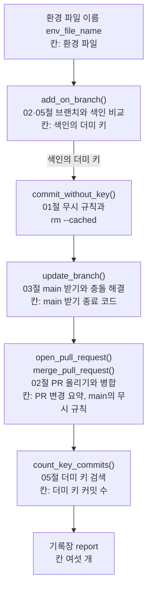
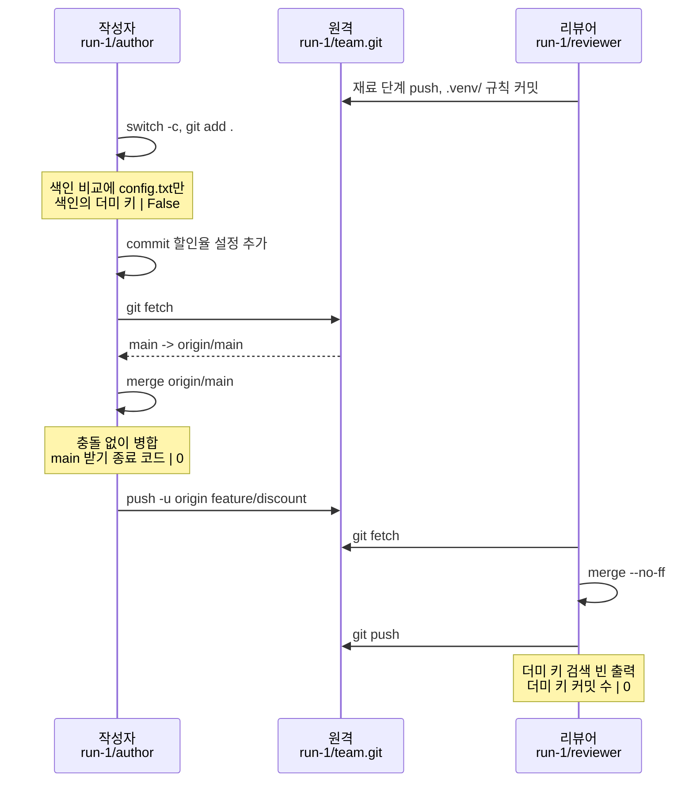
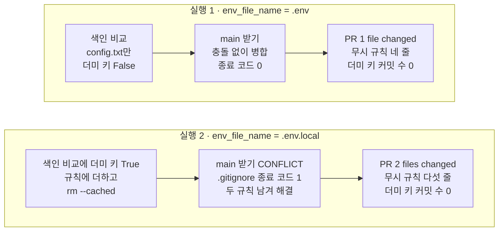

# 06-Git-실습

## _src 본문 (HTML 원본)

```html
<!--meta: 실습 30분 | 코드 Jupyter Notebook | 새 용어 0개 -->
<h2 id="b1"><span class="no">1</span>학습 목표</h2>
<div class="goal"><ul><li>01·02·03·05절의 Git 명령을 함수로 묶어 기능 브랜치의 변경을 main에 합치는 과정을 따라갈 수 있습니다.</li><li>기록장의 칸에서 색인의 더미 키, main 받기 종료 코드, PR 변경 요약, 더미 키 커밋 수를 읽을 수 있습니다.</li><li>환경 파일 이름 하나를 바꿨을 때 어느 단계부터 결과가 달라지는지 설명할 수 있습니다.</li></ul></div>
<h2 id="b2"><span class="no">2</span>이 내용을 배우는 이유</h2>
<p>앞의 절에서는 커밋, PR, 충돌, 시크릿 대응을 하나씩 따로 배웠습니다. 실제 협업에서는 한 번의 변경이 이 단계를 차례로 모두 지납니다.</p>
<p>이번 절은 이 챕터의 실습입니다. 앞에서 배운 명령을 한 노트북에 모아 강사와 함께 실행해 봅니다. 새 Git 명령이나 새 문법은 없고, 따로 내는 과제도 없습니다.</p>
<p>실습 주제는 할인율 설정 PR 합치기입니다. 작성자가 기능 브랜치에서 <code>config.txt</code>를 더하고, 리뷰어가 main에 병합합니다. 그 사이에 커밋 전 색인 비교와 main 받기를 넣고, 결과를 기록장에 남깁니다.</p>
<p><strong>이 절의 질문</strong> — 환경 파일 이름 하나가 바뀌면, PR을 main에 합치는 과정의 어느 단계가 달라질까요?</p>
<h2 id="b3"><span class="no">3</span>앞에서 배운 내용</h2>
<p>이번 실습은 아래 절에서 배운 것을 그대로 가져옵니다.</p>
<table><thead><tr><th>절</th><th>배운 것</th><th>실습에서 쓰는 곳</th></tr></thead><tbody>
<tr><td>01절</td><td>무시 규칙 <code>.gitignore</code> 세 줄, 모드 <code>"a"</code>로 덧붙이기, <code>git rm --cached</code>, <code>git status --short --ignored</code></td><td>첫 커밋, 더미 키를 찾았을 때 규칙 더하기와 색인에서 빼기, 남은 파일 확인</td></tr>
<tr><td>02절</td><td>bare 원격 <code>team.git</code>, 복제, <code>git switch -c</code>, <code>git push -u</code>, <code>git diff --stat origin/main...HEAD</code>, <code>git merge --no-ff</code></td><td>팀 저장소 두 벌, 기능 브랜치 <code>feature/discount</code>, PR 변경 요약, 리뷰어의 병합</td></tr>
<tr><td>03절</td><td><code>git fetch</code>와 <code>git merge origin/main</code>, 충돌 출력과 종료 코드 1, 해결 뒤 <code>add</code>와 <code>commit</code></td><td>PR을 올리기 전 main 받기, 무시 규칙 파일의 충돌 해결</td></tr>
<tr><td>05절</td><td><code>git add .</code>, 커밋 전 <code>git diff --cached</code> 읽기, 이름 <code>.env.local</code>, 더미 문자열, <code>git log --oneline --all -S</code></td><td>색인 비교에서 더미 키 찾기, 실행 2의 환경 파일 이름, 더미 키 커밋 수</td></tr>
</tbody></table>
<p>이름도 앞 절과 같습니다. 원격 <code>team.git</code>, 작성자 <code>Ch3 Student</code>의 <code>author</code>, 리뷰어 <code>Ch3 Reviewer</code>의 <code>reviewer</code>를 씁니다. 함수 <code>run_git()</code>은 05절과 같고, 끝에 실행 결과를 반환하는 줄만 더했습니다.</p>
<p>Python 쪽은 Ch 2의 함수 정의와 반환값(04절), 파일 읽기(05절), 딕셔너리와 <code>in</code>(03절)을 씁니다. 기록장을 출력하는 <code>print_report()</code>는 Ch 2 13절 함수를 도구 파일 <code>git_tools.py</code>에서 가져오고, 칸별 비교 셀은 Ch 2 13절 모양을 따릅니다.</p>
<p>04절의 revert·reflog·worktree와 05절의 이력 정리 도구는 쓰지 않습니다. 이번 흐름은 커밋 전에 더미 키를 막으므로, 공개한 커밋을 취소하거나 이력을 다시 쓸 일이 생기지 않습니다. 이 챕터는 모델을 부르지 않으므로 API 키가 필요 없습니다.</p>
<h2 id="b4"><span class="no">4</span>핵심 개념</h2>
<h3>비유로 시작하기</h3>
<p>01절의 택배 상자와 02절의 검수대를 이어 떠올립니다. 상자를 봉하기 전에 속을 한 번 들여다봅니다. 창고 열쇠가 섞여 들어갔다면 꺼내서 옆 서랍에 둡니다.</p>
<p>열쇠를 뺀 상자만 테이프로 봉해 수레에 싣습니다. 검수대에서 동료가 상자를 살핀 뒤, 팀 선반 줄 끝에 올립니다.</p>
{{img:06-4-열쇠를-뺀-상자|왼쪽 작업대의 열린 상자 위로 손이 열쇠를 들어 올리고 점선이 옆의 빈 서랍으로 이어지며, 가운데에서는 파란 테이프로 봉한 상자를 실은 수레를 한 사람이 돋보기로 살피고, 오른쪽 선반에는 갈색 테이프 상자 셋 끝에 파란 테이프 상자가 놓인 삽화|봉하기 전에 열쇠를 꺼내 서랍에 두고, 열쇠를 뺀 상자만 검수를 거쳐 팀 선반에 올립니다.}}
<p><strong>그림 읽기</strong> — 왼쪽 작업대에서는 손이 열린 상자 위로 열쇠를 들어 올리고, 점선이 옆의 빈 서랍으로 이어집니다. 가운데에서는 파란 테이프로 봉한 상자가 수레에 실려 있고, 한 사람이 돋보기로 살핍니다. 오른쪽 선반에서는 갈색 상자 셋 끝에 파란 상자가 놓였습니다.</p>
<p>실습 코드도 같습니다. 열린 상자는 색인, 열쇠는 더미 키가 든 환경 파일, 서랍은 무시 규칙에 적어 작업 폴더에만 남긴 파일입니다. 파란 상자는 기능 브랜치 커밋, 수레는 기능 브랜치, 돋보기는 PR 리뷰, 선반은 main입니다. 무시 규칙 파일의 충돌은 그림에 넣지 않았습니다.</p>
<h3>실습 함수의 구성</h3>
{{mermaid:06-1-조립도|초록 상자 환경 파일 이름에서 시작해 파란 상자 add_on_branch(), commit_without_key(), update_branch(), open_pull_request()와 merge_pull_request(), count_key_commits()를 차례로 지나 노란 상자 기록장 report로 이어지는 조립도|조립 함수 run_pull_request()가 부르는 부품의 순서. 부품마다 쓰는 절과 기록장에 적는 칸을 함께 적었습니다.}}
<p><strong>도식 읽기</strong> — 위에서 아래로 읽습니다. 맨 위 초록 상자는 실행 1·2에서 바꾸는 값인 환경 파일 이름입니다. 파란 상자는 이 절에서 만든 함수입니다. 상자 안에는 쓰는 절과, 적는 기록장 칸(「칸:」으로 시작하는 줄)을 함께 적었습니다.</p>
<p>함수 <code>add_on_branch()</code>에서 다음 상자로 가는 화살표의 「색인의 더미 키」는 반환값을 다음 함수에 넘긴다는 뜻입니다. 나머지 화살표는 부르는 순서입니다. 맨 아래 노란 상자가 칸 여섯 개의 기록장입니다.</p>
<table><thead><tr><th>함수</th><th>하는 일</th><th>기록장 칸</th></tr></thead><tbody>
<tr><td><code>add_on_branch(run_folder, env_file_name)</code></td><td>기능 브랜치에서 파일 두 개를 색인에 올리고, 비교 출력에 더미 키가 있는지 반환</td><td>색인의 더미 키</td></tr>
<tr><td><code>commit_without_key(run_folder, env_file_name, key_found)</code></td><td>찾았으면 규칙을 더하고 색인에서 뺀 뒤 커밋</td><td>—</td></tr>
<tr><td><code>update_branch(run_folder, env_file_name)</code></td><td>원격 main을 받아 병합하고, 충돌하면 두 규칙을 모두 남겨 마친 뒤 종료 코드 반환</td><td>main 받기 종료 코드</td></tr>
<tr><td><code>open_pull_request(run_folder)</code></td><td>PR 변경 범위를 보고 기능 브랜치를 올린 뒤 요약 줄 반환</td><td>PR 변경 요약</td></tr>
<tr><td><code>merge_pull_request(run_folder)</code></td><td>리뷰어가 병합해 올리고, main의 무시 규칙을 줄 목록으로 반환</td><td>main의 무시 규칙</td></tr>
<tr><td><code>count_key_commits(run_folder)</code></td><td>리뷰어 저장소에서 더미 키를 넣거나 뺀 커밋 수를 반환</td><td>더미 키 커밋 수</td></tr>
</tbody></table>
<p>조립 함수 <code>run_pull_request()</code>는 폴더 이름과 환경 파일 이름을 받아 이 여섯 함수를 차례로 부릅니다. 첫 칸 「환경 파일」에는 받은 이름을 그대로 적습니다.</p>
<h3>두 번의 실행</h3>
<p>노트북은 재료 단계에서 폴더 <code>run-1</code>과 <code>run-2</code>에 같은 모양의 팀 저장소를 만듭니다. 두 팀 모두 리뷰어가 먼저 main의 무시 규칙에 <code>.venv/</code>를 더해 올려 둡니다.</p>
<p>실행 1은 폴더 <code>run-1</code>에서 환경 파일 이름을 <code>.env</code>로 둡니다. 실행 2는 폴더 <code>run-2</code>에서 이름만 <code>.env.local</code>로 바꿉니다. 폴더는 두 실행의 저장소를 나눠 두려고 다르게 두었고, 조건으로 바꾼 값은 환경 파일 이름 하나입니다.</p>
<h2 id="b5"><span class="no">5</span>실행 예제</h2>
<p>노트북은 먼저 05절의 <code>run_git()</code>에 반환 줄을 더해 다시 정의합니다. 이어서 두 폴더에 팀 저장소를 만들고, 부품 함수 다섯 개와 기록 장치 하나, 조립 함수를 차례로 정의합니다. 기록장 출력 함수 <code>print_report()</code>는 준비 셀에서 도구 파일로 가져옵니다.</p>
<p>그다음 실행 1, 실행 2, 두 기록장 비교, 작성자 폴더에 남은 환경 파일 확인을 합니다. 모델 호출은 없고, 준비 셀을 뺀 코드 셀 15개가 1분 안에 끝납니다.</p>
{{notebook:06-Git-실습}}
<p class="look"><b>확인할 점</b> — 실행 1의 기록장에서 <code>색인의 더미 키 | False</code>와 <code>main 받기 종료 코드 | 0</code>을 봅니다. 실행 2에서는 <code>색인의 더미 키 | True</code>와 <code>main 받기 종료 코드 | 1</code>을 확인하고, 두 실행의 <code>더미 키 커밋 수 | 0</code>을 비교합니다.</p>
<h3>실행 1의 실제 순서</h3>
{{mermaid:06-2-실행1-순서|작성자, 원격, 리뷰어 세 세로줄의 순서도. 리뷰어가 먼저 .venv/ 규칙 커밋을 올리고, 작성자가 기능 브랜치에서 색인에 올린 뒤 노란 메모 색인의 더미 키 False, 커밋, fetch, merge origin/main 뒤 노란 메모 main 받기 종료 코드 0, 기능 브랜치 올리기가 이어지며, 리뷰어가 fetch, merge --no-ff, push 뒤 노란 메모 더미 키 커밋 수 0을 확인함|실행 1(.env)에서 작성자, 원격, 리뷰어가 명령을 주고받은 차례. 더미 키를 찾지 않았고 main 받기 종료 코드는 0이었습니다.}}
<p><strong>도식 읽기</strong> — 위에서 아래로 시간이 흐릅니다. 세로줄은 왼쪽부터 작성자, 원격, 리뷰어입니다. 맨 위 화살표는 재료 단계에서 리뷰어가 먼저 올린 <code>.venv/</code> 규칙 커밋입니다. 가로 실선은 요청한 명령, 점선은 받아 온 결과입니다.</p>
<p>제자리로 돌아오는 화살표는 그 저장소 안에서 실행한 명령입니다. 작성자의 첫 화살표는 <code>git switch -c feature/discount</code>와 <code>git add .</code>입니다. 리뷰어의 화살표는 <code>git merge --no-ff origin/feature/discount</code>입니다. 노란 메모는 그 시점에 확인한 출력과 기록장 칸입니다. 작성자 옆 첫 메모는 색인 비교에 <code>config.txt</code>만 있었다는 뜻이고, 둘째 메모는 main 받기가 충돌 없이 끝났다는 뜻입니다.</p>
<h2 id="b6"><span class="no">6</span>실험 결과 해석</h2>
<p>실행 1의 색인 비교 출력에는 <code>+++ b/config.txt</code> 한 파일만 있었습니다. 규칙 첫 줄 <code>.env</code>에 걸린 환경 파일은 색인에 올라가지 않았습니다. 그래서 규칙을 더하는 줄은 실행되지 않고 바로 커밋했습니다.</p>
<p>작성자는 <code>config.txt</code>를, 리뷰어는 <code>.gitignore</code>를 고쳤습니다. 서로 다른 파일이라 main 받기는 <code>Merge made by the 'ort' strategy.</code>로 끝났고 종료 코드 줄이 없었습니다. 기록장은 PR 변경 요약 <code>1 file changed, 1 insertion(+)</code>, 무시 규칙 네 줄, 더미 키 커밋 수 0이었습니다.</p>
{{mermaid:06-3-두-실행-비교|실행 1 칸은 회색 상자 색인 비교 config.txt만 더미 키 False와 회색 상자 main 받기 충돌 없이 병합 종료 코드 0을 지나 노란 상자 PR 1 file changed, 무시 규칙 네 줄, 더미 키 커밋 수 0으로 이어지고, 실행 2 칸은 노란 상자 색인 비교에 더미 키 True 규칙에 더하고 rm --cached와 노란 상자 main 받기 CONFLICT .gitignore 종료 코드 1 두 규칙 남겨 해결을 지나 노란 상자 PR 2 files changed, 무시 규칙 다섯 줄, 더미 키 커밋 수 0으로 이어지는 비교 그림|환경 파일 이름만 바꾼 두 실행. 실행 2는 앞의 두 단계에서 코드가 더미 키와 충돌을 받아 처리했고, 두 실행 모두 더미 키 커밋은 0개입니다.}}
<p><strong>도식 읽기</strong> — 위 칸은 실행 1, 아래 칸은 실행 2이고, 칸 안은 왼쪽에서 오른쪽으로 읽습니다. 실행 1의 왼쪽 두 회색 상자는 막을 것도, 충돌도 없었다는 뜻입니다.</p>
<p>실행 2의 왼쪽 두 노란 상자는 코드가 찾아서 처리하고 기록장에 적은 일입니다. 병합 명령은 종료 코드 1로 멈췄지만, 함수가 그 값을 보고 해결했으므로 셀은 멈추지 않았습니다. 오른쪽 노란 상자에서 더미 키 커밋 수 0만 두 칸이 같습니다.</p>
<p>실행 2의 색인 비교에는 <code>+DEMO_API_KEY=DEMO-ONLY-NOT-A-REAL-SECRET</code> 줄이 나왔습니다. 05절 값 바꿔 보기에서 본 것처럼 규칙 <code>.env</code>는 <code>.env.local</code>에 걸리지 않기 때문입니다. 함수는 규칙 파일 끝에 이름을 더하고 <code>rm '.env.local'</code>로 색인에서 뺀 뒤 커밋했습니다.</p>
<p>그 한 줄이 문제를 하나 더 만들었습니다. 리뷰어도 같은 파일의 같은 자리에 <code>.venv/</code>를 더했기 때문입니다. main 받기는 <code>CONFLICT (content): Merge conflict in .gitignore</code>와 <code>종료 코드: 1</code>로 멈췄고, 함수가 두 규칙을 모두 남긴 글로 해결했습니다.</p>
<p>기록장은 PR 변경 요약 <code>2 files changed, 2 insertions(+)</code>, 무시 규칙 다섯 줄, 더미 키 커밋 수 0이었습니다. 비교 셀의 달라진 칸 수는 5였고, 같은 칸은 더미 키 커밋 수 하나였습니다. 두 실행 모두 0인지 <code>assert</code>로 확인했고 멈추지 않았습니다.</p>
<p>마지막 셀에서 실행 2의 작성자 폴더는 <code>!! .env.local</code>이었습니다. 환경 파일은 폴더에 남아 로컬에서 계속 쓸 수 있고, Git은 무시합니다.</p>
<p>결론은 이렇습니다. 이번 실습에서 환경 파일 이름이 무시 규칙에 걸리지 않자 뒤 단계가 차례로 달라졌습니다. 색인 비교, 규칙 파일, main 받기, PR 변경 범위입니다. 커밋 전에 막았으므로 두 실행 모두 팀 저장소 이력에 더미 키 커밋은 없었습니다. 이 결과는 이름이 다른 환경 파일 한 가지로 관찰한 것입니다.</p>
<h2 id="b7"><span class="no">7</span>주의할 점과 실무 메모</h2>
<ul><li>색인 비교에서 더미 키를 찾는 줄은 이 실습의 더미 문자열만 찾습니다. 다른 모양의 키나 비밀번호는 찾지 못하므로, 실제 작업에서는 05절처럼 사람이 비교 출력을 읽습니다.</li>
<li>충돌 해결 글은 두 규칙이 모두 필요하다는 것을 알고 함수에 미리 적었습니다. 03절처럼 충돌 표시를 읽고 기준에 맞춰 정하는 경우는 이번에 실행하지 않았습니다. 해결 전의 충돌 표시도 이번에는 출력하지 않았습니다.</li>
<li>함수 <code>update_branch()</code>는 종료 코드가 0이 아니면 모두 충돌로 보고 해결 줄을 실행합니다. 받아 오기 실패처럼 다른 이유로 병합이 멈추는 경우는 이번에 실행하지 않았습니다.</li>
<li>무시 규칙에 이름을 하나씩 더하는 대신 <code>.env*</code>처럼 넓힌 규칙을 쓸 수도 있습니다. 넓힌 규칙이 어느 파일에 걸리는지는 이번에 실행하지 않았으니, 쓰기 전에 01절의 <code>git check-ignore -v</code>로 확인합니다.</li>
<li>기능 브랜치를 올리기 전에 main을 받아 합쳤으므로, 리뷰어의 병합은 두 실행 모두 충돌 없이 끝났습니다. 실제 GitHub의 PR 화면과 병합 버튼은 이번에 쓰지 않았습니다.</li>
<li>교재 출력은 Linux의 Git 2.34.1에서 실행한 결과입니다. 커밋 해시와 임시 폴더 경로는 실행마다 달라 읽지 않았고, Windows와 macOS는 실행하지 않았습니다.</li></ul>
<h2 id="b8"><span class="no">8</span>정리와 다음 절</h2>
<ul><li>01·02·03·05절의 명령을 부품 여섯 개로 묶어, 브랜치 커밋부터 PR 병합까지 조립 함수 하나로 이었습니다.</li><li>실행 1(<code>.env</code>)은 더미 키를 찾지 않았고, main 받기 종료 코드 0, PR 변경은 파일 한 개였습니다.</li><li>실행 2에서 이름만 <code>.env.local</code>로 바꾸자 더미 키를 찾아 규칙을 더했고, 그 줄이 충돌해 종료 코드 1이었습니다. 두 실행 모두 더미 키 커밋은 0개였습니다.</li></ul>
<p><strong>다음 학습과 이어지는 지점</strong> — Ch 3은 이 절에서 끝납니다. Ch 4는 Pandas로 표 데이터를 다루는 절부터 시작하며, 이 챕터의 임시 저장소는 쓰지 않습니다. Ch 6부터는 <code>.env</code>에 적은 <code>OPENAI_API_KEY</code>로 모델을 부릅니다. 그때도 이 실습처럼 커밋 전에 색인 비교를 읽고, 환경 파일이 무시 규칙에 걸리는지 확인하길 권합니다. Ch 32 05절에서는 컨테이너에 시크릿을 넘기는 방법을 다룹니다.</p>
<h2 id="b9"><span class="no">9</span>복습 문제</h2><details class="quiz"><summary>문제와 해설</summary>
<p class="quiz-q">1. 실행 1에서 색인의 더미 키가 <code>False</code>였던 까닭을 무시 규칙으로 설명하세요. · 기초</p><p class="quiz-a"><b>해설</b> — 무시 규칙 첫 줄이 <code>.env</code>라서 환경 파일 <code>.env</code>가 <code>git add .</code>에 올라가지 않았습니다. 그래서 색인 비교에는 <code>config.txt</code>만 있었고, 더미 문자열이 없었습니다.</p>
<p class="quiz-q">2. 실행 2에서 main 받기가 충돌한 까닭은 무엇인가요? · 적용</p><p class="quiz-a"><b>해설</b> — 작성자가 더미 키를 막으려고 <code>.gitignore</code> 끝에 <code>.env.local</code>을 더했기 때문입니다. 리뷰어도 같은 파일의 같은 자리에 <code>.venv/</code>를 더해 먼저 올렸습니다. 03절에서 본 것처럼 두 사람이 같은 자리를 다르게 고치면 병합이 멈춥니다.</p>
<p class="quiz-q">3. 두 실행 모두 더미 키 커밋 수가 0이었습니다. 05절 Before에서 검색에 커밋 두 줄이 걸린 것과 무엇이 달랐나요? · 분석</p><p class="quiz-a"><b>해설</b> — 막은 시점이 달랐습니다. 05절 Before는 더미 키 파일을 커밋해 올린 뒤에 추적을 멈춰, 지난 커밋에 값이 남았습니다. 이번에는 커밋하기 전에 색인 비교에서 찾아 색인에서 뺐으므로, 더미 키가 든 커밋이 처음부터 만들어지지 않았습니다.</p>
<p class="quiz-q">4. 이 절의 질문에 답해 봅시다. 환경 파일 이름 하나가 바뀌자 어느 단계부터 달라졌고, 무엇은 같았나요? · 분석</p><p class="quiz-a"><b>해설</b> — 커밋 전 색인 비교부터 달라졌습니다. 더미 키를 찾아 규칙 파일을 고쳤고, 그 줄 때문에 main 받기가 충돌했으며, PR 변경 범위에 <code>.gitignore</code>가 더해졌습니다. 더미 키 커밋 수 0은 같았습니다. 이 결과는 이름이 다른 환경 파일 한 가지로 관찰한 것입니다.</p>
</details>
<h2 id="b10"><span class="no">10</span>참고 자료</h2>
<ul><li><a href="https://git-scm.com/docs/gitignore">Git 공식 문서: gitignore</a> · 01·05절에서 확인 2026-09-16 · 실행 Git 2.34.1</li><li><a href="https://git-scm.com/docs/git-merge">Git 공식 문서: git-merge(충돌)</a> · 03절에서 확인 2026-09-16 · 실행 Git 2.34.1</li><li><a href="https://git-scm.com/docs/git-diff">Git 공식 문서: git-diff</a> · 01·02절에서 확인 2026-09-16</li><li><a href="https://docs.github.com/en/authentication/keeping-your-account-and-data-secure/removing-sensitive-data-from-a-repository">GitHub Docs: 민감 정보 제거</a> · 05절에서 확인 2026-09-16 · 예제는 교재에서 작성</li></ul>
```

## 노트북 셀 (순서대로)

### [0] markdown {'html': 'skip'}

# Git 실습: 할인율 설정 PR 합치기

**이 노트북에서 할 일**

1. 02~05절처럼 팀 원격 저장소와 작성자·리뷰어 저장소를 만듭니다. 같은 모양으로 두 벌 만듭니다.
2. 앞 절의 명령을 함수로 묶어, 작성자의 할인율 설정을 PR로 올리고 main에 합칩니다(실행 1).
3. 환경 파일 이름 하나만 `.env.local`로 바꿔 다시 실행하고, 두 기록장을 비교합니다(실행 2).

**준비물** — API 키 불필요. 실제 비밀 값은 쓰지 않고, 05절의 더미 문자열만 씁니다.
모델 호출은 0번이고 비용은 들지 않습니다. 실행 시간은 1분 이내입니다.

01~05절과 같은 실습 폴더 `labs/part1/ch03-git-github`의 `.venv`를 커널로 고르고, 첫 셀부터 순서대로 실행합니다.
GitHub 계정과 네트워크는 쓰지 않습니다. 새 Git 명령과 새 문법은 없습니다.

### [1] markdown {'html': 'skip'}

## 오늘 볼 그림


위에서 아래로 읽습니다. 파란 상자는 이 노트북에서 만드는 함수이고, 상자마다 쓰는 절과 기록장에 적는 칸을 적었습니다.
맨 위 초록 상자는 실행 1과 실행 2에서 바꾸는 값인 환경 파일 이름입니다. 맨 아래 노란 상자는 결과를 적는 기록장입니다.

### [2] markdown {}

## 1. 준비

이 절도 설치할 패키지가 없습니다. 05절처럼 빈 임시 폴더를 만들고 그 폴더로 작업 위치를 옮깁니다.
폴더 이름의 앞머리만 `ch03-06-`으로 바꿨습니다.

앞에서 배운 함수는 `git_tools.py`에 모아 두었습니다. 파일을 열면 코드를 볼 수 있습니다. 노트북과 같은 폴더(`notebooks/`)에 있는 파일입니다.
이 노트북은 Ch 2 13절 `print_report()`를 가져옵니다.

가져오는 줄은 작업 위치를 옮기기 전에 둡니다. 도구 파일을 현재 작업 폴더에서 찾기 때문입니다.

### [3] code {'execution': {'iopub.execute_input': '2026-09-21T10:18:59.761690Z', 'iopub.status.busy': '2026-09-21T10:18:59.761490Z', 'iopub.status.idle': '2026-09-21T10:18:59.769626Z', 'shell.execute_reply': '2026-09-21T10:18:59.768789Z'}, 'lesson_role': 'setup'}

```python
# Ch 2 13절 print_report()를 도구 파일에서 가져오고, 저장소들을 담을 빈 임시 폴더로 작업 위치를 옮깁니다
import os
import tempfile

# 작업 위치를 옮기기 전에 가져옵니다. 도구 파일은 노트북과 같은 폴더에 있습니다
from git_tools import print_report

# mkdtemp()는 운영체제 임시 폴더 안에 새 폴더를 만들고 그 경로를 반환합니다
practice_folder = tempfile.mkdtemp(prefix="ch03-06-")
os.chdir(practice_folder)
file_names = os.listdir()
print("현재 작업 폴더의 파일:", file_names)
```

출력:
```
현재 작업 폴더의 파일: []

```

### [4] markdown {}

**결과 읽기** — 현재 작업 폴더의 파일은 `[]`로, 빈 폴더에서 시작합니다.

### [5] markdown {}

## 2. git 명령 함수에 반환값 더하기

02~05절의 `run_git()` 함수를 이 노트북에서 다시 정의합니다. 도구 파일에도 있는 함수지만, 이번에는 마지막에 `return result` 한 줄을 더합니다.
이 줄은 명령의 실행 결과를 함수 밖으로 반환합니다. 반환값은 Ch 2 04절에서 배웠습니다.

실행 결과에서는 Ch 1 03절과 Ch 2 08절처럼 `.returncode`로 종료 코드를, `.stdout`으로 출력 글을 읽습니다.
이번 실습은 이 두 값을 기록장에 적습니다. 출력을 보여 주는 나머지 줄은 도구 파일의 02절 판과 같습니다.

실행 전에 예상합니다. 정의 셀이라 출력은 없을 것입니다.

### [6] code {'execution': {'iopub.execute_input': '2026-09-21T10:18:59.771134Z', 'iopub.status.busy': '2026-09-21T10:18:59.770997Z', 'iopub.status.idle': '2026-09-21T10:18:59.774620Z', 'shell.execute_reply': '2026-09-21T10:18:59.773904Z'}}

```python
# git 명령을 폴더 하나에서 실행해 출력을 보여 주고, 실행 결과를 반환하는 함수
import shlex
import subprocess


def run_git(command: str, folder: str = "."):
    full_command = "git " + command
    # split()은 따옴표로 묶은 메시지를 공백이 있어도 한 낱말로 둡니다
    arguments = shlex.split(full_command)
    # cwd 인자에 적은 폴더에서 명령을 실행하고, 글자는 UTF-8 규칙으로 읽습니다
    result = subprocess.run(arguments, capture_output=True, encoding="utf-8", cwd=folder)
    print(folder, "$", full_command)
    print(result.stdout + result.stderr)
    # 종료 코드가 0이 아닐 때만 숫자를 보여 줍니다
    if result.returncode != 0:
        print("종료 코드:", result.returncode)
    # 이번 실습에서 더한 줄: 종료 코드와 출력 글을 함수 밖에서 읽게 합니다
    return result
```

출력:
```

```

### [7] markdown {}

**결과 읽기** — 예상대로 출력이 없습니다. 함수를 새로 정의하기만 했습니다.

### [8] markdown {}

## 3. 실습 주제 — 할인율 설정 PR 합치기

작성자 `Ch3 Student`가 기능 브랜치 `feature/discount`에서 할인율 설정 파일 `config.txt`를 더합니다. 값은 04·05절과 같은 `discount=10`입니다.
작성자는 로컬에서 시험하려고 환경 파일에도 더미 키를 적어 둡니다. 이 변경을 PR로 올리고, 리뷰어 `Ch3 Reviewer`가 main에 병합합니다.

그사이 리뷰어는 main의 무시 규칙에 가상환경 폴더 `.venv/` 한 줄을 더해 올렸습니다. 작성자는 아직 받아 오지 않았습니다.
이번 실습은 이 흐름에 앞 절의 확인 세 가지를 붙입니다. 커밋 전 색인 비교(05절), 올리기 전 main 받기(03절), PR 병합(02절)입니다.

실행 1과 실행 2는 환경 파일 이름 하나만 다릅니다. 실행 1은 `.env`, 실행 2는 05절 값 바꿔 보기의 `.env.local`입니다.

### [9] markdown {}

## 4. 재료 만들기 — 같은 팀 저장소 두 벌

두 실행을 비교하려면 두 실행이 같은 상태에서 시작해야 합니다. 그래서 폴더 `run-1`과 `run-2`에 같은 모양의 저장소를 만듭니다.
반복문 `for`로 같은 명령을 두 폴더에 한 번씩 실행합니다. 경로는 폴더 이름에 `"/author"`를 이어 붙여 만듭니다.

첫 셀은 02~05절 순서대로 원격 `team.git`을 만들고 작성자가 복제합니다. 무시 규칙은 01절과 같은 세 줄이고, 줄바꿈은 `\n`으로 적습니다.
실행 전에 예상합니다. 두 폴더 모두 첫 커밋 표시가 나오고, 종료 코드 줄은 없을 것입니다.

### [10] code {'execution': {'iopub.execute_input': '2026-09-21T10:18:59.776053Z', 'iopub.status.busy': '2026-09-21T10:18:59.775924Z', 'iopub.status.idle': '2026-09-21T10:18:59.824470Z', 'shell.execute_reply': '2026-09-21T10:18:59.824031Z'}}

```python
# 두 실행에 쓸 팀 저장소를 같은 모양으로 만들고, 작성자가 무시 규칙 세 줄을 첫 커밋으로 올립니다
for run_folder in ["run-1", "run-2"]:
    author = run_folder + "/author"
    run_git("init --bare -b main " + run_folder + "/team.git")
    run_git("clone team.git author", run_folder)
    run_git('config user.name "Ch3 Student"', author)
    run_git("config user.email student@example.com", author)
    # 01절의 무시 규칙 세 줄입니다
    with open(author + "/.gitignore", "w", encoding="utf-8") as file:
        file.write(".env\n__pycache__/\n*.log\n")
    run_git("add .gitignore", author)
    run_git('commit -m "chore: 환경 파일 추적 제외"', author)
    run_git("push -u origin main", author)
```

출력:
```
. $ git init --bare -b main run-1/team.git
Initialized empty Git repository in [사용자 폴더]/tmp/ch03-06-rl480dxe/run-1/team.git/

run-1 $ git clone team.git author
Cloning into 'author'...
warning: You appear to have cloned an empty repository.
done.

run-1/author $ git config user.name "Ch3 Student"

run-1/author $ git config user.email student@example.com

run-1/author $ git add .gitignore

run-1/author $ git commit -m "chore: 환경 파일 추적 제외"
[main (root-commit) 9c008f9] chore: 환경 파일 추적 제외
 1 file changed, 3 insertions(+)
 create mode 100644 .gitignore

run-1/author $ git push -u origin main
Branch 'main' set up to track remote branch 'main' from 'origin'.
To [사용자 폴더]/tmp/ch03-06-rl480dxe/run-1/team.git
 * [new branch]      main -> main

. $ git init --bare -b main run-2/team.git
Initialized empty Git repository in [사용자 폴더]/tmp/ch03-06-rl480dxe/run-2/team.git/

run-2 $ git clone team.git author
Cloning into 'author'...
warning: You appear to have cloned an empty repository.
done.

run-2/author $ git config user.name "Ch3 Student"

run-2/author $ git config user.email student@example.com

run-2/author $ git add .gitignore

run-2/author $ git commit -m "chore: 환경 파일 추적 제외"
[main (root-commit) 9c008f9] chore: 환경 파일 추적 제외
 1 file changed, 3 insertions(+)
 create mode 100644 .gitignore

run-2/author $ git push -u origin main
Branch 'main' set up to track remote branch 'main' from 'origin'.
To [사용자 폴더]/tmp/ch03-06-rl480dxe/run-2/team.git
 * [new branch]      main -> main


```

### [11] markdown {}

**결과 읽기** — 폴더마다 `main (root-commit)`과 `1 file changed, 3 insertions(+)`가 한 번씩 나왔습니다. 올리기 출력은 `[new branch]`입니다.
종료 코드 줄은 없습니다. 두 폴더의 출력은 폴더 이름만 다릅니다.

경로 앞 `[사용자 폴더]`는 실행 도구가 사용자 폴더 이름을 가린 표시입니다. 커밋 해시는 실행마다 달라 읽지 않습니다.

### [12] markdown {}

이제 두 폴더 모두 리뷰어가 원격을 복제합니다. 리뷰어는 무시 규칙 파일 끝에 `.venv/` 한 줄을 더해 main에 올립니다.
파일 끝에 덧붙이는 모드 `"a"`는 01절에서 썼습니다. 작성자는 이 커밋을 아직 받아 오지 않습니다.

실행 전에 예상합니다. 리뷰어의 커밋 요약 줄은 한 줄 더하기이고, 올리기는 거절 없이 `main -> main`일 것입니다.

### [13] code {'execution': {'iopub.execute_input': '2026-09-21T10:18:59.825364Z', 'iopub.status.busy': '2026-09-21T10:18:59.825286Z', 'iopub.status.idle': '2026-09-21T10:18:59.855160Z', 'shell.execute_reply': '2026-09-21T10:18:59.854774Z'}}

```python
# 두 팀 모두 리뷰어가 복제하고, main의 무시 규칙에 가상환경 폴더 한 줄을 더해 올립니다
for run_folder in ["run-1", "run-2"]:
    reviewer = run_folder + "/reviewer"
    run_git("clone team.git reviewer", run_folder)
    run_git('config user.name "Ch3 Reviewer"', reviewer)
    run_git("config user.email reviewer@example.com", reviewer)
    with open(reviewer + "/.gitignore", "a", encoding="utf-8") as file:
        file.write(".venv/\n")
    run_git("add .gitignore", reviewer)
    run_git('commit -m "chore: 가상환경 폴더 추적 제외"', reviewer)
    run_git("push", reviewer)
```

출력:
```
run-1 $ git clone team.git reviewer
Cloning into 'reviewer'...
done.

run-1/reviewer $ git config user.name "Ch3 Reviewer"

run-1/reviewer $ git config user.email reviewer@example.com

run-1/reviewer $ git add .gitignore

run-1/reviewer $ git commit -m "chore: 가상환경 폴더 추적 제외"
[main 3072a57] chore: 가상환경 폴더 추적 제외
 1 file changed, 1 insertion(+)

run-1/reviewer $ git push
To [사용자 폴더]/tmp/ch03-06-rl480dxe/run-1/team.git
   9c008f9..3072a57  main -> main

run-2 $ git clone team.git reviewer
Cloning into 'reviewer'...
done.

run-2/reviewer $ git config user.name "Ch3 Reviewer"

run-2/reviewer $ git config user.email reviewer@example.com

run-2/reviewer $ git add .gitignore

run-2/reviewer $ git commit -m "chore: 가상환경 폴더 추적 제외"
[main 3072a57] chore: 가상환경 폴더 추적 제외
 1 file changed, 1 insertion(+)

run-2/reviewer $ git push
To [사용자 폴더]/tmp/ch03-06-rl480dxe/run-2/team.git
   9c008f9..3072a57  main -> main


```

### [14] markdown {}

**결과 읽기** — 폴더마다 커밋 요약 줄은 `1 file changed, 1 insertion(+)`이고, 올리기 출력 끝은 `main -> main`입니다.
두 팀의 원격 main은 이제 커밋 두 개입니다. 작성자 폴더의 main은 아직 첫 커밋에 머물러 있습니다.

### [15] markdown {}

## 5. 부품 준비 — 작성자가 브랜치에서 커밋하기

첫 부품 `add_on_branch()`는 02절처럼 기능 브랜치를 만들고, 파일 두 개를 씁니다. 할인율 파일과 더미 키를 적은 환경 파일입니다.
그다음 05절 Before처럼 `git add .`으로 폴더의 변경을 한꺼번에 색인에 올립니다.

색인에 올린 뒤에는 05절처럼 `git diff --cached`로 커밋에 들어갈 내용을 읽습니다. 이번에는 사람 대신 코드가 읽습니다.
출력 글 `result.stdout`에 더미 문자열이 들어 있는지 Ch 2 03절의 `in`으로 확인하고, 그 결과(`True`/`False`)를 반환합니다.

실행 전에 예상합니다. 정의 셀이라 출력은 없을 것입니다.

### [16] code {'execution': {'iopub.execute_input': '2026-09-21T10:18:59.855859Z', 'iopub.status.busy': '2026-09-21T10:18:59.855791Z', 'iopub.status.idle': '2026-09-21T10:18:59.857970Z', 'shell.execute_reply': '2026-09-21T10:18:59.857695Z'}}

```python
# 기능 브랜치에서 파일 두 개를 색인에 올리고, 커밋 전 비교 출력에 더미 키가 있는지 반환합니다
def add_on_branch(run_folder: str, env_file_name: str):
    author = run_folder + "/author"
    run_git("switch -c feature/discount", author)
    with open(author + "/config.txt", "w", encoding="utf-8") as file:
        file.write("discount=10\n")
    # 05절의 더미 문자열을 환경 파일에 적습니다
    with open(author + "/" + env_file_name, "w", encoding="utf-8") as file:
        file.write("DEMO_API_KEY=DEMO-ONLY-NOT-A-REAL-SECRET\n")
    run_git("add .", author)
    result = run_git("diff --cached", author)
    key_found = "DEMO-ONLY-NOT-A-REAL-SECRET" in result.stdout
    return key_found
```

출력:
```

```

### [17] markdown {}

**결과 읽기** — 예상대로 출력이 없습니다. 브랜치를 만들고 파일을 쓰는 일은 함수를 부를 때 실행됩니다.

### [18] markdown {}

둘째 부품 `commit_without_key()`는 앞 함수가 반환한 값 `key_found`를 받습니다. 더미 키를 찾았을 때만 여러 줄 `if` 아래를 실행합니다.
그 세 줄은 05절 Before에서 작성자가 한 방법과 같습니다. 무시 규칙 파일 끝에 환경 파일 이름을 더합니다.
이어서 01절의 `git rm --cached`로 그 파일을 색인에서만 빼고, 바뀐 무시 규칙을 색인에 올립니다.

매개변수 `key_found` 옆의 `bool`은 Ch 2 01절에서 배운 불리언 자료형으로, 값이 `True`나 `False`라는 표시입니다.
Ch 2 07절에서 본 것처럼 타입힌트는 값을 검사하지 않습니다.

05절과 다른 점은 순서입니다. 05절은 커밋해 올린 뒤에 고쳤고, 이번에는 커밋하기 전에 고칩니다.
찾지 못했으면 바로 커밋합니다. 실행 전에 예상합니다. 정의 셀이라 출력은 없을 것입니다.

### [19] code {'execution': {'iopub.execute_input': '2026-09-21T10:18:59.858634Z', 'iopub.status.busy': '2026-09-21T10:18:59.858574Z', 'iopub.status.idle': '2026-09-21T10:18:59.860455Z', 'shell.execute_reply': '2026-09-21T10:18:59.860106Z'}}

```python
# 더미 키를 찾았으면 환경 파일을 무시 규칙에 더하고 색인에서만 뺀 뒤, 할인율 설정을 커밋합니다
def commit_without_key(run_folder: str, env_file_name: str, key_found: bool):
    author = run_folder + "/author"
    if key_found:
        with open(author + "/.gitignore", "a", encoding="utf-8") as file:
            file.write(env_file_name + "\n")
        # 파일은 폴더에 남기고 색인에서만 뺍니다
        run_git("rm --cached " + env_file_name, author)
        run_git("add .gitignore", author)
    run_git('commit -m "feat: 할인율 설정 추가"', author)
```

출력:
```

```

### [20] markdown {}

**결과 읽기** — 예상대로 출력이 없습니다. 매개변수 `key_found`에는 앞 함수의 반환값을 넣을 것입니다.

### [21] markdown {}

셋째 부품 `update_branch()`는 PR을 올리기 전에 원격 main을 받아 기능 브랜치에 합칩니다. 03절의 `git fetch`와 `git merge origin/main`입니다.
병합이 충돌로 멈추면 03절처럼 종료 코드가 1입니다. 그래서 반환받은 실행 결과의 `.returncode`가 0이 아닐 때 충돌을 해결합니다.

03절에서는 충돌 표시를 읽고 기준 파일에 맞춰 새 줄을 정했습니다. 이번에 충돌이 날 수 있는 곳은 무시 규칙 파일뿐입니다.
두 사람이 더한 규칙은 모두 필요하므로, 두 줄을 함께 남긴 글을 미리 적어 둡니다. 해결 뒤에는 03절처럼 색인에 올리고 커밋합니다.

함수는 병합 명령의 종료 코드를 반환합니다. 실행 전에 예상합니다. 정의 셀이라 출력은 없을 것입니다.

### [22] code {'execution': {'iopub.execute_input': '2026-09-21T10:18:59.861096Z', 'iopub.status.busy': '2026-09-21T10:18:59.861037Z', 'iopub.status.idle': '2026-09-21T10:18:59.863130Z', 'shell.execute_reply': '2026-09-21T10:18:59.862769Z'}}

```python
# 원격 main을 받아 기능 브랜치에 병합하고, 충돌하면 두 사람의 규칙을 모두 남겨 마친 뒤 종료 코드를 반환합니다
def update_branch(run_folder: str, env_file_name: str):
    author = run_folder + "/author"
    run_git("fetch", author)
    result = run_git('merge origin/main -m "merge: main의 무시 규칙 받기"', author)
    if result.returncode != 0:
        # 01절 세 줄 뒤에 리뷰어의 .venv/와 작성자가 더한 환경 파일 이름을 함께 둡니다
        with open(author + "/.gitignore", "w", encoding="utf-8") as file:
            file.write(".env\n__pycache__/\n*.log\n.venv/\n" + env_file_name + "\n")
        run_git("add .gitignore", author)
        run_git('commit -m "merge: main의 무시 규칙 받기"', author)
    return result.returncode
```

출력:
```

```

### [23] markdown {}

**결과 읽기** — 예상대로 출력이 없습니다. 작성자 쪽 부품 세 개를 모두 정의했습니다.

### [24] markdown {}

## 6. 부품 준비 — PR 올리기와 병합

넷째 부품 `open_pull_request()`는 02절처럼 PR로 볼 변경 범위를 `git diff --stat origin/main...HEAD`로 봅니다. 그다음 기능 브랜치를 원격에 올립니다.
변경 범위 출력의 마지막 줄은 `1 file changed`처럼 바뀐 파일 수를 적은 요약입니다.

출력 글은 Ch 2 05절의 `splitlines()`로 줄 목록으로 나눕니다. 마지막 줄은 Ch 1 03절처럼 번호 `[-1]`로 꺼냅니다.
앞의 공백은 Ch 1 04절의 `strip()`으로 떼고 반환합니다. 실행 전에 예상합니다. 정의 셀이라 출력은 없을 것입니다.

### [25] code {'execution': {'iopub.execute_input': '2026-09-21T10:18:59.863746Z', 'iopub.status.busy': '2026-09-21T10:18:59.863684Z', 'iopub.status.idle': '2026-09-21T10:18:59.865437Z', 'shell.execute_reply': '2026-09-21T10:18:59.865089Z'}}

```python
# PR로 볼 변경 범위를 확인하고 기능 브랜치를 올린 뒤, 변경 요약 줄을 반환합니다
def open_pull_request(run_folder: str):
    author = run_folder + "/author"
    result = run_git("diff --stat origin/main...HEAD", author)
    stat_lines = result.stdout.splitlines()
    run_git("push -u origin feature/discount", author)
    # 마지막 줄이 바뀐 파일 수와 더한 줄 수를 적은 요약입니다
    summary = stat_lines[-1]
    return summary.strip()
```

출력:
```

```

### [26] markdown {}

**결과 읽기** — 예상대로 출력이 없습니다. 기능 브랜치 이름은 02절처럼 `feature/`로 시작합니다.

### [27] markdown {}

다섯째 부품 `merge_pull_request()`는 리뷰어 쪽 일입니다. 02절처럼 받아 온 뒤 `git merge --no-ff`로 기능 브랜치를 main에 병합하고 올립니다.
병합한 뒤에는 main의 무시 규칙 파일을 Ch 2 05절처럼 읽어 줄 목록으로 반환합니다. 기록장에 규칙이 몇 줄 남았는지 적기 위해서입니다.

실행 전에 예상합니다. 정의 셀이라 출력은 없을 것입니다.

### [28] code {'execution': {'iopub.execute_input': '2026-09-21T10:18:59.866039Z', 'iopub.status.busy': '2026-09-21T10:18:59.865975Z', 'iopub.status.idle': '2026-09-21T10:18:59.867984Z', 'shell.execute_reply': '2026-09-21T10:18:59.867619Z'}}

```python
# 리뷰어가 기능 브랜치를 main에 병합해 올리고, 병합한 main의 무시 규칙을 줄 목록으로 반환합니다
def merge_pull_request(run_folder: str):
    reviewer = run_folder + "/reviewer"
    run_git("fetch", reviewer)
    run_git('merge --no-ff origin/feature/discount -m "merge: 할인율 설정"', reviewer)
    run_git("push", reviewer)
    with open(reviewer + "/.gitignore", "r", encoding="utf-8") as file:
        rules_text = file.read()
    rules = rules_text.splitlines()
    return rules
```

출력:
```

```

### [29] markdown {}

**결과 읽기** — 예상대로 출력이 없습니다. 기능 브랜치를 올리고 병합하는 부품 두 개를 정의했습니다.

### [30] markdown {}

## 7. 기록 장치 — 더미 키 검색과 기록장 출력

두 실행을 비교하려면 결과를 같은 칸에 적어 둬야 합니다. Ch 2 13절처럼 딕셔너리를 기록장으로 씁니다.
기록장에 적을 값 가운데 하나는 05절의 더미 키 검색 결과입니다.

함수 `count_key_commits()`는 리뷰어 저장소에서 `git log --oneline --all -S`로 더미 문자열을 넣거나 뺀 커밋을 찾습니다.
검색 출력의 줄 수가 곧 그런 커밋의 수이므로, 줄 목록의 길이를 반환합니다.
기록장을 칸마다 한 줄씩 출력하는 함수는 Ch 2 13절의 `print_report()`이고, 1번 준비 셀에서 도구 파일로 가져왔습니다.

실행 전에 예상합니다. 정의 셀이라 출력은 없을 것입니다.

### [31] code {'execution': {'iopub.execute_input': '2026-09-21T10:18:59.868715Z', 'iopub.status.busy': '2026-09-21T10:18:59.868651Z', 'iopub.status.idle': '2026-09-21T10:18:59.870363Z', 'shell.execute_reply': '2026-09-21T10:18:59.870017Z'}}

```python
# 리뷰어 저장소의 모든 이름에서 더미 키를 넣거나 뺀 커밋을 찾아 그 수를 반환합니다
def count_key_commits(run_folder: str):
    reviewer = run_folder + "/reviewer"
    result = run_git("log --oneline --all -S DEMO-ONLY-NOT-A-REAL-SECRET", reviewer)
    commit_lines = result.stdout.splitlines()
    return len(commit_lines)
```

출력:
```

```

### [32] markdown {}

**결과 읽기** — 예상대로 출력이 없습니다. 이 함수는 조립 함수의 마지막 단계에서 부릅니다.

### [33] markdown {}

## 8. 조립하기 — 폴더와 환경 파일 이름으로 기록장까지

조립 함수 `run_pull_request()`는 폴더 이름과 환경 파일 이름을 받습니다. 부품 여섯 개를 차례로 부르고, 반환값을 기록장에 적습니다.
줄마다 붙인 주석에 그 줄이 쓰는 절을 적었습니다.

기록장은 칸 하나를 가진 딕셔너리로 시작해, Ch 2 03절처럼 키를 하나씩 추가합니다. 칸은 모두 여섯 개입니다. 환경 파일, 색인의 더미 키, main 받기 종료 코드, PR 변경 요약, main의 무시 규칙, 더미 키 커밋 수입니다.
실행 전에 예상합니다. 정의 셀이라 출력은 없을 것입니다.

### [34] code {'execution': {'iopub.execute_input': '2026-09-21T10:18:59.871015Z', 'iopub.status.busy': '2026-09-21T10:18:59.870957Z', 'iopub.status.idle': '2026-09-21T10:18:59.872989Z', 'shell.execute_reply': '2026-09-21T10:18:59.872652Z'}}

```python
# 조립: 폴더와 환경 파일 이름을 받아 브랜치 커밋 → main 받기 → PR 병합 → 기록장까지 이어 붙입니다
def run_pull_request(run_folder: str, env_file_name: str):
    report = {"환경 파일": env_file_name}
    # 02절 기능 브랜치, 05절 git add .와 커밋 전 비교 읽기
    report["색인의 더미 키"] = add_on_branch(run_folder, env_file_name)
    # 01절 무시 규칙과 rm --cached, 커밋
    commit_without_key(run_folder, env_file_name, report["색인의 더미 키"])
    # 03절 main 받기와 충돌 해결
    report["main 받기 종료 코드"] = update_branch(run_folder, env_file_name)
    # 02절 PR 변경 범위, 올리기, 리뷰어의 병합
    report["PR 변경 요약"] = open_pull_request(run_folder)
    report["main의 무시 규칙"] = merge_pull_request(run_folder)
    # 05절 이력 전체의 더미 키 검색
    report["더미 키 커밋 수"] = count_key_commits(run_folder)
    return report
```

출력:
```

```

### [35] markdown {}

**결과 읽기** — 예상대로 출력이 없습니다. 조립이 끝났습니다. 이제 폴더와 환경 파일 이름만 넣어 부르면 됩니다.

### [36] markdown {}

## 9. 실행 1 — 환경 파일 이름 .env

변수 `env_file_name`에 `".env"`를 담아 폴더 `run-1`에서 조립 함수를 부릅니다. 반환된 기록장은 `report_1`에 담고 칸별로 출력합니다.

실행 전에 예상합니다. 무시 규칙 첫 줄에 `.env`가 있으므로 색인 비교에는 `config.txt`만 나오고, 더미 키는 `False`일 것입니다.
작성자는 `config.txt`를, 리뷰어는 `.gitignore`를 고쳤으므로 main 받기는 충돌 없이 종료 코드 0일 것입니다.
더미 키 커밋 수는 0일 것입니다.

### [37] code {'execution': {'iopub.execute_input': '2026-09-21T10:18:59.873601Z', 'iopub.status.busy': '2026-09-21T10:18:59.873528Z', 'iopub.status.idle': '2026-09-21T10:18:59.901438Z', 'shell.execute_reply': '2026-09-21T10:18:59.901019Z'}}

```python
# 실행 1: 환경 파일 이름을 .env로 두고, 폴더 run-1에서 PR 한 번을 끝까지 진행합니다
run_folder = "run-1"
env_file_name = ".env"
report_1 = run_pull_request(run_folder, env_file_name)
print("기록장:")
print_report(report_1)
```

출력:
```
run-1/author $ git switch -c feature/discount
Switched to a new branch 'feature/discount'

run-1/author $ git add .

run-1/author $ git diff --cached
diff --git a/config.txt b/config.txt
new file mode 100644
index 0000000..4e7df79
--- /dev/null
+++ b/config.txt
@@ -0,0 +1 @@
+discount=10

run-1/author $ git commit -m "feat: 할인율 설정 추가"
[feature/discount 1ef49b9] feat: 할인율 설정 추가
 1 file changed, 1 insertion(+)
 create mode 100644 config.txt

run-1/author $ git fetch
From [사용자 폴더]/tmp/ch03-06-rl480dxe/run-1/team
   9c008f9..3072a57  main       -> origin/main

run-1/author $ git merge origin/main -m "merge: main의 무시 규칙 받기"
Merge made by the 'ort' strategy.
 .gitignore | 1 +
 1 file changed, 1 insertion(+)

run-1/author $ git diff --stat origin/main...HEAD
 config.txt | 1 +
 1 file changed, 1 insertion(+)

run-1/author $ git push -u origin feature/discount
Branch 'feature/discount' set up to track remote branch 'feature/discount' from 'origin'.
To [사용자 폴더]/tmp/ch03-06-rl480dxe/run-1/team.git
 * [new branch]      feature/discount -> feature/discount

run-1/reviewer $ git fetch
From [사용자 폴더]/tmp/ch03-06-rl480dxe/run-1/team
 * [new branch]      feature/discount -> origin/feature/discount

run-1/reviewer $ git merge --no-ff origin/feature/discount -m "merge: 할인율 설정"
Merge made by the 'ort' strategy.
 config.txt | 1 +
 1 file changed, 1 insertion(+)
 create mode 100644 config.txt

run-1/reviewer $ git push
To [사용자 폴더]/tmp/ch03-06-rl480dxe/run-1/team.git
   3072a57..ae6088c  main -> main

run-1/reviewer $ git log --oneline --all -S DEMO-ONLY-NOT-A-REAL-SECRET

기록장:
환경 파일 | .env
색인의 더미 키 | False
main 받기 종료 코드 | 0
PR 변경 요약 | 1 file changed, 1 insertion(+)
main의 무시 규칙 | ['.env', '__pycache__/', '*.log', '.venv/']
더미 키 커밋 수 | 0

```

### [38] markdown {}

**결과 읽기** — 기록장은 `색인의 더미 키 | False`, `main 받기 종료 코드 | 0`, `PR 변경 요약 | 1 file changed, 1 insertion(+)`, `더미 키 커밋 수 | 0`입니다.
칸 「main의 무시 규칙」은 `['.env', '__pycache__/', '*.log', '.venv/']`로 네 줄입니다. 예상과 같습니다.

출력 위쪽의 색인 비교에는 `+++ b/config.txt` 한 파일만 있습니다. main 받기는 `Merge made by the 'ort' strategy.`로 끝났습니다.
「종료 코드:」 줄이 한 번도 나오지 않았으므로 충돌을 해결하는 줄은 실행되지 않았습니다. 리뷰어의 병합 뒤 더미 키 검색은 명령 줄 아래가 비어 있습니다.

### [39] markdown {}

## 10. 실행 2 — 환경 파일 이름 하나만 바꾸기

바꾸는 값은 `env_file_name` 하나입니다. 값을 `".env.local"`로 바꾸고, 같은 조립 함수를 부릅니다. 폴더 `run-2`는 재료 단계에서 `run-1`과 같은 모양으로 만든 팀입니다.

실행 전에 예상합니다. 05절 값 바꿔 보기처럼 규칙 `.env`는 `.env.local`에 걸리지 않습니다. 그래서 색인 비교에 더미 키가 나와 `True`일 것입니다.

작성자가 무시 규칙 파일 끝에 한 줄을 더하게 됩니다. 리뷰어도 같은 자리에 `.venv/`를 더했으므로 main 받기는 충돌해 종료 코드 1일 것입니다.
두 경우 모두 커밋 전에 막으므로 더미 키 커밋 수는 0일 것입니다.

### [40] code {'execution': {'iopub.execute_input': '2026-09-21T10:18:59.902146Z', 'iopub.status.busy': '2026-09-21T10:18:59.902086Z', 'iopub.status.idle': '2026-09-21T10:18:59.931861Z', 'shell.execute_reply': '2026-09-21T10:18:59.931488Z'}}

```python
# 실행 2: 환경 파일 이름 하나만 .env.local로 바꾸고, 같은 모양의 팀 run-2에서 같은 함수를 부릅니다
run_folder = "run-2"
env_file_name = ".env.local"
report_2 = run_pull_request(run_folder, env_file_name)
print("기록장:")
print_report(report_2)
```

출력:
```
run-2/author $ git switch -c feature/discount
Switched to a new branch 'feature/discount'

run-2/author $ git add .

run-2/author $ git diff --cached
diff --git a/.env.local b/.env.local
new file mode 100644
index 0000000..df0a337
--- /dev/null
+++ b/.env.local
@@ -0,0 +1 @@
+DEMO_API_KEY=DEMO-ONLY-NOT-A-REAL-SECRET
diff --git a/config.txt b/config.txt
new file mode 100644
index 0000000..4e7df79
--- /dev/null
+++ b/config.txt
@@ -0,0 +1 @@
+discount=10

run-2/author $ git rm --cached .env.local
rm '.env.local'

run-2/author $ git add .gitignore

run-2/author $ git commit -m "feat: 할인율 설정 추가"
[feature/discount 4a72519] feat: 할인율 설정 추가
 2 files changed, 2 insertions(+)
 create mode 100644 config.txt

run-2/author $ git fetch
From [사용자 폴더]/tmp/ch03-06-rl480dxe/run-2/team
   9c008f9..3072a57  main       -> origin/main

run-2/author $ git merge origin/main -m "merge: main의 무시 규칙 받기"
Auto-merging .gitignore
CONFLICT (content): Merge conflict in .gitignore
Automatic merge failed; fix conflicts and then commit the result.

종료 코드: 1
run-2/author $ git add .gitignore

run-2/author $ git commit -m "merge: main의 무시 규칙 받기"
[feature/discount d0cd5b8] merge: main의 무시 규칙 받기

run-2/author $ git diff --stat origin/main...HEAD
 .gitignore | 1 +
 config.txt | 1 +
 2 files changed, 2 insertions(+)

run-2/author $ git push -u origin feature/discount
Branch 'feature/discount' set up to track remote branch 'feature/discount' from 'origin'.
To [사용자 폴더]/tmp/ch03-06-rl480dxe/run-2/team.git
 * [new branch]      feature/discount -> feature/discount

run-2/reviewer $ git fetch
From [사용자 폴더]/tmp/ch03-06-rl480dxe/run-2/team
 * [new branch]      feature/discount -> origin/feature/discount

run-2/reviewer $ git merge --no-ff origin/feature/discount -m "merge: 할인율 설정"
Merge made by the 'ort' strategy.
 .gitignore | 1 +
 config.txt | 1 +
 2 files changed, 2 insertions(+)
 create mode 100644 config.txt

run-2/reviewer $ git push
To [사용자 폴더]/tmp/ch03-06-rl480dxe/run-2/team.git
   3072a57..d883551  main -> main

run-2/reviewer $ git log --oneline --all -S DEMO-ONLY-NOT-A-REAL-SECRET

기록장:
환경 파일 | .env.local
색인의 더미 키 | True
main 받기 종료 코드 | 1
PR 변경 요약 | 2 files changed, 2 insertions(+)
main의 무시 규칙 | ['.env', '__pycache__/', '*.log', '.venv/', '.env.local']
더미 키 커밋 수 | 0

```

### [41] markdown {}

**결과 읽기** — 기록장은 `색인의 더미 키 | True`, `main 받기 종료 코드 | 1`, `PR 변경 요약 | 2 files changed, 2 insertions(+)`, `더미 키 커밋 수 | 0`입니다.
칸 「main의 무시 규칙」은 `['.env', '__pycache__/', '*.log', '.venv/', '.env.local']`로 다섯 줄입니다. 예상과 같습니다.

출력 위쪽의 색인 비교에는 `+DEMO_API_KEY=DEMO-ONLY-NOT-A-REAL-SECRET` 줄이 보입니다. 그래서 `rm '.env.local'`로 색인에서 뺀 뒤 커밋했습니다.
main 받기는 `CONFLICT (content): Merge conflict in .gitignore`와 `종료 코드: 1`로 멈췄습니다. 함수가 두 규칙을 남긴 글로 해결해 커밋했습니다.
PR 변경 범위에는 `config.txt`와 함께 `.gitignore`가 들어갔습니다.

### [42] markdown {}

## 11. 두 기록장 비교하기

두 기록장에서 같은 키의 값끼리 비교합니다. Ch 2 13절의 비교 셀과 같은 모양입니다. 기호 `!=`는 「두 값이 다른가」 비교입니다.

셀 끝의 검사 줄 `assert`는 두 실행 모두 더미 키 커밋 수가 0인지 확인합니다. 이 값은 Git 이력에서 세는 값이라 실행마다 같아야 합니다.
실행 전에 예상합니다. 더미 키 커밋 수만 같고, 나머지 다섯 칸은 달라질 것입니다.

### [43] code {'execution': {'iopub.execute_input': '2026-09-21T10:18:59.932578Z', 'iopub.status.busy': '2026-09-21T10:18:59.932487Z', 'iopub.status.idle': '2026-09-21T10:18:59.934729Z', 'shell.execute_reply': '2026-09-21T10:18:59.934370Z'}}

```python
# 두 기록장을 칸마다 비교하고, 달라진 칸의 수를 셉니다
changed_count = 0
for key, value_1 in report_1.items():
    value_2 = report_2[key]
    if value_1 != value_2:
        print("달라짐 |", key, "|", value_1, "->", value_2)
        changed_count += 1
    else:
        print("같음 |", key, "|", value_1)
print("달라진 칸 수:", changed_count)
# 두 실행 모두 팀 저장소 이력에 더미 키를 넣은 커밋이 없어야 합니다
assert report_1["더미 키 커밋 수"] == 0
assert report_2["더미 키 커밋 수"] == 0
```

출력:
```
달라짐 | 환경 파일 | .env -> .env.local
달라짐 | 색인의 더미 키 | False -> True
달라짐 | main 받기 종료 코드 | 0 -> 1
달라짐 | PR 변경 요약 | 1 file changed, 1 insertion(+) -> 2 files changed, 2 insertions(+)
달라짐 | main의 무시 규칙 | ['.env', '__pycache__/', '*.log', '.venv/'] -> ['.env', '__pycache__/', '*.log', '.venv/', '.env.local']
같음 | 더미 키 커밋 수 | 0
달라진 칸 수: 5

```

### [44] markdown {}

**결과 읽기** — 달라진 칸 수는 `5`입니다. `같음 | 더미 키 커밋 수 | 0` 한 칸만 같았고, 검사 줄 `assert`에서도 멈추지 않았습니다.
달라진 칸은 환경 파일, `색인의 더미 키 | False -> True`, `main 받기 종료 코드 | 0 -> 1`, PR 변경 요약, main의 무시 규칙입니다.

바꾼 값은 환경 파일 이름 하나이고, 함수와 저장소 모양은 그대로입니다. 이름 하나가 무시 규칙에 걸리지 않자 뒤 단계가 차례로 달라졌습니다.
색인 비교에서 멈추고, 규칙 파일을 고치고, 그 줄이 리뷰어의 줄과 충돌했습니다. 그래도 두 실행 모두 더미 키 커밋은 팀 저장소에 없습니다.

### [45] markdown {}

## 12. 작성자 폴더에 남은 환경 파일

실행 2에서 `git rm --cached`로 뺀 `.env.local`은 어디에 있을까요? 01절에서 배운 대로 이 명령은 색인에서만 빼고 파일은 남깁니다.
작성자 폴더에서 01절의 `git status --short --ignored`를 실행하고, 폴더 파일 목록에 이름이 있는지도 봅니다.

실행 전에 예상합니다. 무시한 파일 표시가 한 줄 나오고, 파일은 폴더에 있을 것입니다.

### [46] code {'execution': {'iopub.execute_input': '2026-09-21T10:18:59.935317Z', 'iopub.status.busy': '2026-09-21T10:18:59.935247Z', 'iopub.status.idle': '2026-09-21T10:18:59.937910Z', 'shell.execute_reply': '2026-09-21T10:18:59.937559Z'}}

```python
# 실행 2의 작성자 폴더에서 .env.local이 무시한 파일로 남았는지 확인합니다
run_git("status --short --ignored", "run-2/author")
file_names = os.listdir("run-2/author")
print(".env.local이 폴더에 있는가:", ".env.local" in file_names)
```

출력:
```
run-2/author $ git status --short --ignored
!! .env.local

.env.local이 폴더에 있는가: True

```

### [47] markdown {}

**결과 읽기** — 상태 표시는 `!! .env.local` 한 줄이고, 폴더에 있는지는 `True`입니다.
작성자는 로컬에서 환경 파일을 계속 쓸 수 있고, Git은 이 파일을 무시합니다.

### [48] markdown {'html': 'skip'}

## 정리

- 01·02·03·05절의 명령을 부품 여섯 개로 묶어, 브랜치 커밋부터 PR 병합까지 조립 함수 하나로 이었습니다.
- 실행 1(`.env`)은 더미 키를 찾지 않았고, main 받기는 종료 코드 0, PR 변경은 파일 한 개였습니다.
- 실행 2에서 이름만 `.env.local`로 바꾸자 더미 키를 찾아 규칙을 더했고, 그 줄이 충돌해 종료 코드 1이었습니다. 두 실행 모두 더미 키 커밋은 0개였습니다.

이번에는 Linux의 Git 2.34.1로, 임시 폴더의 원격 저장소에서 실행했습니다. 규칙 이름이 다른 파일 한 가지만 실행했습니다.
충돌 표시를 사람이 읽고 고르는 경우와 GitHub PR 화면은 이번에 실행하지 않았습니다.
이 절로 Ch 3이 끝납니다. 다음 챕터 Ch 4에서는 Pandas로 표 데이터를 다루는 것부터 시작합니다.

## 그림

### 06-1-조립도.mmd



- 설명 대상 문장: 01·02·03·05절에서 따로 배운 명령을 부품 여섯 개로 묶어 조립 함수 run_pull_request() 하나로 잇고, 단계마다 기록장 칸을 적습니다.
- 캡션: 조립 함수 run_pull_request()가 부르는 부품의 순서. 부품마다 쓰는 절과 기록장에 적는 칸을 함께 적었습니다.
- 읽는 법: 위에서 아래로 읽습니다. 맨 위 초록 상자는 실행 1·2에서 바꾸는 값 env_file_name입니다. 파란 상자는 이 절에서 만든 함수입니다. 상자 안에는 쓰는 절과, 적는 기록장 칸(「칸:」으로 시작하는 줄)을 함께 적었습니다. commit_without_key()는 칸 줄이 없고, 넷째 상자는 함수 이름이 두 줄입니다. add_on_branch()에서 commit_without_key()로 가는 화살표의 「색인의 더미 키」는 앞 함수의 반환값을 뒤 함수에 넘긴다는 뜻입니다. 맨 아래 노란 상자가 칸 여섯 개의 기록장입니다.
- alt: 초록 상자 환경 파일 이름에서 시작해 파란 상자 add_on_branch(), commit_without_key(), update_branch(), open_pull_request()와 merge_pull_request(), count_key_commits()를 차례로 지나 노란 상자 기록장 report로 이어지는 조립도

### 06-2-실행1-순서.mmd



- 설명 대상 문장: 실행 1에서 색인 비교는 config.txt만 보였고, main 받기는 충돌 없이 끝났으며, 리뷰어가 병합해 올린 뒤 더미 키 검색은 빈 출력이었습니다.
- 캡션: 실행 1(.env)에서 작성자, 원격, 리뷰어가 명령을 주고받은 차례. 더미 키를 찾지 않았고 main 받기 종료 코드는 0이었습니다.
- 읽는 법: 위에서 아래로 시간이 흐릅니다. 세로줄은 왼쪽부터 작성자 run-1/author, 원격 run-1/team.git, 리뷰어 run-1/reviewer입니다. 맨 위 화살표는 재료 단계에서 리뷰어가 먼저 올린 .venv/ 규칙 커밋입니다. 제자리로 돌아오는 화살표는 그 저장소 안에서 실행한 명령이고(라벨을 줄였으므로 전체 명령 `git switch -c feature/discount`·`git add .`, `git merge --no-ff origin/feature/discount`는 도식 읽기에 적음), 가로 실선은 요청한 명령, 점선은 받아 온 결과입니다(02-3·04-2·05-3과 같은 규칙). 라벨은 왼쪽 정렬로 세로선과 겹치지 않게 했습니다(검토 1차 C-3). 노란 메모는 그 시점에 확인한 출력과 기록장 칸입니다.
- alt: 작성자, 원격, 리뷰어 세 세로줄의 순서도. 리뷰어가 먼저 .venv/ 규칙 커밋을 올리고, 작성자가 기능 브랜치에서 색인에 올린 뒤 노란 메모 색인의 더미 키 False, 커밋, fetch, merge origin/main 뒤 노란 메모 main 받기 종료 코드 0, 기능 브랜치 올리기가 이어지며, 리뷰어가 fetch, merge --no-ff, push 뒤 노란 메모 더미 키 커밋 수 0을 확인함

### 06-3-두-실행-비교.mmd



- 설명 대상 문장: 환경 파일 이름 하나만 .env.local로 바꾸자 색인 비교에서 더미 키를 찾았고, 그 규칙 줄이 리뷰어의 줄과 충돌해 main 받기 종료 코드가 1이었습니다. 더미 키 커밋 수 0은 같았습니다.
- 캡션: 환경 파일 이름만 바꾼 두 실행. 실행 2는 앞의 두 단계에서 코드가 더미 키와 충돌을 받아 처리했고, 두 실행 모두 더미 키 커밋은 0개입니다.
- 읽는 법: 위 칸은 실행 1, 아래 칸은 실행 2이고, 칸 안은 왼쪽에서 오른쪽으로 읽습니다. 실행 1의 왼쪽 두 회색 상자는 막을 것도, 충돌도 없었다는 뜻입니다. 실행 2의 왼쪽 두 노란 상자는 코드가 찾아서 처리하고 기록장에 적은 일입니다. 오른쪽 노란 상자는 기록장 결과이며, 더미 키 커밋 수 0만 두 칸이 같습니다.
- alt: 실행 1 칸은 회색 상자 색인 비교 config.txt만 더미 키 False와 회색 상자 main 받기 충돌 없이 병합 종료 코드 0을 지나 노란 상자 PR 1 file changed, 무시 규칙 네 줄, 더미 키 커밋 수 0으로 이어지고, 실행 2 칸은 노란 상자 색인 비교에 더미 키 True 규칙에 더하고 rm --cached와 노란 상자 main 받기 CONFLICT .gitignore 종료 코드 1 두 규칙 남겨 해결을 지나 노란 상자 PR 2 files changed, 무시 규칙 다섯 줄, 더미 키 커밋 수 0으로 이어지는 비교 그림

### 06-4-열쇠를-뺀-상자.prompt.md

# 삽화 — 06-4 열쇠를 뺀 상자

- 상태: 2026-09-16 생성·검수 통과(2회 생성, 탈락 1). 모델 nano_banana_pro(서버 표기 nano_banana_2), 16:9, 2k(2752×1536), 장당 2크레딧 × 2 = 4크레딧. 채택 job d86a7698-5b2e-4e70-8c8c-b903755eb1b9. 탈락 job 815c3cbe-5bbd-4398-8a55-426d3ca920c5(열쇠가 손과 서랍에 두 번 그려짐, 손이 상자가 아니라 서랍 위에 있어 「상자에서 꺼냄」이 읽히지 않음, 가운데 칸에 파란 상자가 수레와 탁자에 두 개, 아래 화살표가 칸과 떨어져 여러 개). 교재 파일은 폭 1100px로 줄여 저장.
- 검수 메모(채택본): 왼쪽 작업대 위 열린 상자(종이 한 장) 위로 손이 열쇠 하나를 들어 올리고, 점선 호가 옆 서랍장의 열린 빈 서랍으로 이어짐. 가운데 수레에 파란 테이프 상자 하나, 한 사람이 허리를 굽혀 돋보기로 봄. 오른쪽 선반 가운데 칸에 갈색 테이프 상자 셋과 끝에 파란 테이프 상자 하나(프롬프트의 「갈색 넷 + 파란 하나」가 아니라 갈색 셋이지만 「파란 상자가 같은 줄 끝에 합류」 관계는 읽힘). 칸 사이 회색 화살표 둘. 글자·화면·자물쇠 없음. 「열쇠는 상자에 넣지 않고 서랍으로 간다」와 「봉한 상자가 검수를 거쳐 선반 줄 끝에 놓인다」가 그림만으로 읽혀 채택.
- 설명 대상 문장: 상자를 봉하기 전에 속을 한 번 들여다봅니다. 창고 열쇠가 섞여 들어갔다면 꺼내서 옆 서랍에 둡니다. 열쇠를 뺀 상자만 테이프로 봉해 수레에 싣고, 검수대에서 동료가 살핀 뒤 팀 선반 줄 끝에 올립니다.
- 넣을 자리: 06절 핵심 개념 「비유로 시작하기」 단락 바로 아래. 01-5 택배 상자(열린 상자 = 색인, 봉한 상자 = 커밋) → 02-6 검수대와 선반(수레 = 기능 브랜치, 검수 = PR 리뷰, 선반 = main) → 05-5 열쇠(= 시크릿)를 이어 씀. Ch 1 06·Ch 2 13 실습처럼 한 장면을 왼쪽에서 오른쪽으로 읽는 구도
- 구성 요소와 배치(왼쪽 → 오른쪽): 작업대와 열린 상자, 열쇠를 든 손, 옆 서랍장(열린 빈 서랍) | 수레의 파란 테이프 상자와 돋보기를 든 사람 | 긴 선반의 갈색 상자 줄과 끝의 파란 상자
- 시선 순서: 열린 상자 위의 열쇠 → 점선을 따라 서랍 → 수레의 봉한 상자와 돋보기 → 선반 줄 끝의 파란 상자
- 대응: 열린 상자 = 색인(`git add .` 뒤), 열쇠 = 더미 키가 든 `.env.local`, 꺼내기 = 색인 비교에서 찾아 `git rm --cached`, 서랍 = 무시 규칙에 적어 작업 폴더에만 남긴 파일(`!! .env.local`), 파란 테이프 상자 = `feat: 할인율 설정 추가` 커밋, 수레 = `feature/discount`, 돋보기 = PR 리뷰(`git diff --stat origin/main...HEAD`), 선반 줄 끝 = 리뷰어의 `merge --no-ff` 뒤 main. 장면은 실행 2. 무시 규칙 파일의 충돌은 그리지 않음(본문에 명시)

## 프롬프트 (채택본, 2회차)

Simple flat educational illustration, white background, limited soft palette, clean outlines, plain everyday objects, no text, no letters, no numbers, no logos.
A small storeroom scene with three zones in one row from left to right on a plain light floor, with one thin gray arrow between zone 1 and zone 2 and one thin gray arrow between zone 2 and zone 3.
(1) Left zone: a plain wooden packing table. On it sits one open cardboard box with its flaps open, holding one folded paper sheet. A single hand is directly above the open box, pulling one brass key up and out of the box, and a short curved dotted motion line leads from the hand down into the open top drawer of a small wooden drawer cabinet standing right next to the table. Exactly one key in the whole image, held by the hand. The drawer is open and empty.
(2) Middle zone: one small hand cart holding exactly one cardboard box that is closed and sealed with bright blue tape. One person stands next to the cart, bending slightly and holding a magnifying glass over this same blue-taped box on the cart. There is no table in the middle zone and no other box in the middle zone.
(3) Right zone: one long wooden shelf holding a neat row of four identical cardboard boxes sealed with brown tape, plus one box sealed with bright blue tape placed at the right end of the same row, five boxes in total.
Exactly one hand in the left zone and exactly one person in the middle zone. No monitors, no screens, no computers, no signs, no labels with writing, no padlocks, no trucks, no conveyor belts, no extra shelves, no extra keys.

## 1회차 프롬프트에서 바꾼 점

- 손을 「directly above the open box, pulling one brass key up and out of the box」로 상자 위에 두고, 서랍으로는 점선 동작선만 이어지게 함(열쇠가 두 번 그려지지 않게 「Exactly one key in the whole image, held by the hand. The drawer is open and empty.」)
- 가운데 칸에서 탁자를 빼고 「no other box in the middle zone」으로 상자를 하나로 고정
- 화살표를 칸 사이 두 개로 지정

