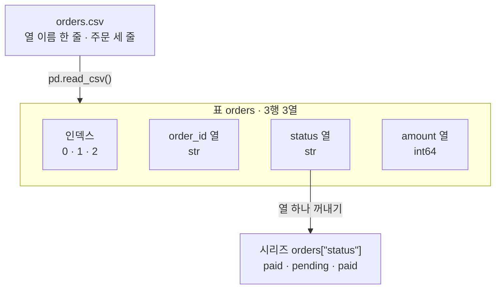
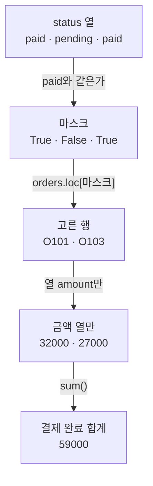
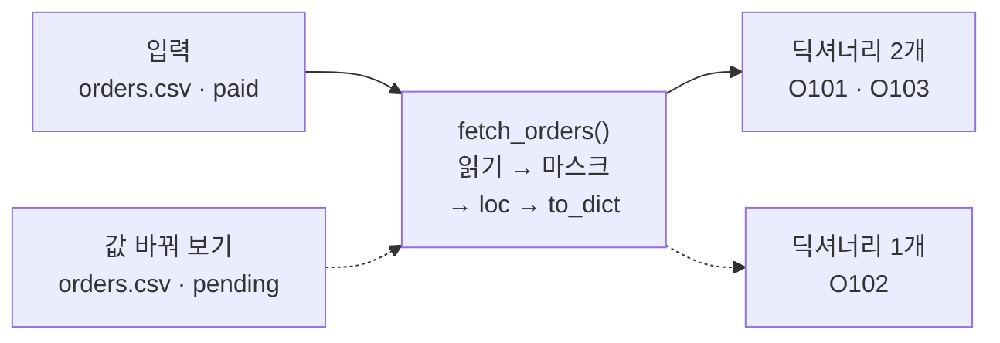
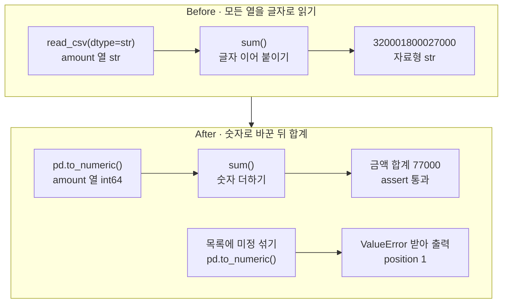

# 01-Pandas로-표-다루기

## _src 본문 (HTML 원본)

```html
<!--meta: 강의 1h | 실습 2h | 코드 Jupyter Notebook | 새 용어 7 -->
<h2 id="b1"><span class="no">1</span>학습 목표</h2>
<div class="goal"><ul><li>주문 CSV 파일을 표(DataFrame)로 읽고, 행·열·자료형을 출력에서 확인할 수 있습니다.</li><li>상태 열의 조건과 <code>loc</code>로 필요한 주문만 골라, 딕셔너리 목록을 반환하는 조회 함수를 만들 수 있습니다.</li><li>금액 열이 글자일 때 합계가 틀리는 이유를 설명하고, 숫자로 바꿔 고칠 수 있습니다.</li></ul></div>
<h2 id="b2"><span class="no">2</span>이 내용을 배우는 이유</h2>
<p>에이전트가 결제 완료 주문의 합계를 답하려면, 먼저 주문 파일에서 맞는 행을 찾아야 합니다. 파일 전체를 모델에 넘기면 상관없는 주문까지 함께 들어갑니다.</p>
<p>행을 바르게 골라도 금액이 글자로 읽혀 있으면 합계가 틀립니다. 게다가 이 실수는 오류 없이 지나갈 수 있습니다.</p>
<p>그래서 이 절에서는 표를 읽고, 조건에 맞는 행만 고르고, 합계 전에 자료형을 확인합니다. 이 과정을 작은 조회 함수로 묶습니다. Ch 19에서는 이런 조회 함수를 에이전트가 부르는 도구로 씁니다.</p>
<p><strong>이 절의 질문</strong> — 금액 열을 글자로 읽으면 오류 없이 합계가 틀릴 수 있을까요? 그렇다면 합계 전에 무엇을 확인해야 할까요?</p>
<h2 id="b3"><span class="no">3</span>앞에서 배운 내용</h2>
<p>Ch 2 05절에서는 <code>with open()</code> 블록으로 <code>orders.txt</code>에 「연필,3」 같은 줄을 저장했습니다. 읽을 때는 줄마다 <code>split(",")</code>로 나누고, <code>int()</code>로 수량을 숫자로 바꿨습니다. 수량 자리가 「많이」인 줄은 <code>ValueError</code>를 냈고, 그 오류 이름만 받는 <code>try/except</code>로 살펴봤습니다.</p>
<p>Ch 2 03절에서는 주문 하나를 딕셔너리로 적고, 빈 목록에 <code>for</code>와 <code>append()</code>로 값을 모았습니다. Ch 2 04절에서는 함수를 정의하는 셀과 호출하는 셀을 나눴습니다. Ch 2 07절에서는 import 문과 타입힌트 <code>-&gt; int</code>를 배웠습니다.</p>
<p>Ch 3의 노트북은 모두 빈 임시 폴더를 만들고 작업 위치를 옮긴 뒤 시작했습니다. 이 절의 준비 셀도 같은 모양입니다. 파일은 임시 폴더에만 생기고, 실습 폴더에는 남지 않습니다.</p>
<p>이번에 새로 쓰는 것은 따로 설치하는 패키지 pandas입니다. 앞에서 한 줄씩 나누던 일을 표 단위로 한 번에 합니다.</p>
<h2 id="b4"><span class="no">4</span>핵심 개념</h2>
<h3>비유로 시작하기</h3>
<p>종이 장부에 주문이 한 줄에 하나씩 적혀 있다고 해 봅니다. 줄마다 결제 상태를 뜻하는 스티커와 금액이 있습니다.</p>
<p>결제 완료 줄만 보고 싶으면, 그 줄 자리에만 창을 낸 종이 덮개를 장부 위에 올립니다. 창 아래 줄만 보이고 나머지 줄은 가려집니다. 보이는 줄의 금액만 모으면 결제 완료 합계가 됩니다.</p>
<p>표에서 행을 고르는 방법도 같습니다. 장부가 표(DataFrame), 줄 하나가 행, 창을 낸 덮개가 불리언 마스크입니다.</p>
{{img:01-5-창을-낸-덮개|초록 스티커 두 줄과 주황 스티커 한 줄이 있는 종이, 가운데 줄만 가리고 두 줄에 창을 낸 갈색 덮개, 초록 두 줄과 합친 동전 더미가 있는 카드가 화살표로 이어진 삽화|창을 낸 덮개를 올리면 결제 완료 줄만 보입니다. 마스크가 True인 행만 남기는 모습과 같습니다.}}
<p><strong>그림 읽기</strong> — 왼쪽에서 오른쪽으로 화살표를 따라갑니다. 왼쪽 종이에는 초록 스티커 두 줄과 주황 스티커 한 줄이 있습니다. 가운데는 같은 종이에 갈색 덮개를 올린 모습입니다. 초록 줄 자리에만 창이 있어, 주황 줄은 덮개 아래로 가려집니다. 오른쪽 카드에는 보였던 초록 두 줄만 옮겨 적었고, 옆에는 두 줄의 동전을 합친 더미가 있습니다.</p>
<h3>이 절에서 쓰는 말</h3>
<table><thead><tr><th>용어</th><th>뜻</th><th>이 절에서 보이는 모습</th></tr></thead><tbody>
<tr><td>CSV(comma-separated values)</td><td>한 줄에 값을 쉼표로 나눠 적은 글 파일. 첫 줄에는 보통 열 이름을 적습니다</td><td><code>orders.csv</code>의 첫 줄 <code>order_id,status,amount</code></td></tr>
<tr><td>데이터프레임(DataFrame)</td><td>행과 열로 된 pandas의 표</td><td><code>pd.read_csv()</code>로 읽은 <code>orders</code>, 3행 3열</td></tr>
<tr><td>행(row)과 열(column)</td><td>행은 가로 한 줄로 주문 하나, 열은 세로 한 줄로 같은 종류의 값</td><td>주문 <code>O101</code> 한 줄, 금액 열 <code>amount</code></td></tr>
<tr><td>인덱스(index)</td><td>표가 행마다 붙이는 번호. 0부터 셉니다</td><td>출력 왼쪽의 <code>0</code>, <code>1</code>, <code>2</code></td></tr>
<tr><td>자료형(dtype)</td><td>열에 담긴 값의 종류</td><td><code>int64</code>(정수), <code>str</code>(글자)</td></tr>
<tr><td>시리즈(Series)</td><td>표에서 꺼낸 열 하나. 인덱스와 값을 짝지어 담습니다</td><td><code>orders["status"]</code></td></tr>
<tr><td>불리언 마스크(boolean mask)</td><td>행마다 고를지 말지를 참·거짓으로 적은 시리즈</td><td><code>True</code>, <code>False</code>, <code>True</code></td></tr>
</tbody></table>
<h3>파일에서 표로, 표에서 열로</h3>
<p>함수 <code>pd.read_csv()</code>는 CSV 파일을 읽어 표 하나를 반환합니다. 첫 줄은 열 이름이 되고, 다음 줄부터 행이 됩니다. 표는 행마다 0부터 번호를 붙이는데, 이 번호가 인덱스입니다.</p>
<p>표 이름 뒤 대괄호에 열 이름을 넣으면 열 하나를 꺼냅니다. 꺼낸 열이 시리즈입니다. Ch 2 03절에서 딕셔너리의 키로 값을 읽던 모양과 같습니다.</p>
<p>이 절의 import 줄은 <code>import pandas as pd</code>입니다. 키워드 <code>as</code>는 불러온 모듈에 짧은 별명을 붙입니다. 그래서 코드는 <code>pandas.read_csv()</code> 대신 <code>pd.read_csv()</code>로 씁니다.</p>
{{mermaid:01-1-주문-표-읽기|orders.csv 파일이 pd.read_csv로 인덱스와 order_id, status, amount 열을 가진 3행 3열 표가 되고, status 열을 꺼내면 paid, pending, paid 시리즈가 되는 흐름도|파일에서 표로, 표에서 열로. 금액 열만 정수 int64이고, 꺼낸 상태 열은 시리즈가 됩니다.}}
<p><strong>도식 읽기</strong> — 위에서 아래로 읽습니다. 초록 상자는 파일, 표의 열, 꺼낸 시리즈처럼 값이 담긴 자리입니다. 화살표 옆 글자는 실행한 코드나 한 일입니다.</p>
<p>가운데 칸이 3행 3열 표입니다. 회색 상자 「인덱스 0·1·2」는 파일에 없던 번호라 다른 색으로 두었습니다. 금액 열만 자료형이 <code>int64</code>이고, 나머지 두 열은 <code>str</code>입니다. 맨 아래 상자는 상태 열을 꺼낸 시리즈입니다.</p>
<h3>자료형이 계산의 뜻을 정합니다</h3>
<p>같은 32000이라도 정수이면 더하기는 숫자 더하기입니다. 글자이면 두 글을 이어 붙입니다. Ch 3 01절에서 <code>"git " + command</code>가 글을 이어 붙였던 것과 같습니다.</p>
<p>함수 <code>pd.read_csv()</code>는 숫자로 보이는 열을 숫자로 읽습니다. 하지만 인자 <code>dtype=str</code>로 모든 열을 글자로 읽게 하면 금액 열도 글자 열이 됩니다. 그래서 합계를 내기 전에 <code>dtypes</code>로 열의 자료형을 먼저 봅니다.</p>
<h2 id="b5"><span class="no">5</span>실행 예제</h2>
<p>노트북은 임시 폴더에 <code>orders.csv</code>를 만들고 pandas로 읽습니다. 표의 크기와 자료형을 본 뒤, 상태 열로 마스크를 만들어 결제 완료 주문만 고릅니다. 마지막으로 같은 일을 조회 함수 <code>fetch_orders()</code>로 묶고, 상태 인자 하나만 바꿔 다시 부릅니다.</p>
<p>모델을 부르지 않으므로 API 키가 필요 없고 비용도 들지 않습니다. 교재 출력은 실습 폴더에 고정한 pandas 3.0.5로 만들었습니다. 다른 버전에서는 자료형 이름 같은 출력 모양이 다를 수 있습니다.</p>
{{notebook:01-Pandas로-표-다루기|example}}
<p class="look"><b>확인할 점</b> — 마스크 출력에서 0번과 2번 행이 <code>True</code>인지 봅니다. 고른 표의 인덱스가 <code>0</code>과 <code>2</code>로 남았는지도 확인합니다. 함수의 반환값은 표가 아니라 딕셔너리 목록이어야 합니다.</p>
<h3>마스크로 행을 고르고 합계 내기</h3>
<p>상태 열을 <code>"paid"</code>와 비교하면 행마다 참·거짓이 나옵니다. 표 뒤에 <code>.loc[마스크]</code>를 붙이면 참인 행만 남습니다. 대괄호 안에 쉼표와 열 이름을 더 적으면, 고른 행에서 그 열만 꺼냅니다.</p>
{{mermaid:01-2-조건으로-행-고르기|status 열 paid, pending, paid를 paid와 비교해 마스크 True, False, True를 만들고, loc로 O101과 O103 행을 고른 뒤 금액 32000과 27000을 더해 59000이 되는 흐름도|마스크로 고른 두 행의 금액만 더합니다. 결제 완료 합계는 59000입니다.}}
<p><strong>도식 읽기</strong> — 위에서 아래로 읽습니다. 초록 상자는 단계마다 만든 값이고, 화살표 옆 글자는 그 값을 만든 코드입니다.</p>
<p>상태 열 paid·pending·paid가 비교를 거쳐 마스크 True·False·True가 됩니다. 마스크로 고른 행은 O101과 O103입니다. 두 행의 금액 32000과 27000을 더한 노란 상자가 출력 <code>결제 완료 합계: 59000</code>입니다.</p>
<h3>입력 두 개, 반환 목록 하나</h3>
<p>함수 <code>fetch_orders()</code>는 파일 이름과 상태를 받아, 그 상태의 주문을 딕셔너리 목록으로 반환합니다. 메서드 <code>to_dict(orient="records")</code>가 행 하나를 딕셔너리 하나로 바꿉니다. 인덱스는 빠지고 열 이름이 키가 됩니다.</p>
<p>반환값을 딕셔너리 목록으로 정한 이유가 있습니다. Ch 2 03절의 주문 딕셔너리와 같은 모양이라, pandas를 모르는 코드도 결과를 읽을 수 있습니다. 정의 줄의 <code>-&gt; list</code>는 목록을 반환한다는 타입힌트입니다.</p>
{{mermaid:01-3-조회-함수|입력 orders.csv와 paid가 fetch_orders 함수로 들어가 딕셔너리 2개 O101, O103이 나오고, 점선으로 pending을 넣으면 딕셔너리 1개 O102가 나오는 그림|같은 함수에 상태만 바꿔 넣습니다. paid는 두 건, pending은 한 건을 반환했습니다.}}
<p><strong>도식 읽기</strong> — 왼쪽에서 오른쪽으로 읽습니다. 가운데 파란 상자는 우리가 정의한 함수이고, 상자 안에 적은 순서대로 일을 합니다. 왼쪽 초록 상자는 넣은 인자, 오른쪽 노란 상자는 출력으로 확인한 반환값입니다.</p>
<p>실선은 상태 <code>paid</code>로 부른 호출이고, 반환값은 딕셔너리 두 개 O101·O103입니다. 점선은 값 바꿔 보기에서 상태만 <code>pending</code>으로 바꾼 호출입니다. 이때는 딕셔너리 하나 O102가 나왔고, 출력은 <code>주문 수: 1</code>이었습니다.</p>
<h2 id="b6"><span class="no">6</span>일부러 실패해 보기</h2>
<p>Before에서는 주문 번호처럼 계산하지 않는 값을 글자로 지키려고, 파일의 모든 열을 글자로 읽었다고 해 봅니다. 앞자리 0이 있는 번호(예: <code>01234</code>)는 숫자로 읽히면 0이 사라지기 때문입니다. 이번 파일에는 그런 번호가 없어 실행하지 않았습니다. 인자 <code>dtype=str</code>을 주고 읽은 표로 금액 합계를 냅니다.</p>
<p>After에서는 같은 표의 금액 열을 <code>pd.to_numeric()</code>으로 숫자로 바꾼 뒤 합계를 냅니다. 이어서 숫자로 바꿀 수 없는 「미정」이 섞인 목록도 넣어 봅니다.</p>
{{notebook:01-Pandas로-표-다루기|failure}}
<p>Before 셀의 표 출력은 앞의 표와 같아 보였습니다. 하지만 자료형 목록에서 금액 열은 <code>str</code>였고, 합계는 <code>320001800027000</code>이 나왔습니다. 세 금액 글자를 이어 붙인 값이고, 셀은 오류 없이 끝났습니다.</p>
<p>After에서는 금액 열의 자료형이 <code>int64</code>로 바뀌었고, 합계는 <code>77000</code>이었습니다. 「미정」이 섞인 목록은 <code>Unable to parse string "미정" at position 1</code> 오류를 냈습니다. 숫자로 바꿀 수 없는 값을 넘기지 않고 오류로 알린 것입니다.</p>
{{mermaid:01-4-글자-합계-비교|Before는 dtype=str로 읽은 금액 열의 sum이 320001800027000이라는 빨간 결과로 이어지고, After는 pd.to_numeric 뒤 sum이 77000과 assert 통과로, 미정이 섞인 목록은 ValueError 출력으로 이어지는 비교 그림|모든 열을 글자로 읽은 Before와 금액 열을 숫자로 바꾼 After. 같은 세 금액의 합계가 달라졌습니다.}}
<p><strong>도식 읽기</strong> — 위 칸이 Before, 아래 칸이 After이고, 칸마다 왼쪽에서 오른쪽으로 읽습니다. 파란 상자는 실행한 코드입니다.</p>
<p>위 칸 끝의 빨간 상자는 틀린 합계 320001800027000입니다. 아래 칸 첫 줄은 숫자로 바꾼 뒤 77000을 얻고 <code>assert</code>를 통과한 흐름입니다. 둘째 줄은 「미정」이 섞인 목록을 따로 넣어 본 실험입니다. 이 오류는 코드가 받아서 출력했으므로 노란 상자로 두었습니다.</p>
<h2 id="b7"><span class="no">7</span>주의할 점과 실무 메모</h2>
<ul><li>합계를 내기 전에 <code>dtypes</code>로 금액 열의 자료형을 확인합니다. 노트북에서 본 것처럼 표 출력만으로는 글자인지 숫자인지 구별되지 않았습니다.</li>
<li>인자 <code>dtype=str</code>은 모든 열을 글자로 읽습니다. 글자로 둘 열만 따로 정하는 방법도 있지만, 이번에는 실행하지 않았습니다.</li>
<li>금액 칸에 「미정」 같은 글자가 들어 있는 파일은 이번에 읽어 보지 않았습니다. 목록으로 확인한 것은 <code>pd.to_numeric()</code>이 그 값에서 오류를 낸다는 것까지입니다.</li>
<li>함수 <code>fetch_orders()</code>는 없는 파일이나 없는 상태 이름을 따로 검사하지 않습니다. 그런 입력의 출력은 이번에 확인하지 않았습니다.</li>
<li>실습 폴더 <code>data_tools.py</code>에도 같은 이름의 함수 <code>fetch_orders(csv_path, *, status=None)</code>가 있습니다. 첫 인자로 CSV 파일 경로를 받고, 상태는 키워드 인자 <code>status=</code>로 받습니다. 가운데 별표 <code>*</code>는 그 뒤 인자를 이름을 붙여서만 넘기게 하는 표시이고, 이 절에서는 쓰지 않았습니다. Ch 19 01절이 도구로 다시 쓰는 것은 이 실습 폴더 판입니다.</li>
<li>실제 주문 파일에는 고객 이름 같은 개인 정보가 들어갈 수 있습니다. 저장소에 올리기 전에 Ch 3 01절처럼 <code>git status --short</code>로 목록을 확인하고, 필요하면 무시 규칙에 적습니다.</li>
<li>교재 출력은 Linux의 pandas 3.0.5, Python 3.12.13으로 만들었습니다. 다른 운영체제와 pandas 2 이하에서는 실행하지 않았습니다.</li></ul>
<h2 id="b8"><span class="no">8</span>정리와 다음 절</h2>
<ul><li>함수 <code>pd.read_csv()</code>는 CSV 파일을 표로 읽습니다. 속성 <code>dtypes</code>로 열마다 자료형을 먼저 확인합니다.</li><li>열 하나(시리즈)를 조건과 비교해 마스크를 만들고, <code>표.loc[마스크]</code>로 필요한 행만 고릅니다.</li><li>글자 금액 열의 <code>sum()</code>은 글자를 이어 붙입니다. 합계 전에 <code>pd.to_numeric()</code>으로 숫자로 바꿉니다.</li></ul>
<p><strong>다음 학습과 이어지는 지점</strong> — 02절에서는 주문 표에 고객 번호 열을 더합니다. 그 번호로 고객 표와 주문 표를 연결하고, 연결 뒤에도 주문 행 수가 그대로인지 확인합니다.</p>
<h2 id="b9"><span class="no">9</span>복습 문제</h2><details class="quiz"><summary>문제와 해설</summary>
<p class="quiz-q">1. 노트북의 표 출력에서 주문 하나와 금액은 각각 표의 무엇에 해당하나요? · 기초</p><p class="quiz-a"><b>해설</b> — 주문 하나는 가로 한 줄인 행이고, 금액은 세로 한 줄인 열 <code>amount</code>입니다. 출력 왼쪽의 0, 1, 2는 행마다 붙은 인덱스입니다.</p>
<p class="quiz-q">2. 결제 완료 주문만 고르는 마스크는 어떻게 만들고, 어디에 넣나요? · 기초</p><p class="quiz-a"><b>해설</b> — 상태 열을 꺼내 <code>"paid"</code>와 <code>==</code>로 비교하면 마스크가 됩니다. 이 마스크를 <code>orders.loc[paid_mask]</code>처럼 대괄호에 넣으면 참인 행만 남습니다.</p>
<p class="quiz-q">3. 마스크로 고른 표 <code>paid_orders</code>의 인덱스가 0과 2인 이유는 무엇인가요? · 적용</p><p class="quiz-a"><b>해설</b> — 행을 고를 때 번호를 새로 매기지 않기 때문입니다. 그래서 O101과 O103이 원래 표에서 가졌던 0과 2가 남습니다. 원래 표도 그대로 3행입니다.</p>
<p class="quiz-q">4. 함수 <code>fetch_orders()</code>가 표 대신 딕셔너리 목록을 반환하게 한 이유는 무엇인가요? · 적용</p><p class="quiz-a"><b>해설</b> — 목록 안의 딕셔너리는 열 이름을 키로 가져, Ch 2 03절의 주문 딕셔너리와 모양이 같습니다. 그래서 pandas를 모르는 코드도 결과를 읽을 수 있습니다.</p>
<p class="quiz-q">5. 모든 열을 글자로 읽은 표에서 금액 합계가 320001800027000으로 나왔습니다. 오류가 없었는데 왜 틀렸고, 무엇을 확인했어야 하나요? · 분석</p><p class="quiz-a"><b>해설</b> — 금액 열의 자료형이 <code>str</code>이라 <code>sum()</code>이 글자를 이어 붙였습니다. 합계 전에 <code>dtypes</code>로 자료형을 확인하고, <code>pd.to_numeric()</code>으로 숫자로 바꿨어야 합니다. 바꿀 수 없는 값이 있으면 이 함수가 <code>ValueError</code>로 알립니다.</p>
</details>
<h2 id="b10"><span class="no">10</span>참고 자료</h2>
<ul><li><a href="https://pandas.pydata.org/docs/reference/api/pandas.read_csv.html">pandas 공식 문서: pandas.read_csv</a> · 확인 2026-09-16 · 실행 pandas 3.0.5</li><li><a href="https://pandas.pydata.org/docs/reference/api/pandas.DataFrame.loc.html">pandas 공식 문서: DataFrame.loc</a> · 확인 2026-09-16 · 실행 pandas 3.0.5</li><li><a href="https://pandas.pydata.org/docs/reference/api/pandas.DataFrame.to_dict.html">pandas 공식 문서: DataFrame.to_dict</a> · 확인 2026-09-16 · 실행 pandas 3.0.5</li><li><a href="https://pandas.pydata.org/docs/reference/api/pandas.to_numeric.html">pandas 공식 문서: pandas.to_numeric</a> · 확인 2026-09-16 · 실행 pandas 3.0.5</li></ul>
```

## 노트북 셀 (순서대로)

### [0] markdown {'html': 'skip'}

# Pandas로 표 다루기

**이 노트북에서 할 일**

1. 주문 세 건을 CSV 파일로 저장하고, pandas로 읽어 행·열·자료형을 확인합니다.
2. 상태 열의 조건으로 결제 완료 주문만 고르고, 같은 일을 하는 조회 함수를 만듭니다.
3. 금액 열을 글자로 읽었을 때 합계가 틀리는 장면을 보고, 숫자로 바꿔 고칩니다.

**준비물** — API 키 불필요. 주문 파일은 노트북이 임시 폴더에 직접 만듭니다.
모델 호출은 0번이고 비용은 들지 않습니다. 실행 시간은 1분 이내입니다.

**기준 pandas 버전** — 실습 폴더에 고정한 pandas 3.0.5를 씁니다. 교재 출력도 이 버전(Python 3.12.13)으로 만들었습니다.
이 버전은 Python 3.11 이상에서 설치됩니다. pandas 2 이하에서는 자료형 이름 같은 출력 모양이 다를 수 있고, 이번에 실행하지 않았습니다.

실습 폴더 `labs/part1/ch04-data-tools`에서 Ch 1 3절처럼 `uv sync --locked`로 환경을 만듭니다.
커널에서 이 폴더의 `.venv`를 고른 뒤 첫 셀부터 순서대로 실행합니다.

### [1] markdown {'html': 'skip'}

## 오늘 볼 그림


위에서 아래로 읽습니다. 초록 상자는 파일과 표의 열처럼 값이 담긴 자리이고, 화살표 옆 글자는 실행한 코드나 한 일입니다.
가운데 칸의 회색 상자는 pandas가 붙인 행 번호(인덱스)입니다. 맨 아래 상자가 상태 열 하나를 꺼낸 시리즈입니다.

### [2] markdown {}

## 1. 준비

이 노트북은 주문 파일 하나를 만듭니다. Ch 2 08절과 Ch 3처럼 빈 임시 폴더를 만들고, 그 폴더로 작업 위치를 옮깁니다.
실습 폴더에는 파일이 생기지 않습니다.

코드의 import 두 줄은 Ch 2 07절에서 배운 import 문입니다. 표준 라이브러리 모듈 os와 tempfile을 불러옵니다.

### [3] code {'execution': {'iopub.execute_input': '2026-09-16T16:17:02.553192Z', 'iopub.status.busy': '2026-09-16T16:17:02.553052Z', 'iopub.status.idle': '2026-09-16T16:17:02.558708Z', 'shell.execute_reply': '2026-09-16T16:17:02.558009Z'}, 'lesson_role': 'setup'}

```python
# 주문 파일을 둘 빈 임시 폴더를 만들고, 그 폴더로 작업 위치를 옮깁니다
import os
import tempfile

# mkdtemp()는 운영체제 임시 폴더 안에 새 폴더를 만들고 그 경로를 반환합니다
practice_folder = tempfile.mkdtemp(prefix="ch04-01-")
# chdir()는 터미널의 cd처럼 현재 작업 폴더를 옮깁니다
os.chdir(practice_folder)
file_names = os.listdir()
print("현재 작업 폴더의 파일:", file_names)
```

출력:
```
현재 작업 폴더의 파일: []

```

### [4] markdown {}

**결과 읽기** — 현재 작업 폴더의 파일은 `[]`로, 빈 폴더에서 시작합니다.
폴더의 경로는 컴퓨터마다 달라서 출력하지 않았습니다.

### [5] markdown {}

## 2. pandas 불러오기

표 데이터를 다루는 패키지 pandas를 불러옵니다. 패키지는 Ch 1 3절에서 본 「따로 설치하는 기능 묶음」입니다.
실습 폴더에서 실행한 `uv sync --locked`가 이미 설치해 두었습니다.

이번 import 줄 끝에는 `as pd`가 붙습니다. 키워드 `as`는 불러온 모듈에 짧은 별명을 붙입니다.
그래서 뒤의 셀은 `pandas.read_csv()` 대신 `pd.read_csv()`로 씁니다. 별명 pd는 pandas 설명서와 많은 코드가 함께 쓰는 관례입니다.

모듈 안의 이름 `__version__`에는 설치된 버전 글자가 들어 있습니다. Ch 2 07절의 `__name__`처럼 밑줄 두 개로 감싼 이름입니다.
실행 전에 예상합니다. 실습 폴더에 고정한 버전 3.0.5가 출력될 것입니다.

### [6] code {'execution': {'iopub.execute_input': '2026-09-16T16:17:02.560654Z', 'iopub.status.busy': '2026-09-16T16:17:02.560474Z', 'iopub.status.idle': '2026-09-16T16:17:02.682610Z', 'shell.execute_reply': '2026-09-16T16:17:02.682177Z'}}

```python
# 표 데이터를 다루는 pandas를 별명 pd로 불러옵니다
import pandas as pd

# 설치된 pandas 버전을 출력합니다
print("pandas 버전:", pd.__version__)
```

출력:
```
pandas 버전: 3.0.5

```

### [7] markdown {}

**결과 읽기** — `pandas 버전: 3.0.5`로 예상과 같습니다.
다른 버전이 나오면 커널이 실습 폴더의 `.venv`인지 확인합니다.

### [8] markdown {}

## 3. 주문 파일 만들기

주문 세 건을 CSV 파일로 저장합니다. CSV(comma-separated values)는 한 줄에 값을 쉼표로 나눠 적은 글 파일입니다.
Ch 2 05절의 `orders.txt`에 「연필,3」처럼 적은 모양과 같습니다.

다른 점은 첫 줄입니다. CSV 파일의 첫 줄에는 보통 값 대신 열 이름을 적습니다.
이번 파일의 열 이름은 주문 번호 `order_id`, 상태 `status`, 금액 `amount`입니다.

상태 값 `paid`는 결제 완료, `pending`은 결제 대기라는 뜻입니다. 금액은 Ch 2 02절부터 쓴 원 단위 정수입니다.
파일은 Ch 2 05절처럼 `with open()` 블록과 여러 줄 글 `"""…"""`로 저장합니다.

실행 전에 예상합니다. 폴더 목록에 `orders.csv` 하나가 보일 것입니다.

### [9] code {'execution': {'iopub.execute_input': '2026-09-16T16:17:02.683340Z', 'iopub.status.busy': '2026-09-16T16:17:02.683254Z', 'iopub.status.idle': '2026-09-16T16:17:02.685558Z', 'shell.execute_reply': '2026-09-16T16:17:02.685026Z'}}

```python
# 주문 세 건을 CSV 글로 적어 orders.csv 파일에 저장합니다
order_text = """order_id,status,amount
O101,paid,32000
O102,pending,18000
O103,paid,27000
"""
with open("orders.csv", "w", encoding="utf-8") as file:
    file.write(order_text)
file_names = os.listdir()
print("현재 작업 폴더의 파일:", file_names)
```

출력:
```
현재 작업 폴더의 파일: ['orders.csv']

```

### [10] markdown {}

**결과 읽기** — 현재 작업 폴더의 파일은 `['orders.csv']`로 예상과 같습니다.
이 파일은 열 이름 한 줄과 주문 세 줄, 모두 네 줄입니다.

### [11] markdown {}

## 4. 파일을 표로 읽기

함수 `pd.read_csv()`는 CSV 파일 이름을 받아 표 하나를 반환합니다. 첫 줄은 열 이름으로, 다음 줄부터는 행으로 읽습니다.
이렇게 만든 표를 데이터프레임(DataFrame)이라고 부릅니다.

Ch 2 05절에서는 줄마다 `split(",")`로 값을 나누고 `int()`로 수량을 숫자로 바꿨습니다.
함수 `pd.read_csv()`는 파일 전체를 한 번에 읽고, 숫자로 보이는 열은 숫자로 읽습니다.

실행 전에 예상합니다. 열 이름 한 줄 아래에 주문 세 건이 한 줄씩 출력될 것입니다.

### [12] code {'execution': {'iopub.execute_input': '2026-09-16T16:17:02.686418Z', 'iopub.status.busy': '2026-09-16T16:17:02.686343Z', 'iopub.status.idle': '2026-09-16T16:17:02.690291Z', 'shell.execute_reply': '2026-09-16T16:17:02.689904Z'}}

```python
# CSV 파일을 읽어 표(DataFrame) 하나를 만듭니다
orders = pd.read_csv("orders.csv")
print("주문 표:")
print(orders)
```

출력:
```
주문 표:
  order_id   status  amount
0     O101     paid   32000
1     O102  pending   18000
2     O103     paid   27000

```

### [13] markdown {}

**결과 읽기** — 라벨 줄 아래 첫 줄은 열 이름 `order_id`, `status`, `amount`입니다. 그 아래 세 줄이 주문 한 건씩입니다.
한 주문이 가로 한 줄인 행(row)이고, 주문 번호·상태·금액이 세로 한 줄씩인 열(column)입니다.

줄 맨 앞의 `0`, `1`, `2`는 파일에 없던 번호입니다. 표가 행마다 붙인 이 번호를 인덱스(index)라고 부릅니다.
Ch 2 02절의 위치 번호처럼 0부터 셉니다. 주문 번호 `O101`과는 다른 값입니다.

### [14] markdown {}

표의 크기와, 열마다 담긴 값의 종류를 확인합니다. 속성 `shape`에는 (행 수, 열 수)가 튜플로 들어 있습니다.
튜플은 Ch 2 03절에서 배웠습니다.

속성 `dtypes`는 열마다 자료형(dtype)을 보여 줍니다. 자료형은 Ch 2 01절의 int와 str처럼 값의 종류입니다.
표의 열 하나에는 같은 자료형의 값이 들어갑니다.

실행 전에 예상합니다. 3행 3열이고, 금액 열만 정수 자료형일 것입니다.

### [15] code {'execution': {'iopub.execute_input': '2026-09-16T16:17:02.690932Z', 'iopub.status.busy': '2026-09-16T16:17:02.690863Z', 'iopub.status.idle': '2026-09-16T16:17:02.692940Z', 'shell.execute_reply': '2026-09-16T16:17:02.692570Z'}}

```python
# 표의 크기(행 수, 열 수)와 열마다의 자료형을 확인합니다
print("행과 열의 수:", orders.shape)
print("열마다의 자료형:")
print(orders.dtypes)
```

출력:
```
행과 열의 수: (3, 3)
열마다의 자료형:
order_id      str
status        str
amount      int64
dtype: object

```

### [16] markdown {}

**결과 읽기** — `행과 열의 수: (3, 3)`은 3행 3열이라는 뜻입니다.
자료형 목록에서 금액 열은 `int64`입니다. Ch 2 01절의 int와 같은 정수이고, 64는 값 하나를 저장하는 크기(64비트)입니다.
주문 번호와 상태 열은 글자 열이라 `str`로 나왔습니다. 마지막 줄 `dtype: object`는 이 목록 자체에 붙은 표시라 지금은 읽지 않습니다.

### [17] markdown {}

## 5. 열 하나 꺼내고 조건과 비교하기

표 이름 뒤 대괄호에 열 이름을 넣으면 그 열 하나를 꺼냅니다. Ch 2 03절에서 딕셔너리의 키로 값을 읽던 모양과 같습니다.

꺼낸 열 하나를 시리즈(Series)라고 부릅니다. 시리즈는 인덱스와 값을 짝지어 한 줄로 담습니다.
번호가 붙은 목록이라고 생각하면 됩니다.

실행 전에 예상합니다. 인덱스 0, 1, 2 옆에 상태 값 세 개가 출력될 것입니다.

### [18] code {'execution': {'iopub.execute_input': '2026-09-16T16:17:02.693688Z', 'iopub.status.busy': '2026-09-16T16:17:02.693598Z', 'iopub.status.idle': '2026-09-16T16:17:02.695648Z', 'shell.execute_reply': '2026-09-16T16:17:02.695236Z'}}

```python
# 표에서 상태 열 하나를 꺼냅니다
status_column = orders["status"]
print("상태 열:")
print(status_column)
```

출력:
```
상태 열:
0       paid
1    pending
2       paid
Name: status, dtype: str

```

### [19] markdown {}

**결과 읽기** — 왼쪽 `0`, `1`, `2`는 표의 인덱스이고, 오른쪽이 상태 값 `paid`, `pending`, `paid`입니다.
마지막 줄 `Name: status, dtype: str`은 이 시리즈의 열 이름과 자료형을 알려 줍니다.

### [20] markdown {}

꺼낸 열을 글자 `"paid"`와 연산자 `==`로 비교합니다. Ch 2 02절에서는 값 하나를 비교해 `True`나 `False` 하나를 얻었습니다.
시리즈를 비교하면 행마다 따로 비교해, 참·거짓이 담긴 시리즈 하나를 만듭니다.

행마다 고를지 말지를 적은 이 참·거짓 시리즈를 불리언 마스크(boolean mask)라고 부릅니다.
불리언은 Ch 2 01절의 bool 자료형입니다.

실행 전에 예상합니다. 상태가 paid인 0번과 2번 행이 참일 것입니다.

### [21] code {'execution': {'iopub.execute_input': '2026-09-16T16:17:02.696232Z', 'iopub.status.busy': '2026-09-16T16:17:02.696183Z', 'iopub.status.idle': '2026-09-16T16:17:02.698185Z', 'shell.execute_reply': '2026-09-16T16:17:02.697840Z'}}

```python
# 상태 열을 "paid"와 비교해 행마다 참·거짓을 만듭니다
paid_mask = status_column == "paid"
print("paid와 같은가:")
print(paid_mask)
```

출력:
```
paid와 같은가:
0     True
1    False
2     True
Name: status, dtype: bool

```

### [22] markdown {}

**결과 읽기** — 0번과 2번 행이 `True`, 1번 행이 `False`로 예상과 같습니다.
마지막 줄의 자료형이 `dtype: bool`로 바뀌었습니다. 값이 참·거짓이기 때문입니다.

### [23] markdown {}

## 6. loc로 행 고르기

표 뒤에 `.loc[마스크]`를 붙이면 마스크가 `True`인 행만 남긴 새 표를 만듭니다.
이름 loc는 위치를 뜻하는 location에서 왔습니다. 인덱스 번호표로 행을 찾는다는 뜻입니다.

원래 표 `orders`는 바뀌지 않습니다. 고른 결과는 새 이름 `paid_orders`에 담습니다.
실행 전에 예상합니다. 주문 O101과 O103 두 줄만 남고, 원래 표는 그대로 3행일 것입니다.

### [24] code {'execution': {'iopub.execute_input': '2026-09-16T16:17:02.699023Z', 'iopub.status.busy': '2026-09-16T16:17:02.698940Z', 'iopub.status.idle': '2026-09-16T16:17:02.702106Z', 'shell.execute_reply': '2026-09-16T16:17:02.701737Z'}}

```python
# 마스크가 True인 행만 고른 새 표를 만듭니다
paid_orders = orders.loc[paid_mask]
print("결제 완료 주문 표:")
print(paid_orders)
# 원래 표의 행 수는 len()으로 셉니다
print("원래 표의 행 수:", len(orders))
```

출력:
```
결제 완료 주문 표:
  order_id status  amount
0     O101   paid   32000
2     O103   paid   27000
원래 표의 행 수: 3

```

### [25] markdown {}

**결과 읽기** — `O101`과 `O103` 두 줄만 남았습니다. 인덱스는 `0`과 `2`로, 원래 표의 번호를 그대로 가집니다.
마지막 줄 `원래 표의 행 수: 3`으로 원래 표가 바뀌지 않았음을 확인합니다.

### [26] markdown {}

대괄호 안에 쉼표를 두고 열 이름을 더 적으면, 고른 행에서 그 열만 꺼냅니다. 모양은 `표.loc[행 조건, 열 이름]`입니다.

꺼낸 금액 시리즈에 메서드 `sum()`을 붙이면 값을 모두 더합니다.
실행 전에 예상합니다. 결제 완료 주문의 금액은 32000과 27000이므로, 합계는 59000일 것입니다.

### [27] code {'execution': {'iopub.execute_input': '2026-09-16T16:17:02.702986Z', 'iopub.status.busy': '2026-09-16T16:17:02.702920Z', 'iopub.status.idle': '2026-09-16T16:17:02.705483Z', 'shell.execute_reply': '2026-09-16T16:17:02.705051Z'}}

```python
# 결제 완료 행의 금액 열만 꺼내 합계를 냅니다
paid_amounts = orders.loc[paid_mask, "amount"]
print("결제 완료 금액:")
print(paid_amounts)
paid_total = paid_amounts.sum()
print("결제 완료 합계:", paid_total)
```

출력:
```
결제 완료 금액:
0    32000
2    27000
Name: amount, dtype: int64
결제 완료 합계: 59000

```

### [28] markdown {}

**결과 읽기** — 금액 시리즈에는 `32000`과 `27000`이 인덱스 0, 2와 함께 남았습니다.
마지막 줄은 `결제 완료 합계: 59000`으로 예상과 같습니다.

### [29] markdown {}

## 7. 조회 함수 만들기

같은 조회를 상태만 바꿔 여러 번 하려고 함수로 묶습니다. Ch 2 04절처럼 정의 셀과 호출 셀을 나눕니다.
이 함수는 파일 이름과 상태를 받아, 그 상태의 주문 목록을 반환합니다.

반환값은 표가 아니라 딕셔너리의 목록입니다. 메서드 `to_dict(orient="records")`는 행 하나를 딕셔너리 하나로 바꾼 목록을 만듭니다.
딕셔너리의 키는 열 이름입니다. Ch 2 03절의 주문 딕셔너리 `order`와 같은 모양이라, pandas를 모르는 코드도 결과를 쓸 수 있습니다.

정의 줄의 `-> list`는 목록을 반환한다는 표시입니다. Ch 2 07절에서 배운 `-> int`와 같은 타입힌트 모양입니다.
실행 전에 예상합니다. 정의 셀이라 출력은 없을 것입니다.

### [30] code {'execution': {'iopub.execute_input': '2026-09-16T16:17:02.706159Z', 'iopub.status.busy': '2026-09-16T16:17:02.706085Z', 'iopub.status.idle': '2026-09-16T16:17:02.708041Z', 'shell.execute_reply': '2026-09-16T16:17:02.707691Z'}}

```python
# 파일 이름과 상태를 받아, 그 상태의 주문을 딕셔너리 목록으로 반환하는 함수
def fetch_orders(file_name: str, status: str) -> list:
    table = pd.read_csv(file_name)
    # 상태 열이 status와 같은 행만 True인 마스크를 만듭니다
    status_mask = table["status"] == status
    selected = table.loc[status_mask]
    # 행 하나를 딕셔너리 하나로 바꾼 목록을 만듭니다
    records = selected.to_dict(orient="records")
    return records
```

출력:
```

```

### [31] markdown {}

**결과 읽기** — 예상대로 출력이 없습니다. 함수를 만들기만 했습니다.

상태 `"paid"`로 함수를 호출합니다. 주문 번호만 모아 목록으로 만들고 `assert`로 확인합니다.
번호 모으기는 Ch 2 03절에서 배운 빈 목록과 `for`, `append()` 모양입니다.

실행 전에 예상합니다. 딕셔너리 두 개가 나오고, 주문 번호 목록은 O101과 O103일 것입니다.

### [32] code {'execution': {'iopub.execute_input': '2026-09-16T16:17:02.708673Z', 'iopub.status.busy': '2026-09-16T16:17:02.708609Z', 'iopub.status.idle': '2026-09-16T16:17:02.712320Z', 'shell.execute_reply': '2026-09-16T16:17:02.711913Z'}}

```python
# 결제 완료 주문을 조회하고, 주문 번호만 모아 확인합니다
paid_records = fetch_orders("orders.csv", "paid")
print("조회 결과:", paid_records)
paid_ids = []
for record in paid_records:
    paid_ids.append(record["order_id"])
print("주문 번호:", paid_ids)
assert paid_ids == ["O101", "O103"]
```

출력:
```
조회 결과: [{'order_id': 'O101', 'status': 'paid', 'amount': 32000}, {'order_id': 'O103', 'status': 'paid', 'amount': 27000}]
주문 번호: ['O101', 'O103']

```

### [33] markdown {}

**결과 읽기** — 조회 결과의 첫 딕셔너리는 `{'order_id': 'O101', 'status': 'paid', 'amount': 32000}`입니다.
인덱스 번호는 사라지고, 열 이름이 딕셔너리의 키가 되었습니다.
주문 번호 목록은 `['O101', 'O103']`이고, `assert` 줄도 멈추지 않았습니다.

### [34] markdown {}

## 8. 값 하나 바꿔 보기 — paid를 pending으로

함수와 파일은 그대로 두고, 상태 인자 하나만 `"paid"`에서 `"pending"`으로 바꿉니다.
실행 전에 예상합니다. 결제 대기 주문은 O102 하나이므로 딕셔너리 하나만 나올 것입니다.

### [35] code {'execution': {'iopub.execute_input': '2026-09-16T16:17:02.713099Z', 'iopub.status.busy': '2026-09-16T16:17:02.713031Z', 'iopub.status.idle': '2026-09-16T16:17:02.716049Z', 'shell.execute_reply': '2026-09-16T16:17:02.715695Z'}}

```python
# 상태 인자만 "pending"으로 바꿔 같은 함수를 호출합니다
pending_records = fetch_orders("orders.csv", "pending")
print("조회 결과:", pending_records)
print("주문 수:", len(pending_records))
assert len(pending_records) == 1
```

출력:
```
조회 결과: [{'order_id': 'O102', 'status': 'pending', 'amount': 18000}]
주문 수: 1

```

### [36] markdown {}

**결과 읽기** — 조회 결과는 `{'order_id': 'O102', 'status': 'pending', 'amount': 18000}` 하나입니다.
마지막 줄은 `주문 수: 1`로 예상과 같습니다. 인자 하나만 바꿔 다른 주문을 골랐습니다.

### [37] markdown {'lesson_part': 'before'}

## 9. Before — 모든 열을 글자로 읽고 금액 합계 내기

주문 번호처럼 계산하지 않는 값을 글자로 지키려고, 파일의 모든 열을 글자로 읽었다고 해 봅니다.
앞자리 0이 있는 번호(예: `01234`)는 숫자로 읽히면 0이 사라지기 때문입니다. 이번 파일에는 그런 번호가 없어 실행하지 않았습니다.
함수 `pd.read_csv()`에 인자 `dtype=str`을 주면 모든 열을 글자로 읽습니다.
Ch 2 05절에서 파일에서 읽은 줄이 모두 글자였던 것과 같은 상태입니다.

실행 전에 예상합니다. 표는 앞과 같아 보이지만, 자료형 목록에서 금액 열도 `str`로 바뀔 것입니다.

### [38] code {'execution': {'iopub.execute_input': '2026-09-16T16:17:02.716705Z', 'iopub.status.busy': '2026-09-16T16:17:02.716644Z', 'iopub.status.idle': '2026-09-16T16:17:02.719404Z', 'shell.execute_reply': '2026-09-16T16:17:02.718952Z'}, 'lesson_part': 'before'}

```python
# Before: 모든 열을 글자로 읽고, 표와 자료형을 확인합니다
text_orders = pd.read_csv("orders.csv", dtype=str)
print("글자로 읽은 표:")
print(text_orders)
print("열마다의 자료형:")
print(text_orders.dtypes)
```

출력:
```
글자로 읽은 표:
  order_id   status amount
0     O101     paid  32000
1     O102  pending  18000
2     O103     paid  27000
열마다의 자료형:
order_id    str
status      str
amount      str
dtype: object

```

### [39] markdown {'lesson_part': 'before'}

**결과 읽기** — 표의 금액은 앞의 표처럼 `32000`, `18000`, `27000`으로 보입니다.
하지만 자료형 목록에서는 세 열 모두 `str`입니다. 금액 열의 값이 숫자가 아니라 글자라는 뜻입니다.

이 금액 열로 합계를 냅니다. 합계 값의 자료형도 Ch 2 01절의 `type()`으로 함께 봅니다.
실행 전에 예상합니다. 숫자라면 32000 + 18000 + 27000 = 77000이어야 합니다.

### [40] code {'execution': {'iopub.execute_input': '2026-09-16T16:17:02.720223Z', 'iopub.status.busy': '2026-09-16T16:17:02.720106Z', 'iopub.status.idle': '2026-09-16T16:17:02.722307Z', 'shell.execute_reply': '2026-09-16T16:17:02.722023Z'}, 'lesson_part': 'before'}

```python
# Before: 글자 금액 열로 합계를 내고, 합계의 자료형을 봅니다
wrong_total = text_orders["amount"].sum()
print("금액 합계:", wrong_total)
print("합계의 자료형:", type(wrong_total))
```

출력:
```
금액 합계: 320001800027000
합계의 자료형: <class 'str'>

```

### [41] markdown {'lesson_part': 'before'}

**결과 읽기** — 예상과 달리 `금액 합계: 320001800027000`이 나왔습니다. 세 금액 글자를 차례로 이어 붙인 값입니다.
합계의 자료형도 `<class 'str'>`로 글자입니다. Ch 3 01절에서 글자 사이의 `+`가 두 글을 이어 붙였던 것과 같습니다.

셀은 오류 없이 끝났습니다. 출력의 자릿수를 보지 않으면 틀린 줄 모르고 넘어갈 수 있습니다.

### [42] markdown {'lesson_part': 'after'}

## 10. After — 금액 열을 숫자로 바꾸고 합계 내기

함수 `pd.to_numeric()`은 글자 시리즈를 받아 숫자 시리즈를 반환합니다.
Ch 2 05절의 `int()`가 글자 하나를 바꿨다면, 이 함수는 열 전체를 한 번에 바꿉니다.

바꾼 시리즈는 `text_orders["amount"] = …`처럼 같은 열 이름에 다시 대입합니다. 딕셔너리에 같은 키로 새 값을 넣던 Ch 2 03절 모양과 같습니다.
열의 자료형 하나는 시리즈의 속성 `dtype`으로 봅니다.

실행 전에 예상합니다. 금액 열의 자료형이 `int64`로 바뀌고, 합계는 77000일 것입니다.

### [43] code {'execution': {'iopub.execute_input': '2026-09-16T16:17:02.723092Z', 'iopub.status.busy': '2026-09-16T16:17:02.723025Z', 'iopub.status.idle': '2026-09-16T16:17:02.725383Z', 'shell.execute_reply': '2026-09-16T16:17:02.725006Z'}, 'lesson_part': 'after'}

```python
# After: 금액 열을 숫자로 바꿔 같은 열에 다시 넣고 합계를 냅니다
amount_numbers = pd.to_numeric(text_orders["amount"])
text_orders["amount"] = amount_numbers
print("금액 열의 자료형:", text_orders["amount"].dtype)
correct_total = text_orders["amount"].sum()
print("금액 합계:", correct_total)
assert correct_total == 77000
```

출력:
```
금액 열의 자료형: int64
금액 합계: 77000

```

### [44] markdown {'lesson_part': 'after'}

**결과 읽기** — `금액 열의 자료형: int64`로 정수 열이 되었습니다.
합계는 `금액 합계: 77000`으로 예상과 같고, `assert` 줄도 멈추지 않았습니다.

금액 자리에 숫자가 아닌 글자가 섞여 있으면 어떻게 될까요? Ch 2 13절의 「연필,많이」 같은 줄입니다.
이번에는 두 번째 금액 자리에 「미정」이 들어간 목록으로 확인합니다. 함수 `pd.to_numeric()`은 시리즈 대신 목록도 받습니다.

오류가 나도 셀이 끝까지 실행되도록, Ch 2 05절처럼 오류 이름 ValueError만 받는 `try/except`로 감쌉니다.
실행 전에 예상합니다. 「미정」을 숫자로 읽을 수 없다는 오류 메시지가 출력될 것입니다.

### [45] code {'execution': {'iopub.execute_input': '2026-09-16T16:17:02.725999Z', 'iopub.status.busy': '2026-09-16T16:17:02.725934Z', 'iopub.status.idle': '2026-09-16T16:17:02.728033Z', 'shell.execute_reply': '2026-09-16T16:17:02.727629Z'}, 'lesson_part': 'after'}

```python
# After: 숫자로 바꿀 수 없는 금액이 섞이면 어떤 오류가 나는지 봅니다
amount_texts = ["32000", "미정", "27000"]
try:
    pd.to_numeric(amount_texts)
except ValueError as error:
    print("변환 오류:", error)
```

출력:
```
변환 오류: Unable to parse string "미정" at position 1

```

### [46] markdown {'lesson_part': 'after'}

**결과 읽기** — `변환 오류: Unable to parse string "미정" at position 1`이 나왔습니다.
끝의 `position 1`은 0부터 센 위치 번호라 두 번째 값을 가리킵니다.
함수는 숫자로 바꿀 수 없는 값을 만나면 멈추고 오류로 알립니다. 그래서 틀린 합계를 내기 전에 문제 값을 찾을 수 있습니다.

## 정리

- 함수 `pd.read_csv()`는 CSV 파일을 표(DataFrame)로 읽습니다. 속성 `dtypes`로 열마다 자료형을 먼저 확인합니다.
- 열 하나(Series)를 조건과 비교해 마스크를 만들고, `표.loc[마스크]`로 필요한 행만 고릅니다.
- 글자 금액 열의 `sum()`은 글자를 이어 붙입니다. 합계 전에 `pd.to_numeric()`으로 숫자로 바꿉니다.

이번에는 Linux의 pandas 3.0.5로 실행했습니다. 다른 운영체제에서는 실행하지 않았습니다.
다음 절에서는 주문 표에 고객 번호 열을 더해, 고객 표와 연결합니다.

## 그림

### 01-1-주문-표-읽기.mmd



- 설명 대상 문장: 함수 `pd.read_csv()`는 CSV 파일을 읽어 표 하나를 반환합니다. 표 이름 뒤 대괄호에 열 이름을 넣으면 열 하나를 꺼냅니다.
- 캡션: 파일에서 표로, 표에서 열로. 금액 열만 정수 int64이고, 꺼낸 상태 열은 시리즈가 됩니다.
- 읽는 법: 위에서 아래로 읽습니다. 초록 상자 orders.csv가 pd.read_csv()로 가운데 3행 3열 표가 됩니다. 표 칸의 회색 상자는 파일에 없던 인덱스 0·1·2이고, 초록 상자 세 개가 열입니다(order_id str, status str, amount int64). status 열에서 내려간 맨 아래 초록 상자가 시리즈 paid·pending·paid입니다. 노트북 출력 `(3, 3)`, `int64`, `Name: status, dtype: str`과 같습니다.
- alt: orders.csv 파일이 pd.read_csv로 인덱스와 order_id, status, amount 열을 가진 3행 3열 표가 되고, status 열을 꺼내면 paid, pending, paid 시리즈가 되는 흐름도

### 01-2-조건으로-행-고르기.mmd



- 설명 대상 문장: 상태 열을 `"paid"`와 비교하면 행마다 참·거짓이 나옵니다. 표 뒤에 `.loc[마스크]`를 붙이면 참인 행만 남습니다.
- 캡션: 마스크로 고른 두 행의 금액만 더합니다. 결제 완료 합계는 59000입니다.
- 읽는 법: 위에서 아래로 읽습니다. 초록 상자는 단계마다 만든 값, 화살표 옆 글자는 그 값을 만든 코드입니다. status 열 → 마스크 True·False·True → 고른 행 O101·O103 → 금액 32000·27000 → 노란 상자 결제 완료 합계 59000. 노트북 출력 `결제 완료 합계: 59000`과 같습니다.
- alt: status 열 paid, pending, paid를 paid와 비교해 마스크 True, False, True를 만들고, loc로 O101과 O103 행을 고른 뒤 금액 32000과 27000을 더해 59000이 되는 흐름도

### 01-3-조회-함수.mmd



- 설명 대상 문장: 함수 `fetch_orders()`는 파일 이름과 상태를 받아, 그 상태의 주문을 딕셔너리 목록으로 반환합니다.
- 캡션: 같은 함수에 상태만 바꿔 넣습니다. paid는 두 건, pending은 한 건을 반환했습니다.
- 읽는 법: 왼쪽에서 오른쪽으로 읽습니다. 왼쪽 초록 상자는 인자, 가운데 파란 상자는 정의한 함수(읽기 → 마스크 → loc → to_dict), 오른쪽 노란 상자는 반환값입니다. 실선은 paid 호출(O101·O103), 점선은 값 바꿔 보기의 pending 호출(O102)입니다. 노트북 출력 `['O101', 'O103']`, `주문 수: 1`과 같습니다.
- alt: 입력 orders.csv와 paid가 fetch_orders 함수로 들어가 딕셔너리 2개 O101, O103이 나오고, 점선으로 pending을 넣으면 딕셔너리 1개 O102가 나오는 그림

### 01-4-글자-합계-비교.mmd



- 설명 대상 문장: 글자 금액 열의 `sum()`은 글자를 이어 붙입니다. 합계 전에 `pd.to_numeric()`으로 숫자로 바꿉니다.
- 캡션: 모든 열을 글자로 읽은 Before와 금액 열을 숫자로 바꾼 After. 같은 세 금액의 합계가 달라졌습니다.
- 읽는 법: 위 칸이 Before, 아래 칸이 After이고 칸마다 왼쪽에서 오른쪽으로 읽습니다. 파란 상자는 실행한 코드입니다. Before 끝의 빨간 상자는 틀린 합계 320001800027000(자료형 str)입니다. After 첫 줄은 int64로 바꾼 뒤 77000과 assert 통과, 둘째 줄은 「미정」이 섞인 목록을 따로 넣어 ValueError를 받아 출력한 실험(노랑)입니다.
- alt: Before는 dtype=str로 읽은 금액 열의 sum이 320001800027000이라는 빨간 결과로 이어지고, After는 pd.to_numeric 뒤 sum이 77000과 assert 통과로, 미정이 섞인 목록은 ValueError 출력으로 이어지는 비교 그림

### 01-5-창을-낸-덮개.prompt.md

# 삽화 — 01-5 창을 낸 덮개

- 상태: 2026-09-16 생성·검수 통과(2회 생성, 탈락 1). 모델 nano_banana_pro(서버 표기 nano_banana_2), 16:9, 2k(2752×1536), 장당 2크레딧, 합계 4크레딧(잔액 2920에서 시작). 채택 job f412811a-9852-4a29-91de-484ddc6e19f8. 교재 파일은 폭 1100px로 줄여 저장했고, 저장 PNG를 채택 job 결과(같은 폭으로 줄임)와 픽셀 대조해 차이 0을 확인.
- 탈락 1: job 755be28c-6e9e-4202-9a3e-d68124ebe39a. 덮개가 종이보다 오른쪽으로 밀려 주황 스티커 줄이 덮개 밖에 그대로 보였고, 가운데 줄의 동전이 덮개 위에 올라가 「가운데 줄만 가려짐」이 읽히지 않음. 프롬프트를 세 구역(원래 종이 → 덮개를 올린 종이 → 고른 줄 카드)으로 나누고, 덮개가 종이와 같은 크기로 정확히 겹친다는 문장과 「Nothing lies on top of the cardboard」를 더함.
- 검수 메모(저장 파일 기준): 왼쪽 종이에 초록·주황·초록 스티커 세 줄과 동전 더미 → 화살표 → 갈색 덮개의 위아래 창으로 초록 두 줄만 보이고 가운데는 덮개로 가려짐 → 화살표 → 초록 두 줄만 담긴 카드와 옆의 합친 동전 더미. 그림만 보고 「고를 줄만 창으로 남긴다」 관계가 읽힘. 동전 개수는 프롬프트(4·2·3)와 정확히 같지 않으나 금액 크기를 구분하는 용도가 아니라 채택.
- 설명 대상 문장: 장부가 표(DataFrame), 줄 하나가 행, 창을 낸 덮개가 불리언 마스크입니다.
- 넣을 자리: 01절 핵심 개념 「비유로 시작하기」 단락 바로 아래
- 구성 요소와 배치(왼쪽 → 오른쪽): ① 스티커·동전 줄 세 개가 있는 흰 종이 ② 같은 종이에 창 두 개를 낸 갈색 덮개를 올린 모습 ③ 초록 두 줄만 담은 작은 카드와 합친 동전 더미. 구역 사이에 가는 회색 화살표.
- 시선 순서: 종이 → 화살표 → 덮개 → 화살표 → 카드와 동전 더미
- 대응: 종이 = 표, 줄 = 행, 초록 스티커 = paid, 주황 스티커 = pending, 동전 = 금액, 덮개 = 불리언 마스크, 카드 = loc로 고른 행, 합친 동전 = 결제 완료 합계

## 프롬프트 (채택본)

Simple flat educational illustration, white background, limited soft palette, clean outlines, plain everyday objects, no text, no letters, no numbers, no logos.
Three zones in one row from left to right, with a thin gray arrow between each zone. (1) Left: a white sheet of paper, seen from above, with exactly three wide horizontal row strips stacked top to bottom. Each row strip has one round colored sticker at its left end and a small stack of gold coins at its right end: top row green sticker with four coins, middle row orange sticker with two coins, bottom row green sticker with three coins. (2) Middle: the same paper with a plain brown cardboard cover placed exactly on top of it. The cardboard is exactly the same size as the paper and perfectly aligned, so no paper edge shows around it. Two long rectangular windows are cut through the cardboard, exactly where the top row and the bottom row are, so each whole top and bottom row strip, its green sticker and its coin stack, shows clearly through its window. The middle row with the orange sticker is completely hidden under solid cardboard. Nothing lies on top of the cardboard. (3) Right: a smaller white card showing only two row strips, each with a green sticker and its coin stack, and beside the card one taller stack of gold coins. No people, no hands, no monitors, no screens, no computers, no pens, no writing, no other objects.

