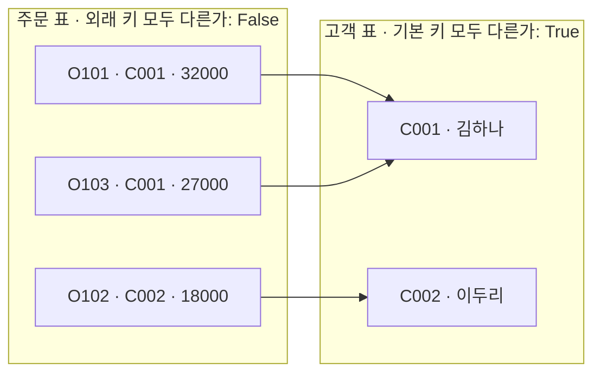
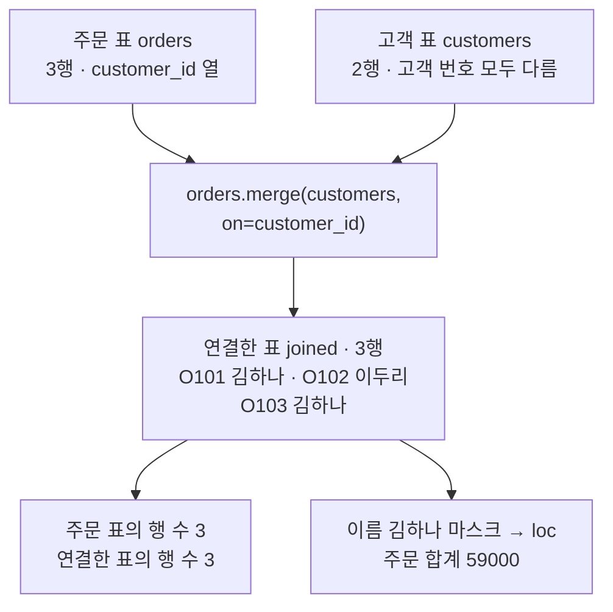
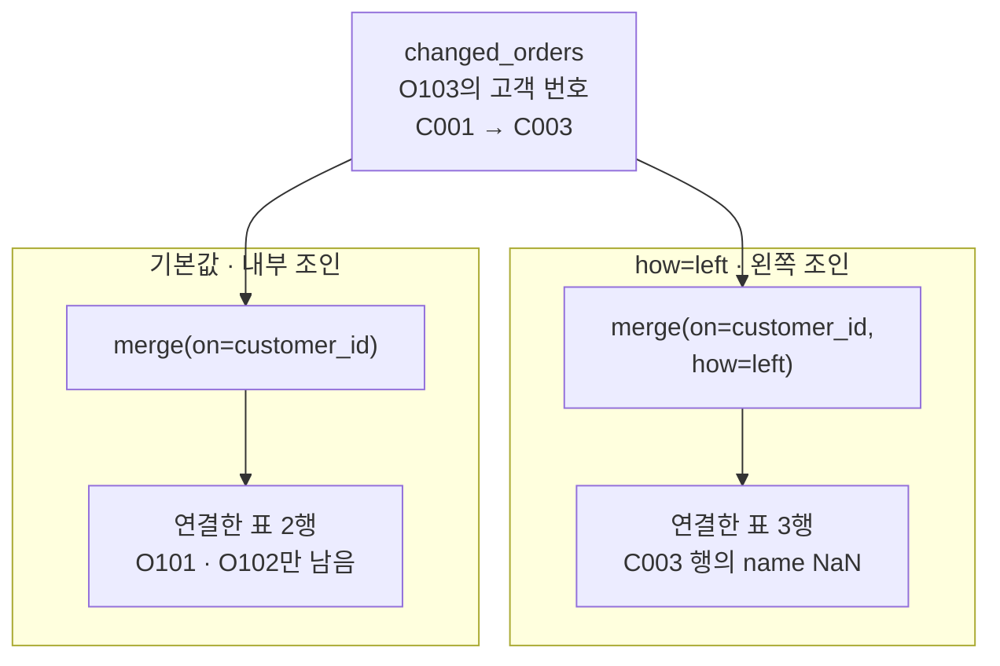
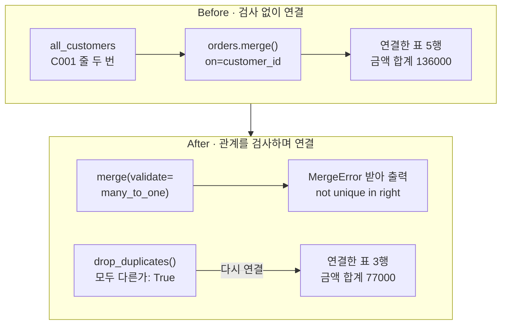

# 02-관계형-테이블과-키

## _src 본문 (HTML 원본)

```html
<!--meta: 강의 1h | 실습 2h | 코드 Jupyter Notebook | 새 용어 8 -->
<h2 id="b1"><span class="no">1</span>학습 목표</h2>
<div class="goal"><ul><li>고객 표의 기본 키와 주문 표의 외래 키를 구분하고, 키 열의 값이 겹치는지 출력에서 확인할 수 있습니다.</li><li>고객 번호로 두 표를 연결하고, 연결 전후의 행 수를 비교할 수 있습니다.</li><li>키가 겹치거나 짝이 없을 때 행 수가 바뀌는 이유를 설명하고, 검사 인자로 틀린 연결을 막을 수 있습니다.</li></ul></div>
<h2 id="b2"><span class="no">2</span>이 내용을 배우는 이유</h2>
<p>주문 파일에는 고객 이름 대신 고객 번호만 적는 경우가 많습니다. 에이전트가 「김하나 고객의 주문 합계」를 답하려면, 번호로 고객 표를 찾아 두 표를 이어야 합니다.</p>
<p>이 연결은 오류 없이 틀릴 수 있습니다. 고객 표에 같은 번호가 두 번 있으면 주문이 두 번 세어집니다. 고객 표에 없는 번호가 있으면 그 주문이 조용히 빠집니다.</p>
<p>그래서 이 절에서는 키 열의 값이 겹치는지 먼저 보고, 연결한 뒤 행 수를 비교합니다. 03절에서는 같은 두 표를 SQL로 잇고, 고객 번호로 주문을 찾는 조회 함수를 만듭니다.</p>
<p><strong>이 절의 질문</strong> — 고객 번호로 두 표를 이으면, 주문 행 수는 언제 그대로이고 언제 바뀔까요? 행 수를 지키려면 무엇을 확인해야 할까요?</p>
<h2 id="b3"><span class="no">3</span>앞에서 배운 내용</h2>
<p>01절에서는 <code>pd.read_csv()</code>로 주문 파일을 표로 읽었습니다. 상태 열을 <code>"paid"</code>와 비교해 마스크를 만들고, <code>loc</code>와 <code>sum()</code>으로 결제 완료 합계 59000을 냈습니다. 금액 열을 글자로 읽은 Before에서는 합계가 오류 없이 틀렸습니다.</p>
<p>Ch 2 03절에서는 딕셔너리의 키 하나에 값 하나를 짝지어 두고, 키로 값을 찾았습니다. 이 절의 기본 키도 번호 하나로 고객 한 명을 찾는 열입니다. 같은 절에서 목록을 복사한 메서드 <code>copy()</code>는 이번에 표를 복사할 때 씁니다.</p>
<p>Ch 2 05절에서는 오류 이름만 받는 <code>try/except</code>로 셀을 끝까지 실행했습니다. 이 절의 After도 같은 모양으로 pandas의 오류를 받습니다.</p>
<p>Ch 3 02절의 명령 <code>git merge</code>는 두 브랜치의 기록을 합쳤습니다. 이 절의 메서드 <code>merge()</code>는 이름만 같고, 두 표의 행을 키로 잇는 일을 합니다.</p>
<h2 id="b4"><span class="no">4</span>핵심 개념</h2>
<h3>비유로 시작하기</h3>
<p>가게 계산대에 주문 쪽지 세 장이 있다고 해 봅니다. 쪽지에는 손님 이름 대신 색 스티커만 붙어 있습니다. 옆 카드 상자에는 손님마다 카드가 한 장씩 있고, 카드에도 색 스티커가 붙어 있습니다.</p>
<p>쪽지의 스티커 색으로 상자에서 카드를 찾으면 손님을 알 수 있습니다. 한 손님이 두 번 주문하면 쪽지 두 장이 같은 카드를 가리킵니다.</p>
<p>표로 옮기면 쪽지 묶음이 주문 표, 카드 상자가 고객 표입니다. 카드의 스티커가 기본 키, 쪽지의 스티커가 외래 키입니다.</p>
<!-- 삽화 대기: figures/02-5-쪽지와-카드-상자.prompt.md (2026-09-16 2회 생성 모두 탈락, qa/upgrade/illustration-pending.md) -->
<h3>이 절에서 쓰는 말</h3>
<table><thead><tr><th>용어</th><th>뜻</th><th>이 절에서 보이는 모습</th></tr></thead><tbody>
<tr><td>기본 키(primary key)</td><td>표 안에서 행 하나를 구분하는 열. 값이 겹치면 안 됩니다</td><td>고객 표의 <code>customer_id</code>, 모두 다른가 <code>True</code></td></tr>
<tr><td>외래 키(foreign key)</td><td>다른 표의 기본 키를 가리키는 열. 값이 겹쳐도 됩니다</td><td>주문 표의 <code>customer_id</code>, <code>C001</code>이 두 번</td></tr>
<tr><td>다대일 관계(many-to-one)</td><td>한쪽 표의 여러 행이 다른 표의 한 행을 가리키는 관계</td><td>주문 O101·O103 → 고객 C001</td></tr>
<tr><td>정규화(normalization)</td><td>같은 사실을 한 곳에만 두도록 표를 나누는 일</td><td>고객 이름은 고객 표에만, 주문 표에는 번호만</td></tr>
<tr><td>조인(join)</td><td>키 값이 같은 행끼리 두 표의 열을 합치는 일</td><td><code>orders.merge(customers, on="customer_id")</code></td></tr>
<tr><td>내부 조인(inner join)</td><td>양쪽 표에 모두 있는 키의 행만 남기는 조인. 메서드 <code>merge()</code>의 기본값입니다</td><td>C003 주문이 빠진 2행</td></tr>
<tr><td>왼쪽 조인(left join)</td><td>왼쪽 표의 행을 모두 남기는 조인</td><td><code>how="left"</code>, 3행</td></tr>
<tr><td>결측값(missing value)</td><td>값이 없는 칸. pandas는 <code>NaN</code>으로 표시합니다</td><td>C003 행의 이름 칸</td></tr>
</tbody></table>
<h3>두 표로 나누고 번호로 잇기</h3>
<p>주문 줄마다 고객 이름을 적으면, 이름이 바뀔 때 그 고객의 주문 줄을 모두 고쳐야 합니다. 한 줄이라도 빠뜨리면 같은 고객이 두 이름으로 남습니다.</p>
<p>그래서 이름은 고객 표 한 곳에만 두고, 주문 표에는 고객 번호만 적습니다. 이렇게 같은 사실을 한 곳에만 두도록 표를 나누는 일이 정규화입니다. 이 절은 고객 표와 주문 표, 두 개로 나누는 가장 작은 모양만 씁니다.</p>
<p>나눈 두 표는 번호로 다시 잇습니다. 고객 표의 고객 번호는 기본 키라 모두 달라야 합니다. 주문 표의 고객 번호는 외래 키라 겹쳐도 됩니다.</p>
{{mermaid:02-1-두-표와-키|주문 표의 O101, O103, O102 행이 고객 번호로 고객 표의 C001 김하나와 C002 이두리 행을 가리키고, 칸 제목에 주문 표 쪽 모두 다른가 False, 고객 표 쪽 True가 적힌 그림|주문 두 건이 고객 C001 한 명을 가리킵니다. 고객 번호는 고객 표에서만 모두 다릅니다.}}
<p><strong>도식 읽기</strong> — 왼쪽에서 오른쪽으로 읽습니다. 왼쪽 칸은 주문 표, 오른쪽 칸은 고객 표이고, 초록 상자 하나가 행 하나입니다.</p>
<p>화살표는 주문 행의 고객 번호가 가리키는 고객 행입니다. 주문 O101과 O103에서 나온 화살표 두 개가 C001 김하나 행에 모입니다. 칸 제목 끝의 False와 True는 노트북의 <code>is_unique</code> 출력입니다. 주문 상자는 화살표가 겹치지 않게 O101, O103, O102 순서로 놓였습니다.</p>
<h3>연결한 표의 행 수로 확인합니다</h3>
<p>주문 표에서 조인하면 주문 행마다 짝이 맞는 고객 행을 찾아 열을 붙입니다. 짝이 하나씩이면 연결한 표의 행 수는 주문 행 수와 같습니다.</p>
<p>짝이 없거나 둘이면 행 수가 바뀝니다. 짝이 없는 주문은 내부 조인에서 빠지고, 짝이 둘인 주문은 두 줄이 됩니다. 그래서 연결한 뒤에는 행 수를 먼저 비교합니다.</p>
<h2 id="b5"><span class="no">5</span>실행 예제</h2>
<p>노트북은 임시 폴더에 고객 파일과 주문 파일을 만들고 표 두 개로 읽습니다. 두 표의 고객 번호 열이 겹치는지 본 뒤, 메서드 <code>merge()</code>로 연결합니다. 이어서 고객 번호 하나를 고객 표에 없는 값으로 바꿔 행 수를 다시 봅니다.</p>
<p>모델을 부르지 않으므로 API 키가 필요 없고 비용도 들지 않습니다. 교재 출력은 01절과 같은 pandas 3.0.5로 만들었습니다. 다른 버전에서는 자료형 이름 같은 출력 모양이 다를 수 있습니다.</p>
{{notebook:02-관계형-테이블과-키|example}}
<p class="look"><b>확인할 점</b> — 고객 표 쪽 출력이 <code>True</code>, 주문 표 쪽이 <code>False</code>인지 봅니다. 연결한 표가 3행이고, 이름 김하나가 O101과 O103 두 행에 붙었는지 확인합니다. 값 바꿔 보기에서는 행 수가 2로 줄었다가, <code>how="left"</code>에서 3으로 돌아오는지 봅니다.</p>
<h3>주문 표에 고객 이름 붙이기</h3>
<p>메서드 <code>merge()</code>는 주문 표 뒤에 붙여 씁니다. 괄호에는 오른쪽에 붙일 고객 표를 넣고, 키워드 인자 <code>on</code>에 고객 번호 열 이름을 적습니다. 결과는 두 표의 열을 모두 가진 새 표입니다.</p>
<p>연결한 표에는 이름 열이 있어서 01절의 마스크와 <code>loc</code>를 그대로 쓸 수 있습니다. 이름이 김하나인 행의 금액을 더하니 <code>김하나 고객의 주문 합계: 59000</code>이 나왔습니다.</p>
{{mermaid:02-2-두-표-연결|주문 표 3행과 고객 표 2행이 orders.merge(customers, on=customer_id)로 들어가 O101 김하나, O102 이두리, O103 김하나인 3행 표가 되고, 행 수 3과 3, 김하나 주문 합계 59000으로 이어지는 흐름도|주문 표에 고객 표를 고객 번호로 붙였습니다. 행 수는 3 그대로이고, 이름으로 고른 합계는 59000입니다.}}
<p><strong>도식 읽기</strong> — 위에서 아래로 읽습니다. 맨 위 초록 상자 두 개가 주문 표와 고객 표이고, 가운데 파란 상자가 실행한 연결 코드입니다.</p>
<p>연결 코드 아래 초록 상자가 연결한 표입니다. 주문 O101과 O103에는 김하나, O102에는 이두리가 붙었습니다. 맨 아래 노란 상자 두 개는 출력으로 확인한 값입니다. 왼쪽은 행 수 3과 3, 오른쪽은 김하나 고객의 주문 합계 59000입니다.</p>
<h3>값 하나 바꿔 보기: 짝이 없는 고객 번호</h3>
<p>주문 O103의 고객 번호를 고객 표에 없는 C003으로 바꾸고 같은 코드로 연결했습니다. 오류 없이 연결한 표가 2행이 되었고, O103 행이 빠졌습니다. 메서드 <code>merge()</code>는 인자 <code>how</code>를 적지 않으면 내부 조인을 하기 때문입니다.</p>
<p>인자 <code>how="left"</code>를 주면 왼쪽 조인이 되어 주문 세 행이 모두 남았습니다. 짝이 없는 O103 행의 이름 칸에는 결측값 <code>NaN</code>이 들어갔습니다.</p>
{{mermaid:02-3-짝-없는-키|O103의 고객 번호를 C003으로 바꾼 주문 표를 기본값 내부 조인으로 연결하면 O101과 O102만 남은 2행, how=left 왼쪽 조인으로 연결하면 C003 행의 이름이 NaN인 3행이 되는 비교 그림|짝이 없는 고객 번호. 내부 조인은 그 주문을 빼고, 왼쪽 조인은 이름 칸을 비워 남깁니다.}}
<p><strong>도식 읽기</strong> — 위에서 아래로 읽습니다. 맨 위 초록 상자는 O103의 고객 번호만 C003으로 바꾼 표입니다. 아래 두 칸은 같은 표를 두 방식으로 연결한 결과입니다.</p>
<p>왼쪽 칸은 인자를 적지 않은 기본값, 곧 내부 조인입니다. 노란 결과 상자에는 O101과 O102 두 행만 남았습니다. 오른쪽 칸은 <code>how=left</code>로 연결한 왼쪽 조인입니다. 세 행이 모두 남았고, C003 행의 이름이 NaN입니다.</p>
<h2 id="b6"><span class="no">6</span>일부러 실패해 보기</h2>
<p>Before에서는 지난달과 이번 달 고객 목록을 이어 붙인 파일을 씁니다. 두 목록에 모두 있던 C001 줄이 두 번 들어 있습니다. 이 고객 표에 주문 표를 검사 없이 연결하고, 행 수와 금액 합계를 봅니다.</p>
<p>After에서는 같은 연결에 인자 <code>validate="many_to_one"</code>을 줍니다. 검사에서 멈추면 겹친 줄을 <code>drop_duplicates()</code>로 지우고, 검사를 켠 채 다시 연결합니다.</p>
{{notebook:02-관계형-테이블과-키|failure}}
<p>Before에서 연결한 표는 5행이었습니다. 주문 O101과 O103이 두 줄씩 나왔고, 금액 합계는 <code>136000</code>이었습니다. 원래 주문 표의 합계 <code>77000</code>보다 59000이 많은데, 셀은 오류 없이 끝났습니다.</p>
<p>After에서는 검사를 켠 연결이 <code>Merge keys are not unique in right dataset; not a many-to-one merge</code> 오류를 냈습니다. 오른쪽 고객 표의 키가 겹쳐 다대일 연결이 아니라는 뜻입니다. 겹친 줄을 지운 뒤 다시 연결하니 3행, 합계 <code>77000</code>이었습니다.</p>
{{mermaid:02-4-겹친-키-비교|Before는 C001 줄이 두 번 든 고객 표를 검사 없이 연결해 5행, 금액 합계 136000이라는 빨간 결과로 이어지고, After는 validate=many_to_one 연결이 MergeError를 받아 출력하고, drop_duplicates 뒤 다시 연결해 3행, 합계 77000으로 이어지는 비교 그림|C001 줄이 겹친 고객 표. 검사 없이 이으면 5행과 136000, 검사를 켜면 멈추고 고친 뒤 3행과 77000입니다.}}
<p><strong>도식 읽기</strong> — 위 칸이 Before, 아래 칸이 After이고, 칸마다 왼쪽에서 오른쪽으로 읽습니다. 파란 상자는 실행한 코드이고, 초록 상자는 C001 줄이 두 번 든 고객 표입니다.</p>
<p>위 칸 끝의 빨간 상자는 틀린 결과인 5행과 합계 136000입니다. 아래 칸 첫 줄은 검사를 켠 연결이 MergeError를 내고, 코드가 그 오류를 받아 출력한 흐름입니다. 받아서 출력한 오류라 노란 상자로 두었습니다. 둘째 줄은 겹친 줄을 지워 True를 확인하고, 다시 연결해 3행과 77000을 얻은 흐름입니다.</p>
<h2 id="b7"><span class="no">7</span>주의할 점과 실무 메모</h2>
<ul><li>연결한 뒤에는 행 수를 원래 표와 비교합니다. 노트북에서 행이 줄어든 경우(2행)와 늘어난 경우(5행) 모두 오류가 나지 않았습니다.</li>
<li>설명서에 따르면 인자 <code>validate="many_to_one"</code>은 오른쪽 표의 키가 모두 다른지만 검사합니다. 짝이 없는 키가 있는 표에 이 인자를 준 경우는 이번에 실행하지 않았습니다.</li>
<li>메서드 <code>drop_duplicates()</code>는 인자 없이 부르면 모든 열이 같은 줄만 지웁니다. 번호는 같고 이름이 다른 줄은 이번에 만들어 보지 않았습니다. 그런 줄은 어느 쪽이 맞는지 원래 기록을 보고 정해야 합니다.</li>
<li>기본 키에는 값이 비어 있으면 안 된다는 조건도 있습니다. 고객 번호가 빈 줄은 이번에 실행하지 않았습니다.</li>
<li>고객 표에는 이름 같은 개인 정보가 들어갑니다. 01절처럼 저장소에 올리기 전에 <code>git status --short</code>로 목록을 확인하고, 필요하면 무시 규칙에 적습니다.</li>
<li>교재 출력은 Linux의 pandas 3.0.5, Python 3.12.13으로 만들었습니다. 다른 운영체제와 pandas 2 이하에서는 실행하지 않았습니다.</li></ul>
<h2 id="b8"><span class="no">8</span>정리와 다음 절</h2>
<ul><li>기본 키는 표 안에서 행 하나를 구분하는 열이라 값이 겹치면 안 됩니다. 외래 키는 다른 표의 기본 키를 가리키고, 겹쳐도 됩니다.</li><li>메서드 <code>merge()</code>로 연결한 뒤에는 행 수를 주문 표와 비교합니다. 짝 없는 키는 행을 줄였고, 겹친 키는 행을 늘렸습니다.</li><li>인자 <code>validate="many_to_one"</code>은 오른쪽 표의 키가 겹치면 연결을 멈춥니다.</li></ul>
<p><strong>다음 학습과 이어지는 지점</strong> — 03절에서는 같은 고객 표와 주문 표를 SQLite 데이터베이스에 만듭니다. SQL 문장으로 두 표를 잇고, 고객 번호로 주문을 조회합니다.</p>
<h2 id="b9"><span class="no">9</span>복습 문제</h2><details class="quiz"><summary>문제와 해설</summary>
<p class="quiz-q">1. 이 절의 고객 표와 주문 표에서 기본 키와 외래 키는 각각 어느 열인가요? · 기초</p><p class="quiz-a"><b>해설</b> — 고객 표의 <code>customer_id</code>가 기본 키, 주문 표의 <code>customer_id</code>가 외래 키입니다. 열 이름은 같지만 고객 표에서는 모두 달라야 합니다. 주문 표에서는 C001처럼 겹쳐도 됩니다.</p>
<p class="quiz-q">2. 주문 표에 고객 이름을 적지 않고 고객 번호만 적은 이유는 무엇인가요? · 기초</p><p class="quiz-a"><b>해설</b> — 이름을 고객 표 한 곳에만 두면, 이름이 바뀔 때 고객 표의 한 줄만 고치면 됩니다. 주문 줄마다 이름을 적으면 그 고객의 주문 줄을 모두 고쳐야 합니다.</p>
<p class="quiz-q">3. O103의 고객 번호를 C003으로 바꾸자 연결한 표가 2행이 되었습니다. 왜 그렇고, 주문 세 행을 모두 남기려면 어떻게 하나요? · 적용</p><p class="quiz-a"><b>해설</b> — 인자 <code>how</code>를 적지 않은 <code>merge()</code>는 내부 조인이라, 고객 표에 없는 C003의 주문을 뺐습니다. 인자 <code>how="left"</code>를 주면 왼쪽 조인이 되어 세 행이 남고, O103의 이름 칸은 <code>NaN</code>이 됩니다.</p>
<p class="quiz-q">4. C001 줄이 두 번 든 고객 표로 연결했더니 금액 합계가 136000이 되었습니다. 늘어난 59000은 어디서 왔나요? · 분석</p><p class="quiz-a"><b>해설</b> — 주문 O101과 O103이 C001 고객 행 두 개와 각각 짝지어져 두 줄씩 되었습니다. 한 번 더 더해진 32000과 27000의 합이 59000입니다.</p>
<p class="quiz-q">5. 인자 <code>validate="many_to_one"</code>은 무엇을 검사하고, Before의 고객 표에서는 어떤 결과를 냈나요? · 분석</p><p class="quiz-a"><b>해설</b> — 왼쪽 표의 키는 겹쳐도 되고, 오른쪽 표의 키는 모두 달라야 하는지 검사합니다. Before에서 쓴 고객 표는 C001이 겹쳐 <code>MergeError</code>가 났고, 틀린 표를 만들기 전에 멈췄습니다.</p>
</details>
<h2 id="b10"><span class="no">10</span>참고 자료</h2>
<ul><li><a href="https://pandas.pydata.org/docs/reference/api/pandas.DataFrame.merge.html">pandas 공식 문서: DataFrame.merge</a> · 확인 2026-09-16 · 실행 pandas 3.0.5</li><li><a href="https://pandas.pydata.org/docs/reference/api/pandas.DataFrame.drop_duplicates.html">pandas 문서: drop_duplicates</a> · 확인 2026-09-16 · 실행 pandas 3.0.5</li><li><a href="https://pandas.pydata.org/docs/reference/api/pandas.Series.is_unique.html">pandas 공식 문서: Series.is_unique</a> · 확인 2026-09-16 · 실행 pandas 3.0.5</li><li><a href="https://www.sqlite.org/foreignkeys.html">SQLite 공식 문서: Foreign Key Support</a> · 확인 2026-09-16 · 03절에서 사용</li></ul>
```

## 노트북 셀 (순서대로)

### [0] markdown {'html': 'skip'}

# 관계형 테이블과 키

**이 노트북에서 할 일**

1. 고객 표와 주문 표를 CSV 파일로 저장하고, 두 표를 잇는 고객 번호 열을 확인합니다.
2. 고객 번호로 두 표를 연결하고, 연결한 뒤에도 주문 행 수가 그대로인지 확인합니다.
3. 고객 번호가 두 번 적힌 고객 표로 연결해 행이 늘어나는 장면을 보고, 검사로 막습니다.

**준비물** — API 키 불필요. 고객 파일과 주문 파일은 노트북이 임시 폴더에 직접 만듭니다.
모델 호출은 0번이고 비용은 들지 않습니다. 실행 시간은 1분 이내입니다.

**기준 pandas 버전** — 01절과 같은 pandas 3.0.5를 씁니다. 실습 폴더에 고정한 버전입니다.
교재 출력도 이 버전(Python 3.12.13)으로 만들었습니다. 이 버전은 Python 3.11 이상에서 설치됩니다.
pandas 2 이하에서는 자료형 이름 같은 출력 모양이 다를 수 있고, 이번에 실행하지 않았습니다.

실습 폴더 `labs/part1/ch04-data-tools`에서 Ch 1 3절처럼 `uv sync --locked`로 환경을 만듭니다.
커널에서 이 폴더의 `.venv`를 고른 뒤 첫 셀부터 순서대로 실행합니다.

### [1] markdown {'html': 'skip'}

## 오늘 볼 그림


왼쪽 칸은 주문 표, 오른쪽 칸은 고객 표이고, 초록 상자 하나가 행 하나입니다.
화살표는 주문 행의 고객 번호가 가리키는 고객 행입니다. 주문 O101과 O103의 화살표가 모두 김하나 행으로 갑니다.
칸 제목 끝의 False와 True는 표마다 고객 번호가 모두 다른지 확인한 출력입니다.
주문 상자는 화살표가 겹치지 않게 O101, O103, O102 순서로 놓였습니다.

### [2] markdown {}

## 1. 준비

이 노트북은 CSV 파일 세 개를 만듭니다. 01절처럼 빈 임시 폴더를 만들고, 그 폴더로 작업 위치를 옮깁니다.
실습 폴더에는 파일이 생기지 않습니다.

코드의 import 두 줄은 Ch 2 07절에서 배운 import 문입니다. 표준 라이브러리 모듈 os와 tempfile을 불러옵니다.

### [3] code {'execution': {'iopub.execute_input': '2026-09-16T16:17:13.011203Z', 'iopub.status.busy': '2026-09-16T16:17:13.010945Z', 'iopub.status.idle': '2026-09-16T16:17:13.017678Z', 'shell.execute_reply': '2026-09-16T16:17:13.016908Z'}, 'lesson_role': 'setup'}

```python
# CSV 파일을 둘 빈 임시 폴더를 만들고, 그 폴더로 작업 위치를 옮깁니다
import os
import tempfile

# mkdtemp()는 운영체제 임시 폴더 안에 새 폴더를 만들고 그 경로를 반환합니다
practice_folder = tempfile.mkdtemp(prefix="ch04-02-")
# chdir()는 터미널의 cd처럼 현재 작업 폴더를 옮깁니다
os.chdir(practice_folder)
file_names = os.listdir()
print("현재 작업 폴더의 파일:", file_names)
```

출력:
```
현재 작업 폴더의 파일: []

```

### [4] markdown {}

**결과 읽기** — 현재 작업 폴더의 파일은 `[]`로, 빈 폴더에서 시작합니다.
폴더의 경로는 컴퓨터마다 달라서 출력하지 않았습니다.

### [5] markdown {}

## 2. pandas 불러오기

01절과 같은 줄 `import pandas as pd`로 pandas를 불러옵니다. 키워드 `as`는 불러온 모듈에 별명 pd를 붙입니다.
실행 전에 예상합니다. 01절과 같은 버전 3.0.5가 출력될 것입니다.

### [6] code {'execution': {'iopub.execute_input': '2026-09-16T16:17:13.019318Z', 'iopub.status.busy': '2026-09-16T16:17:13.019159Z', 'iopub.status.idle': '2026-09-16T16:17:13.124036Z', 'shell.execute_reply': '2026-09-16T16:17:13.123576Z'}}

```python
# 표 데이터를 다루는 pandas를 별명 pd로 불러옵니다
import pandas as pd

# 설치된 pandas 버전을 출력합니다
print("pandas 버전:", pd.__version__)
```

출력:
```
pandas 버전: 3.0.5

```

### [7] markdown {}

**결과 읽기** — `pandas 버전: 3.0.5`로 예상과 같습니다.
다른 버전이 나오면 커널이 실습 폴더의 `.venv`인지 확인합니다.

### [8] markdown {}

## 3. 고객 파일 만들기

이번 절은 표 두 개를 씁니다. 먼저 고객 두 명을 적은 `customers.csv`를 만듭니다.
열은 고객 번호 `customer_id`와 이름 `name`입니다.

고객 번호는 고객 한 명에게 하나씩 붙인 번호입니다. 이름이 같은 고객이 두 명 있어도 번호로 구분할 수 있습니다.
파일은 01절처럼 여러 줄 글 `"""…"""`와 `with open()` 블록으로 저장합니다.

실행 전에 예상합니다. 폴더 목록에 `customers.csv` 하나가 보일 것입니다.

### [9] code {'execution': {'iopub.execute_input': '2026-09-16T16:17:13.124757Z', 'iopub.status.busy': '2026-09-16T16:17:13.124668Z', 'iopub.status.idle': '2026-09-16T16:17:13.126926Z', 'shell.execute_reply': '2026-09-16T16:17:13.126599Z'}}

```python
# 고객 두 명을 CSV 글로 적어 customers.csv 파일에 저장합니다
customer_text = """customer_id,name
C001,김하나
C002,이두리
"""
with open("customers.csv", "w", encoding="utf-8") as file:
    file.write(customer_text)
file_names = os.listdir()
print("현재 작업 폴더의 파일:", file_names)
```

출력:
```
현재 작업 폴더의 파일: ['customers.csv']

```

### [10] markdown {}

**결과 읽기** — 현재 작업 폴더의 파일은 `['customers.csv']`로 예상과 같습니다.
이 파일은 열 이름 한 줄과 고객 두 줄, 모두 세 줄입니다.

### [11] markdown {}

## 4. 주문 파일 만들기

주문 파일은 01절의 주문 세 건과 같습니다. 다른 점은 둘째 열에 고객 번호 `customer_id`를 더한 것입니다.
주문 O101과 O103은 고객 C001, 주문 O102는 고객 C002의 주문입니다.

주문 줄에는 고객 이름을 적지 않고 번호만 적습니다. 이름은 고객 표 한 곳에만 둡니다.
그래야 고객 이름이 바뀌어도 고객 표의 한 줄만 고치면 됩니다.

폴더 목록은 Ch 2 03절의 `sorted()`로 정렬해 출력합니다. 운영체제마다 목록 순서가 다를 수 있기 때문입니다.
실행 전에 예상합니다. 폴더 목록에 파일 두 개가 보일 것입니다.

### [12] code {'execution': {'iopub.execute_input': '2026-09-16T16:17:13.127650Z', 'iopub.status.busy': '2026-09-16T16:17:13.127591Z', 'iopub.status.idle': '2026-09-16T16:17:13.129381Z', 'shell.execute_reply': '2026-09-16T16:17:13.129060Z'}}

```python
# 고객 번호 열을 더한 주문 세 건을 orders.csv 파일에 저장합니다
order_text = """order_id,customer_id,status,amount
O101,C001,paid,32000
O102,C002,pending,18000
O103,C001,paid,27000
"""
with open("orders.csv", "w", encoding="utf-8") as file:
    file.write(order_text)
# 파일 이름을 알파벳 순서로 정렬해 출력합니다
file_names = sorted(os.listdir())
print("현재 작업 폴더의 파일:", file_names)
```

출력:
```
현재 작업 폴더의 파일: ['customers.csv', 'orders.csv']

```

### [13] markdown {}

**결과 읽기** — 현재 작업 폴더의 파일은 `['customers.csv', 'orders.csv']`로 예상과 같습니다.
주문 파일은 열 이름 한 줄과 주문 세 줄입니다.

### [14] markdown {}

## 5. 두 표 읽기

두 파일을 01절의 `pd.read_csv()`로 읽어 표 두 개를 만듭니다.
실행 전에 예상합니다. 고객 표는 2행, 주문 표는 3행이고, 두 표 모두에 고객 번호 열이 있을 것입니다.

### [15] code {'execution': {'iopub.execute_input': '2026-09-16T16:17:13.130018Z', 'iopub.status.busy': '2026-09-16T16:17:13.129957Z', 'iopub.status.idle': '2026-09-16T16:17:13.134020Z', 'shell.execute_reply': '2026-09-16T16:17:13.133583Z'}}

```python
# 두 CSV 파일을 읽어 고객 표와 주문 표를 만듭니다
customers = pd.read_csv("customers.csv")
print("고객 표:")
print(customers)
orders = pd.read_csv("orders.csv")
print("주문 표:")
print(orders)
```

출력:
```
고객 표:
  customer_id name
0        C001  김하나
1        C002  이두리
주문 표:
  order_id customer_id   status  amount
0     O101        C001     paid   32000
1     O102        C002  pending   18000
2     O103        C001     paid   27000

```

### [16] markdown {}

**결과 읽기** — 라벨 줄 `고객 표:` 아래의 표는 `김하나`와 `이두리` 두 행입니다.
라벨 줄 `주문 표:` 아래의 표는 `O101`, `O102`, `O103` 세 행이고, 둘째 열이 `customer_id`입니다.

주문 표에서 고객 번호 `C001`은 0번과 2번 행에 두 번 나옵니다. 김하나 고객이 주문을 두 번 했다는 뜻입니다.
이름 `김하나`는 주문 표에 없고 고객 표에만 있습니다.

### [17] markdown {}

## 6. 기본 키와 외래 키 확인하기

표 안에서 행 하나를 구분하는 열을 기본 키(primary key)라고 부릅니다. 한 반의 출석 번호처럼 같은 번호가 두 사람에게 붙지 않습니다.
이 절의 고객 표에서는 고객 번호 열이 기본 키입니다. 그래서 고객 번호가 모두 달라야 합니다.

다른 표의 기본 키를 가리키는 열은 외래 키(foreign key)라고 부릅니다. 주문 표의 고객 번호 열이 외래 키입니다.
한 고객이 여러 번 주문할 수 있으므로, 외래 키에는 같은 번호가 여러 번 나와도 됩니다.

시리즈의 속성 `is_unique`에는 값이 모두 다르면 `True`, 겹치는 값이 있으면 `False`가 들어 있습니다.
실행 전에 예상합니다. 고객 표 쪽은 True, 주문 표 쪽은 C001이 두 번이라 False일 것입니다.

### [18] code {'execution': {'iopub.execute_input': '2026-09-16T16:17:13.134678Z', 'iopub.status.busy': '2026-09-16T16:17:13.134619Z', 'iopub.status.idle': '2026-09-16T16:17:13.136497Z', 'shell.execute_reply': '2026-09-16T16:17:13.136170Z'}}

```python
# 두 표의 고객 번호 열에 겹치는 값이 있는지 확인합니다
customer_ids = customers["customer_id"]
print("고객 표의 고객 번호가 모두 다른가:", customer_ids.is_unique)
# 주문 표의 고객 번호는 외래 키라 겹쳐도 됩니다
order_customer_ids = orders["customer_id"]
print("주문 표의 고객 번호가 모두 다른가:", order_customer_ids.is_unique)
```

출력:
```
고객 표의 고객 번호가 모두 다른가: True
주문 표의 고객 번호가 모두 다른가: False

```

### [19] markdown {}

**결과 읽기** — 첫 줄은 `고객 표의 고객 번호가 모두 다른가: True`로, 고객 번호가 기본 키 조건을 지킵니다.
둘째 줄은 `주문 표의 고객 번호가 모두 다른가: False`입니다. 외래 키는 겹쳐도 되므로 예상과 같습니다.

주문 여러 건이 고객 한 명을 가리키는 이 관계를 다대일(many-to-one) 관계라고 부릅니다.
주문 쪽이 「다(여럿)」, 고객 쪽이 「일(하나)」입니다.

### [20] markdown {}

## 7. 고객 번호로 두 표 연결하기

두 표에서 키 값이 같은 행끼리 열을 합치는 일을 조인(join)이라고 부릅니다. 주문 표의 메서드 `merge()`가 이 일을 합니다.
괄호에는 오른쪽에 붙일 표를 넣고, 키워드 인자 `on`에 비교할 열 이름을 적습니다.
Ch 3 02절의 `git merge`와 이름은 같지만, 여기서는 브랜치가 아니라 표 두 개를 합칩니다.

주문 행마다 고객 행이 하나씩 붙어야 합니다. 그래서 연결한 표의 행 수는 주문 표의 행 수와 같아야 합니다.
실행 전에 예상합니다. 주문 세 행 오른쪽에 이름 열이 붙고, 행 수는 3일 것입니다.

### [21] code {'execution': {'iopub.execute_input': '2026-09-16T16:17:13.137172Z', 'iopub.status.busy': '2026-09-16T16:17:13.137118Z', 'iopub.status.idle': '2026-09-16T16:17:13.140470Z', 'shell.execute_reply': '2026-09-16T16:17:13.140100Z'}}

```python
# 주문 표에 고객 표를 고객 번호로 연결합니다
joined = orders.merge(customers, on="customer_id")
print("연결한 표:")
print(joined)
print("주문 표의 행 수:", len(orders))
print("연결한 표의 행 수:", len(joined))
# 주문 한 건에 고객 한 명씩 붙었다면 행 수가 같습니다
assert len(joined) == len(orders)
```

출력:
```
연결한 표:
  order_id customer_id   status  amount name
0     O101        C001     paid   32000  김하나
1     O102        C002  pending   18000  이두리
2     O103        C001     paid   27000  김하나
주문 표의 행 수: 3
연결한 표의 행 수: 3

```

### [22] markdown {}

**결과 읽기** — 연결한 표의 오른쪽 끝에 이름 열 `name`이 붙었습니다.
고객 번호가 같은 `O101`과 `O103` 행에는 같은 이름 `김하나`가 들어갔습니다.
마지막 두 줄은 `주문 표의 행 수: 3`, `연결한 표의 행 수: 3`으로 예상과 같습니다.

### [23] markdown {}

## 8. 연결한 표에서 고객 이름으로 금액 모으기

이제 주문 표만으로는 답할 수 없던 질문에 답할 수 있습니다. 「김하나 고객의 주문 금액 합계는 얼마인가?」입니다.
01절의 마스크, `loc`, `sum()`을 연결한 표에 그대로 씁니다.

실행 전에 예상합니다. 김하나 고객의 주문은 O101 32000과 O103 27000이므로 합계는 59000일 것입니다.

### [24] code {'execution': {'iopub.execute_input': '2026-09-16T16:17:13.141143Z', 'iopub.status.busy': '2026-09-16T16:17:13.141083Z', 'iopub.status.idle': '2026-09-16T16:17:13.143415Z', 'shell.execute_reply': '2026-09-16T16:17:13.143047Z'}}

```python
# 연결한 표에서 이름이 김하나인 행의 금액만 꺼내 합계를 냅니다
name_mask = joined["name"] == "김하나"
kim_amounts = joined.loc[name_mask, "amount"]
print("김하나 고객의 금액:")
print(kim_amounts)
kim_total = kim_amounts.sum()
print("김하나 고객의 주문 합계:", kim_total)
```

출력:
```
김하나 고객의 금액:
0    32000
2    27000
Name: amount, dtype: int64
김하나 고객의 주문 합계: 59000

```

### [25] markdown {}

**결과 읽기** — 금액 시리즈에 `32000`과 `27000`이 인덱스 0, 2와 함께 남았습니다.
마지막 줄은 `김하나 고객의 주문 합계: 59000`으로 예상과 같습니다.
01절의 결제 완료 합계와 같은 숫자인 것은, 김하나 고객의 두 주문이 마침 모두 결제 완료이기 때문입니다.

### [26] markdown {}

## 9. 값 하나 바꿔 보기 — O103의 고객 번호를 C003으로

주문 O103의 고객 번호 하나만 `C001`에서 `C003`으로 바꿉니다. 고객 표에는 C003이 없습니다.
고객 등록보다 주문이 먼저 들어온 경우라고 생각합니다.

원래 표는 그대로 두려고, Ch 2 03절에서 목록에 쓴 메서드 `copy()`로 표를 복사합니다.
대입 줄 `changed_orders.loc[2, "customer_id"] = "C003"`은 01절에서 마스크를 넣던 자리에 인덱스 번호를 넣은 모양입니다.
대입 기호 왼쪽에 `loc[행, 열]`을 쓰면 그 칸을 읽지 않고 새 값을 저장합니다. 숫자 2는 주문 O103 행의 인덱스이고, 복사한 표만 바뀝니다.

메서드 `merge()`는 키워드 인자 `how`를 적지 않으면 양쪽 표에 모두 있는 키의 행만 남깁니다. 이 방식을 내부 조인(inner join)이라고 부릅니다.
실행 전에 예상합니다. 고객 번호 C003은 고객 표에 없으므로 O103 행이 빠지고, 연결한 표는 2행일 것입니다.

### [27] code {'execution': {'iopub.execute_input': '2026-09-16T16:17:13.144094Z', 'iopub.status.busy': '2026-09-16T16:17:13.144040Z', 'iopub.status.idle': '2026-09-16T16:17:13.147199Z', 'shell.execute_reply': '2026-09-16T16:17:13.146791Z'}}

```python
# 표를 복사해 O103의 고객 번호만 C003으로 바꾸고 다시 연결합니다
changed_orders = orders.copy()
changed_orders.loc[2, "customer_id"] = "C003"
changed_joined = changed_orders.merge(customers, on="customer_id")
print("연결한 표:")
print(changed_joined)
print("주문 표의 행 수:", len(changed_orders))
print("연결한 표의 행 수:", len(changed_joined))
```

출력:
```
연결한 표:
  order_id customer_id   status  amount name
0     O101        C001     paid   32000  김하나
1     O102        C002  pending   18000  이두리
주문 표의 행 수: 3
연결한 표의 행 수: 2

```

### [28] markdown {}

**결과 읽기** — 연결한 표에는 `O101`과 `O102` 두 행만 남았습니다.
행 수는 `주문 표의 행 수: 3`, `연결한 표의 행 수: 2`로 달라졌습니다.

오류는 나지 않았습니다. 고객을 찾지 못한 주문 O103이 조용히 빠졌습니다.
행 수를 비교하지 않으면 주문 하나가 사라진 줄 모르고 넘어갈 수 있습니다.

### [29] markdown {}

## 10. 왼쪽 조인으로 주문 행 모두 남기기

주문을 하나도 빼지 않으려면 키워드 인자 `how="left"`를 줍니다. 왼쪽 표인 주문 표의 행을 모두 남기는 왼쪽 조인(left join)입니다.
오른쪽 표에서 짝을 찾지 못한 칸은 값 없이 비워 둡니다.

실행 전에 예상합니다. 주문 세 행이 모두 남고, O103 행의 이름 칸만 비어 있을 것입니다.

### [30] code {'execution': {'iopub.execute_input': '2026-09-16T16:17:13.147776Z', 'iopub.status.busy': '2026-09-16T16:17:13.147713Z', 'iopub.status.idle': '2026-09-16T16:17:13.150314Z', 'shell.execute_reply': '2026-09-16T16:17:13.150004Z'}}

```python
# 왼쪽 표(주문 표)의 행을 모두 남기는 방식으로 같은 두 표를 연결합니다
left_joined = changed_orders.merge(customers, on="customer_id", how="left")
print("왼쪽 조인한 표:")
print(left_joined)
print("연결한 표의 행 수:", len(left_joined))
assert len(left_joined) == len(changed_orders)
```

출력:
```
왼쪽 조인한 표:
  order_id customer_id   status  amount name
0     O101        C001     paid   32000  김하나
1     O102        C002  pending   18000  이두리
2     O103        C003     paid   27000  NaN
연결한 표의 행 수: 3

```

### [31] markdown {}

**결과 읽기** — 행 수는 `연결한 표의 행 수: 3`으로, 주문이 모두 남았습니다.
고객 번호가 `C003`인 행의 이름 칸에는 `NaN`이 들어갔습니다.

값이 없는 칸에 pandas가 적는 표시가 NaN(not a number)입니다. 이런 칸을 결측값이라고 부릅니다.
앞 셀에서 행이 줄어든 원인이 이 빈 이름 칸으로 드러났습니다.

### [32] markdown {'lesson_part': 'before'}

## 11. Before — 고객 번호가 두 번 적힌 고객 표로 연결하기

지난달 고객 목록과 이번 달 고객 목록을 한 파일로 이어 붙였다고 해 봅니다.
두 목록에 모두 있던 김하나 고객의 줄이 두 번 들어갔습니다.

이 파일을 `all_customers.csv`로 저장하고 표로 읽습니다.
실행 전에 예상합니다. 고객 표가 3행이 되고, C001 줄이 두 번 보일 것입니다.

### [33] code {'execution': {'iopub.execute_input': '2026-09-16T16:17:13.150995Z', 'iopub.status.busy': '2026-09-16T16:17:13.150913Z', 'iopub.status.idle': '2026-09-16T16:17:13.153401Z', 'shell.execute_reply': '2026-09-16T16:17:13.153058Z'}, 'lesson_part': 'before'}

```python
# Before: C001 줄이 두 번 들어간 고객 파일을 만들어 표로 읽습니다
all_customer_text = """customer_id,name
C001,김하나
C002,이두리
C001,김하나
"""
with open("all_customers.csv", "w", encoding="utf-8") as file:
    file.write(all_customer_text)
all_customers = pd.read_csv("all_customers.csv")
print("고객 표:")
print(all_customers)
```

출력:
```
고객 표:
  customer_id name
0        C001  김하나
1        C002  이두리
2        C001  김하나

```

### [34] markdown {'lesson_part': 'before'}

**결과 읽기** — 인덱스 0과 2인 두 행이 모두 `C001`, `김하나`입니다.
이 표의 고객 번호는 더 이상 기본 키 조건을 지키지 못합니다.

이 고객 표에 앞의 주문 표를 연결하고 행 수를 봅니다.
실행 전에 예상합니다. 주문은 세 건이므로, 행 수 3이 나와야 맞습니다.

### [35] code {'execution': {'iopub.execute_input': '2026-09-16T16:17:13.153969Z', 'iopub.status.busy': '2026-09-16T16:17:13.153918Z', 'iopub.status.idle': '2026-09-16T16:17:13.156413Z', 'shell.execute_reply': '2026-09-16T16:17:13.156166Z'}, 'lesson_part': 'before'}

```python
# Before: 고객 번호가 겹치는 고객 표에 주문 표를 연결합니다
wrong_joined = orders.merge(all_customers, on="customer_id")
print("연결한 표:")
print(wrong_joined)
print("주문 표의 행 수:", len(orders))
print("연결한 표의 행 수:", len(wrong_joined))
```

출력:
```
연결한 표:
  order_id customer_id   status  amount name
0     O101        C001     paid   32000  김하나
1     O101        C001     paid   32000  김하나
2     O102        C002  pending   18000  이두리
3     O103        C001     paid   27000  김하나
4     O103        C001     paid   27000  김하나
주문 표의 행 수: 3
연결한 표의 행 수: 5

```

### [36] markdown {'lesson_part': 'before'}

**결과 읽기** — 예상과 달리 마지막 줄은 `연결한 표의 행 수: 5`입니다.
표를 보면 주문 `O101`과 `O103`이 두 줄씩 나옵니다.
주문 한 건이 같은 번호의 고객 행 두 개와 각각 짝지어졌기 때문입니다.

행이 늘면 금액 합계도 달라집니다. 원래 주문 표와 연결한 표의 금액 합계를 비교합니다.
실행 전에 예상합니다. 주문 표의 합계는 01절과 같은 77000일 것입니다.

### [37] code {'execution': {'iopub.execute_input': '2026-09-16T16:17:13.157026Z', 'iopub.status.busy': '2026-09-16T16:17:13.156977Z', 'iopub.status.idle': '2026-09-16T16:17:13.158870Z', 'shell.execute_reply': '2026-09-16T16:17:13.158531Z'}, 'lesson_part': 'before'}

```python
# Before: 원래 주문 표와 연결한 표의 금액 합계를 비교합니다
original_total = orders["amount"].sum()
print("주문 표의 금액 합계:", original_total)
wrong_total = wrong_joined["amount"].sum()
print("연결한 표의 금액 합계:", wrong_total)
```

출력:
```
주문 표의 금액 합계: 77000
연결한 표의 금액 합계: 136000

```

### [38] markdown {'lesson_part': 'before'}

**결과 읽기** — 첫 줄은 `주문 표의 금액 합계: 77000`이고, 둘째 줄은 `연결한 표의 금액 합계: 136000`입니다.
늘어난 59000은 두 번 들어간 O101 32000과 O103 27000을 더한 값입니다.

셀은 오류 없이 끝났습니다. 이 표로 매출을 보고하면 김하나 고객의 주문이 두 배로 잡힙니다.

### [39] markdown {'lesson_part': 'after'}

## 12. After — 연결할 때 관계를 검사하고, 겹친 줄 지우기

메서드 `merge()`에 키워드 인자 `validate="many_to_one"`을 주면, 연결한 표를 만들기 전에 키를 검사합니다.
왼쪽 표의 키는 겹쳐도 되고, 오른쪽 표의 키는 모두 달라야 한다는 검사입니다. 6절에서 본 다대일 관계를 그대로 적은 값입니다.

검사를 통과하지 못하면 pandas는 오류 MergeError를 냅니다. 이 오류 이름은 pandas 안의 errors 모듈에 있습니다.
그래서 `pd.errors.MergeError`처럼 점으로 이어 적습니다. Ch 2 05절처럼 이 오류 이름만 받는 `try/except`로 감쌉니다.

실행 전에 예상합니다. 고객 번호 C001이 겹치므로 오류 메시지가 출력될 것입니다.

### [40] code {'execution': {'iopub.execute_input': '2026-09-16T16:17:13.159391Z', 'iopub.status.busy': '2026-09-16T16:17:13.159343Z', 'iopub.status.idle': '2026-09-16T16:17:13.162291Z', 'shell.execute_reply': '2026-09-16T16:17:13.161959Z'}, 'lesson_part': 'after'}

```python
# After: 다대일 관계를 검사하며 같은 두 표를 연결해 봅니다
try:
    orders.merge(all_customers, on="customer_id", validate="many_to_one")
except pd.errors.MergeError as error:
    print("연결 오류:", error)
```

출력:
```
연결 오류: Merge keys are not unique in right dataset; not a many-to-one merge

Duplicates in right:
 customer_id
       C001 ...

```

### [41] markdown {'lesson_part': 'after'}

**결과 읽기** — 첫 줄은 `연결 오류: Merge keys are not unique in right dataset; not a many-to-one merge`입니다.
오른쪽 표의 키가 겹쳐서 다대일 연결이 아니라는 뜻입니다.
아래 `Duplicates in right:` 줄 밑에는 겹친 고객 번호 `C001`이 보입니다.

틀린 표를 만들기 전에 연결 단계에서 멈췄습니다. 5행짜리 표와 틀린 합계는 만들어지지 않습니다.

### [42] markdown {'lesson_part': 'after'}

이제 고객 표에서 겹친 줄을 지웁니다. 메서드 `drop_duplicates()`는 앞에 이미 나온 줄과 모든 열의 값이 같은 줄을 지운 새 표를 반환합니다.
인자를 주지 않으면 처음 나온 줄을 남깁니다.

지운 뒤에는 `is_unique`로 고객 번호가 모두 다른지 다시 확인합니다.
실행 전에 예상합니다. 인덱스 2인 줄이 사라지고 `True`가 나올 것입니다.

### [43] code {'execution': {'iopub.execute_input': '2026-09-16T16:17:13.162889Z', 'iopub.status.busy': '2026-09-16T16:17:13.162832Z', 'iopub.status.idle': '2026-09-16T16:17:13.165378Z', 'shell.execute_reply': '2026-09-16T16:17:13.164973Z'}, 'lesson_part': 'after'}

```python
# After: 모든 열이 같은 겹친 줄을 지우고, 고객 번호가 모두 다른지 확인합니다
unique_customers = all_customers.drop_duplicates()
print("겹친 줄을 지운 고객 표:")
print(unique_customers)
unique_ids = unique_customers["customer_id"]
print("고객 번호가 모두 다른가:", unique_ids.is_unique)
```

출력:
```
겹친 줄을 지운 고객 표:
  customer_id name
0        C001  김하나
1        C002  이두리
고객 번호가 모두 다른가: True

```

### [44] markdown {'lesson_part': 'after'}

**결과 읽기** — 인덱스 0과 1인 `김하나`, `이두리` 두 줄만 남았습니다.
마지막 줄은 `고객 번호가 모두 다른가: True`로 예상과 같습니다.

검사 인자를 그대로 둔 채 다시 연결합니다.
실행 전에 예상합니다. 오류 없이 3행이 되고, 금액 합계는 77000일 것입니다.

### [45] code {'execution': {'iopub.execute_input': '2026-09-16T16:17:13.165972Z', 'iopub.status.busy': '2026-09-16T16:17:13.165918Z', 'iopub.status.idle': '2026-09-16T16:17:13.168444Z', 'shell.execute_reply': '2026-09-16T16:17:13.168054Z'}, 'lesson_part': 'after'}

```python
# After: 겹친 줄을 지운 고객 표에 다대일 검사를 켜고 다시 연결합니다
fixed_joined = orders.merge(unique_customers, on="customer_id", validate="many_to_one")
print("연결한 표의 행 수:", len(fixed_joined))
fixed_total = fixed_joined["amount"].sum()
print("연결한 표의 금액 합계:", fixed_total)
assert len(fixed_joined) == len(orders)
assert fixed_total == 77000
```

출력:
```
연결한 표의 행 수: 3
연결한 표의 금액 합계: 77000

```

### [46] markdown {'lesson_part': 'after'}

**결과 읽기** — 출력은 `연결한 표의 행 수: 3`과 `연결한 표의 금액 합계: 77000`입니다.
검사 줄 `assert` 두 개도 멈추지 않았습니다. 주문 행 수와 합계가 원래 주문 표와 같아졌습니다.

### [47] markdown {'lesson_part': 'after'}

## 정리

- 기본 키는 표 안에서 행 하나를 구분하는 열이라 값이 겹치면 안 됩니다. 외래 키는 다른 표의 기본 키를 가리키고, 겹쳐도 됩니다.
- 메서드 `merge()`로 연결한 뒤에는 행 수를 주문 표와 비교합니다. 짝 없는 키는 행을 줄였고, 겹친 키는 행을 늘렸습니다.
- 키워드 인자 `validate="many_to_one"`은 오른쪽 표의 키가 겹치면 연결을 멈춥니다.

이번에는 Linux의 pandas 3.0.5로 실행했습니다. 다른 운영체제에서는 실행하지 않았습니다.
다음 절에서는 같은 고객 표와 주문 표를 SQLite 데이터베이스에 만들고, SQL 문장으로 고객 주문을 조회합니다.

## 그림

### 02-1-두-표와-키.mmd



- 설명 대상 문장: 고객 표의 고객 번호는 기본 키라 모두 달라야 합니다. 주문 표의 고객 번호는 외래 키라 겹쳐도 됩니다.
- 캡션: 주문 두 건이 고객 C001 한 명을 가리킵니다. 고객 번호는 고객 표에서만 모두 다릅니다.
- 읽는 법: 왼쪽에서 오른쪽으로 읽습니다. 왼쪽 칸은 주문 표, 오른쪽 칸은 고객 표이고 초록 상자 하나가 행 하나입니다. 주문 O101과 O103의 화살표가 C001 김하나로, O102의 화살표가 C002 이두리로 갑니다. 칸 제목 끝의 False(주문 표)와 True(고객 표)는 노트북 `is_unique` 출력입니다. 주문 상자는 화살표가 겹치지 않게 O101, O103, O102 순서로 놓였습니다.
- alt: 주문 표의 O101, O103, O102 행이 고객 번호로 고객 표의 C001 김하나와 C002 이두리 행을 가리키고, 칸 제목에 주문 표 쪽 모두 다른가 False, 고객 표 쪽 True가 적힌 그림

### 02-2-두-표-연결.mmd



- 설명 대상 문장: 메서드 `merge()`는 주문 표 뒤에 붙여 씁니다. 결과는 두 표의 열을 모두 가진 새 표입니다.
- 캡션: 주문 표에 고객 표를 고객 번호로 붙였습니다. 행 수는 3 그대로이고, 이름으로 고른 합계는 59000입니다.
- 읽는 법: 위에서 아래로 읽습니다. 초록 상자 주문 표(3행)와 고객 표(2행)가 파란 연결 코드로 들어가, 초록 상자 연결한 표(O101 김하나 · O102 이두리 · O103 김하나)가 됩니다. 노란 상자 두 개는 출력 `주문 표의 행 수: 3`·`연결한 표의 행 수: 3`과 `김하나 고객의 주문 합계: 59000`입니다.
- alt: 주문 표 3행과 고객 표 2행이 orders.merge(customers, on=customer_id)로 들어가 O101 김하나, O102 이두리, O103 김하나인 3행 표가 되고, 행 수 3과 3, 김하나 주문 합계 59000으로 이어지는 흐름도

### 02-3-짝-없는-키.mmd



- 설명 대상 문장: 메서드 `merge()`는 인자 `how`를 적지 않으면 내부 조인을 합니다. 인자 `how="left"`를 주면 주문 세 행이 모두 남습니다.
- 캡션: 짝이 없는 고객 번호. 내부 조인은 그 주문을 빼고, 왼쪽 조인은 이름 칸을 비워 남깁니다.
- 읽는 법: 위에서 아래로 읽습니다. 맨 위 초록 상자는 O103의 고객 번호만 C003으로 바꾼 표입니다. 왼쪽 칸(기본값 · 내부 조인)의 노란 결과는 O101·O102만 남은 2행, 오른쪽 칸(how=left · 왼쪽 조인)의 노란 결과는 C003 행의 이름이 NaN인 3행입니다.
- alt: O103의 고객 번호를 C003으로 바꾼 주문 표를 기본값 내부 조인으로 연결하면 O101과 O102만 남은 2행, how=left 왼쪽 조인으로 연결하면 C003 행의 이름이 NaN인 3행이 되는 비교 그림

### 02-4-겹친-키-비교.mmd



- 설명 대상 문장: 겹친 키는 행을 늘립니다. 인자 `validate="many_to_one"`은 오른쪽 표의 키가 겹치면 연결을 멈춥니다.
- 캡션: C001 줄이 겹친 고객 표. 검사 없이 이으면 5행과 136000, 검사를 켜면 멈추고 고친 뒤 3행과 77000입니다.
- 읽는 법: 위 칸이 Before, 아래 칸이 After이고 칸마다 왼쪽에서 오른쪽으로 읽습니다. 파란 상자는 실행한 코드, 초록 상자는 C001 줄이 두 번 든 고객 표입니다. Before 끝의 빨간 상자는 틀린 결과(5행 · 136000)입니다. After 첫 줄은 검사를 켠 연결이 MergeError를 내고 코드가 받아 출력한 흐름(노랑), 둘째 줄은 drop_duplicates()로 겹친 줄을 지워 True를 확인하고 다시 연결해 3행 · 77000을 얻은 흐름(노랑)입니다.
- alt: Before는 C001 줄이 두 번 든 고객 표를 검사 없이 연결해 5행, 금액 합계 136000이라는 빨간 결과로 이어지고, After는 validate=many_to_one 연결이 MergeError를 받아 출력하고, drop_duplicates 뒤 다시 연결해 3행, 합계 77000으로 이어지는 비교 그림

### 02-5-쪽지와-카드-상자.prompt.md

# 삽화 — 02-5 쪽지와 카드 상자

- 상태: **삽화 대기**. 2026-09-16 2회 생성 모두 검수 탈락(규격 §5-4, 재생성 1회까지). 모델 nano_banana_pro(서버 표기 nano_banana_2), 16:9, 2k(2752×1536), 장당 2크레딧, 합계 4크레딧(잔액 2916에서 시작). 채택본 없음. HTML·노트북에 넣지 않았고 `qa/upgrade/illustration-pending.md`에 올림.
- 탈락 1: job 0b0f8381-25a1-473e-989f-93a4e941245c. 회색 끈 세 가닥이 서로 엇갈려, 가운데 초록 쪽지의 끈이 파란 카드로, 아래 파란 쪽지의 끈이 초록 카드로 이어짐. 「같은 색끼리 이어진다」가 읽히지 않음. 프롬프트에 끈 색을 스티커 색과 같게, 곧은 선으로 바꿈.
- 탈락 2: job 31286c11-a64c-4fda-9082-a851abaa91e8. 위쪽 초록 끈이 오른쪽 카드의 파란 스티커에서 끝남(초록 카드에 끈이 하나만 이어짐). 두 카드 뒤에 빈 카드가 한 장씩 더 겹쳐 「카드 두 장」이 흐려지고, 파란 끈이 오른쪽 카드 몸통을 뚫고 지나감.
- 다음 시도 제안: 끈을 없애고 **가까이 놓기**로 관계를 보이게 합니다. 이미지 모델은 끈의 시작·끝을 자주 바꿉니다. 아래 「다음 시도 프롬프트」를 씁니다.
- 설명 대상 문장: 쪽지 묶음이 주문 표, 카드 상자가 고객 표입니다. 카드의 스티커가 기본 키, 쪽지의 스티커가 외래 키입니다.
- 넣을 자리: 02절 핵심 개념 「비유로 시작하기」 셋째 단락 바로 아래(`_src`의 `<!-- 삽화 대기 … -->` 주석 자리). 넣을 때 `{{img:02-5-쪽지와-카드-상자|alt|캡션}}`과 「그림 읽기」 한 단락을 저장 파일을 보고 씁니다.
- 구성 요소와 배치: ① 카드 상자 하나에 선 흰 카드 정확히 두 장(초록 스티커 카드, 파란 스티커 카드), 카드마다 사람 모양 회색 윤곽 ② 주문 쪽지 세 장(초록 스티커 두 장, 파란 스티커 한 장), 쪽지마다 동전 더미
- 시선 순서: 카드 상자 → 카드마다 그 앞에 모인 쪽지(초록 카드 앞 두 장, 파란 카드 앞 한 장)
- 대응: 쪽지 = 주문 행, 동전 = 금액, 쪽지 스티커 = 외래 키(`customer_id`), 카드 = 고객 행, 카드 스티커 = 기본 키, 초록 카드 앞 쪽지 두 장 = C001의 주문 O101·O103(다대일)

## 프롬프트 (탈락 2, 마지막 시도)

Simple flat educational illustration, white background, limited soft palette, clean outlines, plain everyday objects, no text, no letters, no numbers, no logos.
Two groups in one row on a plain white background. (1) Left group: exactly three small white paper order slips arranged in a vertical column with clear space between them. Each slip has one round colored sticker at its right edge and a small stack of gold coins in its middle: top slip green sticker, middle slip green sticker, bottom slip blue sticker. (2) Right group, at the vertical middle of the picture: one open shallow wooden card box seen from the front, holding exactly two white index cards standing upright side by side, each card clearly sticking halfway out of the box. The left card has one round green sticker at its left edge and a simple gray round head-and-shoulders silhouette drawn on it. The right card has one round blue sticker at its top edge and the same kind of gray silhouette. Colored straight strings connect stickers of the same color: a green string goes straight from the top slip's green sticker to the green sticker on the left card, a second green string goes straight from the middle slip's green sticker to the same green sticker on the left card, and one blue string goes from the bottom slip's blue sticker, passing below the left card, up to the blue sticker on the right card. Both green strings end on the single green card. There are only two cards in the box, only three slips and only three strings. No real people, no hands, no monitors, no screens, no computers, no pens, no writing, no other objects.

## 다음 시도 프롬프트 (끈 없이 가까이 놓기)

Simple flat educational illustration, white background, limited soft palette, clean outlines, plain everyday objects, no text, no letters, no numbers, no logos.
Seen from the front on a plain white background. At the top center, one open shallow wooden card box holding exactly two white index cards standing upright with a wide gap between them, each card clearly sticking halfway out of the box, and no other cards behind them. The left card has one large round green sticker on it and a simple gray round head-and-shoulders silhouette. The right card has one large round blue sticker on it and the same gray silhouette. Below the box, on the table, exactly three small white paper order slips, each with one round sticker and a small stack of gold coins. Directly below the left green card lie two slips side by side, both with green stickers. Directly below the right blue card lies one slip with a blue sticker. A short thin gray arrow points straight up from each slip to the card above it. Only two cards and only three slips. No strings, no real people, no hands, no monitors, no screens, no computers, no pens, no writing, no other objects.

