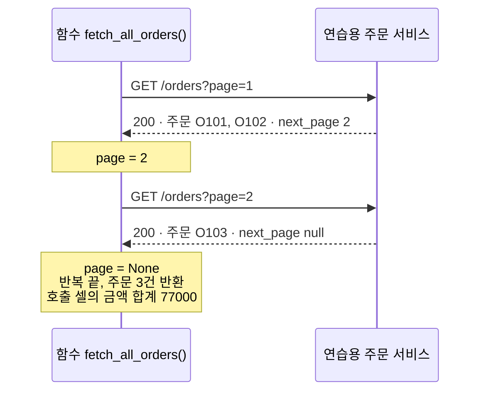
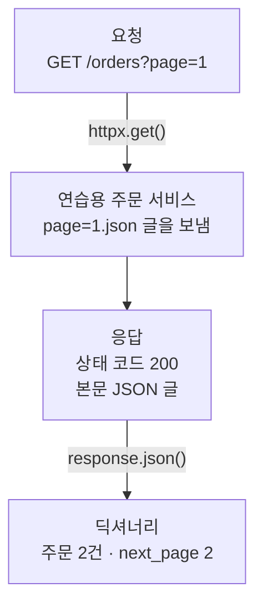
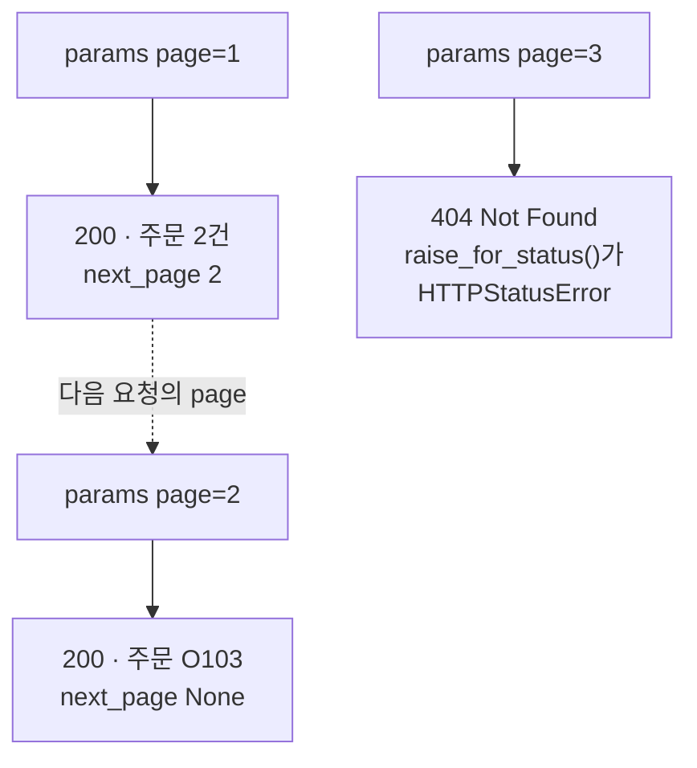
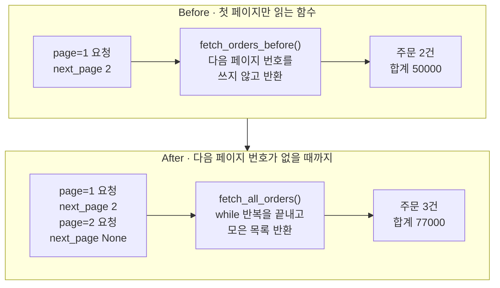

# 04-REST와-페이지네이션

## _src 본문 (HTML 원본)

```html
<!--meta: 강의 1h | 실습 3h | 코드 Jupyter Notebook | 새 용어 9 -->
<h2 id="b1"><span class="no">1</span>학습 목표</h2>
<div class="goal"><ul><li>HTTP GET 요청의 주소와 쿼리 문자열, 응답의 상태 코드와 JSON 본문을 출력에서 찾아 설명할 수 있습니다.</li><li>응답의 다음 페이지 번호가 <code>None</code>이 될 때까지 요청을 이어 가, 주문을 딕셔너리 목록으로 반환하는 함수를 만들 수 있습니다.</li><li>첫 페이지만 읽은 함수가 오류 없이 주문을 빠뜨리는 이유를 설명하고, 다음 페이지 번호를 따라 반복하도록 고칠 수 있습니다.</li></ul></div>
<h2 id="b2"><span class="no">2</span>이 내용을 배우는 이유</h2>
<p>03절에서는 주문을 데이터베이스 파일에서 읽었습니다. 실제로는 다른 팀이나 다른 회사의 서버에 주문, 기사, 상품 데이터가 있는 경우가 많습니다. 그런 데이터는 HTTP 주소로 요청해서 받습니다.</p>
<p>목록이 길면 서버는 한 응답에 모두 담지 않고 여러 페이지로 나눠 줍니다. 첫 페이지만 읽는 함수도 상태 코드는 성공이고, 오류도 나지 않습니다. 그래서 주문이 빠진 것을 결과만 보고 알아채기 어렵습니다.</p>
<p>에이전트가 「주문 합계를 알려 줘」에 답하려면 조회 함수가 목록을 끝까지 읽어야 합니다. 이 절에서는 이 컴퓨터 안에 켠 연습용 주문 서비스에 요청을 보냅니다. 응답을 읽는 법을 익힌 뒤, 페이지를 이어 읽는 함수를 만듭니다. Ch 19에서는 이런 조회 함수를 에이전트가 부르는 도구로 씁니다.</p>
<p><strong>이 절의 질문</strong> — 여러 페이지로 나뉜 주문 목록을 빠짐없이 읽으려면, 조회 함수는 언제까지 요청을 보내야 할까요?</p>
<h2 id="b3"><span class="no">3</span>앞에서 배운 내용</h2>
<p>03절에서는 고객 번호를 받아 SQLite 데이터베이스를 조회하는 함수 <code>find_customer_orders()</code>를 만들었습니다. 함수 안에서 연결을 열고 SQL을 보낸 뒤, 결과를 딕셔너리 목록으로 바꿔 반환했습니다. 이 절의 함수도 요청을 보내고, 받은 주문을 딕셔너리 목록으로 반환합니다.</p>
<p>03절 After 함수는 이상한 입력에 빈 목록을 반환했고, 빈 목록은 입력이 이상했는지 알려 주지 않았습니다. 이 절의 Before 함수도 오류 없이 덜 가져온 목록을 반환합니다. 결과 목록만 봐서는 문제가 보이지 않는다는 점이 같습니다.</p>
<p>01~03절의 주문 세 건 O101, O102, O103과 전체 합계 77000을 그대로 씁니다. 연습용 서비스는 이 주문을 한 페이지에 두 건씩 나눠 줍니다.</p>
<p>Ch 2 02절의 <code>while</code> 반복, 03절의 <code>append()</code>와 <code>+=</code>, 04절의 <code>None</code>을 씁니다. 05절의 <code>with open</code>과 <code>try/except 오류이름</code>도 씁니다. Ch 2 08절에서는 <code>subprocess.run()</code>으로 다른 Python 프로그램을 실행하고 끝나기를 기다렸습니다. 이 절의 준비 셀은 비슷한 <code>subprocess.Popen()</code>으로 서비스를 켜 둔 채 다음 셀로 넘어갑니다.</p>
<p>Ch 1 05절에서는 Docker 도구를 명령을 입력하는 클라이언트와, 요청을 받아 일하는 서버(데몬)로 나눠 보았습니다. 이 절의 httpx 코드는 요청하는 쪽이고, 연습용 주문 서비스는 답하는 쪽 서버입니다.</p>
<h2 id="b4"><span class="no">4</span>핵심 개념</h2>
<h3>비유로 시작하기</h3>
<p>창고 벽에 주문 서류철을 내주는 창구가 있다고 해 봅니다. 직원은 쟁반 하나에 서류철을 두 개까지만 담아 창구로 내놓습니다. 뒤에 쟁반이 더 있으면 내놓는 쟁반 모서리에 작은 깃발을 꽂습니다.</p>
<p>깃발이 꽂힌 첫 쟁반만 받고 돌아서면, 창구 안에 남은 쟁반의 서류철은 받지 못합니다. 받은 쟁반만 보면 아무 문제가 없어서, 빠진 것이 있다는 사실은 깃발을 봐야 압니다. 깃발이 있으면 다시 요청하고, 깃발 없는 쟁반이 나오면 멈춥니다. 그러면 서류철을 모두 받습니다.</p>
<p>이 장면을 HTTP로 옮기면 쟁반 하나가 응답 하나, 서류철이 주문, 깃발이 응답의 다음 페이지 번호입니다. 깃발 없는 쟁반은 다음 페이지 번호가 <code>None</code>인 마지막 페이지입니다.</p>
{{img:04-5-깃발-쟁반|왼쪽에는 초록 깃발이 꽂히고 초록과 파랑 서류철이 든 쟁반 하나만 선반에 있고 창구 안에 초록 서류철 하나가 든 쟁반이 남아 있으며, 오른쪽에는 창구가 비고 선반에 깃발 꽂힌 쟁반과 초록 서류철 하나가 든 깃발 없는 쟁반이 나란히 있는 삽화|깃발이 꽂힌 쟁반만 받고 멈추면 창구 안의 쟁반이 남습니다. 깃발 없는 쟁반이 나올 때까지 받으면 서류철 세 개가 모두 나옵니다.}}
<p><strong>그림 읽기</strong> — 가운데 세로선의 왼쪽이 첫 쟁반만 받은 경우, 오른쪽이 끝까지 받은 경우입니다. 두 칸에는 같은 나무 벽과 네모난 창구, 긴 선반이 있습니다. 왼쪽 칸 선반에는 초록과 파랑 서류철이 든 쟁반 하나가 있고, 쟁반 모서리에 초록 깃발이 서 있습니다. 창구 안에는 초록 서류철 하나가 든 쟁반이 아직 남아 있습니다.</p>
<p>오른쪽 칸은 창구가 비었습니다. 선반에는 깃발이 꽂힌 첫 쟁반과, 초록 서류철 하나만 든 깃발 없는 둘째 쟁반이 나란히 있습니다. 서류철 세 개는 03절 삽화처럼 주문 세 건이고, 초록은 김하나 고객, 파랑은 이두리 고객의 주문입니다.</p>
<h3>이 절에서 쓰는 말</h3>
<table><thead><tr><th>용어</th><th>뜻</th><th>이 절에서 보이는 모습</th></tr></thead><tbody>
<tr><td>HTTP(HyperText Transfer Protocol)</td><td>프로그램끼리 요청과 응답을 주고받는 약속</td><td><code>httpx.get()</code>이 보내는 GET 요청</td></tr>
<tr><td>요청(request)과 응답(response)</td><td>「이 주소의 데이터를 주세요」라는 메시지와, 서버가 보내는 답</td><td>요청 <code>GET /orders?page=1</code>, 응답 객체 <code>response</code></td></tr>
<tr><td>서버(server)와 포트(port)</td><td>요청을 기다렸다가 답을 보내는 프로그램과, 한 컴퓨터 안에서 프로그램마다 나눠 쓰는 번호</td><td>연습용 주문 서비스, 주소 <code>http://127.0.0.1:</code> 뒤의 숫자</td></tr>
<tr><td>쿼리 문자열(query string)</td><td>주소의 물음표 뒤에 <code>이름=값</code>으로 붙이는 조건</td><td><code>params={"page": 1}</code>이 만든 <code>?page=1</code></td></tr>
<tr><td>상태 코드(status code)</td><td>서버가 요청을 어떻게 처리했는지 알리는 세 자리 숫자</td><td>성공 <code>200</code>, 찾을 수 없음 <code>404</code></td></tr>
<tr><td>JSON(JavaScript Object Notation)</td><td>딕셔너리와 목록 같은 값을 정해진 모양의 글로 적는 형식</td><td>본문 글 <code>{"orders": [...], "next_page": 2}</code>, 값 없음 <code>null</code></td></tr>
<tr><td>REST API</td><td>주소마다 데이터 한 가지를 두고, HTTP 요청으로 읽고 쓰게 만든 서비스</td><td>주소 <code>/orders</code>에 GET 요청을 보내 주문 목록 읽기</td></tr>
<tr><td>페이지네이션(pagination)</td><td>긴 목록을 여러 응답으로 나눠 주는 방식</td><td>한 페이지에 주문 두 건, 다음 페이지 번호 <code>next_page</code></td></tr>
<tr><td>시간 제한(timeout)</td><td>응답을 기다릴 때 단계마다 둘 최대 시간. 넘으면 기다리기를 멈춥니다</td><td><code>timeout=2.0</code>(2초)</td></tr>
</tbody></table>
<h3>요청과 응답은 한 쌍입니다</h3>
<p>식당에서 주문서를 내면 영수증과 음식이 함께 나옵니다. HTTP도 요청 하나에 응답 하나가 옵니다. 요청에는 무엇을 할지(GET), 어느 주소인지(<code>/orders</code>), 어떤 조건인지(<code>page=1</code>)를 적습니다.</p>
<p>응답에는 영수증에 해당하는 상태 코드와, 음식에 해당하는 본문이 들어 있습니다. 코드는 상태 코드부터 확인하고, 성공일 때만 본문을 읽습니다. 메서드 <code>raise_for_status()</code>는 상태 코드가 200번대가 아니면 오류를 내서, 실패한 응답의 본문을 주문 목록으로 읽지 않게 합니다.</p>
<p>이 서비스의 본문은 JSON 글입니다. 메서드 <code>response.json()</code>은 이 글을 Python 딕셔너리와 목록으로 바꿉니다. JSON 글의 <code>null</code>은 Python의 <code>None</code>이 됩니다.</p>
<h3>다음 페이지 번호를 따라 읽습니다</h3>
<p>연습용 서비스는 응답마다 주문 목록 <code>orders</code>와 다음 페이지 번호 <code>next_page</code>를 줍니다. 함수는 받은 주문을 모으고, 다음 페이지 번호를 다음 요청의 <code>page</code>에 넣습니다. 다음 페이지 번호가 <code>None</code>이면 요청을 멈추고 모은 목록을 반환합니다.</p>
{{mermaid:04-1-끝까지-읽는-순서|함수 fetch_all_orders가 연습용 주문 서비스에 page=1을 요청해 상태 코드 200과 주문 O101, O102, 다음 페이지 2를 받고, page=2를 요청해 200과 주문 O103, 다음 페이지 null을 받은 뒤 멈추고 주문 3건 합계 77000을 모으는 순서도|다음 페이지 번호를 따라 두 번 요청했습니다. 둘째 응답의 null에서 멈추고 주문 3건을 반환합니다.}}
<p><strong>도식 읽기</strong> — 위에서 아래로 읽습니다. 왼쪽 세로선은 노트북 8절에서 만든 함수 <code>fetch_all_orders()</code>이고, 오른쪽 세로선은 연습용 주문 서비스입니다. 실선 화살표는 요청, 점선 화살표는 응답입니다.</p>
<p>첫 응답은 상태 코드 200, 주문 O101과 O102, 다음 페이지 2입니다. 노란 메모 <code>page = 2</code>는 그 번호를 둘째 요청에 넣었다는 뜻입니다. 둘째 응답의 다음 페이지는 null이라, 마지막 노란 메모처럼 반복이 끝나고 주문 3건이 반환됩니다. 호출 셀에서 더한 금액 합계는 77000입니다.</p>
<h3>연습용 서비스를 쓰는 이유</h3>
<p>인터넷의 실제 서비스는 내용이 바뀌거나, 접속이 막히거나, 인증 키가 필요할 수 있습니다. 그러면 교재와 같은 출력을 다시 보기 어렵습니다. 그래서 노트북의 준비 셀이 이 컴퓨터 안에 작은 주문 서비스를 켜고, 마지막 셀에서 끕니다.</p>
<p>서비스 쪽 준비 셀 세 개는 줄마다 읽지 않아도 됩니다. 페이지 두 개의 JSON 글 파일, 요청에 맞는 파일 글을 보내는 프로그램 파일, 그 프로그램을 따로 실행하는 셀입니다. 요청을 보내는 쪽 코드는 인터넷 서비스에 보낼 때와 같은 모양입니다.</p>
<h2 id="b5"><span class="no">5</span>실행 예제</h2>
<p>노트북은 임시 폴더에 연습용 주문 서비스를 켜고, 서비스 주소를 만듭니다. 그다음 첫 페이지를 요청해 상태 코드와 본문을 읽고, 본문을 딕셔너리로 바꿉니다. 페이지 번호를 2로 바꿔 요청한 뒤, 없는 페이지 3을 요청해 상태 오류를 받아 봅니다.</p>
<p>모델을 부르지 않으므로 API 키가 필요 없고 비용도 들지 않습니다. 인터넷에도 접속하지 않습니다. 교재 출력은 Python 3.12.13과 실습 폴더에 고정한 httpx 0.28.1로 만들었습니다. 서비스 주소의 포트 번호는 실행할 때마다 달라서 교재와 다를 수 있습니다.</p>
{{notebook:04-REST와-페이지네이션|example}}
<p class="look"><b>확인할 점</b> — 3절 출력의 요청한 주소 끝이 <code>/orders?page=1</code>인지 봅니다. 4절에서 <code>다음 페이지 번호: 2</code>, 5절에서 <code>다음 페이지 번호: None</code>이 나왔는지 확인합니다. 6절의 상태 코드가 <code>404</code>인지도 봅니다.</p>
<h3>요청 한 번과 응답 한 번</h3>
<p>함수 <code>httpx.get()</code>에 주소와 인자 <code>params={"page": 1}</code>, <code>timeout=2.0</code>을 넣었습니다. 출력의 요청한 주소 끝에는 <code>/orders?page=1</code>이 붙었고, 상태 코드는 <code>200</code>이었습니다.</p>
<p>속성 <code>response.text</code>로 본 본문 글은 준비 셀에서 쓴 <code>page=1.json</code>의 글과 같았습니다. 메서드 <code>json()</code>으로 바꾼 값은 <code>&lt;class 'dict'&gt;</code>였고, 주문 수 2와 다음 페이지 번호 2가 들어 있었습니다. 01~03절의 주문은 세 건이니, 이 응답은 목록의 일부만 담았습니다.</p>
{{mermaid:04-2-요청과-응답|요청 GET /orders?page=1이 httpx.get()으로 연습용 주문 서비스에 가고, 서비스가 page=1.json 글을 보내 상태 코드 200과 JSON 본문이 든 응답이 오며, response.json()으로 주문 2건과 next_page 2가 든 딕셔너리가 되는 흐름도|요청 한 번과 응답 한 번입니다. 상태 코드 200인 응답의 JSON 본문이 주문 2건과 next_page 2를 담은 딕셔너리가 됩니다.}}
<p><strong>도식 읽기</strong> — 위에서 아래로 읽습니다. 초록 상자 두 개는 보낸 요청과, 파일 <code>page=1.json</code>의 글을 보내는 연습용 서비스입니다. 화살표 위 글자는 실행한 코드 <code>httpx.get()</code>과 <code>response.json()</code>입니다.</p>
<p>노란 상자 두 개는 노트북 출력으로 확인한 값입니다. 위 상자는 상태 코드 200과 JSON 본문 글이 든 응답입니다. 아래 상자는 주문 2건과 next_page 2가 든 딕셔너리입니다.</p>
<h3>페이지 번호 바꿔 보기</h3>
<p>인자의 페이지 번호만 2로 바꾸자 주문 O103 한 건이 왔습니다. 본문 글 끝은 <code>"next_page": null}</code>이었고, 딕셔너리에서는 <code>None</code>이 되었습니다. 앞 응답이 알려 준 번호를 넣었더니 마지막 페이지가 나온 것입니다.</p>
<p>없는 페이지 3을 요청하자 상태 코드 <code>404</code>와 본문 <code>{"error": "not found"}</code>가 왔습니다. 메서드 <code>raise_for_status()</code>는 오류 HTTPStatusError를 냈고, 코드가 받아 <code>Client error '404 Not Found'</code>로 시작하는 메시지를 출력했습니다. 이 본문에는 주문 목록 칸 <code>orders</code>가 없습니다.</p>
{{mermaid:04-3-페이지-번호-바꾸기|왼쪽 줄은 params page=1이 200 주문 2건 next_page 2가 되고 점선으로 params page=2로 이어져 200 주문 O103 next_page None이 되며, 오른쪽 줄은 params page=3이 404 Not Found와 raise_for_status가 낸 HTTPStatusError가 되는 그림|page 값만 바꿔 세 번 요청했습니다. 2쪽에서 next_page가 None이 되고, 없는 3쪽은 404와 상태 오류입니다.}}
<p><strong>도식 읽기</strong> — 왼쪽 줄을 위에서 아래로 읽습니다. 초록 상자는 요청에 넣은 인자, 노란 상자는 출력으로 확인한 결과입니다. 점선은 page=1 응답의 next_page 2가 다음 요청의 page가 되었다는 뜻입니다. 그 요청의 결과에서 next_page가 None이 되었습니다.</p>
<p>오른쪽 줄은 따로 요청한 page=3입니다. 노란 상자에는 404 Not Found와 <code>raise_for_status()</code>가 낸 HTTPStatusError를 적었습니다. 이 오류는 코드가 <code>try/except</code>로 받아 출력했으므로 노란색입니다.</p>
<h2 id="b6"><span class="no">6</span>일부러 실패해 보기</h2>
<p>Before 함수 <code>fetch_orders_before()</code>는 페이지 1을 요청하고, 상태 코드를 확인하고, 그 페이지의 주문 목록을 반환합니다. After 함수 <code>fetch_all_orders()</code>는 같은 요청을 <code>while</code> 반복 안에 두고, 다음 페이지 번호가 <code>None</code>이 될 때까지 이어 갑니다. 두 함수 모두 요청한 페이지와 다음 페이지 번호를 출력하고, 호출 셀에서 금액을 더합니다.</p>
{{notebook:04-REST와-페이지네이션|failure}}
<p>Before 함수를 부른 셀은 오류 없이 끝났고, 상태 코드 확인도 통과했습니다. 그런데 결과는 <code>읽은 주문 수: 2</code>, <code>금액 합계: 50000</code>이었습니다. 01절에서 확인한 전체 합계 77000보다 27000원 적고, 2쪽의 주문 O103이 빠졌습니다.</p>
<p>첫 줄 <code>요청한 페이지: 1 / 다음 페이지 번호: 2</code>는 뒤에 페이지가 더 있다고 알려 주었습니다. 함수가 이 값을 쓰지 않고 끝났을 뿐입니다. 에이전트 도구라면 모델은 주문이 두 건뿐이라고 답하게 됩니다.</p>
<p>After 함수는 요청 줄을 두 번 출력했습니다. 둘째 줄이 <code>요청한 페이지: 2 / 다음 페이지 번호: None</code>이고, 결과는 <code>읽은 주문 수: 3</code>, <code>금액 합계: 77000</code>이었습니다. 함수는 페이지 3을 요청하지 않았습니다. 없는 페이지에 부딪혀서가 아니라, 응답의 다음 페이지 번호가 비어서 멈췄습니다.</p>
{{mermaid:04-4-한-페이지-비교|위 칸 Before는 page=1 요청과 next_page 2가 fetch_orders_before로 가서 다음 페이지 번호를 쓰지 않고 반환해 빨간 주문 2건 합계 50000이 되고, 아래 칸 After는 page=1과 page=2 요청으로 next_page None을 받은 뒤 fetch_all_orders가 반복을 끝내 노란 주문 3건 합계 77000이 되는 비교 그림|같은 서비스, 다른 함수입니다. 다음 페이지 번호를 쓰지 않으면 2건·50000, 따라가면 3건·77000입니다.}}
<p><strong>도식 읽기</strong> — 위 칸이 Before, 아래 칸이 After이고, 칸마다 왼쪽에서 오른쪽으로 읽습니다. 초록 상자는 보낸 요청과 응답이 알려 준 다음 페이지 번호이고, 파란 상자는 우리가 정의한 함수입니다.</p>
<p>위 칸 함수는 next_page 2를 받고도 쓰지 않고 반환해, 빨간 상자의 주문 2건과 합계 50000이 되었습니다. 아래 칸은 page=1과 page=2를 요청해 next_page None을 받았습니다. 함수가 반복을 끝내고 반환한 결과는 노란 상자의 주문 3건과 합계 77000입니다.</p>
<h2 id="b7"><span class="no">7</span>주의할 점과 실무 메모</h2>
<ul><li>페이지를 나누는 방식은 서비스마다 다릅니다. 이 절은 응답에 다음 페이지 번호를 넣는 방식만 실행했습니다. 커서 값이나 다음 주소를 주는 방식, 빈 목록으로 끝을 알리는 방식은 실행하지 않았으므로 그 서비스의 설명서를 확인합니다.</li>
<li>서비스가 같은 다음 페이지 번호를 계속 준다면 After 함수는 멈추지 않습니다. 이런 경우는 이번에 실행하지 않았습니다. 실습 폴더 <code>data_tools.py</code>의 확장 함수 <code>fetch_articles()</code>는 이미 요청한 페이지를 기억해 막습니다.</li>
<li>함수 <code>httpx.get()</code>은 요청마다 연결을 새로 엽니다. HTTPX 설명서는 실험이나 한 번 쓰고 끝나는 스크립트가 아니면 <code>httpx.Client</code>를 쓰라고 권합니다. 이 절에서는 쓰지 않았습니다.</li>
<li>설치한 httpx 0.28.1 소스의 기본값을 보면, 인자 <code>timeout</code>을 뺀 요청은 5초까지 기다립니다. 응답이 시간 제한을 넘는 경우는 이번에 실행하지 않았습니다.</li>
<li>설치한 소스를 보면 <code>raise_for_status()</code>는 200번대가 아닌 모든 상태 코드에서 오류를 냅니다. 이번에 실행한 것은 404 하나입니다. 5로 시작하는 서버 쪽 오류는 실행하지 않았습니다.</li>
<li>실제 서비스의 인증 키는 코드와 노트북 출력에 적지 않습니다. Ch 3 05절처럼 비밀 값은 저장소에 커밋하지 않습니다.</li>
<li>준비 셀의 서비스 프로그램은 표준 라이브러리 <code>wsgiref</code>로 만든 연습용입니다. 실제 서비스를 운영하는 서버는 다루지 않습니다. 준비 셀을 여러 번 실행하거나, 마지막 셀 없이 커널을 다시 시작한 경우도 실행하지 않았습니다.</li>
<li>실습 폴더의 <code>data_tools.py</code>와 <code>data/articles.json</code>은 기사 목록을 읽는 확장 예제입니다. 노트북 함수는 01~03절의 주문을 읽게 바꿨고, 이름과 모양이 다릅니다.</li>
<li>교재 출력은 2026-09-16에 Linux의 Python 3.12.13, httpx 0.28.1로 만들었습니다. 운영체제 Windows와 macOS, 다른 httpx 버전에서는 실행하지 않았습니다.</li></ul>
<h2 id="b8"><span class="no">8</span>정리와 다음 절</h2>
<ul><li>HTTP 요청은 주소와 쿼리 문자열로 원하는 데이터를 적고, 응답은 상태 코드와 본문을 보냅니다. 메서드 <code>json()</code>은 JSON 본문을 딕셔너리로 바꿉니다.</li><li>상태 코드가 200번대가 아닌 응답은 <code>raise_for_status()</code>가 오류로 알립니다. 없는 페이지 3은 404였습니다.</li><li>첫 페이지만 읽은 함수는 오류 없이 2건, 합계 50000을 반환했습니다. 다음 페이지 번호가 <code>None</code>이 될 때까지 읽은 함수는 3건, 77000이었습니다.</li></ul>
<p><strong>다음 학습과 이어지는 지점</strong> — 05절에서는 JSON을 주는 서비스가 없을 때를 다룹니다. 그때는 HTML로 된 문서에서 필요한 값을 골라 읽습니다. 이 절처럼 읽은 값이 빠지거나 없을 때를 먼저 확인합니다.</p>
<h2 id="b9"><span class="no">9</span>복습 문제</h2><details class="quiz"><summary>문제와 해설</summary>
<p class="quiz-q">1. 3절에서 인자 <code>params={"page": 1}</code>은 요청 주소를 어떻게 바꾸었나요? 상태 코드 200은 무슨 뜻인가요? · 기초</p><p class="quiz-a"><b>해설</b> — 주소 끝에 쿼리 문자열 <code>?page=1</code>을 붙였습니다. 출력의 요청한 주소가 <code>/orders?page=1</code>로 끝났습니다. 상태 코드 200은 요청이 성공했다는 뜻입니다.</p>
<p class="quiz-q">2. 5절 본문 글의 <code>"next_page": null</code>은 <code>json()</code>으로 바꾼 뒤 어떤 값이 되었고, 무엇을 알려 주나요? · 기초</p><p class="quiz-a"><b>해설</b> — Python의 <code>None</code>이 되었습니다. 다음 페이지가 없다는 뜻이라, 이 페이지가 마지막입니다.</p>
<p class="quiz-q">3. 6절에서 없는 페이지 3을 요청했을 때 상태 코드는 무엇이었나요? 함수 안에서 본문을 읽기 전에 <code>raise_for_status()</code>를 부르는 이유는 무엇인가요? · 적용</p><p class="quiz-a"><b>해설</b> — 상태 코드는 404였고, <code>raise_for_status()</code>가 HTTPStatusError를 냈습니다. 실패한 응답의 본문에는 주문 목록 칸 <code>orders</code>가 없습니다. 상태 코드부터 확인해, 실패한 응답을 주문 목록으로 읽지 않으려는 것입니다.</p>
<p class="quiz-q">4. Before 함수는 오류 없이 끝났는데도 합계가 50000이었습니다. 출력의 어느 줄에서 주문이 빠진 단서를 찾을 수 있나요? · 분석</p><p class="quiz-a"><b>해설</b> — 첫 줄 <code>요청한 페이지: 1 / 다음 페이지 번호: 2</code>입니다. 응답은 2쪽이 더 있다고 알려 주었지만, 함수가 이 값을 쓰지 않았습니다. 그래서 2쪽의 O103 27000이 빠졌습니다.</p>
<p class="quiz-q">5. After 함수는 페이지 3을 요청하지 않고 멈췄습니다. 반복이 끝난 조건은 무엇이었나요? · 분석</p><p class="quiz-a"><b>해설</b> — 반복 조건 <code>page is not None</code>이 거짓이 되었습니다. 2쪽 응답의 다음 페이지 번호 <code>None</code>을 <code>page</code>에 넣었기 때문입니다. 없는 페이지의 404로 멈춘 것이 아닙니다.</p>
</details>
<h2 id="b10"><span class="no">10</span>참고 자료</h2>
<ul><li><a href="https://www.python-httpx.org/quickstart/">HTTPX 공식 문서: QuickStart</a> · 확인 2026-09-16 · 실행 httpx 0.28.1</li><li><a href="https://www.python-httpx.org/advanced/clients/">HTTPX 공식 문서: Clients</a> · 확인 2026-09-16 · 실행하지 않음(주의 메모)</li><li><a href="https://docs.python.org/3.12/library/wsgiref.html">Python 3.12 공식 문서: wsgiref</a> · 확인 2026-09-16 · 실행 Python 3.12.13</li><li><a href="https://developer.mozilla.org/en-US/docs/Web/HTTP/Status">MDN: HTTP response status codes</a> · 확인 2026-09-16</li></ul>
```

## 노트북 셀 (순서대로)

### [0] markdown {'html': 'skip'}

# REST와 페이지네이션

**이 노트북에서 할 일**

1. 이 컴퓨터 안에 켠 연습용 주문 서비스에 HTTP 요청을 보내고, 응답의 상태 코드와 JSON 본문을 읽습니다.
2. 페이지 번호를 바꿔 요청하며, 마지막 페이지에서 다음 페이지 번호가 비는 것을 확인합니다.
3. 첫 페이지만 읽은 함수가 오류 없이 주문을 빠뜨리는 장면을 보고, 다음 페이지 번호를 따라 끝까지 읽도록 고칩니다.

**준비물** — API 키 불필요. 인터넷에 있는 서비스는 쓰지 않습니다.
노트북이 이 컴퓨터 안에 연습용 주문 서비스를 켰다가 마지막 셀에서 끕니다.
모델 호출은 0번이고 비용은 들지 않습니다. 실행 시간은 1분 이내입니다.

**기준 httpx 버전** — 실습 폴더에 고정한 httpx 0.28.1을 씁니다. 교재 출력도 이 버전과 Python 3.12.13으로 만들었습니다.
이 버전의 httpx는 Python 3.8 이상에서 설치됩니다. 오류 메시지 글은 httpx 버전에 따라 다를 수 있습니다.

실습 폴더의 `uv.lock`이 httpx를 0.28.1로 고정하므로, `uv sync --locked`로 만든 환경에는 이 버전이 설치됩니다.
다른 버전과 httpx 1.0 개발판은 이번에 실행하지 않았습니다.

실습 폴더 `labs/part1/ch04-data-tools`에서 Ch 1 3절처럼 `uv sync --locked`로 환경을 만듭니다.
커널에서 이 폴더의 `.venv`를 고른 뒤 첫 셀부터 순서대로 실행합니다.

### [1] markdown {'html': 'skip'}

## 오늘 볼 그림


위에서 아래로 읽습니다. 왼쪽 세로선은 이 노트북 끝에서 만드는 함수이고, 오른쪽 세로선은 연습용 주문 서비스입니다.
실선 화살표는 요청, 점선 화살표는 응답입니다. 첫 응답의 다음 페이지 2가 둘째 요청의 page 값이 됩니다.

둘째 응답의 다음 페이지가 null이라 함수는 더 요청하지 않습니다. 첫 노란 메모는 다음 요청에 넣을 페이지 번호이고, 마지막 노란 메모는 반복이 끝난 뒤의 결과입니다.

### [2] markdown {}

## 1. 준비

이 노트북은 연습용 서비스가 쓸 파일 세 개를 만듭니다. 01~03절처럼 빈 임시 폴더를 만들고, 그 폴더로 작업 위치를 옮깁니다.
실습 폴더에는 파일이 생기지 않습니다.

코드의 import 두 줄은 Ch 2 07절에서 배운 import 문입니다. 표준 라이브러리 모듈 os와 tempfile을 불러옵니다.

### [3] code {'execution': {'iopub.execute_input': '2026-09-16T16:17:49.040857Z', 'iopub.status.busy': '2026-09-16T16:17:49.040694Z', 'iopub.status.idle': '2026-09-16T16:17:49.046149Z', 'shell.execute_reply': '2026-09-16T16:17:49.045175Z'}, 'lesson_role': 'setup'}

```python
# 연습용 서비스 파일을 둘 빈 임시 폴더를 만들고, 그 폴더로 작업 위치를 옮깁니다
import os
import tempfile

# mkdtemp()는 운영체제 임시 폴더 안에 새 폴더를 만들고 그 경로를 반환합니다
practice_folder = tempfile.mkdtemp(prefix="ch04-04-")
# chdir()는 터미널의 cd처럼 현재 작업 폴더를 옮깁니다
os.chdir(practice_folder)
file_names = os.listdir()
print("현재 작업 폴더의 파일:", file_names)
```

출력:
```
현재 작업 폴더의 파일: []

```

### [4] markdown {}

**결과 읽기** — 현재 작업 폴더의 파일은 `[]`로, 빈 폴더에서 시작합니다.
폴더의 경로는 컴퓨터마다 달라서 출력하지 않았습니다.

### [5] markdown {}

## 2. 연습용 주문 서비스 켜기 — 준비 코드

이 절은 인터넷에 있는 실제 서비스 대신, 이 컴퓨터 안에 켠 연습용 주문 서비스에 요청을 보냅니다.
인터넷 서비스는 내용이 바뀌거나 접속이 막힐 수 있습니다. 매번 같은 결과를 보려고 연습용 서비스를 씁니다.

아래 세 셀은 **연습용 서버를 켜는 준비 코드**이며, 줄마다 읽지 않아도 됩니다. 셀마다 하는 일만 확인하고 차례로 실행합니다.
서버(server)는 요청을 기다렸다가 답을 보내는 프로그램입니다. 서버 쪽 코드를 이해하는 일은 이 절의 목표가 아닙니다.

첫 셀은 서비스가 페이지마다 보낼 주문 목록 글 두 개를 파일로 씁니다. 1쪽에는 주문 두 건, 2쪽에는 한 건이 있습니다.
파일 이름 `page=1.json`은 요청 주소 끝에 붙을 `page=1`에 맞춰 지었습니다. 파일 안의 글 모양은 4절에서 읽습니다.

### [6] code {'execution': {'iopub.execute_input': '2026-09-16T16:17:49.047738Z', 'iopub.status.busy': '2026-09-16T16:17:49.047573Z', 'iopub.status.idle': '2026-09-16T16:17:49.051308Z', 'shell.execute_reply': '2026-09-16T16:17:49.050517Z'}, 'lesson_role': 'setup'}

```python
# 연습용 서비스가 페이지마다 보낼 주문 목록 글 두 개를 파일로 씁니다
# 01~03절의 주문 세 건을 한 페이지에 두 건씩 나눴습니다
page_1_text = """{"orders": [
  {"order_id": "O101", "customer_id": "C001", "amount": 32000},
  {"order_id": "O102", "customer_id": "C002", "amount": 18000}
], "next_page": 2}"""
with open("page=1.json", "w", encoding="utf-8") as file:
    file.write(page_1_text)
page_2_text = """{"orders": [
  {"order_id": "O103", "customer_id": "C001", "amount": 27000}
], "next_page": null}"""
with open("page=2.json", "w", encoding="utf-8") as file:
    file.write(page_2_text)
```

출력:
```

```

### [7] markdown {}

둘째 셀은 서비스 프로그램 파일 `order_server.py`를 씁니다. 이 프로그램은 요청을 기다리다가, 주소가 `/orders`이고 이름이 맞는 파일이 있으면 그 파일 글을 보냅니다.
맞는 파일이 없으면 「찾을 수 없음」을 보냅니다. 프로그램 글 안의 주석은 궁금한 학생을 위해 달아 두었습니다.

### [8] code {'execution': {'iopub.execute_input': '2026-09-16T16:17:49.052832Z', 'iopub.status.busy': '2026-09-16T16:17:49.052664Z', 'iopub.status.idle': '2026-09-16T16:17:49.055824Z', 'shell.execute_reply': '2026-09-16T16:17:49.055345Z'}, 'lesson_role': 'setup'}

```python
# 요청을 받아 파일 글을 보내는 서비스 프로그램을 order_server.py 파일로 씁니다
server_text = """import os
from wsgiref.simple_server import make_server

# 요청 하나가 올 때마다 이 함수가 불립니다
def answer(environ, start_response):
    # 주소 끝의 쿼리 문자열 page=1로 파일 page=1.json을 고릅니다
    file_name = environ["QUERY_STRING"] + ".json"
    if environ["PATH_INFO"] != "/orders" or not os.path.exists(file_name):
        start_response("404 Not Found", [("Content-Type", "application/json")])
        return [b'{"error": "not found"}']
    start_response("200 OK", [("Content-Type", "application/json")])
    with open(file_name, "rb") as file:
        return [file.read()]

# 포트 번호 0은 운영체제에게 비어 있는 번호를 골라 달라는 뜻입니다
server = make_server("127.0.0.1", 0, answer)
print(server.server_port, flush=True)
server.serve_forever()"""
with open("order_server.py", "w", encoding="utf-8") as file:
    file.write(server_text)
```

출력:
```

```

### [9] markdown {}

셋째 셀은 그 프로그램을 따로 실행합니다. Ch 2 08절의 `subprocess.run()`은 프로그램이 끝날 때까지 기다렸습니다.
이 셀의 `subprocess.Popen()`은 프로그램을 켜 둔 채 바로 다음 줄로 넘어갑니다.
서비스는 켜지면서 포트 번호를 한 줄 출력하고, 셀은 그 줄을 읽어 서비스 주소를 만듭니다.

인자 `stdout=subprocess.PIPE`는 서비스가 출력한 글을 이 노트북이 읽을 수 있게 이어 둡니다. 메서드 `readline()`은 그 글에서 한 줄을 읽습니다.

### [10] code {'execution': {'iopub.execute_input': '2026-09-16T16:17:49.057133Z', 'iopub.status.busy': '2026-09-16T16:17:49.057016Z', 'iopub.status.idle': '2026-09-16T16:17:49.100104Z', 'shell.execute_reply': '2026-09-16T16:17:49.099604Z'}, 'lesson_role': 'setup'}

```python
# 서비스 프로그램을 따로 실행하고, 서비스가 알려 준 포트 번호로 주소를 만듭니다
import subprocess
import sys

# Popen()은 프로그램을 켜 두고 기다리지 않습니다. 서비스의 접속 기록(stderr)은 버립니다
server_process = subprocess.Popen(
    [sys.executable, "order_server.py"],
    stdout=subprocess.PIPE,
    stderr=subprocess.DEVNULL,
    text=True,
)
# 서비스가 켜지면서 출력한 첫 줄(포트 번호)을 읽습니다
port_text = server_process.stdout.readline().strip()
base_url = f"http://127.0.0.1:{port_text}"
print("서비스 주소:", base_url)
file_names = sorted(os.listdir())
print("현재 작업 폴더의 파일:", file_names)
```

출력:
```
서비스 주소: http://127.0.0.1:43991
현재 작업 폴더의 파일: ['order_server.py', 'page=1.json', 'page=2.json']

```

### [11] markdown {}

**결과 읽기** — 서비스 주소는 `http://127.0.0.1:`로 시작합니다. 주소 127.0.0.1은 「이 컴퓨터 자신」을 가리킵니다.
콜론 뒤의 숫자는 포트 번호입니다. 포트(port)는 한 컴퓨터 안에서 프로그램마다 나눠 쓰는 번호로, 한 건물 안의 호수와 비슷합니다.
포트 번호는 실행할 때마다 달라서 교재와 다를 수 있습니다.

파일 목록 `['order_server.py', 'page=1.json', 'page=2.json']`은 앞의 두 셀이 쓴 파일입니다. 이제 서비스가 요청을 기다립니다.

### [12] markdown {}

## 3. 첫 페이지 요청하기 — HTTP 요청과 상태 코드

프로그램끼리 요청과 응답을 주고받는 약속을 HTTP(HyperText Transfer Protocol)라고 부릅니다.
요청(request)은 「이 주소의 데이터를 주세요」 같은 메시지이고, 응답(response)은 서버가 보내는 답입니다.
식당에서 주문서를 내면 영수증과 음식이 함께 나오는 일과 비슷합니다.

패키지 httpx는 Python에서 HTTP 요청을 보내는 기능 묶음입니다. 실습 폴더에서 실행한 `uv sync --locked`가 이미 설치했습니다.
함수 `httpx.get()`은 읽기 요청인 GET 요청을 보내고, 받은 응답을 객체로 반환합니다.

인자 `params={"page": 1}`은 주소 끝에 `?page=1`을 붙입니다. 물음표 뒤의 `이름=값` 부분을 쿼리 문자열(query string)이라고 부릅니다.
인자 `timeout=2.0`은 연결하기와 응답 읽기 같은 단계마다 최대 2초까지 기다린다는 뜻입니다. 주소는 Ch 3에서 쓴 글자 `+`로 이어 붙입니다.

실행 전에 예상합니다. 요청한 주소 끝에 `/orders?page=1`이 보이고, 상태 코드는 성공을 뜻하는 숫자일 것입니다.

### [13] code {'execution': {'iopub.execute_input': '2026-09-16T16:17:49.100952Z', 'iopub.status.busy': '2026-09-16T16:17:49.100870Z', 'iopub.status.idle': '2026-09-16T16:17:49.129405Z', 'shell.execute_reply': '2026-09-16T16:17:49.129032Z'}}

```python
# httpx를 불러와, 주문 목록의 첫 페이지를 달라는 GET 요청을 보냅니다
import httpx

print("httpx 버전:", httpx.__version__)
orders_url = base_url + "/orders"
# get()은 요청을 보내고 응답 객체를 반환합니다. params는 주소 끝의 쿼리 문자열이 됩니다
response = httpx.get(orders_url, params={"page": 1}, timeout=2.0)
print("요청한 주소:", response.url)
print("상태 코드:", response.status_code)
```

출력:
```
httpx 버전: 0.28.1
요청한 주소: http://127.0.0.1:43991/orders?page=1
상태 코드: 200

```

### [14] markdown {}

**결과 읽기** — 첫 줄 `httpx 버전: 0.28.1`은 실습 폴더에 고정한 버전입니다.
요청한 주소는 서비스 주소 뒤에 `/orders?page=1`이 붙은 모양입니다. 인자 params가 쿼리 문자열을 만들었습니다.

마지막 줄은 `상태 코드: 200`입니다. 상태 코드(status code)는 서버가 요청을 어떻게 처리했는지 알리는 세 자리 숫자입니다.
200은 요청이 성공했다는 뜻입니다.

### [15] markdown {}

## 4. 응답 본문 읽기 — JSON

응답에는 상태 코드 말고 본문(body)도 들어 있습니다. 식당 비유에서 영수증이 상태 코드라면, 음식이 본문입니다.
속성 `response.text`에는 본문이 글 그대로 들어 있습니다.

이 서비스의 본문은 JSON(JavaScript Object Notation) 형식입니다. 이 형식은 딕셔너리와 목록 같은 값을 정해진 모양의 글로 적습니다.
택배 송장처럼 칸 모양이 정해져 있어서, 받는 프로그램이 칸마다 값을 꺼낼 수 있습니다.
메서드 `response.json()`은 JSON 글을 Python 딕셔너리와 목록으로 바꿔 반환합니다.

실행 전에 예상합니다. 본문 글은 준비 셀에서 쓴 `page=1.json`의 글과 같고, 바꾼 값은 딕셔너리일 것입니다.

### [16] code {'execution': {'iopub.execute_input': '2026-09-16T16:17:49.130255Z', 'iopub.status.busy': '2026-09-16T16:17:49.130186Z', 'iopub.status.idle': '2026-09-16T16:17:49.132348Z', 'shell.execute_reply': '2026-09-16T16:17:49.132022Z'}}

```python
# 응답 본문을 글 그대로 보고, JSON 글을 Python 딕셔너리로 바꿉니다
print("본문 글:", response.text)
# json()은 본문의 JSON 글을 딕셔너리와 목록으로 바꿔 반환합니다
body = response.json()
print("바꾼 값의 자료형:", type(body))
print("이 페이지의 주문 수:", len(body["orders"]))
print("다음 페이지 번호:", body["next_page"])
```

출력:
```
본문 글: {"orders": [
  {"order_id": "O101", "customer_id": "C001", "amount": 32000},
  {"order_id": "O102", "customer_id": "C002", "amount": 18000}
], "next_page": 2}
바꾼 값의 자료형: <class 'dict'>
이 페이지의 주문 수: 2
다음 페이지 번호: 2

```

### [17] markdown {}

**결과 읽기** — 본문 글은 `{"orders": [`로 시작해 `"next_page": 2}`로 끝납니다. 준비 셀의 파일 글 그대로입니다.
자료형은 `<class 'dict'>`로, 글이 딕셔너리로 바뀌었습니다.

출력의 `이 페이지의 주문 수: 2`와 `다음 페이지 번호: 2`를 봅니다. 01~03절의 주문은 세 건인데, 이 응답에는 두 건만 있습니다.
서비스가 긴 목록을 페이지로 나누고, 다음 페이지가 2번이라고 알려 준 것입니다.
이렇게 긴 목록을 여러 응답으로 나눠 주는 방식을 페이지네이션(pagination)이라고 부릅니다.

### [18] markdown {}

## 5. 값 하나 바꿔 보기 — 페이지 2

페이지 번호만 1에서 2로 바꿔 같은 주소에 요청합니다. 앞 응답이 알려 준 다음 페이지 번호를 그대로 넣은 셈입니다.

JSON에서 「값 없음」은 `null`로 적습니다. 메서드 `json()`은 이 값을 Ch 2 04절에서 본 Python의 `None`으로 바꿉니다.

실행 전에 예상합니다. 준비 셀의 `page=2.json`처럼 주문 O103 한 건이 오고, 다음 페이지 번호는 `None`일 것입니다.

### [19] code {'execution': {'iopub.execute_input': '2026-09-16T16:17:49.133029Z', 'iopub.status.busy': '2026-09-16T16:17:49.132967Z', 'iopub.status.idle': '2026-09-16T16:17:49.138300Z', 'shell.execute_reply': '2026-09-16T16:17:49.137956Z'}}

```python
# 페이지 번호만 2로 바꿔 요청하고, 본문을 딕셔너리로 바꿉니다
response = httpx.get(orders_url, params={"page": 2}, timeout=2.0)
print("상태 코드:", response.status_code)
print("본문 글:", response.text)
body = response.json()
print("이 페이지의 주문:", body["orders"])
print("다음 페이지 번호:", body["next_page"])
```

출력:
```
상태 코드: 200
본문 글: {"orders": [
  {"order_id": "O103", "customer_id": "C001", "amount": 27000}
], "next_page": null}
이 페이지의 주문: [{'order_id': 'O103', 'customer_id': 'C001', 'amount': 27000}]
다음 페이지 번호: None

```

### [20] markdown {}

**결과 읽기** — 상태 코드는 이번에도 `200`입니다. 본문 글 끝은 `"next_page": null}`입니다.
딕셔너리로 바꾼 뒤에는 `다음 페이지 번호: None`으로, JSON의 null이 Python의 None이 되었습니다.

이 페이지의 주문은 `'O103'` 한 건입니다. 다음 페이지 번호가 비었으니 이 페이지가 마지막입니다.

### [21] markdown {}

## 6. 없는 페이지 요청하기 — 상태 코드 404

마지막 페이지 다음인 3번을 요청해 봅니다. 준비 셀에서 `page=3.json` 파일을 쓰지 않아서, 서비스는 「찾을 수 없음」을 보냅니다.

메서드 `raise_for_status()`는 응답의 상태 코드를 확인합니다. 200번대면 그냥 넘어가고, 그 밖의 번호면 오류 HTTPStatusError를 냅니다.
이 오류 이름은 httpx 안에 있어서, 03절 `sqlite3.IntegrityError`처럼 `httpx.HTTPStatusError`로 적습니다.
Ch 2 05절처럼 이 오류 이름만 받는 `try/except`로 감싸 셀을 끝까지 실행합니다.

실행 전에 예상합니다. 상태 코드는 200이 아니고, 상태 오류 메시지가 출력될 것입니다.

### [22] code {'execution': {'iopub.execute_input': '2026-09-16T16:17:49.139101Z', 'iopub.status.busy': '2026-09-16T16:17:49.139026Z', 'iopub.status.idle': '2026-09-16T16:17:49.145455Z', 'shell.execute_reply': '2026-09-16T16:17:49.145060Z'}}

```python
# 없는 페이지 3을 요청하고, 상태 코드가 성공이 아니면 오류를 내게 합니다
response = httpx.get(orders_url, params={"page": 3}, timeout=2.0)
print("상태 코드:", response.status_code)
print("본문 글:", response.text)
try:
    response.raise_for_status()
except httpx.HTTPStatusError as error:
    print("상태 오류:", error)
```

출력:
```
상태 코드: 404
본문 글: {"error": "not found"}
상태 오류: Client error '404 Not Found' for url 'http://127.0.0.1:43991/orders?page=3'
For more information check: https://developer.mozilla.org/en-US/docs/Web/HTTP/Status/404

```

### [23] markdown {}

**결과 읽기** — 상태 코드는 `404`이고, 본문 글은 `{"error": "not found"}`입니다. 404는 요청한 데이터를 찾을 수 없다는 뜻입니다.
상태 오류 메시지는 `Client error '404 Not Found'`로 시작합니다. 4로 시작하는 상태 코드는 요청한 쪽의 문제로 봅니다.

이 본문에는 주문 목록 칸 `orders`가 없습니다. 상태 코드를 확인하지 않고 이 칸을 꺼내는 경우는 이번에 실행하지 않았습니다.
뒤의 두 함수는 본문을 읽기 전에 `raise_for_status()`를 불러 상태 코드부터 확인합니다.

### [24] markdown {'lesson_part': 'before'}

## 7. Before — 첫 페이지만 읽는 함수

이제 3~6절에서 한 일을 함수로 묶습니다. 01절 `fetch_orders()`와 03절 `find_customer_orders()`처럼 딕셔너리 목록을 반환합니다.
이런 함수가 에이전트 도구가 되면, 모델은 함수가 반환한 목록을 보고 답을 만듭니다.

Before 함수는 페이지 1을 요청하고, 상태 코드를 확인하고, 그 페이지의 주문 목록을 반환합니다.
요청한 페이지와 응답의 다음 페이지 번호는 함수 안에서 출력합니다.

실행 전에 예상합니다. 함수를 정의만 하는 셀이라 출력은 없을 것입니다.

### [25] code {'execution': {'iopub.execute_input': '2026-09-16T16:17:49.146130Z', 'iopub.status.busy': '2026-09-16T16:17:49.146067Z', 'iopub.status.idle': '2026-09-16T16:17:49.148197Z', 'shell.execute_reply': '2026-09-16T16:17:49.147804Z'}, 'lesson_part': 'before'}

```python
# Before: 첫 페이지만 요청해, 그 페이지의 주문 목록을 반환합니다
def fetch_orders_before(orders_url: str) -> list:
    page = 1
    response = httpx.get(orders_url, params={"page": page}, timeout=2.0)
    # 상태 코드가 200번대가 아니면 여기서 오류가 납니다
    response.raise_for_status()
    body = response.json()
    print("요청한 페이지:", page, "/ 다음 페이지 번호:", body["next_page"])
    return body["orders"]
```

출력:
```

```

### [26] markdown {'lesson_part': 'before'}

**결과 읽기** — 출력이 없습니다. 함수 `fetch_orders_before()`가 정의되었습니다.

함수를 부르고, 반환된 주문의 금액을 Ch 2 03절의 `+=`로 더합니다.
실행 전에 예상합니다. 맞게 읽었다면 주문은 세 건이고, 합계는 01절 전체 합계와 같은 77000이어야 합니다.

### [27] code {'execution': {'iopub.execute_input': '2026-09-16T16:17:49.148905Z', 'iopub.status.busy': '2026-09-16T16:17:49.148838Z', 'iopub.status.idle': '2026-09-16T16:17:49.154474Z', 'shell.execute_reply': '2026-09-16T16:17:49.154104Z'}, 'lesson_part': 'before'}

```python
# Before: 함수가 반환한 주문을 출력하고 금액 합계를 냅니다
before_orders = fetch_orders_before(orders_url)
before_total = 0
for order in before_orders:
    print("읽은 주문:", order["order_id"], order["amount"])
    before_total += order["amount"]
print("읽은 주문 수:", len(before_orders))
print("금액 합계:", before_total)
```

출력:
```
요청한 페이지: 1 / 다음 페이지 번호: 2
읽은 주문: O101 32000
읽은 주문: O102 18000
읽은 주문 수: 2
금액 합계: 50000

```

### [28] markdown {'lesson_part': 'before'}

**결과 읽기** — 셀은 오류 없이 끝났고, 상태 코드 확인도 통과했습니다. 그런데 `읽은 주문 수: 2`, `금액 합계: 50000`입니다.
01절에서 확인한 전체 합계 77000보다 27000원 적습니다. 2쪽에 있던 주문 O103이 빠졌습니다.

첫 줄 `요청한 페이지: 1 / 다음 페이지 번호: 2`는 뒤에 페이지가 더 있다고 알려 줍니다. 함수가 이 값을 쓰지 않고 끝났습니다.
에이전트 도구라면 모델은 주문이 두 건뿐이라고 답하게 됩니다. 반환된 목록만 보고는 빠진 주문이 있는지 알 수 없습니다.

### [29] markdown {'lesson_part': 'after'}

## 8. After — 다음 페이지 번호가 없을 때까지 읽는 함수

After 함수는 요청할 페이지 번호를 변수 `page`에 두고, Ch 2 02절의 `while` 반복으로 요청을 이어 갑니다.
한 번 돌 때마다 받은 주문을 목록에 `append()`로 모으고, 응답의 다음 페이지 번호를 `page`에 다시 넣습니다.

마지막 페이지의 다음 페이지 번호는 `None`입니다. 반복 조건 `page is not None`이 거짓이 되어 반복이 끝나고, 모은 목록을 반환합니다.

실행 전에 예상합니다. 함수를 정의만 하는 셀이라 출력은 없을 것입니다.

### [30] code {'execution': {'iopub.execute_input': '2026-09-16T16:17:49.155229Z', 'iopub.status.busy': '2026-09-16T16:17:49.155162Z', 'iopub.status.idle': '2026-09-16T16:17:49.157422Z', 'shell.execute_reply': '2026-09-16T16:17:49.157012Z'}, 'lesson_part': 'after'}

```python
# After: 다음 페이지 번호가 None이 될 때까지 차례로 요청해, 모든 주문을 모아 반환합니다
def fetch_all_orders(orders_url: str) -> list:
    all_orders = []
    page = 1
    while page is not None:
        response = httpx.get(orders_url, params={"page": page}, timeout=2.0)
        response.raise_for_status()
        body = response.json()
        print("요청한 페이지:", page, "/ 다음 페이지 번호:", body["next_page"])
        for order in body["orders"]:
            all_orders.append(order)
        # 응답이 알려 준 다음 페이지 번호로 바꿉니다. 마지막 페이지에서는 None입니다
        page = body["next_page"]
    return all_orders
```

출력:
```

```

### [31] markdown {'lesson_part': 'after'}

**결과 읽기** — 출력이 없습니다. 함수 `fetch_all_orders()`가 정의되었습니다.
요청하고, 상태 코드를 확인하고, 본문을 읽는 줄은 Before 함수와 같습니다. 반복과 모으기 줄만 더했습니다.

같은 주소로 함수를 부르고 금액을 더합니다.
실행 전에 예상합니다. 페이지 1과 2를 요청한 줄이 출력되고, 주문 세 건과 합계 77000이 나올 것입니다.

### [32] code {'execution': {'iopub.execute_input': '2026-09-16T16:17:49.158078Z', 'iopub.status.busy': '2026-09-16T16:17:49.158004Z', 'iopub.status.idle': '2026-09-16T16:17:49.166713Z', 'shell.execute_reply': '2026-09-16T16:17:49.166363Z'}, 'lesson_part': 'after'}

```python
# After: 함수가 반환한 주문을 출력하고 금액 합계를 냅니다
all_orders = fetch_all_orders(orders_url)
after_total = 0
for order in all_orders:
    print("읽은 주문:", order["order_id"], order["amount"])
    after_total += order["amount"]
print("읽은 주문 수:", len(all_orders))
print("금액 합계:", after_total)
assert after_total == 77000
```

출력:
```
요청한 페이지: 1 / 다음 페이지 번호: 2
요청한 페이지: 2 / 다음 페이지 번호: None
읽은 주문: O101 32000
읽은 주문: O102 18000
읽은 주문: O103 27000
읽은 주문 수: 3
금액 합계: 77000

```

### [33] markdown {'lesson_part': 'after'}

**결과 읽기** — 요청 줄이 두 번 출력되었습니다. 첫 줄은 `요청한 페이지: 1 / 다음 페이지 번호: 2`입니다.
둘째 줄은 `요청한 페이지: 2 / 다음 페이지 번호: None`입니다. 이어서 `읽은 주문 수: 3`과 `금액 합계: 77000`이 나왔습니다.
합계가 01절 전체 합계와 같고, 검사 줄 `assert`도 멈추지 않았습니다.

함수는 페이지 3을 요청하지 않았습니다. 6절처럼 없는 페이지에 부딪혀 멈춘 것이 아닙니다.
응답이 알려 준 다음 페이지 번호가 비어서 반복을 끝냈습니다.

### [34] markdown {'lesson_part': 'after'}

## 9. 연습용 서비스 끄기

연습이 끝났으니 2절에서 켠 서비스를 끕니다. 메서드 `terminate()`는 따로 실행한 프로그램에 멈추라는 신호를 보냅니다.
메서드 `wait()`는 그 프로그램이 끝날 때까지 기다립니다. 메서드 `poll()`은 프로그램이 아직 실행 중이면 `None`을 반환합니다.

실행 전에 예상합니다. 서비스가 아직 켜져 있는지 묻는 줄에 `False`가 나올 것입니다.

### [35] code {'execution': {'iopub.execute_input': '2026-09-16T16:17:49.167411Z', 'iopub.status.busy': '2026-09-16T16:17:49.167344Z', 'iopub.status.idle': '2026-09-16T16:17:49.169835Z', 'shell.execute_reply': '2026-09-16T16:17:49.169482Z'}, 'lesson_part': 'after'}

```python
# 2절에서 켠 연습용 주문 서비스를 끄고, 꺼질 때까지 기다립니다
server_process.terminate()
server_process.wait()
# poll()이 None이 아니면 프로그램이 끝난 것입니다
print("서비스가 아직 켜져 있는가:", server_process.poll() is None)
```

출력:
```
서비스가 아직 켜져 있는가: False

```

### [36] markdown {'lesson_part': 'after'}

**결과 읽기** — 출력은 `서비스가 아직 켜져 있는가: False`입니다. 연습용 서비스가 꺼졌습니다.
꺼진 서비스 주소로 요청을 보내는 경우는 이번에 실행하지 않았습니다. 다시 연습하려면 첫 셀부터 차례로 실행합니다.

### [37] markdown {'lesson_part': 'after'}

## 정리

- HTTP 요청은 주소와 쿼리 문자열로 원하는 데이터를 적고, 응답은 상태 코드와 본문을 보냅니다. 메서드 `json()`은 JSON 본문을 딕셔너리로 바꿉니다.
- 상태 코드가 200번대가 아닌 응답은 `raise_for_status()`가 오류로 알립니다. 없는 페이지 3은 404였습니다.
- 첫 페이지만 읽은 함수는 오류 없이 2건, 합계 50000을 반환했습니다. 다음 페이지 번호가 `None`이 될 때까지 읽은 함수는 3건, 77000이었습니다.

이번에는 Linux의 Python 3.12.13과 httpx 0.28.1로, 이 컴퓨터 안의 연습용 서비스에만 요청했습니다.
인터넷의 실제 서비스와 다른 운영체제에서는 실행하지 않았습니다.
다음 절에서는 JSON 대신 HTML로 된 문서에서 필요한 값을 골라 읽습니다.

## 그림

### 04-1-끝까지-읽는-순서.mmd



- 설명 대상 문장: 함수는 응답의 다음 페이지 번호를 다음 요청의 page에 넣고, 번호가 비면 요청을 멈춥니다.
- 캡션: 다음 페이지 번호를 따라 두 번 요청했습니다. 둘째 응답의 null에서 멈추고 주문 3건을 반환합니다.
- 읽는 법: 위에서 아래로 읽습니다. 왼쪽 세로선은 함수 fetch_all_orders(), 오른쪽 세로선은 연습용 주문 서비스입니다. 실선 화살표는 요청 `GET /orders?page=1`·`GET /orders?page=2`, 점선 화살표는 응답입니다. 첫 응답은 200·주문 O101, O102·next_page 2이고, 노란 메모 `page = 2`가 그 번호를 둘째 요청에 넣었음을 보여 줍니다. 둘째 응답은 200·주문 O103·next_page null이고, 마지막 노란 메모는 page가 None이 되어 반복이 끝나고 주문 3건을 반환한 것, 호출 셀의 합계 77000입니다.
- alt: 함수 fetch_all_orders가 연습용 주문 서비스에 page=1을 요청해 상태 코드 200과 주문 O101, O102, 다음 페이지 2를 받고, page=2를 요청해 200과 주문 O103, 다음 페이지 null을 받은 뒤 멈추고 주문 3건 합계 77000을 모으는 순서도

### 04-2-요청과-응답.mmd



- 설명 대상 문장: 요청에는 방법과 주소, 쿼리 문자열이 들어갑니다. 응답의 상태 코드를 확인한 뒤 본문을 딕셔너리로 바꿉니다.
- 캡션: 요청 한 번과 응답 한 번입니다. 상태 코드 200인 응답의 JSON 본문이 주문 2건과 next_page 2를 담은 딕셔너리가 됩니다.
- 읽는 법: 위에서 아래로 읽습니다. 초록 상자 두 개는 보낸 요청 `GET /orders?page=1`과, 파일 page=1.json의 글을 보내는 연습용 서비스입니다. 노란 상자는 출력으로 확인한 값으로, 위는 응답(`상태 코드: 200`, 본문 JSON 글), 아래는 `response.json()`으로 바꾼 딕셔너리(주문 2건, next_page 2)입니다. 화살표 위 글자는 실행한 코드 `httpx.get()`과 `response.json()`입니다.
- alt: 요청 GET /orders?page=1이 httpx.get()으로 연습용 주문 서비스에 가고, 서비스가 page=1.json 글을 보내 상태 코드 200과 JSON 본문이 든 응답이 오며, response.json()으로 주문 2건과 next_page 2가 든 딕셔너리가 되는 흐름도

### 04-3-페이지-번호-바꾸기.mmd



- 설명 대상 문장: 앞 응답이 알려 준 다음 페이지 번호를 넣은 page=2에서 다음 페이지 번호가 비고, 없는 page=3은 상태 코드 404입니다.
- 캡션: page 값만 바꿔 세 번 요청했습니다. 2쪽에서 next_page가 None이 되고, 없는 3쪽은 404와 상태 오류입니다.
- 읽는 법: 왼쪽 줄을 위에서 아래로 읽습니다. 초록 상자는 요청에 넣은 인자 params, 노란 상자는 출력으로 확인한 결과입니다. page=1은 200·주문 2건·next_page 2이고, 점선은 그 2가 다음 요청의 page가 되었다는 뜻입니다. page=2는 200·주문 O103·next_page None입니다. 오른쪽 줄은 6절에서 따로 요청한 page=3으로, 404 Not Found에 raise_for_status()가 HTTPStatusError를 냈고 코드가 받아 출력했습니다.
- alt: 왼쪽 줄은 params page=1이 200 주문 2건 next_page 2가 되고 점선으로 params page=2로 이어져 200 주문 O103 next_page None이 되며, 오른쪽 줄은 params page=3이 404 Not Found와 raise_for_status가 낸 HTTPStatusError가 되는 그림

### 04-4-한-페이지-비교.mmd



- 설명 대상 문장: 첫 페이지만 읽은 함수는 오류 없이 2건과 합계 50000을, 다음 페이지 번호가 None이 될 때까지 읽은 함수는 3건과 77000을 반환했습니다.
- 캡션: 같은 서비스, 다른 함수입니다. 다음 페이지 번호를 쓰지 않으면 2건·50000, 따라가면 3건·77000입니다.
- 읽는 법: 위 칸이 Before, 아래 칸이 After이고, 칸마다 왼쪽에서 오른쪽으로 읽습니다. 초록 상자는 요청과 응답이 알려 준 다음 페이지 번호, 파란 상자는 우리가 정의한 함수입니다. 위 칸 함수 fetch_orders_before()는 next_page 2를 받고도 쓰지 않고 반환해, 끝의 빨간 상자 주문 2건·합계 50000이 되었습니다. 아래 칸은 page=1과 page=2를 요청해 next_page None을 받았고, fetch_all_orders()가 반복을 끝내 노란 상자 주문 3건·합계 77000이 되었습니다.
- alt: 위 칸 Before는 page=1 요청과 next_page 2가 fetch_orders_before로 가서 다음 페이지 번호를 쓰지 않고 반환해 빨간 주문 2건 합계 50000이 되고, 아래 칸 After는 page=1과 page=2 요청으로 next_page None을 받은 뒤 fetch_all_orders가 반복을 끝내 노란 주문 3건 합계 77000이 되는 비교 그림

### 04-5-깃발-쟁반.prompt.md

# 삽화 — 04-5 깃발 꽂힌 쟁반

- 상태: 2026-09-16 생성·검수 통과(1회 생성). 모델 nano_banana_pro(서버 표기 nano_banana_2), 16:9, 2k(2752×1536), 장당 2크레딧, 합계 2크레딧(잔액 2908 → 2906). 채택 job d55f7a01-cea2-4d66-ad48-f3f63b1dc3ab. 교재 파일은 폭 1100px(1100×614)로 줄여 저장했고, 저장 PNG를 채택 job 결과(같은 폭으로 줄임)와 픽셀 대조해 차이 0을 확인.
- 검수 메모(저장 파일 기준): 가운데 회색 세로선으로 두 칸. 두 칸 모두 나무 벽 왼쪽 위에 네모난 창구, 아래에 긴 나무 선반. 왼쪽 칸 — 창구 안쪽(어두운 안쪽 벽 앞)에 초록 서류철 하나가 든 얕은 쟁반이 남아 있음. 선반 오른쪽에 초록 서류철 하나와 파랑 서류철(겉장이 두 겹으로 보임)이 든 쟁반, 쟁반 오른쪽 모서리에 삼각형 초록 깃발. 오른쪽 칸 — 창구 안이 비어 어두움. 선반에 깃발 꽂힌 초록·파랑 서류철 쟁반과, 간격을 두고 초록 서류철 하나만 든 깃발 없는 쟁반. 모든 물건이 칸 안에 들어오고 세로선·그림 끝에 닿지 않음. 글자·화면·사람 없음. 그림만 보고 「깃발 쟁반 하나만 받으면 창구 안 쟁반이 남고, 깃발 없는 쟁반까지 받으면 창구가 빈다」가 읽힘. 파랑 서류철이 겉장 두 겹으로 보이는 점은 관계와 무관해 채택.
- 설명 대상 문장: 이 장면을 HTTP로 옮기면 쟁반 하나가 응답 하나, 서류철이 주문, 깃발이 응답의 다음 페이지 번호입니다. 깃발 없는 쟁반은 다음 페이지 번호가 `None`인 마지막 페이지입니다.
- 넣을 자리: 04절 핵심 개념 「비유로 시작하기」 셋째 단락 바로 아래
- 구성 요소와 배치(왼쪽 칸 → 오른쪽 칸): 칸마다 나무 벽의 창구와 긴 선반. 왼쪽 칸은 선반에 깃발 쟁반 하나(서류철 두 개), 창구 안에 서류철 하나 든 쟁반이 남음. 오른쪽 칸은 창구가 비고 선반에 깃발 쟁반과 깃발 없는 쟁반이 나란히.
- 시선 순서: 왼쪽 선반의 깃발 쟁반 → 왼쪽 창구 안의 남은 쟁반 → 세로선 → 오른쪽 빈 창구 → 선반의 두 쟁반(깃발 있음·없음)
- 대응: 창구 = 연습용 주문 서비스, 쟁반 하나 = 응답 하나(한 페이지), 서류철 = 주문(초록 = 고객 C001의 O101·O103, 파랑 = C002의 O102), 깃발 = 다음 페이지 번호 `next_page` 2, 깃발 없는 쟁반 = `"next_page": null`인 마지막 페이지, 창구 안에 남은 쟁반 = Before가 요청하지 않은 2쪽(O103), 선반의 두 쟁반 = After가 모은 주문 3건
- 03-5와 이어짐: 03절 삽화의 나무 쟁반과 초록·파랑 서류철(주문 세 건)을 같은 뜻으로 이어 씀

## 프롬프트 (채택본)

Simple flat educational illustration, white background, limited soft palette, clean outlines, plain everyday objects, no text, no letters, no numbers, no logos.
Two equal panels side by side, separated by a thin vertical gray line in the exact middle of the picture. Wide white margins everywhere: every object is small enough to sit fully inside its own panel with clear empty space around it, and nothing touches or crosses the middle line or the picture edges. The same wall, hatch and counter appear in both panels at the same size and position. In each panel there is a plain light brown wooden wall with one square pass-through hatch opening in its upper left part, seen straight from the front, and a long plain wooden counter shelf running along the bottom of the wall.
Left panel: deep inside the hatch opening, clearly framed by the opening, one shallow wooden tray is still waiting; it holds exactly one green paper folder standing up. On the counter, to the right of the hatch, there is one shallow wooden tray holding exactly two paper folders standing up, one green and one blue, and one small triangular green flag on a thin stick stands upright in the corner of this tray.
Right panel: the hatch opening is completely empty and dark. On the counter there are two shallow wooden trays side by side with a clear gap between them. The first tray holds one green and one blue paper folder and has the small triangular green flag standing upright in its corner. The second tray holds exactly one green paper folder and has no flag at all.
No people, no hands, no monitors, no screens, no computers, no bells, no signs, no arrows, no other objects.

