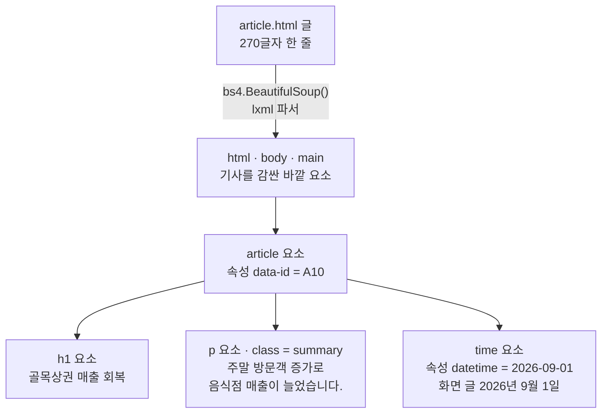
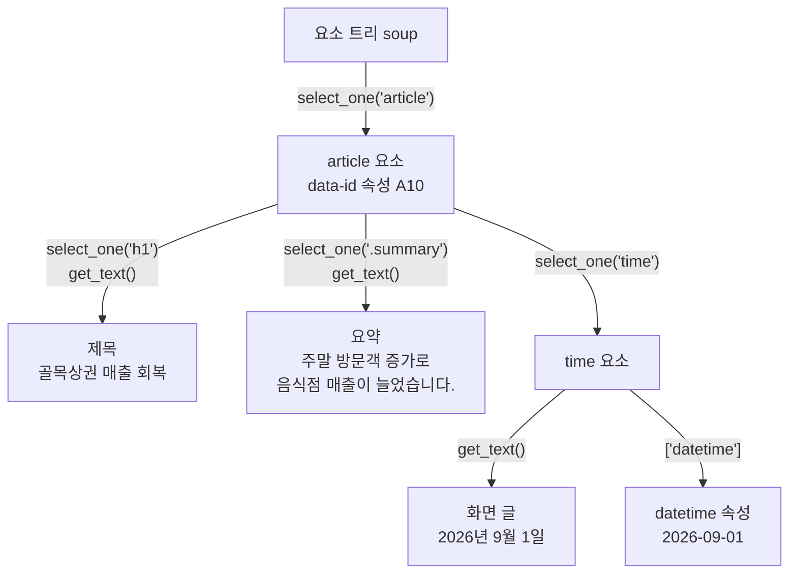
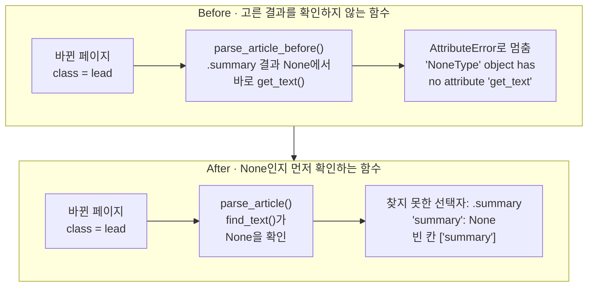
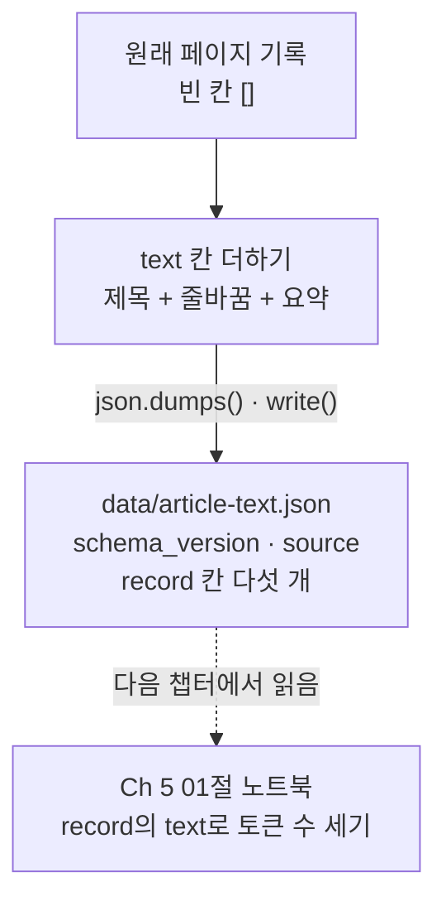

# 05-문서-파싱과-스크래핑

## _src 본문 (HTML 원본)

```html
<!--meta: 강의 1h | 실습 2h | 코드 Jupyter Notebook | 새 용어 9 -->
<h2 id="b1"><span class="no">1</span>학습 목표</h2>
<div class="goal"><ul><li>HTML 글을 파서로 요소 트리로 바꾸고, CSS 선택자로 고른 요소에서 글자와 속성 값을 읽을 수 있습니다.</li><li>고른 결과가 <code>None</code>인지 먼저 확인해, 요소가 없는 페이지에서도 멈추지 않고 빈 칸을 알리는 함수를 만들 수 있습니다.</li><li>robots.txt 규칙이 알려 주는 것과, 이용 약관·저작권·개인정보처럼 따로 확인할 것을 나눠 설명할 수 있습니다.</li></ul></div>
<h2 id="b2"><span class="no">2</span>이 내용을 배우는 이유</h2>
<p>04절에서는 JSON을 주는 연습용 주문 서비스에서 데이터를 읽었습니다. 그러나 필요한 데이터가 사람이 보는 웹 페이지에만 있는 경우도 많습니다. 기사, 공지, 상품 설명이 그렇습니다. 이런 페이지는 HTML 글로 받습니다.</p>
<p>HTML 글에서 화면의 위치나 글자 수로 값을 잘라 내면, 페이지 모양이 조금 바뀌어도 엉뚱한 글이 나올 수 있습니다. 그래서 요소의 이름과 속성으로 값을 고릅니다. 그래도 사이트가 이름표를 바꾸면 고를 요소가 사라집니다. 이때 함수가 그냥 멈추는지, 어느 칸이 비었는지 알리는지에 따라 다음 일이 달라집니다.</p>
<p>이 절에서 읽은 기사 기록은 파일로 남기고, Ch 5 01절이 그 파일을 읽어 토큰 수를 셉니다. 또 남의 사이트에서 페이지를 가져오기 전에는 사이트가 정한 규칙부터 확인해야 합니다. 프로그램으로 읽을 수 있다고 해서 모아도 되는 것은 아닙니다.</p>
<p><strong>이 절의 질문</strong> — class 이름이 바뀌어 고를 요소가 없을 때, 기사를 읽는 함수는 어떻게 멈추지 않고 빈 칸을 알릴까요?</p>
<h2 id="b3"><span class="no">3</span>앞에서 배운 내용</h2>
<p>04절에서는 <code>httpx.get()</code>으로 받은 응답 본문을 메서드 <code>json()</code>으로 딕셔너리로 바꾸고, 키로 값을 꺼냈습니다. 없는 페이지 3의 404 응답에는 주문 목록 칸 <code>orders</code>가 없었습니다. 그래서 본문을 읽기 전에 <code>raise_for_status()</code>로 상태 코드부터 확인했습니다. 이 절도 값을 읽기 전에, 고른 요소가 있는지부터 확인합니다.</p>
<p>01절 <code>fetch_orders()</code>, 03절 <code>find_customer_orders()</code>, 04절 <code>fetch_all_orders()</code>는 모두 딕셔너리 목록을 반환했습니다. 이 절의 함수는 기사 하나를 읽어 딕셔너리 하나를 반환합니다. 받을 오류는 03절 <code>sqlite3.IntegrityError</code>, 04절 <code>httpx.HTTPStatusError</code>처럼 이름을 정해 <code>try/except</code>로 받습니다.</p>
<p>01~04절은 주문 데이터를 임시 폴더에 새로 만들었습니다. 이 절은 실습 폴더 <code>data</code>에 저장해 둔 지역 상권 소식 기사 <code>A10</code>의 페이지를 씁니다. 여기서 만든 기사 기록을 Ch 5 01절이 이어 받기 때문입니다. 그래서 준비 셀은 임시 폴더 대신 <code>data</code> 폴더로 작업 위치를 옮깁니다.</p>
<p>Ch 2 03절의 딕셔너리 <code>items()</code>와 풀어 담기, 04절의 <code>None</code>과 <code>is None</code>, 05절의 <code>with open</code>과 <code>try/except 오류이름</code>을 씁니다. Ch 1 02절의 상대 경로로 <code>data</code> 폴더를 찾고, Ch 1 04절의 <code>replace()</code>로 페이지 글을 바꿔 봅니다.</p>
<h2 id="b4"><span class="no">4</span>핵심 개념</h2>
<h3>비유로 시작하기</h3>
<p>기사 페이지를 뚜껑이 열린 나무 상자라고 해 봅니다. 상자 안에는 제목, 요약, 날짜 카드가 서 있고, 카드 모서리마다 색 스티커가 붙어 있습니다. 옆에 둔 쟁반 앞면에는 노란 스티커가 붙어 있습니다. 노란 스티커 카드를 찾아 이 쟁반에 올리는데, 카드가 상자의 몇째 칸에 있는지는 보지 않습니다.</p>
<p>어느 날 요약 카드의 스티커가 보라로 바뀌었습니다. 노란 스티커 카드를 찾으면 쟁반은 비어 있습니다. 빈 쟁반인 줄 모르고 카드 글을 읽으려 하면 거기서 멈춥니다. 쟁반이 비었는지 먼저 보면 「노란 스티커 카드 없음」이라고 적고 다음 일로 넘어갈 수 있습니다.</p>
<p>이 장면을 HTML로 옮기면 상자는 기사 요소, 카드는 그 안의 요소, 스티커 색은 class 이름입니다. 쟁반 앞의 노란 스티커는 선택자 <code>.summary</code>이고, 빈 쟁반은 <code>select_one()</code>이 반환한 <code>None</code>입니다.</p>
{{img:05-5-스티커-쟁반|왼쪽에는 초록과 파랑 스티커 카드가 든 나무 상자 옆에 앞면에 노란 스티커가 붙은 쟁반이 있고 그 위에 노란 스티커 카드가 놓여 있으며, 오른쪽에는 초록·보라·파랑 스티커 카드 세 장이 든 상자 옆에 노란 스티커가 붙은 쟁반이 비어 있는 삽화|노란 스티커 카드는 노란 스티커 쟁반에 오릅니다. 카드 스티커가 보라로 바뀌면 같은 쟁반은 빈 채로 남습니다.}}
<p><strong>그림 읽기</strong> — 가운데 세로선의 왼쪽이 원래 페이지, 오른쪽이 class 이름이 바뀐 페이지입니다. 두 칸에는 같은 나무 상자와 쟁반이 있고, 쟁반 앞면에 노란 스티커가 붙어 있습니다. 왼쪽 상자에는 초록과 파랑 스티커 카드가 남아 있고, 노란 스티커 카드는 쟁반 위에 놓여 있습니다.</p>
<p>오른쪽 상자에는 초록, 보라, 파랑 스티커 카드 세 장이 서 있습니다. 가운데 카드의 스티커가 보라로 바뀌어, 노란 스티커 쟁반은 비어 있습니다. 카드는 상자 안에 그대로 있지만, 찾는 스티커와 색이 달라 쟁반에 오르지 못했습니다.</p>
<h3>이 절에서 쓰는 말</h3>
<table><thead><tr><th>용어</th><th>뜻</th><th>이 절에서 보이는 모습</th></tr></thead><tbody>
<tr><td>스크래핑(scraping)</td><td>웹 페이지에서 필요한 데이터를 프로그램으로 골라 모으는 일</td><td>저장한 기사 페이지에서 제목·요약·날짜 읽기</td></tr>
<tr><td>robots.txt</td><td>페이지를 자동으로 가져가는 프로그램에게 들어와도 되는 주소를 알리는 사이트의 글</td><td><code>Allow: /articles/</code>, <code>Disallow: /private/</code></td></tr>
<tr><td>HTML(HyperText Markup Language)</td><td>내용 앞뒤에 태그를 붙여 역할을 적는 웹 페이지 글 형식</td><td>파일 <code>article.html</code>, 270글자 한 줄</td></tr>
<tr><td>태그(tag)와 요소(element)</td><td>꺾쇠 괄호로 된 표시와, 여는 태그부터 닫는 태그까지의 덩어리</td><td><code>&lt;h1&gt;골목상권 매출 회복&lt;/h1&gt;</code></td></tr>
<tr><td>속성(attribute)</td><td>여는 태그 안에 <code>이름="값"</code>으로 붙인 추가 정보</td><td><code>data-id="A10"</code>, <code>datetime="2026-09-01"</code></td></tr>
<tr><td>파싱(parsing)과 파서(parser)</td><td>글을 태그와 포함 관계가 있는 구조로 읽는 일과, 그 일을 하는 프로그램</td><td><code>bs4.BeautifulSoup(html_text, "lxml")</code></td></tr>
<tr><td>요소 트리(element tree)</td><td>바깥 요소가 안쪽 요소를 품는 나무 모양 구조. 안에 바로 든 요소는 자식 요소</td><td><code>prettify()</code>로 들여 쓴 트리 글</td></tr>
<tr><td>CSS 선택자(CSS selector)</td><td>트리에서 원하는 요소를 고르는 조건 글</td><td><code>article</code>, <code>.summary</code>, <code>time</code></td></tr>
<tr><td>class 속성</td><td>같은 역할의 요소를 묶는 이름표</td><td><code>class="summary"</code>, 바꾼 페이지의 <code>class="lead"</code></td></tr>
</tbody></table>
<h3>한 줄 글이 요소 트리가 됩니다</h3>
<p>저장한 기사 페이지는 줄바꿈 없는 270글자 한 줄입니다. 파서는 이 글의 태그를 따라가며, 어느 요소가 어느 요소 안에 있는지 정리한 요소 트리를 만듭니다. 이 절은 파서로 lxml을 쓰고, 트리를 다루는 도구로 beautifulsoup4를 씁니다. 코드에서 불러오는 이름은 <code>bs4</code>입니다.</p>
{{mermaid:05-1-요소-트리|한 줄로 된 article.html 글이 BeautifulSoup과 lxml 파서를 거쳐 html·body·main 바깥 요소가 되고, 그 안의 article 요소에 data-id A10 속성이 있으며, article 안에 h1 제목, class가 summary인 p 요약, datetime 속성이 2026-09-01인 time 요소가 나란히 든 요소 트리 그림|한 줄 HTML 글이 요소 트리가 됩니다. 기사 요소 article 안에 제목, 요약, 날짜 요소가 나란히 들어 있습니다.}}
<p><strong>도식 읽기</strong> — 위에서 아래로 읽습니다. 맨 위 초록 상자는 파일 <code>article.html</code>의 270글자 한 줄 글입니다. 화살표 위 글자는 실행한 코드 <code>bs4.BeautifulSoup()</code>와 lxml 파서입니다. 회색 상자는 기사를 감싼 바깥 요소 html, body, main을 한데 묶어 적은 것입니다.</p>
<p>초록 상자 article 요소에는 속성 <code>data-id</code>의 값 A10이 있습니다. 아래 줄에 나란히 놓인 초록 상자 세 개가 기사 요소의 자식 요소입니다. 제목 h1, class가 summary인 요약 p, 속성 datetime이 2026-09-01인 날짜 time입니다.</p>
<h3>선택자로 요소를 고르고 값을 읽습니다</h3>
<p>CSS 선택자는 요소를 고르는 조건 글입니다. 요소 이름만 적은 <code>article</code>은 이름으로, 점을 찍은 <code>.summary</code>는 class 이름으로 고릅니다. 메서드 <code>select_one()</code>은 조건에 맞는 첫 요소를 반환합니다.</p>
<p>고른 요소에서는 두 가지를 읽습니다. 메서드 <code>get_text(strip=True)</code>는 태그를 뺀 안쪽 글자를 앞뒤 공백 없이 반환합니다. 속성 값은 딕셔너리처럼 <code>요소["속성 이름"]</code>으로 읽습니다. 날짜는 화면 글 「2026년 9월 1일」보다 속성 값 2026-09-01이 프로그램이 다루기 좋은 모양입니다.</p>
<h3>없는 요소를 고르면 None입니다</h3>
<p>맞는 요소가 없어도 <code>select_one()</code>은 오류를 내지 않고 <code>None</code>을 반환합니다. 문제는 그다음 줄입니다. 값 <code>None</code>에는 <code>get_text()</code> 메서드가 없어서, 곧바로 부르면 AttributeError가 나고 프로그램이 멈춥니다.</p>
<p>그래서 고른 결과를 쓰기 전에 <code>is None</code>으로 먼저 확인합니다. 04절에서 본문을 읽기 전에 상태 코드부터 확인한 것과 같은 순서입니다. 없으면 <code>None</code>을 칸에 넣고 어느 선택자가 비었는지 알리면, 함수는 멈추지 않고 나머지 칸을 채웁니다.</p>
<h3>robots.txt는 허가서가 아닙니다</h3>
<p>사이트는 robots.txt에, 자동으로 페이지를 가져가는 프로그램이 들어와도 되는 주소와 안 되는 주소를 적습니다. 모듈 <code>urllib.robotparser</code>의 메서드 <code>can_fetch()</code>는 이 규칙으로 주소마다 <code>True</code>나 <code>False</code>를 판단합니다.</p>
<p>규칙이 <code>True</code>라고 해서 그 페이지를 모으고 다시 써도 된다는 뜻은 아닙니다. 이용 약관, 저작권, 개인정보, 요청 간격은 따로 확인합니다. 로그인이나 접근 제한이 걸린 페이지는 우회하지 않고, 사이트가 제공하는 공식 API를 먼저 찾습니다.</p>
<h3>저장한 페이지를 쓰는 이유</h3>
<p>인터넷의 실제 사이트는 내용과 구조가 바뀌고, 접속이 막히기도 합니다. 그러면 교재와 같은 출력을 다시 보기 어렵습니다. 그래서 이 절은 04절의 연습용 서비스처럼, 실습 폴더에 저장해 둔 페이지 파일을 읽습니다. 규칙 판단에 쓴 주소 <code>example.test</code>는 시험용으로 비워 둔 이름이라 실제 사이트가 없습니다.</p>
<h2 id="b5"><span class="no">5</span>실행 예제</h2>
<p>노트북은 작업 위치를 실습 폴더의 <code>data</code> 폴더로 옮긴 뒤, robots.txt 규칙으로 두 주소를 판단합니다. 그다음 기사 페이지 글을 읽어 요소 트리로 바꾸고, 선택자로 제목·요약·날짜를 읽습니다. 마지막으로 class 이름 하나만 바꾼 페이지에서 같은 선택자를 써 봅니다.</p>
<p>모델을 부르지 않으므로 API 키가 필요 없고 비용도 들지 않습니다. 인터넷에도 접속하지 않습니다. 교재 출력은 Python 3.12.13으로 만들었습니다. 패키지는 실습 폴더에 고정한 beautifulsoup4 4.15.0, lxml 6.1.3, soupsieve 2.9.2입니다.</p>
{{notebook:05-문서-파싱과-스크래핑|example}}
<p class="look"><b>확인할 점</b> — 2절에서 기사 주소가 <code>True</code>, 비공개 주소가 <code>False</code>인지 봅니다. 4절 트리 글에서 <code>&lt;h1&gt;</code> 줄이 기사 요소 줄보다 더 들여 쓰였는지 확인합니다. 7절의 <code>.summary로 고른 결과: None</code>도 봅니다.</p>
<h3>규칙 확인과 한 줄 글</h3>
<p>규칙 줄은 <code>['User-agent: *', 'Allow: /articles/', 'Disallow: /private/']</code>였습니다. 연습용 기사 주소는 <code>True</code>, 비공개 주소는 <code>False</code>였습니다. 이 판단은 규칙 글만 본 것이고, 인터넷에 접속하지 않았습니다.</p>
<p>파일에서 읽은 HTML 글은 270글자 한 줄이었습니다. 메서드 <code>prettify()</code>로 본 트리 글에서는 <code>&lt;article data-id="A10"&gt;</code> 줄 아래 세 줄이 한 칸 더 들여 쓰여 있었습니다. 세 줄은 <code>&lt;h1&gt;</code>, <code>&lt;p class="summary"&gt;</code>, <code>&lt;time datetime="2026-09-01"&gt;</code>입니다.</p>
<h3>선택자로 값 읽기</h3>
<p>선택자 <code>article</code>로 고른 요소의 이름은 <code>article</code>, 속성 <code>data-id</code>는 <code>A10</code>이었습니다. 이 요소 안에서 <code>h1</code>을 골라 제목 <code>골목상권 매출 회복</code>을 읽었습니다. class 선택자 <code>.summary</code>로는 요약 문단의 글을 읽었습니다.</p>
<p>날짜 요소 <code>time</code>의 화면 글은 <code>2026년 9월 1일</code>, 속성 <code>datetime</code>은 <code>2026-09-01</code>이었습니다. 같은 날짜가 두 모양으로 들어 있고, 뒤의 함수는 속성 값을 씁니다.</p>
{{mermaid:05-2-선택자로-값-읽기|요소 트리 soup에서 select_one('article')로 data-id 속성이 A10인 article 요소를 고르고, 그 안에서 select_one('h1')과 get_text()로 제목 골목상권 매출 회복을, select_one('.summary')와 get_text()로 요약 글을 읽으며, select_one('time')으로 고른 time 요소에서 get_text()로 화면 글 2026년 9월 1일을, ['datetime']으로 속성 값 2026-09-01을 읽는 흐름도|선택자로 요소를 고르고 글자와 속성 값을 읽었습니다. 같은 날짜가 화면 글과 속성 값, 두 모양으로 나옵니다.}}
<p><strong>도식 읽기</strong> — 위에서 아래로 읽습니다. 초록 상자는 요소 트리와 고른 요소이고, 노란 상자는 노트북 출력으로 확인한 값입니다. 화살표 위 글자가 실행한 코드입니다.</p>
<p>맨 위 요소 트리에서 <code>select_one('article')</code>로 기사 요소를 골랐습니다. 제목과 요약은 기사 요소 안에서 요소를 고른 뒤 <code>get_text()</code>로 읽었습니다. 날짜는 time 요소를 고른 뒤 두 갈래로 나뉩니다. 한쪽은 화면 글 2026년 9월 1일, 다른 쪽은 속성 값 2026-09-01입니다.</p>
<h3>class 이름 하나만 바꿔 보기</h3>
<p>저장한 글에서 <code>class="summary"</code>만 <code>class="lead"</code>로 바꾼 페이지를 만들었습니다. 같은 선택자 <code>.summary</code>로 고르자 <code>.summary로 고른 결과: None</code>이 나왔고, 오류는 나지 않았습니다. 선택자를 <code>.lead</code>로 바꾸자 요약 글이 그대로 나왔습니다. 내용은 페이지에 있지만, 이름표가 달라 옛 선택자로 찾지 못한 것입니다.</p>
<h2 id="b6"><span class="no">6</span>일부러 실패해 보기</h2>
<p>Before 함수 <code>parse_article_before()</code>는 HTML 글을 받아 기사 번호, 제목, 요약, 날짜를 담은 딕셔너리를 반환합니다. 제목과 요약은 고른 결과를 확인하지 않고 곧바로 <code>get_text()</code>를 부릅니다. After 함수 <code>parse_article()</code>는 이 두 줄만 작은 함수 <code>find_text()</code>로 바꿨습니다. 두 함수에 원래 페이지와 class 이름이 바뀐 페이지를 차례로 넣습니다.</p>
{{notebook:05-문서-파싱과-스크래핑|failure}}
<p>원래 페이지에서는 Before 함수도 네 칸이 모두 찬 기록을 반환했습니다. 바뀐 페이지에서는 기록 대신 <code>속성 오류: 'NoneType' object has no attribute 'get_text'</code>가 나왔습니다. 요약을 고른 결과가 <code>None</code>이었고, 그 값에서 <code>get_text()</code>를 부르다 멈춘 것입니다.</p>
<p>오류 메시지에는 어느 선택자가 비었는지 적혀 있지 않습니다. 노트북은 셀을 끝까지 실행하려고 AttributeError만 받아 출력했습니다. 실제 프로그램이라면 제대로 읽힌 기사 번호와 날짜도 받지 못한 채 여기서 멈춥니다.</p>
<p>After 함수는 바뀐 페이지에서 <code>찾지 못한 선택자: .summary</code>를 출력하고, <code>'summary': None</code>이 든 기록을 반환했습니다. 기사 번호 <code>'A10'</code>과 날짜 <code>'2026-09-01'</code>은 그대로 들어 있었습니다. 빈 칸을 모은 결과는 원래 페이지 <code>[]</code>, 바뀐 페이지 <code>['summary']</code>였습니다.</p>
{{mermaid:05-3-바뀐-페이지-비교|위 칸 Before는 class가 lead로 바뀐 페이지가 parse_article_before로 가서 .summary 결과 None에서 바로 get_text를 불러 빨간 상자 AttributeError 'NoneType' object has no attribute 'get_text'로 멈추고, 아래 칸 After는 같은 페이지가 parse_article로 가서 find_text가 None을 확인해 노란 상자 찾지 못한 선택자 .summary, 'summary': None, 빈 칸 ['summary']가 되는 비교 그림|같은 바뀐 페이지, 다른 함수입니다. 확인하지 않으면 AttributeError로 멈추고, 먼저 확인하면 빈 칸 summary를 알립니다.}}
<p><strong>도식 읽기</strong> — 위 칸이 Before, 아래 칸이 After이고, 칸마다 왼쪽에서 오른쪽으로 읽습니다. 초록 상자는 class 이름이 lead로 바뀐 페이지이고, 파란 상자는 우리가 정의한 함수입니다.</p>
<p>위 칸 끝의 빨간 상자는 Before 함수가 기록을 반환하지 못하고 멈춘 결함입니다. 노트북은 셀을 이어 가려고 이 오류를 받아 출력했지만, 함수가 할 일로 보면 실패라 빨간색으로 칠했습니다. 아래 칸 끝의 노란 상자는 After 함수가 반환해 출력으로 확인한 값입니다.</p>
<h3>빈 칸이 없는 기록만 Ch 5에 넘깁니다</h3>
<p>마지막 셀은 빈 칸이 없는 원래 페이지 기록에 글 칸 <code>text</code>를 더합니다. 제목과 요약을 줄바꿈으로 이은 글입니다. 이 기록을 <code>schema_version</code>, <code>source</code>와 함께 <code>json.dumps()</code>로 JSON 글로 바꿔 <code>data/article-text.json</code>에 썼습니다.</p>
<p>출력된 JSON 글의 첫 칸은 <code>"schema_version": "ch04-parsed-article-v1"</code>입니다. 칸 <code>record</code> 안에는 <code>id</code>부터 <code>text</code>까지 칸 다섯 개가 있습니다. Ch 5 01절 노트북은 이 파일의 <code>schema_version</code>, <code>source</code>, 기사 번호, <code>text</code>를 읽습니다. 그래서 칸 이름과 파일 이름을 바꾸지 않았습니다.</p>
{{mermaid:05-4-Ch5에-넘길-파일|노란 상자 원래 페이지 기록 빈 칸 []에서 파란 상자 text 칸 더하기 제목 + 줄바꿈 + 요약으로 가고, json.dumps와 write로 초록 상자 data/article-text.json schema_version, source, record 칸 다섯 개가 되며, 점선으로 회색 상자 Ch 5 01절 노트북이 record의 text로 토큰 수를 세는 곳으로 이어지는 흐름도|빈 칸이 없는 기록에 text 칸을 더해 JSON 파일로 씁니다. Ch 5 01절이 이 파일의 text 칸을 읽습니다.}}
<p><strong>도식 읽기</strong> — 위에서 아래로 읽습니다. 노란 상자는 출력으로 확인한 원래 페이지의 빈 칸 목록 <code>[]</code>입니다. 파란 상자는 셀에서 실행한 <code>text</code> 칸 더하기, 초록 상자는 데이터 파일입니다.</p>
<p>맨 아래 회색 상자는 다음 챕터 Ch 5 01절 노트북입니다. 이 절에서는 실행하지 않아 점선으로 이었습니다.</p>
<h2 id="b7"><span class="no">7</span>주의할 점과 실무 메모</h2>
<ul><li>규칙 확인 결과 <code>True</code>는 규칙 글이 그 주소를 막지 않았다는 뜻입니다. 이용 허가는 아니므로 이용 약관, 저작권과 데이터베이스 권리, 개인정보 처리 조건을 따로 확인합니다.</li>
<li>로그인, 접근 제한, 자동 입력 방지 문자(CAPTCHA)를 우회하지 않습니다. 접근이 막혀 있으면 사이트가 제공하는 공식 API나 데이터 제공 경로를 찾습니다.</li>
<li>실제 사이트에서 가져올 때는 요청 사이에 간격을 두고, 한꺼번에 많은 요청을 보내지 않습니다. 이 절은 인터넷에서 페이지를 가져오지 않았으므로 요청 간격은 실행하지 않았습니다.</li>
<li>설치한 Python 3.12의 <code>urllib.robotparser</code> 소스를 보면, 주소에 맞는 규칙 줄 가운데 먼저 적힌 줄을 따릅니다. 로봇 배제 표준 문서 RFC 9309는 가장 길게 맞는 줄을 따르라고 적습니다. 이번 규칙 두 줄은 서로 겹치지 않아 차이가 없었고, 겹치는 규칙은 실행하지 않았습니다.</li>
<li>이 절의 After 함수는 제목과 요약 두 칸만 <code>None</code>을 확인합니다. 기사 요소나 time 요소가 없는 페이지는 이번에 실행하지 않았습니다. 설치한 beautifulsoup4 소스를 보면, 없는 속성을 <code>요소["속성 이름"]</code>으로 읽으면 KeyError가 납니다. 이 경우도 실행하지 않았습니다.</li>
<li>실습 폴더 <code>data_tools.py</code>의 확장 함수 <code>parse_article_html()</code>은 필수 칸이 없으면 ValueError를 냅니다. 노트북 함수와 이름과 모양이 다르고, 이 절에서는 고치지 않았습니다.</li>
<li>Beautiful Soup 설명서는 잘못 짠 HTML을 파서마다 다른 트리로 만든다고 적습니다. 이 절은 lxml 파서 하나만 실행했으므로, 실습과 운영에서 파서 이름과 버전을 고정합니다.</li>
<li>노트북을 다시 실행하면 <code>data/article-text.json</code>이 같은 내용으로 다시 쓰입니다. 페이지 파일 <code>article.html</code>을 바꾸면 이 파일도 바뀌고, Ch 5 01절의 토큰 수 출력도 달라질 수 있습니다. Windows에서는 줄바꿈 글자가 달라 파일이 바뀐 것으로 보일 수 있고, 이 경우는 실행하지 않았습니다.</li>
<li>교재 출력은 2026-09-16에 Linux의 Python 3.12.13으로 만들었습니다. 패키지는 beautifulsoup4 4.15.0, lxml 6.1.3, soupsieve 2.9.2입니다. 운영체제 Windows와 macOS, 다른 버전에서는 실행하지 않았습니다.</li></ul>
<h2 id="b8"><span class="no">8</span>정리와 다음 절</h2>
<ul><li>파서는 한 줄 HTML 글을 요소 트리로 바꿉니다. 메서드 <code>select_one()</code>은 선택자에 맞는 첫 요소를, 없으면 <code>None</code>을 반환합니다.</li><li>고른 결과를 확인하지 않은 함수는 class 이름이 바뀐 페이지에서 AttributeError로 멈췄습니다. 결과가 <code>None</code>인지 먼저 확인한 함수는 빈 칸 <code>['summary']</code>를 알리고 기록을 반환했습니다.</li><li>robots.txt 규칙은 기사 주소를 <code>True</code>, 비공개 주소를 <code>False</code>로 판단했습니다. 이용 약관, 저작권, 개인정보는 따로 확인합니다.</li></ul>
<p><strong>다음 학습과 이어지는 지점</strong> — <a href="06-데이터-도구-실습.html">06절 데이터 도구 실습</a>에서는 01~04절의 도구를 함수로 묶어 고객별 합계를 냅니다. 고객 파일은 02절처럼 CSV로, 주문은 04절 연습용 서비스에서 받아 03절 데이터베이스에 모읍니다. 고객 파일 이름 하나만 바꿔 두 번 실행하고 기록장을 비교합니다. 이 절에서 쓴 <code>data/article-text.json</code>이 Ch 5로 이어지는 지점은 06절 끝에 적었습니다.</p>
<h2 id="b9"><span class="no">9</span>복습 문제</h2><details class="quiz"><summary>문제와 해설</summary>
<p class="quiz-q">1. 선택자 <code>article</code>과 <code>.summary</code>는 각각 무엇을 기준으로 요소를 고르나요? · 기초</p><p class="quiz-a"><b>해설</b> — 선택자 <code>article</code>은 요소 이름이 article인 요소를 고릅니다. 점을 찍은 <code>.summary</code>는 class 이름이 summary인 요소를 고릅니다. 5절에서 기사 요소를, 6절에서 요약 문단을 이렇게 골랐습니다.</p>
<p class="quiz-q">2. 6절에서 날짜를 화면 글 대신 <code>datetime</code> 속성에서 읽은 이유는 무엇인가요? · 기초</p><p class="quiz-a"><b>해설</b> — 화면 글 <code>2026년 9월 1일</code>은 한국어 글자가 섞여 있고, 사이트마다 적는 모양이 다를 수 있습니다. 속성 값 <code>2026-09-01</code>은 HTML 규칙이 정한 날짜 모양이라 프로그램이 다루기 좋습니다.</p>
<p class="quiz-q">3. 7절에서 class 이름이 바뀐 페이지를 <code>.summary</code>로 골랐을 때 결과는 무엇이었고, 오류가 났나요? · 적용</p><p class="quiz-a"><b>해설</b> — 결과는 <code>None</code>이었고 오류는 나지 않았습니다. 메서드 <code>select_one()</code>은 맞는 요소가 없으면 <code>None</code>을 반환합니다. 선택자를 <code>.lead</code>로 바꾸자 요약 글이 나왔습니다.</p>
<p class="quiz-q">4. Before 함수가 바뀐 페이지에서 멈춘 까닭은 무엇이고, 오류 메시지만으로는 무엇을 알기 어렵나요? · 분석</p><p class="quiz-a"><b>해설</b> — 요약을 고른 결과 <code>None</code>에서 <code>get_text()</code>를 불러 AttributeError가 났습니다. 메시지 <code>'NoneType' object has no attribute 'get_text'</code>에는 어느 선택자가 비었는지 없습니다. 그래서 After의 <code>find_text()</code>는 <code>찾지 못한 선택자: .summary</code>를 출력합니다.</p>
<p class="quiz-q">5. robots.txt 규칙이 기사 주소에 <code>True</code>를 냈다면, 그 기사를 모아 다시 배포해도 되나요? · 분석</p><p class="quiz-a"><b>해설</b> — 아닙니다. 규칙 확인은 자동 프로그램이 들어와도 되는 주소만 알려 줍니다. 이용 약관, 저작권, 개인정보, 요청 간격은 따로 확인해야 합니다.</p>
</details>
<h2 id="b10"><span class="no">10</span>참고 자료</h2>
<ul><li><a href="https://www.crummy.com/software/BeautifulSoup/bs4/doc/">Beautiful Soup 공식 문서</a> · 확인 2026-09-16 · 실행 beautifulsoup4 4.15.0</li><li><a href="https://docs.python.org/3.12/library/urllib.robotparser.html">Python 공식 문서: urllib.robotparser</a> · 확인 2026-09-09 · 실행 3.12.13</li><li><a href="https://docs.python.org/3.12/library/json.html">Python 3.12 공식 문서: json</a> · 실행 Python 3.12.13</li><li><a href="https://www.rfc-editor.org/rfc/rfc9309.html">RFC 9309: Robots Exclusion Protocol</a> · 확인 2026-09-16 · 주의 메모</li><li><a href="https://developers.google.com/search/docs/crawling-indexing/robots/intro">Google Search Central: robots.txt 소개</a> · 확인 2026-09-09</li></ul>
```

## 노트북 셀 (순서대로)

### [0] markdown {'html': 'skip'}

# 문서 파싱과 스크래핑

**이 노트북에서 할 일**

1. 연습용 robots.txt 규칙을 읽고, 두 주소를 이 규칙이 허용하는지 확인합니다.
2. 기사 페이지 HTML 글을 요소 트리로 바꾸고, CSS 선택자로 제목·요약·날짜를 골라 읽습니다.
3. class 이름이 바뀐 페이지에서 멈추는 함수를 고친 뒤, Ch 5가 읽을 JSON 파일을 씁니다.

**준비물** — API 키 불필요. 인터넷에 있는 사이트에는 접속하지 않습니다.
실습 폴더의 `data` 폴더에 든 `robots.txt`와 `article.html`을 읽습니다.
마지막 코드 셀은 같은 폴더에 `article-text.json`을 씁니다. Ch 5 01절이 이 파일을 읽습니다.

모델 호출은 0번이고 비용은 들지 않습니다. 실행 시간은 1분 이내입니다.

**기준 버전** — 실습 폴더에 고정한 beautifulsoup4 4.15.0과 lxml 6.1.3을 씁니다.
선택자를 처리하는 soupsieve 2.9.2도 함께 설치됩니다. 교재 출력은 이 버전들과 Python 3.12.13으로 만들었습니다.

설치 정보에 적힌 Python 요구 버전은 세 패키지가 다릅니다. 패키지 beautifulsoup4는 3.7 이상, lxml은 3.8 이상입니다.
패키지 soupsieve는 3.10 이상을 요구합니다. 다른 버전은 이번에 실행하지 않았습니다.

실습 폴더 `labs/part1/ch04-data-tools`에서 Ch 1 3절처럼 `uv sync --locked`로 환경을 만듭니다.
커널에서 이 폴더의 `.venv`를 고른 뒤 첫 셀부터 순서대로 실행합니다.

### [1] markdown {'html': 'skip'}

## 오늘 볼 그림


위에서 아래로 읽습니다. 맨 위 초록 상자는 한 줄로 된 HTML 글이고, 화살표의 파서가 이 글을 요소 트리로 바꿉니다.
회색 상자는 기사를 감싼 바깥 요소입니다. 그 아래 기사 요소 article 안에 제목, 요약, 날짜 요소가 나란히 들어 있습니다.

이 노트북은 아래 줄의 세 요소에서 글자와 속성 값을 골라 읽습니다.

### [2] markdown {}

## 1. 준비

이 절은 새 연습 파일을 만들지 않습니다. 실습 폴더의 `data` 폴더에 든 파일을 읽고, 마지막에 Ch 5가 읽을 파일 하나를 같은 폴더에 씁니다.
그래서 01~04절처럼 임시 폴더를 만들지 않고, 작업 위치를 `data` 폴더로 옮깁니다.

노트북을 `notebooks` 폴더에서 열면 `data` 폴더는 한 칸 위에 있어 `../data`로 적습니다. Ch 1 02절의 상대 경로입니다.
함수 `os.path.exists()`는 적은 경로에 파일이나 폴더가 있으면 `True`를 반환합니다.
그 경로에 파일이 없으면 프로젝트 맨 위 폴더에서 연 경우로 보고 긴 경로를 씁니다.

### [3] code {'execution': {'iopub.execute_input': '2026-09-16T16:17:58.422642Z', 'iopub.status.busy': '2026-09-16T16:17:58.422423Z', 'iopub.status.idle': '2026-09-16T16:17:58.428545Z', 'shell.execute_reply': '2026-09-16T16:17:58.427812Z'}, 'lesson_role': 'setup'}

```python
# 기사 페이지 파일이 든 실습 폴더의 data 폴더로 작업 위치를 옮깁니다
import os

# notebooks 폴더에서 열면 한 칸 위의 data, 프로젝트 맨 위 폴더에서 열면 긴 경로에 있습니다
data_folder = "../data"
if not os.path.exists("../data/article.html"):
    data_folder = "labs/part1/ch04-data-tools/data"
# chdir()는 터미널의 cd처럼 현재 작업 폴더를 옮깁니다
os.chdir(data_folder)
print("article.html이 있는가:", os.path.exists("article.html"))
print("robots.txt가 있는가:", os.path.exists("robots.txt"))
```

출력:
```
article.html이 있는가: True
robots.txt가 있는가: True

```

### [4] markdown {}

**결과 읽기** — 두 줄 모두 `True`입니다. 작업 위치가 `data` 폴더로 옮겨졌고, 이 절에서 읽을 두 파일이 있습니다.
폴더의 경로는 컴퓨터마다 달라서 출력하지 않았습니다.

### [5] markdown {}

## 2. 가져오기 전에 — robots.txt 규칙 읽기

웹 페이지에서 필요한 데이터를 프로그램으로 골라 모으는 일을 스크래핑(scraping)이라고 부릅니다.
신문에서 필요한 기사만 오려 두는 일을 프로그램이 하는 셈입니다. 이 절은 저장해 둔 기사 페이지 하나에서 제목과 요약, 날짜를 골라 읽습니다.

페이지를 가져오기 전에 먼저 볼 규칙이 있습니다. 파일 robots.txt는 페이지를 자동으로 가져가는 프로그램에게 들어와도 되는 주소를 알리는 글입니다.
건물 입구의 「관계자 외 출입 금지」 안내판과 비슷합니다. 안내판에 적히지 않은 방이라도 건물 규칙과 저작권은 따로 지켜야 합니다.

실습 폴더의 `robots.txt`는 연습용 주소 `example.test`의 규칙이라고 가정합니다. 끝이 `.test`인 주소는 시험용으로 비워 둔 이름이라 실제 사이트가 없습니다.
표준 라이브러리 모듈 `urllib.robotparser`가 규칙을 읽고 판단합니다. 묶음 `urllib` 안의 모듈이라 점으로 이어 적습니다.

메서드 `can_fetch(프로그램 이름, 주소)`는 규칙이 그 주소를 허용하면 `True`를 반환합니다. 프로그램 이름은 요청하는 프로그램이 스스로 밝히는 이름입니다.
이 메서드는 이미 읽어 들인 규칙만 보고 판단하고, 인터넷에 접속하지 않습니다.

실행 전에 예상합니다. 규칙 줄 `Allow: /articles/`에 맞는 기사 주소는 `True`, `Disallow: /private/`에 맞는 비공개 주소는 `False`일 것입니다.

### [6] code {'execution': {'iopub.execute_input': '2026-09-16T16:17:58.430109Z', 'iopub.status.busy': '2026-09-16T16:17:58.429999Z', 'iopub.status.idle': '2026-09-16T16:17:58.437973Z', 'shell.execute_reply': '2026-09-16T16:17:58.437160Z'}}

```python
# robots.txt 규칙을 읽고, 연습용 주소 두 곳을 이 규칙이 허용하는지 묻습니다
import urllib.robotparser

with open("robots.txt", encoding="utf-8") as file:
    rule_lines = file.read().splitlines()
print("규칙 줄:", rule_lines)
# RobotFileParser()는 규칙을 담을 객체를 만들고, parse()가 규칙 줄 목록을 읽어 들입니다
robots = urllib.robotparser.RobotFileParser()
robots.parse(rule_lines)
article_address = "https://example.test/articles/A10"
private_address = "https://example.test/private/A10"
# can_fetch(프로그램 이름, 주소)는 규칙이 허용하면 True를 반환합니다
print("기사 주소를 허용하는가:", robots.can_fetch("course-bot", article_address))
print("비공개 주소를 허용하는가:", robots.can_fetch("course-bot", private_address))
```

출력:
```
규칙 줄: ['User-agent: *', 'Allow: /articles/', 'Disallow: /private/']
기사 주소를 허용하는가: True
비공개 주소를 허용하는가: False

```

### [7] markdown {}

**결과 읽기** — 규칙 줄은 `['User-agent: *', 'Allow: /articles/', 'Disallow: /private/']`입니다. 첫 줄의 별표는 모든 프로그램에 적용한다는 뜻입니다.
기사 주소는 `True`, 비공개 주소는 `False`로 예상과 같습니다.

이 결과는 robots.txt 규칙만 보고 내린 판단입니다. 사이트의 이용 약관, 저작권, 개인정보, 요청 간격은 이 코드가 확인하지 않습니다.
이 노트북은 페이지를 가져오지 않고, 저장해 둔 페이지 파일을 읽습니다.

### [8] markdown {}

## 3. HTML 글 읽기

기사 페이지는 HTML(HyperText Markup Language) 형식의 글입니다. 이 형식은 내용 앞뒤에 꺾쇠 괄호로 된 태그(tag)를 붙여 내용의 역할을 적습니다.
예를 들어 여는 태그 `<time datetime="2026-09-01">`와 닫는 태그 `</time>` 사이의 글은 날짜입니다.

여는 태그부터 닫는 태그까지를 요소(element)라고 부릅니다. 여는 태그 안의 `이름="값"`은 속성(attribute)으로, 요소에 붙이는 추가 정보입니다.
04절의 JSON은 값을 키로 찾았습니다. HTML에서는 요소 이름과 속성으로 값을 찾습니다.

Ch 2 05절처럼 `with open`으로 파일 글을 읽습니다.
실행 전에 예상합니다. 태그와 내용이 줄바꿈 없이 이어진 글이 나올 것입니다.

### [9] code {'execution': {'iopub.execute_input': '2026-09-16T16:17:58.439143Z', 'iopub.status.busy': '2026-09-16T16:17:58.439033Z', 'iopub.status.idle': '2026-09-16T16:17:58.442564Z', 'shell.execute_reply': '2026-09-16T16:17:58.442042Z'}}

```python
# 실습 폴더에 저장해 둔 기사 페이지 HTML 파일을 글로 읽습니다
with open("article.html", encoding="utf-8") as file:
    html_text = file.read()
print("HTML 글의 글자 수:", len(html_text))
print("HTML 글:")
print(html_text)
```

출력:
```
HTML 글의 글자 수: 270
HTML 글:
<!doctype html>
<html lang="ko"><head><meta charset="utf-8"><title>지역 상권 소식</title></head><body><main><article data-id="A10"><h1>골목상권 매출 회복</h1><p class="summary">주말 방문객 증가로 음식점 매출이 늘었습니다.</p><time datetime="2026-09-01">2026년 9월 1일</time></article></main></body></html>


```

### [10] markdown {}

**결과 읽기** — 글자 수는 `270`입니다. 글은 `<!doctype html>`로 시작해 `</html>`로 끝나고, 줄바꿈 없이 한 줄입니다.

가운데의 `<article data-id="A10">`은 기사 요소를 여는 태그이고, `data-id="A10"`이 속성입니다.
그 뒤로 제목 태그 h1, 문단 태그 p, 날짜 태그 `<time datetime="2026-09-01">`의 요소가 이어집니다.
한 줄 글이라 어느 요소가 어느 요소 안에 있는지 눈으로 찾기 어렵습니다.

### [11] markdown {}

## 4. 파서로 요소 트리 만들기

HTML 글을 태그와 포함 관계가 있는 구조로 읽는 일을 파싱(parsing)이라고 부릅니다. 그 일을 하는 프로그램은 파서(parser)입니다.
파싱한 결과는 바깥 요소가 안쪽 요소를 품는 나무 모양이라 요소 트리(element tree)라고 부릅니다. 폴더 안에 폴더가 든 모양과 비슷합니다.
어떤 요소 안에 바로 든 요소를 그 요소의 자식 요소라고 부릅니다.

패키지 beautifulsoup4는 HTML을 파싱해 요소 트리를 다루는 기능 묶음이고, import할 때 이름은 `bs4`입니다.
실제로 글을 읽는 파서로는 패키지 lxml을 씁니다. 두 패키지는 실습 폴더의 `uv sync --locked`가 이미 설치했습니다.

함수 `bs4.BeautifulSoup(글, "lxml")`은 lxml 파서로 글을 읽어 요소 트리 객체를 반환합니다.
메서드 `prettify()`는 요소마다 줄을 나누고, 안쪽 요소일수록 더 들여 쓴 글을 반환합니다.

실행 전에 예상합니다. 기사 요소 줄보다 그 안의 제목 요소 줄이 더 들여 쓰여 있을 것입니다.

### [12] code {'execution': {'iopub.execute_input': '2026-09-16T16:17:58.443595Z', 'iopub.status.busy': '2026-09-16T16:17:58.443494Z', 'iopub.status.idle': '2026-09-16T16:17:58.471498Z', 'shell.execute_reply': '2026-09-16T16:17:58.471018Z'}}

```python
# bs4로 HTML 글을 요소 트리로 바꾸고, 트리를 들여쓰기한 글로 출력합니다
import bs4
import lxml

print("beautifulsoup4 버전:", bs4.__version__)
print("lxml 버전:", lxml.__version__)
# BeautifulSoup(글, "lxml")은 lxml 파서로 글을 읽어 요소 트리 객체를 반환합니다
soup = bs4.BeautifulSoup(html_text, "lxml")
# prettify()는 요소마다 줄을 나누고 안쪽 요소를 더 들여 쓴 글을 반환합니다
tree_text = soup.prettify()
print("트리 글:")
print(tree_text)
```

출력:
```
beautifulsoup4 버전: 4.15.0
lxml 버전: 6.1.3
트리 글:
<!DOCTYPE html>
<html lang="ko">
 <head>
  <meta charset="utf-8"/>
  <title>
   지역 상권 소식
  </title>
 </head>
 <body>
  <main>
   <article data-id="A10">
    <h1>
     골목상권 매출 회복
    </h1>
    <p class="summary">
     주말 방문객 증가로 음식점 매출이 늘었습니다.
    </p>
    <time datetime="2026-09-01">
     2026년 9월 1일
    </time>
   </article>
  </main>
 </body>
</html>


```

### [13] markdown {}

**결과 읽기** — 버전 줄은 `beautifulsoup4 버전: 4.15.0`과 `lxml 버전: 6.1.3`입니다. 실습 폴더에 고정한 버전입니다.

트리 글에서 `<article data-id="A10">` 줄 아래의 제목 태그 h1 줄은 한 칸 더 들여 쓰여 있습니다.
요약 문단 태그 p 줄과 날짜 줄 `<time datetime="2026-09-01">`도 h1 줄과 같은 깊이입니다. 세 요소가 모두 기사 요소의 자식 요소라는 뜻입니다.

맨 위 `<html lang="ko">` 안에 `<head>`와 `<body>`가 있고, `<body>` 안의 `<main>`이 기사 요소를 품습니다.
트리 글은 보기 좋게 만든 글이고, 파일 `article.html`은 바뀌지 않았습니다.

### [14] markdown {}

## 5. CSS 선택자로 요소 고르기

트리에서 원하는 요소를 고르는 조건 글을 CSS 선택자(CSS selector)라고 부릅니다. 웹 페이지의 모양을 정하는 CSS에서 쓰는 표기입니다.
요소 이름만 적은 선택자 `article`은 이름이 article인 요소를 고릅니다.

메서드 `select_one(선택자)`는 조건에 맞는 첫 요소를 반환하고, 맞는 요소가 없으면 `None`을 반환합니다.
고른 요소의 속성은 딕셔너리처럼 `요소["속성 이름"]`으로 읽습니다.
메서드 `get_text(strip=True)`는 태그를 뺀 안쪽 글자를, 앞뒤 공백을 지워 반환합니다.

실행 전에 예상합니다. 기사 번호 속성은 `A10`, 제목은 `골목상권 매출 회복`일 것입니다.

### [15] code {'execution': {'iopub.execute_input': '2026-09-16T16:17:58.472399Z', 'iopub.status.busy': '2026-09-16T16:17:58.472301Z', 'iopub.status.idle': '2026-09-16T16:17:58.476445Z', 'shell.execute_reply': '2026-09-16T16:17:58.476007Z'}}

```python
# 요소 이름 선택자로 기사 요소와 제목 요소를 고르고, 속성과 글자를 읽습니다
# select_one()은 조건에 맞는 첫 요소를, 없으면 None을 반환합니다
article = soup.select_one("article")
print("고른 요소의 이름:", article.name)
print("기사 번호 속성:", article["data-id"])
# 트리 전체가 아니라 기사 요소 안에서 제목 요소를 고릅니다
title_node = article.select_one("h1")
# get_text(strip=True)는 태그를 뺀 글자를 앞뒤 공백 없이 반환합니다
print("제목:", title_node.get_text(strip=True))
```

출력:
```
고른 요소의 이름: article
기사 번호 속성: A10
제목: 골목상권 매출 회복

```

### [16] markdown {}

**결과 읽기** — 고른 요소의 이름은 `article`, 기사 번호 속성은 `A10`입니다. 속성 값은 화면에 보이지 않지만 여는 태그 안에 있었습니다.

둘째 선택은 트리 전체가 아니라 변수 `article`에서 시작했습니다. 그래서 기사 요소 안의 제목 `골목상권 매출 회복`이 나왔습니다.

### [17] markdown {}

## 6. class 선택자와 속성 읽기

요소에 붙인 class 속성은 같은 역할의 요소를 묶는 이름표입니다. 선택자 앞에 점을 찍은 `.summary`는 class 이름이 summary인 요소를 고릅니다.
요약 문단의 여는 태그에 적힌 `class="summary"`가 이 조건에 맞습니다.

날짜 요소 `time`에는 화면에 보이는 글과 속성 `datetime`의 값이 함께 있습니다. 화면 글은 사이트마다 적는 모양이 다를 수 있습니다.
속성 `datetime`의 값은 HTML 규칙이 정한 날짜 모양으로 적습니다.

실행 전에 예상합니다. 화면 글에는 한국어 글자가 섞여 있고, 속성 값은 연-월-일 모양일 것입니다.

### [18] code {'execution': {'iopub.execute_input': '2026-09-16T16:17:58.477313Z', 'iopub.status.busy': '2026-09-16T16:17:58.477215Z', 'iopub.status.idle': '2026-09-16T16:17:58.479371Z', 'shell.execute_reply': '2026-09-16T16:17:58.479062Z'}}

```python
# class 선택자로 요약 문단을 고르고, time 요소의 화면 글과 datetime 속성을 나란히 읽습니다
summary_node = article.select_one(".summary")
print("요약:", summary_node.get_text(strip=True))
time_node = article.select_one("time")
print("화면에 보이는 날짜:", time_node.get_text(strip=True))
print("datetime 속성:", time_node["datetime"])
```

출력:
```
요약: 주말 방문객 증가로 음식점 매출이 늘었습니다.
화면에 보이는 날짜: 2026년 9월 1일
datetime 속성: 2026-09-01

```

### [19] markdown {}

**결과 읽기** — 요약은 `주말 방문객 증가로 음식점 매출이 늘었습니다.`입니다.
화면에 보이는 날짜는 `2026년 9월 1일`이고, datetime 속성은 `2026-09-01`입니다.

같은 날짜라도 화면 글에는 한국어 글자가 섞여 있어, 날짜로 다루려면 글을 다시 풀어야 합니다. 뒤에서 만드는 함수는 날짜를 속성 값에서 읽습니다.

### [20] markdown {}

## 7. 값 하나 바꿔 보기 — class 이름이 바뀐 페이지

사이트는 디자인을 고치면서 class 이름을 바꾸기도 합니다. 저장한 글에서 `class="summary"`만 `class="lead"`로 바꾼 페이지를 만듭니다.
글자 바꾸기는 Ch 1 04절의 메서드 `replace()`를 씁니다. 바꾼 페이지를 같은 선택자 `.summary`로 골라 봅니다.

실행 전에 예상합니다. 요약 문단은 그대로 있지만 이름표가 달라져, 선택 결과는 `None`일 것입니다. 오류는 나지 않을 것입니다.

### [21] code {'execution': {'iopub.execute_input': '2026-09-16T16:17:58.480211Z', 'iopub.status.busy': '2026-09-16T16:17:58.480118Z', 'iopub.status.idle': '2026-09-16T16:17:58.482641Z', 'shell.execute_reply': '2026-09-16T16:17:58.482266Z'}}

```python
# 요약 문단의 class 이름만 lead로 바꾼 페이지를 만들고, 같은 선택자로 골라 봅니다
changed_html = html_text.replace('class="summary"', 'class="lead"')
changed_soup = bs4.BeautifulSoup(changed_html, "lxml")
changed_summary = changed_soup.select_one(".summary")
print(".summary로 고른 결과:", changed_summary)
# 바뀐 이름표로 고르면 같은 문단이 나오는지 확인합니다
lead_node = changed_soup.select_one(".lead")
print(".lead로 고른 글:", lead_node.get_text(strip=True))
```

출력:
```
.summary로 고른 결과: None
.lead로 고른 글: 주말 방문객 증가로 음식점 매출이 늘었습니다.

```

### [22] markdown {}

**결과 읽기** — 첫 줄은 `.summary로 고른 결과: None`입니다. 맞는 요소가 없어도 오류는 나지 않았고, `None`이 반환되었습니다.

선택자를 `.lead`로 바꾸면 요약 글 `주말 방문객 증가로 음식점 매출이 늘었습니다.`가 그대로 나옵니다.
내용은 페이지에 있지만, 이름표가 달라져 옛 선택자로는 찾지 못했습니다.

### [23] markdown {'lesson_part': 'before'}

## 8. Before — 고른 결과를 확인하지 않는 함수

이제 5~6절에서 한 일을 함수로 묶습니다. 함수는 HTML 글을 받아 기사 번호, 제목, 요약, 날짜를 담은 딕셔너리를 반환합니다.
01절 `fetch_orders()`와 04절 `fetch_all_orders()`는 딕셔너리 목록을 반환했습니다. 이 페이지에는 기사가 하나라 딕셔너리 하나를 반환합니다.

Before 함수는 고른 결과를 확인하지 않고, 곧바로 `get_text()`를 불러 글자를 읽습니다.
실행 전에 예상합니다. 함수를 정의만 하는 셀이라 출력은 없을 것입니다.

### [24] code {'execution': {'iopub.execute_input': '2026-09-16T16:17:58.483413Z', 'iopub.status.busy': '2026-09-16T16:17:58.483339Z', 'iopub.status.idle': '2026-09-16T16:17:58.485398Z', 'shell.execute_reply': '2026-09-16T16:17:58.485018Z'}, 'lesson_part': 'before'}

```python
# Before: 고른 요소가 있는지 확인하지 않고 글자를 읽어, 기사 기록 딕셔너리를 반환합니다
def parse_article_before(html_text: str) -> dict:
    soup = bs4.BeautifulSoup(html_text, "lxml")
    article = soup.select_one("article")
    # 고른 결과가 None이어도 확인하지 않고 get_text()를 부릅니다
    title = article.select_one("h1").get_text(strip=True)
    summary = article.select_one(".summary").get_text(strip=True)
    published = article.select_one("time")["datetime"]
    record = {"id": article["data-id"], "title": title,
              "summary": summary, "published": published}
    return record
```

출력:
```

```

### [25] markdown {'lesson_part': 'before'}

**결과 읽기** — 출력이 없습니다. 함수 `parse_article_before()`가 정의되었습니다.

원래 페이지와 7절의 바뀐 페이지를 차례로 넣어 부릅니다. 없는 속성이나 메서드를 쓰려 할 때 나는 오류의 이름은 AttributeError입니다.
바뀐 페이지에서 이 오류가 나면 셀이 멈추므로, 03·04절처럼 그 오류 이름만 받는 `try/except`로 감쌉니다.

실행 전에 예상합니다. 원래 페이지는 기록이 나오고, 바뀐 페이지는 속성 오류 메시지가 나올 것입니다.

### [26] code {'execution': {'iopub.execute_input': '2026-09-16T16:17:58.486246Z', 'iopub.status.busy': '2026-09-16T16:17:58.486173Z', 'iopub.status.idle': '2026-09-16T16:17:58.489083Z', 'shell.execute_reply': '2026-09-16T16:17:58.488717Z'}, 'lesson_part': 'before'}

```python
# Before: 원래 페이지와 class 이름이 바뀐 페이지를 차례로 읽습니다
before_record = parse_article_before(html_text)
print("원래 페이지 기록:", before_record)
try:
    changed_before_record = parse_article_before(changed_html)
    print("바뀐 페이지 기록:", changed_before_record)
except AttributeError as error:
    print("속성 오류:", error)
```

출력:
```
원래 페이지 기록: {'id': 'A10', 'title': '골목상권 매출 회복', 'summary': '주말 방문객 증가로 음식점 매출이 늘었습니다.', 'published': '2026-09-01'}
속성 오류: 'NoneType' object has no attribute 'get_text'

```

### [27] markdown {'lesson_part': 'before'}

**결과 읽기** — 원래 페이지 기록은 `'id': 'A10'`부터 `'published': '2026-09-01'`까지 네 칸이 모두 찼습니다.
바뀐 페이지는 기록 줄 없이 `속성 오류: 'NoneType' object has no attribute 'get_text'`가 나왔습니다.

요약을 고른 결과가 `None`이었고, 그 `None`에서 `get_text()`를 부르다 멈췄습니다. 오류 메시지에는 어느 선택자가 비었는지 적혀 있지 않습니다.
실제 프로그램이라면 제대로 읽힌 기사 번호와 날짜도 받지 못한 채 여기서 멈춥니다.

### [28] markdown {'lesson_part': 'after'}

## 9. After — 고른 결과가 None인지 먼저 확인하는 함수

After에서는 글자를 읽는 일을 작은 함수 `find_text()`로 뺍니다. 이 함수는 요소 하나와 선택자를 받습니다.
고른 결과가 `None`이면 찾지 못한 선택자를 출력하고 `None`을 반환합니다. 찾았으면 글자를 반환합니다.

매개변수 `parent`에는 bs4가 만든 요소가 들어옵니다. 이 요소의 자료형 이름은 이 절에서 다루지 않아 타입힌트를 적지 않았습니다.
반환값도 글자이거나 `None`이라 반환 타입힌트를 적지 않았습니다.

실행 전에 예상합니다. 함수를 정의만 하는 셀이라 출력은 없을 것입니다.

### [29] code {'execution': {'iopub.execute_input': '2026-09-16T16:17:58.489784Z', 'iopub.status.busy': '2026-09-16T16:17:58.489704Z', 'iopub.status.idle': '2026-09-16T16:17:58.491557Z', 'shell.execute_reply': '2026-09-16T16:17:58.491166Z'}, 'lesson_part': 'after'}

```python
# After: 요소 안에서 선택자로 하나를 골라, 있으면 글자를, 없으면 None을 반환합니다
def find_text(parent, selector: str):
    found = parent.select_one(selector)
    if found is None:
        print("찾지 못한 선택자:", selector)
        return None
    return found.get_text(strip=True)
```

출력:
```

```

### [30] markdown {'lesson_part': 'after'}

**결과 읽기** — 출력이 없습니다. 함수 `find_text()`가 정의되었습니다.

다음 셀의 After 함수 `parse_article()`은 Before 함수와 거의 같습니다. 제목과 요약을 읽는 두 줄만 `find_text()`로 바꿨습니다.
날짜는 Before처럼 `time` 요소의 속성에서 읽습니다.

실행 전에 예상합니다. 이번에도 정의만 하는 셀이라 출력은 없을 것입니다.

### [31] code {'execution': {'iopub.execute_input': '2026-09-16T16:17:58.492291Z', 'iopub.status.busy': '2026-09-16T16:17:58.492223Z', 'iopub.status.idle': '2026-09-16T16:17:58.494453Z', 'shell.execute_reply': '2026-09-16T16:17:58.494043Z'}, 'lesson_part': 'after'}

```python
# After: 제목과 요약은 find_text()로 읽어, 요소가 없으면 None이 든 기사 기록을 반환합니다
def parse_article(html_text: str) -> dict:
    soup = bs4.BeautifulSoup(html_text, "lxml")
    article = soup.select_one("article")
    # Before와 달라진 두 줄: 고른 결과가 None인지 find_text()가 먼저 확인합니다
    title = find_text(article, "h1")
    summary = find_text(article, ".summary")
    published = article.select_one("time")["datetime"]
    record = {"id": article["data-id"], "title": title,
              "summary": summary, "published": published}
    return record
```

출력:
```

```

### [32] markdown {'lesson_part': 'after'}

**결과 읽기** — 출력이 없습니다. 함수 `parse_article()`이 정의되었습니다.

같은 두 페이지를 넣어 부르고, 기록마다 값이 `None`인 칸 이름을 모읍니다. 딕셔너리의 `items()`와 풀어 담기는 Ch 2 03절에서 배웠습니다.

실행 전에 예상합니다. 바뀐 페이지에서도 셀이 멈추지 않고, 바뀐 페이지의 빈 칸 목록에 `summary`가 들어갈 것입니다.

### [33] code {'execution': {'iopub.execute_input': '2026-09-16T16:17:58.495130Z', 'iopub.status.busy': '2026-09-16T16:17:58.495064Z', 'iopub.status.idle': '2026-09-16T16:17:58.498015Z', 'shell.execute_reply': '2026-09-16T16:17:58.497646Z'}, 'lesson_part': 'after'}

```python
# After: 두 페이지를 같은 함수로 읽고, 기록마다 값이 None인 칸 이름을 모읍니다
record = parse_article(html_text)
changed_record = parse_article(changed_html)
print("원래 페이지 기록:", record)
print("바뀐 페이지 기록:", changed_record)
page_records = [("원래 페이지", record), ("바뀐 페이지", changed_record)]
for page_name, one_record in page_records:
    empty_keys = []
    for key, value in one_record.items():
        if value is None:
            empty_keys.append(key)
    print(page_name, "빈 칸:", empty_keys)
# 반복이 끝나면 empty_keys에는 마지막 페이지(바뀐 페이지)의 빈 칸이 남습니다
assert empty_keys == ["summary"]
```

출력:
```
찾지 못한 선택자: .summary
원래 페이지 기록: {'id': 'A10', 'title': '골목상권 매출 회복', 'summary': '주말 방문객 증가로 음식점 매출이 늘었습니다.', 'published': '2026-09-01'}
바뀐 페이지 기록: {'id': 'A10', 'title': '골목상권 매출 회복', 'summary': None, 'published': '2026-09-01'}
원래 페이지 빈 칸: []
바뀐 페이지 빈 칸: ['summary']

```

### [34] markdown {'lesson_part': 'after'}

**결과 읽기** — 첫 줄은 `찾지 못한 선택자: .summary`로, 바뀐 페이지를 읽을 때 `find_text()`가 출력했습니다.
바뀐 페이지 기록은 `'summary': None`이고, 기사 번호 `'A10'`과 날짜 `'2026-09-01'`은 그대로 들어 있습니다.

마지막 두 줄은 `원래 페이지 빈 칸: []`와 `바뀐 페이지 빈 칸: ['summary']`입니다. 셀은 멈추지 않았고, 비어 있는 칸을 이름으로 알 수 있습니다.
검사 줄 `assert`는 마지막으로 모은 바뀐 페이지의 빈 칸이 `['summary']`인지 확인했고, 멈추지 않았습니다.

빈 칸이 있는 기록은 Ch 5에 넘기지 않습니다. 다음 셀은 빈 칸이 없는 원래 페이지 기록만 파일로 씁니다.

### [35] markdown {'lesson_part': 'after'}

## 10. Ch 5에 넘길 JSON 파일 쓰기

Ch 5 01절은 이 절이 만든 기사 기록을 파일로 읽고, 모델이 글을 나누는 단위인 토큰의 수를 셉니다.
넘길 파일은 `article-text.json`이고, 04절에서 본 JSON 형식으로 씁니다.

기록에는 Ch 5가 읽을 글 칸 `text`를 더합니다. 제목과 요약을 줄바꿈 한 글자 `"\n"`으로 이은 글입니다.
파일 맨 위에는 파일 모양의 이름 `schema_version`과 원본 HTML 경로 `source`를 함께 적습니다. Ch 5 노트북이 이 칸 이름을 그대로 읽으므로 바꾸지 않습니다.

표준 라이브러리 모듈 `json`의 함수 `json.dumps()`는 딕셔너리를 JSON 글로 바꿔 반환합니다.
인자 `ensure_ascii=False`는 한글을 그대로 두고, `indent=2`는 안쪽 칸을 두 칸씩 들여 씁니다.
04절의 메서드 `response.json()`은 JSON 글을 딕셔너리로 바꿨습니다. 이 함수는 반대 방향입니다.

실행 전에 예상합니다. 출력된 JSON 글의 `record` 안에 칸 다섯 개가 있고, `text` 칸 가운데에 `\n`이 보일 것입니다.

### [36] code {'execution': {'iopub.execute_input': '2026-09-16T16:17:58.498805Z', 'iopub.status.busy': '2026-09-16T16:17:58.498733Z', 'iopub.status.idle': '2026-09-16T16:17:58.503464Z', 'shell.execute_reply': '2026-09-16T16:17:58.502967Z'}, 'lesson_part': 'after'}

```python
# 원래 페이지 기록에 Ch 5가 읽을 text 칸을 더하고, JSON 글로 바꿔 파일에 씁니다
import json

record["text"] = record["title"] + "\n" + record["summary"]
payload = {
    "schema_version": "ch04-parsed-article-v1",
    "source": "labs/part1/ch04-data-tools/data/article.html",
    "record": record,
}
# dumps()는 딕셔너리를 JSON 글로 바꿔 반환합니다
json_text = json.dumps(payload, ensure_ascii=False, indent=2)
with open("article-text.json", "w", encoding="utf-8") as file:
    file.write(json_text + "\n")
print("JSON 글:")
print(json_text)
```

출력:
```
JSON 글:
{
  "schema_version": "ch04-parsed-article-v1",
  "source": "labs/part1/ch04-data-tools/data/article.html",
  "record": {
    "id": "A10",
    "title": "골목상권 매출 회복",
    "summary": "주말 방문객 증가로 음식점 매출이 늘었습니다.",
    "published": "2026-09-01",
    "text": "골목상권 매출 회복\n주말 방문객 증가로 음식점 매출이 늘었습니다."
  }
}

```

### [37] markdown {'lesson_part': 'after'}

**결과 읽기** — JSON 글 첫 칸은 `"schema_version": "ch04-parsed-article-v1"`입니다.
칸 `record` 안에는 `"id": "A10"`부터 `"text"`까지 칸 다섯 개가 있습니다.
글 칸 `text`의 값은 `"골목상권 매출 회복\n주말 방문객 증가로 음식점 매출이 늘었습니다."`이고, 가운데 `\n`이 줄바꿈입니다.

셀은 이 글을 `data` 폴더의 `article-text.json`에 썼습니다. 실습 폴더에 처음부터 있던 같은 이름의 파일을 다시 쓴 것입니다.
작업 기록에서 파일 내용의 지문 값(SHA-256)을 비교하니, 실행 전과 바이트까지 같았습니다. 노트북 안에서 다시 읽어 비교하지는 않았습니다.

### [38] markdown {'lesson_part': 'after'}

## 정리

- 파서는 한 줄 HTML 글을 요소 트리로 바꿉니다. 메서드 `select_one()`은 선택자에 맞는 첫 요소를, 없으면 `None`을 반환합니다.
- 고른 결과를 확인하지 않은 함수는 class 이름이 바뀐 페이지에서 AttributeError로 멈췄습니다.
- 결과가 `None`인지 먼저 확인한 함수는 `찾지 못한 선택자: .summary`를 알리고, 빈 칸 `['summary']`를 남겼습니다.
- robots.txt 규칙은 기사 주소를 `True`, 비공개 주소를 `False`로 판단했습니다. 이용 약관, 저작권, 개인정보는 따로 확인합니다.

이번에는 저장해 둔 페이지 하나만 읽었습니다. 실행 환경은 Linux의 Python 3.12.13, beautifulsoup4 4.15.0, lxml 6.1.3입니다.
인터넷의 실제 사이트에서 페이지를 가져오는 일은 실행하지 않았습니다.
다음 06절은 이 챕터의 실습입니다. 01~04절의 도구를 함수로 묶어, 주문 서비스에서 받은 주문으로 고객별 합계를 냅니다.

## 그림

### 05-1-요소-트리.mmd



- 설명 대상 문장: 파서는 이 글의 태그를 따라가며, 어느 요소가 어느 요소 안에 있는지 정리한 요소 트리를 만듭니다.
- 캡션: 한 줄 HTML 글이 요소 트리가 됩니다. 기사 요소 article 안에 제목, 요약, 날짜 요소가 나란히 들어 있습니다.
- 읽는 법: 위에서 아래로 읽습니다. 맨 위 초록 상자는 파일 article.html의 270글자 한 줄 글(3절 `HTML 글의 글자 수: 270`)이고, 화살표 위 글자는 실행한 코드 `bs4.BeautifulSoup()`와 lxml 파서입니다. 회색 상자는 기사를 감싼 바깥 요소 html, body, main을 묶어 적은 것입니다(head는 기사를 감싸지 않아 뺌). 초록 article 요소에 속성 data-id A10, 아래 줄 초록 상자 세 개가 자식 요소 h1(골목상권 매출 회복), class가 summary인 p(요약 글), time(속성 datetime 2026-09-01, 화면 글 2026년 9월 1일)입니다. 값은 4절 `prettify()` 출력과 같습니다.
- alt: 한 줄로 된 article.html 글이 BeautifulSoup과 lxml 파서를 거쳐 html·body·main 바깥 요소가 되고, 그 안의 article 요소에 data-id A10 속성이 있으며, article 안에 h1 제목, class가 summary인 p 요약, datetime 속성이 2026-09-01인 time 요소가 나란히 든 요소 트리 그림

### 05-2-선택자로-값-읽기.mmd



- 설명 대상 문장: 선택자로 요소를 고른 뒤, 글자는 get_text()로, 속성 값은 요소["속성 이름"]으로 읽습니다.
- 캡션: 선택자로 요소를 고르고 글자와 속성 값을 읽었습니다. 같은 날짜가 화면 글과 속성 값, 두 모양으로 나옵니다.
- 읽는 법: 위에서 아래로 읽습니다. 초록 상자는 고른 요소(요소 트리 soup, article 요소, time 요소), 노란 상자는 5·6절 출력으로 확인한 값입니다. 화살표 위 글자가 실행한 코드입니다. article 요소(data-id 속성 A10)에서 select_one('h1')·get_text()로 제목 골목상권 매출 회복, select_one('.summary')·get_text()로 요약 글을 읽었습니다. time 요소에서는 get_text()로 화면 글 2026년 9월 1일, ['datetime']으로 속성 값 2026-09-01을 읽었습니다.
- alt: 요소 트리 soup에서 select_one('article')로 data-id 속성이 A10인 article 요소를 고르고, 그 안에서 select_one('h1')과 get_text()로 제목 골목상권 매출 회복을, select_one('.summary')와 get_text()로 요약 글을 읽으며, select_one('time')으로 고른 time 요소에서 get_text()로 화면 글 2026년 9월 1일을, ['datetime']으로 속성 값 2026-09-01을 읽는 흐름도

### 05-3-바뀐-페이지-비교.mmd



- 설명 대상 문장: 고른 결과를 확인하지 않은 함수는 class 이름이 바뀐 페이지에서 AttributeError로 멈췄고, None인지 먼저 확인한 함수는 빈 칸 ['summary']를 알리고 기록을 반환했습니다.
- 캡션: 같은 바뀐 페이지, 다른 함수입니다. 확인하지 않으면 AttributeError로 멈추고, 먼저 확인하면 빈 칸 summary를 알립니다.
- 읽는 법: 위 칸이 Before, 아래 칸이 After이고, 칸마다 왼쪽에서 오른쪽으로 읽습니다. 초록 상자는 class 이름이 lead로 바뀐 페이지(7절 changed_html), 파란 상자는 정의한 함수입니다. 위 칸 parse_article_before()는 .summary 결과 None에서 바로 get_text()를 불러 빨간 상자 `'NoneType' object has no attribute 'get_text'`로 멈췄습니다(8절 출력, 노트북은 셀을 이어 가려고 받아 출력했지만 함수의 결함 결과라 빨강). 아래 칸 parse_article()은 find_text()가 None을 확인해 노란 상자 `찾지 못한 선택자: .summary`, `'summary': None`, `바뀐 페이지 빈 칸: ['summary']`가 되었습니다(9절 출력).
- alt: 위 칸 Before는 class가 lead로 바뀐 페이지가 parse_article_before로 가서 .summary 결과 None에서 바로 get_text를 불러 빨간 상자 AttributeError 'NoneType' object has no attribute 'get_text'로 멈추고, 아래 칸 After는 같은 페이지가 parse_article로 가서 find_text가 None을 확인해 노란 상자 찾지 못한 선택자 .summary, 'summary': None, 빈 칸 ['summary']가 되는 비교 그림

### 05-4-Ch5에-넘길-파일.mmd



- 설명 대상 문장: 빈 칸이 없는 원래 페이지 기록에 text 칸을 더해 data/article-text.json으로 쓰고, Ch 5 01절이 이 파일의 text 칸을 읽습니다.
- 캡션: 빈 칸이 없는 기록에 text 칸을 더해 JSON 파일로 씁니다. Ch 5 01절이 이 파일의 text 칸을 읽습니다.
- 읽는 법: 위에서 아래로 읽습니다. 노란 상자는 9절 출력 `원래 페이지 빈 칸: []`, 파란 상자는 10절 셀에서 실행한 text 칸 더하기(제목 + 줄바꿈 + 요약), 초록 상자는 json.dumps()와 write()로 쓴 데이터 파일(schema_version, source, record 칸 다섯 개 — 10절 출력)입니다. 맨 아래 회색 상자는 다음 챕터 Ch 5 01절 노트북이며, 이 절에서 실행하지 않아 점선으로 이었습니다. Ch 5 01 노트북 셀이 schema_version·source·record.id·record.text를 읽는 것은 `labs/part1/ch05-llm-principles/notebooks/01-토큰화와-한국어-효율.ipynb`에서 확인했습니다.
- alt: 노란 상자 원래 페이지 기록 빈 칸 []에서 파란 상자 text 칸 더하기 제목 + 줄바꿈 + 요약으로 가고, json.dumps와 write로 초록 상자 data/article-text.json schema_version, source, record 칸 다섯 개가 되며, 점선으로 회색 상자 Ch 5 01절 노트북이 record의 text로 토큰 수를 세는 곳으로 이어지는 흐름도

### 05-5-스티커-쟁반.prompt.md

# 삽화 — 05-5 스티커 쟁반

- 상태: 2026-09-16 생성·검수 통과(1회 생성). 모델 nano_banana_pro(서버 표기 nano_banana_2), 16:9, 2k(2752×1536), 장당 2크레딧, 합계 2크레딧(잔액 2906 → 2904 확인). 채택 job 07413a99-9326-49f5-af2c-eb79c433f6f0. 교재 파일은 폭 1100px(1100×614)로 줄여 저장했고, 저장 PNG를 기기에서 다시 받아 채택 job 결과(같은 폭으로 줄임)와 픽셀 대조해 차이 0을 확인.
- 검수 메모(저장 파일 기준): 가운데 회색 세로선으로 두 칸. 두 칸 모두 왼쪽에 뚜껑 없는 나무 상자, 오른쪽에 얕은 나무 쟁반, 쟁반 앞면 가운데에 노란 동그라미 스티커. 왼쪽 칸 — 상자 안에 흰 카드 두 장(앞 카드 모서리 초록 스티커, 뒤 카드 파랑 스티커)이 반쯤 나와 서 있고, 쟁반 바닥에 노란 스티커가 붙은 흰 카드 한 장이 놓여 있음. 오른쪽 칸 — 상자 안에 카드 세 장(앞 초록, 가운데 보라, 뒤 파랑 스티커), 쟁반은 비어 있음. 글자·사람·손·화면·화살표 없음. 모든 물건이 칸 안에 들어오고 세로선에 닿지 않음. 그림만 보고 「노란 스티커 쟁반에는 노란 스티커 카드가 오르고, 카드 스티커가 보라가 되면 쟁반이 빈다」가 읽힘. 오른쪽 카드 세 장이 겹쳐 보라 스티커가 조금 작게 보이는 점은 관계를 읽는 데 지장이 없어 채택.
- 설명 대상 문장: 이 장면을 HTML로 옮기면 상자는 기사 요소, 카드는 그 안의 요소, 스티커 색은 class 이름입니다. 쟁반 앞의 노란 스티커는 선택자 `.summary`이고, 빈 쟁반은 `select_one()`이 반환한 `None`입니다.
- 넣을 자리: 05절 핵심 개념 「비유로 시작하기」 셋째 단락 바로 아래
- 구성 요소와 배치(왼쪽 칸 → 오른쪽 칸): 칸마다 나무 상자와 쟁반. 왼쪽은 상자에 카드 두 장, 쟁반에 노란 스티커 카드. 오른쪽은 상자에 카드 세 장(가운데 보라), 쟁반은 빔.
- 시선 순서: 왼쪽 쟁반 앞면 노란 스티커 → 쟁반 위 노란 스티커 카드 → 세로선 → 오른쪽 상자의 보라 스티커 카드 → 빈 쟁반
- 대응: 상자 = 기사 요소 article, 카드 = 자식 요소(제목·요약·날짜), 스티커 색 = class 이름, 쟁반 앞 노란 스티커 = 선택자 `.summary`, 쟁반 위 카드 = 고른 요소, 보라 스티커 = 바뀐 class 이름 `lead`, 빈 쟁반 = `None`
- 03-5·04-5와 이어짐: 나무 쟁반을 같은 모양으로 이어 씀. 서류철(주문)과 구분하려고 이번에는 흰 카드를 씀

## 프롬프트 (채택본)

Simple flat educational illustration, white background, limited soft palette, clean outlines, plain everyday objects, no text, no letters, no numbers, no logos.
Two equal panels side by side, separated by a thin vertical gray line in the exact middle of the picture. Wide white margins everywhere: every object is small enough to sit fully inside its own panel with clear empty space around it, and nothing touches or crosses the middle line or the picture edges. Both panels show the same scene at the same size and position, seen from the front and slightly above: on the left side of the panel one open plain wooden box, and on the right side of the panel one shallow wooden tray lying flat on the table. A single small round yellow sticker is stuck on the front edge of the tray in both panels.
Left panel: inside the open box stand exactly two plain white paper cards, clearly sticking halfway out of the box; the front card has one round green sticker on its top corner and the back card has one round blue sticker on its top corner. On the tray lies exactly one plain white paper card with one round yellow sticker on its top corner, the same yellow as the sticker on the tray edge.
Right panel: inside the open box stand exactly three plain white paper cards, clearly sticking halfway out of the box, spread apart so all three are visible; the first card has a round green sticker, the middle card has a round purple sticker, and the last card has a round blue sticker. The tray is completely empty, showing only its bare wooden bottom and the yellow sticker on its front edge.
No people, no hands, no monitors, no screens, no computers, no magnifying glass, no arrows, no signs, no other objects.

