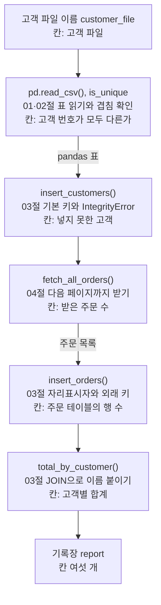
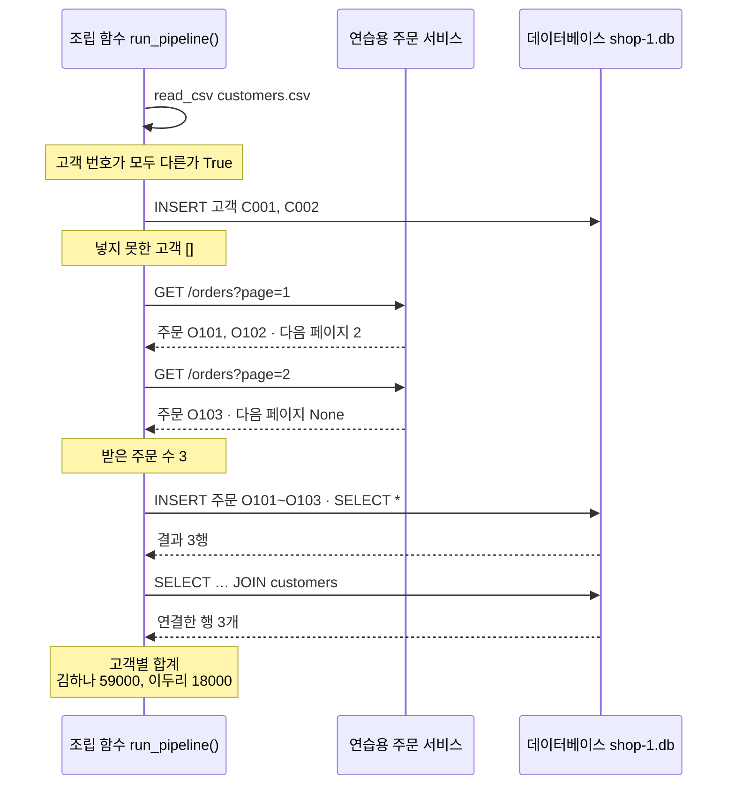
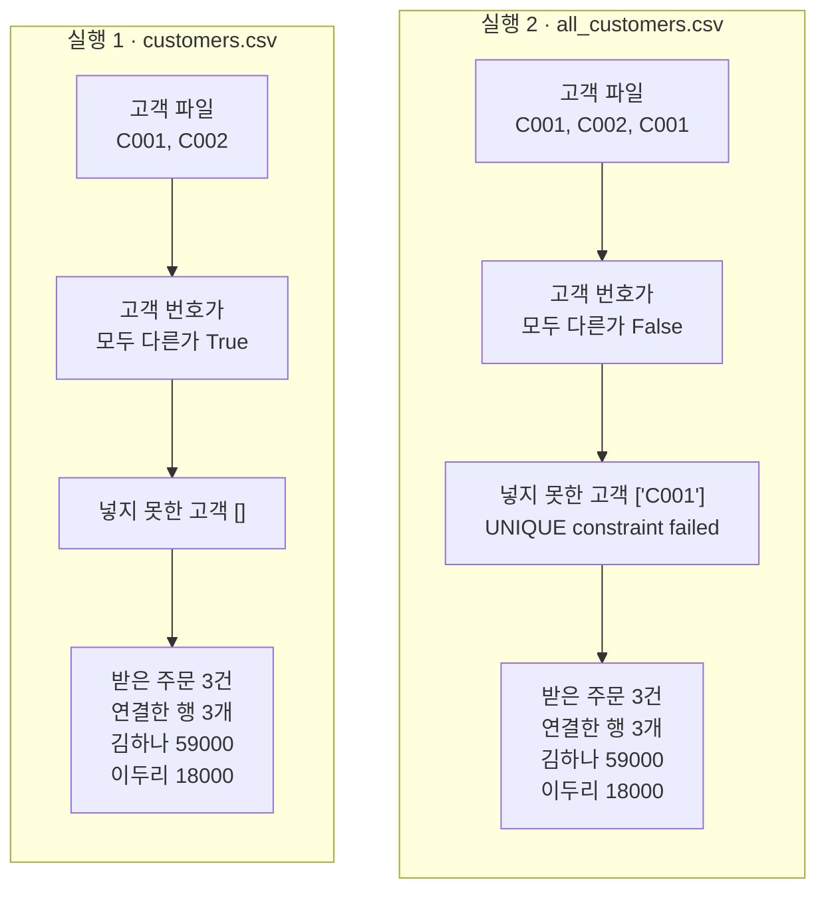

# 06-데이터-도구-실습

## _src 본문 (HTML 원본)

```html
<!--meta: 실습 30분 | 코드 Jupyter Notebook | 새 용어 0개 -->
<h2 id="b1"><span class="no">1</span>학습 목표</h2>
<div class="goal"><ul><li>01~04절의 pandas, SQLite, httpx 코드를 함수로 묶을 수 있습니다. 이 함수로 고객 파일과 주문 서비스의 데이터를 데이터베이스 하나에 모읍니다.</li><li>기록장의 칸에서 고객 번호 겹침 확인, 넣지 못한 고객, 받은 주문 수, 고객별 합계를 읽을 수 있습니다.</li><li>고객 파일 이름 하나를 바꿨을 때 어느 단계의 결과가 달라지고 무엇이 같은지 설명할 수 있습니다.</li></ul></div>
<h2 id="b2"><span class="no">2</span>이 내용을 배우는 이유</h2>
<p>앞의 절에서는 표 읽기, 두 표 잇기, SQL 조회, 페이지 읽기를 하나씩 따로 배웠습니다. 실제 도구 함수는 이 단계를 차례로 이어서 씁니다. 한 단계에서 놓친 문제는 뒤 단계의 결과를 조용히 바꿀 수 있습니다.</p>
<p>이번 절은 이 챕터의 실습입니다. 앞에서 배운 코드를 한 노트북에 모아 강사와 함께 실행해 봅니다. 새 문법이나 새 라이브러리 기능은 없고, 따로 내는 과제도 없습니다.</p>
<p>실습 주제는 주문 서비스에서 고객별 합계 내기입니다. 고객 명단은 CSV 파일로, 주문은 연습용 주문 서비스에서 받습니다. 두 데이터를 데이터베이스에 모은 뒤 고객 이름을 붙여 합계를 내고, 중간에 확인한 값을 기록장에 남깁니다.</p>
<p><strong>이 절의 질문</strong> — 고객 파일에 같은 고객 번호가 두 줄 들어 있으면, 고객별 합계를 내는 과정의 어느 칸이 달라질까요?</p>
<h2 id="b3"><span class="no">3</span>앞에서 배운 내용</h2>
<p>이번 실습은 아래 절에서 배운 것을 그대로 가져옵니다.</p>
<table><thead><tr><th>절</th><th>배운 것</th><th>실습에서 쓰는 곳</th></tr></thead><tbody>
<tr><td>01절</td><td><code>import pandas as pd</code>, <code>pd.read_csv()</code>, <code>len(표)</code>, <code>to_dict(orient="records")</code></td><td>고객 파일 읽기, 표를 딕셔너리 목록으로 바꿔 한 명씩 넣기, 파일 행 수 세기</td></tr>
<tr><td>02절</td><td>고객 파일 <code>customers.csv</code>와 C001 줄이 두 번 든 <code>all_customers.csv</code>, 기본 키, 시리즈 속성 <code>is_unique</code></td><td>실행 1·2의 고객 파일, 기록장 칸 「고객 번호가 모두 다른가」</td></tr>
<tr><td>03절</td><td><code>CREATE TABLE</code>의 <code>PRIMARY KEY</code>·<code>FOREIGN KEY</code>, <code>PRAGMA foreign_keys = ON</code>, <code>INSERT INTO</code>와 자리표시자 <code>?</code>, <code>sqlite3.IntegrityError</code>, <code>JOIN</code>, <code>commit()</code>·<code>close()</code></td><td>빈 데이터베이스 두 개, 고객·주문 넣기, 기본 키에 막힌 고객 기록, 고객 이름 붙이기</td></tr>
<tr><td>04절</td><td>연습용 주문 서비스 준비 코드, <code>fetch_all_orders()</code>, 서비스 끄기</td><td>페이지 두 개로 나뉜 주문 세 건 받기, 기록장 칸 「받은 주문 수」</td></tr>
</tbody></table>
<p>데이터도 앞 절과 같습니다. 고객은 C001 김하나와 C002 이두리이고, 주문은 O101·O102·O103 세 건, 전체 77000원입니다. 함수 <code>fetch_all_orders()</code>는 04절 After 함수를 그대로 가져왔습니다. 기록장을 출력하는 <code>print_report()</code>와 칸별 비교 셀은 Ch 2 13절 실습에서 가져왔습니다.</p>
<p>02절 Before에서는 <code>all_customers.csv</code>를 주문 표에 <code>merge()</code>로 바로 이었습니다. 그때 연결한 표는 5행, 금액 합계는 136000이었습니다. 이번 실습은 같은 파일을 데이터베이스에 먼저 넣고 잇습니다. 02절의 <code>merge()</code>는 다시 실행하지 않고, 앞 절 결과로만 비교합니다.</p>
<p>05절의 HTML 파싱은 쓰지 않습니다. 이번 흐름은 주문 데이터만 다루고, 05절이 쓴 <code>data/article-text.json</code>은 Ch 5가 읽기 때문입니다. 그래서 실습 파일은 모두 01~04절처럼 임시 폴더에 만듭니다. 이 챕터는 모델을 부르지 않으므로 API 키가 필요 없습니다.</p>
<h2 id="b4"><span class="no">4</span>핵심 개념</h2>
<h3>비유로 시작하기</h3>
<p>04절의 창구와 쟁반을 이어 떠올립니다. 창구에서 받은 쟁반 두 개에 주문 서류철이 담겨 있습니다. 초록은 김하나, 파랑은 이두리의 주문입니다.</p>
<p>옆 탁자에는 고객 카드를 꽂는 꽂이가 있습니다. 고객 번호마다 칸이 하나라서 초록 카드와 파랑 카드가 한 장씩 꽂힙니다. 같은 초록 카드를 또 꽂으려 하면 빈칸이 없어 옆 접시에 남습니다. 서류철은 꽂힌 카드 색에 맞춰 묶이고, 묶음마다 합계를 냅니다.</p>
{{img:06-4-주문-쟁반과-카드-꽂이|왼쪽 나무 벽 창구 아래 선반에 깃발 꽂힌 쟁반(초록·파랑 서류철)과 깃발 없는 쟁반(초록 서류철 하나)이 있고, 가운데 탁자의 꽂이에 초록 카드와 파랑 카드가 한 장씩 서 있으며 앞의 흰 접시에 초록 카드 한 장이 눕혀 있고, 오른쪽 탁자에 초록 서류철 두 개 묶음과 파랑 서류철 하나가 놓인 삽화|쟁반으로 받은 주문과 한 칸에 한 장씩 꽂는 고객 카드. 같은 카드는 접시에 남고, 서류철은 색별로 묶입니다.}}
<p><strong>그림 읽기</strong> — 왼쪽 나무 벽의 창구 아래 선반에 쟁반 두 개가 있습니다. 깃발 꽂힌 쟁반에는 초록과 파랑 서류철, 깃발 없는 쟁반에는 초록 서류철 하나가 있습니다. 가운데 꽂이에는 초록 카드와 파랑 카드가 한 장씩 서 있고, 앞의 흰 접시에 초록 카드 한 장이 눕혀 있습니다. 오른쪽 탁자에는 초록 서류철 두 개 묶음과 파랑 서류철 하나가 놓였습니다.</p>
<p>실습 코드도 같습니다. 쟁반 두 개는 서비스의 페이지 두 개, 깃발은 다음 페이지 번호입니다. 꽂이는 고객 테이블이고, 칸 하나는 기본 키인 고객 번호 한 줄입니다. 접시의 초록 카드는 기본 키에 막힌 셋째 줄 C001입니다. 색별 묶음은 <code>JOIN</code>으로 이름을 붙여 낸 고객별 합계입니다.</p>
<h3>실습 함수의 구성</h3>
{{mermaid:06-1-조립도|초록 상자 고객 파일 이름에서 시작해 파란 상자 pd.read_csv와 is_unique, insert_customers(), fetch_all_orders(), insert_orders(), total_by_customer()를 차례로 지나 노란 상자 기록장 report로 이어지는 조립도|조립 함수 run_pipeline()이 부르는 코드와 부품의 순서. 상자마다 쓰는 절과 기록장에 적는 칸을 함께 적었습니다.}}
<p><strong>도식 읽기</strong> — 위에서 아래로 읽습니다. 맨 위 초록 상자는 실행 1·2에서 바꾸는 값인 고객 파일 이름입니다. 파란 상자는 조립 함수가 부르는 코드와 부품 함수입니다. 상자 안에는 쓰는 절과, 적는 기록장 칸(「칸:」으로 시작하는 줄)을 함께 적었습니다.</p>
<p>화살표의 「pandas 표」와 「주문 목록」은 앞 단계의 값을 뒤 함수에 넘긴다는 뜻입니다. 나머지 화살표는 부르는 순서입니다. 맨 아래 노란 상자가 칸 여섯 개의 기록장입니다.</p>
<table><thead><tr><th>코드와 함수</th><th>하는 일</th><th>기록장 칸</th></tr></thead><tbody>
<tr><td><code>pd.read_csv(customer_file)</code>와 <code>is_unique</code></td><td>고객 파일을 표로 읽고, 고객 번호 열의 값이 모두 다른지 확인</td><td>고객 번호가 모두 다른가</td></tr>
<tr><td><code>insert_customers(database_name, customers)</code></td><td>표의 고객을 한 명씩 넣고, 기본 키에 막힌 고객 번호 목록을 반환</td><td>넣지 못한 고객</td></tr>
<tr><td><code>fetch_all_orders(orders_url)</code></td><td>다음 페이지 번호가 <code>None</code>이 될 때까지 주문을 받아 목록으로 반환</td><td>받은 주문 수</td></tr>
<tr><td><code>insert_orders(database_name, orders)</code></td><td>외래 키 검사를 켜고 주문을 넣은 뒤, 주문 테이블의 행 수를 반환</td><td>주문 테이블의 행 수</td></tr>
<tr><td><code>total_by_customer(database_name)</code></td><td>두 테이블을 <code>JOIN</code>으로 잇고, 고객 이름별 금액 합계를 딕셔너리로 반환</td><td>고객별 합계</td></tr>
</tbody></table>
<p>조립 함수 <code>run_pipeline()</code>은 고객 파일 이름, 데이터베이스 파일 이름, 주문 주소를 받아 이 순서대로 부릅니다. 첫 칸 「고객 파일」에는 받은 이름을 그대로 적습니다. 주문 테이블에 외래 키가 있으므로, 고객을 먼저 넣고 주문을 넣습니다.</p>
<h3>두 번의 실행</h3>
<p>노트북은 재료 단계에서 고객 파일 두 개와 연습용 주문 서비스를 준비합니다. 또 파일 <code>shop-1.db</code>와 <code>shop-2.db</code>에 같은 모양의 빈 테이블을 만듭니다.</p>
<p>실행 1은 고객 파일 <code>customers.csv</code>를 <code>shop-1.db</code>에 넣습니다. 실행 2는 고객 파일 이름만 <code>all_customers.csv</code>로 바꾸고 <code>shop-2.db</code>에 넣습니다. 데이터베이스 파일은 두 실행의 데이터를 나눠 두려고 따로 두었습니다. 조건으로 바꾼 값은 고객 파일 이름 하나이고, 주문 서비스는 같습니다.</p>
<h2 id="b5"><span class="no">5</span>실행 예제</h2>
<p>노트북은 먼저 도구 세 가지를 불러오고 재료를 만듭니다. 이어서 부품 함수 네 개와 기록 장치, 조립 함수를 차례로 정의합니다. 그다음 실행 1, 실행 2, 두 기록장 비교, 데이터베이스에 남은 고객 확인, 서비스 끄기를 합니다.</p>
<p>모델 호출은 없고 인터넷에도 접속하지 않습니다. 준비 셀 네 개를 뺀 코드 셀 14개가 1분 안에 끝납니다. 교재 출력은 Python 3.12.13으로 만들었습니다. 버전은 pandas 3.0.5, SQLite 3.53.1, httpx 0.28.1입니다.</p>
{{notebook:06-데이터-도구-실습}}
<p class="look"><b>확인할 점</b> — 실행 1의 기록장에서 <code>고객 번호가 모두 다른가 | True</code>와 <code>넣지 못한 고객 | []</code>를 봅니다. 실행 2에서는 <code>False</code>와 <code>['C001']</code>을 확인합니다. 두 실행의 <code>고객별 합계 | {'김하나': 59000, '이두리': 18000}</code>도 비교합니다.</p>
<h3>실행 1의 실제 순서</h3>
{{mermaid:06-2-실행1-순서|조립 함수, 연습용 주문 서비스, 데이터베이스 세 세로줄의 순서도. 조립 함수가 customers.csv를 읽어 노란 메모 고객 번호가 모두 다른가 True, 고객 C001과 C002를 넣어 노란 메모 넣지 못한 고객 빈 목록, page=1 요청에 주문 O101과 O102와 다음 페이지 2, page=2 요청에 주문 O103과 다음 페이지 None을 받아 노란 메모 받은 주문 수 3, 주문 세 건을 넣고 SELECT *로 읽어 결과 3행, JOIN 조회로 연결한 행 3개를 받아 노란 메모 고객별 합계 김하나 59000 이두리 18000|실행 1(customers.csv)에서 조립 함수, 연습용 주문 서비스, 데이터베이스가 주고받은 차례. 막힌 고객은 없었고 연결한 행은 3개였습니다.}}
<p><strong>도식 읽기</strong> — 위에서 아래로 시간이 흐릅니다. 세로줄은 왼쪽부터 조립 함수, 연습용 주문 서비스, 데이터베이스 <code>shop-1.db</code>입니다. 실선은 보낸 요청이나 SQL 문장, 점선은 받은 결과입니다. 맨 위 제자리로 돌아오는 화살표는 조립 함수 안에서 고객 파일을 읽은 일입니다.</p>
<p>노란 메모는 그 시점에 기록장에 적은 칸입니다. 서비스에서 받은 주문 번호 O101~O103은 준비 셀이 쓴 페이지 파일의 주문입니다. 주문을 넣고 <code>SELECT *</code>로 받은 「결과 3행」은 <code>insert_orders()</code>가 읽은 주문 테이블이고, 마지막 점선은 <code>JOIN</code> 조회의 행 수입니다.</p>
<h2 id="b6"><span class="no">6</span>실험 결과 해석</h2>
<p>실행 1의 고객 파일은 고객 번호가 모두 달라 <code>True</code>였습니다. 고객 두 명은 오류 없이 들어갔고, 「고객 넣기 오류:」 줄은 나오지 않았습니다. 주문은 <code>요청한 페이지: 1 / 다음 페이지 번호: 2</code>와 <code>요청한 페이지: 2 / 다음 페이지 번호: None</code> 두 번 요청으로 받았습니다.</p>
<p>기록장은 받은 주문 수 3, 주문 테이블의 행 수 3이었습니다. 조회 부품은 <code>연결한 행 수: 3</code>을 출력했고, 고객별 합계는 <code>{'김하나': 59000, '이두리': 18000}</code>이었습니다. 02절과 03절에서 본 김하나 합계 59000과 같습니다.</p>
{{mermaid:06-3-두-실행-비교|왼쪽 실행 1 칸은 초록 상자 고객 파일 C001, C002에서 회색 상자 고객 번호가 모두 다른가 True, 회색 상자 넣지 못한 고객 빈 목록을 지나 노란 상자 받은 주문 3건 연결한 행 3개 김하나 59000 이두리 18000으로 이어지고, 오른쪽 실행 2 칸은 초록 상자 고객 파일 C001, C002, C001에서 노란 상자 False, 노란 상자 넣지 못한 고객 C001 UNIQUE constraint failed를 지나 같은 노란 결과 상자로 이어지는 비교 그림|고객 파일 이름만 바꾼 두 실행. 실행 2는 앞의 두 단계에서 겹친 C001을 알아채 기록했고, 뒤의 결과는 두 실행이 같습니다.}}
<p><strong>도식 읽기</strong> — 왼쪽 칸은 실행 1, 오른쪽 칸은 실행 2이고, 칸 안은 위에서 아래로 읽습니다. 초록 상자는 고객 파일의 고객 번호 줄입니다. 실행 1의 가운데 두 회색 상자는 겹친 번호도, 막힌 고객도 없었다는 뜻입니다.</p>
<p>실행 2의 가운데 두 노란 상자는 코드가 확인해 기록장에 적은 일입니다. 넣기 오류는 함수가 받아 출력했으므로 셀은 멈추지 않았습니다. 맨 아래 노란 상자는 두 칸의 값이 같습니다.</p>
<p>실행 2의 첫 출력 줄은 <code>고객 넣기 오류: C001 UNIQUE constraint failed: customers.customer_id</code>였습니다. 파일의 셋째 줄 C001이 고객 테이블의 기본 키에 막힌 것입니다. 03절에서 같은 번호를 한 번 더 넣어 본 오류와 같은 메시지입니다. 함수는 이 오류를 받아 번호를 목록에 모으고 다음 고객으로 넘어갔습니다.</p>
<p>기록장은 <code>고객 번호가 모두 다른가 | False</code>, <code>넣지 못한 고객 | ['C001']</code>였습니다. 받은 주문 수와 주문 테이블의 행 수는 3이고, 연결한 행 수도 3이었습니다. 고객별 합계는 실행 1과 같았습니다. 비교 셀의 달라진 칸 수는 3이었고, 두 <code>assert</code> 줄도 멈추지 않았습니다.</p>
<p>합계가 같았던 까닭은 마지막 확인 셀에 있습니다. 고객 파일은 <code>고객 파일의 행 수: 3</code>이었지만, 고객 테이블은 <code>고객 테이블의 행 수: 2</code>였습니다. 테이블의 행은 <code>[('C001', '김하나'), ('C002', '이두리')]</code>로 고객 번호마다 한 줄씩입니다. 그래서 <code>JOIN</code>이 주문마다 이름을 한 번씩만 붙였습니다.</p>
<p>02절 Before는 같은 파일을 겹친 줄이 남은 채로 <code>merge()</code>로 이어 5행, 136000이 되었습니다. 이번에는 기본 키가 겹친 줄을 넣는 단계에서 막았습니다. 그리고 막힌 번호가 기록장에 남아, 파일에 문제가 있었다는 사실도 알 수 있습니다.</p>
<p>결론은 이렇습니다. 이번 실습에서 고객 파일에 겹친 줄이 섞이자 앞의 두 확인 칸이 달라졌습니다. 받은 주문 수와 주문 테이블의 행 수는 고객 파일과 관계없는 칸이라 같았습니다. 기본 키가 겹친 줄을 막았으므로 연결한 행 수와 고객별 합계도 같았습니다. 이 결과는 모든 열이 같은 겹친 줄 한 가지로 관찰한 것입니다.</p>
<h2 id="b7"><span class="no">7</span>주의할 점과 실무 메모</h2>
<ul><li>이번 겹친 줄은 번호와 이름이 모두 같았습니다. 번호는 같고 이름이 다른 줄도 뒤 줄이 기본 키에 막힐 것으로 보지만, 이번에 실행하지 않았습니다. 그때 어느 이름이 맞는지는 코드가 판단하지 못합니다.</li>
<li>함수 <code>insert_customers()</code>는 <code>sqlite3.IntegrityError</code>를 모두 막힌 고객으로 적습니다. 이름이 빈 줄처럼 <code>NOT NULL</code> 제약에 걸리는 경우는 이번 파일에 없어 실행하지 않았습니다.</li>
<li>함수 <code>insert_orders()</code>에는 오류를 받는 줄이 없습니다. 고객 테이블에 없는 번호의 주문이 오면 03절처럼 <code>FOREIGN KEY constraint failed</code>로 멈출 것으로 봅니다. 이번 서비스 데이터에는 그런 주문이 없어 실행하지 않았습니다.</li>
<li>기록장의 <code>False</code>는 확인 결과를 적기만 하고 실행을 멈추지 않습니다. 실제 도구에서 겹친 파일을 받지 않을지, 기록만 하고 넘어갈지는 도구를 쓰는 사람과 정합니다.</li>
<li>실행 1·2 셀만 같은 데이터베이스 파일로 다시 실행하면, 고객은 넣기 오류로 기록되지만 주문은 첫 줄에서 <code>IntegrityError</code>로 멈춥니다. 이 동작은 노트북과 같은 함수를 따로 실행해 확인했고, 노트북 출력에는 없습니다. 멈춘 함수는 연결을 닫지 못해, 그 파일에 쓰려는 다른 연결이 <code>database is locked</code>를 받았습니다. 다시 연습할 때는 마지막 셀로 서비스를 끄고, 첫 셀부터 실행합니다.</li>
<li>교재 출력은 2026-09-16에 Linux의 Python 3.12.13으로 만들었습니다. 버전은 pandas 3.0.5, SQLite 3.53.1, httpx 0.28.1입니다. 포트 번호와 임시 폴더 경로는 실행마다 달라 읽지 않았고, Windows와 macOS는 실행하지 않았습니다.</li></ul>
<h2 id="b8"><span class="no">8</span>정리와 다음 절</h2>
<ul><li>01~04절의 도구를 부품 네 개와 조립 함수 하나로 묶었습니다. 고객 파일과 주문 서비스의 데이터를 데이터베이스에 모아 고객별 합계를 냈습니다.</li><li>실행 1(<code>customers.csv</code>)은 고객 번호가 모두 달랐고, 주문 3건이 모두 들어가 김하나 59000, 이두리 18000이었습니다.</li><li>실행 2에서 이름만 <code>all_customers.csv</code>로 바꾸자 <code>False</code>와 막힌 고객 <code>['C001']</code>이 기록되었습니다. 주문 수, 연결한 행 수, 고객별 합계는 같았습니다.</li></ul>
<p><strong>다음 학습과 이어지는 지점</strong> — Ch 4는 이 절에서 끝납니다. 05절에서 쓴 <code>data/article-text.json</code>은 Ch 5 01절이 직접 읽습니다. 그 절은 파일의 <code>text</code> 칸, 곧 기사 제목과 요약을 이은 글을 두 토큰화기로 나눠 토큰 수를 셉니다. Ch 19 01절은 실습 폴더 <code>data_tools.py</code>의 <code>fetch_orders(csv_path, *, status=None)</code>를 모델이 고를 수 있는 도구로 다시 씁니다. 01절 함수와 하는 일은 같고, 상태를 키워드 인자 <code>status=</code>로 받는 모양입니다.</p>
<h2 id="b9"><span class="no">9</span>복습 문제</h2><details class="quiz"><summary>문제와 해설</summary>
<p class="quiz-q">1. 실행 2에서 기록장 칸 「고객 번호가 모두 다른가」가 <code>False</code>였던 까닭은 무엇인가요? · 기초</p><p class="quiz-a"><b>해설</b> — 파일 <code>all_customers.csv</code>에 C001 김하나 줄이 두 번 들어 있기 때문입니다. 02절에서 배운 시리즈 속성 <code>is_unique</code>는 열의 값이 모두 다를 때만 <code>True</code>입니다.</p>
<p class="quiz-q">2. 실행 2에서 셋째 줄 C001을 넣을 때 셀이 멈추지 않은 까닭은 무엇인가요? · 적용</p><p class="quiz-a"><b>해설</b> — 함수 <code>insert_customers()</code>가 넣는 줄을 <code>try/except sqlite3.IntegrityError</code>로 감쌌기 때문입니다. 함수는 오류 메시지를 출력하고 번호를 막힌 고객 목록에 모은 뒤 다음 고객으로 넘어갔습니다.</p>
<p class="quiz-q">3. 같은 <code>all_customers.csv</code>를 썼는데 02절 Before는 136000, 이번 실행 2는 합계가 그대로였습니다. 무엇이 달랐나요? · 분석</p><p class="quiz-a"><b>해설</b> — 02절 Before는 겹친 줄이 남은 고객 표에 주문 표를 바로 이어 김하나 주문이 두 번씩 붙었습니다. 이번에는 고객 테이블의 기본 키가 겹친 줄을 막아 고객 번호마다 한 줄만 남았습니다. 그래서 <code>JOIN</code> 결과가 주문 수와 같은 3행이었습니다.</p>
<p class="quiz-q">4. 이 절의 질문에 답해 봅시다. 고객 파일에 겹친 줄이 섞이자 어느 칸이 달라졌고, 무엇은 같았나요? · 분석</p><p class="quiz-a"><b>해설</b> — 고객 파일 이름 말고는 「고객 번호가 모두 다른가」와 「넣지 못한 고객」 두 칸이 달라졌습니다. 받은 주문 수, 주문 테이블의 행 수, 고객별 합계는 같았습니다. 이 결과는 번호와 이름이 모두 같은 겹친 줄 한 가지로 관찰한 것입니다.</p>
</details>
<h2 id="b10"><span class="no">10</span>참고 자료</h2>
<ul><li><a href="https://pandas.pydata.org/docs/reference/api/pandas.Series.is_unique.html">pandas 공식 문서: Series.is_unique</a> · 02절에서 확인 2026-09-16 · 실행 pandas 3.0.5</li><li><a href="https://docs.python.org/3.12/library/sqlite3.html">Python 3.12 공식 문서: sqlite3</a> · 03절에서 확인 2026-09-16 · 실행 SQLite 3.53.1</li><li><a href="https://www.sqlite.org/foreignkeys.html">SQLite 공식 문서: Foreign Key Support</a> · 03절에서 확인 2026-09-16</li><li><a href="https://www.python-httpx.org/quickstart/">HTTPX 공식 문서: Quickstart</a> · 04절에서 확인 2026-09-16 · 실행 httpx 0.28.1</li></ul>
```

## 노트북 셀 (순서대로)

### [0] markdown {'html': 'skip'}

# 데이터 도구 실습: 주문 서비스에서 고객별 합계 내기

**이 노트북에서 할 일**

1. 01~04절의 도구로 부품 함수를 만들고, 고객 파일과 주문 서비스의 데이터를 데이터베이스 하나에 모읍니다.
2. 고객 파일 `customers.csv`로 조립 함수를 실행해, 고객별 합계와 확인한 값을 기록장에 적습니다(실행 1).
3. 고객 파일 이름 하나만 02절의 `all_customers.csv`로 바꿔 다시 실행하고, 두 기록장을 비교합니다(실행 2).

**준비물** — API 키 불필요. 인터넷에 있는 서비스에는 접속하지 않습니다.
04절처럼 이 컴퓨터 안에 연습용 주문 서비스를 켰다가 마지막 셀에서 끕니다.
모델 호출은 0번이고 비용은 들지 않습니다. 실행 시간은 1분 이내입니다.

**기준 버전** — 01~05절과 같은 실습 폴더에 고정한 pandas 3.0.5와 httpx 0.28.1을 씁니다.
교재 출력은 Python 3.12.13과, 그 Python에 들어 있는 SQLite 3.53.1로 만들었습니다. 다른 버전은 이번에 실행하지 않았습니다.

실습 폴더 `labs/part1/ch04-data-tools`의 `.venv`를 커널로 고르고, 첫 셀부터 순서대로 실행합니다.
새 문법과 새 라이브러리 기능은 없습니다. 강사와 함께 셀을 차례로 실행하며, 따로 내는 과제는 없습니다.

### [1] markdown {'html': 'skip'}

## 오늘 볼 그림


위에서 아래로 읽습니다. 파란 상자는 이 노트북에서 부르는 코드와 함수이고, 상자마다 쓰는 절과 기록장에 적는 칸을 적었습니다.
맨 위 초록 상자는 실행 1과 실행 2에서 바꾸는 값인 고객 파일 이름입니다. 맨 아래 노란 상자는 결과를 적는 기록장입니다.

### [2] markdown {}

## 1. 준비

이 절도 01~04절처럼 빈 임시 폴더를 만들고, 그 폴더로 작업 위치를 옮깁니다. 폴더 이름의 앞머리만 `ch04-06-`으로 바꿨습니다.

05절은 실습 폴더의 `data` 폴더에서 작업했습니다. 그 폴더의 `article-text.json`은 Ch 5가 읽으므로, 이번 실습은 그 폴더를 쓰지 않습니다.

### [3] code {'execution': {'iopub.execute_input': '2026-09-16T16:18:08.738875Z', 'iopub.status.busy': '2026-09-16T16:18:08.738706Z', 'iopub.status.idle': '2026-09-16T16:18:08.742442Z', 'shell.execute_reply': '2026-09-16T16:18:08.742025Z'}, 'lesson_role': 'setup'}

```python
# 실습 파일을 둘 빈 임시 폴더를 만들고, 그 폴더로 작업 위치를 옮깁니다
import os
import tempfile

# mkdtemp()는 운영체제 임시 폴더 안에 새 폴더를 만들고 그 경로를 반환합니다
practice_folder = tempfile.mkdtemp(prefix="ch04-06-")
# chdir()는 터미널의 cd처럼 현재 작업 폴더를 옮깁니다
os.chdir(practice_folder)
file_names = os.listdir()
print("현재 작업 폴더의 파일:", file_names)
```

출력:
```
현재 작업 폴더의 파일: []

```

### [4] markdown {}

**결과 읽기** — 현재 작업 폴더의 파일은 `[]`로, 빈 폴더에서 시작합니다.
폴더의 경로는 컴퓨터마다 달라서 출력하지 않았습니다.

### [5] markdown {}

## 2. 도구 세 가지 불러오기

이번 실습은 01·02절의 pandas, 03절의 sqlite3, 04절의 httpx를 한 노트북에서 함께 씁니다.
세 import 줄과 버전을 출력하는 줄은 앞 절에서 쓴 모양 그대로입니다.

실행 전에 예상합니다. 버전은 01·03·04절에서 출력한 값과 같을 것입니다.

### [6] code {'execution': {'iopub.execute_input': '2026-09-16T16:18:08.743202Z', 'iopub.status.busy': '2026-09-16T16:18:08.743129Z', 'iopub.status.idle': '2026-09-16T16:18:08.854189Z', 'shell.execute_reply': '2026-09-16T16:18:08.853695Z'}}

```python
# 01·02절 pandas, 03절 sqlite3, 04절 httpx를 불러오고 버전을 확인합니다
import pandas as pd
import sqlite3
import httpx

print("pandas 버전:", pd.__version__)
print("SQLite 버전:", sqlite3.sqlite_version)
print("httpx 버전:", httpx.__version__)
```

출력:
```
pandas 버전: 3.0.5
SQLite 버전: 3.53.1
httpx 버전: 0.28.1

```

### [7] markdown {}

**결과 읽기** — 출력은 `pandas 버전: 3.0.5`, `SQLite 버전: 3.53.1`, `httpx 버전: 0.28.1`입니다.
세 값 모두 앞 절에서 본 버전과 같습니다. SQLite 버전은 Python 설치본에 따라 다를 수 있습니다.

### [8] markdown {}

## 3. 실습 주제 — 주문 서비스에서 고객별 합계 내기

고객 명단은 02절처럼 CSV 파일로 받습니다. 주문은 04절의 연습용 주문 서비스가 페이지로 나눠 줍니다.
이번 실습은 두 데이터를 03절의 데이터베이스 하나에 모으고, 고객별 주문 합계를 냅니다.
합계만 보지 않고, 중간에 확인한 값을 기록장에 함께 남깁니다.

Ch 19 01절은 실습 폴더 `data_tools.py`의 `fetch_orders()`를 모델이 고르는 도구로 다시 씁니다.
01절 함수와 하는 일은 같고, 상태를 키워드 인자 `status=`로 받는 모양입니다.

실행 1과 실행 2는 고객 파일 이름 하나만 다릅니다. 실행 1은 고객 두 명이 한 줄씩 든 `customers.csv`입니다.
실행 2는 02절 Before에서 쓴 `all_customers.csv`로, 김하나 줄이 두 번 들어 있습니다.

02절 Before에서는 이 파일을 주문 표에 `merge()`로 바로 이었습니다. 그때 연결한 표는 5행, 금액 합계는 136000이었습니다.
이번에는 같은 파일을 데이터베이스에 먼저 넣으면 무엇이 달라지는지 봅니다.

### [9] markdown {}

## 4. 재료 만들기 — 고객 파일 두 개

02절과 같은 글로 고객 파일 두 개를 씁니다. 파일 `customers.csv`는 C001 김하나, C002 이두리 두 줄입니다.
파일 `all_customers.csv`는 그 뒤에 C001 김하나 줄이 한 번 더 있습니다.

실행 전에 예상합니다. 파일 목록에 두 CSV 파일 이름이 알파벳 순서로 나올 것입니다.

### [10] code {'execution': {'iopub.execute_input': '2026-09-16T16:18:08.854938Z', 'iopub.status.busy': '2026-09-16T16:18:08.854837Z', 'iopub.status.idle': '2026-09-16T16:18:08.857417Z', 'shell.execute_reply': '2026-09-16T16:18:08.857026Z'}}

```python
# 02절과 같은 고객 파일 두 개를 씁니다. 둘째 파일은 C001 줄이 두 번 들어 있습니다
customer_text = """customer_id,name
C001,김하나
C002,이두리
"""
with open("customers.csv", "w", encoding="utf-8") as file:
    file.write(customer_text)
all_customer_text = customer_text + "C001,김하나\n"
with open("all_customers.csv", "w", encoding="utf-8") as file:
    file.write(all_customer_text)
file_names = sorted(os.listdir())
print("현재 작업 폴더의 파일:", file_names)
```

출력:
```
현재 작업 폴더의 파일: ['all_customers.csv', 'customers.csv']

```

### [11] markdown {}

**결과 읽기** — 파일 목록은 `['all_customers.csv', 'customers.csv']`입니다.
둘째 파일의 글은 첫 파일 글 끝에 김하나 줄 하나를 Ch 3에서 쓴 글자 `+`로 이어 붙여 만들었습니다. 끝의 `\n`은 05절에서 본 줄바꿈 한 글자입니다.
두 파일은 02절에서 쓴 파일과 글이 같습니다.

### [12] markdown {}

## 5. 재료 만들기 — 연습용 주문 서비스 켜기(준비 코드)

아래 세 셀은 04절과 같은 **연습용 서버를 켜는 준비 코드**입니다. 줄마다 읽지 않아도 되고, 셀마다 하는 일만 확인하고 실행합니다.

첫 셀은 서비스가 페이지마다 보낼 주문 목록 글 두 개를 파일로 씁니다. 1쪽에는 주문 두 건, 2쪽에는 한 건이 있습니다.

### [13] code {'execution': {'iopub.execute_input': '2026-09-16T16:18:08.858058Z', 'iopub.status.busy': '2026-09-16T16:18:08.857991Z', 'iopub.status.idle': '2026-09-16T16:18:08.860212Z', 'shell.execute_reply': '2026-09-16T16:18:08.859810Z'}, 'lesson_role': 'setup'}

```python
# 연습용 서비스가 페이지마다 보낼 주문 목록 글 두 개를 파일로 씁니다(04절과 같음)
page_1_text = """{"orders": [
  {"order_id": "O101", "customer_id": "C001", "amount": 32000},
  {"order_id": "O102", "customer_id": "C002", "amount": 18000}
], "next_page": 2}"""
with open("page=1.json", "w", encoding="utf-8") as file:
    file.write(page_1_text)
page_2_text = """{"orders": [
  {"order_id": "O103", "customer_id": "C001", "amount": 27000}
], "next_page": null}"""
with open("page=2.json", "w", encoding="utf-8") as file:
    file.write(page_2_text)
```

출력:
```

```

### [14] markdown {}

둘째 셀은 04절의 서비스 프로그램 파일 `order_server.py`를 씁니다. 주소가 `/orders`이고 페이지 파일이 있으면 그 글을 보내는 프로그램입니다.

### [15] code {'execution': {'iopub.execute_input': '2026-09-16T16:18:08.861268Z', 'iopub.status.busy': '2026-09-16T16:18:08.861186Z', 'iopub.status.idle': '2026-09-16T16:18:08.863427Z', 'shell.execute_reply': '2026-09-16T16:18:08.863055Z'}, 'lesson_role': 'setup'}

```python
# 요청을 받아 파일 글을 보내는 서비스 프로그램을 order_server.py 파일로 씁니다(04절과 같음)
server_text = """import os
from wsgiref.simple_server import make_server

# 요청 하나가 올 때마다 이 함수가 불립니다
def answer(environ, start_response):
    # 주소 끝의 쿼리 문자열 page=1로 파일 page=1.json을 고릅니다
    file_name = environ["QUERY_STRING"] + ".json"
    if environ["PATH_INFO"] != "/orders" or not os.path.exists(file_name):
        start_response("404 Not Found", [("Content-Type", "application/json")])
        return [b'{"error": "not found"}']
    start_response("200 OK", [("Content-Type", "application/json")])
    with open(file_name, "rb") as file:
        return [file.read()]

# 포트 번호 0은 운영체제에게 비어 있는 번호를 골라 달라는 뜻입니다
server = make_server("127.0.0.1", 0, answer)
print(server.server_port, flush=True)
server.serve_forever()"""
with open("order_server.py", "w", encoding="utf-8") as file:
    file.write(server_text)
```

출력:
```

```

### [16] markdown {}

셋째 셀은 04절처럼 `subprocess.Popen()`으로 그 프로그램을 켜 두고, 서비스가 알려 준 포트 번호로 주소를 만듭니다.

### [17] code {'execution': {'iopub.execute_input': '2026-09-16T16:18:08.864027Z', 'iopub.status.busy': '2026-09-16T16:18:08.863968Z', 'iopub.status.idle': '2026-09-16T16:18:08.891530Z', 'shell.execute_reply': '2026-09-16T16:18:08.891034Z'}, 'lesson_role': 'setup'}

```python
# 서비스 프로그램을 따로 실행하고, 서비스가 알려 준 포트 번호로 주소를 만듭니다(04절과 같음)
import subprocess
import sys

# Popen()은 프로그램을 켜 두고 기다리지 않습니다. 서비스의 접속 기록(stderr)은 버립니다
server_process = subprocess.Popen(
    [sys.executable, "order_server.py"],
    stdout=subprocess.PIPE,
    stderr=subprocess.DEVNULL,
    text=True,
)
# 서비스가 켜지면서 출력한 첫 줄(포트 번호)을 읽습니다
port_text = server_process.stdout.readline().strip()
base_url = f"http://127.0.0.1:{port_text}"
print("서비스 주소:", base_url)
```

출력:
```
서비스 주소: http://127.0.0.1:41047

```

### [18] markdown {}

**결과 읽기** — 서비스 주소는 `http://127.0.0.1:`로 시작합니다. 콜론 뒤의 포트 번호는 실행할 때마다 달라서 교재와 다를 수 있습니다.
이제 서비스가 요청을 기다립니다.

### [19] markdown {}

## 6. 재료 만들기 — 같은 모양의 빈 데이터베이스 두 개

두 실행을 비교하려면 두 실행이 같은 상태에서 시작해야 합니다. 그래서 파일 `shop-1.db`와 `shop-2.db`에 같은 모양의 빈 테이블을 만듭니다.
반복문 `for`로 같은 SQL 문장을 두 파일에 한 번씩 실행합니다.

테이블은 03절과 같은 제약을 둡니다. 고객 번호는 고객 테이블의 기본 키이고, 주문 테이블에서는 외래 키입니다.
04절 서비스의 주문에는 상태 칸이 없어서, 주문 테이블에서 `status` 열만 뺐습니다. 열 정의는 한 줄에 몰아 적었습니다.

실행 전에 예상합니다. 출력은 없고, 파일 목록 끝에 데이터베이스 파일 두 개가 더해질 것입니다.

### [20] code {'execution': {'iopub.execute_input': '2026-09-16T16:18:08.892276Z', 'iopub.status.busy': '2026-09-16T16:18:08.892207Z', 'iopub.status.idle': '2026-09-16T16:18:08.938693Z', 'shell.execute_reply': '2026-09-16T16:18:08.938391Z'}}

```python
# 두 데이터베이스 파일에 03절과 같은 제약을 둔 고객 테이블과 주문 테이블을 만듭니다
customer_table_sql = """CREATE TABLE customers (
    customer_id TEXT PRIMARY KEY, name TEXT NOT NULL)"""
order_table_sql = """CREATE TABLE orders (
    order_id TEXT PRIMARY KEY, customer_id TEXT NOT NULL, amount INTEGER NOT NULL,
    FOREIGN KEY (customer_id) REFERENCES customers (customer_id))"""
for database_name in ["shop-1.db", "shop-2.db"]:
    connection = sqlite3.connect(database_name)
    connection.execute(customer_table_sql)
    connection.execute(order_table_sql)
    connection.commit()
    connection.close()
file_names = sorted(os.listdir())
print("현재 작업 폴더의 파일:", file_names)
```

출력:
```
현재 작업 폴더의 파일: ['all_customers.csv', 'customers.csv', 'order_server.py', 'page=1.json', 'page=2.json', 'shop-1.db', 'shop-2.db']

```

### [21] markdown {}

**결과 읽기** — 파일 목록은 `['all_customers.csv', 'customers.csv', 'order_server.py', 'page=1.json', 'page=2.json', 'shop-1.db', 'shop-2.db']`입니다.
앞의 두 CSV 파일과 서비스 파일 세 개 뒤에 데이터베이스 파일 두 개가 생겼습니다. 두 파일의 테이블은 아직 비어 있습니다.

### [22] markdown {}

## 7. 부품 준비 — 고객 표를 데이터베이스에 넣기

첫 부품 `insert_customers()`는 pandas 표를 받습니다. 표를 01절의 `to_dict(orient="records")`로 딕셔너리 목록으로 바꾸고, 고객을 한 명씩 넣습니다.
넣는 SQL은 03절의 `INSERT INTO`에 자리표시자 `?`를 둔 모양입니다. 물음표가 두 개라서, 값 목록에도 고객 번호와 이름 두 값을 차례로 넣습니다.

이미 있는 고객 번호를 넣으면 03절에서 본 `sqlite3.IntegrityError`가 납니다. 한 명이 막혀도 나머지를 넣도록, 넣는 줄만 이 오류 이름으로 받습니다.
막힌 고객 번호는 목록에 모아 반환합니다.

매개변수 `customers`에는 pandas 표가 들어옵니다. 05절 `find_text()`처럼 이 자료형의 이름은 다루지 않아 타입힌트를 적지 않았습니다.
실행 전에 예상합니다. 정의 셀이라 출력은 없을 것입니다.

### [23] code {'execution': {'iopub.execute_input': '2026-09-16T16:18:08.939373Z', 'iopub.status.busy': '2026-09-16T16:18:08.939306Z', 'iopub.status.idle': '2026-09-16T16:18:08.941261Z', 'shell.execute_reply': '2026-09-16T16:18:08.940958Z'}}

```python
# pandas 표의 고객을 한 명씩 고객 테이블에 넣고, 기본 키에 막힌 고객 번호 목록을 반환합니다
def insert_customers(database_name: str, customers) -> list:
    records = customers.to_dict(orient="records")
    connection = sqlite3.connect(database_name)
    rejected_ids = []
    for record in records:
        values = [record["customer_id"], record["name"]]
        try:
            connection.execute("INSERT INTO customers VALUES (?, ?)", values)
        except sqlite3.IntegrityError as error:
            print("고객 넣기 오류:", record["customer_id"], error)
            rejected_ids.append(record["customer_id"])
    connection.commit()
    connection.close()
    return rejected_ids
```

출력:
```

```

### [24] markdown {}

**결과 읽기** — 예상대로 출력이 없습니다. 고객을 넣는 일은 함수를 부를 때 실행됩니다.

### [25] markdown {}

## 8. 부품 준비 — 주문을 끝까지 받아 넣기

둘째 부품은 04절 After의 `fetch_all_orders()`를 그대로 가져옵니다. 다음 페이지 번호가 `None`이 될 때까지 요청해, 주문을 모두 모아 반환합니다.
요청할 때마다 요청한 페이지와 다음 페이지 번호를 출력합니다.

실행 전에 예상합니다. 정의 셀이라 출력은 없을 것입니다.

### [26] code {'execution': {'iopub.execute_input': '2026-09-16T16:18:08.941918Z', 'iopub.status.busy': '2026-09-16T16:18:08.941858Z', 'iopub.status.idle': '2026-09-16T16:18:08.943842Z', 'shell.execute_reply': '2026-09-16T16:18:08.943537Z'}}

```python
# 04절 함수: 다음 페이지 번호가 None이 될 때까지 차례로 요청해, 모든 주문을 모아 반환합니다
def fetch_all_orders(orders_url: str) -> list:
    all_orders = []
    page = 1
    while page is not None:
        response = httpx.get(orders_url, params={"page": page}, timeout=2.0)
        response.raise_for_status()
        body = response.json()
        print("요청한 페이지:", page, "/ 다음 페이지 번호:", body["next_page"])
        for order in body["orders"]:
            all_orders.append(order)
        # 응답이 알려 준 다음 페이지 번호로 바꿉니다. 마지막 페이지에서는 None입니다
        page = body["next_page"]
    return all_orders
```

출력:
```

```

### [27] markdown {}

**결과 읽기** — 예상대로 출력이 없습니다. 반환하는 주문 딕셔너리의 키는 `order_id`, `customer_id`, `amount`입니다.

### [28] markdown {}

셋째 부품 `insert_orders()`는 받은 주문 목록을 주문 테이블에 넣습니다. 03절처럼 연결을 연 뒤 외래 키 검사를 먼저 켭니다.
넣는 SQL의 물음표는 세 개이고, 값 목록에는 주문 번호, 고객 번호, 금액을 차례로 넣습니다.
넣은 뒤에는 03절 마지막 셀처럼 `SELECT * FROM orders`로 행을 읽어, 테이블의 행 수를 반환합니다.

외래 키 검사가 켜져 있으면 고객 테이블에 없는 번호의 주문은 넣을 수 없습니다. 그래서 조립 함수는 고객을 먼저 넣고 주문을 넣습니다.
이번 서비스의 주문은 고객 번호가 모두 C001이나 C002라서, 이 함수에는 오류를 받는 줄을 두지 않았습니다.

실행 전에 예상합니다. 정의 셀이라 출력은 없을 것입니다.

### [29] code {'execution': {'iopub.execute_input': '2026-09-16T16:18:08.944484Z', 'iopub.status.busy': '2026-09-16T16:18:08.944418Z', 'iopub.status.idle': '2026-09-16T16:18:08.946397Z', 'shell.execute_reply': '2026-09-16T16:18:08.946061Z'}}

```python
# 주문 목록을 주문 테이블에 넣고, 넣은 뒤 테이블의 행 수를 반환합니다
def insert_orders(database_name: str, orders: list) -> int:
    connection = sqlite3.connect(database_name)
    # 03절처럼 이 연결에서 외래 키 검사를 켭니다
    connection.execute("PRAGMA foreign_keys = ON")
    for order in orders:
        values = [order["order_id"], order["customer_id"], order["amount"]]
        connection.execute("INSERT INTO orders VALUES (?, ?, ?)", values)
    connection.commit()
    cursor = connection.execute("SELECT * FROM orders")
    rows = cursor.fetchall()
    connection.close()
    return len(rows)
```

출력:
```

```

### [30] markdown {}

**결과 읽기** — 예상대로 출력이 없습니다. 주문을 받는 부품과 넣는 부품을 정의했습니다.

### [31] markdown {}

## 9. 부품 준비 — 고객별 합계 내기

넷째 부품 `total_by_customer()`는 03절의 `JOIN`으로 주문마다 고객 이름을 붙여 읽습니다.
03절 `find_customer_orders()`의 SQL에서 고객 번호 조건 `WHERE`를 빼고, 이름과 금액 두 열만 고른 모양입니다.
읽은 행 수는 03절 라벨 그대로 「연결한 행 수:」로 출력합니다.

합계는 이름을 키로 둔 딕셔너리에 모읍니다. Ch 2 03절의 `get(키, 기본값)`은 키가 아직 없으면 기본값을 반환합니다.
그래서 처음 나온 이름도 0에 금액을 더해 시작합니다.

실행 전에 예상합니다. 정의 셀이라 출력은 없을 것입니다.

### [32] code {'execution': {'iopub.execute_input': '2026-09-16T16:18:08.946965Z', 'iopub.status.busy': '2026-09-16T16:18:08.946904Z', 'iopub.status.idle': '2026-09-16T16:18:08.948914Z', 'shell.execute_reply': '2026-09-16T16:18:08.948622Z'}}

```python
# 주문 테이블과 고객 테이블을 고객 번호로 이어 읽고, 고객 이름별 금액 합계를 반환합니다
def total_by_customer(database_name: str) -> dict:
    sql = """SELECT customers.name, orders.amount
    FROM orders JOIN customers ON orders.customer_id = customers.customer_id
    ORDER BY orders.order_id"""
    connection = sqlite3.connect(database_name)
    cursor = connection.execute(sql)
    rows = cursor.fetchall()
    connection.close()
    print("연결한 행 수:", len(rows))
    totals = {}
    for name, amount in rows:
        # 이름이 처음 나오면 get()이 0을 반환해, 0에 금액을 더합니다
        totals[name] = totals.get(name, 0) + amount
    return totals
```

출력:
```

```

### [33] markdown {}

**결과 읽기** — 예상대로 출력이 없습니다. 반환하는 딕셔너리의 키는 고객 이름, 값은 그 고객의 금액 합계입니다.

### [34] markdown {}

## 10. 기록 장치 — 기록장 출력 함수

두 실행을 비교하려면 결과를 같은 칸에 적어 둬야 합니다. Ch 2 13절처럼 딕셔너리를 기록장으로 씁니다.
기록장을 칸마다 한 줄씩 출력하는 함수는 Ch 2 13절의 `print_report()`를 그대로 가져옵니다.

실행 전에 예상합니다. 정의 셀이라 출력은 없을 것입니다.

### [35] code {'execution': {'iopub.execute_input': '2026-09-16T16:18:08.949509Z', 'iopub.status.busy': '2026-09-16T16:18:08.949449Z', 'iopub.status.idle': '2026-09-16T16:18:08.951456Z', 'shell.execute_reply': '2026-09-16T16:18:08.950945Z'}}

```python
# Ch 2 13절 함수: 기록장 딕셔너리의 칸을 한 줄에 하나씩 출력합니다
def print_report(report):
    # items()는 키와 값의 짝을 차례로 내놓습니다
    for key, value in report.items():
        print(key, "|", value)
```

출력:
```

```

### [36] markdown {}

**결과 읽기** — 예상대로 출력이 없습니다. 이 함수는 실행 1과 실행 2에서 한 번씩 부릅니다.

### [37] markdown {}

## 11. 조립하기 — 고객 파일 이름에서 기록장까지

조립 함수 `run_pipeline()`은 고객 파일 이름, 데이터베이스 파일 이름, 주문 주소를 받습니다.
고객 파일을 01절의 `pd.read_csv()`로 읽고, 부품 네 개를 차례로 부르며 반환값을 기록장에 적습니다.
줄마다 붙인 주석에 그 줄이 쓰는 절을 적었습니다.

표를 넣기 전에 02절의 `is_unique`로 고객 번호가 모두 다른지 먼저 적어 둡니다.
기록장 칸은 여섯 개입니다. 고객 파일, 고객 번호가 모두 다른가, 넣지 못한 고객, 받은 주문 수, 주문 테이블의 행 수, 고객별 합계입니다.

실행 전에 예상합니다. 정의 셀이라 출력은 없을 것입니다.

### [38] code {'execution': {'iopub.execute_input': '2026-09-16T16:18:08.952067Z', 'iopub.status.busy': '2026-09-16T16:18:08.952005Z', 'iopub.status.idle': '2026-09-16T16:18:08.954138Z', 'shell.execute_reply': '2026-09-16T16:18:08.953807Z'}}

```python
# 조립: 고객 파일 읽기 → 고객 넣기 → 주문 받기 → 주문 넣기 → 고객별 합계까지 기록장에 적습니다
def run_pipeline(customer_file: str, database_name: str, orders_url: str) -> dict:
    report = {"고객 파일": customer_file}
    # 01절 CSV 읽기, 02절 기본 키로 쓸 열이 모두 다른지 확인
    customers = pd.read_csv(customer_file)
    report["고객 번호가 모두 다른가"] = customers["customer_id"].is_unique
    # 03절 기본 키와 IntegrityError
    report["넣지 못한 고객"] = insert_customers(database_name, customers)
    # 04절 다음 페이지 번호를 따라 끝까지 받기
    orders = fetch_all_orders(orders_url)
    report["받은 주문 수"] = len(orders)
    # 03절 자리표시자와 외래 키
    report["주문 테이블의 행 수"] = insert_orders(database_name, orders)
    # 03절 JOIN으로 고객 이름 붙이기
    report["고객별 합계"] = total_by_customer(database_name)
    return report
```

출력:
```

```

### [39] markdown {}

**결과 읽기** — 예상대로 출력이 없습니다. 조립이 끝났습니다. 이제 파일 이름과 주소만 넣어 부르면 됩니다.

### [40] markdown {}

## 12. 실행 1 — 고객 파일 customers.csv

변수 `orders_url`에 04절처럼 서비스 주소와 `/orders`를 이어 담습니다.
고객 파일 `customers.csv`와 데이터베이스 `shop-1.db`로 조립 함수를 부르고, 기록장을 칸별로 출력합니다.

실행 전에 예상합니다. 고객 번호가 모두 다르므로 `True`이고, 넣지 못한 고객은 빈 목록일 것입니다.
04절 After처럼 페이지 두 개를 요청해 주문 세 건을 받을 것입니다.
합계는 02·03절처럼 김하나 59000, 이두리 18000일 것입니다.

### [41] code {'execution': {'iopub.execute_input': '2026-09-16T16:18:08.954751Z', 'iopub.status.busy': '2026-09-16T16:18:08.954693Z', 'iopub.status.idle': '2026-09-16T16:18:08.981110Z', 'shell.execute_reply': '2026-09-16T16:18:08.980774Z'}}

```python
# 실행 1: 고객 파일 customers.csv와 빈 데이터베이스 shop-1.db로 조립 함수를 부릅니다
orders_url = base_url + "/orders"
customer_file = "customers.csv"
report_1 = run_pipeline(customer_file, "shop-1.db", orders_url)
print("기록장:")
print_report(report_1)
```

출력:
```
요청한 페이지: 1 / 다음 페이지 번호: 2
요청한 페이지: 2 / 다음 페이지 번호: None
연결한 행 수: 3
기록장:
고객 파일 | customers.csv
고객 번호가 모두 다른가 | True
넣지 못한 고객 | []
받은 주문 수 | 3
주문 테이블의 행 수 | 3
고객별 합계 | {'김하나': 59000, '이두리': 18000}

```

### [42] markdown {}

**결과 읽기** — 기록장은 `고객 번호가 모두 다른가 | True`, `넣지 못한 고객 | []`, `받은 주문 수 | 3`입니다.
이어서 `주문 테이블의 행 수 | 3`, `고객별 합계 | {'김하나': 59000, '이두리': 18000}`입니다. 예상과 같습니다.

기록장 위쪽에는 부품이 출력한 줄이 있습니다. 요청 줄은 `요청한 페이지: 1 / 다음 페이지 번호: 2`와 `요청한 페이지: 2 / 다음 페이지 번호: None`입니다.
그 아래 `연결한 행 수: 3`은 주문 세 건에 고객 이름이 한 번씩 붙었다는 뜻입니다.
「고객 넣기 오류:」 줄은 없으므로 오류를 받는 줄은 실행되지 않았습니다.

### [43] markdown {}

## 13. 실행 2 — 고객 파일 이름 하나만 바꾸기

바꾸는 값은 고객 파일 이름 하나입니다. 02절 Before의 `all_customers.csv`로 바꾸고, 같은 조립 함수를 부릅니다.
데이터베이스 `shop-2.db`는 재료 단계에서 `shop-1.db`와 같은 모양으로 만든 빈 파일입니다. 두 실행의 데이터를 나눠 두려고 파일만 따로 두었습니다.

실행 전에 예상합니다. 김하나 줄이 두 번이라 고객 번호가 모두 다른가는 `False`일 것입니다.
두 번째 C001 줄은 기본 키에 막혀, 넣지 못한 고객 목록에 들어갈 것입니다.

주문 서비스는 같으므로 받은 주문 수와 주문 테이블의 행 수는 3일 것입니다.
고객 테이블에 김하나가 한 번만 들어가면 연결한 행 수도 3이고, 합계도 실행 1과 같을 것입니다.

### [44] code {'execution': {'iopub.execute_input': '2026-09-16T16:18:08.981793Z', 'iopub.status.busy': '2026-09-16T16:18:08.981722Z', 'iopub.status.idle': '2026-09-16T16:18:08.997410Z', 'shell.execute_reply': '2026-09-16T16:18:08.997029Z'}}

```python
# 실행 2: 고객 파일 이름 하나만 all_customers.csv로 바꾸고, 같은 모양의 빈 shop-2.db로 부릅니다
customer_file = "all_customers.csv"
report_2 = run_pipeline(customer_file, "shop-2.db", orders_url)
print("기록장:")
print_report(report_2)
```

출력:
```
고객 넣기 오류: C001 UNIQUE constraint failed: customers.customer_id
요청한 페이지: 1 / 다음 페이지 번호: 2
요청한 페이지: 2 / 다음 페이지 번호: None
연결한 행 수: 3
기록장:
고객 파일 | all_customers.csv
고객 번호가 모두 다른가 | False
넣지 못한 고객 | ['C001']
받은 주문 수 | 3
주문 테이블의 행 수 | 3
고객별 합계 | {'김하나': 59000, '이두리': 18000}

```

### [45] markdown {}

**결과 읽기** — 기록장은 `고객 번호가 모두 다른가 | False`, `넣지 못한 고객 | ['C001']`입니다.
나머지 칸은 `받은 주문 수 | 3`, `주문 테이블의 행 수 | 3`, `고객별 합계 | {'김하나': 59000, '이두리': 18000}`입니다. 예상과 같습니다.

출력 첫 줄은 `고객 넣기 오류: C001 UNIQUE constraint failed: customers.customer_id`입니다.
세 번째 줄의 C001이 기본 키에 막혔고, 함수가 오류를 받아 출력한 뒤 다음으로 넘어갔습니다.
그 뒤 `연결한 행 수: 3`도 실행 1과 같습니다.

### [46] markdown {}

## 14. 두 기록장 비교하기

두 기록장에서 같은 키의 값끼리 비교합니다. Ch 2 13절의 비교 셀과 같은 모양입니다. 기호 `!=`는 「두 값이 다른가」 비교입니다.

셀 끝의 검사 줄 `assert`는 두 실행의 고객별 합계가 같은지와, 실행 2에서 막힌 고객 번호를 확인합니다.
두 값은 파일과 서비스 글이 같으면 실행마다 같아야 합니다.
실행 전에 예상합니다. 달라진 칸은 앞의 세 칸이고, 뒤의 세 칸은 같을 것입니다.

### [47] code {'execution': {'iopub.execute_input': '2026-09-16T16:18:08.998139Z', 'iopub.status.busy': '2026-09-16T16:18:08.998073Z', 'iopub.status.idle': '2026-09-16T16:18:09.000292Z', 'shell.execute_reply': '2026-09-16T16:18:08.999998Z'}}

```python
# 두 기록장을 칸마다 비교하고, 달라진 칸의 수를 셉니다
changed_count = 0
for key, value_1 in report_1.items():
    value_2 = report_2[key]
    if value_1 != value_2:
        print("달라짐 |", key, "|", value_1, "->", value_2)
        changed_count += 1
    else:
        print("같음 |", key, "|", value_1)
print("달라진 칸 수:", changed_count)
# 두 실행의 합계가 같고, 실행 2에서 막힌 고객은 C001 하나여야 합니다
assert report_1["고객별 합계"] == report_2["고객별 합계"]
assert report_2["넣지 못한 고객"] == ["C001"]
```

출력:
```
달라짐 | 고객 파일 | customers.csv -> all_customers.csv
달라짐 | 고객 번호가 모두 다른가 | True -> False
달라짐 | 넣지 못한 고객 | [] -> ['C001']
같음 | 받은 주문 수 | 3
같음 | 주문 테이블의 행 수 | 3
같음 | 고객별 합계 | {'김하나': 59000, '이두리': 18000}
달라진 칸 수: 3

```

### [48] markdown {}

**결과 읽기** — 달라진 칸 수는 `3`입니다. 달라진 칸은 고객 파일, `고객 번호가 모두 다른가 | True -> False`, `넣지 못한 고객 | [] -> ['C001']`입니다.
같은 칸은 `같음 | 받은 주문 수 | 3`, `같음 | 주문 테이블의 행 수 | 3`, 고객별 합계입니다. 검사 줄 `assert`도 멈추지 않았습니다.

바꾼 값은 고객 파일 이름 하나이고, 함수와 서비스는 그대로입니다. 고객 파일의 겹친 줄은 앞의 두 단계에서만 드러났습니다.
주문 두 칸은 고객 파일과 관계없이 같았습니다. 기본 키가 겹친 줄을 막아, 연결한 행 수와 합계도 실행 1과 같았습니다.

### [49] markdown {}

## 15. 데이터베이스에 남은 고객 확인하기

실행 2의 고객 파일은 세 줄이었습니다. 데이터베이스 `shop-2.db`의 고객 테이블에는 몇 줄이 남았을까요?
01절의 `len()`으로 파일의 행 수를 세고, 03절처럼 `SELECT * FROM customers`로 테이블의 행을 읽어 나란히 봅니다.

실행 전에 예상합니다. 파일은 3행, 테이블은 2행일 것입니다.

### [50] code {'execution': {'iopub.execute_input': '2026-09-16T16:18:09.000866Z', 'iopub.status.busy': '2026-09-16T16:18:09.000791Z', 'iopub.status.idle': '2026-09-16T16:18:09.003357Z', 'shell.execute_reply': '2026-09-16T16:18:09.003036Z'}}

```python
# 실행 2의 고객 파일 행 수와, 데이터베이스 shop-2.db에 남은 고객 행을 나란히 봅니다
all_customers = pd.read_csv("all_customers.csv")
print("고객 파일의 행 수:", len(all_customers))
connection = sqlite3.connect("shop-2.db")
cursor = connection.execute("SELECT * FROM customers")
customer_rows = cursor.fetchall()
connection.close()
print("고객 테이블의 행:", customer_rows)
print("고객 테이블의 행 수:", len(customer_rows))
```

출력:
```
고객 파일의 행 수: 3
고객 테이블의 행: [('C001', '김하나'), ('C002', '이두리')]
고객 테이블의 행 수: 2

```

### [51] markdown {}

**결과 읽기** — 출력은 `고객 파일의 행 수: 3`과 `고객 테이블의 행 수: 2`입니다.
고객 테이블의 행은 `[('C001', '김하나'), ('C002', '이두리')]`로, 고객 번호마다 한 줄씩입니다.

그래서 03절의 `JOIN`이 주문마다 이름을 한 번씩만 붙였습니다. 02절 Before는 겹친 줄이 남은 표에 이어 5행이 되었습니다.

### [52] markdown {}

## 16. 연습용 서비스 끄기

연습이 끝났으니 5번에서 켠 서비스를 04절처럼 끕니다. 메서드 `terminate()`는 멈추라는 신호를 보내고, `wait()`는 끝날 때까지 기다립니다.

실행 전에 예상합니다. 서비스가 아직 켜져 있는지 묻는 줄에 `False`가 나올 것입니다.

### [53] code {'execution': {'iopub.execute_input': '2026-09-16T16:18:09.004027Z', 'iopub.status.busy': '2026-09-16T16:18:09.003964Z', 'iopub.status.idle': '2026-09-16T16:18:09.006441Z', 'shell.execute_reply': '2026-09-16T16:18:09.006069Z'}}

```python
# 5번에서 켠 연습용 주문 서비스를 끄고, 꺼질 때까지 기다립니다
server_process.terminate()
server_process.wait()
# poll()이 None이 아니면 프로그램이 끝난 것입니다
print("서비스가 아직 켜져 있는가:", server_process.poll() is None)
```

출력:
```
서비스가 아직 켜져 있는가: False

```

### [54] markdown {}

**결과 읽기** — 출력은 `서비스가 아직 켜져 있는가: False`입니다. 연습용 서비스가 꺼졌습니다.
다시 연습하려면 첫 셀부터 차례로 실행합니다. 임시 폴더는 매번 새로 만들어집니다.

실행 1·2 셀만 같은 데이터베이스 파일로 다시 실행하면, 고객은 넣기 오류로 기록되지만 주문은 첫 줄에서 `IntegrityError`로 멈춥니다.
이 동작은 같은 함수를 따로 실행해 확인했고, 이 노트북 출력에는 없습니다.

### [55] markdown {'html': 'skip'}

## 정리

- 01~04절의 도구를 부품 네 개와 조립 함수 하나로 묶었습니다. 고객 파일과 주문 서비스의 데이터를 데이터베이스에 모아 고객별 합계를 냈습니다.
- 실행 1(`customers.csv`)은 고객 번호가 모두 달랐고, 주문 3건이 모두 들어가 김하나 59000, 이두리 18000이었습니다.
- 실행 2에서 파일 이름만 `all_customers.csv`로 바꾸자 `False`와 막힌 고객 `['C001']`이 기록되었고, 주문 수와 합계는 같았습니다.

실행 환경은 Linux의 Python 3.12.13입니다. 패키지는 pandas 3.0.5와 httpx 0.28.1, SQLite는 3.53.1입니다. 요청은 이 컴퓨터 안의 연습용 서비스에만 보냈습니다.
번호는 같고 이름이 다른 겹친 줄, 고객 테이블에 없는 번호의 주문은 이번에 실행하지 않았습니다.

이 절로 Ch 4가 끝납니다. Ch 5 01절은 05절이 쓴 `article-text.json`의 `text` 칸을 읽어 토큰 수를 셉니다.

## 그림

### 06-1-조립도.mmd



- 설명 대상 문장: 01~04절에서 따로 배운 도구를 부품 네 개와 조립 함수 run_pipeline() 하나로 잇고, 단계마다 기록장 칸을 적습니다.
- 캡션: 조립 함수 run_pipeline()이 부르는 코드와 부품의 순서. 상자마다 쓰는 절과 기록장에 적는 칸을 함께 적었습니다.
- 읽는 법: 위에서 아래로 읽습니다. 맨 위 초록 상자는 실행 1·2에서 바꾸는 값 customer_file입니다. 파란 상자는 조립 함수가 부르는 코드와 부품 함수이고, 상자 안에 쓰는 절과 적는 기록장 칸(「칸:」으로 시작하는 줄)을 적었습니다. 화살표의 「pandas 표」와 「주문 목록」은 앞 단계의 값을 뒤 함수에 넘긴다는 뜻이고, 나머지 화살표는 부르는 순서입니다. 맨 아래 노란 상자가 칸 여섯 개의 기록장입니다.
- alt: 초록 상자 고객 파일 이름에서 시작해 파란 상자 pd.read_csv와 is_unique, insert_customers(), fetch_all_orders(), insert_orders(), total_by_customer()를 차례로 지나 노란 상자 기록장 report로 이어지는 조립도

### 06-2-실행1-순서.mmd



- 설명 대상 문장: 실행 1에서 조립 함수는 고객 두 명을 넣고, 서비스에서 페이지 두 개로 주문 세 건을 받아 넣은 뒤, JOIN으로 고객별 합계를 냈습니다.
- 캡션: 실행 1(customers.csv)에서 조립 함수, 연습용 주문 서비스, 데이터베이스가 주고받은 차례. 막힌 고객은 없었고 연결한 행은 3개였습니다.
- 읽는 법: 위에서 아래로 시간이 흐릅니다. 세로줄은 왼쪽부터 조립 함수, 연습용 주문 서비스, 데이터베이스 shop-1.db입니다. 실선은 보낸 요청이나 SQL 문장, 점선은 받은 결과입니다. 노란 메모는 그 시점에 기록장에 적은 칸입니다. 주문 번호 O101~O103은 준비 셀이 쓴 페이지 파일의 주문입니다.
- alt: 조립 함수, 연습용 주문 서비스, 데이터베이스 세 세로줄의 순서도. 조립 함수가 customers.csv를 읽어 노란 메모 고객 번호가 모두 다른가 True, 고객 C001과 C002를 넣어 노란 메모 넣지 못한 고객 빈 목록, page=1 요청에 주문 O101과 O102와 다음 페이지 2, page=2 요청에 주문 O103과 다음 페이지 None을 받아 노란 메모 받은 주문 수 3, 주문 세 건을 넣고 SELECT *로 읽어 결과 3행, JOIN 조회로 연결한 행 3개를 받아 노란 메모 고객별 합계 김하나 59000 이두리 18000

### 06-3-두-실행-비교.mmd



- 설명 대상 문장: 고객 파일 이름만 바꾸자 고객 번호 겹침 확인과 넣지 못한 고객 칸이 달라졌고, 받은 주문과 연결한 행 수, 고객별 합계는 같았습니다.
- 캡션: 고객 파일 이름만 바꾼 두 실행. 실행 2는 앞의 두 단계에서 겹친 C001을 알아채 기록했고, 뒤의 결과는 두 실행이 같습니다.
- 읽는 법: 왼쪽 칸은 실행 1, 오른쪽 칸은 실행 2이고, 칸 안은 위에서 아래로 읽습니다. 초록 상자는 고객 파일의 고객 번호 줄입니다. 실행 1의 가운데 두 회색 상자는 겹친 번호도 막힌 고객도 없었다는 뜻입니다. 실행 2의 가운데 두 노란 상자는 코드가 확인해 기록장에 적은 일입니다. 넣기 오류는 함수가 받아 출력했으므로 셀은 멈추지 않았습니다. 맨 아래 노란 상자는 두 칸이 같습니다.
- alt: 왼쪽 실행 1 칸은 초록 상자 고객 파일 C001, C002에서 회색 상자 고객 번호가 모두 다른가 True, 회색 상자 넣지 못한 고객 빈 목록을 지나 노란 상자 받은 주문 3건 연결한 행 3개 김하나 59000 이두리 18000으로 이어지고, 오른쪽 실행 2 칸은 초록 상자 고객 파일 C001, C002, C001에서 노란 상자 False, 노란 상자 넣지 못한 고객 C001 UNIQUE constraint failed를 지나 같은 노란 결과 상자로 이어지는 비교 그림

### 06-4-주문-쟁반과-카드-꽂이.prompt.md

# 삽화 — 06-4 주문 쟁반과 카드 꽂이

- 상태: 2026-09-16 생성·검수 통과(1회 생성). 모델 nano_banana_pro(서버 표기 nano_banana_2), 16:9, 2k(2752×1536), 장당 2크레딧, 합계 2크레딧(잔액 2904 → 생성). 채택 job 96165042-cd32-463f-8f45-1517e9e52caf. 교재 파일은 폭 1100px(1100×614)로 줄여 저장했고, 저장 PNG를 채택 job 결과(같은 폭으로 줄임)와 픽셀 대조해 차이 0(getbbox None)을 확인.
- 검수 메모(저장 파일 기준): 세 칸이 왼쪽에서 오른쪽으로 놓이고 칸 사이에 가는 회색 화살표 둘. 왼쪽 — 나무 벽 가운데 네모 창구(안이 비어 어두움), 아래 선반에 쟁반 둘. 첫 쟁반에 초록·파랑 서류철이 서 있고 모서리에 삼각형 초록 깃발, 둘째 쟁반에 초록 서류철 하나·깃발 없음. 가운데 — 낮은 탁자 위 나무 꽂이에 초록 카드와 파랑 카드가 한 장씩 서 있고(두 장으로 꽉 참), 앞의 흰 둥근 접시에 초록 카드 한 장이 눕혀 있음. 오른쪽 — 탁자 위 초록 서류철 두 개가 겹친 묶음과, 떨어져 놓인 파랑 서류철 하나. 글자·화면·사람·손 없음. 「받은 주문 → 한 칸에 한 장씩 꽂고 같은 카드는 접시에 남김 → 서류철을 색별로 묶음」이 그림만으로 읽혀 채택. 접시의 카드가 원근 때문에 꽂이 카드보다 작아 보이는 점과, 파랑 서류철의 뒷장 테두리가 겹쳐 보이는 점은 색·자리로 관계가 읽혀 채택(재생성하지 않음).
- 설명 대상 문장: 창구에서 받은 쟁반의 서류철은 주문이고, 꽂이의 두 칸은 고객 번호마다 한 줄인 고객 테이블입니다. 칸이 모두 찬 꽂이에 같은 초록 카드를 또 꽂으려 하면 그 카드는 접시에 남습니다. 서류철은 카드 색별로 묶여 고객별 합계가 됩니다.
- 넣을 자리: 06절 핵심 개념 「비유로 시작하기」 단락 바로 아래.
- 앞 삽화와 이어짐: 04-5 깃발 쟁반(창구 = 연습용 주문 서비스, 쟁반 = 응답 한 페이지, 깃발 = 다음 페이지 번호, 초록 서류철 = C001 김하나 주문 O101·O103, 파랑 = C002 이두리 주문 O102)과 03-5의 나무 쟁반·서류철 색을 그대로 씀. Ch 3 06-4처럼 한 장면을 왼쪽에서 오른쪽으로 읽는 세 칸 구도
- 구성 요소와 배치(왼쪽 → 오른쪽): 창구 벽과 쟁반 두 개 | 탁자 위 두 칸 꽂이(초록·파랑 카드)와 접시의 초록 카드 | 탁자 위 초록 서류철 두 개 묶음과 파랑 서류철 하나
- 시선 순서: 깃발 쟁반 → 깃발 없는 쟁반 → 꽂이의 두 카드 → 접시의 초록 카드 → 색별 서류철 묶음
- 대응: 창구 = 연습용 주문 서비스, 쟁반 두 개 = 페이지 두 개(`fetch_all_orders()`), 꽂이 = 고객 테이블, 칸 = 기본 키 고객 번호 한 줄, 초록 카드 = C001 김하나, 파랑 카드 = C002 이두리, 접시의 초록 카드 = `all_customers.csv`의 셋째 줄 C001(`넣지 못한 고객 | ['C001']`), 색별 묶음 = `JOIN`으로 이름을 붙인 고객별 합계(김하나 59000, 이두리 18000). 장면은 실행 2. 주문 테이블과 외래 키, 기록장은 그리지 않음

## 프롬프트 (채택본)

Simple flat educational illustration, white background, limited soft palette, clean outlines, plain everyday objects, no text, no letters, no numbers, no logos.
A small back-office scene with three zones in one row from left to right on a plain light floor, with one thin gray arrow between zone 1 and zone 2 and one thin gray arrow between zone 2 and zone 3. Wide white margins everywhere: every object is small enough to sit fully inside its own zone with clear empty space around it.
(1) Left zone: a plain light brown wooden wall with one square pass-through hatch opening, seen straight from the front, and a long wooden counter shelf along the bottom of the wall. The hatch opening is empty and dark. On the counter sit two shallow wooden trays side by side with a gap between them. The first tray holds one green paper folder and one blue paper folder standing up, and one small triangular green flag on a thin stick stands upright in its corner. The second tray holds exactly one green paper folder standing up and has no flag.
(2) Middle zone: one small wooden card rack standing on a low wooden table, with exactly two upright slots side by side and no other slots. The left slot holds one plain green card standing up, the right slot holds one plain blue card standing up; both slots are full. In front of the rack, on the same table, a small separate round white dish holds one more plain green card, identical in size and color to the green card in the rack, lying flat in the dish and clearly not in the rack.
(3) Right zone: one plain wooden table with two neat piles of paper folders lying flat with a clear gap between them: on the left a pile of exactly two green folders, on the right a pile of exactly one blue folder.
No people, no hands, no monitors, no screens, no computers, no signs, no labels with writing, no coins, no calculators, no boxes, no extra cards, no extra folders.

