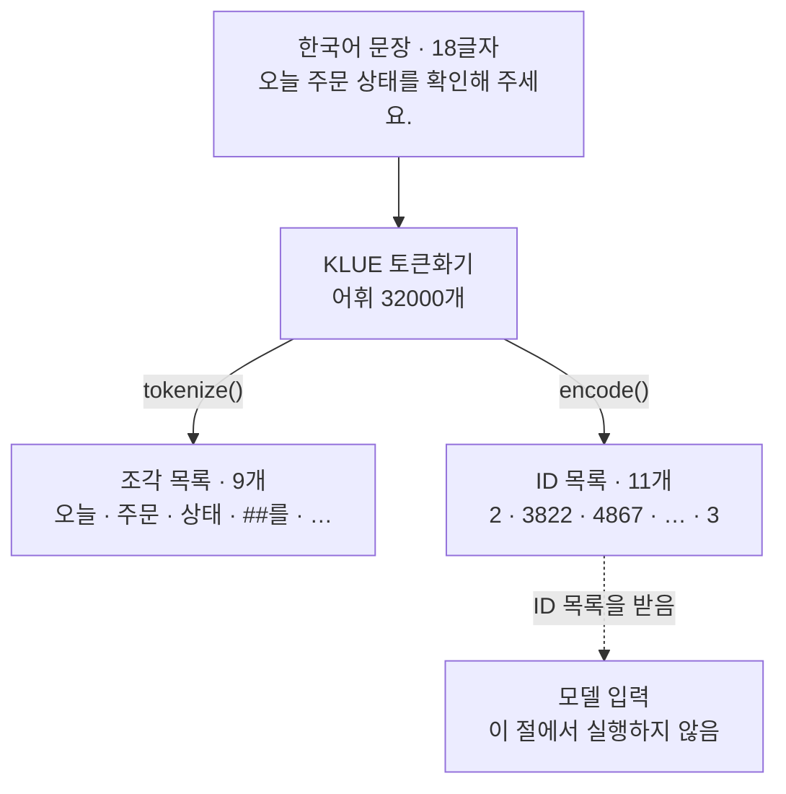
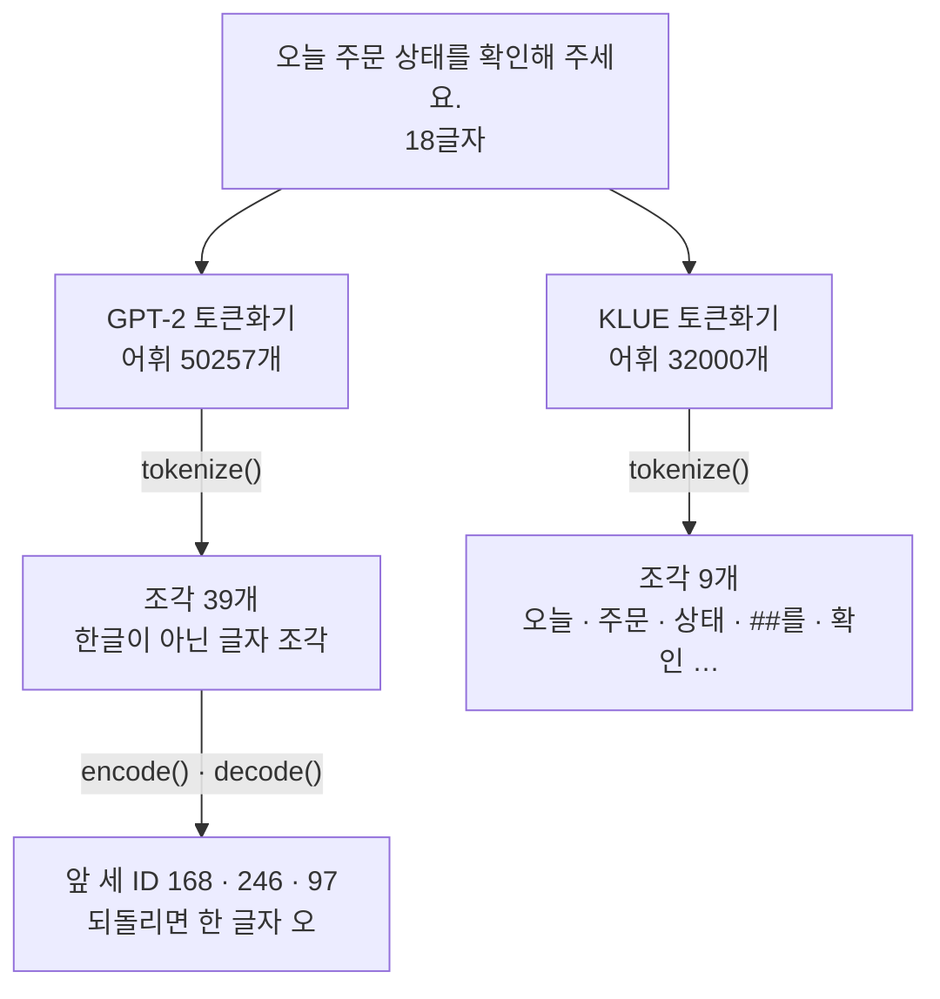
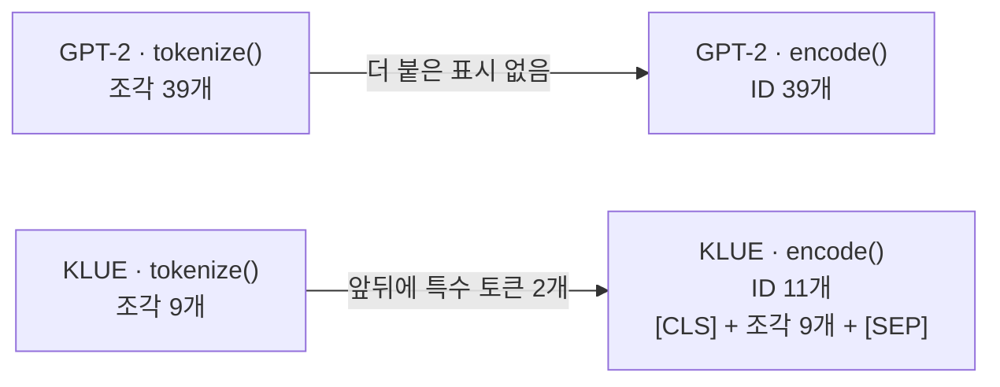
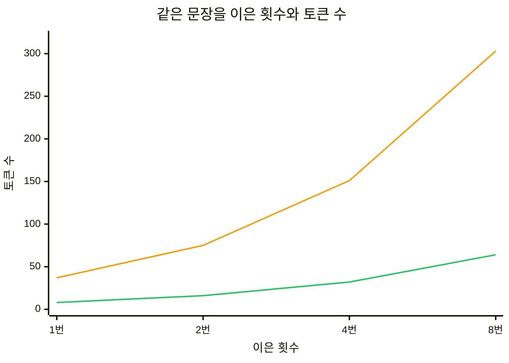

# 01-토큰화와-한국어-효율

## _src 본문 (HTML 원본)

```html
<!--meta: 강의 1.5h · 실습 1h | 코드 Jupyter Notebook | 새 용어 8 -->
<h2 id="b1"><span class="no">1</span>학습 목표</h2>
<div class="goal"><ul><li>토큰화기가 글을 조각(토큰)으로 나누고 조각마다 번호(토큰 ID)를 붙이는 과정을 노트북 출력으로 설명할 수 있습니다.</li><li>같은 뜻의 한국어와 영어 문장이 토큰화기 GPT-2와 KLUE에서 몇 개의 토큰이 되는지 비교할 수 있습니다.</li><li>글자 수와 토큰 수가 어긋나는 까닭을 조각 크기, 공백, 특수 토큰으로 짚을 수 있습니다.</li></ul></div>
<h2 id="b2"><span class="no">2</span>이 내용을 배우는 이유</h2>
<p>대규모 언어 모델(Large Language Model, LLM)은 사람이 쓴 글을 글자 그대로 받지 않습니다. 모델에 넣기 전에 글을 토큰이라는 조각으로 나누고, 조각마다 붙은 번호를 넘깁니다. 모델에 한 번에 넣을 수 있는 글의 길이와 사용 요금도 보통 이 토큰 수로 셉니다.</p>
<p>글자 수를 알면 토큰 수도 알 것 같지만, 그렇지 않습니다. 같은 18글자 한국어 문장이 한 토큰화기에서는 39토큰, 다른 토큰화기에서는 9토큰이 되었습니다. 한국어 글을 다루는 에이전트를 만들려면, 쓰는 모델의 토큰화기로 직접 세어 보는 습관이 필요합니다.</p>
<p><strong>이 절의 질문</strong> — 같은 뜻의 한국어와 영어 문장은 토큰화기에 따라 몇 개의 토큰이 되고, 그 차이는 어디서 올까요?</p>
<h2 id="b3"><span class="no">3</span>앞에서 배운 내용</h2>
<p>Ch 4 05절에서는 기사 A10의 페이지를 파싱해 <code>data/article-text.json</code>에 썼습니다. 이 파일에는 파일 모양 이름 <code>schema_version</code>, 원본 경로 <code>source</code>, 기사 기록 <code>record</code>가 들어 있습니다. 기록의 글 칸 <code>text</code>는 제목과 요약을 줄바꿈 한 글자로 이은 글입니다. 이 절은 그 파일을 읽기만 하고, 글 칸의 토큰 수를 셉니다.</p>
<p>05절은 함수 <code>json.dumps()</code>로 딕셔너리를 JSON 글로 바꿨습니다. 이 절은 반대 방향인 <code>json.loads()</code>로 JSON 글을 딕셔너리로 바꿉니다. Ch 4 04절의 메서드 <code>response.json()</code>과 같은 방향입니다. 파일은 Ch 2 05절처럼 <code>with open(…, encoding="utf-8")</code>과 <code>read()</code>로 읽습니다.</p>
<p>Ch 4까지는 모델을 쓰지 않았습니다. 이 절도 모델을 부르지 않고, 모델에 글을 넣기 전 단계인 토큰화기만 씁니다. 패키지는 Ch 4의 pandas처럼 실습 폴더에서 <code>uv sync --locked</code>로 설치합니다. 불러오는 줄은 Ch 2 07절의 <code>from 모듈 import 이름</code> 모양입니다.</p>
<p>그 밖에 Ch 1 01절의 <code>len()</code>, Ch 2 03절의 목록 슬라이싱, Ch 2 02절의 <code>range()</code>와 위치 번호를 씁니다. 파일 경로는 Ch 4 05절 준비 셀처럼 <code>os.path.exists()</code>로 고릅니다. 위 폴더를 가리키는 <code>..</code>은 Ch 3 04절에서 썼습니다.</p>
<h2 id="b4"><span class="no">4</span>핵심 개념</h2>
<h3>비유로 시작하기</h3>
<p>크기가 같은 나무 쟁반 두 개가 있고, 쟁반마다 긴 홈이 두 줄씩 파여 있습니다. 이 홈을 블록으로 빈틈 없이 채워야 합니다. 쓸 수 있는 블록은 쟁반 뒤 상자에 든 것뿐입니다. 한쪽 상자에는 작은 정육면체만, 다른 쪽 상자에는 긴 막대만 들어 있습니다.</p>
<p>이 장면을 토큰화로 옮기면 홈은 나눌 글이고, 블록 하나는 토큰 하나입니다. 블록 상자는 토큰화기가 가진 조각 목록인 어휘이고, 쓴 블록 수가 토큰 수입니다. 같은 글이라도 어휘에 긴 조각이 있으면 토큰 수가 줄고, 작은 조각만 있으면 늘어납니다.</p>
{{img:01-5-블록-쟁반|왼쪽에는 작은 파란 정육면체가 든 나무 상자 앞에 홈 두 줄이 작은 정육면체 16개씩으로 채워진 나무 쟁반이 있고, 오른쪽에는 긴 파란 막대가 든 상자 앞에 같은 크기의 쟁반 홈 두 줄이 긴 막대 3개씩으로 채워진 삽화|같은 크기의 홈을 채워도, 작은 블록만 있는 상자로는 블록이 많이 들고 긴 막대가 든 상자로는 적게 듭니다.}}
<p><strong>그림 읽기</strong> — 가운데 회색 세로선의 왼쪽과 오른쪽에 같은 크기의 나무 쟁반이 하나씩 있습니다. 왼쪽 쟁반 뒤 상자에는 작은 파란 정육면체만 들어 있습니다. 그래서 쟁반의 홈 두 줄을 정육면체 16개씩, 모두 32개로 채웠습니다.</p>
<p>오른쪽 쟁반 뒤 상자에는 길이가 다른 파란 막대만 들어 있습니다. 같은 홈 두 줄이 막대 3개씩, 모두 6개로 찼습니다. 그림의 블록 수는 실제 토큰 수가 아닙니다. 상자에 든 블록의 크기가 쓴 블록 수를 가른다는 관계만 보여 줍니다.</p>
<h3>이 절에서 쓰는 말</h3>
<table><thead><tr><th>용어</th><th>뜻</th><th>이 절에서 보이는 모습</th></tr></thead><tbody>
<tr><td>대규모 언어 모델(LLM)</td><td>많은 글로 학습해, 앞 토큰들에 이어질 토큰을 만들어 내는 모델</td><td>이 절에서는 부르지 않음</td></tr>
<tr><td>토큰(token)</td><td>모델이 글을 다루는 조각 단위. 낱말, 낱말의 일부, 문장부호, 공백이 될 수 있음</td><td><code>'오늘'</code>, <code>'##를'</code>, <code>'.'</code>, <code>'Ġ'</code></td></tr>
<tr><td>토큰화(tokenization)와 토큰화기(tokenizer)</td><td>글을 토큰으로 나누는 일과, 그 일을 하는 도구</td><td><code>gpt2.tokenize(korean_sentence)</code></td></tr>
<tr><td>어휘(vocabulary)</td><td>토큰화기가 가진 조각과 번호의 목록</td><td>GPT-2 50257개, KLUE 32000개</td></tr>
<tr><td>토큰 ID</td><td>어휘에서 조각마다 붙은 번호. 모델은 이 번호 목록을 받음</td><td><code>[168, 246, 97]</code></td></tr>
<tr><td>특수 토큰(special token)</td><td>글에 없던 표시를 토큰화기가 더한 조각</td><td><code>[CLS]</code>, <code>[SEP]</code></td></tr>
<tr><td>판 번호(revision)</td><td>같은 이름의 모델 파일 가운데 한 판을 고르는 값</td><td><code>gpt2_revision = "607a30d…"</code></td></tr>
<tr><td>바이트(byte)</td><td>컴퓨터가 글자를 저장하는 작은 단위. 한글 한 글자는 UTF-8 방식에서 3바이트</td><td>앞 세 ID를 되돌리면 한 글자 <code>오</code></td></tr>
</tbody></table>
<h3>글이 조각이 되고, 조각이 번호가 됩니다</h3>
<p>토큰화기는 두 단계로 일합니다. 먼저 글을 어휘에 있는 조각으로 나눕니다. 메서드 <code>tokenize()</code>가 이 조각의 글자 목록을 반환합니다. 다음으로 조각마다 어휘의 번호를 찾아 붙입니다. 메서드 <code>encode()</code>는 이 번호, 곧 토큰 ID의 목록을 반환합니다.</p>
{{mermaid:01-1-토큰화-흐름|맨 위 초록 상자 18글자 문장 오늘 주문 상태를 확인해 주세요가 초록 상자 KLUE 토큰화기 어휘 32000개로 가고, tokenize()로 노란 상자 조각 목록 9개, encode()로 노란 상자 ID 목록 11개가 되며, ID 목록이 점선으로 회색 상자 모델 입력으로 이어지는 흐름도|토큰화기는 글을 조각 목록과 ID 목록으로 바꿉니다. KLUE 토큰화기에서 조각은 9개, ID는 11개였습니다.}}
<p><strong>도식 읽기</strong> — 위에서 아래로 읽습니다. 맨 위 초록 상자는 노트북에서 나눈 18글자 문장이고, 그 아래 초록 상자는 어휘 32000개를 가진 KLUE 토큰화기입니다. 화살표 위 글자가 실행한 메서드입니다. 왼쪽 노란 상자는 <code>tokenize()</code>가 반환한 조각 9개이고, 오른쪽 노란 상자는 <code>encode()</code>가 반환한 ID 11개입니다.</p>
<p>조각 9개와 ID 11개의 차이는 뒤에서 보는 특수 토큰 두 개입니다. 맨 아래 회색 상자는 ID 목록을 받는 모델입니다. 이 절에서는 모델을 실행하지 않아 점선으로 이었습니다.</p>
<h3>어휘가 다르면 조각도 다릅니다</h3>
<p>이 절은 토큰화기 두 개를 비교합니다. GPT-2 토큰화기는 영어 글을 중심으로 학습한 모델의 것입니다. KLUE BERT 토큰화기는 한국어 글로 학습한 모델의 것이라, 낱말 오늘과 주문이 조각 하나로 어휘에 있습니다.</p>
<p>어휘에 알맞은 조각이 없으면 토큰화기는 글을 더 작게 쪼갭니다. GPT-2 토큰화기는 글자를 저장하는 단위인 바이트까지 내려가 나눕니다. 한글 한 글자는 UTF-8 방식으로 3바이트라서, 한 글자가 조각 두세 개가 되기도 합니다. 노트북에서 앞 세 ID를 글로 되돌리면 한 글자 <code>오</code>가 나옵니다.</p>
<p>반대로 영어 문장에서는 GPT-2 토큰화기의 조각이 더 적었습니다. 그러니 토큰 수 차이를 언어의 우열로 읽지 않습니다. 토큰화기가 어떤 글로 어휘를 만들었는지의 차이입니다.</p>
<h3>글자 수와 토큰 수가 어긋나는 세 가지 까닭</h3>
<p>첫째, 조각의 크기가 어휘에 따라 다릅니다. 둘째, 공백을 다루는 방식이 다릅니다. GPT-2 토큰화기는 공백을 조각에 담아 <code>Ġ</code> 표시로 남깁니다. KLUE 토큰화기는 공백에서 글을 나눈 뒤 공백을 버립니다.</p>
<p>셋째, 토큰화기가 글에 없던 특수 토큰을 더할 수 있습니다. KLUE 토큰화기의 <code>encode()</code>는 문장 앞에 <code>[CLS]</code>, 뒤에 <code>[SEP]</code>를 붙였습니다. 마트 계산대에서 손님 물건 사이에 놓는 칸막이 막대처럼, 글의 시작과 끝을 알리는 표시입니다. 그래서 모델에 넣을 길이는 조각 수보다 ID 수로 셉니다.</p>
<h2 id="b5"><span class="no">5</span>실행 예제</h2>
<p>노트북은 먼저 Ch 4 05절의 기사 파일이 있는지 확인하고, 토큰화기 두 개를 준비합니다. 한국어 문장 하나를 두 토큰화기로 나누고, 조각을 ID로 바꿔 특수 토큰을 봅니다. 이어서 영어 문장, 문장 쌍 두 개, Ch 4 기사 글의 토큰 수를 셉니다. 마지막으로 같은 문장을 1·2·4·8번 이어 붙여 봅니다.</p>
<p>모델을 부르지 않으므로 API 키가 필요 없고 비용도 들지 않습니다. 첫 실행은 토큰화기 파일을 내려받으려고 인터넷에 접속합니다. 교재 출력은 Python 3.12.13, transformers 4.56.2, tokenizers 0.22.2로 만들었습니다.</p>
{{notebook:01-토큰화와-한국어-효율}}
<p class="look"><b>확인할 점</b> — 3절의 <code>GPT-2 토큰 수: 39</code>와 5절의 <code>KLUE 토큰 수: 9</code>를 비교합니다. 6절 목록의 양 끝에 <code>'[CLS]'</code>와 <code>'[SEP]'</code>이 붙었는지 봅니다. 11절 네 줄에서 두 토큰화기의 토큰 수가 이은 횟수와 함께 어떻게 늘었는지 확인합니다.</p>
<h3>한 문장, 두 토큰화기</h3>
<p>한국어 문장 <code>오늘 주문 상태를 확인해 주세요.</code>는 18글자입니다. GPT-2 토큰화기는 이 문장을 39토큰으로 나눴고, 조각은 <code>'ì'</code>, <code>'ĺ'</code>처럼 한글이 아닌 글자였습니다. 앞 세 ID <code>[168, 246, 97]</code>을 되돌리자 한 글자 <code>오</code>가 나왔습니다.</p>
<p>KLUE 토큰화기는 같은 문장을 9토큰으로 나눴습니다. 조각은 <code>['오늘', '주문', '상태', '##를', '확인', '##해', '주세', '##요', '.']</code>였습니다. 앞에 <code>##</code>이 붙은 조각은 앞 조각에 공백 없이 이어진다는 표시입니다.</p>
{{mermaid:01-2-한-문장-두-토큰화기|맨 위 초록 상자 18글자 문장이 왼쪽 초록 상자 GPT-2 토큰화기 어휘 50257개와 오른쪽 초록 상자 KLUE 토큰화기 어휘 32000개로 갈라지고, 왼쪽은 tokenize()로 노란 상자 조각 39개 한글이 아닌 글자 조각이 된 뒤 encode()와 decode()로 노란 상자 앞 세 ID 168, 246, 97 되돌리면 한 글자 오가 되며, 오른쪽은 tokenize()로 노란 상자 조각 9개 오늘, 주문, 상태, ##를, 확인이 되는 흐름도|같은 18글자 문장이 GPT-2 토큰화기에서는 39토큰, KLUE 토큰화기에서는 9토큰이 되었습니다.}}
<p><strong>도식 읽기</strong> — 위에서 아래로 읽습니다. 초록 상자는 문장과 토큰화기이고, 노란 상자는 노트북 출력으로 확인한 결과입니다. 화살표 위 글자가 실행한 메서드입니다.</p>
<p>왼쪽 갈래는 GPT-2 토큰화기입니다. 조각 39개 아래에는 앞 세 ID 168, 246, 97과, 이 셋을 되돌린 한 글자 오를 적었습니다. 오른쪽 갈래는 KLUE 토큰화기의 조각 9개입니다.</p>
<h3>조각 수와 ID 수</h3>
<p>GPT-2 토큰화기는 <code>tokenize()</code>의 조각 수와 <code>encode()</code>의 ID 수가 모두 39였습니다. KLUE 토큰화기는 조각 9개가 ID 11개가 되었습니다. 번호를 조각 이름으로 되돌린 목록의 양 끝에 <code>'[CLS]'</code>와 <code>'[SEP]'</code>이 있었습니다. 노트북의 <code>assert added_count == 2</code> 줄도 멈추지 않았습니다.</p>
{{mermaid:01-3-특수-토큰|위 줄은 노란 상자 GPT-2 tokenize() 조각 39개에서 더 붙은 표시 없음 화살표로 노란 상자 GPT-2 encode() ID 39개로 가고, 아래 줄은 노란 상자 KLUE tokenize() 조각 9개에서 앞뒤에 특수 토큰 2개 화살표로 노란 상자 KLUE encode() ID 11개 [CLS] + 조각 9개 + [SEP]로 가는 비교 그림|토큰화기 GPT-2는 조각 수와 ID 수가 같고, KLUE는 특수 토큰 두 개만큼 ID가 많습니다.}}
<p><strong>도식 읽기</strong> — 줄마다 왼쪽에서 오른쪽으로 읽습니다. 위 줄은 GPT-2 토큰화기, 아래 줄은 KLUE 토큰화기입니다. 노란 상자 네 개는 모두 노트북 출력으로 확인한 수입니다. 아래 줄 오른쪽 상자는 ID 11개가 특수 토큰 두 개와 조각 9개로 이루어졌음을 보여 줍니다.</p>
<h3>영어 문장과 기사 글</h3>
<p>같은 뜻의 영어 문장 <code>Please check today's order status.</code>는 34글자입니다. GPT-2 토큰화기는 7토큰, KLUE 토큰화기는 15토큰으로 나눠 순서가 뒤집혔습니다. 환불 기준 문장 쌍도 한국어 <code>GPT-2 44 | KLUE 11</code>, 영어 <code>GPT-2 9 | KLUE 17</code>로 같은 방향이었습니다.</p>
<p>Ch 4 기사 글은 줄바꿈을 포함해 36글자입니다. GPT-2 토큰화기는 81토큰, KLUE 토큰화기는 17토큰이었습니다. KLUE 조각 목록에는 줄바꿈 조각이 없었습니다. 줄바꿈도 공백처럼 버렸기 때문입니다.</p>
<h2 id="b6"><span class="no">6</span>실험 결과 해석</h2>
<p>반복 실험은 문장 <code>한국어 토큰 효율을 측정합니다.</code>를 공백 한 칸씩 끼워 1·2·4·8번 이었습니다. 한 번은 <code>글자 17 | GPT-2 37 | KLUE 8</code>, 여덟 번은 <code>글자 143 | GPT-2 303 | KLUE 64</code>였습니다. 토큰화기 KLUE의 토큰 수는 8, 16, 32, 64로 이은 횟수에 딱 비례했습니다.</p>
<p>토큰화기 GPT-2의 토큰 수는 37, 75, 151, 303이었습니다. 37의 두 배는 74, 네 배는 148, 여덟 배는 296입니다. 실제 토큰 수는 이보다 1, 3, 7이 많았습니다.</p>
{{mermaid:01-4-반복-실험|가로축 이은 횟수 1번, 2번, 4번, 8번, 세로축 토큰 수의 꺾은선 그림으로, 위쪽 주황 선 GPT-2는 37, 75, 151, 303으로 가파르게 오르고 아래쪽 초록 선 KLUE는 8, 16, 32, 64로 완만하게 오르는 그림|이은 횟수가 두 배가 될 때 토큰화기 KLUE는 토큰 수가 딱 두 배였고, GPT-2는 공백 수만큼 더 늘었습니다.}}
<p><strong>도식 읽기</strong> — 가로축은 이은 횟수이고, 네 칸 간격은 같지만 값은 1, 2, 4, 8입니다. 세로축은 토큰 수입니다. 위쪽 주황 선이 GPT-2 토큰화기로 37에서 303까지 오릅니다. 아래쪽 초록 선은 KLUE 토큰화기로 8에서 64까지 오릅니다. 두 선 모두 가로축 간격 때문에 오른쪽으로 갈수록 가팔라 보입니다.</p>
<p>늘어난 수 1, 3, 7은 끼워 넣은 공백 수와 같습니다. 두 번 이은 글에서 첫 문장이 끝나는 자리를 보니 GPT-2 조각은 <code>['.', 'Ġ', 'íķ']</code>였습니다. 공백 한 칸이 조각 <code>'Ġ'</code> 하나로 따로 나온 것입니다. 같은 자리의 KLUE 조각은 <code>['.', '한국어']</code>로 공백 조각이 없었습니다.</p>
<p>이음새는 첫 번째만 출력했습니다. 다른 이음새에서도 같은 조각이 생겼는지는 늘어난 수가 공백 수와 같다는 점으로 짐작한 것입니다. 글자 수도 17, 35, 71, 143으로 공백 수만큼 더 늘었습니다.</p>
<p>결론은 이렇습니다. 글자 수에 한 숫자를 곱해 토큰 수를 어림하면, 토큰화기마다 다른 오차가 생깁니다. 두 문장 쌍에서는 한국어는 KLUE 토큰화기가, 영어는 GPT-2 토큰화기가 더 적은 토큰을 썼습니다. 다만 이번에 나눈 글은 짧은 문장 다섯 개와 기사 글 하나이고, 토큰화기는 두 개뿐입니다. 이 결과로 한국어가 늘 토큰이 많이 든다고 일반화할 수 없습니다.</p>
<h2 id="b7"><span class="no">7</span>주의할 점과 실무 메모</h2>
<ul><li>토큰 수는 쓰는 모델의 토큰화기로 셉니다. 이 절의 두 토큰화기는 비교용이며, 뒤 챕터에서 부를 모델의 토큰화기와 같다고 보지 않습니다.</li>
<li>토큰 ID는 토큰화기마다 어휘가 달라 가리키는 조각이 다릅니다. 한 토큰화기의 ID 목록을 다른 토큰화기로 되돌리지 않습니다. 이 경우는 이번에 실행하지 않았습니다.</li>
<li>채팅 모델은 역할 표시 같은 토큰을 더 붙이므로, 모델에 실제로 들어가는 토큰 수는 <code>encode()</code> 결과보다 많을 수 있습니다. 이 절에서는 채팅 형식을 실행하지 않았고, 04절 컨텍스트 윈도에서 다룹니다.</li>
<li>판 번호를 고정하지 않으면 모델 파일이 바뀌었을 때 조각과 토큰 수가 달라질 수 있습니다. 판 번호를 뺀 경우는 이번에 실행하지 않았습니다.</li>
<li>첫 실행은 Hugging Face 사이트에서 토큰화기 파일을 내려받고, 받은 파일은 사용자 폴더의 캐시에 남습니다. 인터넷이 없는 곳에서 실행하는 경우는 이번에 실행하지 않았습니다.</li>
<li>조각의 <code>Ġ</code>와 <code>##</code>는 토큰화기가 붙인 표시이지 원래 글의 글자가 아닙니다. 내려받은 설정 파일 <code>tokenizer.json</code>을 보면 GPT-2는 바이트 단위 나누기(ByteLevel)를 씁니다. 토큰화기 KLUE는 이어지는 조각 앞에 <code>##</code>를 붙이는 방식(WordPiece)입니다.</li>
<li>실습 폴더는 뒤 절에서 쓸 torch와 sentence-transformers도 함께 설치합니다. 이 절의 노트북은 두 패키지를 쓰지 않습니다.</li>
<li>교재 출력은 2026-09-16에 Linux의 Python 3.12.13으로 만들었습니다. 패키지는 transformers 4.56.2, tokenizers 0.22.2, huggingface-hub 0.36.2입니다. Windows·macOS와 다른 버전에서는 실행하지 않았습니다.</li></ul>
<h2 id="b8"><span class="no">8</span>정리와 다음 절</h2>
<ul><li>토큰화기는 글을 어휘의 조각(토큰)으로 나누고 조각마다 번호(토큰 ID)를 붙입니다. 메서드 <code>tokenize()</code>는 조각을, <code>encode()</code>는 ID를 반환합니다.</li><li>18글자 한국어 문장이 GPT-2 토큰화기에서 39토큰, KLUE 토큰화기에서 9토큰이었습니다. 같은 뜻의 영어 문장은 7토큰과 15토큰으로 반대였습니다.</li><li>글자 수와 토큰 수는 조각 크기, 공백 처리, 특수 토큰 때문에 어긋납니다. 토큰 수는 쓰는 모델의 토큰화기로 직접 셉니다.</li></ul>
<p><strong>다음 학습과 이어지는 지점</strong> — <a href="02-임베딩과-의미-유사도.html">02절 임베딩과 의미 유사도</a>에서는 문장을 토큰 수가 아니라 뜻을 담은 숫자 목록으로 바꿉니다. 그리고 뜻이 비슷한 문장끼리 그 숫자 목록이 얼마나 가까운지 비교합니다.</p>
<h2 id="b9"><span class="no">9</span>복습 문제</h2><details class="quiz"><summary>문제와 해설</summary>
<p class="quiz-q">1. 메서드 <code>tokenize()</code>와 <code>encode()</code>는 각각 무엇을 반환하나요? · 기초</p><p class="quiz-a"><b>해설</b> — 메서드 <code>tokenize()</code>는 조각의 글자 목록을, <code>encode()</code>는 조각마다 붙은 번호인 토큰 ID 목록을 반환합니다. KLUE 토큰화기에서 같은 문장이 조각 9개, ID 11개였습니다.</p>
<p class="quiz-q">2. GPT-2 토큰화기가 18글자 한국어 문장을 39토큰으로 나눈 까닭은 무엇인가요? · 기초</p><p class="quiz-a"><b>해설</b> — 어휘에 알맞은 한글 조각이 없어, 글자를 바이트 단위까지 쪼갰기 때문입니다. 한글 한 글자는 UTF-8 방식에서 3바이트입니다. 앞 세 ID <code>[168, 246, 97]</code>을 되돌리면 한 글자 <code>오</code>가 나왔습니다.</p>
<p class="quiz-q">3. KLUE 토큰화기에서 ID 수가 조각 수보다 2 많았던 까닭은 무엇인가요? · 적용</p><p class="quiz-a"><b>해설</b> — 메서드 <code>encode()</code>가 문장 앞에 <code>[CLS]</code>, 뒤에 <code>[SEP]</code> 특수 토큰을 더했기 때문입니다. 메서드 <code>tokenize()</code>는 이 표시를 넣지 않습니다.</p>
<p class="quiz-q">4. 문장을 여덟 번 이은 글에서 GPT-2 토큰 수 303이 37의 여덟 배인 296보다 7 많은 까닭은 무엇인가요? · 분석</p><p class="quiz-a"><b>해설</b> — 문장 사이에 끼운 공백 7칸이 각각 조각이 되었다고 볼 수 있습니다. 첫 이음새에서 공백이 조각 <code>'Ġ'</code> 하나로 따로 나왔고, 늘어난 수가 공백 수와 같았습니다. KLUE 토큰화기는 공백을 버려 딱 64였습니다.</p>
<p class="quiz-q">5. 에이전트에 넣을 한국어 문서의 길이를 글자 수로만 어림하면 어떤 문제가 생기고, 대신 무엇을 하나요? · 분석</p><p class="quiz-a"><b>해설</b> — 같은 글도 토큰화기에 따라 토큰 수가 네 배 넘게 달랐습니다. 이 절의 기사 글은 81토큰과 17토큰이었습니다. 그래서 글자 수로 어림하지 않고, 쓰는 모델의 토큰화기로 직접 셉니다.</p>
</details>
<h2 id="b10"><span class="no">10</span>참고 자료</h2>
<ul><li><a href="https://huggingface.co/docs/transformers/">Hugging Face Transformers 공식 문서</a> · 확인 2026-09-09 · transformers 4.56.2</li><li><a href="https://huggingface.co/openai-community/gpt2/tree/607a30d783dfa663caf39e06633721c8d4cfcd7e">GPT-2 모델 파일과 MIT 라이선스</a> · 판 607a30d · 확인 2026-09-09</li><li><a href="https://huggingface.co/klue/bert-base/tree/77c8b3d707df785034b4e50f2da5d37be5f0f546">KLUE BERT 모델 파일과 CC-BY-SA-4.0 라이선스</a> · 판 77c8b3d · 확인 2026-09-09</li></ul>
```

## 노트북 셀 (순서대로)

### [0] markdown {'html': 'skip'}

# 토큰화와 한국어 효율

**이 노트북에서 할 일**

1. 같은 한국어 문장을 토큰화기 두 개로 나누고, 조각 목록과 토큰 수를 비교합니다.
2. 조각을 숫자 ID로 바꾸고, 토큰화기가 앞뒤에 더하는 특수 토큰을 확인합니다.
3. Ch 4 05절의 기사 글과, 같은 문장을 여러 번 이은 글의 토큰 수를 셉니다.

**준비물** — API 키는 필요 없습니다. 모델을 부르지 않으므로 모델 호출은 0번이고 비용도 들지 않습니다.
실행 시간은 1분 안팎입니다. 첫 실행에서는 Hugging Face 사이트에서 토큰화기 파일을 내려받습니다.
그래서 인터넷 연결이 필요하고, 교재 실행 컴퓨터에서 받은 파일은 합쳐 3.6MB였습니다.

Ch 4 05절이 만든 파일 `labs/part1/ch04-data-tools/data/article-text.json`을 읽습니다. 읽기만 하고 바꾸지 않습니다.

**기준 버전** — 실습 폴더에 고정한 transformers 4.56.2와 tokenizers 0.22.2를 씁니다.
토큰화기 파일도 판 번호(revision)를 고정해 받습니다. 교재 출력은 이 버전들과 Python 3.12.13으로 만들었습니다.
다른 버전과 Windows·macOS에서는 이번에 실행하지 않았습니다.

실습 폴더 `labs/part1/ch05-llm-principles`에서 Ch 1 3절처럼 `uv sync --locked`로 환경을 만듭니다.
커널에서 이 폴더의 `.venv`를 고른 뒤 첫 셀부터 순서대로 실행합니다.

### [1] markdown {'html': 'skip'}

## 오늘 볼 그림


위에서 아래로 읽습니다. 초록 상자의 한국어 문장이 KLUE 토큰화기를 거쳐 노란 상자 두 개가 됩니다.
하나는 `tokenize()`가 반환한 조각 9개이고, 다른 하나는 `encode()`가 반환한 ID 11개입니다.

맨 아래 회색 상자는 ID 목록을 받는 모델입니다. 이 노트북은 모델을 부르지 않고, 토큰화기가 만든 조각과 ID까지만 봅니다.

### [2] markdown {}

## 1. 준비

이 절은 새 파일을 만들지 않습니다. Ch 4 05절이 실습 폴더에 남긴 기사 파일을 읽기만 하므로, 임시 폴더도 만들지 않습니다.

노트북을 `notebooks` 폴더에서 열면 Ch 4 실습 폴더는 두 칸 위 폴더 안에 있습니다. 그래서 경로를 `../../ch04-data-tools`로 시작합니다.
그 경로에 파일이 없으면 프로젝트 맨 위 폴더에서 연 경우로 보고 긴 경로를 씁니다.
함수 `os.path.exists()`는 Ch 4 05절 준비 셀에서처럼, 경로에 파일이 있으면 `True`를 반환합니다.

### [3] code {'execution': {'iopub.execute_input': '2026-09-16T16:53:37.695065Z', 'iopub.status.busy': '2026-09-16T16:53:37.694867Z', 'iopub.status.idle': '2026-09-16T16:53:37.702341Z', 'shell.execute_reply': '2026-09-16T16:53:37.701483Z'}, 'lesson_role': 'setup'}

```python
# Ch 4 05절이 만든 기사 파일의 경로를 정합니다
import os

# notebooks 폴더에서 열면 두 칸 위 폴더 안에, 프로젝트 맨 위 폴더에서 열면 긴 경로에 있습니다
article_path = "../../ch04-data-tools/data/article-text.json"
if not os.path.exists(article_path):
    article_path = "labs/part1/ch04-data-tools/data/article-text.json"
print("기사 파일이 있는가:", os.path.exists(article_path))
```

출력:
```
기사 파일이 있는가: True

```

### [4] markdown {}

**결과 읽기** — 출력 줄은 `기사 파일이 있는가: True`입니다. 이 절에서 읽을 파일을 찾았습니다.
출력이 `False`라면 Ch 4 05절 노트북을 먼저 실행해 파일을 만듭니다. 경로는 컴퓨터마다 달라서 출력하지 않았습니다.

### [5] markdown {}

## 2. 토큰화기 두 개 준비

모델은 글을 토큰(token)이라는 조각 단위로 다룹니다. 문장을 낱말 카드 몇 장으로 잘라 늘어놓는 일과 비슷합니다.
글을 토큰으로 나누는 도구를 토큰화기(tokenizer), 토큰화기가 가진 조각 목록을 어휘(vocabulary)라고 부릅니다.

패키지 transformers는 여러 모델의 토큰화기를 같은 방법으로 불러오게 해 줍니다.
메서드 `AutoTokenizer.from_pretrained(모델 이름, revision=판 번호)`는 토큰화기 파일을 받아 토큰화기 객체를 반환합니다.
판 번호(revision)는 같은 이름의 파일 가운데 교재가 확인한 판을 고르는 값입니다.

영어 글을 중심으로 만든 GPT-2와, 한국어 글로 만든 KLUE BERT의 토큰화기를 준비합니다. 속성 `vocab_size`는 어휘에 든 조각 종류 수입니다.
함수 `warnings.filterwarnings()` 줄은 진행 표시 위젯이 없다는 경고 한 줄을 끕니다. 실습 폴더 README에도 적힌 경고로, 계산 결과와 관계없습니다.

실행 전에 예상합니다. 두 어휘의 크기는 서로 다를 것입니다.

### [6] code {'execution': {'iopub.execute_input': '2026-09-16T16:53:37.704228Z', 'iopub.status.busy': '2026-09-16T16:53:37.704074Z', 'iopub.status.idle': '2026-09-16T16:53:41.922781Z', 'shell.execute_reply': '2026-09-16T16:53:41.922160Z'}}

```python
# 두 모델의 토큰화기를 고정 판 번호로 받아 만들고, 어휘 크기를 확인합니다
import warnings

# 진행 표시 위젯이 없다는 경고(TqdmWarning)는 계산과 관계없어 화면에 내지 않습니다
warnings.filterwarnings("ignore", message="IProgress not found")
import transformers
from transformers import AutoTokenizer

print("transformers 버전:", transformers.__version__)
# from_pretrained(모델 이름, revision=판 번호)는 토큰화기 파일을 받아 토큰화기 객체를 반환합니다
gpt2_revision = "607a30d783dfa663caf39e06633721c8d4cfcd7e"
gpt2 = AutoTokenizer.from_pretrained("openai-community/gpt2", revision=gpt2_revision)
klue_revision = "77c8b3d707df785034b4e50f2da5d37be5f0f546"
klue = AutoTokenizer.from_pretrained("klue/bert-base", revision=klue_revision)
# vocab_size는 어휘에 든 조각의 종류 수입니다
print("GPT-2 어휘 크기:", gpt2.vocab_size)
print("KLUE 어휘 크기:", klue.vocab_size)
```

출력:
```
transformers 버전: 4.56.2
GPT-2 어휘 크기: 50257
KLUE 어휘 크기: 32000

```

### [7] markdown {}

**결과 읽기** — 버전 줄은 `transformers 버전: 4.56.2`입니다. 어휘 크기는 GPT-2 `50257`, KLUE `32000`입니다.

첫 실행에서는 파일을 내려받는 진행 표시가 더 나올 수 있습니다. 어휘가 크다고 한국어 문장의 토큰 수가 적다고는 말할 수 없습니다.
다음 셀부터 같은 문장을 넣어 직접 비교합니다.

### [8] markdown {}

## 3. GPT-2 토큰화기로 한 문장 나누기

주문 상태를 묻는 한국어 문장 하나를 나눕니다. 메서드 `tokenize(글)`는 글을 조각으로 나눈 글자 목록을 반환합니다.
함수 `len()`으로 목록의 항목 수, 곧 토큰 수를 셉니다.

실행 전에 예상합니다. 낱말이 다섯 개인 문장이니, 토큰도 열 개 안팎일 것이라고 예상해 봅니다.

### [9] code {'execution': {'iopub.execute_input': '2026-09-16T16:53:41.924025Z', 'iopub.status.busy': '2026-09-16T16:53:41.923863Z', 'iopub.status.idle': '2026-09-16T16:53:41.927154Z', 'shell.execute_reply': '2026-09-16T16:53:41.926691Z'}}

```python
# 한국어 문장 하나를 GPT-2 토큰화기로 나눠 조각 목록과 토큰 수를 봅니다
korean_sentence = "오늘 주문 상태를 확인해 주세요."
print("글자 수:", len(korean_sentence))
# tokenize(글)는 글을 조각(토큰)으로 나눈 글자 목록을 반환합니다
gpt2_pieces = gpt2.tokenize(korean_sentence)
print("GPT-2 토큰 수:", len(gpt2_pieces))
print("GPT-2 조각 목록:", gpt2_pieces)
```

출력:
```
글자 수: 18
GPT-2 토큰 수: 39
GPT-2 조각 목록: ['ì', 'ĺ', '¤', 'ë', 'Ĭ', 'ĺ', 'Ġì', '£', '¼', 'ë', '¬', '¸', 'Ġì', 'ĥ', 'ģ', 'í', 'ĥ', 'ľ', 'ë', '¥', '¼', 'Ġ', 'í', 'Ļ', 'ķ', 'ìĿ', '¸', 'íķ', '´', 'Ġì', '£', '¼', 'ì', 'Ħ', '¸', 'ì', 'ļ', 'Ķ', '.']

```

### [10] markdown {}

**결과 읽기** — 글자 수는 `18`인데 GPT-2 토큰 수는 `39`입니다. 예상한 열 개 안팎보다 훨씬 많습니다.

조각 목록에는 `'ì'`, `'ĺ'`, `'¤'`처럼 한글이 아닌 글자가 이어집니다. 어휘에 알맞은 한글 조각이 없어, 글자를 더 작게 쪼갠 결과입니다.
조각 앞의 `Ġ` 표시는 그 조각 앞에 공백이 있었다는 뜻입니다. 다음 셀에서 조각을 글로 되돌려 봅니다.

### [11] markdown {}

## 4. 조각을 번호로 바꾸고 되돌리기

모델이 받는 것은 조각 글자가 아니라, 어휘에서 조각마다 붙은 번호입니다. 이 번호를 토큰 ID라고 부릅니다.
메서드 `encode(글)`는 토큰 ID 목록을, 메서드 `decode(ID 목록)`는 번호를 다시 글로 바꾼 결과를 반환합니다.

앞 세 ID는 Ch 2 03절의 슬라이싱 `[0:3]`으로 고릅니다.
실행 전에 예상합니다. 조각 세 개를 글로 되돌리면 글자 세 개가 나올 것 같습니다.

### [12] code {'execution': {'iopub.execute_input': '2026-09-16T16:53:41.928109Z', 'iopub.status.busy': '2026-09-16T16:53:41.928010Z', 'iopub.status.idle': '2026-09-16T16:53:41.930492Z', 'shell.execute_reply': '2026-09-16T16:53:41.930131Z'}}

```python
# 같은 문장을 GPT-2 토큰 ID 목록으로 바꾸고, 앞 세 ID만 글로 되돌려 봅니다
# encode(글)는 조각마다 붙은 번호(토큰 ID)의 목록을 반환합니다
gpt2_ids = gpt2.encode(korean_sentence)
print("GPT-2 ID 수:", len(gpt2_ids))
first_ids = gpt2_ids[0:3]
print("앞 세 ID:", first_ids)
# decode(ID 목록)는 번호를 다시 글로 바꿔 반환합니다
first_text = gpt2.decode(first_ids)
print("앞 세 ID를 글로 되돌린 결과:", first_text)
```

출력:
```
GPT-2 ID 수: 39
앞 세 ID: [168, 246, 97]
앞 세 ID를 글로 되돌린 결과: 오

```

### [13] markdown {}

**결과 읽기** — GPT-2 ID 수는 `39`로, 3절의 토큰 수와 같습니다. 앞 세 ID는 `[168, 246, 97]`이고, 이 셋을 되돌린 결과는 `오` 한 글자입니다.

예상과 달리 한글 한 글자가 조각 세 개로 나뉘었습니다. 한글 한 글자는 UTF-8 방식으로 저장하면 3바이트입니다.
GPT-2 토큰화기는 한글 글자를 이 바이트 단위까지 쪼갰습니다. 대부분의 글자가 조각 두세 개가 되어, 18글자 문장이 39토큰이 되었습니다.

### [14] markdown {}

## 5. KLUE 토큰화기로 같은 문장 나누기

같은 문장을 한국어 글로 만든 KLUE 토큰화기에 넣습니다. 메서드 이름과 쓰는 법은 GPT-2 토큰화기와 같습니다.
실행 전에 예상합니다. 어휘에 한국어 조각이 많을 테니, 토큰 수가 39보다 훨씬 적을 것입니다.

### [15] code {'execution': {'iopub.execute_input': '2026-09-16T16:53:41.931548Z', 'iopub.status.busy': '2026-09-16T16:53:41.931443Z', 'iopub.status.idle': '2026-09-16T16:53:41.933734Z', 'shell.execute_reply': '2026-09-16T16:53:41.933300Z'}}

```python
# 같은 문장을 한국어 글로 만든 KLUE 토큰화기로 나눕니다
klue_pieces = klue.tokenize(korean_sentence)
print("KLUE 토큰 수:", len(klue_pieces))
print("KLUE 조각 목록:", klue_pieces)
```

출력:
```
KLUE 토큰 수: 9
KLUE 조각 목록: ['오늘', '주문', '상태', '##를', '확인', '##해', '주세', '##요', '.']

```

### [16] markdown {}

**결과 읽기** — KLUE 토큰 수는 `9`입니다. 조각 목록은 `['오늘', '주문', '상태', '##를', '확인', '##해', '주세', '##요', '.']`입니다.

낱말 오늘, 주문, 확인이 조각 하나씩으로 나왔습니다. 앞에 `##`이 붙은 조각은 앞 조각에 공백 없이 이어진다는 표시입니다.
공백 자체는 조각으로 남지 않았습니다.

### [17] markdown {}

## 6. 특수 토큰 확인하기

이번에는 KLUE 토큰화기로 ID 목록을 만듭니다. 메서드 `convert_ids_to_tokens(ID 목록)`는 번호마다 어휘의 조각 이름을 찾아 목록으로 반환합니다.
ID 수가 5절의 조각 수보다 몇 개 많은지도 셉니다.

실행 전에 예상합니다. GPT-2 토큰화기에서 ID 수와 토큰 수가 같았으니, 이번에도 둘 다 9일 것 같습니다.

### [18] code {'execution': {'iopub.execute_input': '2026-09-16T16:53:41.934509Z', 'iopub.status.busy': '2026-09-16T16:53:41.934430Z', 'iopub.status.idle': '2026-09-16T16:53:41.936920Z', 'shell.execute_reply': '2026-09-16T16:53:41.936401Z'}}

```python
# KLUE 토큰화기로 ID 목록을 만들고, 번호를 조각 이름으로 되돌려 봅니다
klue_ids = klue.encode(korean_sentence)
print("KLUE ID 목록:", klue_ids)
# convert_ids_to_tokens(ID 목록)는 번호마다 조각 이름을 찾아 목록으로 반환합니다
klue_id_pieces = klue.convert_ids_to_tokens(klue_ids)
print("번호를 조각 이름으로 바꾼 목록:", klue_id_pieces)
added_count = len(klue_ids) - len(klue_pieces)
print("조각 목록보다 많은 ID 수:", added_count)
# 더 붙는 수는 토큰화기 설정이 정한 값이라 실행할 때마다 같습니다
assert added_count == 2
```

출력:
```
KLUE ID 목록: [2, 3822, 4867, 3889, 2138, 3915, 2097, 27616, 2182, 18, 3]
번호를 조각 이름으로 바꾼 목록: ['[CLS]', '오늘', '주문', '상태', '##를', '확인', '##해', '주세', '##요', '.', '[SEP]']
조각 목록보다 많은 ID 수: 2

```

### [19] markdown {}

**결과 읽기** — ID 목록은 `[2, 3822, 4867, 3889, 2138, 3915, 2097, 27616, 2182, 18, 3]`로 11개입니다. 목록보다 많은 ID 수는 `2`입니다.

조각 이름 목록의 양 끝에 `'[CLS]'`와 `'[SEP]'`이 붙었습니다. 문장에 없던 이 두 조각을 특수 토큰(special token)이라고 부릅니다.
마트 계산대에서 손님 물건 사이에 놓는 칸막이 막대처럼, 글의 시작과 끝을 알리는 표시입니다.

메서드 `tokenize()`는 이 표시를 넣지 않고, `encode()`는 넣었습니다. GPT-2 토큰화기는 표시를 붙이지 않아 3절과 4절의 수가 39로 같았습니다.

### [20] markdown {}

## 7. 영어 문장으로 바꿔 보기

3~5절의 한국어 문장과 같은 뜻의 영어 문장을 두 토큰화기에 넣습니다. 바꾼 값은 문장 하나이고, 토큰화기와 메서드는 그대로입니다.
실행 전에 예상합니다. 이번에는 영어 글을 중심으로 만든 GPT-2 토큰화기의 토큰 수가 더 적을 것입니다.

### [21] code {'execution': {'iopub.execute_input': '2026-09-16T16:53:41.937702Z', 'iopub.status.busy': '2026-09-16T16:53:41.937617Z', 'iopub.status.idle': '2026-09-16T16:53:41.940382Z', 'shell.execute_reply': '2026-09-16T16:53:41.939992Z'}}

```python
# 같은 뜻의 영어 문장을 두 토큰화기로 나눕니다
english_sentence = "Please check today's order status."
print("글자 수:", len(english_sentence))
gpt2_english_pieces = gpt2.tokenize(english_sentence)
print("GPT-2 토큰 수:", len(gpt2_english_pieces))
print("GPT-2 조각 목록:", gpt2_english_pieces)
klue_english_pieces = klue.tokenize(english_sentence)
print("KLUE 토큰 수:", len(klue_english_pieces))
print("KLUE 조각 목록:", klue_english_pieces)
```

출력:
```
글자 수: 34
GPT-2 토큰 수: 7
GPT-2 조각 목록: ['Please', 'Ġcheck', 'Ġtoday', "'s", 'Ġorder', 'Ġstatus', '.']
KLUE 토큰 수: 15
KLUE 조각 목록: ['Pl', '##ea', '##se', 'ch', '##eck', 'to', '##day', "'", 's', 'or', '##der', 'st', '##at', '##us', '.']

```

### [22] markdown {}

**결과 읽기** — 글자 수는 `34`이고, GPT-2 토큰 수는 `7`, KLUE 토큰 수는 `15`입니다. 한국어 문장과 순서가 뒤집혔습니다.

GPT-2 조각은 `'Please'`, `'Ġcheck'`처럼 낱말 하나가 조각 하나입니다. KLUE 조각은 `'Pl'`, `'##ea'`, `'##se'`처럼 영어 낱말을 잘게 나눴습니다.
이 한 쌍에서는 어휘를 만든 글의 언어에 따라 토큰 수가 달라졌습니다.

### [23] markdown {}

## 8. 문장 쌍 두 개의 토큰 수

환불 기준을 알리는 문장 쌍을 하나 더해, 문장마다 두 토큰화기의 토큰 수를 한 줄씩 출력합니다.
목록 안의 튜플을 `for korean, english in sentence_pairs:`로 풀어 담는 모양은 Ch 2 03절에서 배웠습니다.

실행 전에 예상합니다. 둘째 쌍에서도 한국어는 KLUE, 영어는 GPT-2 토큰화기가 더 적은 토큰을 쓸 것입니다.

### [24] code {'execution': {'iopub.execute_input': '2026-09-16T16:53:41.941272Z', 'iopub.status.busy': '2026-09-16T16:53:41.941194Z', 'iopub.status.idle': '2026-09-16T16:53:41.944217Z', 'shell.execute_reply': '2026-09-16T16:53:41.943790Z'}}

```python
# 한국어·영어 문장 쌍 두 개의 토큰 수를 토큰화기별로 한 줄씩 출력합니다
sentence_pairs = [
    ("오늘 주문 상태를 확인해 주세요.", "Please check today's order status."),
    ("환불 기준은 결제일로부터 7일입니다.", "The refund period is seven days from payment."),
]
for korean, english in sentence_pairs:
    korean_gpt2 = len(gpt2.tokenize(korean))
    korean_klue = len(klue.tokenize(korean))
    english_gpt2 = len(gpt2.tokenize(english))
    english_klue = len(klue.tokenize(english))
    print("한국어 | GPT-2", korean_gpt2, "| KLUE", korean_klue, "|", korean)
    print("영어 | GPT-2", english_gpt2, "| KLUE", english_klue, "|", english)
```

출력:
```
한국어 | GPT-2 39 | KLUE 9 | 오늘 주문 상태를 확인해 주세요.
영어 | GPT-2 7 | KLUE 15 | Please check today's order status.
한국어 | GPT-2 44 | KLUE 11 | 환불 기준은 결제일로부터 7일입니다.
영어 | GPT-2 9 | KLUE 17 | The refund period is seven days from payment.

```

### [25] markdown {}

**결과 읽기** — 첫째 쌍은 한국어 `GPT-2 39 | KLUE 9`, 영어 `GPT-2 7 | KLUE 15`로 7절까지와 같습니다. 둘째 쌍은 한국어 `GPT-2 44 | KLUE 11`, 영어 `GPT-2 9 | KLUE 17`입니다.

두 쌍 모두 예상대로 한국어는 KLUE, 영어는 GPT-2 토큰화기가 더 적은 토큰을 썼습니다.
짧은 문장 네 개로 본 결과라서, 긴 글이나 다른 토큰화기에서도 같다고 볼 수는 없습니다.

### [26] markdown {}

## 9. Ch 4 기사 파일 읽기

이제 짧은 문장이 아니라 Ch 4 05절이 파싱한 기사 글을 나눕니다. 파일은 Ch 2 05절처럼 `with open`으로 열고 `read()`로 글을 읽습니다.

표준 라이브러리 모듈 `json`의 함수 `json.loads(글)`는 JSON 글을 딕셔너리로 바꿔 반환합니다.
Ch 4 05절의 `json.dumps()`와 반대 방향이고, 04절 `response.json()`과 같은 방향입니다. 칸 이름은 05절에서 정한 그대로 읽습니다.

실행 전에 예상합니다. 기사 번호는 `A10`이고, 기사 글은 제목과 요약 두 줄일 것입니다.

### [27] code {'execution': {'iopub.execute_input': '2026-09-16T16:53:41.945005Z', 'iopub.status.busy': '2026-09-16T16:53:41.944915Z', 'iopub.status.idle': '2026-09-16T16:53:41.948568Z', 'shell.execute_reply': '2026-09-16T16:53:41.948179Z'}}

```python
# Ch 4 05절이 쓴 JSON 파일을 글로 읽고, 딕셔너리로 바꿔 네 칸을 확인합니다
import json

with open(article_path, encoding="utf-8") as file:
    json_text = file.read()
# loads()는 JSON 글을 딕셔너리로 바꿔 반환합니다
article = json.loads(json_text)
print("파일 모양 이름:", article["schema_version"])
print("원본 HTML 경로:", article["source"])
record = article["record"]
print("기사 번호:", record["id"])
article_text = record["text"]
print("기사 글:")
print(article_text)
# 파일 모양 이름과 기사 번호는 Ch 4 05절이 정한 값이라 매번 같습니다
assert article["schema_version"] == "ch04-parsed-article-v1"
assert record["id"] == "A10"
```

출력:
```
파일 모양 이름: ch04-parsed-article-v1
원본 HTML 경로: labs/part1/ch04-data-tools/data/article.html
기사 번호: A10
기사 글:
골목상권 매출 회복
주말 방문객 증가로 음식점 매출이 늘었습니다.

```

### [28] markdown {}

**결과 읽기** — 파일 모양 이름은 `ch04-parsed-article-v1`, 원본 HTML 경로는 `labs/part1/ch04-data-tools/data/article.html`입니다. 기사 번호는 `A10`입니다.

라벨 줄 `기사 글:` 아래 두 줄이 기사 글입니다. 첫 줄은 제목 `골목상권 매출 회복`, 둘째 줄은 요약 `주말 방문객 증가로 음식점 매출이 늘었습니다.`입니다.
두 `assert` 줄은 멈추지 않았습니다.

### [29] markdown {}

## 10. 기사 글의 토큰 수

읽은 기사 글을 두 토큰화기로 나눕니다. 글자 수에는 제목과 요약 사이의 줄바꿈 한 글자도 들어갑니다.
KLUE 조각 목록은 짧아서 함께 출력합니다.

실행 전에 예상합니다. 한국어 글이니 3·5절처럼 GPT-2 토큰 수가 KLUE보다 훨씬 많을 것입니다.

### [30] code {'execution': {'iopub.execute_input': '2026-09-16T16:53:41.949452Z', 'iopub.status.busy': '2026-09-16T16:53:41.949366Z', 'iopub.status.idle': '2026-09-16T16:53:41.951660Z', 'shell.execute_reply': '2026-09-16T16:53:41.951329Z'}}

```python
# 기사 글의 글자 수와 두 토큰화기의 토큰 수를 셉니다
print("기사 글자 수:", len(article_text))
article_gpt2_pieces = gpt2.tokenize(article_text)
print("GPT-2 토큰 수:", len(article_gpt2_pieces))
article_klue_pieces = klue.tokenize(article_text)
print("KLUE 토큰 수:", len(article_klue_pieces))
print("KLUE 조각 목록:", article_klue_pieces)
```

출력:
```
기사 글자 수: 36
GPT-2 토큰 수: 81
KLUE 토큰 수: 17
KLUE 조각 목록: ['골목', '##상', '##권', '매출', '회복', '주말', '방문객', '증가', '##로', '음식점', '매출', '##이', '늘', '##었', '##습', '##니다', '.']

```

### [31] markdown {}

**결과 읽기** — 기사 글자 수는 `36`, GPT-2 토큰 수는 `81`, KLUE 토큰 수는 `17`입니다. 한국어 문장과 같은 방향으로, GPT-2 토큰 수가 네 배 넘게 많습니다.

KLUE 조각 목록에는 `'음식점'`처럼 낱말 하나가 한 조각인 경우가 있습니다. `'골목'`, `'##상'`, `'##권'`처럼 나뉜 경우도 섞여 있습니다.
목록에는 줄바꿈 조각이 없습니다. KLUE 토큰화기가 줄바꿈도 공백처럼 버렸기 때문입니다.

### [32] markdown {}

## 11. 값 바꿔 보기 — 같은 문장을 여러 번 잇기

글이 길어지면 토큰 수도 같은 비율로 늘까요? 문장 하나를 공백 한 칸씩 끼워 1·2·4·8번 이어 붙여 봅니다.
바꾸는 값은 이은 횟수 하나입니다.

안쪽 `for` 반복은 Ch 2 02절의 `range()`로 첫 문장 뒤에 공백과 문장을 `repeat - 1`번 더 붙입니다. 반복 번호 `number`는 횟수만 셉니다.
실행 전에 예상합니다. 두 토큰화기 모두 이은 횟수가 두 배가 되면 토큰 수도 정확히 두 배가 될 것입니다.

### [33] code {'execution': {'iopub.execute_input': '2026-09-16T16:53:41.952548Z', 'iopub.status.busy': '2026-09-16T16:53:41.952465Z', 'iopub.status.idle': '2026-09-16T16:53:41.955499Z', 'shell.execute_reply': '2026-09-16T16:53:41.955162Z'}}

```python
# 같은 문장을 공백 한 칸씩 끼워 1·2·4·8번 이은 글의 글자 수와 토큰 수를 셉니다
base_sentence = "한국어 토큰 효율을 측정합니다."
for repeat in [1, 2, 4, 8]:
    text = base_sentence
    # 첫 문장 뒤로 공백과 문장을 repeat - 1번 더 붙입니다
    for number in range(repeat - 1):
        text = text + " " + base_sentence
    gpt2_count = len(gpt2.tokenize(text))
    klue_count = len(klue.tokenize(text))
    print("반복", repeat, "| 글자", len(text), "| GPT-2", gpt2_count, "| KLUE", klue_count)
```

출력:
```
반복 1 | 글자 17 | GPT-2 37 | KLUE 8
반복 2 | 글자 35 | GPT-2 75 | KLUE 16
반복 4 | 글자 71 | GPT-2 151 | KLUE 32
반복 8 | 글자 143 | GPT-2 303 | KLUE 64

```

### [34] markdown {}

**결과 읽기** — 첫 줄은 `반복 1 | 글자 17 | GPT-2 37 | KLUE 8`, 마지막 줄은 `반복 8 | 글자 143 | GPT-2 303 | KLUE 64`입니다. KLUE 토큰 수는 `KLUE 16`, `KLUE 32`로 정확히 두 배씩 늘었습니다.

GPT-2 토큰 수는 75, 151, 303입니다. 37의 두 배, 네 배, 여덟 배보다 1, 3, 7이 많습니다.
예상과 달리 GPT-2 토큰화기는 딱 두 배가 아니었습니다. 늘어난 수는 끼워 넣은 공백 수와 같습니다.

### [35] markdown {}

두 번 이은 글을 두 토큰화기로 나누고, 첫 문장이 끝나는 자리의 조각을 봅니다. 위치 번호는 Ch 2 02절에서처럼 0부터 셉니다.
첫 문장 하나가 GPT-2에서는 37토큰이라 번호 36이, KLUE에서는 8토큰이라 번호 7이 첫 문장의 마지막 조각입니다.

실행 전에 예상합니다. GPT-2 조각에서는 마침표와 다음 문장 사이에 공백 조각이 따로 있을 것입니다.

### [36] code {'execution': {'iopub.execute_input': '2026-09-16T16:53:41.956355Z', 'iopub.status.busy': '2026-09-16T16:53:41.956274Z', 'iopub.status.idle': '2026-09-16T16:53:41.958580Z', 'shell.execute_reply': '2026-09-16T16:53:41.958162Z'}}

```python
# 두 번 이은 글에서 첫 문장이 끝나는 자리의 조각을 두 토큰화기로 봅니다
two_sentences = base_sentence + " " + base_sentence
two_gpt2_pieces = gpt2.tokenize(two_sentences)
# GPT-2 번호 36은 첫 문장의 마지막 조각, 37과 38은 그 뒤 조각입니다
print("GPT-2 번호 36~38의 조각:", two_gpt2_pieces[36:39])
two_klue_pieces = klue.tokenize(two_sentences)
# KLUE 번호 7은 첫 문장의 마지막 조각, 8은 그 뒤 조각입니다
print("KLUE 번호 7~8의 조각:", two_klue_pieces[7:9])
```

출력:
```
GPT-2 번호 36~38의 조각: ['.', 'Ġ', 'íķ']
KLUE 번호 7~8의 조각: ['.', '한국어']

```

### [37] markdown {}

**결과 읽기** — GPT-2 조각은 `['.', 'Ġ', 'íķ']`입니다. 마침표 다음의 `'Ġ'`가 공백 한 칸을 담은 조각입니다. KLUE 조각은 `['.', '한국어']`로 공백 조각이 없습니다.

11절에서 늘어난 수 1, 3, 7이 공백 수와 같으므로, 다른 이음새에서도 같은 조각이 생긴 것으로 볼 수 있습니다. 첫 이음새 말고는 조각을 출력하지 않았습니다.
글자 수에 한 숫자를 곱해 토큰 수를 어림하기 어려운 까닭입니다.

### [38] markdown {}

## 정리

- 토큰화기는 글을 어휘의 조각(토큰)으로 나누고, 조각마다 번호(토큰 ID)를 붙입니다. 메서드 `tokenize()`는 조각을, `encode()`는 ID를 반환합니다.
- 18글자 문장이 GPT-2 토큰화기에서 39토큰, KLUE 토큰화기에서 9토큰이었습니다. 같은 뜻의 영어 문장은 7토큰과 15토큰이었습니다.
- 토큰화기 KLUE의 `encode()`는 특수 토큰 두 개를 더했습니다. GPT-2 토큰화기는 이은 문장 사이 공백마다 조각을 더 썼습니다.

이번에는 짧은 문장 다섯 개와 기사 글 하나를 토큰화기 두 개로만 나눴습니다. 모델은 부르지 않았고, 채팅 형식으로 넣을 때 더해지는 토큰도 실행하지 않았습니다.
다음 02절에서는 문장을 뜻을 담은 숫자 목록(임베딩)으로 바꿔, 뜻이 비슷한 문장끼리 비교합니다.

## 그림

### 01-1-토큰화-흐름.mmd



- 설명 대상 문장: 토큰화기는 두 단계로 일합니다. 먼저 글을 어휘에 있는 조각으로 나누고(tokenize()), 조각마다 어휘의 번호를 찾아 붙입니다(encode()).
- 캡션: 토큰화기는 글을 조각 목록과 ID 목록으로 바꿉니다. KLUE 토큰화기에서 조각은 9개, ID는 11개였습니다.
- 읽는 법: 위에서 아래로 읽습니다. 초록 상자는 문장(3절 출력 `글자 수: 18`)과 KLUE 토큰화기(2절 출력 `KLUE 어휘 크기: 32000`)입니다. 왼쪽 노란 상자는 5절 `KLUE 토큰 수: 9`와 조각 목록, 오른쪽 노란 상자는 6절 `KLUE ID 목록: [2, 3822, 4867, …, 3]`(11개)입니다. 회색 상자는 이 절에서 실행하지 않은 모델 입력이라 점선입니다.
- alt: 맨 위 초록 상자 18글자 문장 오늘 주문 상태를 확인해 주세요가 초록 상자 KLUE 토큰화기 어휘 32000개로 가고, tokenize()로 노란 상자 조각 목록 9개, encode()로 노란 상자 ID 목록 11개가 되며, ID 목록이 점선으로 회색 상자 모델 입력으로 이어지는 흐름도

### 01-2-한-문장-두-토큰화기.mmd



- 설명 대상 문장: 같은 18글자 문장을 GPT-2 토큰화기는 39토큰, KLUE 토큰화기는 9토큰으로 나눴고, GPT-2의 앞 세 ID를 되돌리면 한 글자 오가 나왔습니다.
- 캡션: 같은 18글자 문장이 GPT-2 토큰화기에서는 39토큰, KLUE 토큰화기에서는 9토큰이 되었습니다.
- 읽는 법: 위에서 아래로 읽습니다. 초록 상자는 문장과 토큰화기(2절 어휘 크기 50257·32000), 노란 상자는 출력으로 확인한 결과입니다. 왼쪽 갈래는 3절 `GPT-2 토큰 수: 39`, 4절 `앞 세 ID: [168, 246, 97]`·`앞 세 ID를 글로 되돌린 결과: 오`, 오른쪽 갈래는 5절 `KLUE 토큰 수: 9`와 조각 목록 앞부분입니다. 화살표 위 글자가 실행한 메서드입니다.
- alt: 맨 위 초록 상자 18글자 문장이 왼쪽 초록 상자 GPT-2 토큰화기 어휘 50257개와 오른쪽 초록 상자 KLUE 토큰화기 어휘 32000개로 갈라지고, 왼쪽은 tokenize()로 노란 상자 조각 39개 한글이 아닌 글자 조각이 된 뒤 encode()와 decode()로 노란 상자 앞 세 ID 168, 246, 97 되돌리면 한 글자 오가 되며, 오른쪽은 tokenize()로 노란 상자 조각 9개 오늘, 주문, 상태, ##를, 확인이 되는 흐름도

### 01-3-특수-토큰.mmd



- 설명 대상 문장: GPT-2 토큰화기는 조각 수와 ID 수가 모두 39였고, KLUE 토큰화기는 조각 9개가 [CLS]와 [SEP]을 더해 ID 11개가 되었습니다.
- 캡션: 토큰화기 GPT-2는 조각 수와 ID 수가 같고, KLUE는 특수 토큰 두 개만큼 ID가 많습니다.
- 읽는 법: 줄마다 왼쪽에서 오른쪽으로 읽습니다. 위 줄은 GPT-2(3절 `GPT-2 토큰 수: 39`, 4절 `GPT-2 ID 수: 39`), 아래 줄은 KLUE(5절 `KLUE 토큰 수: 9`, 6절 ID 11개·`'[CLS]'`·`'[SEP]'`·`조각 목록보다 많은 ID 수: 2`)입니다. 네 상자 모두 출력으로 확인한 수라 노랑입니다.
- alt: 위 줄은 노란 상자 GPT-2 tokenize() 조각 39개에서 더 붙은 표시 없음 화살표로 노란 상자 GPT-2 encode() ID 39개로 가고, 아래 줄은 노란 상자 KLUE tokenize() 조각 9개에서 앞뒤에 특수 토큰 2개 화살표로 노란 상자 KLUE encode() ID 11개 [CLS] + 조각 9개 + [SEP]로 가는 비교 그림

### 01-4-반복-실험.mmd



- 설명 대상 문장: 이은 횟수가 1·2·4·8번일 때 KLUE 토큰 수는 8, 16, 32, 64로 딱 비례했고, GPT-2 토큰 수는 37, 75, 151, 303으로 37의 배수보다 공백 수(1, 3, 7)만큼 많았습니다.
- 캡션: 이은 횟수가 두 배가 될 때 토큰화기 KLUE는 토큰 수가 딱 두 배였고, GPT-2는 공백 수만큼 더 늘었습니다.
- 읽는 법: 가로축은 이은 횟수(1번·2번·4번·8번, 칸 간격은 같음), 세로축은 토큰 수입니다. 위쪽 주황 선은 GPT-2(11절 출력 37·75·151·303), 아래쪽 초록 선은 KLUE(8·16·32·64)입니다. xychart-beta는 범례가 없어 본문과 캡션에서 선 위치로 구분합니다. 선 색은 두 계열을 나누려고 고른 것이며, 흐름도의 의미 색과 따로 봅니다.
- alt: 가로축 이은 횟수 1번, 2번, 4번, 8번, 세로축 토큰 수의 꺾은선 그림으로, 위쪽 주황 선 GPT-2는 37, 75, 151, 303으로 가파르게 오르고 아래쪽 초록 선 KLUE는 8, 16, 32, 64로 완만하게 오르는 그림

### 01-5-블록-쟁반.prompt.md

# 삽화 — 01-5 블록 쟁반

- 상태: 2026-09-16 생성·검수 통과(1회 생성). 모델 nano_banana_pro(서버 표기 nano_banana_2), 16:9, 2k(2752×1536), 장당 2크레딧, 합계 2크레딧(생성 전 잔액 2902). 채택 job 0184d3b8-3aa7-41a7-bb99-c7bf06e84903. 교재 파일은 폭 1100px(1100×614)로 줄여 저장했고, 저장 PNG를 기기에서 다시 받아 채택 job 결과(같은 폭으로 줄임)와 픽셀 대조해 차이 0(bbox 없음)을 확인.
- 검수 메모(저장 파일 기준): 가운데 회색 세로선으로 두 칸. 두 칸 모두 위쪽에 뚜껑 없는 나무 상자, 아래쪽에 같은 크기의 긴 나무 쟁반. 왼쪽 칸 — 상자에 작은 파란 정육면체가 수북하고(몇 개는 위로 나옴), 쟁반의 홈 두 줄이 정육면체 16개씩(32개)으로 가득 참. 오른쪽 칸 — 상자에 길이가 다른 파란 막대가 반쯤 꽂혀 있고, 같은 홈 두 줄이 막대 3개씩(6개)으로 가득 참. 글자·사람·손·화면·화살표 없음. 모든 물건이 칸 안에 들어오고 세로선에 닿지 않음. 그림만 보고 「같은 홈을 작은 블록으로는 많이, 긴 막대로는 적게 채운다」가 읽힘.
- 프롬프트와 다른 점(채택 판단): 프롬프트는 홈 한 줄·막대 네 개였으나 결과는 홈 두 줄·막대 3개씩. 관계(같은 크기, 블록 크기에 따라 개수가 다름)가 그대로 읽혀 채택하고, 본문 비유와 그림 읽기를 저장 파일(홈 두 줄, 32개·6개)에 맞춰 씀.
- 설명 대상 문장: 이 장면을 토큰화로 옮기면 홈은 나눌 글이고, 블록 하나는 토큰 하나입니다. 블록 상자는 토큰화기가 가진 조각 목록인 어휘이고, 쓴 블록 수가 토큰 수입니다.
- 넣을 자리: 01절 핵심 개념 「비유로 시작하기」 둘째 단락 바로 아래
- 구성 요소와 배치(왼쪽 칸 → 오른쪽 칸): 칸마다 위 상자(어휘)와 아래 쟁반(나눌 글). 왼쪽은 작은 정육면체(작은 조각만 있는 어휘, GPT-2의 한국어 처리), 오른쪽은 긴 막대(긴 조각이 있는 어휘, KLUE의 한국어 처리).
- 시선 순서: 왼쪽 상자의 작은 정육면체 → 왼쪽 쟁반의 빽빽한 줄 → 세로선 → 오른쪽 상자의 긴 막대 → 오른쪽 쟁반의 막대 몇 개
- 대응: 쟁반 홈 = 나눌 글, 블록 하나 = 토큰, 상자 = 어휘, 쓴 블록 수 = 토큰 수. 블록 개수는 실제 토큰 수가 아님(본문에 적음)
- Ch 4와 이어짐: Ch 4 03-5·04-5·05-5의 나무 쟁반·나무 상자를 같은 모양으로 이어 씀

## 프롬프트 (채택본)

Simple flat educational illustration, white background, limited soft palette, clean outlines, plain everyday objects, no text, no letters, no numbers, no logos.
Two equal panels side by side, separated by a thin vertical gray line in the exact middle of the picture. Wide white margins everywhere: every object sits fully inside its own panel with clear empty space around it, and nothing touches or crosses the middle line or the picture edges. Both panels show the same scene at the same size and position, seen from the front and slightly above.
In the lower half of each panel lies one long flat wooden tray with a single straight groove running along its whole length. The two trays are exactly the same length and the same size.
In the upper half of each panel sits one small open wooden box holding spare soft blue blocks, clearly sticking halfway out of the box.
Left panel: the box holds only tiny identical soft blue cubes. The groove of the tray is completely filled from end to end with one row of many tiny soft blue cubes, about twenty cubes, touching each other.
Right panel: the box holds only long soft blue bars of a few different lengths. The groove of the tray is completely filled from end to end with exactly four long soft blue bars of different lengths lying in one row, touching each other.
No people, no hands, no monitors, no screens, no computers, no arrows, no labels, no signs, no other objects.

