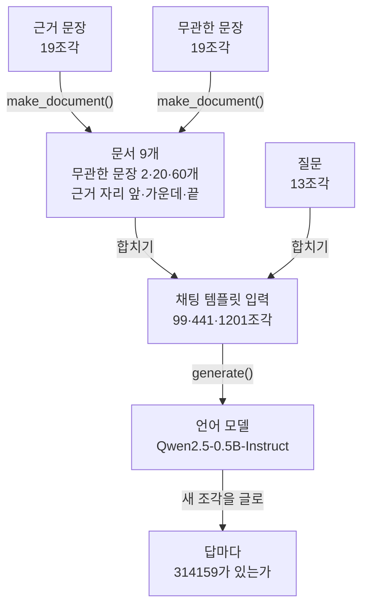
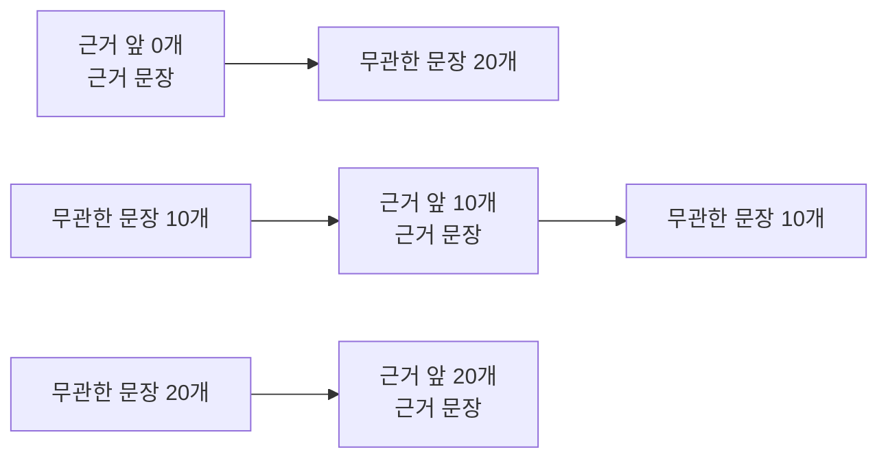
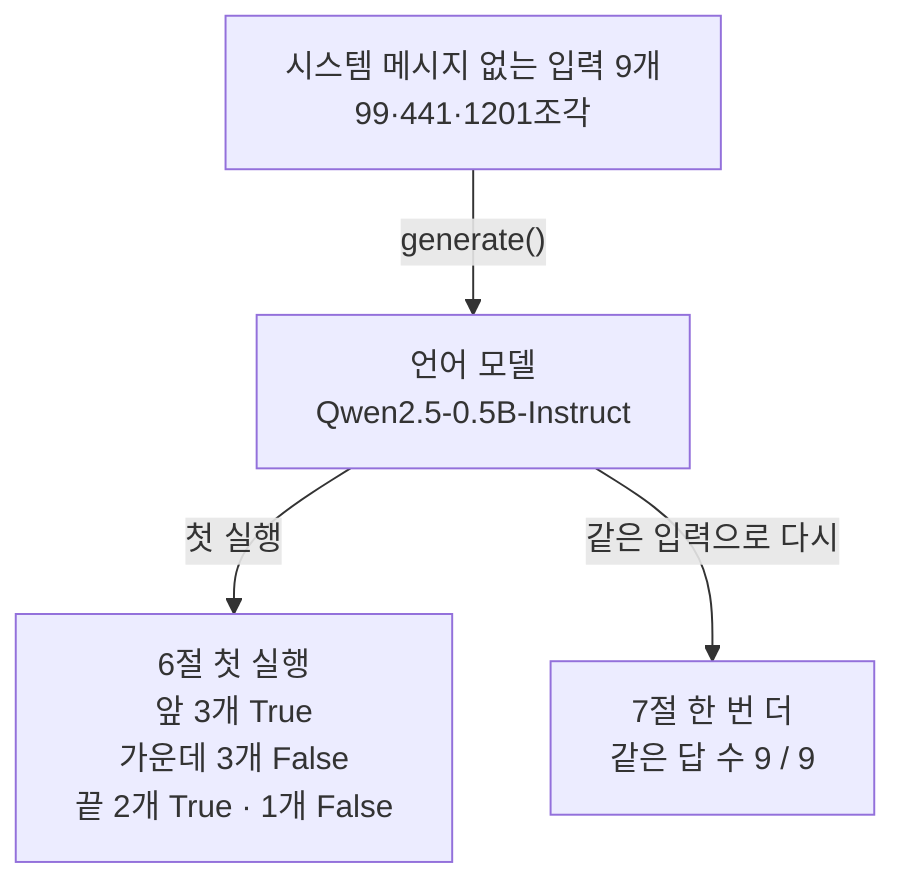
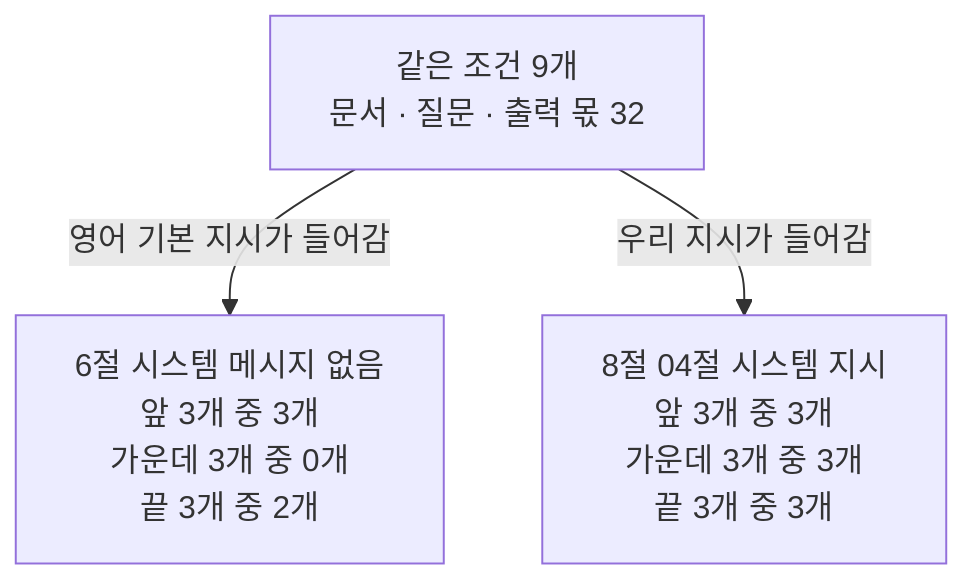

# 05-컨텍스트-로트

## _src 본문 (HTML 원본)

```html
<!--meta: 강의 1h · 실습 1h | 코드 Jupyter Notebook | 새 용어 6 -->
<h2 id="b1"><span class="no">1</span>학습 목표</h2>
<div class="goal"><ul><li>근거 문장의 자리와 무관한 문장 수만 바꾼 입력 9개를 만들고, 모델의 답에 정답이 있는지 셀 수 있습니다.</li><li>입력이 한도 안에 있어도 근거의 자리에 따라 답이 달라진 결과를 노트북 출력으로 설명할 수 있습니다.</li><li>모델 하나로 본 결과를 어디까지 말할 수 있는지, 시스템 지시를 바꾼 결과와 함께 판단할 수 있습니다.</li></ul></div>
<h2 id="b2"><span class="no">2</span>이 내용을 배우는 이유</h2>
<p>04절에서는 입력이 한도를 넘으면 질문이 빠지거나 답이 끊기는 것을 봤습니다. 그러면 한도 안에만 넣으면 모델이 입력을 빠짐없이 쓸까요? 에이전트의 입력에는 긴 문서와 대화 기록이 쌓입니다. 필요한 한 문장은 그 가운데 어디에나 있을 수 있습니다.</p>
<p>입력이 한도 안에 있어도, 길이와 정보의 자리에 따라 모델이 그 정보를 쓰는 결과가 달라질 수 있습니다. 이런 현상을 컨텍스트 로트(context rot)라고 부릅니다. 이 절의 노트북에서는 99조각짜리 짧은 입력에서도 답이 달라졌습니다. 그래서 내가 쓰는 모델과 입력 모양으로 직접 확인해야 합니다.</p>
<p><strong>이 절의 질문</strong> — 입력이 한도 안에 들어가도, 근거 문장의 자리와 주변 문장 수에 따라 답이 달라질까요? 그 결과를 다른 모델과 다른 입력에도 말할 수 있을까요?</p>
<h2 id="b3"><span class="no">3</span>앞에서 배운 내용</h2>
<p>01절에서는 글을 조각(토큰)으로 나누고 메서드 <code>encode()</code>로 조각 수를 셌습니다. 이 절도 같은 방법으로 근거 문장, 무관한 문장, 질문의 조각 수를 셉니다. 같은 문장을 <code>for</code>와 <code>+</code>로 이어 긴 글을 만드는 모양은 01절과 04절에서 썼습니다.</p>
<p>04절에서는 채팅 템플릿으로 메시지 목록을 입력 글 하나로 합쳤습니다. 전체 한도에서 출력 몫을 빼 입력 한도를 구했고, 메서드 <code>generate()</code>로 답을 만들게 했습니다. 시스템 메시지를 빼면 템플릿이 영어 기본 지시를 넣는다는 것도 봤습니다. 04절에서 모델에 넣은 가장 긴 입력은 400조각이었고, 이 절은 1201조각까지 넣습니다.</p>
<p>03절에서는 어텐션 비중을 꺼내 봤지만, 비중이 크다고 그 조각을 근거로 삼았다고 말할 수는 없었습니다. 이 절은 비중을 꺼내지 않고 모델이 낸 답만 봅니다. 조건 목록을 <code>for</code> 줄에서 세 이름으로 나눠 담는 모양은 Ch 2 03절의 풀어 담기입니다.</p>
<h2 id="b4"><span class="no">4</span>핵심 개념</h2>
<h3>비유로 시작하기</h3>
<p>01절과 04절에서는 나무 쟁반의 칸을 파란 블록으로 채웠습니다. 이번에는 블록 하나를 문장 하나로 봅니다. 길이가 같은 쟁반 세 개를 블록으로 가득 채우고, 쟁반마다 주황 블록을 하나씩 섞습니다.</p>
<p>세 쟁반은 주황 블록의 자리만 다릅니다. 어느 쟁반도 칸이 넘치지 않습니다. 긴 줄에서 주황 블록 하나를 찾는 일이 자리에 따라 달라지는지가 이 절의 실험입니다.</p>
{{img:05-5-세-쟁반|나무 탁자 위에 긴 나무 쟁반 세 개가 위아래로 나란히 놓여 있고, 쟁반마다 네모 칸 9개에 블록이 하나씩 들어 있으며, 파란 블록 8개 사이의 주황 블록 하나가 위 쟁반에서는 왼쪽 끝, 가운데 쟁반에서는 한가운데, 아래 쟁반에서는 오른쪽 끝에 있는 삽화|칸을 모두 채운 같은 쟁반 세 개에서 주황 블록 하나만 왼쪽 끝, 가운데, 오른쪽 끝으로 자리가 다릅니다.}}
<p><strong>그림 읽기</strong> — 나무 탁자 위에 같은 쟁반 세 개가 위아래로 놓여 있습니다. 쟁반마다 칸 9개에 블록이 하나씩 들어 있고, 빈칸이나 쟁반 밖 블록은 없습니다. 주황 블록은 위 쟁반에서 왼쪽 끝, 가운데 쟁반에서 한가운데, 아래 쟁반에서 오른쪽 끝에 있습니다.</p>
<p>쟁반 하나가 한 조건의 입력이고, 칸이 모두 찬 모습은 입력이 한도 안이라는 뜻입니다. 파란 블록은 무관한 문장, 주황 블록은 근거 문장입니다. 04절 쟁반과 달리 칸막이도 넘친 블록도 없습니다. 칸과 블록의 개수는 실제 문장 수가 아닙니다.</p>
<h3>이 절에서 쓰는 말</h3>
<table><thead><tr><th>용어</th><th>뜻</th><th>이 절에서 보이는 모습</th></tr></thead><tbody>
<tr><td>컨텍스트 로트(context rot)</td><td>입력이 한도 안에 있어도, 입력 길이와 정보의 자리, 주변 내용에 따라 모델이 그 정보를 쓰는 결과가 달라지는 현상. 긴 회의록 가운데 적힌 한 줄을 놓치는 것과 비슷함</td><td>가운데 자리 세 줄의 <code>False</code></td></tr>
<tr><td>근거 문장</td><td>질문의 답이 들어 있는 문장</td><td><code>해바라기 작전의 확인 코드는 314159입니다.</code></td></tr>
<tr><td>무관한 문장</td><td>질문과 관계없이 입력을 길게 만드는 문장</td><td><code>주문 조회 화면에는 결제 상태와 배송 상태가 표시됩니다.</code></td></tr>
<tr><td>근거 앞 문장 수</td><td>근거 문장 앞에 놓인 무관한 문장의 수. 이 절에서 근거의 자리를 나타내는 값</td><td>무관한 문장 20개일 때 0(앞), 10(가운데), 20(끝)</td></tr>
<tr><td>정답 판정</td><td>답이 맞았는지 정하는 규칙. 이 절은 답에 정답 코드가 들어 있는지만 보고, 문장이 자연스러운지는 보지 않음</td><td><code>found = "314159" in answer</code></td></tr>
<tr><td>기본 지시</td><td>시스템 메시지가 없을 때 이 모델의 채팅 템플릿이 넣는 영어 지시(04절에서 봄)</td><td><code>시스템 메시지 없음 | True | False</code></td></tr>
</tbody></table>
<h3>실험은 두 값만 바꿉니다</h3>
<p>근거 문장과 질문, 모델, 출력 몫은 모든 조건에서 같습니다. 바꾸는 값은 무관한 문장 수와 근거 앞 문장 수 두 가지입니다. 무관한 문장 수는 2, 20, 60개입니다. 근거 앞 문장 수는 0(앞), 절반(가운데), 무관한 문장 수(끝)라서 조건은 3 × 3으로 9개입니다.</p>
<p>두 값을 한꺼번에 바꾸면, 답이 달라진 까닭이 길이인지 자리인지 가를 수 없습니다. 그래서 길이가 같은 세 문서는 자리만 다르고, 자리가 같은 세 문서는 길이만 다르게 둡니다.</p>
{{mermaid:05-1-실험-설계|초록 상자 근거 문장 19조각과 무관한 문장 19조각이 make_document 함수로 초록 상자 문서 9개가 되고, 초록 상자 질문 13조각과 합쳐 노란 상자 채팅 템플릿 입력 99, 441, 1201조각이 된 뒤, generate 메서드로 보라 상자 언어 모델 Qwen2.5-0.5B-Instruct에 들어가 노란 상자 답마다 314159가 있는가로 이어지는 위에서 아래 흐름도|근거 문장, 무관한 문장, 질문으로 조건 9개의 입력을 만들고, 모델의 답마다 정답 코드 314159가 있는지 봅니다.}}
<p><strong>도식 읽기</strong> — 위에서 아래로 읽습니다. 초록 상자는 노트북에서 만든 근거 문장, 무관한 문장, 질문, 문서입니다. 노란 상자는 출력으로 확인한 입력 조각 수와 판정이고, 보라 상자는 실행한 언어 모델입니다.</p>
<p>문서 9개는 무관한 문장 수와 근거 자리만 다릅니다. 질문을 붙여 채팅 템플릿으로 합친 입력은 무관한 문장 2, 20, 60개일 때 99, 441, 1201조각입니다. 화살표 위 글자는 실행한 함수와 메서드, 단계 이름입니다.</p>
<h3>정답 판정은 글자로 합니다</h3>
<p>모델의 답은 문장이라, 사람이 읽고 맞았는지 정하면 기준이 흔들립니다. 이 절은 답에 정답 코드 314159가 들어 있으면 True로 셉니다. 코드만 답해도, 「확인 코드는 314159입니다」라고 답해도 True입니다. 이 규칙은 코드를 찾았는지만 보고, 문장의 품질은 보지 않습니다.</p>
<h3>한도 안의 차이와 한도 밖의 잘림</h3>
<p>04절에서 본 잘림은 입력이 한도를 넘어 코드가 한쪽 끝을 잘랐기 때문에 생겼습니다. 이 절의 입력은 가장 긴 것도 1201조각으로, 입력 한도 32736 안에 있습니다. 입력이 한 조각도 잘리지 않았는데 답이 달라진다면, 그 차이는 잘림 때문이 아닙니다.</p>
<h2 id="b5"><span class="no">5</span>실행 예제</h2>
<p>노트북은 03·04절과 같은 모델을 받고 입력 한도를 구합니다. 재료 문장의 조각 수를 센 뒤, 근거의 자리를 정해 문서를 만드는 함수를 정의합니다. 조건 9개의 입력 토큰 수를 확인하고, 사용자 메시지 하나로 넣은 입력으로 답을 받습니다. 같은 입력으로 한 번 더 실행해 답을 비교하고, 마지막에 04절 시스템 지시를 넣어 다시 실행합니다.</p>
<p>인터넷 서비스의 모델을 부르지 않으므로 API 키가 필요 없고 비용도 들지 않습니다. 내 컴퓨터에서 모델이 답을 만드는 계산을 27번 합니다. 실행에는 2분 안팎이 걸립니다.</p>
{{notebook:05-컨텍스트-로트}}
<p class="look"><b>확인할 점</b> — 5절 표의 마지막 칸이 모두 True인지 봅니다. 6절 표의 가운데 자리 세 줄과 7절 <code>같은 답 수: 9 / 9</code>를 봅니다. 8절 표에 False가 남았는지 확인합니다.</p>
<h3>문서와 입력의 크기</h3>
<p>근거 문장과 무관한 문장은 모두 19조각, 질문은 13조각이었습니다. 5절 표에서 입력은 무관한 문장 2, 20, 60개일 때 99, 441, 1201조각이었습니다. 20개에서 60개로 40개 늘자 760조각 늘어, 무관한 문장 하나에 19조각씩입니다.</p>
<p>무관한 문장 수가 같은 세 줄은 조각 수가 같았습니다. 같은 문장들의 순서만 다르기 때문입니다. 그래서 같은 길이 안에서 답이 달라지면, 달라진 값은 근거의 자리뿐입니다.</p>
{{mermaid:05-2-근거-자리|세 줄 흐름도로, 첫 줄은 초록 상자 근거 앞 0개 근거 문장 뒤에 회색 상자 무관한 문장 20개, 둘째 줄은 회색 상자 무관한 문장 10개 뒤에 초록 상자 근거 앞 10개 근거 문장과 회색 상자 무관한 문장 10개, 셋째 줄은 회색 상자 무관한 문장 20개 뒤에 초록 상자 근거 앞 20개 근거 문장이 이어지는 그림|무관한 문장 20개 조건에서 근거 앞 문장 수 0, 10, 20은 근거를 맨 앞, 가운데, 맨 끝에 둡니다.}}
<p><strong>도식 읽기</strong> — 세 줄을 각각 왼쪽에서 오른쪽으로 읽습니다. 초록 상자가 근거 문장이고, 회색 상자는 무관한 문장을 묶은 것입니다. 첫 줄은 근거가 맨 앞, 둘째 줄은 무관한 문장 10개 뒤, 셋째 줄은 20개 뒤에 있습니다.</p>
<p>세 줄은 5절 표의 <code>20 | 0 | 441 | True</code>, <code>20 | 10 | 441 | True</code>, <code>20 | 20 | 441 | True</code> 조건입니다. 질문은 세 문서 모두 맨 뒤에 붙고, 그림에는 넣지 않았습니다.</p>
<h3>사용자 메시지 하나로 넣은 결과</h3>
<p>6절은 04절 5절처럼 시스템 메시지 없이 사용자 메시지 하나만 넣었습니다. 근거가 앞에 있는 세 조건은 모두 True였습니다. 근거가 가운데 있는 세 조건은 모두 False였고, 끝 자리는 <code>2 | 2 | False</code> 한 줄만 틀렸습니다.</p>
<p>틀린 답은 근거 대신 무관한 문장의 내용을 썼습니다. 무관한 문장 2개 조건은 <code>결제 상태: 완료 배송 상태: 완료</code>처럼 문서에 없는 상태를 지어냈습니다. 60개 가운데 조건은 무관한 문장을 그대로 옮겨 답했습니다.</p>
<p>7절에서 같은 입력 9개로 한 번 더 실행하자 <code>같은 답 수: 9 / 9</code>였습니다. 인자 <code>do_sample=False</code>로 무작위 뽑기를 꺼서, 같은 입력은 같은 답을 냈습니다. 그래서 6절의 False는 한 번 우연히 나온 결과가 아닙니다. 다만 같은 계산을 두 번 한 것이라, 실패율이 100%라는 뜻은 아닙니다.</p>
{{mermaid:05-3-다시-실행|맨 위 노란 상자 시스템 메시지 없는 입력 9개 99, 441, 1201조각이 generate 메서드로 보라 상자 언어 모델에 들어간 뒤, 왼쪽 첫 실행 화살표는 노란 상자 6절 첫 실행 앞 3개 True, 가운데 3개 False, 끝 2개 True 1개 False로, 오른쪽 같은 입력으로 다시 화살표는 노란 상자 7절 한 번 더 같은 답 수 9 / 9로 갈라지는 흐름도|시스템 메시지 없는 입력으로 첫 실행에서는 가운데 3개가 모두 False였고, 한 번 더 실행해도 답 9개가 모두 같았습니다.}}
<p><strong>도식 읽기</strong> — 위에서 아래로 읽습니다. 맨 위 노란 상자는 5절에서 센 입력이고, 가운데 보라 상자가 실행한 언어 모델입니다. 왼쪽 노란 상자는 6절 표의 True와 False를 근거 자리별로 센 것입니다.</p>
<p>오른쪽 노란 상자는 7절에서 같은 입력으로 다시 실행한 결과입니다. False도 코드가 멈춘 실패가 아니라 출력으로 확인한 결과라서 노랑으로 칠했습니다.</p>
<h2 id="b6"><span class="no">6</span>실험 결과 해석</h2>
<p>먼저 길이를 봅니다. 시스템 메시지 없이 넣은 결과에서 정답을 낸 조건은 무관한 문장 2개일 때 1개, 20개와 60개일 때 2개씩이었습니다. 입력이 99조각에서 1201조각으로 길어졌지만 정답 수는 줄지 않았습니다. 이 범위에서는 「길수록 나빠진다」는 모습을 보지 못했습니다.</p>
<p>다음은 자리입니다. 앞 자리는 세 길이 모두 맞았고, 가운데 자리는 세 길이 모두 틀렸습니다. 이 입력 모양에서는 길이보다 근거의 자리가 답을 크게 갈랐습니다.</p>
<p>8절 값 바꿔 보기에서는 입력 모양 하나만 바꿨습니다. 영어 기본 지시 대신 04절 시스템 지시 「주어진 문서 범위에서만 답하세요.」를 넣었습니다. 확인 표도 <code>04절 시스템 지시 | False | True</code>로, 기본 지시가 빠지고 우리 지시가 들어갔습니다. 그러자 9개 조건이 모두 True였습니다.</p>
{{mermaid:05-4-자리별-비교|맨 위 초록 상자 같은 조건 9개 문서, 질문, 출력 몫 32에서 왼쪽 영어 기본 지시가 들어감 화살표는 노란 상자 6절 시스템 메시지 없음 앞 3개 중 3개, 가운데 3개 중 0개, 끝 3개 중 2개로, 오른쪽 우리 지시가 들어감 화살표는 노란 상자 8절 04절 시스템 지시 앞 3개 중 3개, 가운데 3개 중 3개, 끝 3개 중 3개로 가는 흐름도|같은 조건 9개에서 시스템 메시지가 없으면 가운데 3개 중 0개를 맞혔고, 04절 시스템 지시를 넣으면 9개를 모두 맞혔습니다.}}
<p><strong>도식 읽기</strong> — 위에서 아래로 읽습니다. 맨 위 초록 상자는 두 실행에서 같게 둔 문서, 질문, 출력 몫 32입니다. 화살표 위 글자는 두 입력에서 달라진 지시입니다.</p>
<p>왼쪽 노란 상자는 6절, 오른쪽 노란 상자는 8절 결과를 근거 자리별로 센 수입니다. 가운데 줄이 3개 중 0개에서 3개 중 3개로 바뀐 것이 두 실행의 차이입니다.</p>
<p>결론은 두 가지입니다. 입력이 한도 안에 있고 한 조각도 잘리지 않아도, 근거의 자리에 따라 답이 달라질 수 있습니다. 그리고 그 차이는 시스템 지시 한 문장 같은 작은 변화로 나타나거나 사라질 수 있습니다. 그래서 한 가지 입력 모양의 관찰로 일반 규칙을 만들지 않습니다.</p>
<p>이번에 본 것은 작은 모델 하나, 같은 문장을 이은 연습용 문서, 조건 9개, 입력 1201조각까지입니다. 가운데 자리의 답이 왜 틀렸는지는 이 노트북으로 알 수 없습니다. 무관한 문장을 근거와 비슷한 문장으로 바꾸는 실행과 수천 조각 넘는 입력은 하지 않았습니다.</p>
<p>다른 연구의 결과도 한 방향이 아닙니다. Liu 등의 2023년 논문은 여러 모델에서 정보가 긴 입력의 가운데 있을 때 성능이 크게 떨어진다고 보고했습니다. 벡터 데이터베이스 회사 Chroma의 2025년 보고서는 모델 18개에서 입력이 길수록 결과가 믿기 어려워졌다고 보고했습니다. 같은 보고서의 한 찾기 실험에서는 근거 자리에 따른 뚜렷한 차이가 없었습니다.</p>
<h2 id="b7"><span class="no">7</span>주의할 점과 실무 메모</h2>
<ul><li>정답 판정은 글자 314159가 답에 있는지만 봅니다. 「코드는 314159가 아닙니다」 같은 답도 True가 됩니다. 판정 규칙을 만들 때는 틀린 답이 True로 세지는 경우를 함께 따져 봅니다.</li>
<li>인자 <code>do_sample=False</code>로 같은 입력을 두 번 실행해 같은 답을 받은 것은, 계산이 되풀이된다는 확인입니다. 성공률을 말하려면 근거 문장, 질문, 무관한 문장을 여러 가지로 바꾼 조건이 더 필요합니다.</li>
<li>03절 어텐션 비중으로 가운데 자리가 틀린 까닭을 설명하지 않습니다. 이 절은 비중을 꺼내지 않았고, 03절도 비중으로 근거를 말할 수 없다고 정리했습니다.</li>
<li>답 안의 줄바꿈은 표를 한 줄로 보려고 메서드 <code>replace()</code>로 빈칸으로 바꿔 출력했습니다. 판정은 바꾸기 전의 답으로 합니다.</li>
<li>입력 모양이 조금만 달라도 결과가 달라질 수 있습니다. 작업 중 기기 셸에서 질문 앞 줄바꿈을 하나 더 넣어 봤더니, 시스템 메시지 없는 조건의 <code>2 | 2</code> 답이 맞는 답으로 바뀌었습니다. 이 실행은 노트북에 넣지 않았습니다.</li>
<li>필요한 자료만 고르는 방법(Select)과 긴 기록을 줄이는 방법(Compress)은 Ch 8 02·03절에서 배웁니다.</li>
<li>모델을 float32로 올리고 1201조각 입력으로 답을 만드는 계산을 스크립트로 실행했습니다. 이때 Python이 쓴 메모리는 최대 약 3.2GB였습니다. 교재를 만든 컴퓨터의 메모리는 3.8GB였습니다. 이 컴퓨터에서 약 3,500조각 입력은 메모리가 모자라, 종료 코드 137로 프로세스가 강제로 끝났습니다. 그래서 더 긴 입력은 노트북에 넣지 않았습니다.</li>
<li>교재 출력은 2026-09-16에 Linux의 Python 3.12.13과 CPU용 torch 2.8.0으로 만들었습니다. 패키지는 transformers 4.56.2이고, 모델 판 번호는 <code>7ae5576…</code>입니다. GPU, Windows·macOS와 다른 버전에서는 실행하지 않았습니다.</li></ul>
<h2 id="b8"><span class="no">8</span>정리와 다음 절</h2>
<ul><li>근거의 자리와 무관한 문장 수만 바꾼 입력 9개는 모두 입력 한도 안이었고, 가장 긴 입력은 1201조각이었습니다.</li><li>사용자 메시지 하나로 넣자 가운데 자리 세 조건과 끝 자리 한 조건이 틀렸습니다. 다시 실행해도 답 9개가 같았고, 입력이 길어져도 정답 수는 줄지 않았습니다.</li><li>04절 시스템 지시를 넣자 9개 조건이 모두 맞았습니다. 자리에 따른 차이는 입력 모양에 따라 나타나거나 사라졌습니다.</li></ul>
<p><strong>다음 학습과 이어지는 지점</strong> — <a href="06-temperature와-샘플링.html">06절 temperature와 샘플링</a>에서는 이 절에서 꺼 둔 무작위 뽑기를 켭니다. 그리고 temperature를 바꿔 같은 입력의 답이 어떻게 달라지는지 봅니다.</p>
<h2 id="b9"><span class="no">9</span>복습 문제</h2><details class="quiz"><summary>문제와 해설</summary>
<p class="quiz-q">1. 무관한 문장 20개 조건에서 근거 앞 문장 수 0, 10, 20은 각각 어느 자리인가요? 세 입력의 토큰 수는 왜 같나요? · 기초</p><p class="quiz-a"><b>해설</b> — 0은 맨 앞, 10은 가운데, 20은 맨 끝입니다. 세 입력은 같은 문장 21개의 순서만 달라서 모두 441조각이었습니다. 그래서 세 조건의 답이 다르면 달라진 값은 근거의 자리뿐입니다.</p>
<p class="quiz-q">2. 이 절의 입력은 한도를 넘지 않았는데도 틀린 답이 있었습니다. 04절에서 본 잘림과 무엇이 다른가요? · 기초</p><p class="quiz-a"><b>해설</b> — 04절은 입력이 한도를 넘어 코드가 끝을 잘랐고, 그래서 질문이나 시스템 지시가 입력에서 사라졌습니다. 이 절의 입력은 가장 긴 것도 1201조각으로 입력 한도 32736 안이라 잘린 조각이 없습니다. 근거 문장이 입력에 있는데도 답에 쓰이지 않은 것입니다.</p>
<p class="quiz-q">3. 무관한 문장을 100개로 늘리면 시스템 메시지 없는 입력은 몇 조각쯤일까요? 입력 한도 안에 들어가나요? · 적용</p><p class="quiz-a"><b>해설</b> — 무관한 문장 하나가 19조각입니다. 60개일 때의 1201조각에 40 × 19 = 760조각을 더하면 1961조각쯤입니다. 입력 한도 32736 안입니다. 이번에 실행하지 않은 조건이라, 실제로 넣을 때는 토큰화기로 다시 세어 확인합니다.</p>
<p class="quiz-q">4. 동료가 「가운데 자리 조건을 두 번 실행해 두 번 다 틀렸으니, 이 모델의 가운데 자리 실패율은 100%」라고 합니다. 무엇이라고 답하나요? · 분석</p><p class="quiz-a"><b>해설</b> — 이 절은 <code>do_sample=False</code>로 무작위 뽑기를 껐기 때문에, 같은 입력은 같은 계산을 되풀이해 같은 답을 냅니다. 두 번 틀린 것은 결과가 우연이 아니라는 확인이지, 서로 다른 시도 두 번의 결과가 아닙니다. 게다가 04절 시스템 지시를 넣자 같은 조건이 맞았으므로, 실패율을 말하려면 입력을 여러 가지로 바꾼 조건이 필요합니다.</p>
<p class="quiz-q">5. 동료가 「이 모델은 긴 입력의 가운데를 읽지 못한다」고 정리하려 합니다. 이 절의 결과로 무엇을 말할 수 있나요? · 분석</p><p class="quiz-a"><b>해설</b> — 가운데 자리는 99조각짜리 짧은 입력에서도 틀렸습니다. 60개 조건에서도 정답 수가 줄지 않아, 「긴 입력」 탓이라고 볼 근거가 없습니다. 또 04절 시스템 지시를 넣자 가운데 자리 세 조건이 모두 맞았습니다. 그래서 「모델 하나와 이 입력 모양에서 가운데 자리가 틀렸다」까지만 말하고, 내 입력 모양으로 다시 확인하자고 답합니다.</p>
</details>
<h2 id="b10"><span class="no">10</span>참고 자료</h2>
<ul><li><a href="https://huggingface.co/Qwen/Qwen2.5-0.5B-Instruct/tree/7ae557604adf67be50417f59c2c2f167def9a775">Qwen2.5-0.5B-Instruct 모델 카드(Apache-2.0)</a> · 판 7ae5576 · 확인 2026-09-16</li><li><a href="https://arxiv.org/abs/2307.03172">Lost in the Middle 논문(Liu 외)</a> · 2023 · 확인 2026-09-16</li><li><a href="https://www.trychroma.com/research/context-rot">Context Rot 보고서(Chroma)</a> · 2025-07-14 · 확인 2026-09-16</li><li><a href="https://huggingface.co/docs/transformers/v4.56.2/en/main_classes/text_generation">Transformers 생성 문서</a> · 4.56.2 · 확인 2026-09-16</li></ul>
```

## 노트북 셀 (순서대로)

### [0] markdown {'html': 'skip'}

# 컨텍스트 로트

**이 노트북에서 할 일**

1. 근거 문장의 자리와 무관한 문장 수만 바꾼 입력 9개를 만들고, 모두 입력 한도 안인지 확인합니다.
2. 사용자 메시지 하나로 넣은 입력으로 답을 받아 정답 코드가 있는지 세고, 한 번 더 실행해 비교합니다.
3. 04절의 시스템 지시를 넣어 같은 9개 조건을 다시 실행하고, 결과를 어디까지 말할 수 있는지 판단합니다.

**준비물** — API 키는 필요 없습니다. 인터넷 서비스의 모델을 부르지 않고, 내 컴퓨터에서 작은 언어 모델을 실행합니다.
그래서 비용은 들지 않습니다. 모델이 답을 만드는 계산은 모두 27번 합니다.

실행 시간은 2분 안팎입니다. 모델 파일은 03·04절과 같은 약 1GB(954MiB)이고, 캐시에 없으면 Hugging Face 사이트에서 내려받습니다.
노트북과 같은 계산을 스크립트로 실행했을 때 Python이 쓴 메모리는 최대 약 3.2GB였습니다.

**기준 버전** — 실습 폴더에 고정한 transformers 4.56.2와 torch 2.8.0을 씁니다.
모델은 `Qwen/Qwen2.5-0.5B-Instruct`이고, 판 번호(revision)를 `7ae557604adf67be50417f59c2c2f167def9a775`로 고정해 받습니다.

교재 출력은 Linux의 Python 3.12.13과 CPU용 torch(2.8.0+cpu)로 만들었습니다. 다른 버전, GPU, Windows·macOS에서는 이번에 실행하지 않았습니다.

실습 폴더 `labs/part1/ch05-llm-principles`에서 01절과 같은 `.venv` 커널을 고른 뒤 첫 셀부터 순서대로 실행합니다.

### [1] markdown {'html': 'skip'}

## 오늘 볼 그림


위에서 아래로 읽습니다. 초록 상자는 노트북에서 만든 문장과 문서이고, 노란 상자는 출력으로 확인하는 값입니다.
보라 상자는 내 컴퓨터에서 실행하는 언어 모델입니다. 문서 9개는 무관한 문장 수와 근거의 자리만 다릅니다.

### [2] markdown {}

## 1. 준비

이 절은 파일을 읽거나 만들지 않습니다. 준비 셀에서는 transformers 패키지를 불러오고 버전을 확인합니다.

함수 `warnings.filterwarnings()` 줄은 01절처럼 진행 표시 위젯이 없다는 경고 한 줄을 끕니다.
함수 `transformers.logging.set_verbosity_error()`는 04절처럼, 생성 셀에서 나오는 오류가 아닌 안내 두 줄을 끕니다.
어떤 안내인지는 04절 9절 결과 읽기에 적었습니다.

### [3] code {'execution': {'iopub.execute_input': '2026-09-16T19:08:33.499120Z', 'iopub.status.busy': '2026-09-16T19:08:33.498940Z', 'iopub.status.idle': '2026-09-16T19:08:37.396109Z', 'shell.execute_reply': '2026-09-16T19:08:37.395749Z'}, 'lesson_role': 'setup'}

```python
# transformers 패키지를 불러오고, 오류가 아닌 안내 경고를 줄인 뒤 버전을 확인합니다
import warnings

# 진행 표시 위젯이 없다는 경고(TqdmWarning)는 계산과 관계없어 화면에 내지 않습니다
warnings.filterwarnings("ignore", message="IProgress not found")

import transformers
from transformers import AutoModelForCausalLM, AutoTokenizer

# 생성 셀의 안내 두 줄(오류 아님)을 화면에 내지 않습니다
transformers.logging.set_verbosity_error()
print("transformers 버전:", transformers.__version__)
```

출력:
```
transformers 버전: 4.56.2

```

### [4] markdown {}

**결과 읽기** — 출력 줄은 `transformers 버전: 4.56.2`입니다. 준비물에 적은 기준 버전과 같습니다.

### [5] markdown {}

## 2. 모델과 입력 한도

모델은 03·04절과 같은 Qwen2.5-0.5B-Instruct이고, 같은 판 번호로 받습니다.
이번에는 04절의 연습용 한도 512 대신, 모델 설정에 적힌 한도를 그대로 씁니다.

출력 몫은 04절에서 정한 이름으로, 모델이 새로 만들 조각 수의 상한입니다. 이 절의 답은 짧아서 32로 정합니다.
입력 한도는 04절의 식 `입력 한도 = 전체 한도 - 출력 몫`으로 구합니다.
실행 전에 예상합니다. 모델 설정 한도가 04절처럼 32768이면, 입력 한도는 32736일 것입니다.

### [6] code {'execution': {'iopub.execute_input': '2026-09-16T19:08:37.397032Z', 'iopub.status.busy': '2026-09-16T19:08:37.396885Z', 'iopub.status.idle': '2026-09-16T19:08:39.330695Z', 'shell.execute_reply': '2026-09-16T19:08:39.328667Z'}}

```python
# 03·04절과 같은 언어 모델과 토큰화기를 받고, 모델 설정 한도에서 출력 몫을 뺀 입력 한도를 구합니다
model_name = "Qwen/Qwen2.5-0.5B-Instruct"
model_revision = "7ae557604adf67be50417f59c2c2f167def9a775"
tokenizer = AutoTokenizer.from_pretrained(model_name, revision=model_revision)
model = AutoModelForCausalLM.from_pretrained(model_name, revision=model_revision)
# 출력 몫은 모델이 새로 만들 조각 수의 상한이고, 입력은 나머지 칸에 넣습니다
output_budget = 32
input_budget = model.config.max_position_embeddings - output_budget
print("모델 설정 max_position_embeddings:", model.config.max_position_embeddings)
print("출력 몫:", output_budget)
print("입력 한도:", input_budget)
```

출력:
```
모델 설정 max_position_embeddings: 32768
출력 몫: 32
입력 한도: 32736

```

### [7] markdown {}

**결과 읽기** — 출력 줄은 `모델 설정 max_position_embeddings: 32768`, `출력 몫: 32`, `입력 한도: 32736`입니다. 예상과 같습니다.

이 절의 입력이 32736조각 이하이면, 04절처럼 끝을 잘라 낼 일은 없습니다.
이 노트북의 출력은 2026-09-16에 이 모델과 판 번호로 실행한 결과입니다. 실행 환경이나 버전이 바뀌면 답 문장이 달라질 수 있습니다.

### [8] markdown {}

## 3. 실험 재료 세 가지

근거 문장은 질문의 답이 들어 있는 문장입니다. 이 절의 근거 문장에는 정답 코드 314159가 들어 있습니다.
무관한 문장은 질문과 관계없이 입력을 길게 만드는 문장입니다. 질문은 확인 코드만 답하라고 요청합니다.

두 문장 끝의 `'\n'`은 줄바꿈 글자입니다. 문장을 이어 붙이면 한 줄에 한 문장씩 놓입니다.
세 글을 01절 메서드 `encode()`로 바꿔 조각 수를 셉니다. 실행 전에 예상합니다. 글자가 더 많은 무관한 문장이 조각도 더 많을 것입니다.

### [9] code {'execution': {'iopub.execute_input': '2026-09-16T19:08:39.334342Z', 'iopub.status.busy': '2026-09-16T19:08:39.334100Z', 'iopub.status.idle': '2026-09-16T19:08:39.343805Z', 'shell.execute_reply': '2026-09-16T19:08:39.343158Z'}}

```python
# 근거 문장, 무관한 문장, 질문을 만들고 각각의 토큰 수를 셉니다
fact_sentence = "해바라기 작전의 확인 코드는 314159입니다.\n"
filler_sentence = "주문 조회 화면에는 결제 상태와 배송 상태가 표시됩니다.\n"
question = "해바라기 작전의 확인 코드만 답하세요."
fact_tokens = len(tokenizer.encode(fact_sentence))
filler_tokens = len(tokenizer.encode(filler_sentence))
question_tokens = len(tokenizer.encode(question))
print("근거 문장 토큰 수:", fact_tokens)
print("무관한 문장 토큰 수:", filler_tokens)
print("질문 토큰 수:", question_tokens)
```

출력:
```
근거 문장 토큰 수: 19
무관한 문장 토큰 수: 19
질문 토큰 수: 13

```

### [10] markdown {}

**결과 읽기** — 출력 줄은 `근거 문장 토큰 수: 19`, `무관한 문장 토큰 수: 19`, `질문 토큰 수: 13`입니다.

예상과 달리 두 문장의 조각 수가 19로 같습니다. 글자 수와 조각 수는 01절에서 본 것처럼 늘 비례하지 않습니다.
두 문장의 조각 수가 같아서, 근거의 자리만 바꾸면 입력의 조각 수는 그대로입니다.

### [11] markdown {}

## 4. 근거의 자리를 정해 문서 만들기

문서는 무관한 문장을 여러 번 이은 글 사이에 근거 문장 하나를 끼운 것입니다. 근거의 자리는 근거 앞에 놓인 무관한 문장의 수로 정합니다.
이 수를 이 절에서는 「근거 앞 문장 수」라고 부릅니다. 0이면 근거가 맨 앞이고, 무관한 문장 수와 같으면 맨 끝입니다.

함수는 01·04절처럼 `for`와 `+`로 문장을 잇습니다. 반복 번호 `i`가 근거 앞 문장 수와 같아지면, 그 무관한 문장 앞에 근거 문장을 먼저 붙입니다.
반복이 끝날 때까지 근거를 붙이지 못했다면 근거의 자리가 맨 끝이므로, 반복 뒤에 붙입니다. 이 셀은 함수를 정의만 합니다.

### [12] code {'execution': {'iopub.execute_input': '2026-09-16T19:08:39.345256Z', 'iopub.status.busy': '2026-09-16T19:08:39.345118Z', 'iopub.status.idle': '2026-09-16T19:08:39.348443Z', 'shell.execute_reply': '2026-09-16T19:08:39.347858Z'}}

```python
# 무관한 문장 수와 근거 앞 문장 수를 받아, 근거 문장을 그 자리에 끼운 문서 글을 반환하는 함수를 정의합니다
def make_document(filler_count, fact_place):
    document_text = ""
    for i in range(filler_count):
        # 근거 앞에 놓인 무관한 문장이 fact_place개가 된 자리에 근거 문장을 붙입니다
        if i == fact_place:
            document_text = document_text + fact_sentence
        document_text = document_text + filler_sentence
    # 근거 앞 문장 수가 무관한 문장 수와 같으면 근거는 맨 끝입니다
    if fact_place == filler_count:
        document_text = document_text + fact_sentence
    return document_text
```

출력:
```

```

### [13] markdown {}

**결과 읽기** — 정의만 하는 셀이라 출력이 없습니다.

작은 문서 하나로 함수를 확인합니다. 무관한 문장 2개에 근거 앞 문장 수 1을 주면, 근거가 두 문장 사이에 들어가야 합니다.
문서는 여러 줄이라 라벨을 앞줄에 따로 출력합니다. 실행 전에 예상합니다. 라벨 줄 아래 가운데 줄이 근거 문장일 것입니다.

### [14] code {'execution': {'iopub.execute_input': '2026-09-16T19:08:39.349562Z', 'iopub.status.busy': '2026-09-16T19:08:39.349453Z', 'iopub.status.idle': '2026-09-16T19:08:39.351854Z', 'shell.execute_reply': '2026-09-16T19:08:39.351369Z'}}

```python
# 무관한 문장 2개와 근거 앞 문장 수 1로 작은 문서를 만들어, 근거가 들어간 자리를 봅니다
small_document = make_document(2, 1)
print("무관한 문장 2개, 근거 앞 문장 1개인 문서:")
print(small_document)
```

출력:
```
무관한 문장 2개, 근거 앞 문장 1개인 문서:
주문 조회 화면에는 결제 상태와 배송 상태가 표시됩니다.
해바라기 작전의 확인 코드는 314159입니다.
주문 조회 화면에는 결제 상태와 배송 상태가 표시됩니다.


```

### [15] markdown {}

**결과 읽기** — 라벨 줄 아래 세 줄 가운데 둘째 줄이 `해바라기 작전의 확인 코드는 314159입니다.`입니다. 첫째 줄과 셋째 줄은 무관한 문장입니다.

예상대로 근거 문장이 무관한 문장 두 개 사이에 들어갔습니다. 마지막 빈 줄은 셋째 문장 끝의 줄바꿈 글자 때문에 생겼습니다.

### [16] markdown {}

## 5. 아홉 가지 입력과 입력 한도

먼저 입력 글을 만드는 함수를 정의합니다. 이 함수는 문서와 질문을 사용자 메시지 하나에 담습니다.
04절 5절에서 본 것처럼, 시스템 메시지가 없으면 채팅 템플릿이 영어 기본 지시를 넣습니다.

문서 끝에 줄바꿈이 있으므로 질문 앞에 `'\n'`을 하나 더 붙이면, 문서와 질문 사이에 빈 줄이 하나 생깁니다. 이 셀은 함수를 정의만 합니다.

### [17] code {'execution': {'iopub.execute_input': '2026-09-16T19:08:39.353230Z', 'iopub.status.busy': '2026-09-16T19:08:39.353091Z', 'iopub.status.idle': '2026-09-16T19:08:39.355646Z', 'shell.execute_reply': '2026-09-16T19:08:39.355168Z'}}

```python
# 문서와 질문을 사용자 메시지 하나에 담고, 채팅 템플릿으로 합친 입력 글을 반환하는 함수를 정의합니다
def make_input_without_system(document_text):
    message_list = [
        {"role": "user", "content": document_text + "\n" + question},
    ]
    return tokenizer.apply_chat_template(message_list, tokenize=False, add_generation_prompt=True)
```

출력:
```

```

### [18] markdown {}

**결과 읽기** — 정의만 하는 셀이라 출력이 없습니다.

이제 조건 9개를 만듭니다. 무관한 문장 수는 2, 20, 60개입니다. 근거 앞 문장 수는 0(앞), 절반(가운데), 무관한 문장 수(끝)입니다.
절반은 `/`로 나눈 값이 실수라서 Ch 2 01절 함수 `int()`로 정수로 바꿉니다. 예를 들어 `int(20 / 2)`는 10입니다.

조건마다 문서, 입력 글, 토큰 수를 차례로 만듭니다. 조건은 세 값을 담은 목록으로 `conditions`에 모읍니다.
실행 전에 예상합니다. 무관한 문장이 한 개 늘 때마다 19조각씩 늘고, 가장 긴 입력도 입력 한도 32736보다 훨씬 작을 것입니다.

### [19] code {'execution': {'iopub.execute_input': '2026-09-16T19:08:39.356732Z', 'iopub.status.busy': '2026-09-16T19:08:39.356619Z', 'iopub.status.idle': '2026-09-16T19:08:39.374402Z', 'shell.execute_reply': '2026-09-16T19:08:39.374057Z'}}

```python
# 무관한 문장 수 3가지와 근거 자리 3가지로 조건 9개를 만들고, 입력 토큰 수가 입력 한도 이하인지 봅니다
conditions = []
print("무관한 문장 수 | 근거 앞 문장 수 | 입력 토큰 수 | 입력 한도 이하")
for filler_count in [2, 20, 60]:
    # 근거의 자리는 맨 앞(0), 가운데(절반), 맨 끝(무관한 문장 수)입니다
    middle_place = int(filler_count / 2)
    for fact_place in [0, middle_place, filler_count]:
        document_text = make_document(filler_count, fact_place)
        input_text = make_input_without_system(document_text)
        token_count = len(tokenizer.encode(input_text))
        conditions.append([filler_count, fact_place, document_text])
        print(filler_count, "|", fact_place, "|", token_count, "|", token_count <= input_budget)
```

출력:
```
무관한 문장 수 | 근거 앞 문장 수 | 입력 토큰 수 | 입력 한도 이하
2 | 0 | 99 | True
2 | 1 | 99 | True
2 | 2 | 99 | True
20 | 0 | 441 | True
20 | 10 | 441 | True
20 | 20 | 441 | True
60 | 0 | 1201 | True
60 | 30 | 1201 | True
60 | 60 | 1201 | True

```

### [20] markdown {}

**결과 읽기** — 라벨 줄 아래 아홉 줄은 무관한 문장 수마다 세 줄씩입니다. 2개는 `2 | 0 | 99 | True`, 20개는 `20 | 10 | 441 | True`, 60개는 `60 | 30 | 1201 | True`처럼 나옵니다.

같은 무관한 문장 수의 세 줄은 토큰 수가 같습니다. 같은 문장들의 순서만 다르기 때문입니다.
20개에서 60개로 40개 늘자 760조각 늘어, 예상대로 한 문장에 19조각씩입니다. 아홉 줄 모두 마지막 칸이 True라서 한도를 넘은 입력은 없습니다.

### [21] markdown {}

## 6. 모델에 묻고 정답 코드 찾기

입력 글을 받아 모델의 답을 반환하는 함수를 정의합니다. 몸통은 04절 9절 셀과 같은 모양입니다.
메서드 `generate()`에 인자 `max_new_tokens`로 출력 몫 32를, 인자 `do_sample=False`로 무작위로 뽑지 않는 설정을 줍니다.

반환된 ID 목록에서 입력 길이만큼을 건너뛴 뒤가 새 조각입니다. 텐서 `input_ids`의 첫 줄 길이가 입력 조각 수입니다.
04절처럼 새 조각을 글로 바꾸면 답 끝에 끝 표시 `<|im_end|>`가 남습니다. 이 셀은 함수를 정의만 합니다.

### [22] code {'execution': {'iopub.execute_input': '2026-09-16T19:08:39.375329Z', 'iopub.status.busy': '2026-09-16T19:08:39.375251Z', 'iopub.status.idle': '2026-09-16T19:08:39.377685Z', 'shell.execute_reply': '2026-09-16T19:08:39.377218Z'}}

```python
# 입력 글을 받아, 출력 몫 안에서 모델이 만든 새 조각만 글로 바꿔 반환하는 함수를 정의합니다
def ask_model(input_text):
    input_ids = tokenizer.encode(input_text, return_tensors="pt")
    # do_sample=False는 04절처럼 다음 조각을 무작위로 뽑지 않는 설정입니다
    output_ids = model.generate(input_ids=input_ids, max_new_tokens=output_budget, do_sample=False)
    all_ids = output_ids[0].tolist()
    # 입력 조각 수만큼 건너뛴 뒤가 새 조각입니다
    input_length = len(input_ids[0])
    new_ids = all_ids[input_length:len(all_ids)]
    return tokenizer.decode(new_ids)
```

출력:
```

```

### [23] markdown {}

**결과 읽기** — 정의만 하는 셀이라 출력이 없습니다.

조건 9개를 차례로 모델에 넣습니다. 한 조건은 목록 세 칸이라, Ch 2 03절 풀어 담기로 `for` 줄에서 세 이름에 나눠 담습니다.
답에 정답 코드 `"314159"`가 들어 있는지는 연산자 `in`으로 봅니다. 이 판정은 코드를 찾았는지만 보고, 문장이 자연스러운지는 보지 않습니다.

답 안의 줄바꿈은 메서드 `replace()`로 빈칸으로 바꿔 출력해, 조건 하나를 한 줄에 봅니다. 판정은 바꾸기 전의 답으로 합니다.
나중에 한 번 더 실행해 비교하려고 답을 `answers`에 모읍니다. 실행 전에 예상합니다. 입력이 한도 안이니 아홉 조건 모두 314159를 답할 것입니다.

### [24] code {'execution': {'iopub.execute_input': '2026-09-16T19:08:39.378603Z', 'iopub.status.busy': '2026-09-16T19:08:39.378513Z', 'iopub.status.idle': '2026-09-16T19:09:05.488822Z', 'shell.execute_reply': '2026-09-16T19:09:05.488032Z'}}

```python
# 아홉 가지 입력을 차례로 모델에 넣고, 답에 정답 코드 314159가 들어 있는지 봅니다
answers = []
print("무관한 문장 수 | 근거 앞 문장 수 | 314159 있음 | 답")
for filler_count, fact_place, document_text in conditions:
    input_text = make_input_without_system(document_text)
    answer = ask_model(input_text)
    answers.append(answer)
    found = "314159" in answer
    # 답 안의 줄바꿈은 빈칸으로 바꿔, 조건 하나를 한 줄에 출력합니다
    print(filler_count, "|", fact_place, "|", found, "|", answer.replace("\n", " "))
```

출력:
```
무관한 문장 수 | 근거 앞 문장 수 | 314159 있음 | 답
2 | 0 | True | 314159<|im_end|>
2 | 1 | False | 결제 상태: 완료 배송 상태: 완료<|im_end|>
2 | 2 | False | 결제 상태: 완료 배송 상태: 완료<|im_end|>
20 | 0 | True | 해바라기 작전의 확인 코드는 314159입니다.<|im_end|>
20 | 10 | False | 주문 조회 화면에는 결제 상태와 배송 상태가 표시되지 않습니다.<|im_end|>
20 | 20 | True | 해바라기 작전의 확인 코드는 314159입니다.<|im_end|>
60 | 0 | True | 314159<|im_end|>
60 | 30 | False | 주문 조회 화면에는 결제 상태와 배송 상태가 표시됩니다.<|im_end|>
60 | 60 | True | 해바라기 작전의 확인 코드는 314159입니다.<|im_end|>

```

### [25] markdown {}

**결과 읽기** — 라벨 줄 아래 앞 자리 세 줄 `2 | 0 | True`, `20 | 0 | True`, `60 | 0 | True`는 모두 맞았습니다. 가운데 자리 세 줄 `2 | 1 | False`, `20 | 10 | False`, `60 | 30 | False`는 모두 틀렸습니다.

끝 자리는 `2 | 2 | False`만 틀리고, `20 | 20 | True`와 `60 | 60 | True`는 맞았습니다. 예상과 달리 한도 안의 입력에서도 9개 가운데 4개가 틀렸습니다.
틀린 답은 근거 대신 무관한 문장의 내용을 썼습니다. 무관한 문장 2개 조건은 `결제 상태: 완료 배송 상태: 완료`처럼 문서에 없는 상태를 지어냈습니다.

60개 가운데 조건의 답은 무관한 문장을 그대로 옮긴 `주문 조회 화면에는 결제 상태와 배송 상태가 표시됩니다.`입니다.
정답 수는 무관한 문장 2개일 때 1개, 20개와 60개일 때 2개씩이었습니다. 입력이 길어져도 정답 수는 줄지 않았습니다.

### [26] markdown {}

## 7. 같은 입력으로 한 번 더

6절의 답이 우연히 나온 것인지 확인합니다. 같은 입력 9개로 한 번 더 실행하고, 6절의 답과 글자까지 같은지 셉니다.
6절에서 모은 `answers`의 순서는 `conditions`의 순서와 같습니다. 그래서 조건 번호 `number`를 0부터 하나씩 늘리며 같은 자리의 답과 비교합니다.

실행 전에 예상합니다. 무작위로 뽑지 않았으니 9개 모두 같은 답일 것입니다.

### [27] code {'execution': {'iopub.execute_input': '2026-09-16T19:09:05.489840Z', 'iopub.status.busy': '2026-09-16T19:09:05.489757Z', 'iopub.status.idle': '2026-09-16T19:09:31.200516Z', 'shell.execute_reply': '2026-09-16T19:09:31.200186Z'}}

```python
# 시스템 메시지 없이 넣은 아홉 입력을 한 번 더 실행해, 6절의 답과 같은지 셉니다
same_count = 0
number = 0
for filler_count, fact_place, document_text in conditions:
    input_text = make_input_without_system(document_text)
    answer = ask_model(input_text)
    # 같은 조건 번호에 모아 둔 6절의 답과 글자까지 같은지 비교합니다
    if answer == answers[number]:
        same_count = same_count + 1
    number = number + 1
print("같은 답 수:", same_count, "/", len(conditions))
```

출력:
```
같은 답 수: 9 / 9

```

### [28] markdown {}

**결과 읽기** — 출력 줄은 `같은 답 수: 9 / 9`입니다. 예상대로 9개 조건 모두 6절과 같은 답이 나왔습니다.

같은 입력은 같은 답을 냈으므로, 6절의 False는 한 번 우연히 나온 결과가 아닙니다.
다만 두 번 모두 틀렸다고 가운데 자리의 실패율이 100%라는 뜻은 아닙니다. 무작위를 끈 같은 계산을 두 번 한 것이지, 서로 다른 시도를 두 번 한 것이 아닙니다.

### [29] markdown {}

## 8. 값 바꿔 보기 — 04절 시스템 지시 넣기

바꾸는 값은 입력의 모양 하나입니다. 04절에서 쓴 시스템 지시 「주어진 문서 범위에서만 답하세요.」를 시스템 메시지로 넣습니다.
문서, 질문, 조건 9개, 모델, 출력 몫은 그대로입니다. 먼저 04절 `make_input_text()`와 같은 모양의 함수를 새 이름으로 정의합니다. 이 셀은 함수를 정의만 합니다.

### [30] code {'execution': {'iopub.execute_input': '2026-09-16T19:09:31.201319Z', 'iopub.status.busy': '2026-09-16T19:09:31.201238Z', 'iopub.status.idle': '2026-09-16T19:09:31.203268Z', 'shell.execute_reply': '2026-09-16T19:09:31.202975Z'}}

```python
# 04절 시스템 지시를 시스템 메시지로 넣고, 문서와 질문은 사용자 메시지에 담는 함수를 정의합니다
system_text = "주어진 문서 범위에서만 답하세요."


def make_input_with_system(document_text):
    message_list = [
        {"role": "system", "content": system_text},
        {"role": "user", "content": document_text + "\n" + question},
    ]
    return tokenizer.apply_chat_template(message_list, tokenize=False, add_generation_prompt=True)
```

출력:
```

```

### [31] markdown {}

**결과 읽기** — 정의만 하는 셀이라 출력이 없습니다.

4절의 작은 문서로 두 함수의 입력 글을 만들어 비교합니다. 영어 기본 지시의 첫 글자 `"You are Qwen"`이 들어 있는지와, 우리 시스템 지시가 들어 있는지를 `in`으로 봅니다.
실행 전에 예상합니다. 시스템 메시지를 넣으면 영어 기본 지시는 들어가지 않을 것입니다.

### [32] code {'execution': {'iopub.execute_input': '2026-09-16T19:09:31.203955Z', 'iopub.status.busy': '2026-09-16T19:09:31.203884Z', 'iopub.status.idle': '2026-09-16T19:09:31.206151Z', 'shell.execute_reply': '2026-09-16T19:09:31.205870Z'}}

```python
# 작은 문서로 두 함수의 입력 글을 만들어, 어느 지시가 들어 있는지 비교합니다
without_system_text = make_input_without_system(small_document)
with_system_text = make_input_with_system(small_document)
print("입력 모양 | 영어 기본 지시 | 04절 시스템 지시")
print("시스템 메시지 없음 |", "You are Qwen" in without_system_text, "|", system_text in without_system_text)
print("04절 시스템 지시 |", "You are Qwen" in with_system_text, "|", system_text in with_system_text)
```

출력:
```
입력 모양 | 영어 기본 지시 | 04절 시스템 지시
시스템 메시지 없음 | True | False
04절 시스템 지시 | False | True

```

### [33] markdown {}

**결과 읽기** — 라벨 줄 아래 두 줄은 `시스템 메시지 없음 | True | False`와 `04절 시스템 지시 | False | True`입니다.

예상대로 두 입력은 지시 한 가지만 다릅니다. 시스템 메시지가 없으면 영어 기본 지시가, 있으면 우리 지시가 들어갑니다.
이제 이 함수로 조건 9개를 다시 실행합니다. 실행 전에 예상합니다. 지시만 바꿨으니 6절처럼 가운데 자리가 틀릴 것입니다.

### [34] code {'execution': {'iopub.execute_input': '2026-09-16T19:09:31.206762Z', 'iopub.status.busy': '2026-09-16T19:09:31.206692Z', 'iopub.status.idle': '2026-09-16T19:09:48.591526Z', 'shell.execute_reply': '2026-09-16T19:09:48.591258Z'}}

```python
# 04절 시스템 지시를 넣은 입력으로 같은 아홉 조건을 실행해, 답에 314159가 있는지 봅니다
print("무관한 문장 수 | 근거 앞 문장 수 | 314159 있음 | 답")
for filler_count, fact_place, document_text in conditions:
    input_text = make_input_with_system(document_text)
    answer = ask_model(input_text)
    found = "314159" in answer
    print(filler_count, "|", fact_place, "|", found, "|", answer.replace("\n", " "))
```

출력:
```
무관한 문장 수 | 근거 앞 문장 수 | 314159 있음 | 답
2 | 0 | True | 314159<|im_end|>
2 | 1 | True | 314159<|im_end|>
2 | 2 | True | 314159<|im_end|>
20 | 0 | True | 314159<|im_end|>
20 | 10 | True | 314159<|im_end|>
20 | 20 | True | 314159<|im_end|>
60 | 0 | True | 314159<|im_end|>
60 | 30 | True | 314159<|im_end|>
60 | 60 | True | 314159<|im_end|>

```

### [35] markdown {}

**결과 읽기** — 라벨 줄 아래 아홉 줄이 모두 True입니다. 가운데 자리 세 줄도 `2 | 1 | True | 314159<|im_end|>`처럼 코드만 답했습니다.

예상과 달리 6절에서 틀린 4개 조건이 모두 맞았습니다. 근거의 자리에 따른 차이가 시스템 지시 한 문장으로 사라졌습니다.
그래서 6절의 결과를 「이 모델은 가운데 근거를 쓰지 못한다」로 넓혀 말하지 않습니다. 이번에 본 것은 모델 하나, 입력 모양 두 가지, 조건 9개입니다.

### [36] markdown {}

## 정리

- 근거의 자리와 무관한 문장 수만 바꾼 입력 9개는 모두 입력 한도 32736 안이었습니다. 가장 긴 입력은 1201조각이었습니다.
- 사용자 메시지 하나로 넣자 가운데 자리 세 조건과 끝 자리 한 조건이 틀렸습니다. 다시 실행해도 9개 답이 같았고, 입력이 길어져도 정답 수는 줄지 않았습니다.
- 04절 시스템 지시를 넣자 9개 조건이 모두 맞았습니다. 자리에 따른 차이는 입력 모양에 따라 나타나거나 사라졌습니다.

입력이 한도 안에 있어도 모델이 모든 정보를 똑같이 쓴다고 가정하지 않고, 내 입력 모양으로 직접 확인합니다.
다음 06절에서는 이 절에서 꺼 둔 무작위 뽑기를 켭니다. 그리고 temperature를 바꿔 같은 입력의 답이 어떻게 달라지는지 봅니다.

## 그림

### 05-1-실험-설계.mmd



- 설명 대상 문장: 근거 문장과 질문, 모델, 출력 몫은 모든 조건에서 같고, 바꾸는 값은 무관한 문장 수와 근거의 자리 두 가지입니다.
- 캡션: 근거 문장, 무관한 문장, 질문으로 조건 9개의 입력을 만들고, 모델의 답마다 정답 코드 314159가 있는지 봅니다.
- 읽는 법: 위에서 아래로 읽습니다. 초록 상자는 노트북에서 만든 문장·질문·문서로, 3절 `근거 문장 토큰 수: 19`·`무관한 문장 토큰 수: 19`·`질문 토큰 수: 13`입니다. 노란 상자 입력 조각 수는 5절 표의 `99`·`441`·`1201`이고, 보라 상자는 실행한 언어 모델입니다. 맨 아래 노란 상자는 6·8절 표의 `314159 있음` 칸입니다. 화살표 위 글자는 실행한 함수·메서드와 단계 이름입니다.
- alt: 초록 상자 근거 문장 19조각과 무관한 문장 19조각이 make_document 함수로 초록 상자 문서 9개가 되고, 초록 상자 질문 13조각과 합쳐 노란 상자 채팅 템플릿 입력 99, 441, 1201조각이 된 뒤, generate 메서드로 보라 상자 언어 모델 Qwen2.5-0.5B-Instruct에 들어가 노란 상자 답마다 314159가 있는가로 이어지는 위에서 아래 흐름도

### 05-2-근거-자리.mmd



- 설명 대상 문장: 근거 앞 문장 수가 0이면 근거가 맨 앞, 절반이면 가운데, 무관한 문장 수와 같으면 맨 끝입니다.
- 캡션: 무관한 문장 20개 조건에서 근거 앞 문장 수 0, 10, 20은 근거를 맨 앞, 가운데, 맨 끝에 둡니다.
- 읽는 법: 세 줄을 각각 왼쪽에서 오른쪽으로 읽습니다. 초록 상자가 근거 문장이고, 회색 상자가 무관한 문장 묶음입니다. 첫 줄은 5절 표의 `20 | 0 | 441 | True`, 둘째 줄은 `20 | 10 | 441 | True`, 셋째 줄은 `20 | 20 | 441 | True` 조건의 문서입니다. 세 줄 모두 같은 문장 21개라 입력 토큰 수가 같습니다. 질문은 세 문서 모두 맨 뒤에 붙으며, 그림에는 넣지 않았습니다.
- alt: 세 줄 흐름도로, 첫 줄은 초록 상자 근거 앞 0개 근거 문장 뒤에 회색 상자 무관한 문장 20개, 둘째 줄은 회색 상자 무관한 문장 10개 뒤에 초록 상자 근거 앞 10개 근거 문장과 회색 상자 무관한 문장 10개, 셋째 줄은 회색 상자 무관한 문장 20개 뒤에 초록 상자 근거 앞 20개 근거 문장이 이어지는 그림

### 05-3-다시-실행.mmd



- 설명 대상 문장: 시스템 메시지 없이 넣은 입력 9개에서 가운데 자리 세 조건과 끝 자리 한 조건이 틀렸고, 같은 입력으로 다시 실행해도 답 9개가 모두 같았습니다.
- 캡션: 시스템 메시지 없는 입력으로 첫 실행에서는 가운데 3개가 모두 False였고, 한 번 더 실행해도 답 9개가 모두 같았습니다.
- 읽는 법: 위에서 아래로 읽습니다. 맨 위 노란 상자는 5절 표의 입력 조각 수 `99`·`441`·`1201`이고, 보라 상자는 실행한 언어 모델입니다. 왼쪽 노란 상자는 6절 표의 `314159 있음` 칸을 자리별로 센 것으로, 끝 자리 False는 `2 | 2 | False` 한 줄입니다. 오른쪽 노란 상자는 7절 `같은 답 수: 9 / 9`입니다. False도 코드가 멈춘 실패가 아니라 출력으로 확인한 결과라 빨강을 쓰지 않았습니다.
- alt: 맨 위 노란 상자 시스템 메시지 없는 입력 9개 99, 441, 1201조각이 generate 메서드로 보라 상자 언어 모델에 들어간 뒤, 왼쪽 첫 실행 화살표는 노란 상자 6절 첫 실행 앞 3개 True, 가운데 3개 False, 끝 2개 True 1개 False로, 오른쪽 같은 입력으로 다시 화살표는 노란 상자 7절 한 번 더 같은 답 수 9 / 9로 갈라지는 흐름도

### 05-4-자리별-비교.mmd



- 설명 대상 문장: 입력 모양 하나만 바꿔 04절 시스템 지시를 넣자, 시스템 메시지 없이 틀렸던 4개 조건이 모두 맞았습니다.
- 캡션: 같은 조건 9개에서 시스템 메시지가 없으면 가운데 3개 중 0개를 맞혔고, 04절 시스템 지시를 넣으면 9개를 모두 맞혔습니다.
- 읽는 법: 위에서 아래로 읽습니다. 맨 위 초록 상자는 두 실행에서 같게 둔 문서·질문·출력 몫 32(2절 `출력 몫: 32`)입니다. 화살표 위 글자는 8절 확인 표의 `시스템 메시지 없음 | True | False`와 `04절 시스템 지시 | False | True`가 보여 준 차이입니다. 왼쪽 노란 상자는 6절 표, 오른쪽 노란 상자는 8절 표의 `314159 있음` 칸을 자리별로 센 수입니다.
- alt: 맨 위 초록 상자 같은 조건 9개 문서, 질문, 출력 몫 32에서 왼쪽 영어 기본 지시가 들어감 화살표는 노란 상자 6절 시스템 메시지 없음 앞 3개 중 3개, 가운데 3개 중 0개, 끝 3개 중 2개로, 오른쪽 우리 지시가 들어감 화살표는 노란 상자 8절 04절 시스템 지시 앞 3개 중 3개, 가운데 3개 중 3개, 끝 3개 중 3개로 가는 흐름도

### 05-5-세-쟁반.prompt.md

# 삽화 — 05-5 세 쟁반

- 상태: 2026-09-16 생성·검수 통과(1회 생성). 모델 nano_banana_pro(서버 표기 nano_banana_2), 16:9, 2k(2752×1536), 장당 2크레딧, 합계 2크레딧(생성 전 잔액 2890). 채택 job 97e322bd-1c60-4633-abab-0fccd5855d82. 교재 파일은 폭 1100px(1100×614)로 줄여 저장했고, 저장 PNG를 기기에서 다시 받아 채택 job 결과(같은 폭으로 줄임)와 픽셀 대조해 차이 0(bbox 없음)을 확인.
- 검수 메모(저장 파일 기준): 흰 바탕, 연한 나무 탁자 위에 같은 긴 나무 쟁반 세 개가 위아래로 나란히 있고 좌우 끝이 거의 맞음. 쟁반마다 네모 칸 9개가 한 줄이고 모든 칸에 정육면체가 하나씩 들어 있음. 파란 블록 8개와 주황 블록 1개. 주황 블록 자리는 위 쟁반 왼쪽 끝(첫째 칸), 가운데 쟁반 다섯째 칸(가운데), 아래 쟁반 오른쪽 끝(아홉째 칸). 빈칸·칸막이·쟁반 밖 블록·글자·숫자·사람·손·화면·돋보기·화살표 없음. 그림만 보고 「같은 줄에서 다른 한 블록의 자리만 앞·가운데·끝으로 다르다」가 읽힘.
- 프롬프트와 다른 점(채택 판단): 프롬프트는 칸 11개(주황 여섯째 칸)였으나 결과는 칸 9개(주황 다섯째 칸). 개수는 뜻이 없고 가운데 자리가 정확히 가운데라 관계가 그대로 읽혀 채택. 본문 그림 읽기는 저장 파일(9칸)에 맞춰 씀.
- 설명 대상 문장: 세 쟁반은 주황 블록의 자리만 다릅니다. 어느 쟁반도 칸이 넘치지 않습니다.
- 넣을 자리: 05절 핵심 개념 「비유로 시작하기」 둘째 단락 바로 아래
- 구성 요소와 배치(위 → 아래): 주황 블록이 왼쪽 끝인 쟁반(근거 앞 0개) → 가운데인 쟁반(근거 앞 절반) → 오른쪽 끝인 쟁반(근거 앞 전체)
- 시선 순서: 쟁반 세 개가 같다 → 칸이 모두 찼다(한도 안, 넘친 블록 없음) → 주황 블록의 자리가 위에서 아래로 오른쪽으로 옮겨 감
- 대응: 쟁반 = 한 조건의 입력(한도 안), 블록 하나 = 문장 하나(01-5·04-5에서는 토큰 하나였으나 여기서는 문장 단위로 줄여 봄), 파란 블록 = 무관한 문장, 주황 블록 = 근거 문장, 쟁반 순서 = 근거 앞 문장 수 0·절반·전체. 칸·블록 개수는 실제 값이 아님
- 01·04절과 이어짐: 01-5 블록 쟁반과 04-5 칸막이 쟁반의 나무 쟁반·파란 정육면체를 같은 모양으로 이어 씀. 04-5와 달리 칸막이와 쟁반 밖 블록이 없음(한도를 넘지 않음)

## 프롬프트 (채택본)

Simple flat educational illustration, white background, limited soft palette, clean outlines, plain everyday objects, no text, no letters, no numbers, no logos.
Front view from slightly above of one plain light wooden table, with wide white space around everything.
On the table lie three identical long flat wooden trays, placed parallel one above another with a clear gap between them, all aligned at the same left and right ends.
Each tray has exactly one straight row of eleven identical square holes, evenly spaced along its whole length, and every hole holds exactly one cube sitting down inside it.
In each tray, ten cubes are soft blue and exactly one cube is soft orange.
Top tray: the orange cube is in the first hole at the far left end.
Middle tray: the orange cube is in the sixth hole, exactly in the center of the row.
Bottom tray: the orange cube is in the last hole at the far right end.
All cubes are fully inside the trays; nothing lies outside the trays and there are no empty holes.
No people, no hands, no magnifying glass, no monitors, no screens, no computers, no arrows, no labels, no signs, no dividers, no other objects.

