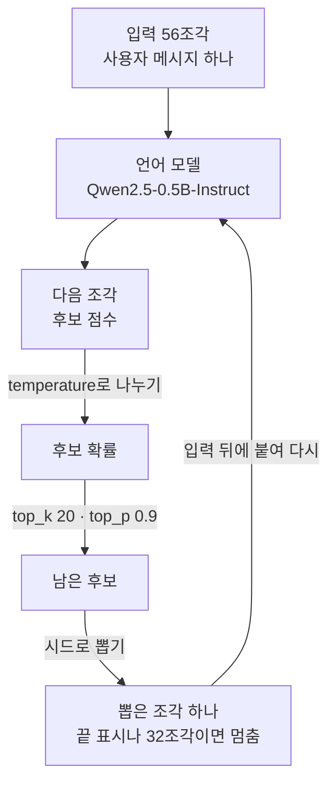
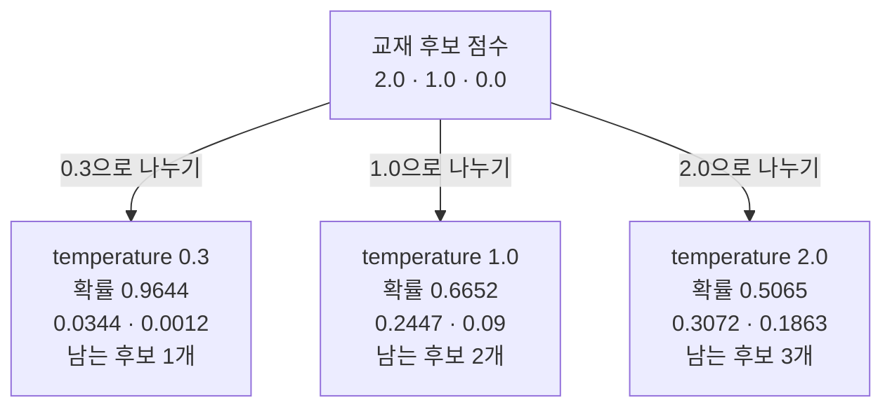
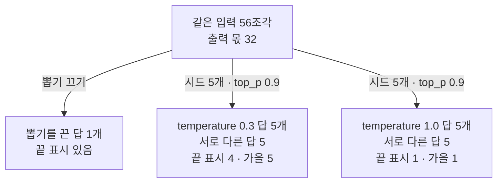
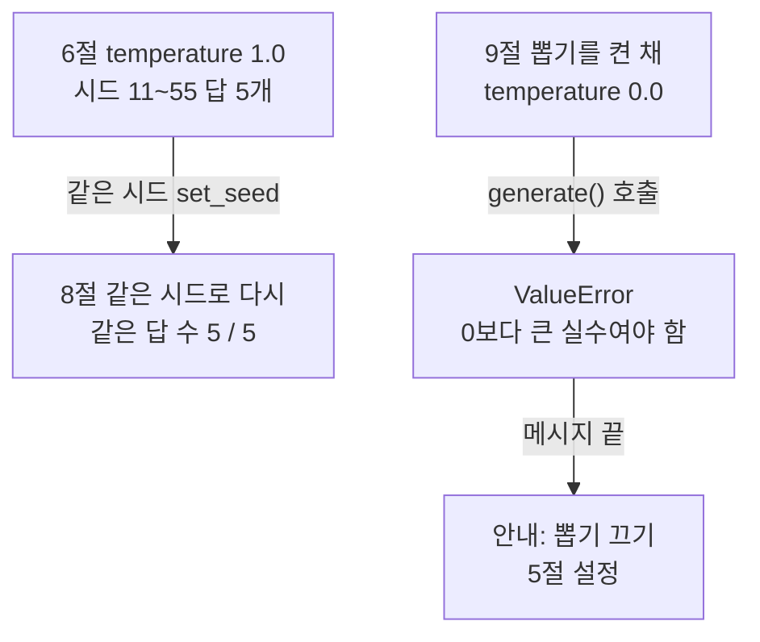

# 06-temperature와-샘플링

## _src 본문 (HTML 원본)

```html
<!--meta: 강의 1.5h · 실습 1h | 코드 Jupyter Notebook | 새 용어 7 -->
<h2 id="b1"><span class="no">1</span>학습 목표</h2>
<div class="goal"><ul><li>후보 점수를 temperature로 나눠 확률로 바꾸고, top_p로 남는 후보 수를 직접 계산할 수 있습니다.</li><li>같은 요청을 temperature와 시드만 바꿔 실행하고, 답의 가짓수와 끝 표시를 세어 비교할 수 있습니다.</li><li>시드를 고정한 답이 되풀이되는 범위를 노트북 출력과 확인 기록으로 설명할 수 있습니다.</li></ul></div>
<h2 id="b2"><span class="no">2</span>이 내용을 배우는 이유</h2>
<p>05절까지는 인자 <code>do_sample=False</code>로 무작위 뽑기를 끄고 답을 받았습니다. 그래서 같은 입력은 같은 답을 냈습니다. 그런데 이 모델 파일의 기본 설정은 뽑기가 켜져 있습니다. Ch 6부터 부르는 인터넷 서비스의 모델도 temperature 같은 인자를 받습니다.</p>
<p>뽑기를 켜면 같은 요청에도 실행마다 다른 답이 나올 수 있습니다. 이름 후보를 여러 개 모을 때는 쓸모가 있습니다. 하지만 답을 검사하는 코드에서는 결과를 비교하기 어렵게 만듭니다. 그래서 무엇을 고정했고 무엇을 바꿨는지 적어 두어야 합니다.</p>
<p><strong>이 절의 질문</strong> — 같은 요청에서 temperature를 바꾸면 답이 얼마나 달라질까요? 시드를 고정하면 그 답을 언제 다시 얻을 수 있을까요?</p>
<h2 id="b3"><span class="no">3</span>앞에서 배운 내용</h2>
<p>03절에서는 소프트맥스 함수를 직접 만들어 점수를 합이 1인 비중으로 바꿨습니다. 함수 <code>math.exp()</code>로 e의 거듭제곱을 구했습니다. 이 절은 같은 함수로 다음 조각 후보의 점수를 확률로 바꿉니다. 03절 비중은 조각 벡터를 섞는 데 썼고, 이 절의 확률은 조각 하나를 고르는 데 씁니다.</p>
<p>04절에서는 채팅 템플릿으로 입력을 만들고, 메서드 <code>generate()</code>에 출력 몫을 줘서 답을 받았습니다. 답이 출력 몫 안에서 끝나면 끝 표시 <code>&lt;|im_end|&gt;</code>가 남는다는 것도 봤습니다. 05절은 사용자 메시지 하나로 넣은 입력을 두 번 실행해, 뽑기를 끄면 같은 입력이 같은 답을 낸다는 것을 확인했습니다.</p>
<p>01절에서는 글이 토큰(조각)으로 나뉜다는 것을 봤습니다. 모델은 답도 조각 하나씩 만들고, 이 절은 그 조각 하나를 고르는 방식을 바꿉니다. 같은 값을 하나로 합치는 집합 <code>set()</code>은 Ch 2 03절, 오류 이름만 받는 <code>try/except</code>는 Ch 2 05절에서 배웠습니다.</p>
<h2 id="b4"><span class="no">4</span>핵심 개념</h2>
<h3>비유로 시작하기</h3>
<p>01·04·05절에서는 나무 쟁반의 칸을 블록으로 채웠습니다. 이번에는 블록을 담은 그릇에서 한 개를 뽑는다고 생각합니다. 그릇 속 블록 색 하나가 다음 조각 후보 하나이고, 그 색 블록의 개수가 뽑힐 확률입니다.</p>
<p>낮은 temperature 쪽 그릇은 거의 한 가지 색이라, 뽑으면 그 색이 나오기 쉽습니다. 높은 쪽 그릇은 색이 더 섞여 있어 다른 색도 자주 나옵니다. 두 그릇의 블록 수는 같고, 섞인 정도만 다릅니다.</p>
{{img:06-5-블록-두-그릇|나무 탁자 위에 같은 크기의 얕은 나무 그릇 두 개가 좌우로 놓여 있고, 왼쪽 그릇에는 파란 블록 10개와 주황 블록 1개, 오른쪽 그릇에는 파란 블록 6개, 주황 블록 3개, 초록 블록 2개가 섞여 담긴 삽화|블록 수가 같은 두 그릇에서 왼쪽은 거의 파란 블록뿐이고, 오른쪽은 파랑, 주황, 초록이 섞여 있습니다.}}
<p><strong>그림 읽기</strong> — 나무 탁자 위에 같은 그릇 두 개가 좌우로 놓여 있고, 그릇마다 블록 11개가 들어 있습니다. 왼쪽 그릇은 파란 블록 10개 가운데 주황 블록 하나가 있습니다. 오른쪽 그릇은 파란 블록 6개, 주황 블록 3개, 초록 블록 2개가 섞여 있습니다.</p>
<p>왼쪽 그릇이 temperature를 낮춘 확률이고, 오른쪽 그릇이 높인 확률입니다. 파란 블록은 점수가 가장 큰 후보이고, 두 그릇 모두 파랑이 가장 많습니다. 블록 개수는 실제 확률 값이 아닙니다.</p>
<h3>이 절에서 쓰는 말</h3>
<table><thead><tr><th>용어</th><th>뜻</th><th>이 절에서 보이는 모습</th></tr></thead><tbody>
<tr><td>로짓(logit)</td><td>모델이 다음 조각 후보마다 매긴 점수. 소프트맥스에 넣기 전의 값</td><td>교재 점수 <code>[2.0, 1.0, 0.0]</code></td></tr>
<tr><td>샘플링(sampling)</td><td>확률대로 후보 하나를 뽑는 방식. 후보마다 확률만큼 제비를 넣은 통에서 한 장을 뽑는 것과 비슷함</td><td>인자 <code>do_sample=True</code></td></tr>
<tr><td>temperature</td><td>소프트맥스에 넣기 전에 점수를 나누는 값. 작을수록 큰 후보에 확률이 몰림</td><td><code>0.3 | [6.67, 3.33, 0.0] | [0.9644, 0.0344, 0.0012]</code></td></tr>
<tr><td>top-p(<code>top_p</code>)</td><td>확률이 큰 후보부터 더해, 합이 기준에 닿을 때까지의 후보만 남기는 설정</td><td><code>1.0 | 2</code>(후보 2개 남음)</td></tr>
<tr><td>top-k(<code>top_k</code>)</td><td>점수가 큰 후보 몇 개만 남기는 설정. 이 모델의 기본값은 20</td><td><code>기본 top_k: 20</code></td></tr>
<tr><td>시드(seed)</td><td>난수가 만들어지는 시작 번호. 번호마다 주사위 눈을 미리 적어 둔 목록과 비슷함</td><td><code>같은 답 수: 5 / 5</code></td></tr>
<tr><td>생성 설정(generation config)</td><td>모델 파일에 든 생성 기본값. 호출에 넘긴 인자가 먼저 쓰이고, 넘기지 않은 값은 기본값이 쓰임</td><td><code>기본 do_sample: True</code></td></tr>
</tbody></table>
<h3>조각 하나를 뽑는 순서</h3>
<p>메서드 <code>generate()</code>는 답을 한 번에 만들지 않고 조각 하나씩 만듭니다. 조각마다 모델이 후보 점수를 매기면, 설정에 따라 점수를 확률로 바꾸고 후보를 줄인 뒤 하나를 뽑습니다. 뽑은 조각을 입력 뒤에 붙여 다음 조각을 계산합니다.</p>
{{mermaid:06-1-한-조각-뽑기|초록 상자 입력 56조각이 보라 상자 언어 모델에 들어가 회색 상자 다음 조각 후보 점수가 되고, temperature로 나누기를 거쳐 회색 상자 후보 확률, top_k 20과 top_p 0.9를 거쳐 회색 상자 남은 후보가 된 뒤, 시드로 뽑기를 거쳐 노란 상자 뽑은 조각 하나가 되고, 입력 뒤에 붙여 다시 모델로 올라가는 되풀이 흐름도|입력 56조각에서 조각 하나를 뽑을 때마다 점수를 temperature로 나누고, top_k 20과 top_p 0.9로 후보를 줄인 뒤 시드로 뽑습니다.}}
<p><strong>도식 읽기</strong> — 위에서 아래로 읽고, 맨 아래 노란 상자에서 보라 상자로 올라가는 화살표를 따라 되풀이합니다. 초록 상자는 노트북에서 만든 입력 56조각이고, 보라 상자는 실행한 언어 모델입니다. 회색 상자 세 개는 <code>generate()</code> 안에서 계산되어 화면에 나오지 않는 값입니다. 노란 상자는 출력으로 확인하는 뽑은 조각입니다.</p>
<p>화살표 위 글자가 이 절에서 다루는 설정입니다. top_k 20은 모델의 기본 설정에서 오고, temperature와 top_p 0.9, 시드는 노트북에서 넘깁니다. 끝 표시가 나오거나 새 조각이 32개가 되면 되풀이를 멈춥니다. 뽑기를 끈 설정은 회색 확률 단계를 거치지 않고 점수가 가장 큰 후보를 고릅니다.</p>
<h3>temperature는 점수 차이를 바꿉니다</h3>
<p>03절 소프트맥스에서는 점수가 1 크면 거듭제곱이 약 2.7배가 됐습니다. 그래서 점수 사이의 차이를 키우면 큰 후보가 더 도드라집니다. 점수를 temperature로 나누는 일이 바로 이 차이를 키우거나 줄입니다.</p>
<p>식은 <code>확률 = 소프트맥스(점수 ÷ temperature)</code>입니다. 교재 점수 <code>[2.0, 1.0, 0.0]</code>을 0.3으로 나누면 <code>[6.67, 3.33, 0.0]</code>이 되고, 첫 후보 확률은 0.9644입니다. 2.0으로 나누면 <code>[1.0, 0.5, 0.0]</code>으로 차이가 줄어, 첫 후보 확률은 0.5065입니다. 어느 값으로 나눠도 후보의 순서는 그대로입니다.</p>
<h3>top_p는 남길 후보를 정합니다</h3>
<p>설정 top_p는 확률이 큰 후보부터 더해, 합이 기준에 닿는 후보까지 남깁니다. 기준 0.9에서 temperature 0.3의 첫 후보는 혼자 0.9644라 1개만 남습니다. 1.0은 0.6652와 0.2447을 더한 0.9099에서 멈춰 2개, 2.0은 세 후보를 모두 더해야 해서 3개가 남습니다.</p>
{{mermaid:06-2-온도별-확률|맨 위 초록 상자 교재 후보 점수 2.0, 1.0, 0.0에서 세 갈래로 나뉘어, 0.3으로 나누기는 노란 상자 temperature 0.3 확률 0.9644, 0.0344, 0.0012 남는 후보 1개로, 1.0으로 나누기는 노란 상자 확률 0.6652, 0.2447, 0.09 남는 후보 2개로, 2.0으로 나누기는 노란 상자 확률 0.5065, 0.3072, 0.1863 남는 후보 3개로 가는 흐름도|교재 점수를 temperature 0.3, 1.0, 2.0으로 나누면 첫 후보 확률이 0.9644, 0.6652, 0.5065로 줄고, top_p 0.9로 남는 후보는 1, 2, 3개로 늘어납니다.}}
<p><strong>도식 읽기</strong> — 위에서 아래로 읽습니다. 맨 위 초록 상자는 교재에서 정한 점수이고, 화살표 위 글자가 나누는 temperature입니다. 아래 노란 상자 세 개는 노트북 2절 표의 확률과 3절 표의 남는 후보 수입니다.</p>
<p>왼쪽에서 오른쪽으로 갈수록 첫 확률은 줄고 남는 후보는 늘어납니다. 이 교재 점수에서 temperature 0.3과 top_p 0.9를 함께 쓰면 후보가 하나만 남습니다. 그러면 뽑아도 늘 같은 후보가 나옵니다. 실제 모델에서도 그런지는 실행 예제에서 확인합니다.</p>
<h2 id="b5"><span class="no">5</span>실행 예제</h2>
<p>노트북은 03절과 같은 소프트맥스 함수로 교재 점수를 계산하고, top_p로 남는 후보 수를 셉니다. 이어서 03~05절과 같은 모델을 받고, 모델 파일의 기본 생성 설정을 출력합니다. 사용자 메시지 하나로 만든 입력으로 뽑기를 끈 답을 한 번 받습니다. 그다음 temperature 0.3과 1.0에서 시드 다섯 개로 답을 받고, 같은 시드로 한 번 더 실행합니다.</p>
<p>인터넷 서비스의 모델을 부르지 않으므로 API 키가 필요 없고 비용도 들지 않습니다. 모델이 답을 만드는 계산은 모두 16번이고, 실행에는 1분 안팎이 걸립니다.</p>
{{notebook:06-temperature와-샘플링}}
<p class="look"><b>확인할 점</b> — 3절 표의 남는 후보 수와 4절의 기본 생성 설정 다섯 줄을 봅니다. 7절 표 <code>0.3 | 5 | 4 | 5</code>와 <code>1.0 | 5 | 1 | 1</code>, 8절 <code>같은 답 수: 5 / 5</code>를 봅니다. 9절에서 temperature 0.0이 어떤 오류 메시지를 냈는지 확인합니다.</p>
<h3>넘긴 설정과 넘기지 않은 설정</h3>
<p>4절 출력에서 모델 파일의 기본값은 <code>기본 do_sample: True</code>, <code>기본 top_k: 20</code>, <code>기본 repetition_penalty: 1.1</code> 등이었습니다. 이 절은 do_sample, temperature, top_p 세 값을 호출마다 넘겨 기본값 대신 씁니다.</p>
<p>넘기지 않은 top_k 20과 repetition_penalty 1.1은 모든 호출에 같게 쓰입니다. 설정 top_k는 점수가 큰 후보 20개만 남깁니다. 설정 repetition_penalty는 입력과 답에 이미 나온 조각의 점수를 조금 낮춥니다. 바꾸지 않은 값도 결과에 영향을 주므로, 비교할 때는 이런 값까지 같게 두었는지 확인합니다.</p>
<h3>temperature 0.3과 1.0의 답</h3>
<p>5절에서 뽑기를 끈 답은 <code>"가을의 푸른 시원ness: 오프라인 서점의 전통과 새로운 활동들"&lt;|im_end|&gt;</code>였습니다. 6절에서 temperature 0.3의 다섯 답은 이 답과 모두 달랐고, 서로도 달랐습니다. 교재 점수에서는 후보가 하나만 남았지만, 실제 모델의 점수는 그렇게 한 후보에 몰리지 않았습니다.</p>
<p>temperature 0.3에서도 시드 22는 번호 목록을 냈고, 시드 33과 55는 가을 행사 이름 끝에 <code>봄행사</code>를 붙였습니다. temperature 1.0에서 시드 11은 <code>죄송합니다</code>로 시작해 이름을 내지 않았습니다. 1.0의 다섯 답 가운데 네 개는 끝 표시 없이 32조각에서 끊겼습니다.</p>
{{mermaid:06-3-온도별-답|맨 위 초록 상자 같은 입력 56조각 출력 몫 32에서 세 갈래로 나뉘어, 뽑기 끄기는 노란 상자 뽑기를 끈 답 1개 끝 표시 있음으로, 시드 5개와 top_p 0.9는 노란 상자 temperature 0.3 답 5개 서로 다른 답 5 끝 표시 4 가을 5와 노란 상자 temperature 1.0 답 5개 서로 다른 답 5 끝 표시 1 가을 1로 가는 흐름도|같은 입력으로 뽑기를 끈 답 하나와, temperature 0.3과 1.0에서 시드 다섯 개씩 받은 답을 셌습니다. 서로 다른 답은 모두 5개였고 끝 표시는 4개와 1개였습니다.}}
<p><strong>도식 읽기</strong> — 위에서 아래로 읽습니다. 맨 위 초록 상자는 모든 호출에 같게 둔 입력 56조각과 출력 몫 32입니다. 왼쪽 노란 상자는 5절 뽑기를 끈 답이고, 가운데와 오른쪽 노란 상자는 7절 표의 두 줄입니다.</p>
<p>가운데와 오른쪽 화살표는 같은 시드 다섯 개와 top_p 0.9를 쓰고, temperature만 다릅니다. 요청에서 벗어난 답도 코드가 멈춘 실패가 아니라 출력으로 확인한 결과라서 노랑으로 칠했습니다.</p>
<h2 id="b6"><span class="no">6</span>실험 결과 해석</h2>
<p>먼저 답의 가짓수입니다. 서로 다른 답은 temperature 0.3과 1.0 모두 5개였습니다. 0.3에서도 이미 다섯 번 모두 다른 답이 나와서, 이 셈으로는 1.0이 더 다양하다고 말할 수 없습니다. 차이를 보려면 시드를 훨씬 늘리거나, 글자가 아니라 뜻이 얼마나 다른지 재는 방법이 필요합니다.</p>
<p>다음은 끝 표시와 요청 낱말입니다. 끝 표시가 있는 답은 0.3에서 4개, 1.0에서 1개였습니다. 「가을」이 들어간 답은 5개와 1개였습니다. 이번 실행에서는 temperature 1.0의 답이 출력 몫 안에 끝나지 않거나 요청 낱말을 쓰지 않은 경우가 더 많았습니다.</p>
<p>이 수는 답의 품질을 재지 않습니다. 「가을」 셈에는 <code>봄행사</code>를 붙인 답도 들어갔고, 영어 조각이 섞인 답도 걸러 내지 않았습니다. 요청 하나에 시드 다섯 개로 본 결과라, temperature 1.0이 늘 요청을 덜 따른다고 넓혀 말하지 않습니다.</p>
<p>이제 시드입니다. 8절에서 같은 시드로 다시 실행하자 <code>같은 답 수: 5 / 5</code>였습니다. 노트북을 새 커널로 두 번 실행해도 모든 출력이 같았습니다. 뽑기를 켜도 시드를 같게 두면, 같은 기기와 버전에서는 답이 되풀이됩니다.</p>
{{mermaid:06-4-같은-시드와-0|두 줄기 흐름도로, 왼쪽은 노란 상자 6절 temperature 1.0 시드 11~55 답 5개가 같은 시드 set_seed 화살표로 노란 상자 8절 같은 시드로 다시 같은 답 수 5 / 5로 가고, 오른쪽은 초록 상자 9절 뽑기를 켠 채 temperature 0.0이 generate 호출 화살표로 노란 상자 ValueError 0보다 큰 실수여야 함으로, 다시 메시지 끝 화살표로 초록 상자 안내 뽑기 끄기 5절 설정으로 가는 그림|temperature 1.0에서 같은 시드로 다시 받은 답은 5개 모두 같았고, 뽑기를 켠 채 넣은 temperature 0.0은 ValueError로 막혔습니다.}}
<p><strong>도식 읽기</strong> — 두 줄기를 각각 위에서 아래로 읽습니다. 왼쪽 노란 상자 두 개는 6절 답 다섯 개와, 같은 시드로 다시 받은 8절 결과입니다. 오른쪽 초록 상자는 9절에서 넣은 temperature 0.0이고, 노란 상자는 받아서 출력한 ValueError입니다.</p>
<p>맨 아래 초록 상자는 오류 메시지 끝이 안내한 <code>do_sample=False</code>, 곧 5절의 뽑기를 끈 설정입니다. 이 ValueError는 <code>try/except</code>로 받아 출력한 오류라서 빨강이 아니라 노랑입니다.</p>
<p>시드가 되풀이를 보장하는 범위는 넓지 않습니다. 교재를 만들 때 다른 CPU 기기(Linux x86_64)에서 같은 패키지 버전으로 5·6절 답 11개를 받았습니다. 11개 모두 글자까지 같았습니다. 그 x86_64 기기에서 torch만 2.5.1로 바꾸자, 뽑기를 끈 답은 같았지만 시드로 뽑은 답 10개는 모두 달라졌습니다. 이 두 실행은 노트북 밖에서 한 것입니다.</p>
<p>그 torch 2.5.1 실행에서는 temperature 1.0의 「가을」이 든 답이 3개였습니다. 7절의 세 값도 버전이 바뀌면 달라진다는 뜻입니다. PyTorch 문서도 판이나 실행 플랫폼이 바뀌면 완전히 같은 결과를 보장하지 않는다고 적습니다.</p>
<p>9절에서 뽑기를 켠 채 temperature 0.0을 넣자, 답을 만들기 전에 <code>ValueError</code>가 났습니다. 이 라이브러리는 점수를 temperature로 나누므로 0보다 큰 값만 받습니다. 메시지는 가장 큰 후보만 고르려면 <code>do_sample=False</code>로 두라고 안내합니다.</p>
<p>뒤 챕터의 인터넷 서비스 모델은 temperature를 0으로 줍니다. Ch 22 01절 노트북은 temperature를 「답을 고를 때의 무작위 정도」로 설명합니다. 그리고 0으로 두면 매번 비슷한 답을 고른다고 적습니다. 같은 노트북은 0으로 두어도 답 문장이 매번 똑같다고 보장하지 않는다고도 적습니다. 서비스 모델이 0을 어떻게 처리하는지는 이 절에서 실행하지 않았습니다.</p>
<h2 id="b7"><span class="no">7</span>주의할 점과 실무 메모</h2>
<ul><li>교재 점수 <code>[2.0, 1.0, 0.0]</code>은 실제 모델의 점수가 아닙니다. 작업 중 기기 셸에서 이 입력의 첫 조각 후보를 꺼내 봤습니다. 점수 1위 따옴표와 2위 숫자 1의 차이가 약 0.41로 작았습니다. 점수가 큰 후보 20개로 반복 벌점 없이 계산하면, temperature 0.3의 두 확률은 0.6752와 0.169입니다. 이 계산은 노트북에 넣지 않았습니다.</li>
<li>소스(transformers 4.56.2)의 처리 순서는 반복 벌점, temperature, top_k, top_p입니다. 설정 top_p는 3절 함수처럼, 더한 확률이 기준 이상이 되는 후보까지 남깁니다. temperature 값이 1.0이면 나누는 단계를 건너뜁니다.</li>
<li>기본값 repetition_penalty 1.1은 뽑기를 끈 04·05절 생성에도 적용됐습니다. 기기 셸에서 5절 입력에 <code>repetition_penalty=1.0</code>을 넘기자, 뽑기를 끈 답이 다른 이름으로 바뀌었습니다. 이 실행도 노트북에 넣지 않았습니다.</li>
<li>두 값 temperature와 top_p를 한 번에 바꾸면 어느 값이 답을 바꿨는지 가를 수 없습니다. 이 절은 top_p를 0.9로 두고 temperature만 바꿨습니다.</li>
<li>시드를 정하지 않고 뽑으면 실행마다 답이 달라질 수 있습니다. 기기 셸에서 시드 없이 두 번 뽑자 두 답이 달랐습니다. 교재 출력과 맞춰 볼 수 없어서, 노트북은 모든 뽑기에 시드를 줍니다.</li>
<li>Ch 6 01절은 temperature 같은 인자가 모든 제공자와 모델에서 같은 범위로 지원된다고 가정하지 않는다고 적습니다. 서비스 모델의 temperature 0이 이 절의 <code>do_sample=False</code>와 같다고 보지 않습니다.</li>
<li>노트북과 같은 계산을 스크립트로 실행했을 때 Python이 쓴 메모리는 최대 약 3.2GB였습니다. 교재를 만든 컴퓨터의 메모리는 3.8GB입니다.</li>
<li>교재 출력은 2026-09-16에 Linux(aarch64) 컴퓨터에서 만들었습니다. 쓴 Python은 3.12.13이고, torch는 CPU용 2.8.0입니다. 패키지는 transformers 4.56.2이고, 모델 판 번호는 <code>7ae5576…</code>입니다. GPU, Windows·macOS에서는 실행하지 않았습니다.</li></ul>
<h2 id="b8"><span class="no">8</span>정리와 다음 절</h2>
<ul><li>후보 점수를 temperature로 나누면, 작은 값일수록 큰 후보에 확률이 몰립니다. 설정 top_p는 큰 후보부터 더해 기준에 닿을 때까지만 남깁니다.</li><li>실제 모델에서는 temperature 0.3에서도 시드 다섯 개의 답이 모두 달랐습니다. 1.0에서는 끝 표시와 「가을」이 든 답이 1개씩이었습니다.</li><li>같은 시드는 같은 기기와 버전에서 같은 답을 냈지만, torch 판을 바꾸자 달라졌습니다. 뽑기를 켠 채 temperature 0.0을 넣으면 <code>ValueError</code>가 났습니다.</li></ul>
<p><strong>다음 학습과 이어지는 지점</strong> — <a href="07-환각의-구조적-원인.html">07절 환각의 구조적 원인</a>에서는 문장을 잇는 능력과 사실 확인이 서로 다르다는 것을 봅니다. 근거가 주어지지 않은 질문에 모델이 어떻게 답하는지 살펴봅니다.</p>
<h2 id="b9"><span class="no">9</span>복습 문제</h2><details class="quiz"><summary>문제와 해설</summary>
<p class="quiz-q">1. 교재 점수 [2.0, 1.0, 0.0]을 temperature 2.0으로 나누면 확률은 어떻게 달라지나요? 후보의 순서는 바뀌나요? · 기초</p><p class="quiz-a"><b>해설</b> — 나눈 점수는 1.0, 0.5, 0.0으로 차이가 줄어듭니다. 확률은 0.5065, 0.3072, 0.1863으로 서로 가까워집니다. 첫 후보가 여전히 가장 크므로 순서는 그대로입니다. 나누는 값은 순서가 아니라 확률 차이를 바꿉니다.</p>
<p class="quiz-q">2. top_p 0.9에서 temperature 1.0일 때 후보가 2개 남은 까닭은 무엇인가요? · 기초</p><p class="quiz-a"><b>해설</b> — 확률이 큰 후보부터 더합니다. 첫 후보 0.6652만으로는 0.9에 못 미치고, 둘째 0.2447을 더한 0.9099에서 기준 이상이 됩니다. 그래서 둘째 후보까지 남습니다.</p>
<p class="quiz-q">3. 같은 교재 점수에 temperature 0.5를 쓰면 첫 후보 확률은 얼마쯤이고, top_p 0.9로 몇 개가 남을까요? · 적용</p><p class="quiz-a"><b>해설</b> — 0.5로 나누면 4.0, 2.0, 0.0입니다. 수 e의 거듭제곱은 약 54.6, 7.39, 1이고 합은 약 62.99라서, 첫 후보 확률은 약 0.8668입니다. 첫 확률만으로는 0.9에 못 미치고 둘째 약 0.1173을 더하면 넘으므로 2개가 남습니다. 노트북에서 실행하지 않은 값이라, 2절 셀의 목록에 0.5를 넣어 확인합니다.</p>
<p class="quiz-q">4. 동료가 「7절에서 1.0의 서로 다른 답이 5개였으니 0.3보다 다양하다」고 합니다. 무엇이라고 답하나요? · 분석</p><p class="quiz-a"><b>해설</b> — temperature 0.3도 서로 다른 답이 5개였으므로, 이 셈으로는 두 값의 차이가 보이지 않습니다. 시드 다섯 개와 요청 하나로 본 결과이고, 글자가 조금만 달라도 다른 답으로 셉니다. 다양성을 비교하려면 시드를 늘리고 뜻의 차이를 재는 방법을 미리 정해야 한다고 답합니다.</p>
<p class="quiz-q">5. 동료가 「시드 11을 적어 두었으니 누구 컴퓨터에서 실행해도 같은 답이 나온다」고 합니다. 이 절의 기록으로 무엇을 말할 수 있나요? · 분석</p><p class="quiz-a"><b>해설</b> — 같은 기기에서 같은 시드로 다시 실행하면 5개 모두 같았고, 같은 패키지 버전의 다른 CPU 기기에서도 같았습니다. 하지만 torch를 2.5.1로 바꾸자 시드로 뽑은 답 10개가 모두 달라졌습니다. PyTorch 문서도 판이나 플랫폼이 바뀌면 같은 결과를 보장하지 않습니다. 그래서 시드와 함께 모델 판 번호, 패키지 버전, 기기를 적자고 답합니다.</p>
</details>
<h2 id="b10"><span class="no">10</span>참고 자료</h2>
<ul><li><a href="https://huggingface.co/docs/transformers/v4.56.2/en/generation_strategies">Transformers 생성 전략 문서</a> · 4.56.2 · 확인 2026-09-16</li><li><a href="https://huggingface.co/docs/transformers/v4.56.2/en/main_classes/text_generation">Transformers 생성 설정 문서</a> · 4.56.2 · 확인 2026-09-16</li><li><a href="https://docs.pytorch.org/docs/2.8/notes/randomness.html">PyTorch 재현성 문서(Reproducibility)</a> · 2.8 · 확인 2026-09-16</li><li><a href="https://huggingface.co/Qwen/Qwen2.5-0.5B-Instruct/blob/7ae557604adf67be50417f59c2c2f167def9a775/generation_config.json">Qwen2.5-0.5B-Instruct 생성 설정 파일(Apache-2.0)</a> · 판 7ae5576 · 확인 2026-09-16</li></ul>
```

## 노트북 셀 (순서대로)

### [0] markdown {'html': 'skip'}

# temperature와 샘플링

**이 노트북에서 할 일**

1. 교재에서 정한 후보 점수 세 개를 temperature로 나눠 확률로 바꾸고, top_p 0.9로 남는 후보 수를 셉니다.
2. 같은 요청을 temperature 0.3과 1.0에서 시드 다섯 개로 실행하고, 답의 가짓수와 끝 표시를 셉니다.
3. 같은 시드로 한 번 더 실행해 답이 같은지 보고, 뽑기를 켠 채 temperature 0.0을 넣어 봅니다.

**준비물** — API 키는 필요 없습니다. 인터넷 서비스의 모델을 부르지 않고, 내 컴퓨터에서 작은 언어 모델을 실행합니다.
그래서 비용은 들지 않습니다. 모델이 답을 만드는 계산은 모두 16번 합니다.

실행 시간은 1분 안팎입니다. 모델 파일은 03~05절과 같은 약 1GB(954MiB)이고, 캐시에 없으면 Hugging Face 사이트에서 내려받습니다.
노트북과 같은 계산을 스크립트로 실행했을 때 Python이 쓴 메모리는 최대 약 3.2GB였습니다.

**기준 버전** — 실습 폴더에 고정한 transformers 4.56.2와 torch 2.8.0을 씁니다.
모델은 `Qwen/Qwen2.5-0.5B-Instruct`이고, 판 번호(revision)를 `7ae557604adf67be50417f59c2c2f167def9a775`로 고정해 받습니다.

교재 출력은 Linux(aarch64)의 Python 3.12.13과 CPU용 torch(2.8.0+cpu)로 만들었습니다.
시드를 같게 줘도 버전이나 기기가 바뀌면 답이 달라질 수 있습니다. 확인한 범위는 정리 셀 위 10절에 적었습니다.

실습 폴더 `labs/part1/ch05-llm-principles`에서 01절과 같은 `.venv` 커널을 고른 뒤 첫 셀부터 순서대로 실행합니다.

### [1] markdown {'html': 'skip'}

## 오늘 볼 그림


위에서 아래로 읽습니다. 초록 상자는 노트북에서 만든 입력이고, 보라 상자는 실행한 언어 모델입니다.
회색 상자는 메서드 `generate()` 안에서 계산되어 화면에 나오지 않는 값이고, 노란 상자는 출력으로 확인하는 조각입니다.
뽑은 조각을 입력 뒤에 붙여 다시 모델에 넣는 일을, 끝 표시가 나오거나 32조각이 될 때까지 되풀이합니다.

### [2] markdown {}

## 1. 준비

이 절은 파일을 읽거나 만들지 않습니다. 준비 셀에서는 계산에 쓸 모듈과 패키지를 불러오고 버전을 확인합니다.

표준 라이브러리 모듈 `math`는 03절에서 소프트맥스를 만들 때 쓴 기능 묶음입니다.
함수 `set_seed()`는 이 절에서 처음 쓰는 transformers 함수이고, 뜻은 6절에서 풉니다.
패키지 torch는 03절에서 본 텐서를 계산하는 패키지입니다. 뽑기에 쓰는 난수도 torch가 만들어서 버전을 함께 출력합니다.

함수 `warnings.filterwarnings()` 줄은 01절처럼 진행 표시 위젯 경고 한 줄을 끕니다.
함수 `transformers.logging.set_verbosity_error()`는 04절처럼, 오류가 아닌 생성 안내를 화면에 내지 않게 합니다.

### [3] code {'execution': {'iopub.execute_input': '2026-09-16T19:41:02.766118Z', 'iopub.status.busy': '2026-09-16T19:41:02.765945Z', 'iopub.status.idle': '2026-09-16T19:41:06.673616Z', 'shell.execute_reply': '2026-09-16T19:41:06.673123Z'}, 'lesson_role': 'setup'}

```python
# 계산에 쓸 math 모듈과 transformers·torch 패키지를 불러오고 버전을 확인합니다
import math
import warnings

# 진행 표시 위젯이 없다는 경고(TqdmWarning)는 계산과 관계없어 화면에 내지 않습니다
warnings.filterwarnings("ignore", message="IProgress not found")

import torch
import transformers
from transformers import AutoModelForCausalLM, AutoTokenizer, set_seed

# 생성 셀의 안내(오류 아님)를 화면에 내지 않습니다
transformers.logging.set_verbosity_error()
print("transformers 버전:", transformers.__version__)
print("torch 버전:", torch.__version__)
```

출력:
```
transformers 버전: 4.56.2
torch 버전: 2.8.0+cpu

```

### [4] markdown {}

**결과 읽기** — 출력 줄은 `transformers 버전: 4.56.2`와 `torch 버전: 2.8.0+cpu`입니다. 준비물에 적은 기준 버전과 같습니다.

torch 버전 끝의 `+cpu`는 GPU 없이 CPU로 계산하는 판이라는 표시입니다.

### [5] markdown {}

## 2. 후보 점수를 확률로 — temperature로 나누기

모델은 다음 조각을 정하기 전에 후보 조각마다 점수를 매깁니다. 이 점수를 로짓(logit)이라고 부릅니다.
03절의 소프트맥스로 점수를 바꾸면 모두 0보다 크고 합이 1인 확률이 됩니다.
04·05절의 인자 `do_sample=False`는 이 확률 가운데 가장 큰 후보를 고르는 설정이었습니다.

샘플링(sampling)은 가장 큰 후보만 고르지 않고, 확률대로 후보 하나를 뽑는 방식입니다.
후보마다 확률만큼 제비를 넣은 통에서 한 장을 뽑는 것과 비슷합니다. 확률 0.7인 후보는 열 번 뽑으면 일곱 번쯤 나옵니다.

노트북은 서로 독립이라 03절 함수를 그대로 쓸 수 없습니다. 먼저 03절과 같은 소프트맥스 함수를 다시 정의합니다. 이 셀은 함수를 정의만 합니다.

### [6] code {'execution': {'iopub.execute_input': '2026-09-16T19:41:06.674705Z', 'iopub.status.busy': '2026-09-16T19:41:06.674538Z', 'iopub.status.idle': '2026-09-16T19:41:06.677257Z', 'shell.execute_reply': '2026-09-16T19:41:06.676661Z'}}

```python
# 점수 목록을 합이 1인 확률 목록으로 바꾸는 소프트맥스 함수를 03절과 같게 정의합니다
def softmax(scores):
    # 점수마다 e의 거듭제곱을 구하고, 그 합을 함께 셉니다
    powers = []
    total = 0
    for score in scores:
        power = math.exp(score)
        powers.append(power)
        total = total + power
    # 거듭제곱을 합으로 나누면 모두 0보다 크고 합이 1인 값이 됩니다
    probabilities = []
    for power in powers:
        probabilities.append(power / total)
    return probabilities
```

출력:
```

```

### [7] markdown {}

**결과 읽기** — 정의만 하는 셀이라 출력이 없습니다.

소프트맥스에 넣기 전에 점수를 나누는 값이 temperature입니다. 1보다 작은 값으로 나누면 점수 차이가 커지고, 1보다 큰 값으로 나누면 차이가 줄어듭니다.
점수 차이가 커지면 큰 후보의 확률이 더 커집니다. 다음 셀은 점수를 temperature로 나눈 새 목록을 반환하는 함수를 정의만 합니다.

### [8] code {'execution': {'iopub.execute_input': '2026-09-16T19:41:06.678087Z', 'iopub.status.busy': '2026-09-16T19:41:06.677990Z', 'iopub.status.idle': '2026-09-16T19:41:06.679795Z', 'shell.execute_reply': '2026-09-16T19:41:06.679526Z'}}

```python
# 점수 목록의 값마다 temperature로 나눈 새 목록을 반환하는 함수를 정의합니다
def divide_scores(scores, temperature):
    divided = []
    for score in scores:
        # temperature가 1보다 작으면 나눈 점수 사이의 차이가 커집니다
        divided.append(score / temperature)
    return divided
```

출력:
```

```

### [9] markdown {}

**결과 읽기** — 정의만 하는 셀이라 출력이 없습니다.

교재에서 정한 후보 점수 `[2.0, 1.0, 0.0]`으로 두 함수를 부릅니다. 실제 모델의 점수가 아니라 계산을 보려고 정한 숫자입니다.
나눌 temperature 값은 0.3, 1.0, 2.0 세 가지입니다. 0.3과 1.0은 7절에서 실제 모델에 넣을 값입니다.

실행 전에 예상합니다. 0.3으로 나누면 점수가 6.67, 3.33, 0.0이 되어 첫 후보의 확률이 0.9를 넘을 것입니다.
2.0으로 나누면 점수가 1.0, 0.5, 0.0으로 좁혀져 세 확률이 서로 가까워질 것입니다.

### [10] code {'execution': {'iopub.execute_input': '2026-09-16T19:41:06.680510Z', 'iopub.status.busy': '2026-09-16T19:41:06.680443Z', 'iopub.status.idle': '2026-09-16T19:41:06.682404Z', 'shell.execute_reply': '2026-09-16T19:41:06.682082Z'}}

```python
# 교재 점수 세 개를 temperature 0.3, 1.0, 2.0으로 나눈 뒤 확률로 바꿔 봅니다
candidate_scores = [2.0, 1.0, 0.0]
print("temperature | 나눈 점수 | 확률")
for temperature in [0.3, 1.0, 2.0]:
    divided = divide_scores(candidate_scores, temperature)
    probabilities = softmax(divided)
    # 표로 보기 좋게 나눈 점수는 둘째 자리, 확률은 넷째 자리까지 반올림합니다
    rounded_scores = []
    rounded_probabilities = []
    for number in range(len(candidate_scores)):
        rounded_scores.append(round(divided[number], 2))
        rounded_probabilities.append(round(probabilities[number], 4))
    print(temperature, "|", rounded_scores, "|", rounded_probabilities)
```

출력:
```
temperature | 나눈 점수 | 확률
0.3 | [6.67, 3.33, 0.0] | [0.9644, 0.0344, 0.0012]
1.0 | [2.0, 1.0, 0.0] | [0.6652, 0.2447, 0.09]
2.0 | [1.0, 0.5, 0.0] | [0.5065, 0.3072, 0.1863]

```

### [11] markdown {}

**결과 읽기** — 라벨 줄 아래 첫 줄은 `0.3 | [6.67, 3.33, 0.0] | [0.9644, 0.0344, 0.0012]`입니다. 둘째 줄은 `1.0 | [2.0, 1.0, 0.0] | [0.6652, 0.2447, 0.09]`입니다.

셋째 줄은 `2.0 | [1.0, 0.5, 0.0] | [0.5065, 0.3072, 0.1863]`입니다. 예상대로 temperature가 작을수록 첫 후보에 확률이 몰렸습니다.
세 줄 모두 가장 큰 후보는 첫 후보입니다. 나누는 값을 바꿔도 후보의 순서는 그대로이고, 후보 사이의 확률 차이만 바뀝니다.

### [12] markdown {}

## 3. top_p — 확률이 큰 후보만 남기기

설정 top_p는 확률이 큰 후보부터 차례로 더해, 합이 정한 값에 닿을 때까지의 후보만 남깁니다. 남은 후보 안에서만 뽑습니다.
투표에서 1등부터 득표율을 더해 90%에 닿을 때까지의 후보만 결선에 올리는 것과 비슷합니다.

아래 함수는 확률 목록을 앞에서부터 더하며 남는 후보 수를 셉니다. 확률이 큰 순서로 놓인 목록을 넣어야 맞습니다.
2절의 교재 확률은 이미 큰 순서입니다. 이 셀은 함수를 정의만 합니다.

### [13] code {'execution': {'iopub.execute_input': '2026-09-16T19:41:06.683102Z', 'iopub.status.busy': '2026-09-16T19:41:06.683034Z', 'iopub.status.idle': '2026-09-16T19:41:06.684876Z', 'shell.execute_reply': '2026-09-16T19:41:06.684492Z'}}

```python
# 확률이 큰 순서의 목록을 앞에서부터 더해, 합이 기준에 닿을 때까지 남는 후보 수를 반환하는 함수를 정의합니다
def count_top_p(probabilities, cutoff):
    total = 0
    kept_count = 0
    for probability in probabilities:
        kept_count = kept_count + 1
        total = total + probability
        # 더한 확률이 기준 이상이 되면 이 후보까지 남기고 멈춥니다
        if total >= cutoff:
            break
    return kept_count
```

출력:
```

```

### [14] markdown {}

**결과 읽기** — 정의만 하는 셀이라 출력이 없습니다.

기준은 7절에서 실제 모델에 넣을 값과 같은 0.9로 정하고, 이름 `top_p`에 담습니다. 2절의 세 temperature로 남는 후보 수를 셉니다.
실행 전에 예상합니다. 0.3에서는 첫 후보 확률 0.9644가 혼자 0.9를 넘으니 1개가 남을 것입니다. 2.0에서는 두 후보를 더해도 0.8137이라 3개가 남을 것입니다.

### [15] code {'execution': {'iopub.execute_input': '2026-09-16T19:41:06.685645Z', 'iopub.status.busy': '2026-09-16T19:41:06.685575Z', 'iopub.status.idle': '2026-09-16T19:41:06.687481Z', 'shell.execute_reply': '2026-09-16T19:41:06.687168Z'}}

```python
# top_p 0.9로 정하고, 세 temperature에서 남는 후보 수를 셉니다
top_p = 0.9
print("temperature | top_p 0.9로 남는 후보 수")
for temperature in [0.3, 1.0, 2.0]:
    divided = divide_scores(candidate_scores, temperature)
    probabilities = softmax(divided)
    kept_count = count_top_p(probabilities, top_p)
    print(temperature, "|", kept_count)
```

출력:
```
temperature | top_p 0.9로 남는 후보 수
0.3 | 1
1.0 | 2
2.0 | 3

```

### [16] markdown {}

**결과 읽기** — 라벨 줄 아래 세 줄은 `0.3 | 1`, `1.0 | 2`, `2.0 | 3`입니다. 예상과 같습니다.

1.0에서는 0.6652와 0.2447을 더한 0.9099가 0.9 이상이라 두 후보에서 멈췄습니다.
이 교재 점수에서 temperature 0.3과 top_p 0.9를 함께 쓰면 후보가 하나만 남습니다. 그러면 뽑아도 늘 같은 후보가 나옵니다.
실제 모델의 점수는 이 교재 점수와 다르므로, 같은 일이 일어나는지는 7절 답으로 확인합니다.

### [17] markdown {}

## 4. 모델과 기본 생성 설정

모델은 03~05절과 같은 Qwen2.5-0.5B-Instruct이고, 같은 판 번호로 받습니다.
모델 파일에는 답을 만들 때 쓸 기본값을 적은 생성 설정(generation config)도 들어 있습니다. 모델 객체의 속성 `generation_config`로 읽습니다.

메서드 `generate()`에 인자로 넘긴 값은 그 호출에서 기본값보다 먼저 쓰입니다. 넘기지 않은 값은 기본값이 그대로 쓰입니다.
그래서 이번에 넘기지 않을 값이 무엇인지 먼저 봅니다. 실행 전에 예상합니다. 04절 안내 경고가 샘플링 설정 값을 말했으니, 기본값에 temperature가 있을 것입니다.

### [18] code {'execution': {'iopub.execute_input': '2026-09-16T19:41:06.688279Z', 'iopub.status.busy': '2026-09-16T19:41:06.688208Z', 'iopub.status.idle': '2026-09-16T19:41:08.381427Z', 'shell.execute_reply': '2026-09-16T19:41:08.380302Z'}}

```python
# 03~05절과 같은 언어 모델과 토큰화기를 받고, 모델 파일에 든 기본 생성 설정을 봅니다
model_name = "Qwen/Qwen2.5-0.5B-Instruct"
model_revision = "7ae557604adf67be50417f59c2c2f167def9a775"
tokenizer = AutoTokenizer.from_pretrained(model_name, revision=model_revision)
model = AutoModelForCausalLM.from_pretrained(model_name, revision=model_revision)
# 모델 파일의 기본 생성 설정 가운데 뽑기와 관련된 값만 출력합니다
settings = model.generation_config
print("기본 do_sample:", settings.do_sample)
print("기본 temperature:", settings.temperature)
print("기본 top_p:", settings.top_p)
print("기본 top_k:", settings.top_k)
print("기본 repetition_penalty:", settings.repetition_penalty)
```

출력:
```
기본 do_sample: True
기본 temperature: 0.7
기본 top_p: 0.8
기본 top_k: 20
기본 repetition_penalty: 1.1

```

### [19] markdown {}

**결과 읽기** — 출력 줄은 `기본 do_sample: True`, `기본 temperature: 0.7`, `기본 top_p: 0.8`, `기본 top_k: 20`, `기본 repetition_penalty: 1.1`입니다.

예상대로 기본값에 temperature가 있고, 뽑기도 켜져 있습니다. 04·05절은 `do_sample=False`를 넘겨서 뽑기를 껐습니다.
이 절은 do_sample, temperature, top_p 세 값을 넘깁니다. 나머지 top_k와 repetition_penalty는 넘기지 않습니다.

기본값 top_k 20은 점수가 큰 후보 20개만 남기는 값입니다. 기본값 repetition_penalty 1.1은 입력과 답에 이미 나온 조각의 점수를 조금 낮춥니다.
두 값은 이 절의 모든 호출에서 같게 쓰입니다. 이 노트북의 출력은 2026-09-16에 이 모델과 판 번호로 실행한 결과입니다.

### [20] markdown {}

## 5. 입력과 뽑기를 끈 답

입력은 사용자 메시지 하나입니다. 05절 6절처럼 시스템 메시지가 없어서, 채팅 템플릿이 영어 기본 지시를 넣습니다.
요청은 행사 이름 하나를 짧게 지어 달라는 글입니다. 정답이 하나로 정해진 질문이 아니라서, 뽑기에 따라 답이 갈리는지 보기 좋습니다.

출력 몫은 05절처럼 32로 정합니다. 먼저 04·05절처럼 `do_sample=False`로 답을 한 번 받아, 뽑기를 켠 답과 비교할 기준으로 둡니다.
새 조각 수가 출력 몫에 닿기 전에 끝나면, 04절에서 본 끝 표시 `<|im_end|>`가 답 끝에 남습니다.

### [21] code {'execution': {'iopub.execute_input': '2026-09-16T19:41:08.383390Z', 'iopub.status.busy': '2026-09-16T19:41:08.383205Z', 'iopub.status.idle': '2026-09-16T19:41:08.397863Z', 'shell.execute_reply': '2026-09-16T19:41:08.397316Z'}}

```python
# 사용자 메시지 하나로 입력을 만들고, 출력 몫 32를 정해 입력 토큰 수를 셉니다
request_text = "오프라인 서점의 가을 행사 이름을 한국어 5어절 이내로 하나 제안하세요."
message_list = [
    {"role": "user", "content": request_text},
]
input_text = tokenizer.apply_chat_template(message_list, tokenize=False, add_generation_prompt=True)
input_ids = tokenizer.encode(input_text, return_tensors="pt")
input_length = len(input_ids[0])
output_budget = 32
print("입력 토큰 수:", input_length)
print("출력 몫:", output_budget)
```

출력:
```
입력 토큰 수: 56
출력 몫: 32

```

### [22] markdown {}

**결과 읽기** — 출력 줄은 `입력 토큰 수: 56`과 `출력 몫: 32`입니다.

영어 기본 지시가 들어간 입력이라, 요청 글만 셀 때보다 조각 수가 많습니다. 이 입력을 이 절의 모든 호출에서 그대로 씁니다.
다음 셀은 뽑기를 끈 설정으로 답을 받습니다. 실행 전에 예상합니다. 05절처럼 다시 실행해도 같은 답이 나올 것입니다.

### [23] code {'execution': {'iopub.execute_input': '2026-09-16T19:41:08.398924Z', 'iopub.status.busy': '2026-09-16T19:41:08.398808Z', 'iopub.status.idle': '2026-09-16T19:41:11.305866Z', 'shell.execute_reply': '2026-09-16T19:41:11.305520Z'}}

```python
# 04·05절처럼 뽑기를 끈 설정으로 답을 한 번 받아, 비교할 기준으로 둡니다
output_ids = model.generate(input_ids=input_ids, max_new_tokens=output_budget, do_sample=False)
all_ids = output_ids[0].tolist()
# 입력 조각 수만큼 건너뛴 뒤가 새 조각입니다
greedy_answer = tokenizer.decode(all_ids[input_length:len(all_ids)])
print("뽑기를 끈 답:", greedy_answer)
```

출력:
```
뽑기를 끈 답: "가을의 푸른 시원ness: 오프라인 서점의 전통과 새로운 활동들"<|im_end|>

```

### [24] markdown {}

**결과 읽기** — 출력 줄은 `뽑기를 끈 답: "가을의 푸른 시원ness: 오프라인 서점의 전통과 새로운 활동들"<|im_end|>`입니다.

따옴표 안에 이름 하나를 답했고, 끝 표시가 있어 출력 몫 안에서 끝났습니다. 영어 조각 `ness`가 섞인 것은 이 작은 모델의 답 그대로입니다.
이 셀을 다시 실행해도 같은 답이 나옵니다. 05절 7절에서 같은 입력은 같은 답을 낸다는 것을 확인했습니다.

### [25] markdown {}

## 6. 시드 — 뽑기의 시작점

컴퓨터의 뽑기는 난수(무작위로 보이는 수)로 합니다. 이 난수는 시작 번호에서 정해진 순서로 만들어집니다. 이 시작 번호를 시드(seed)라고 부릅니다.
번호마다 주사위 눈을 미리 적어 둔 목록과 비슷합니다. 같은 번호의 목록을 펴면 같은 순서로 눈이 나옵니다.

함수 `set_seed(번호)`는 Python·NumPy·torch의 난수 시작점을 한꺼번에 그 번호로 정합니다.
아래 함수는 호출마다 먼저 시드를 정합니다. 그다음 인자 `do_sample=True`로 뽑기를 켜고 temperature와 top_p를 넘깁니다.

인자 `temperature`와 `top_p`는 2·3절에서 교재 점수로 계산한 그 값입니다. 3절에서 정한 `top_p` 0.9를 모든 호출에 씁니다.
몸통의 나머지는 5절 셀과 같은 모양입니다. 이 셀은 함수를 정의만 합니다.

### [26] code {'execution': {'iopub.execute_input': '2026-09-16T19:41:11.306765Z', 'iopub.status.busy': '2026-09-16T19:41:11.306683Z', 'iopub.status.idle': '2026-09-16T19:41:11.308716Z', 'shell.execute_reply': '2026-09-16T19:41:11.308411Z'}}

```python
# temperature와 시드를 받아, 뽑기를 켠 설정으로 만든 새 조각을 글로 바꿔 반환하는 함수를 정의합니다
def ask_with_sampling(temperature, seed):
    # 호출마다 시드를 먼저 정해, 같은 시드면 같은 순서의 난수로 뽑게 합니다
    set_seed(seed)
    output_ids = model.generate(
        input_ids=input_ids,
        max_new_tokens=output_budget,
        do_sample=True,
        temperature=temperature,
        top_p=top_p,
    )
    all_ids = output_ids[0].tolist()
    return tokenizer.decode(all_ids[input_length:len(all_ids)])
```

출력:
```

```

### [27] markdown {}

**결과 읽기** — 정의만 하는 셀이라 출력이 없습니다.

바꾸는 값은 temperature 하나입니다. 0.3과 1.0 두 가지에 같은 시드 다섯 개 11, 22, 33, 44, 55를 씁니다.
입력, 출력 몫, top_p, 기본 설정의 top_k와 repetition_penalty는 모든 호출에서 같습니다.

답은 temperature를 키로 한 딕셔너리에 목록으로 모읍니다. 답 안의 줄바꿈은 05절처럼 빈칸으로 바꿔 한 줄에 출력합니다.
실행 전에 예상합니다. 3절의 교재 점수처럼 0.3에서 후보가 하나만 남는다면, 0.3의 답 다섯 개는 5절 답과 같을 것입니다.

### [28] code {'execution': {'iopub.execute_input': '2026-09-16T19:41:11.309297Z', 'iopub.status.busy': '2026-09-16T19:41:11.309231Z', 'iopub.status.idle': '2026-09-16T19:41:38.680460Z', 'shell.execute_reply': '2026-09-16T19:41:38.680121Z'}}

```python
# temperature 0.3과 1.0에서 같은 시드 다섯 개로 답을 받아 모읍니다
temperatures = [0.3, 1.0]
seeds = [11, 22, 33, 44, 55]
answers_by_temperature = {}
print("temperature | 시드 | 답")
for temperature in temperatures:
    answer_list = []
    for seed in seeds:
        answer = ask_with_sampling(temperature, seed)
        answer_list.append(answer)
        print(temperature, "|", seed, "|", answer.replace("\n", " "))
    answers_by_temperature[temperature] = answer_list
```

출력:
```
temperature | 시드 | 답
0.3 | 11 | "열정과 풍부한 책: 오프라인 서점의 가을 행사를 맞이합니다."<|im_end|>
0.3 | 22 | 1. "열매와 함께: 가을의 풍경" 2. "오늘의 날씨: 가을의 봄
0.3 | 33 | "가을의 푸른 시선: 오프라인 서점의 봄행사"<|im_end|>
0.3 | 44 | "가을의 푸른 꽃들: 오프라인 서점의 전시회"<|im_end|>
0.3 | 55 | "가을의 풍경: 오프라인 서점의 봄행사"<|im_end|>
1.0 | 11 | 죄송합니다, 저는 실시간 정보나 실제 위치에 맞는 인적 자원을 가지고 있지 않습니다. 하지만 저에게 직접 제공하는 정보를 주
1.0 | 22 | 1. "열린 시선" (Sunlit Eye) 2. "월드를 뚫고" (Might have Gone) 3.
1.0 | 33 | "온라인 어워서행 특별 판매"<|im_end|>
1.0 | 44 | 오프라인 서점의 가을 행사는 다음과 같은 내용을 다루고 있어요:  1. "열정 넘치는 가을
1.0 | 55 | 1. 겨울의 명상자와 함께 2. 따뜻한 책이 어우러진 잔잔함 3. 비록

```

### [29] markdown {}

**결과 읽기** — 라벨 줄 아래 앞 다섯 줄이 temperature 0.3입니다. 시드 11은 `"열정과 풍부한 책: 오프라인 서점의 가을 행사를 맞이합니다."<|im_end|>`이고, 시드 22는 `1. "열매와 함께: 가을의 풍경"`으로 시작하는 번호 목록입니다.

예상과 달리 0.3의 답 다섯 개는 모두 5절 답과 다르고, 서로도 다릅니다. 실제 모델의 후보 점수는 3절 교재 점수처럼 한 후보에 몰리지 않았습니다.
시드 33과 55는 가을 행사를 물었는데 이름 끝에 `봄행사`를 붙였습니다.

뒤 다섯 줄은 temperature 1.0입니다. 시드 11은 `죄송합니다`로 시작해 이름을 내지 않았고, 시드 55는 `1. 겨울의 명상자와 함께`로 시작합니다.
1.0에서는 다섯 줄 가운데 네 줄이 끝 표시 없이 32조각에서 끊겼습니다.

### [30] markdown {}

## 7. 답 세기 — 가짓수, 끝 표시, 요청 낱말

6절 답을 temperature마다 세 가지로 셉니다. 첫째는 서로 다른 답의 수입니다.
Ch 2 03절의 집합 `set()`은 같은 값을 하나로 합치므로, 집합의 길이가 서로 다른 답의 수입니다.

둘째는 끝 표시가 있는 답의 수이고, 셋째는 요청 낱말 「가을」이 들어간 답의 수입니다. 둘 다 05절처럼 연산자 `in`으로 봅니다.
세 값은 글자로만 센 것이라 이름이 좋은지는 알려 주지 않습니다. 실행 전에 예상합니다. 6절에서 본 대로 서로 다른 답은 두 temperature 모두 5개일 것입니다.

### [31] code {'execution': {'iopub.execute_input': '2026-09-16T19:41:38.681331Z', 'iopub.status.busy': '2026-09-16T19:41:38.681260Z', 'iopub.status.idle': '2026-09-16T19:41:38.683592Z', 'shell.execute_reply': '2026-09-16T19:41:38.683191Z'}}

```python
# temperature마다 서로 다른 답 수, 끝 표시가 있는 답 수, "가을"이 들어간 답 수를 셉니다
print("temperature | 서로 다른 답 | 끝 표시 있음 | 가을 들어감")
for temperature in temperatures:
    answer_list = answers_by_temperature[temperature]
    different_count = len(set(answer_list))
    finished_count = 0
    autumn_count = 0
    for answer in answer_list:
        if "<|im_end|>" in answer:
            finished_count = finished_count + 1
        if "가을" in answer:
            autumn_count = autumn_count + 1
    print(temperature, "|", different_count, "|", finished_count, "|", autumn_count)
```

출력:
```
temperature | 서로 다른 답 | 끝 표시 있음 | 가을 들어감
0.3 | 5 | 4 | 5
1.0 | 5 | 1 | 1

```

### [32] markdown {}

**결과 읽기** — 라벨 줄 아래 두 줄은 `0.3 | 5 | 4 | 5`와 `1.0 | 5 | 1 | 1`입니다.

서로 다른 답의 수는 두 temperature 모두 5개라, 이 셈으로는 차이가 보이지 않습니다. 0.3에서도 이미 다섯 번 모두 다른 답이 나왔기 때문입니다.
끝 표시와 「가을」 수는 1.0에서 적었습니다. 1.0의 답은 32조각 안에 끝나지 않거나 요청 낱말을 쓰지 않은 경우가 많았습니다.

다만 요청 하나에 시드 다섯 개로 본 결과입니다. 「가을」이 들어간 `봄행사` 답도 세었으므로, 이 수가 요청을 잘 따랐다는 뜻은 아닙니다.

### [33] markdown {}

## 8. 같은 시드로 한 번 더

6절 답이 시드로 정해진 것인지 확인합니다. 가장 답이 흩어진 temperature 1.0에서, 같은 시드 다섯 개로 한 번 더 실행합니다.
05절 7절처럼 조건 번호 `number`를 0부터 늘리며, 6절에 모아 둔 목록의 같은 자리 답과 글자까지 비교합니다.

실행 전에 예상합니다. 시드를 호출마다 같게 정했으니 다섯 개 모두 같은 답일 것입니다.

### [34] code {'execution': {'iopub.execute_input': '2026-09-16T19:41:38.684220Z', 'iopub.status.busy': '2026-09-16T19:41:38.684161Z', 'iopub.status.idle': '2026-09-16T19:41:52.876061Z', 'shell.execute_reply': '2026-09-16T19:41:52.875585Z'}}

```python
# temperature 1.0에서 같은 시드 다섯 개로 한 번 더 답을 받아, 6절의 답과 같은지 셉니다
first_answers = answers_by_temperature[1.0]
same_count = 0
number = 0
for seed in seeds:
    answer = ask_with_sampling(1.0, seed)
    # 같은 시드로 받은 6절의 답과 글자까지 같은지 비교합니다
    if answer == first_answers[number]:
        same_count = same_count + 1
    number = number + 1
print("같은 답 수:", same_count, "/", len(seeds))
```

출력:
```
같은 답 수: 5 / 5

```

### [35] markdown {}

**결과 읽기** — 출력 줄은 `같은 답 수: 5 / 5`입니다. 예상대로 뽑기를 켜도 같은 시드는 같은 답을 냈습니다.

그래서 6절의 답 차이는 시드마다 뽑기 순서가 달라서 생긴 것입니다. 시드를 바꾸면 답이 바뀌고, 같게 두면 같은 기기·버전에서 되풀이됩니다.
시드를 정하지 않고 뽑으면 실행할 때마다 답이 달라질 수 있어, 교재 출력과 맞춰 볼 수 없습니다. 그래서 이 노트북은 모든 뽑기에 시드를 줍니다.

### [36] markdown {}

## 9. 값 바꿔 보기 — temperature 0.0

바꾸는 값은 temperature 하나입니다. 2절 표에서 temperature가 작을수록 첫 후보에 확률이 몰렸습니다.
그러면 뽑기를 켠 채 0.0을 넣으면 5절의 뽑기를 끈 답과 같아질까요? 실행 전에 예상합니다. 가장 큰 후보만 골라 5절 답과 같을 것입니다.

이 셀은 오류가 날 수 있어서, Ch 2 05절처럼 그 오류 이름 `ValueError`만 받아 메시지를 출력합니다. 받지 않으면 셀이 오류로 멈춥니다.

### [37] code {'execution': {'iopub.execute_input': '2026-09-16T19:41:52.876835Z', 'iopub.status.busy': '2026-09-16T19:41:52.876765Z', 'iopub.status.idle': '2026-09-16T19:41:52.879354Z', 'shell.execute_reply': '2026-09-16T19:41:52.878968Z'}}

```python
# 뽑기를 켠 채 temperature 0.0을 넣어, 받은 오류 메시지를 출력합니다
try:
    model.generate(input_ids=input_ids, max_new_tokens=output_budget, do_sample=True, temperature=0.0)
except ValueError as error:
    print("ValueError:", error)
```

출력:
```
ValueError: `temperature` (=0.0) has to be a strictly positive float, otherwise your next token scores will be invalid. If you're looking for greedy decoding strategies, set `do_sample=False`.

```

### [38] markdown {}

**결과 읽기** — 출력은 `ValueError:`로 시작하는 한 줄입니다. 메시지는 temperature `(=0.0)`이 0보다 큰 실수여야 한다고 알립니다.

예상과 달리 답을 만들지 않고 오류가 났습니다. 이 라이브러리는 2절처럼 점수를 temperature로 나누므로, 0보다 큰 값만 받습니다.
메시지 끝은 가장 큰 후보만 고르려면 `do_sample=False`로 두라고 안내합니다. 이 라이브러리에서 「temperature 0」에 해당하는 설정은 5절의 뽑기 끄기입니다.

### [39] markdown {}

## 10. 시드가 보장하는 범위

이 절에서 확인한 것은 같은 기기에서 같은 시드가 같은 답을 낸다는 것입니다. 8절 셀과, 노트북을 새 커널로 두 번 실행해 비교한 결과입니다.
교재를 만들 때 다른 CPU 기기(Linux x86_64)에서도 5·6절 답 11개를 받았습니다. 패키지는 transformers 4.56.2와 torch 2.8.0+cpu로 같았고, 11개 모두 글자까지 같았습니다.

그 x86_64 기기에서 torch만 2.5.1+cpu로 바꿔 같은 계산을 했습니다. 뽑기를 끈 5절 답은 같았지만, 시드로 뽑은 6절 답 10개는 모두 달라졌습니다.
PyTorch 문서도 PyTorch 판이나 실행 플랫폼이 바뀌면 완전히 같은 결과를 보장하지 않는다고 적습니다. 같은 시드라도 계산을 CPU에서 할 때와 GPU에서 할 때 결과가 다를 수 있다고 적습니다.

그래서 시드를 고정한 출력을 기록할 때는 모델 판 번호, 패키지 버전, 기기를 함께 적습니다. 이 노트북 준비물에 그 값을 적은 까닭입니다.
7절의 세 값도 버전이 바뀌면 달라질 수 있어, 한 번의 셈으로 temperature의 효과를 정하지 않습니다.

### [40] markdown {}

## 정리

- 후보 점수를 temperature로 나누면, 작은 값일수록 큰 후보에 확률이 몰립니다. 설정 top_p는 큰 후보부터 더해 기준에 닿을 때까지만 남깁니다.
- 실제 모델에서는 temperature 0.3에서도 시드 다섯 개의 답이 모두 달랐습니다. 1.0에서는 끝 표시와 「가을」이 든 답이 1개씩으로 줄었습니다.
- 같은 시드로 다시 실행하면 같은 답이 나왔습니다. 뽑기를 켠 채 temperature 0.0을 넣으면 `ValueError`가 났고, 뽑기를 끄려면 `do_sample=False`를 씁니다.

Ch 6부터는 인터넷 서비스의 모델을 부릅니다. Ch 22 01절 노트북은 그 모델을 temperature 0으로 부르며, 0으로 두면 매번 비슷한 답을 고른다고 설명합니다. 같은 노트북은 답 문장이 매번 똑같다고 보장하지는 않는다고도 적습니다.
다음 07절에서는 모델이 근거 없이도 그럴듯한 답을 만드는 까닭을 봅니다.

## 그림

### 06-1-한-조각-뽑기.mmd



- 설명 대상 문장: 조각마다 모델이 후보 점수를 매기면, 설정에 따라 점수를 확률로 바꾸고 후보를 줄인 뒤 하나를 고릅니다. 고른 조각을 입력 뒤에 붙여 다음 조각을 계산합니다.
- 캡션: 입력 56조각에서 조각 하나를 뽑을 때마다 점수를 temperature로 나누고, top_k 20과 top_p 0.9로 후보를 줄인 뒤 시드로 뽑습니다.
- 읽는 법: 위에서 아래로 읽고, 맨 아래 노란 상자에서 보라 상자로 올라가는 화살표를 따라 되풀이합니다. 초록 상자는 5절 `입력 토큰 수: 56`의 입력, 보라 상자는 실행한 언어 모델입니다. 회색 상자 세 개는 `generate()` 안에서 계산되어 출력하지 않는 값입니다. top_k 20은 4절 `기본 top_k: 20`, top_p 0.9는 3절에서 정한 값, 32조각은 5절 `출력 몫: 32`입니다. 뽑기를 끈 설정(`do_sample=False`)은 회색 확률 단계 대신 점수가 가장 큰 후보를 고릅니다.
- alt: 초록 상자 입력 56조각이 보라 상자 언어 모델에 들어가 회색 상자 다음 조각 후보 점수가 되고, temperature로 나누기를 거쳐 회색 상자 후보 확률, top_k 20과 top_p 0.9를 거쳐 회색 상자 남은 후보가 된 뒤, 시드로 뽑기를 거쳐 노란 상자 뽑은 조각 하나가 되고, 입력 뒤에 붙여 다시 모델로 올라가는 되풀이 흐름도

### 06-2-온도별-확률.mmd



- 설명 대상 문장: 교재 점수를 0.3으로 나누면 첫 후보에 확률이 몰리고, 2.0으로 나누면 세 확률이 서로 가까워집니다.
- 캡션: 교재 점수 2.0, 1.0, 0.0을 temperature 0.3, 1.0, 2.0으로 나누면 첫 후보 확률이 0.9644, 0.6652, 0.5065로 줄고, top_p 0.9로 남는 후보는 1, 2, 3개로 늘어납니다.
- 읽는 법: 위에서 아래로 읽습니다. 맨 위 초록 상자는 2절에서 정한 교재 점수입니다. 화살표 위 글자가 나누는 temperature이고, 아래 노란 상자 세 개가 2절 표의 확률과 3절 표의 남는 후보 수입니다. 왼쪽 상자는 `0.3 | [6.67, 3.33, 0.0] | [0.9644, 0.0344, 0.0012]`와 `0.3 | 1`입니다.
- alt: 맨 위 초록 상자 교재 후보 점수 2.0, 1.0, 0.0에서 세 갈래로 나뉘어, 0.3으로 나누기는 노란 상자 temperature 0.3 확률 0.9644, 0.0344, 0.0012 남는 후보 1개로, 1.0으로 나누기는 노란 상자 확률 0.6652, 0.2447, 0.09 남는 후보 2개로, 2.0으로 나누기는 노란 상자 확률 0.5065, 0.3072, 0.1863 남는 후보 3개로 가는 흐름도

### 06-3-온도별-답.mmd



- 설명 대상 문장: 서로 다른 답은 두 temperature 모두 5개였고, 끝 표시가 있는 답과 「가을」이 든 답은 temperature 1.0에서 1개씩으로 줄었습니다.
- 캡션: 같은 입력을 뽑기를 끄고 한 번, temperature 0.3과 1.0에서 시드 다섯 개로 실행하자 서로 다른 답은 모두 5개였고 끝 표시는 4개와 1개였습니다.
- 읽는 법: 위에서 아래로 읽습니다. 맨 위 초록 상자는 모든 호출에 같게 둔 5절 입력 56조각과 출력 몫 32입니다. 왼쪽 노란 상자는 5절 뽑기를 끈 답, 가운데와 오른쪽 노란 상자는 7절 표의 `0.3 | 5 | 4 | 5`와 `1.0 | 5 | 1 | 1`입니다. 가운데와 오른쪽 화살표는 같은 시드 다섯 개와 top_p 0.9를 쓰고 temperature만 다릅니다.
- alt: 맨 위 초록 상자 같은 입력 56조각 출력 몫 32에서 세 갈래로 나뉘어, 뽑기 끄기는 노란 상자 뽑기를 끈 답 1개 끝 표시 있음으로, 시드 5개 top_p 0.9는 노란 상자 temperature 0.3 답 5개 서로 다른 답 5 끝 표시 4 가을 5와 노란 상자 temperature 1.0 답 5개 서로 다른 답 5 끝 표시 1 가을 1로 가는 흐름도

### 06-4-같은-시드와-0.mmd



- 설명 대상 문장: 같은 시드로 다시 실행하면 답 5개가 모두 같았고, 뽑기를 켠 채 temperature 0.0을 넣으면 ValueError가 나며 메시지가 뽑기 끄기를 안내합니다.
- 캡션: temperature 1.0에서 같은 시드로 다시 실행한 답은 5개 모두 같았고, 뽑기를 켠 채 넣은 temperature 0.0은 ValueError로 막혔습니다.
- 읽는 법: 두 줄기를 각각 위에서 아래로 읽습니다. 왼쪽 노란 상자는 6절 temperature 1.0 답 다섯 개와, 같은 시드로 다시 받은 8절 `같은 답 수: 5 / 5`입니다. 오른쪽 초록 상자는 9절에서 넣은 temperature 0.0이고, 노란 상자는 `try/except`로 받아 출력한 `ValueError`입니다. 맨 아래 초록 상자는 메시지 끝이 안내한 `do_sample=False`, 곧 5절 설정입니다.
- alt: 두 줄기 흐름도로, 왼쪽은 노란 상자 6절 temperature 1.0 시드 11~55 답 5개가 같은 시드 set_seed 화살표로 노란 상자 8절 같은 시드로 다시 같은 답 수 5 / 5로 가고, 오른쪽은 초록 상자 9절 뽑기를 켠 채 temperature 0.0이 generate 호출 화살표로 노란 상자 ValueError 0보다 큰 실수여야 함으로, 다시 메시지 끝 화살표로 초록 상자 안내 뽑기 끄기 5절 설정으로 가는 그림

### 06-5-블록-두-그릇.prompt.md

# 삽화 — 06-5 블록 두 그릇

- 상태: 2026-09-16 생성·검수 통과(1회 생성). 모델 nano_banana_pro(서버 표기 nano_banana_2), 16:9, 2k(2752×1536), 장당 2크레딧, 합계 2크레딧(생성 전 잔액 2888). 채택 job f8949249-810e-4231-a815-2fc549735df1. 교재 파일은 폭 1100px(1100×614)로 줄여 저장했고, 저장 PNG를 기기에서 다시 받아 채택 job 결과(같은 폭으로 줄임)와 픽셀 대조해 차이 0(bbox 없음)을 확인.
- 검수 메모(저장 파일 기준): 흰 바탕에 연한 나무 탁자 하나, 탁자 위에 같은 크기의 얕은 둥근 나무 그릇 두 개가 좌우로 떨어져 놓임. 블록은 모두 위에서 보이고 겹치지 않음. 왼쪽 그릇은 파란 블록 10개와 가운데 주황 블록 1개(11개). 오른쪽 그릇은 파란 블록 6개, 주황 블록 3개, 초록 블록 2개(11개). 사람·손·글자·숫자·화면·화살표·주사위·뚜껑 없음. 그림만 보고 「같은 그릇, 같은 블록 수에서 왼쪽은 거의 한 색, 오른쪽은 여러 색이 섞임」이 읽힘.
- 프롬프트와 다른 점(채택 판단): 프롬프트는 그릇마다 12개(왼쪽 파랑 11·주황 1, 오른쪽 파랑 8·주황 3·초록 1)였으나 결과는 11개씩(왼쪽 10·1, 오른쪽 6·3·2). 두 그릇의 블록 수가 같고, 왼쪽이 거의 한 색·오른쪽이 섞였다는 관계는 그대로라 채택. 개수는 실제 확률 값이 아니며, 본문 그림 읽기는 저장 파일 개수로 씀.
- 설명 대상 문장: 그릇 속 블록 색 하나가 다음 조각 후보 하나이고, 그 색 블록의 개수가 뽑힐 확률입니다. temperature가 낮은 그릇은 거의 한 가지 색이고, 높은 그릇은 색이 더 섞여 있습니다.
- 넣을 자리: 06절 핵심 개념 「비유로 시작하기」 둘째 단락 바로 아래
- 구성 요소와 배치(왼쪽 → 오른쪽): temperature가 낮을 때의 그릇(거의 파랑) → temperature가 높을 때의 그릇(파랑·주황·초록이 섞임)
- 시선 순서: 그릇 두 개가 같다 → 블록 수도 같다(확률의 합이 1) → 왼쪽은 한 색에 몰리고 오른쪽은 섞였다
- 대응: 그릇 = 한 조각을 뽑을 때의 후보 확률, 블록 색 = 후보 조각, 같은 색 블록 개수 = 그 후보의 확률, 한 개를 뽑기 = 샘플링. 파랑 = 확률이 가장 큰 후보(2절 교재 점수의 첫 후보). 개수는 실제 값이 아님
- 01·04·05절과 이어짐: 01-5·04-5·05-5의 파란·주황 정육면체 블록과 연한 나무 재질을 이어 씀. 쟁반 대신 그릇을 쓴 까닭은 이 절이 칸 순서가 아니라 「섞인 통에서 뽑기」를 보이기 때문

## 프롬프트 (채택본)

Simple flat educational illustration, white background, limited soft palette, clean outlines, plain everyday objects, no text, no letters, no numbers, no logos.
Front view from slightly above of one plain light wooden table, with wide white space around everything.
On the table sit two identical shallow round light wooden bowls side by side, with a clear gap between them.
Each bowl holds exactly twelve identical small cubes lying in a single loose layer, every cube clearly visible from above, no cubes stacked or hidden.
Left bowl: eleven soft blue cubes and exactly one soft orange cube.
Right bowl: eight soft blue cubes, three soft orange cubes and one soft green cube, mixed evenly among each other.
The two bowls are the same size and hold the same number of cubes; only the color mix differs.
No people, no hands, no jars, no lids, no trays, no dice, no labels, no signs, no arrows, no monitors, no screens, no computers, no other objects.

