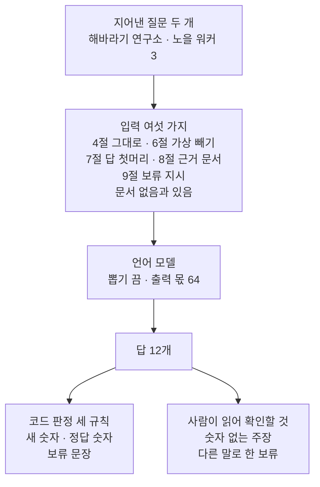
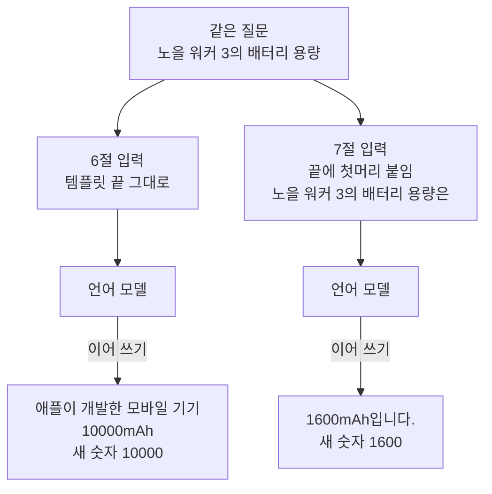
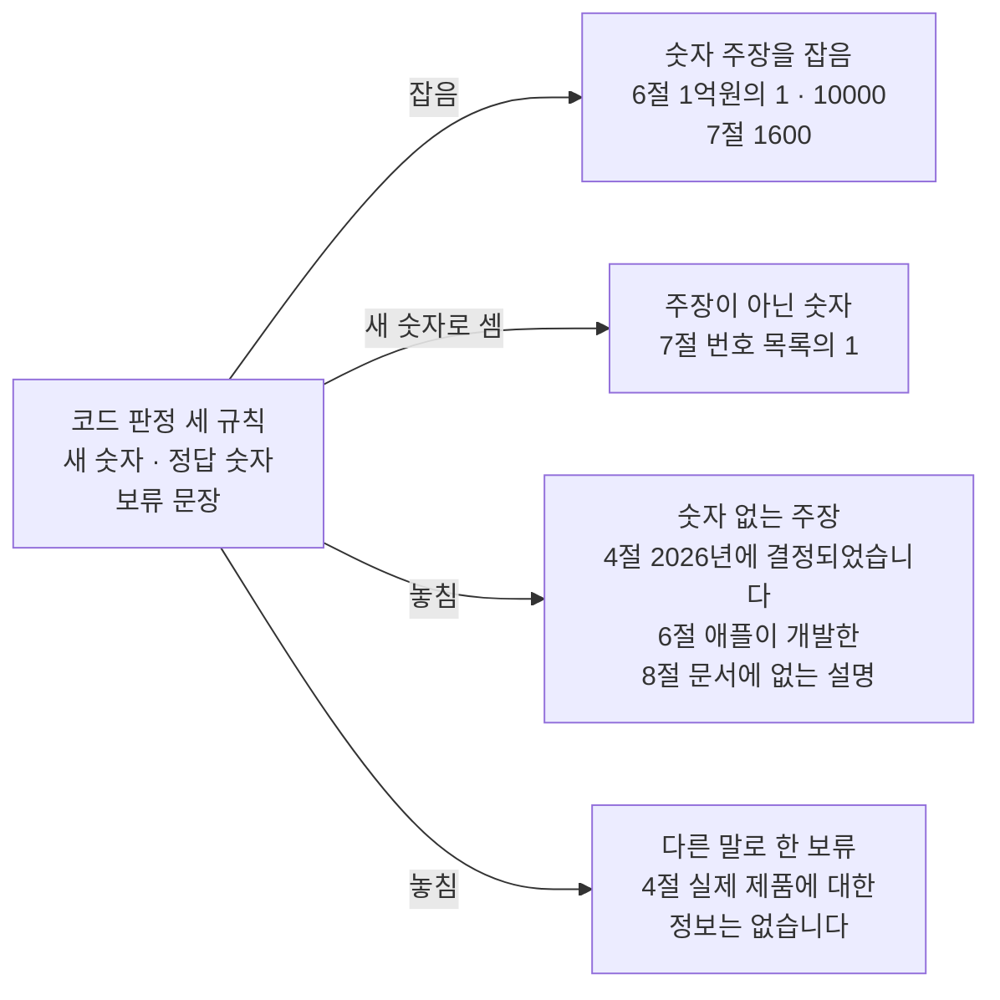
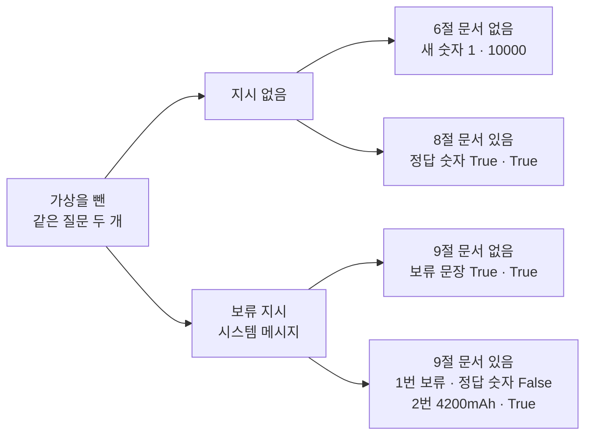

# 07-환각의-구조적-원인

## _src 본문 (HTML 원본)

```html
<!--meta: 강의 1.5h · 실습 0.5h | 코드 Jupyter Notebook | 새 용어 7 -->
<h2 id="b1"><span class="no">1</span>학습 목표</h2>
<div class="goal"><ul><li>근거 없는 질문에 모델이 적은 답에서, 확인할 수 없는 주장과 정보가 없다는 표현을 구분할 수 있습니다.</li><li>답에서 새 숫자, 정답 숫자, 보류 문장을 찾는 판정 코드를 만들고, 그 판정이 놓치는 경우를 설명할 수 있습니다.</li><li>근거 문서와 보류 지시를 넣은 결과를 비교하고, 작은 모델 하나의 관찰을 어디까지 말할 수 있는지 판단할 수 있습니다.</li></ul></div>
<h2 id="b2"><span class="no">2</span>이 내용을 배우는 이유</h2>
<p>모델의 답은 문장이 자연스럽고 설명 모양도 익숙합니다. 그래서 문장이 자연스러우면 내용도 확인된 사실이라고 받아들이기 쉽습니다. 하지만 이 절의 모델은 답을 만들 때 인터넷이나 데이터베이스를 찾아보지 않습니다.</p>
<p>05절에서도 근거를 놓친 답이 문서에 없는 상태 <code>결제 상태: 완료</code>를 적었습니다. 06절에서는 가을 행사 이름을 물었는데 <code>봄행사</code>를 붙인 답이 나왔습니다. 모델을 서비스에 붙이려면 이런 답을 가려낼 규칙이 필요합니다. 그리고 그 규칙이 무엇을 놓치는지도 알아야 합니다.</p>
<p><strong>이 절의 질문</strong> — 근거가 없는 질문에 모델은 왜 그럴듯한 답을 적을까요? 그 답을 코드로 어디까지 판정할 수 있을까요?</p>
<h2 id="b3"><span class="no">3</span>앞에서 배운 내용</h2>
<p>04절에서는 채팅 템플릿으로 시스템 메시지와 사용자 메시지를 합쳐 입력을 만들었습니다. 시스템 메시지가 없으면 영어 기본 지시가 들어간다는 것도 봤습니다. 이 절의 함수 <code>make_input()</code>은 두 모양 가운데 하나를 인자로 고릅니다.</p>
<p>05절에서는 근거 문장의 자리를 바꿔 답을 받고, 답에 <code>314159</code>가 들어 있는지로 판정했습니다. 시스템 지시 한 문장을 넣자 9개 조건이 모두 맞았습니다. 이 절은 05절 함수 <code>ask_model()</code>을 같은 코드로 쓰고, 판정을 숫자 목록 비교로 넓힙니다.</p>
<p>06절에서는 모델이 조각마다 후보 점수를 매기고 하나를 고른다는 것을 봤습니다. 뽑기를 켠 채 temperature 0.0을 넣으면 <code>ValueError</code>가 났습니다. 이 라이브러리에서 「temperature 0」에 해당하는 설정은 뽑기 끄기(<code>do_sample=False</code>)였습니다. 이 절의 생성 12번은 모두 뽑기를 끈 설정입니다.</p>
<p>글자를 하나씩 도는 <code>for</code>와 여러 줄 <code>if/elif</code>는 Ch 2 02절에서 배웠습니다. 연산자 <code>in</code>과 <code>not</code>은 Ch 1 04절에서 처음 썼습니다.</p>
<h2 id="b4"><span class="no">4</span>핵심 개념</h2>
<h3>비유로 시작하기</h3>
<p>해바라기 그림 퍼즐을 맞춘다고 생각합니다. 빈자리에 모양이 딱 맞는 조각을 끼우면 퍼즐은 빈틈 없이 완성돼 보입니다. 그런데 그 조각의 그림이 해바라기가 아니라 물결이라면, 모양은 맞지만 그림은 틀린 것입니다.</p>
<p>모델이 이어 쓴 문장도 비슷합니다. 앞 글에 이어지는 모양은 자연스럽지만, 담긴 내용이 사실인지는 따로 확인해야 합니다. 상자 뚜껑 그림처럼 대조할 근거가 있어야 틀린 조각이 보입니다.</p>
{{img:07-5-퍼즐-조각|나무 탁자 왼쪽에 해바라기 그림 퍼즐이 놓여 있고 가운데쯤 파란 물결 그림 조각 하나가 빈틈 없이 끼워져 있으며, 오른쪽에는 해바라기와 하늘만 그려진 퍼즐 상자 뚜껑이 놓인 삽화|해바라기 퍼즐에 모양은 맞지만 그림이 다른 물결 조각이 끼워져 있고, 옆의 상자 뚜껑 그림과 대 보면 그 조각이 틀렸다는 것이 보입니다.}}
<p><strong>그림 읽기</strong> — 나무 탁자 왼쪽에 해바라기 그림 퍼즐이 있고, 가운데쯤 조각 하나만 파란 물결 그림입니다. 이 조각은 빈틈 없이 끼워져 있어서 모양만 보면 이상한 곳이 없습니다. 오른쪽에는 해바라기와 하늘만 그려진 상자 뚜껑이 놓여 있습니다.</p>
<p>조각의 모양은 문장이 앞 글에 자연스럽게 이어지는 것이고, 조각의 그림은 문장에 담긴 내용입니다. 물결 조각이 근거 없는 내용이고, 뚜껑 그림이 대조할 근거입니다. 뚜껑과 대 보면 물결 조각이 틀렸다는 것을 알 수 있습니다.</p>
<h3>이 절에서 쓰는 말</h3>
<table><thead><tr><th>용어</th><th>뜻</th><th>이 절에서 보이는 모습</th></tr></thead><tbody>
<tr><td>환각(hallucination)</td><td>입력이나 확인할 수 있는 자료가 뒷받침하지 않는 내용을 모델이 답에 적은 것. 영수증을 보지 않고 짐작한 금액을 가계부에 적는 일과 비슷함</td><td><code>지원금은 1억원입니다</code></td></tr>
<tr><td>주장(claim)</td><td>답 속에서 맞는지 확인해야 하는 내용 한 가지. 금액, 날짜, 제품 사양, 만든 회사, 절차 등</td><td><code>애플이 개발한 모바일 기기</code></td></tr>
<tr><td>근거(evidence)</td><td>주장이 맞는지 확인하는 데 쓸 수 있는 자료. 문서, 사양표, 데이터베이스 조회 결과 등</td><td>8절 문서 <code>노을 워커 3의 배터리 용량은 4200mAh입니다.</code></td></tr>
<tr><td>사전학습(pretraining)</td><td>많은 글로 모델을 학습시키는 과정. 학습으로 정해진 숫자가 모델 파일에 저장됨</td><td>03~06절과 같은 모델 파일(약 1GB)</td></tr>
<tr><td>다음 조각 예측(next-token prediction)</td><td>앞 글이 주어졌을 때 이어질 조각을 맞히는 학습 목표. 끝말을 듣고 다음 말을 이어 가는 놀이와 비슷함</td><td>첫머리 뒤에 이은 <code>1600mAh입니다.</code></td></tr>
<tr><td>답변 보류(abstention)</td><td>근거가 없을 때 답 대신 확인할 수 없다고 말하는 것</td><td><code>제공된 정보로는 확인할 수 없습니다.</code></td></tr>
<tr><td>판정 규칙</td><td>답을 맞음, 근거 없음, 보류로 가르는 규칙. 이 절에서는 코드가 숫자와 문장을 찾음</td><td><code>새 숫자: ['10000']</code></td></tr>
</tbody></table>
<h3>다음 조각을 고르는 계산에는 찾아보는 단계가 없습니다</h3>
<p>06절에서 본 것처럼 모델은 조각마다 후보 점수를 매기고 하나를 고릅니다. 이 점수 계산에 들어가는 것은 입력 조각과 모델 파일의 숫자뿐입니다. 인터넷이나 데이터베이스를 찾아보는 단계는 없습니다.</p>
<p>모델 파일의 숫자는 사전학습에서 다음 조각 예측을 배우며 정해졌습니다. 그래서 「배터리 용량은」 뒤에 숫자와 단위가 이어지는 모양은 잘 따릅니다. 하지만 지어낸 제품의 용량을 알려 주는 자료는 계산 어디에도 없습니다.</p>
<p>OpenAI 연구진의 2025년 글은 이를 구조로 설명합니다. 반려동물의 생일처럼 드물고 규칙이 없는 사실은 글의 패턴만으로 맞힐 수 없어 환각으로 이어진다고 봅니다. 또 정답 비율만으로 채점하면, 모른다고 답하기보다 짐작해 적는 쪽이 유리해진다고 봅니다. 이것은 여러 설명 가운데 하나이고, 이 절의 실험이 증명한 것은 아닙니다.</p>
<h3>이 절의 실험과 판정 규칙</h3>
<p>노트북은 지어낸 연구소와 제품을 묻는 질문 두 개를 입력 여섯 가지로 넣습니다. 질문 그대로, 「가상」 낱말 빼기, 답 첫머리 붙이기, 근거 문서 넣기가 네 가지입니다. 나머지 두 가지는 보류 지시를 문서 없이 넣은 입력과, 문서와 함께 넣은 입력입니다.</p>
<p>답 12개는 코드로 만든 규칙 세 가지로 판정합니다. 새 숫자는 질문이나 문서에 없던 숫자가 답에 나온 것입니다. 정답 숫자는 교재가 문서에 적은 300과 4200이 답의 숫자 목록에 있는 것입니다. 보류 문장은 「제공된 정보로는 확인할 수 없습니다」가 답에 들어 있는 것입니다.</p>
{{mermaid:07-1-실험-설계|초록 상자 지어낸 질문 두 개가 초록 상자 입력 여섯 가지로 이어지고, 보라 상자 언어 모델 뽑기 끔 출력 몫 64를 거쳐 노란 상자 답 12개가 된 뒤, 파란 상자 코드 판정 세 규칙과 회색 상자 사람이 읽어 확인할 것으로 갈라지는 흐름도|지어낸 질문 두 개를 입력 여섯 가지로 모델에 넣어 답 12개를 받고, 코드 판정 세 규칙과 사람이 읽을 것으로 나눠 봅니다.}}
<p><strong>도식 읽기</strong> — 위에서 아래로 읽습니다. 초록 상자 두 개는 노트북에서 만든 질문과 입력 여섯 가지이고, 보라 상자는 실행한 언어 모델입니다. 노란 상자는 출력으로 받은 답 12개입니다.</p>
<p>답은 두 갈래로 나뉩니다. 파란 상자는 노트북에서 정의한 판정 규칙이고, 회색 상자는 그 규칙이 보지 못해 사람이 읽어 확인할 것입니다. 회색 상자에 무엇이 들어가는지는 실행 예제에서 확인합니다.</p>
<h2 id="b5"><span class="no">5</span>실행 예제</h2>
<p>노트북은 03~06절과 같은 모델을 받고 출력 몫을 64로 정합니다. 입력을 만드는 함수와 05절과 같은 <code>ask_model()</code> 함수를 정의한 뒤, 근거 없는 질문 두 개로 답을 받습니다. 숫자를 찾는 함수 두 개로 판정하고, 질문 글과 답 첫머리를 바꿔 다시 묻습니다. 마지막에 근거 문서와 보류 지시를 넣어 묻습니다.</p>
<p>인터넷 서비스의 모델을 부르지 않으므로 API 키가 필요 없고 비용도 들지 않습니다. 모델이 답을 만드는 계산은 모두 12번이고, 실행에는 1분 안팎이 걸립니다.</p>
{{notebook:07-환각의-구조적-원인}}
<p class="look"><b>확인할 점</b> — 4절 두 답의 모양과 5절 판정 <code>0 | [] | False</code>를 봅니다. 6절 <code>새 숫자: ['10000']</code>과 7절 <code>새 숫자: ['1600']</code>을 비교합니다. 9절 둘째 셀에서 문서가 있는데도 보류한 질문이 어느 것인지 확인합니다.</p>
<h3>근거 없는 질문과 첫 판정</h3>
<p>4절 첫 답은 <code>지원금은 2026년에 결정되었습니다.</code>로 시작해, 연구 결과를 공개하는 지원 방식처럼 설명했습니다. 이 제도는 교재가 지어낸 것이라 그 설명을 뒷받침할 자료가 없습니다. 둘째 답은 <code>실제 제품에 대한 정보는 없습니다</code>라고 말하고 용량을 적지 않았습니다.</p>
<p>5절 판정 두 줄은 <code>0 | [] | False</code>와 <code>1 | [] | False</code>였습니다. 첫 답의 2026은 질문에도 있어 새 숫자가 아니고, 제도 설명에는 숫자가 없습니다. 둘째 답은 다른 말로 정보가 없다고 해서, 정해 둔 보류 문장과 글자가 달랐습니다.</p>
<h3>질문 낱말과 답 첫머리를 바꾸면</h3>
<p>6절에서 「가상 기관」과 「가상 제품」만 빼자 첫 답은 <code>지원금은 1억원입니다</code>를 적었습니다. 둘째 답은 지어낸 제품을 <code>애플이 개발한 모바일 기기</code>라고 소개하고 <code>10000mAh</code>를 적었습니다. 이 두 질문에서는 「가상」 낱말을 빼자 정보가 없다는 답이 사라졌습니다.</p>
<p>7절에서는 같은 질문의 입력 끝에 「노을 워커 3의 배터리 용량은」을 붙였습니다. 모델은 그 뒤에 <code>1600mAh입니다.</code>를 이었습니다. 입력 끝의 글만 달라졌는데 용량이 10000에서 1600으로 바뀌었습니다.</p>
{{mermaid:07-2-첫머리-잇기|맨 위 초록 상자 같은 질문 노을 워커 3의 배터리 용량에서 두 줄기로 나뉘어, 왼쪽은 초록 상자 6절 입력 템플릿 끝 그대로가 보라 상자 언어 모델을 거쳐 노란 상자 애플이 개발한 모바일 기기 10000mAh 새 숫자 10000으로, 오른쪽은 초록 상자 7절 입력 끝에 첫머리 붙임이 보라 상자 언어 모델을 거쳐 노란 상자 1600mAh입니다 새 숫자 1600으로 가는 흐름도|같은 질문이라도 입력 끝에 답의 첫머리를 붙이자, 모델이 적은 용량이 10000mAh에서 1600mAh로 바뀌었습니다.}}
<p><strong>도식 읽기</strong> — 위에서 아래로 읽고, 두 줄기를 나란히 비교합니다. 맨 위 초록 상자는 같은 질문이고, 그 아래 초록 상자 두 개는 입력 끝만 다른 6절과 7절 입력입니다. 보라 상자는 같은 언어 모델이고, 노란 상자는 이어 쓴 답과 새 숫자 판정입니다.</p>
<p>두 노란 상자의 용량 숫자가 다릅니다. 두 숫자 모두 뒷받침할 자료가 없고, 입력 끝의 모양에 따라 달라졌습니다.</p>
<h3>판정이 놓친 것</h3>
<p>새 숫자 규칙은 6절의 1억원과 10000mAh, 7절의 1600mAh를 잡았습니다. 하지만 7절 첫 줄의 <code>새 숫자: ['1']</code>은 금액이 아닙니다. 이어 쓴 글의 번호 목록 <code>1. 연구 결과의 중요성</code>에서 온 1입니다. 6절 「1억원」의 1과 판정 글자는 같지만 뜻이 다릅니다.</p>
<p>8절에서 문서를 넣자 두 답 모두 <code>정답 숫자 있음: True</code>였습니다. 그런데 첫 답은 문서에 없는 문장 <code>이는 연구자의 일상적인 생활과 휴식을 제공하는 데 있어 중요한 지원책입니다.</code>를 붙였습니다. 세 규칙 모두 이 문장을 문제로 세지 않았습니다.</p>
{{mermaid:07-3-판정이-놓친-것|왼쪽 파란 상자 코드 판정 세 규칙에서 네 갈래로 나뉘어, 잡음 화살표는 노란 상자 숫자 주장을 잡음 6절 1억원의 1과 10000 7절 1600으로, 새 숫자로 셈 화살표는 노란 상자 주장이 아닌 숫자 7절 번호 목록의 1로, 놓침 화살표 두 개는 회색 상자 숫자 없는 주장과 회색 상자 다른 말로 한 보류로 가는 흐름도|판정 세 규칙은 숫자 주장을 잡았지만 번호 목록의 1도 새 숫자로 셌고, 숫자 없는 주장과 다른 말로 한 보류는 놓쳤습니다.}}
<p><strong>도식 읽기</strong> — 왼쪽에서 오른쪽으로 읽습니다. 왼쪽 파란 상자는 노트북에서 정의한 판정 세 규칙입니다. 오른쪽 위 노란 상자 두 개는 규칙이 새 숫자로 센 것이고, 아래 회색 상자 두 개는 규칙이 놓친 것입니다.</p>
<p>첫 노란 상자는 숫자 주장을 제대로 잡은 경우이고, 둘째 노란 상자는 주장이 아닌 번호를 센 경우입니다. 회색 상자에는 숫자 없는 주장 세 가지와 다른 말로 한 보류가 있습니다. 회색 상자는 코드가 멈춘 실패가 아니라 판정이 보지 못한 것이라서 빨강으로 칠하지 않았습니다.</p>
<h2 id="b6"><span class="no">6</span>실험 결과 해석</h2>
<p>먼저 이 절에서 본 환각의 모양입니다. 지어낸 이름을 묻자 모델은 금액 <code>1억원</code>, 용량 <code>10000mAh</code>, 만든 회사 <code>애플이 개발한</code>, 제도 설명을 적었습니다. 문장은 모두 자연스럽지만, 교재가 지어낸 이름이라 뒷받침할 자료가 없습니다.</p>
<p>다음은 구조입니다. 7절에서 입력 끝만 바꾸자 같은 질문의 용량이 달라졌습니다. 생성 계산이 자료를 찾지 않고 앞 글에 이어질 조각을 고른다는 설명과 맞는 관찰입니다. 다만 모델 안의 어떤 계산이 1600을 골랐는지는 이 노트북으로 알 수 없습니다.</p>
<p>이제 근거 문서와 보류 지시입니다. 지시 없이 문서를 넣으면 두 질문 모두 정답 숫자를 적었습니다. 보류 지시를 넣고 문서 없이 물으면 두 질문 모두 보류 문장으로 답했습니다.</p>
{{mermaid:07-4-근거와-보류-지시|왼쪽 초록 상자 가상을 뺀 같은 질문 두 개가 초록 상자 지시 없음과 초록 상자 보류 지시 시스템 메시지로 나뉘고, 지시 없음은 노란 상자 6절 문서 없음 새 숫자 1과 10000, 노란 상자 8절 문서 있음 정답 숫자 True와 True로, 보류 지시는 노란 상자 9절 문서 없음 보류 문장 True와 True, 노란 상자 9절 문서 있음 1번 보류 정답 숫자 False 2번 4200mAh True로 가는 흐름도|문서 없이 물으면 지시가 없을 때 숫자를 지어내고 보류 지시가 있을 때 보류했습니다. 보류 지시와 문서를 함께 넣자 첫 질문은 문서가 있는데도 보류했습니다.}}
<p><strong>도식 읽기</strong> — 왼쪽에서 오른쪽으로 읽습니다. 맨 왼쪽 초록 상자는 「가상」을 뺀 두 질문이고, 가운데 초록 상자 두 개는 보류 지시를 넣었는지입니다. 오른쪽 노란 상자 네 개는 문서가 없을 때와 있을 때의 판정 결과입니다.</p>
<p>맨 아래 상자가 이 절에서 가장 조심해 읽을 결과입니다. 보류 지시와 문서를 함께 넣자, 첫 질문은 문서에 금액이 있는데도 보류했습니다. 둘째 질문은 <code>4200mAh&lt;|im_end|&gt;</code>로 답했습니다.</p>
<p>그래서 보류 문장 수만 세면 좋은 결과로 잘못 읽을 수 있습니다. 근거가 없는 질문의 보류와, 근거가 있는 질문의 답을 함께 세야 합니다. 9절 첫 질문은 보류 문장이 True이면서 정답 숫자는 False입니다.</p>
<p>이 결과를 넓혀 말하지 않습니다. 본 것은 작은 모델 하나, 지어낸 질문 두 개, 보류 지시 문장 하나, 뽑기를 끈 계산입니다. 작업 중 기기 셸에서 같은 지시를 사용자 메시지 앞에 붙여 봤습니다. 그러자 문서가 있는데도 보류한 질문이 첫 질문에서 둘째 질문으로 바뀌었고, 이 실행은 노트북에 넣지 않았습니다.</p>
<p>환각의 원인은 하나로 정할 수 없습니다. 학습 목표, 학습 자료에 없는 사실, 질문에 준 정보, 모델 크기, 평가 방식이 함께 영향을 줄 수 있습니다. 이 절은 그 가운데 「근거 없는 질문에도 문장을 이어 쓴다」는 모양 하나를 관찰했습니다.</p>
<h2 id="b7"><span class="no">7</span>주의할 점과 실무 메모</h2>
<ul><li>판정 규칙은 숫자 글자와 한 문장만 봅니다. 숫자 없는 주장, 다른 말로 한 보류, 번호 목록의 숫자는 사람이 답을 읽어 가려야 합니다. 코드 모양상 「용량은 4200mAh가 아닙니다」 같은 답도 정답 숫자가 True로 나옵니다. 이런 답은 이번에 실행하지 않았습니다.</li>
<li>새 숫자 규칙은 지어낸 이름처럼 답을 적은 자료가 없는 질문에서만 뜻이 있습니다. 실제 제품을 물으면 질문에 없던 숫자가 맞는 답일 수도 있습니다.</li>
<li>기기 셸에서 04·05절 시스템 지시 「주어진 문서 범위에서만 답하세요.」로도 물어 봤습니다. 문서가 있으면 두 질문 모두 정답 숫자를 적었습니다. 문서가 없으면 둘째 질문에 <code>2019년에 출시된 모델로, 배터리 용량은 4000mAh입니다</code>라고 지어냈습니다. 이 실행은 노트북에 넣지 않았습니다.</li>
<li>06절 주의 메모처럼, 모델 기본 설정의 반복 벌점 1.1은 뽑기를 끈 이 절의 생성에도 적용됐습니다. 이 값을 바꾼 실행은 하지 않았습니다.</li>
<li>Ch 6 01절은 메시지가 거부된 오류를 모델의 환각 사례로 기록하면 안 된다고 적습니다. 오류로 멈춘 호출과 근거 없는 답은 따로 기록합니다.</li>
<li>Ch 9 04절은 모델이 표기한 출처가 검색한 문서 가운데 하나여야 하고, 아니면 지어낸 출처라고 적습니다. 출처를 붙이라고 지시해도, 적힌 출처가 실제로 내용을 뒷받침하는지 따로 확인합니다.</li>
<li>Ch 9 05절은 문서에 답이 없는 질문과 검색이 정답 문서를 놓친 질문을 거부 답만으로 구분할 수 없다고 적습니다. 이 절 9절에서도 보류 답만 보고는 근거가 있었는지 알 수 없었습니다.</li>
<li>Ch 15 02절은 응답의 주장이 검색 문서로 뒷받침되는지 보는 근거 충실도(Groundedness) 평가를 다룹니다. 8절 첫 답의 문서에 없는 문장은 숫자 규칙으로는 잡지 못한 종류의 문제입니다.</li>
<li>노트북과 같은 계산을 스크립트로 실행했을 때 Python이 쓴 메모리는 최대 약 3.2GB였습니다. 교재를 만든 컴퓨터의 메모리는 3.8GB입니다.</li>
<li>교재 출력은 2026-09-16에 Linux(aarch64) 컴퓨터에서 만들었습니다. 쓴 Python은 3.12.13이고, torch는 CPU용 2.8.0입니다. 패키지는 transformers 4.56.2이고, 모델 판 번호는 <code>7ae5576…</code>입니다. GPU, Windows·macOS에서는 실행하지 않았습니다.</li></ul>
<h2 id="b8"><span class="no">8</span>정리와 다음 절</h2>
<ul><li>지어낸 이름을 묻자 모델은 확인할 수 없는 설명이나 금액과 용량을 적었습니다. 「가상」 낱말이 있을 때만 한 질문에서 정보가 없다고 했습니다.</li><li>답의 첫머리만 붙이자 용량이 10000에서 1600으로 바뀌었습니다. 이 모델의 생성 계산은 앞 글에 이어질 조각을 고르고, 자료를 찾아보는 단계가 없습니다.</li><li>코드 판정은 숫자 주장을 잡았지만 숫자 없는 주장과 다른 말로 한 보류를 놓쳤습니다. 보류 지시는 지어낸 숫자를 막았지만, 근거가 있는 질문 하나도 보류하게 했습니다.</li></ul>
<p><strong>다음 학습과 이어지는 지점</strong> — <a href="08-모델-선택-기준.html">08절 모델 선택 기준</a>에서는 조건이 다른 모델 후보를 비교하는 기준을 봅니다. Ch 9에서는 이 절 8절처럼 문서를 입력에 넣되, 질문에 맞는 문서를 검색으로 골라 넣습니다.</p>
<h2 id="b9"><span class="no">9</span>복습 문제</h2><details class="quiz"><summary>문제와 해설</summary>
<p class="quiz-q">1. 4절 첫 답을 「숫자를 적지 않았으니 환각이 아니다」라고 볼 수 없는 까닭은 무엇인가요? · 기초</p><p class="quiz-a"><b>해설</b> — 첫 답은 지원금이 2026년에 결정됐다고 하고, 연구 결과를 공개하는 지원 방식처럼 설명했습니다. 이 제도는 교재가 지어낸 것이라 그 설명을 뒷받침할 자료가 없습니다. 숫자가 없어도 확인할 수 없는 제도 설명은 근거 없는 주장입니다.</p>
<p class="quiz-q">2. 함수 <code>find_new_numbers()</code>에 답 「용량은 4200mAh입니다」와 질문 「노을 워커 3의 용량은?」을 넣으면 무엇이 나올까요? · 기초</p><p class="quiz-a"><b>해설</b> — 질문의 숫자 목록은 3 하나이고, 답의 숫자 목록은 4200 하나입니다. 4200은 질문 목록에 없으므로 4200 하나가 든 목록이 반환됩니다. 노트북에서 실행하지 않은 값이라, 5절 셀 아래에 새 셀을 만들어 확인합니다.</p>
<p class="quiz-q">3. 6절 첫 답과 7절 첫 줄은 둘 다 새 숫자 판정이 1이었습니다. 두 1은 무엇이 다른가요? · 적용</p><p class="quiz-a"><b>해설</b> — 6절의 1은 「1억원」이라는 지어낸 금액의 일부입니다. 7절의 1은 번호 목록 「1. 연구 결과의 중요성」의 번호라서 주장이 아닙니다. 규칙은 숫자 글자만 보므로 둘을 구분하지 못하고, 사람이 답을 읽어 가려야 합니다.</p>
<p class="quiz-q">4. 동료가 「9절에서 보류 지시를 넣자 근거 없는 질문 두 개가 모두 보류됐으니, 이 지시로 환각을 막을 수 있다」고 합니다. 무엇이라고 답하나요? · 분석</p><p class="quiz-a"><b>해설</b> — 같은 지시에 문서를 넣자 첫 질문은 문서에 금액이 있는데도 보류했습니다. 그래서 근거가 있는 질문에 답했는지도 함께 세야 합니다. 본 것은 모델 하나, 질문 두 개, 지시 문장 하나입니다. 지시를 사용자 메시지에 붙이자 보류한 질문이 바뀐 기기 셸 기록도 있어, 일반 규칙으로 말할 수 없다고 답합니다.</p>
<p class="quiz-q">5. 8절 첫 답은 정답 숫자가 True이고 새 숫자가 없었습니다. 그래도 답을 그대로 믿기 어려운 까닭은 무엇이고, 무엇을 더 확인해야 하나요? · 분석</p><p class="quiz-a"><b>해설</b> — 첫 답은 문서에 없는 문장 <code>이는 연구자의 일상적인 생활과 휴식을 제공하는 데 있어 중요한 지원책입니다.</code>를 붙였습니다. 숫자 규칙은 이 문장을 보지 못합니다. 답의 문장마다 문서가 뒷받침하는지 대조해야 하고, Ch 15 02절의 근거 충실도 평가가 이런 대조를 다룹니다.</p>
</details>
<h2 id="b10"><span class="no">10</span>참고 자료</h2>
<ul><li><a href="https://openai.com/index/why-language-models-hallucinate/">OpenAI: Why Language Models Hallucinate</a> · 2025-09-05 · 확인 2026-09-16</li><li><a href="https://cdn.openai.com/pdf/d04913be-3f6f-4d2b-b283-ff432ef4aaa5/why-language-models-hallucinate.pdf">Kalai 등의 논문 원문(PDF)</a> · 2025 · 확인 2026-09-09</li><li><a href="https://huggingface.co/Qwen/Qwen2.5-0.5B-Instruct/tree/7ae557604adf67be50417f59c2c2f167def9a775">Qwen2.5-0.5B-Instruct 모델 카드(Apache-2.0)</a> · 판 7ae5576 · 확인 2026-09-16</li></ul>
```

## 노트북 셀 (순서대로)

### [0] markdown {'html': 'skip'}

# 환각의 구조적 원인

**이 노트북에서 할 일**

1. 지어낸 연구소와 제품을 묻는 질문 두 개로 답을 받고, 질문 낱말과 답의 첫머리를 바꿔 봅니다.
2. 답에서 숫자를 찾는 함수로 근거 없는 숫자와 보류 문장을 판정하고, 그 판정이 놓치는 것을 봅니다.
3. 근거 문서와 보류 지시를 넣어 같은 질문을 다시 묻고, 결과를 어디까지 말할 수 있는지 판단합니다.

**준비물** — API 키는 필요 없습니다. 인터넷 서비스의 모델을 부르지 않고, 내 컴퓨터에서 작은 언어 모델을 실행합니다.
그래서 비용은 들지 않습니다. 모델이 답을 만드는 계산은 모두 12번 합니다.

실행 시간은 1분 안팎입니다. 모델 파일은 03~06절과 같은 약 1GB(954MiB)이고, 캐시에 없으면 Hugging Face 사이트에서 내려받습니다.
노트북과 같은 계산을 스크립트로 실행했을 때 Python이 쓴 메모리는 최대 약 3.2GB였습니다.

**기준 버전** — 실습 폴더에 고정한 transformers 4.56.2와 torch 2.8.0을 씁니다.
모델은 `Qwen/Qwen2.5-0.5B-Instruct`이고, 판 번호(revision)를 `7ae557604adf67be50417f59c2c2f167def9a775`로 고정해 받습니다.

교재 출력은 Linux(aarch64)의 Python 3.12.13과 CPU용 torch(2.8.0+cpu)로 만들었습니다. 다른 버전, GPU, Windows·macOS에서는 이번에 실행하지 않았습니다.

실습 폴더 `labs/part1/ch05-llm-principles`에서 01절과 같은 `.venv` 커널을 고른 뒤 첫 셀부터 순서대로 실행합니다.

### [1] markdown {'html': 'skip'}

## 오늘 볼 그림


위에서 아래로 읽습니다. 초록 상자는 노트북에서 만든 질문과 입력이고, 보라 상자는 실행한 언어 모델입니다.
노란 상자는 출력으로 확인하는 답과 코드 판정입니다. 회색 상자는 코드 판정이 보지 못해 사람이 답을 읽어 확인할 것입니다.

### [2] markdown {}

## 1. 준비

이 절은 파일을 읽거나 만들지 않습니다. 준비 셀에서는 transformers 패키지를 불러오고 버전을 확인합니다.

함수 `warnings.filterwarnings()` 줄은 01절처럼 진행 표시 위젯이 없다는 경고 한 줄을 끕니다.
함수 `transformers.logging.set_verbosity_error()`는 04절처럼, 생성 셀에서 나오는 오류가 아닌 안내를 화면에 내지 않게 합니다.

### [3] code {'execution': {'iopub.execute_input': '2026-09-16T20:15:49.813703Z', 'iopub.status.busy': '2026-09-16T20:15:49.813525Z', 'iopub.status.idle': '2026-09-16T20:15:53.957379Z', 'shell.execute_reply': '2026-09-16T20:15:53.956989Z'}, 'lesson_role': 'setup'}

```python
# transformers 패키지를 불러오고, 오류가 아닌 안내 경고를 줄인 뒤 버전을 확인합니다
import warnings

# 진행 표시 위젯이 없다는 경고(TqdmWarning)는 계산과 관계없어 화면에 내지 않습니다
warnings.filterwarnings("ignore", message="IProgress not found")

import transformers
from transformers import AutoModelForCausalLM, AutoTokenizer

# 생성 셀의 안내(오류 아님)를 화면에 내지 않습니다
transformers.logging.set_verbosity_error()
print("transformers 버전:", transformers.__version__)
```

출력:
```
transformers 버전: 4.56.2

```

### [4] markdown {}

**결과 읽기** — 출력 줄은 `transformers 버전: 4.56.2`입니다. 준비물에 적은 기준 버전과 같습니다.

### [5] markdown {}

## 2. 모델과 출력 몫

모델은 03~06절과 같은 Qwen2.5-0.5B-Instruct이고, 같은 판 번호로 받습니다.
이 절의 계산은 입력 조각과 모델 파일에 든 숫자만 씁니다. 인터넷이나 데이터베이스를 찾아보는 단계는 없습니다.

출력 몫은 04절에서 정한 이름으로, 모델이 새로 만들 조각 수의 상한입니다.
답에 적힌 주장을 조금 더 길게 보려고, 05·06절의 32보다 큰 64로 정합니다.

### [6] code {'execution': {'iopub.execute_input': '2026-09-16T20:15:53.958288Z', 'iopub.status.busy': '2026-09-16T20:15:53.958145Z', 'iopub.status.idle': '2026-09-16T20:15:55.939913Z', 'shell.execute_reply': '2026-09-16T20:15:55.938258Z'}}

```python
# 03~06절과 같은 언어 모델과 토큰화기를 받고, 새로 만들 조각 수의 상한인 출력 몫을 정합니다
model_name = "Qwen/Qwen2.5-0.5B-Instruct"
model_revision = "7ae557604adf67be50417f59c2c2f167def9a775"
tokenizer = AutoTokenizer.from_pretrained(model_name, revision=model_revision)
model = AutoModelForCausalLM.from_pretrained(model_name, revision=model_revision)
# 답에 적힌 주장을 조금 더 길게 보려고 05·06절의 32보다 크게 정합니다
output_budget = 64
print("모델 이름:", model_name)
print("출력 몫:", output_budget)
```

출력:
```
모델 이름: Qwen/Qwen2.5-0.5B-Instruct
출력 몫: 64

```

### [7] markdown {}

**결과 읽기** — 출력 줄은 `모델 이름: Qwen/Qwen2.5-0.5B-Instruct`와 `출력 몫: 64`입니다.

이 노트북의 모든 생성은 05절처럼 뽑기를 끈 설정(`do_sample=False`)으로 합니다. 06절 9절에서 본 것처럼, 이 라이브러리에서 「temperature 0」에 해당하는 설정입니다.
이 노트북의 출력은 2026-09-16에 이 모델과 판 번호로 실행한 결과입니다. 실행 환경이나 버전이 바뀌면 답 문장이 달라질 수 있습니다.

### [8] markdown {}

## 3. 입력을 만들고 답을 받는 함수

먼저 입력 글을 만드는 함수를 정의합니다. 인자 `system_text`가 빈 글 `""`이면 사용자 메시지 하나만 넣습니다.
빈 글이 아니면 그 글을 시스템 메시지로 앞에 넣습니다. 05절은 두 경우를 함수 두 개로 나눴고, 이 절은 `if` 하나로 합칩니다.

사용자 메시지만 넣으면 04절에서 본 것처럼 채팅 템플릿이 영어 기본 지시를 넣습니다. 이 셀은 함수를 정의만 합니다.

### [9] code {'execution': {'iopub.execute_input': '2026-09-16T20:15:55.943279Z', 'iopub.status.busy': '2026-09-16T20:15:55.943075Z', 'iopub.status.idle': '2026-09-16T20:15:55.946778Z', 'shell.execute_reply': '2026-09-16T20:15:55.946159Z'}}

```python
# 시스템 지시와 사용자 글을 받아, 채팅 템플릿으로 합친 입력 글을 반환하는 함수를 정의합니다
def make_input(system_text, user_text):
    message_list = []
    # 시스템 지시가 빈 글이 아닐 때만 시스템 메시지를 먼저 넣습니다
    if system_text != "":
        message_list.append({"role": "system", "content": system_text})
    message_list.append({"role": "user", "content": user_text})
    return tokenizer.apply_chat_template(message_list, tokenize=False, add_generation_prompt=True)
```

출력:
```

```

### [10] markdown {}

**결과 읽기** — 정의만 하는 셀이라 출력이 없습니다.

다음은 입력 글을 받아 모델의 답을 반환하는 함수입니다. 05절 `ask_model()` 함수와 같은 코드입니다.
노트북은 서로 독립이라 다시 정의합니다. 새 조각을 글로 바꾸면 04절처럼 답 끝에 끝 표시 `<|im_end|>`가 남습니다. 이 셀도 함수를 정의만 합니다.

### [11] code {'execution': {'iopub.execute_input': '2026-09-16T20:15:55.948355Z', 'iopub.status.busy': '2026-09-16T20:15:55.948199Z', 'iopub.status.idle': '2026-09-16T20:15:55.951439Z', 'shell.execute_reply': '2026-09-16T20:15:55.950807Z'}}

```python
# 입력 글을 받아, 출력 몫 안에서 모델이 만든 새 조각만 글로 바꿔 반환하는 함수를 정의합니다
def ask_model(input_text):
    input_ids = tokenizer.encode(input_text, return_tensors="pt")
    # do_sample=False는 05·06절처럼 다음 조각을 무작위로 뽑지 않는 설정입니다
    output_ids = model.generate(input_ids=input_ids, max_new_tokens=output_budget, do_sample=False)
    all_ids = output_ids[0].tolist()
    # 입력 조각 수만큼 건너뛴 뒤가 새 조각입니다
    input_length = len(input_ids[0])
    new_ids = all_ids[input_length:len(all_ids)]
    return tokenizer.decode(new_ids)
```

출력:
```

```

### [12] markdown {}

**결과 읽기** — 정의만 하는 셀이라 출력이 없습니다.

## 4. 근거 없는 질문 두 개

질문 두 개는 교재가 지어낸 「해바라기 연구소」의 제도와, 지어낸 제품 「노을 워커 3」을 묻습니다. 05절 「해바라기 작전」처럼 지어낸 이름입니다.
이 절은 교재 밖 어디에도 이 질문의 답을 적은 자료가 없다고 보고 실험합니다. 질문 글에는 「가상 기관」, 「가상 제품」이라는 낱말도 들어 있습니다.

답은 한 줄로 보려고 05절처럼 줄바꿈을 빈칸으로 바꿔 출력합니다. 5절에서 판정하려고 답을 `answers`에 모읍니다.
실행 전에 예상합니다. 모델이 찾아볼 자료가 없으니, 두 답 모두 모른다고 할 것입니다.

### [13] code {'execution': {'iopub.execute_input': '2026-09-16T20:15:55.952644Z', 'iopub.status.busy': '2026-09-16T20:15:55.952521Z', 'iopub.status.idle': '2026-09-16T20:16:08.370593Z', 'shell.execute_reply': '2026-09-16T20:16:08.369940Z'}}

```python
# 지어낸 연구소와 제품을 묻는 질문 두 개로, 근거 없이 답을 받습니다
questions = [
    "2026년 가상 기관 '해바라기 연구소'의 초록 패스 제도 지원금은 얼마인가요?",
    "가상 제품 '노을 워커 3'의 배터리 용량은 몇 mAh인가요?",
]
answers = []
for question in questions:
    input_text = make_input("", question)
    answer = ask_model(input_text)
    answers.append(answer)
    print("질문:", question)
    # 답 안의 줄바꿈은 빈칸으로 바꿔 한 줄에 출력합니다
    print("답:", answer.replace("\n", " "))
```

출력:
```
질문: 2026년 가상 기관 '해바라기 연구소'의 초록 패스 제도 지원금은 얼마인가요?
답: 해바라기 연구소의 초록 패스 제도 지원금은 2026년에 결정되었습니다. 이는 해바라기 연구소가 학술적으로 인정받고 있는 연구를 위한 지원을 제공하는 방식으로, 이는 연구 결과를 공개하고 교
질문: 가상 제품 '노을 워커 3'의 배터리 용량은 몇 mAh인가요?
답: "노을 워커 3"라는 이름으로 인해, 실제 제품에 대한 정보는 없습니다. "노을 워커 3"이라는 제품이 실제로 존재하지 않는 것으로 보입니다. 이 제품의 배터리 용량에 대해 구체적인 정보를 제공하려면,

```

### [14] markdown {}

**결과 읽기** — 첫 답은 `해바라기 연구소의 초록 패스 제도 지원금은 2026년에 결정되었습니다.`로 시작합니다. 이어서 연구 결과를 공개하는 지원 방식처럼 보이는 설명을 붙였습니다.
둘째 답은 `실제 제품에 대한 정보는 없습니다`라고 말하고, 배터리 용량 숫자를 적지 않았습니다.

예상과 달리 두 답의 모양이 달랐습니다. 첫 답은 지원금 액수를 적지 않았지만, 확인할 수 없는 제도 설명을 사실처럼 적었습니다.
두 답 모두 끝 표시 `<|im_end|>` 없이 출력 몫 64조각에서 끊겼습니다.

### [15] markdown {}

## 5. 코드로 판정하기 — 새 숫자와 보류 문장

이 절에서 환각(hallucination)은 입력이나 확인할 수 있는 자료가 뒷받침하지 않는 내용을 모델이 답에 적은 것입니다.
영수증을 보지 않고 짐작한 금액을 가계부에 적는 일과 비슷합니다. 답을 눈으로만 읽지 않고, 코드로 판정하는 규칙 두 가지를 정합니다.

첫째 규칙은 「새 숫자」입니다. 지어낸 이름이라 답을 적은 자료가 없으니, 질문에 없던 숫자가 답에 나오면 근거 없는 숫자로 셉니다.
둘째 규칙은 「보류 문장」입니다. 9절 지시에서 쓸 문장 「제공된 정보로는 확인할 수 없습니다」가 답에 들어 있는지 봅니다.

먼저 글에서 숫자를 찾는 함수를 정의합니다. 메서드 `isdigit()`은 글자 하나가 0부터 9까지의 숫자이면 True를 반환합니다.
숫자 글자가 이어지는 동안 `current`에 붙이고, 숫자가 아닌 글자를 만나면 모은 숫자를 목록에 넣습니다.
글 끝에 빈칸 하나를 붙여 돌면, 글이 숫자로 끝나도 마지막 숫자가 목록에 들어갑니다. 이 셀은 함수를 정의만 합니다.

### [16] code {'execution': {'iopub.execute_input': '2026-09-16T20:16:08.371581Z', 'iopub.status.busy': '2026-09-16T20:16:08.371509Z', 'iopub.status.idle': '2026-09-16T20:16:08.374182Z', 'shell.execute_reply': '2026-09-16T20:16:08.373788Z'}}

```python
# 글에서 이어진 숫자 글자를 찾아, 숫자 글 목록으로 반환하는 함수를 정의합니다
def find_numbers(text):
    numbers = []
    current = ""
    # 글 끝에 빈칸을 붙여, 마지막 숫자도 숫자가 아닌 글자를 만나게 합니다
    for letter in text + " ":
        if letter.isdigit():
            current = current + letter
        # 숫자가 끝난 자리에서 모은 숫자를 목록에 넣고 비웁니다
        elif current != "":
            numbers.append(current)
            current = ""
    return numbers
```

출력:
```

```

### [17] markdown {}

**결과 읽기** — 정의만 하는 셀이라 출력이 없습니다.

짧은 글 하나로 함수를 확인합니다. 글 「노을 워커 3의 배터리 용량은 4200mAh입니다.」에는 숫자가 두 군데 있습니다.
실행 전에 예상합니다. 글 두 개 `'3'`과 `'4200'`이 든 목록이 나올 것입니다.

### [18] code {'execution': {'iopub.execute_input': '2026-09-16T20:16:08.374749Z', 'iopub.status.busy': '2026-09-16T20:16:08.374683Z', 'iopub.status.idle': '2026-09-16T20:16:08.376518Z', 'shell.execute_reply': '2026-09-16T20:16:08.376206Z'}}

```python
# 숫자가 두 군데 있는 짧은 글로 find_numbers() 함수를 확인합니다
sample_text = "노을 워커 3의 배터리 용량은 4200mAh입니다."
print("찾은 숫자:", find_numbers(sample_text))
```

출력:
```
찾은 숫자: ['3', '4200']

```

### [19] markdown {}

**결과 읽기** — 출력 줄은 `찾은 숫자: ['3', '4200']`입니다. 예상과 같습니다.

목록의 값은 수가 아니라 글이라서 따옴표 안에 있습니다. 단위 mAh는 숫자 글자가 아니라서 빠졌습니다.

이제 답에만 있는 숫자를 고르는 함수를 정의합니다. 연산자 `not in`은 `in`의 반대로, 목록에 그 값이 없으면 True입니다.
인자 `source_text`에는 모델에 넣은 질문이나 문서를 넣습니다. 이 셀은 함수를 정의만 합니다.

### [20] code {'execution': {'iopub.execute_input': '2026-09-16T20:16:08.377097Z', 'iopub.status.busy': '2026-09-16T20:16:08.377028Z', 'iopub.status.idle': '2026-09-16T20:16:08.378839Z', 'shell.execute_reply': '2026-09-16T20:16:08.378513Z'}}

```python
# 답의 숫자 가운데, 모델에 넣은 글에 없던 숫자만 모아 반환하는 함수를 정의합니다
def find_new_numbers(answer, source_text):
    source_numbers = find_numbers(source_text)
    new_numbers = []
    for number_text in find_numbers(answer):
        # 질문이나 문서에 없던 숫자만 모읍니다
        if number_text not in source_numbers:
            new_numbers.append(number_text)
    return new_numbers
```

출력:
```

```

### [21] markdown {}

**결과 읽기** — 정의만 하는 셀이라 출력이 없습니다.

4절 답 두 개를 판정합니다. 질문 번호 `number`를 05·06절처럼 0부터 늘리며, 같은 자리의 질문을 꺼내 비교할 글로 씁니다.
실행 전에 예상합니다. 첫 답에는 질문에 있던 2026 말고 숫자가 없으니, 두 답 모두 새 숫자가 없을 것입니다.

### [22] code {'execution': {'iopub.execute_input': '2026-09-16T20:16:08.379514Z', 'iopub.status.busy': '2026-09-16T20:16:08.379441Z', 'iopub.status.idle': '2026-09-16T20:16:08.381500Z', 'shell.execute_reply': '2026-09-16T20:16:08.381143Z'}}

```python
# 4절 답마다 질문에 없던 새 숫자와 보류 문장이 있는지 판정합니다
abstain_sentence = "제공된 정보로는 확인할 수 없습니다"
print("질문 번호 | 새 숫자 | 보류 문장 있음")
number = 0
for answer in answers:
    new_numbers = find_new_numbers(answer, questions[number])
    print(number, "|", new_numbers, "|", abstain_sentence in answer)
    number = number + 1
```

출력:
```
질문 번호 | 새 숫자 | 보류 문장 있음
0 | [] | False
1 | [] | False

```

### [23] markdown {}

**결과 읽기** — 라벨 줄 아래 두 줄은 `0 | [] | False`와 `1 | [] | False`입니다. 두 답 모두 새 숫자도, 보류 문장도 없다고 판정했습니다.
예상과 같지만, 이 판정이 맞는 것은 아닙니다. 첫 답이 확인할 수 없는 제도 설명을 적었는데도 규칙은 잡지 못했습니다.

둘째 답은 다른 말로 정보가 없다고 했지만, 정해 둔 보류 문장과 글자가 달라 False입니다.
두 규칙은 숫자와 한 문장의 글자만 보고, 문장의 뜻은 보지 않습니다.

### [24] markdown {}

## 6. 값 바꿔 보기 — 질문에서 「가상」 빼기

바꾸는 값은 질문 글 하나입니다. 「가상 기관」과 「가상 제품」 낱말만 빼고, 나머지 글자는 그대로 둡니다.
둘째 답이 정보가 없다고 한 것이 이 낱말과 관계있는지 봅니다.

실행 전에 예상합니다. 「가상」이라는 단서가 없으면, 둘째 답도 용량 숫자를 지어낼 것입니다.

### [25] code {'execution': {'iopub.execute_input': '2026-09-16T20:16:08.382058Z', 'iopub.status.busy': '2026-09-16T20:16:08.382004Z', 'iopub.status.idle': '2026-09-16T20:16:20.526831Z', 'shell.execute_reply': '2026-09-16T20:16:20.526577Z'}}

```python
# 질문에서 "가상" 낱말만 뺀 두 질문으로 답을 받고, 새 숫자를 판정합니다
plain_questions = [
    "2026년 '해바라기 연구소'의 초록 패스 제도 지원금은 얼마인가요?",
    "'노을 워커 3'의 배터리 용량은 몇 mAh인가요?",
]
for question in plain_questions:
    input_text = make_input("", question)
    answer = ask_model(input_text)
    print("질문:", question)
    print("답:", answer.replace("\n", " "))
    print("새 숫자:", find_new_numbers(answer, question))
```

출력:
```
질문: 2026년 '해바라기 연구소'의 초록 패스 제도 지원금은 얼마인가요?
답: 2026년 '해바라기 연구소'의 초록 패스 제도 지원금은 1억원입니다.  이 지원금은 해바라기 연구소에서 학생들이 연구를 수행하는 과정을 보장하며, 이는 학생들의 연구
새 숫자: ['1']
질문: '노을 워커 3'의 배터리 용량은 몇 mAh인가요?
답: "노을 워커 3"는 애플이 개발한 모바일 기기로, 전자상거래 시장에서 가장 인기가 많은 제품 중 하나입니다. 이 제품의 배터리 용량은 다음과 같습니다:  - 10000mAh (마
새 숫자: ['10000']

```

### [26] markdown {}

**결과 읽기** — 첫 답은 `지원금은 1억원입니다`라고 금액을 적었고, 판정은 `새 숫자: ['1']`입니다. 둘째 답은 `애플이 개발한 모바일 기기`라고 소개한 뒤 `10000mAh`를 적었고, 판정은 `새 숫자: ['10000']`입니다.
예상대로 둘째 답도 용량을 지어냈고, 첫 답도 이번에는 금액을 적었습니다. 이 두 질문에서는 「가상」 낱말을 빼자 정보가 없다는 답이 사라졌습니다.

새 숫자 규칙은 두 숫자 주장을 잡았습니다. 하지만 「애플이 개발한」처럼 숫자가 없는 주장은 이 규칙으로 잡히지 않습니다.
첫 답의 판정 `['1']`은 「1억원」의 1입니다. 규칙은 숫자 글자만 보고 단위 「억원」은 보지 않습니다.

### [27] markdown {}

## 7. 답의 첫머리를 정해 두면

모델은 답을 조각 하나씩 이어 씁니다. 06절에서 본 것처럼 조각마다 후보 점수를 매기고, 뽑기를 끄면 점수가 가장 큰 조각을 고릅니다.
그 계산에는 앞에 놓인 글과 모델 파일의 숫자만 들어갑니다. 고르기 전에 사실을 찾아보는 단계는 없습니다.

이를 보려고 채팅 템플릿으로 만든 입력 글 끝에 답의 첫머리를 직접 붙입니다. 모델은 그 첫머리 뒤를 이어 씁니다.
첫머리는 질문을 되받는 글 「…지원금은」과 「…배터리 용량은」입니다. 새 숫자는 질문과 첫머리를 이은 글과 비교해 셉니다.

실행 전에 예상합니다. 6절처럼 금액과 용량을 적을 것이고, 숫자도 6절과 같을 것입니다.

### [28] code {'execution': {'iopub.execute_input': '2026-09-16T20:16:20.527601Z', 'iopub.status.busy': '2026-09-16T20:16:20.527530Z', 'iopub.status.idle': '2026-09-16T20:16:27.582264Z', 'shell.execute_reply': '2026-09-16T20:16:27.581963Z'}}

```python
# 입력 글 끝에 답의 첫머리를 붙여, 모델이 그 뒤를 이어 쓴 글과 새 숫자를 봅니다
answer_starts = ["해바라기 연구소의 초록 패스 제도 지원금은", "노을 워커 3의 배터리 용량은"]
number = 0
for question in plain_questions:
    answer_start = answer_starts[number]
    # 입력 글 끝에 첫머리를 붙이면, 모델은 답을 그 뒤부터 씁니다
    input_text = make_input("", question) + answer_start
    answer = ask_model(input_text)
    print("첫머리:", answer_start)
    print("이어 쓴 글:", answer.replace("\n", " "))
    print("새 숫자:", find_new_numbers(answer, question + answer_start))
    number = number + 1
```

출력:
```
첫머리: 해바라기 연구소의 초록 패스 제도 지원금은
이어 쓴 글:  2026년에 결정되었습니다. 이는 해바라기 연구소의 학술적 성과를 인정하고 이를 통해 연구 결과를 공유하는 방식을 개선하기 위한 정책입니다.  지원금은 다음과 같은 내용으로 구성됩니다:  1. 연구 결과의 중요성
새 숫자: ['1']
첫머리: 노을 워커 3의 배터리 용량은
이어 쓴 글:  1600mAh입니다.<|im_end|>
새 숫자: ['1600']

```

### [29] markdown {}

**결과 읽기** — 첫머리 「노을 워커 3의 배터리 용량은」 뒤에 모델은 `1600mAh입니다.<|im_end|>`를 이었고, 판정은 `새 숫자: ['1600']`입니다. 첫머리 「…지원금은」 뒤에는 `2026년에 결정되었습니다.`를 이었습니다.
예상과 달리 용량 숫자가 6절의 10000과 다릅니다. 같은 질문인데 입력 끝의 글만 달라지자 숫자가 바뀌었습니다.

위 줄의 판정 `새 숫자: ['1']`은 금액이 아닙니다. 이어 쓴 글 끝의 번호 목록 `1. 연구 결과의 중요성`에서 온 1입니다.
6절 「1억원」의 1과 판정 글자는 같지만 뜻은 다릅니다. 숫자 규칙이 잡은 것도 사람이 답을 읽어 확인해야 합니다.

### [30] markdown {}

## 8. 근거 문서를 넣으면

이번에는 답의 근거가 되는 문서 한 문장을 질문 앞에 넣습니다. 05절처럼 문서와 질문을 줄바꿈으로 이어 사용자 메시지에 담습니다.
두 문서는 교재가 정한 내용입니다. 우리가 적었으니 정답 숫자가 300과 4200이라는 것을 압니다.

셋째 규칙은 「정답 숫자」입니다. 정답 숫자가 답에서 찾은 숫자 목록에 들어 있는지 봅니다.
05절은 답 글에 314159가 들어 있는지 봤습니다. 숫자 목록으로 비교하면, 답이 띄어쓰기를 바꿔 적어도 숫자가 같으면 찾습니다.

실행 전에 예상합니다. 05절 앞 자리 조건처럼 두 답 모두 정답 숫자를 적고, 새 숫자는 없을 것입니다.

### [31] code {'execution': {'iopub.execute_input': '2026-09-16T20:16:27.582978Z', 'iopub.status.busy': '2026-09-16T20:16:27.582906Z', 'iopub.status.idle': '2026-09-16T20:16:36.266579Z', 'shell.execute_reply': '2026-09-16T20:16:36.266219Z'}}

```python
# 교재가 정한 문서 한 문장을 질문 앞에 넣고, 정답 숫자와 새 숫자를 판정합니다
documents = [
    "해바라기 연구소의 초록 패스 제도는 2026년에 연구자 한 명당 300만 원을 지원합니다.",
    "노을 워커 3의 배터리 용량은 4200mAh입니다.",
]
correct_numbers = ["300", "4200"]
number = 0
for question in plain_questions:
    user_text = documents[number] + "\n" + question
    input_text = make_input("", user_text)
    answer = ask_model(input_text)
    print("답:", answer.replace("\n", " "))
    print("정답 숫자 있음:", correct_numbers[number] in find_numbers(answer))
    print("새 숫자:", find_new_numbers(answer, user_text))
    number = number + 1
```

출력:
```
답: 해바라기 연구소의 초록 패스 제도는 2026년에 연구자 한 명당 300만원을 지원합니다. 이는 연구자의 일상적인 생활과 휴식을 제공하는 데 있어 중요한 지원책입니다.<|im_end|>
정답 숫자 있음: True
새 숫자: []
답: "노을 워커 3"의 배터리 용량은 4200mAh입니다.<|im_end|>
정답 숫자 있음: True
새 숫자: []

```

### [32] markdown {}

**결과 읽기** — 첫 답은 `300만원을 지원합니다`를, 둘째 답은 `4200mAh입니다`를 적었습니다. 두 답 모두 `정답 숫자 있음: True`와 `새 숫자: []`입니다.
예상과 같습니다. 두 답 모두 끝 표시가 있어 출력 몫 안에서 끝났습니다.

그런데 첫 답의 뒤 문장 `이는 연구자의 일상적인 생활과 휴식을 제공하는 데 있어 중요한 지원책입니다.`는 문서에 없는 설명입니다.
세 규칙 모두 이 문장을 문제로 세지 않았습니다. 근거를 넣어도 문서에 없는 주장이 붙을 수 있고, 숫자 규칙은 이를 보지 못합니다.

### [33] markdown {}

## 9. 값 바꿔 보기 — 보류 지시 넣기

바꾸는 값은 시스템 지시 하나입니다. 근거가 없으면 추측하지 말고 보류 문장으로 답하라는 지시를 시스템 메시지로 넣습니다.
질문과 사용자 메시지 모양은 6절과 같습니다. 먼저 문서 없이 두 질문을 묻습니다.

실행 전에 예상합니다. 답할 자료가 없는 질문이니 두 답 모두 보류 문장을 적을 것입니다.

### [34] code {'execution': {'iopub.execute_input': '2026-09-16T20:16:36.267340Z', 'iopub.status.busy': '2026-09-16T20:16:36.267267Z', 'iopub.status.idle': '2026-09-16T20:16:38.734525Z', 'shell.execute_reply': '2026-09-16T20:16:38.734191Z'}}

```python
# 보류 지시를 시스템 메시지로 넣고, 문서 없이 6절의 두 질문을 다시 묻습니다
system_text = "주어진 질문에 정답 근거가 없으면 추측하지 말고 '제공된 정보로는 확인할 수 없습니다'라고 답하세요."
for question in plain_questions:
    input_text = make_input(system_text, question)
    answer = ask_model(input_text)
    print("답:", answer.replace("\n", " "))
    print("보류 문장 있음:", abstain_sentence in answer)
    print("새 숫자:", find_new_numbers(answer, question))
```

출력:
```
답: 제공된 정보로는 확인할 수 없습니다.<|im_end|>
보류 문장 있음: True
새 숫자: []
답: 제공된 정보로는 확인할 수 없습니다.<|im_end|>
보류 문장 있음: True
새 숫자: []

```

### [35] markdown {}

**결과 읽기** — 두 답 모두 `제공된 정보로는 확인할 수 없습니다.<|im_end|>`이고, `보류 문장 있음: True`와 `새 숫자: []`입니다.
예상과 같습니다. 6절에서 금액과 용량을 지어낸 두 질문이 지시 한 문장으로 보류 답이 됐습니다.

그러면 이 지시는 답할 근거가 있는 질문에서도 보류하게 할까요? 다음 셀은 같은 지시에 8절 문서를 넣어 묻습니다.
실행 전에 예상합니다. 문서에 정답이 있으니 두 답 모두 정답 숫자를 적을 것입니다.

### [36] code {'execution': {'iopub.execute_input': '2026-09-16T20:16:38.735227Z', 'iopub.status.busy': '2026-09-16T20:16:38.735160Z', 'iopub.status.idle': '2026-09-16T20:16:40.782409Z', 'shell.execute_reply': '2026-09-16T20:16:40.782080Z'}}

```python
# 같은 보류 지시에 8절 문서를 넣어, 답할 근거가 있는 질문도 보류하는지 봅니다
number = 0
for question in plain_questions:
    user_text = documents[number] + "\n" + question
    input_text = make_input(system_text, user_text)
    answer = ask_model(input_text)
    print("답:", answer.replace("\n", " "))
    print("보류 문장 있음:", abstain_sentence in answer)
    print("정답 숫자 있음:", correct_numbers[number] in find_numbers(answer))
    number = number + 1
```

출력:
```
답: 제공된 정보로는 확인할 수 없습니다.<|im_end|>
보류 문장 있음: True
정답 숫자 있음: False
답: 4200mAh<|im_end|>
보류 문장 있음: False
정답 숫자 있음: True

```

### [37] markdown {}

**결과 읽기** — 첫 질문은 문서에 금액이 있는데도 `제공된 정보로는 확인할 수 없습니다.<|im_end|>`로 답해, `정답 숫자 있음: False`입니다. 둘째 질문은 `4200mAh<|im_end|>`로 답해 `정답 숫자 있음: True`입니다.
예상과 달리 답할 근거가 있는 질문 하나에서도 보류했습니다. 보류 지시는 지어낸 숫자를 막았지만, 맞는 답까지 막을 수 있습니다.

그래서 보류 문장이 많이 나왔다고 좋은 결과로 세지 않습니다. 근거가 있는 질문에는 답했는지, 없는 질문에는 보류했는지를 함께 셉니다.
이번에 본 것은 모델 하나, 질문 두 개, 지시 문장 하나입니다. 지시를 다른 자리에 넣거나 다른 글로 쓴 실행은 이 노트북에 없습니다.

### [38] markdown {}

## 정리

- 지어낸 이름을 묻자 모델은 확인할 수 없는 제도 설명을 적거나, 정보가 없다고 했습니다. 「가상」 낱말을 빼자 두 답 모두 금액과 용량을 지어냈습니다.
- 답의 첫머리만 붙이자 같은 질문의 용량이 10000에서 1600으로 바뀌었습니다. 모델은 앞 글에 이어질 조각을 고르고, 사실을 찾아보는 단계는 없습니다.
- 코드 판정은 숫자 주장을 잡았지만, 숫자 없는 주장과 다른 말로 한 보류는 놓쳤습니다. 보류 지시는 지어낸 숫자를 막았지만, 근거가 있는 질문 하나도 보류하게 했습니다.

Ch 9에서는 8절처럼 문서를 입력에 넣되, 질문에 맞는 문서를 검색으로 골라 넣습니다.
다음 08절에서는 작업 종류, 라이선스, 실행 조건이 다른 모델 후보를 어떻게 비교할지 봅니다.

## 그림

### 07-1-실험-설계.mmd



- 설명 대상 문장: 노트북은 지어낸 질문 두 개를 입력 여섯 가지로 넣고, 답 12개를 코드 판정 세 규칙으로 판정합니다. 규칙이 보지 못하는 것은 사람이 답을 읽어 확인합니다.
- 캡션: 지어낸 질문 두 개를 입력 여섯 가지로 모델에 넣어 답 12개를 받고, 코드 판정 세 규칙과 사람이 읽을 것으로 나눠 봅니다.
- 읽는 법: 위에서 아래로 읽습니다. 초록 상자 두 개는 노트북에서 만든 질문과 입력 여섯 가지(4절 그대로, 6절 가상 빼기, 7절 답 첫머리, 8절 근거 문서, 9절 보류 지시 문서 없음·있음)입니다. 보라 상자는 실행한 언어 모델이고 2절 `출력 몫: 64`로 답을 받습니다. 노란 상자는 답 12개, 파란 상자는 5·8·9절에서 쓴 판정 규칙, 회색 상자는 규칙이 보지 못한 숫자 없는 주장과 다른 말로 한 보류입니다.
- alt: 초록 상자 지어낸 질문 두 개가 초록 상자 입력 여섯 가지로 이어지고, 보라 상자 언어 모델 뽑기 끔 출력 몫 64를 거쳐 노란 상자 답 12개가 된 뒤, 파란 상자 코드 판정 세 규칙과 회색 상자 사람이 읽어 확인할 것으로 갈라지는 흐름도

### 07-2-첫머리-잇기.mmd



- 설명 대상 문장: 같은 질문의 입력 끝에 「노을 워커 3의 배터리 용량은」을 붙이자, 용량이 10000에서 1600으로 바뀌었습니다.
- 캡션: 같은 질문이라도 입력 끝에 답의 첫머리를 붙이자, 모델이 적은 용량이 10000mAh에서 1600mAh로 바뀌었습니다.
- 읽는 법: 위에서 아래로 읽고 두 줄기를 비교합니다. 맨 위 초록 상자는 6·7절에서 같은 질문 「'노을 워커 3'의 배터리 용량은 몇 mAh인가요?」입니다. 초록 상자 두 개는 입력 끝만 다른 6절 입력(템플릿 끝 그대로)과 7절 입력(끝에 첫머리)입니다. 노란 상자는 6절 `10000mAh`·`새 숫자: ['10000']`과 7절 `1600mAh입니다.`·`새 숫자: ['1600']`입니다.
- alt: 맨 위 초록 상자 같은 질문 노을 워커 3의 배터리 용량에서 두 줄기로 나뉘어, 왼쪽은 초록 상자 6절 입력 템플릿 끝 그대로가 보라 상자 언어 모델을 거쳐 노란 상자 애플이 개발한 모바일 기기 10000mAh 새 숫자 10000으로, 오른쪽은 초록 상자 7절 입력 끝에 첫머리 붙임이 보라 상자 언어 모델을 거쳐 노란 상자 1600mAh입니다 새 숫자 1600으로 가는 흐름도

### 07-3-판정이-놓친-것.mmd



- 설명 대상 문장: 새 숫자 규칙은 숫자 주장을 잡았지만 번호 목록의 1도 새 숫자로 셌습니다. 숫자 없는 주장과 다른 말로 한 보류는 세 규칙 모두 놓쳤습니다.
- 캡션: 판정 세 규칙은 숫자 주장을 잡았지만 번호 목록의 1도 새 숫자로 셌고, 숫자 없는 주장과 다른 말로 한 보류는 놓쳤습니다.
- 읽는 법: 왼쪽에서 오른쪽으로 읽습니다. 왼쪽 파란 상자는 판정 세 규칙입니다. 오른쪽 위 노란 상자 두 개는 규칙이 새 숫자로 센 것으로, 6절 `['1']`(1억원)·`['10000']`, 7절 `['1600']`과 7절 번호 목록 `1. 연구 결과의 중요성`의 `['1']`입니다. 아래 회색 상자 두 개는 놓친 것으로, 4절 `2026년에 결정되었습니다`, 6절 `애플이 개발한`, 8절 문서에 없는 문장, 4절 `실제 제품에 대한 정보는 없습니다`입니다.
- alt: 왼쪽 파란 상자 코드 판정 세 규칙에서 네 갈래로 나뉘어, 잡음 화살표는 노란 상자 숫자 주장을 잡음 6절 1억원의 1과 10000 7절 1600으로, 새 숫자로 셈 화살표는 노란 상자 주장이 아닌 숫자 7절 번호 목록의 1로, 놓침 화살표 두 개는 회색 상자 숫자 없는 주장과 회색 상자 다른 말로 한 보류로 가는 흐름도

### 07-4-근거와-보류-지시.mmd



- 설명 대상 문장: 지시 없이 문서를 넣으면 두 질문 모두 정답 숫자를 적었고, 보류 지시만 넣으면 두 질문 모두 보류했습니다. 보류 지시와 문서를 함께 넣자 첫 질문은 문서에 금액이 있는데도 보류했습니다.
- 캡션: 문서 없이 물으면 지시가 없을 때 숫자를 지어내고 보류 지시가 있을 때 보류했습니다. 보류 지시와 문서를 함께 넣자 첫 질문은 문서가 있는데도 보류했습니다.
- 읽는 법: 왼쪽에서 오른쪽으로 읽습니다. 맨 왼쪽 초록 상자는 6절의 「가상」을 뺀 두 질문, 가운데 초록 상자는 보류 지시 없음과 시스템 메시지로 넣은 보류 지시입니다. 오른쪽 노란 상자는 위부터 6절 `새 숫자: ['1']`·`['10000']`, 8절 `정답 숫자 있음: True` 두 번, 9절 첫 셀 `보류 문장 있음: True` 두 번, 9절 둘째 셀(첫 질문 보류·`정답 숫자 있음: False`, 둘째 질문 `4200mAh`·`True`)입니다.
- alt: 왼쪽 초록 상자 가상을 뺀 같은 질문 두 개가 초록 상자 지시 없음과 초록 상자 보류 지시 시스템 메시지로 나뉘고, 지시 없음은 노란 상자 6절 문서 없음 새 숫자 1과 10000, 노란 상자 8절 문서 있음 정답 숫자 True와 True로, 보류 지시는 노란 상자 9절 문서 없음 보류 문장 True와 True, 노란 상자 9절 문서 있음 1번 보류 정답 숫자 False 2번 4200mAh True로 가는 흐름도

### 07-5-퍼즐-조각.prompt.md

# 삽화 — 07-5 퍼즐 조각

- 상태: 2026-09-16 생성·검수 통과(1회 생성). 모델 nano_banana_pro(서버 표기 nano_banana_2), 16:9, 2k(2752×1536), 장당 2크레딧, 합계 2크레딧(생성 전 잔액 2886). 채택 job c2a5c64f-5906-49af-b64f-5fe4a5ea3b69. 교재 파일은 폭 1100px(1100×614)로 줄여 저장했고, 저장 PNG를 기기에서 다시 받아 채택 job 결과(같은 폭으로 줄임)와 픽셀 대조해 차이 0(bbox 없음)을 확인.
- 검수 메모(저장 파일 기준): 흰 바탕에 연한 나무 탁자 하나. 탁자 왼쪽에 조각 선이 보이는 직사각형 해바라기 퍼즐(노란 해바라기, 초록 줄기, 연한 하늘). 가운데쯤 파란 물결(흰 물결선) 그림 조각 하나가 둘레 조각과 빈틈 없이 끼워짐(조각 크기는 둘레 조각 약 두 칸 폭). 탁자 오른쪽에 더 작은 상자 뚜껑이 놓여 있고 해바라기와 하늘만 그려져 물결이 없음. 사람·손·글자·숫자·화면·화살표·흩어진 조각 없음. 그림만 보고 「모양은 맞게 끼워졌지만 그림이 다른 조각」과 「뚜껑 그림과 대 보면 다름」이 읽힘.
- 프롬프트와 다른 점(채택 판단): 물결 조각이 한 칸보다 넓은 두 칸 폭 모양이지만 둘레 홈과 맞물려 「빈틈 없이 끼워짐」은 그대로라 채택. 퍼즐 표면에 해바라기 한 송이가 물결 조각 아래로 가려진 듯 보이는 부분이 있으나 관계 읽기에 영향 없음.
- 설명 대상 문장: 앞 글에 이어지는 모양은 자연스럽지만, 담긴 내용이 사실인지는 따로 확인해야 합니다. 상자 뚜껑 그림처럼 대조할 근거가 있어야 틀린 조각이 보입니다.
- 넣을 자리: 07절 핵심 개념 「비유로 시작하기」 둘째 단락 바로 아래
- 구성 요소와 배치(왼쪽 → 오른쪽): 해바라기 퍼즐(물결 조각 하나 포함) → 상자 뚜껑(해바라기만)
- 시선 순서: 완성돼 보이는 퍼즐 → 그림이 다른 조각 하나 → 옆 뚜껑과 대 보기
- 대응: 조각 모양 = 앞 글에 자연스럽게 이어지는 문장 모양, 조각 그림 = 문장에 담긴 내용, 물결 조각 = 근거 없는 내용(환각), 뚜껑 그림 = 대조할 근거(8절 문서). 해바라기는 05절 「해바라기 작전」·이 절 「해바라기 연구소」 이름과 이어짐
- 01~06절과 이어짐: 01·04·05절 블록 쟁반, 06절 블록 그릇은 조각(토큰)·문장·후보를 셈하는 비유였음. 이 절은 「모양은 맞지만 내용이 다름」을 보이려고 그림이 있는 퍼즐 조각으로 바꿈

## 프롬프트 (채택본)

Simple flat educational illustration, white background, limited soft palette, clean outlines, plain everyday objects, no text, no letters, no numbers, no logos.
Front view from slightly above of one plain light wooden table, with wide white space around everything.
On the left side of the table lies one finished rectangular jigsaw puzzle with a simple picture of yellow sunflowers with green stems under a pale sky.
Exactly one puzzle piece near the center of the puzzle is fully pressed in and fits its hole perfectly, with no gap, but its picture is plain blue water with small white waves, clearly different from the sunflowers around it.
On the right side of the table lies the flat lid of the puzzle box, the same shape as the puzzle but smaller, showing the complete sunflower picture with only sunflowers and sky and no blue water anywhere.
No people, no hands, no loose pieces, no arrows, no labels, no signs, no monitors, no screens, no computers, no other objects.

