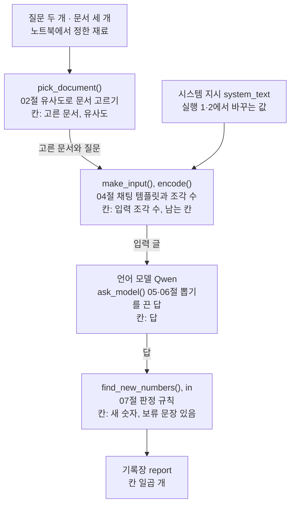
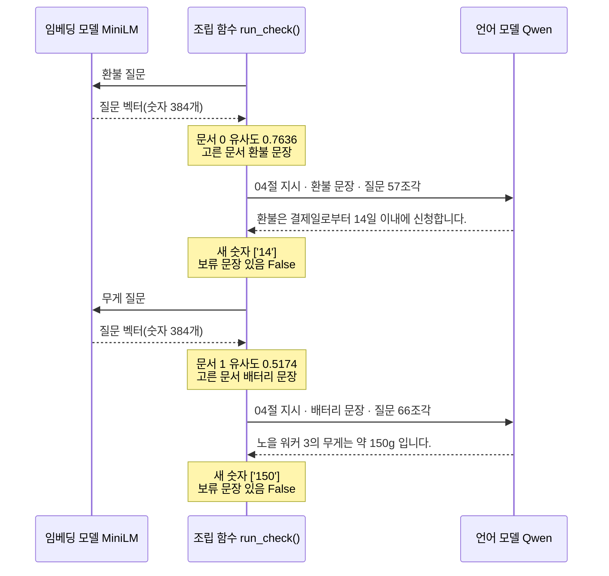
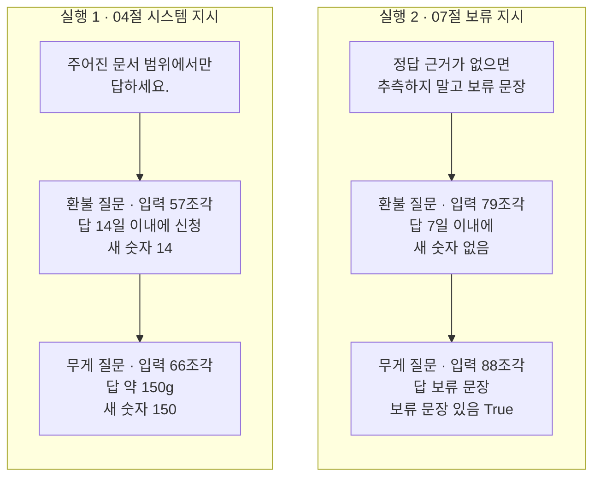

# 09-LLM-동작-원리-실습

## _src 본문 (HTML 원본)

```html
<!--meta: 실습 30분 | 코드 Jupyter Notebook | 새 용어 0개 -->
<h2 id="b1"><span class="no">1</span>학습 목표</h2>
<div class="goal"><ul><li>앞 절에서 따로 배운 네 가지를 조립 함수 하나로 이을 수 있습니다. 02절 유사도, 04절 입력 한도, 05·06절 뽑기를 끈 답, 07절 판정 규칙입니다.</li><li>기록장의 고른 문서, 유사도, 입력 조각 수, 남는 칸, 새 숫자, 보류 문장 칸을 읽을 수 있습니다.</li><li>시스템 지시 하나를 바꿨을 때 달라진 칸과 같은 칸을 구분하고, 그 결과를 어디까지 말할 수 있는지 설명할 수 있습니다.</li></ul></div>
<h2 id="b2"><span class="no">2</span>이 내용을 배우는 이유</h2>
<p>앞의 절에서는 토큰, 임베딩, 컨텍스트 한도, 생성 설정, 환각을 하나씩 따로 봤습니다. 실제로 모델에 질문을 보내면 이 단계가 한 번에 일어납니다. 문서를 고르고, 입력을 만들고, 답을 받고, 답을 확인합니다.</p>
<p>이번 절은 이 챕터의 실습입니다. 앞에서 쓴 함수와 모델을 한 노트북에 모아 강사와 함께 실행해 봅니다. 새 문법이나 새 라이브러리 기능은 없고, 따로 내는 과제도 없습니다.</p>
<p>실습 주제는 문서를 골라 넣고 답 점검하기입니다. 작은 상담 창구에 문서 세 개가 있고, 질문과 가장 가까운 문서를 골라 질문과 함께 모델에 넣습니다. 받은 답은 코드로 점검하고, 확인한 값을 기록장에 남깁니다.</p>
<p><strong>이 절의 질문</strong> — 질문과 가까운 문서를 골라 넣으면 모델의 답을 그대로 믿어도 될까요? 시스템 지시 한 문장을 바꾸면 기록장의 어느 칸이 달라질까요?</p>
<h2 id="b3"><span class="no">3</span>앞에서 배운 내용</h2>
<p>이번 실습은 아래 절에서 배운 것을 그대로 가져옵니다.</p>
<table><thead><tr><th>절</th><th>배운 것</th><th>실습에서 쓰는 곳</th></tr></thead><tbody>
<tr><td>01절</td><td>토큰화기 <code>encode()</code>로 조각 수 세기, 판 번호(revision) 고정</td><td>문서 조각 수, 기록장 칸 「입력 조각 수」, 두 모델 불러오기</td></tr>
<tr><td>02절</td><td><code>SentenceTransformer</code>, <code>encode(…, normalize_embeddings=True)</code>, <code>dot_product()</code>, 길이 1인 벡터의 점곱은 코사인 유사도</td><td>문서 벡터, 부품 <code>pick_document()</code>, 칸 「고른 문서」·「유사도」</td></tr>
<tr><td>03절</td><td><code>for</code>와 <code>if</code>로 가장 큰 값의 자리 찾기(<code>largest_position()</code>)</td><td><code>pick_document()</code> 안에서 유사도가 가장 큰 문서 찾기</td></tr>
<tr><td>04절</td><td>시스템 지시, 채팅 템플릿, 연습용 한도 512, 출력 몫 64, <code>입력 한도 = 전체 한도 - 출력 몫</code></td><td>실행 1의 시스템 지시, 입력 한도 448, 칸 「남는 칸」</td></tr>
<tr><td>05·06절</td><td><code>ask_model()</code>, 뽑기를 끈 설정 <code>do_sample=False</code></td><td>답 받기</td></tr>
<tr><td>07절</td><td><code>make_input()</code>, <code>find_numbers()</code>·<code>find_new_numbers()</code>, 보류 문장과 보류 지시, 노을 워커 3·초록 패스 문서</td><td>칸 「답」·「새 숫자」·「보류 문장 있음」, 실행 2의 시스템 지시</td></tr>
<tr><td>08절</td><td>선택 기준으로 고른 Qwen, 두 모델을 한 커널에 올리기, 튜플 반환</td><td>언어 모델, <code>pick_document()</code>의 반환값</td></tr>
</tbody></table>
<p>데이터도 앞 절과 같습니다. 환불 문장과 환불 질문은 04·08절, 배터리 문장과 초록 패스 문장은 07·08절에서 썼습니다. 둘째 질문 「노을 워커 3의 무게는 몇 g인가요?」만 이 실습에서 새로 만들었습니다.</p>
<p>기록장 딕셔너리와 <code>print_report()</code>, 칸별 비교 셀은 Ch 2 13절과 Ch 4 06절 실습에서 가져왔습니다. 03절 어텐션 비중과 06절 뽑기를 켠 생성은 쓰지 않습니다. 인터넷 서비스의 모델을 부르지 않으므로 API 키가 필요 없습니다.</p>
<p>08절에서는 시스템 메시지 없이 환불 문서와 질문을 넣었을 때, Qwen 모델의 답에 문서와 다른 14일이 나왔습니다. 이번 실습은 시스템 지시를 넣은 입력으로 같은 질문을 다시 묻습니다.</p>
<h2 id="b4"><span class="no">4</span>핵심 개념</h2>
<h3>비유로 시작하기</h3>
<p>상담 창구 직원을 떠올립니다. 꽂이에는 무늬가 다른 참고 카드 세 장이 있습니다. 손님이 세모가 그려진 질문 카드를 내밀면, 직원은 무늬가 가장 비슷한 파란 세모 카드를 뽑습니다.</p>
<p>뽑은 카드와 질문 카드는 칸막이가 있는 쟁반에 올립니다. 칸막이 뒤 빈칸은 답이 들어갈 자리입니다. 답 카드가 나오면 참고 카드와 나란히 놓고, 참고 카드에 없는 무늬를 돋보기로 찾습니다.</p>
{{img:09-4-카드-고르기와-돋보기|긴 나무 탁자 왼쪽 꽂이에서 파란 세모 카드가 주황 동그라미와 초록 네모 카드보다 높이 뽑혀 있고 앞에 세모 테두리 카드가 놓이며, 가운데 칸막이 쟁반의 왼쪽에 세모 카드 두 장이 있고 오른쪽 칸은 비어 있으며, 오른쪽에 파란 세모 카드와 돋보기가 올려진 보라 별 카드가 나란히 놓인 삽화|무늬가 같은 카드를 뽑아 쟁반에 올리고, 나온 카드에서 참고 카드에 없는 별을 돋보기로 찾습니다.}}
<p><strong>그림 읽기</strong> — 왼쪽 나무 꽂이에서 파란 세모 카드가 주황 동그라미 카드와 초록 네모 카드보다 높이 뽑혀 올라와 있습니다. 꽂이 앞에는 세모 테두리만 그린 질문 카드가 있습니다. 가운데 쟁반은 칸막이로 나뉘어, 왼쪽에 세모 카드 두 장이 놓이고 오른쪽 칸은 비어 있습니다. 오른쪽에는 파란 세모 카드와 보라 별 카드가 나란히 있고, 돋보기가 별 위에 놓였습니다.</p>
<p>실습 코드도 같습니다. 카드 세 장은 문서 세 개이고, 무늬는 02절 임베딩 벡터입니다. 가장 비슷한 카드를 뽑는 일은 <code>pick_document()</code>입니다. 쟁반은 04절 연습용 한도이고, 칸막이 뒤 빈칸은 출력 몫입니다. 별 카드는 모델의 답, 별은 입력에 없던 새 숫자, 돋보기는 07절 판정 규칙입니다.</p>
<h3>실습 함수의 구성</h3>
{{mermaid:09-1-조립도|초록 상자 질문 두 개와 문서 세 개가 파란 상자 pick_document를 지나고, 초록 상자 시스템 지시와 함께 파란 상자 make_input과 encode로 들어간 뒤, 보라 상자 언어 모델 Qwen의 ask_model, 파란 상자 find_new_numbers와 보류 문장 확인을 거쳐 노란 상자 기록장으로 가는 조립도|조립 함수 run_check()가 부르는 함수와 모델의 순서. 상자마다 쓰는 절과 기록장에 적는 칸을 함께 적었습니다.}}
<p><strong>도식 읽기</strong> — 위에서 아래로 읽습니다. 초록 상자 두 개는 노트북에서 정한 재료와, 실행 1·2에서 바꾸는 시스템 지시입니다. 파란 상자는 노트북에서 정의한 함수이고, 상자 안에 쓰는 절과 기록장 칸(「칸:」으로 시작하는 줄)을 적었습니다.</p>
<p>보라 상자는 답을 만드는 언어 모델입니다. 임베딩 모델도 <code>pick_document()</code> 안에서 벡터를 만들지만, 가장 큰 유사도를 고르는 일은 노트북 코드가 합니다. 그래서 그 상자는 파란색입니다. 화살표 라벨은 앞 단계가 뒤 단계에 넘기는 값이고, 맨 아래 노란 상자가 칸 일곱 개의 기록장입니다.</p>
<table><thead><tr><th>함수</th><th>하는 일</th><th>기록장 칸</th></tr></thead><tbody>
<tr><td><code>pick_document(question)</code></td><td>질문 벡터와 문서 벡터 세 개의 유사도를 출력하고, 가장 큰 문서와 그 유사도를 반환</td><td>고른 문서, 유사도</td></tr>
<tr><td><code>make_input(system_text, user_text)</code>와 <code>tokenizer.encode()</code></td><td>시스템 지시와 「문서 + 줄바꿈 + 질문」을 채팅 템플릿으로 합치고 조각으로 나눔</td><td>입력 조각 수, 남는 칸</td></tr>
<tr><td><code>ask_model(input_text)</code></td><td>뽑기를 끈 설정으로, 출력 몫 64조각 안에서 답을 만듦</td><td>답</td></tr>
<tr><td><code>find_new_numbers(answer, input_text)</code>와 <code>abstain_sentence in answer</code></td><td>입력 글에 없던 숫자를 모으고, 보류 문장이 있는지 확인</td><td>새 숫자, 보류 문장 있음</td></tr>
</tbody></table>
<p>조립 함수 <code>run_check()</code>는 질문과 시스템 지시를 받아 이 순서대로 부릅니다. 남는 칸은 04절 식으로 구한 입력 한도 448에서 실제 입력 조각 수를 뺀 값입니다. 새 숫자를 가릴 기준 글은 모델이 받은 입력 글 전체입니다.</p>
<h3>두 번의 실행</h3>
<p>질문은 두 개입니다. 첫 질문 「환불은 며칠 이내에 신청하나요?」는 환불 문서에 답이 있습니다. 둘째 질문 「노을 워커 3의 무게는 몇 g인가요?」는 세 문서 어디에도 답이 없습니다.</p>
<p>실행 1은 04절 시스템 지시 「주어진 문서 범위에서만 답하세요.」로 두 질문을 묻습니다. 실행 2는 시스템 지시만 07절 9절의 보류 지시로 바꿉니다. 보류 지시는 정답 근거가 없으면 추측하지 말고 보류 문장으로 답하라는 한 문장입니다. 문서, 질문, 출력 몫, 판정 규칙은 두 실행이 같습니다.</p>
<h2 id="b5"><span class="no">5</span>실행 예제</h2>
<p>노트북은 먼저 두 모델을 불러오고, 문서 세 개와 질문 두 개를 준비합니다. 이어서 부품 함수 여섯 개와 기록 장치, 조립 함수를 차례로 정의합니다. 그다음 실행 1, 실행 2, 두 기록장 비교를 합니다.</p>
<p>인터넷 서비스의 모델을 부르지 않으므로 비용이 들지 않습니다. 언어 모델이 답을 만드는 계산은 4번이고, 준비 셀을 뺀 코드 셀 14개가 1분 안팎에 끝납니다. 교재 출력은 Python 3.12.13과 CPU용 torch 2.8.0으로 만들었습니다. 패키지 버전은 transformers 4.56.2, sentence-transformers 5.1.1입니다.</p>
{{notebook:09-LLM-동작-원리-실습}}
<p class="look"><b>확인할 점</b> — 실행 1에서 두 질문의 <code>새 숫자</code> 칸을 봅니다. 실행 2에서는 <code>입력 조각 수</code>와 <code>보류 문장 있음</code> 칸이 어떻게 바뀌는지 확인합니다. 비교 셀의 <code>달라진 칸 수: 9</code>와 같은 칸도 봅니다.</p>
<h3>실행 1의 실제 순서</h3>
{{mermaid:09-2-실행1-순서|가운데 조립 함수 세로줄이 왼쪽 임베딩 모델에 환불 질문을 보내 질문 벡터를 받고 노란 메모 문서 0 유사도 0.7636, 오른쪽 언어 모델에 04절 지시와 환불 문장과 질문 57조각을 보내 환불은 결제일로부터 14일 이내에 신청합니다를 받고 노란 메모 새 숫자 14, 이어서 무게 질문으로 문서 1 유사도 0.5174, 66조각 입력, 노을 워커 3의 무게는 약 150g 입니다, 새 숫자 150을 적는 순서도|실행 1(04절 시스템 지시)에서 조립 함수와 두 모델이 주고받은 차례. 두 답 모두 입력에 없던 숫자가 새 숫자로 잡혔습니다.}}
<p><strong>도식 읽기</strong> — 위에서 아래로 시간이 흐릅니다. 세로줄은 왼쪽부터 임베딩 모델, 조립 함수, 언어 모델입니다. 실선은 보낸 입력, 점선은 받은 결과입니다.</p>
<p>노란 메모는 그 시점에 조립 함수가 기록장에 적은 칸입니다. 유사도와 새 숫자는 모델이 아니라 노트북 함수가 계산해서, 조립 함수 세로줄 위에 적었습니다. 위 여섯 줄이 환불 질문, 아래 여섯 줄이 무게 질문입니다.</p>
<h2 id="b6"><span class="no">6</span>실험 결과 해석</h2>
<p>실행 1에서 첫 질문은 <code>문서 0 유사도: 0.7636</code>인 환불 문서를 골랐습니다. 입력은 57조각이고 남는 칸은 391이었습니다. 답은 <code>환불은 결제일로부터 14일 이내에 신청합니다.&lt;|im_end|&gt;</code>였고, 기록장은 <code>새 숫자 | ['14']</code>였습니다.</p>
<p>문서 범위에서만 답하라고 했는데도, 답은 문서의 7일을 14일로 바꿨습니다. 08절에서 시스템 메시지 없이 같은 문서와 질문을 넣었을 때도 14일이 나왔습니다. 새 숫자 규칙은 입력 글에 없던 14를 잡았습니다.</p>
<p>둘째 질문은 <code>문서 1 유사도: 0.5174</code>인 배터리 문서를 골랐습니다. 첫 질문의 0.7636보다 낮지만, 세 문서 가운데서는 가장 컸습니다. 모델은 <code>노을 워커 3의 무게는 약 150g 입니다.&lt;|im_end|&gt;</code>라고 문서에 없는 무게를 적었습니다. 새 숫자 칸은 <code>['150']</code>이었습니다.</p>
{{mermaid:09-3-두-실행-비교|왼쪽 실행 1 칸은 초록 상자 주어진 문서 범위에서만 답하세요에서 노란 상자 환불 질문 입력 57조각 답 14일 새 숫자 14, 노란 상자 무게 질문 입력 66조각 답 약 150g 새 숫자 150으로 이어지고, 오른쪽 실행 2 칸은 초록 상자 정답 근거가 없으면 추측하지 말고 보류 문장에서 노란 상자 환불 질문 입력 79조각 답 7일 이내에 새 숫자 없음, 노란 상자 무게 질문 입력 88조각 답 보류 문장 보류 문장 있음 True로 이어지는 비교 그림|시스템 지시만 바꾼 두 실행. 실행 2는 입력이 22조각씩 늘었고, 환불 답은 7일, 무게 질문은 보류 문장이었습니다.}}
<p><strong>도식 읽기</strong> — 왼쪽 칸은 실행 1, 오른쪽 칸은 실행 2이고, 칸 안은 위에서 아래로 읽습니다. 맨 위 초록 상자는 바꾼 시스템 지시이고, 실행 2의 지시는 줄여 적었습니다. 아래 노란 상자 두 개는 질문마다 기록장에서 읽은 입력 조각 수, 답, 판정입니다.</p>
<p>그림에 없는 고른 문서와 유사도는 두 실행이 같았습니다. 틀린 답도 코드가 멈춘 실패가 아니라 출력으로 확인한 결과라서 노랑으로 칠했습니다.</p>
<p>실행 2에서 입력 조각 수는 79와 88로, 질문마다 22조각 늘었습니다. 문서와 질문이 같으므로, 늘어난 조각은 두 시스템 지시의 길이 차이입니다. 남는 칸도 369와 360으로 줄었습니다. 지시 글도 연습용 한도의 칸을 차지합니다.</p>
<p>첫 질문의 답은 <code>7일 이내에&lt;|im_end|&gt;</code>로 문서의 숫자와 같았고, 새 숫자는 없었습니다. 둘째 질문의 답은 보류 문장이었고, 기록장은 <code>보류 문장 있음 | True</code>였습니다. 비교 셀은 <code>달라진 칸 수: 9</code>를 출력했고, 고른 문서가 같은지 확인한 <code>assert</code> 줄도 멈추지 않았습니다.</p>
<p>07절 9절에서는 같은 보류 지시에 문서를 넣었을 때, 문서가 있는 질문 하나도 보류했습니다. 이번 첫 질문은 보류하지 않았습니다. 질문과 문서가 다르면 같은 지시로도 결과가 달라질 수 있습니다.</p>
<p>결론은 이렇습니다. 이번 실습에서 질문과 가까운 문서를 골라 넣어도, 실행 1의 두 답에는 입력에 없던 숫자가 들어 있었습니다. 시스템 지시만 보류 지시로 바꾸자 입력은 22조각 늘었고, 두 답에서 새 숫자가 나오지 않았습니다. 이 결과는 질문 두 개와 모델 하나로 한 번 실행해 관찰한 것입니다.</p>
<h2 id="b7"><span class="no">7</span>주의할 점과 실무 메모</h2>
<ul><li>새 숫자 규칙은 입력에 없던 숫자만 잡습니다. 07절에서 본 것처럼, 입력에 있는 숫자를 틀린 뜻으로 적은 답은 잡지 못합니다. 숫자 없이 지어낸 문장도 잡지 못합니다. 이번 네 답에서는 그런 경우가 나오지 않았습니다.</li>
<li>유사도가 가장 큰 문서라도 그 문서에 답이 있다는 뜻은 아닙니다. 둘째 질문은 0.5174로 배터리 문서를 골랐지만, 문서에 무게는 없었습니다. 유사도가 낮으면 문서를 넣지 않는 기준은 이번에 만들지 않았습니다.</li>
<li>보류 지시가 늘 좋은 쪽으로만 작동하지는 않습니다. 작업 중 기기 셸에서 이 실습의 보류 지시로 07절 초록 패스 문서와 질문을 넣어 봤습니다. 문서에 답이 있는데도 보류 문장이 나왔습니다. 05절 해바라기 작전 문서와 질문도 같았습니다. 이 실행은 노트북에 넣지 않았습니다.</li>
<li>환불 답의 14일은 04절 지시를 넣었을 때 나왔습니다. 작업 중 기기 셸에서 지시 없이 넣었을 때도 08절처럼 14일이 나왔습니다. 04절에서는 같은 환불 문장을 20번 이은 문서를 넣었고, 그때 답은 7일이었습니다. 문서 모양이 달라 이번 결과와 바로 비교하지 않습니다.</li>
<li>교재 노트북은 새 커널에서 두 번 실행해 출력이 같았습니다. 같은 기기와 같은 버전에서 확인한 것이고, 다른 버전이나 기기에서는 답 문장이 달라질 수 있습니다.</li>
<li>두 모델을 한 커널에 올리면 메모리를 더 씁니다. 노트북과 같은 계산을 스크립트로 실행했을 때 최대 약 3.2GB였고, 교재를 만든 컴퓨터의 메모리는 3.8GB입니다.</li>
<li>교재 출력은 2026-09-16에 Linux(aarch64) 컴퓨터에서 만들었습니다. 쓴 Python은 3.12.13, torch는 CPU용 2.8.0입니다. 패키지는 transformers 4.56.2와 sentence-transformers 5.1.1입니다. 모델 판 번호는 Qwen <code>7ae5576…</code>, MiniLM <code>e8f8c21…</code>이고, GPU와 Windows·macOS에서는 실행하지 않았습니다.</li></ul>
<h2 id="b8"><span class="no">8</span>정리와 다음 절</h2>
<ul><li>02절 유사도, 04절 입력 한도, 05·06절 뽑기를 끈 답, 07절 판정 규칙을 조립 함수 하나로 이었습니다.</li><li>실행 1(04절 지시)에서 환불 답은 문서의 7일을 14일로 바꿨고, 무게 답은 150g을 지어냈습니다. 새 숫자 규칙이 두 숫자를 잡았습니다.</li><li>실행 2에서 시스템 지시만 보류 지시로 바꾸자 입력이 22조각 늘었습니다. 환불 답은 7일, 무게 질문은 보류 문장이었고, 질문 두 개로 한 번 본 결과입니다.</li></ul>
<p><strong>다음 학습과 이어지는 지점</strong> — Ch 5는 이 절에서 끝납니다. Ch 6에서는 인터넷 서비스의 모델을 LangChain의 공통 방식으로 부릅니다. Ch 6 01절은 08절의 선택표를 작업과 제약에 맞는 후보를 사람이 미리 고르는 기준으로 이어 받습니다. 그리고 그 기준으로 고정한 <code>openai:gpt-5.4-mini</code>를 부릅니다. Ch 6 06절은 세 제공자에 같은 질문을 보내 토큰 수, 비용, 지연을 기록하고, 한 번의 기록을 품질 순위로 쓰지 않습니다.</p>
<p>Ch 9 01절은 이 실습의 문서 고르기를 검색 단계로 다시 다룹니다. 문서를 조각(청크)으로 나눠 벡터로 저장해 두고, 질문과 가장 가까운 조각 k개를 가져와 답을 만듭니다. Ch 11은 질의셋으로 검색 결과를 재고, 답의 정확성과 근거 충실도는 Ch 15에서 따로 평가합니다.</p>
<h2 id="b9"><span class="no">9</span>복습 문제</h2><details class="quiz"><summary>문제와 해설</summary>
<p class="quiz-q">1. 실행 1의 둘째 질문에서 배터리 문서를 고른 까닭은 무엇이고, 그 선택에는 어떤 한계가 있었나요? · 기초</p><p class="quiz-a"><b>해설</b> — 세 문서 가운데 질문 벡터와의 유사도가 0.5174로 가장 컸기 때문입니다. 제품 이름이 같아 가까웠지만, 그 문서에는 무게가 없었습니다. 유사도가 가장 크다는 것은 가장 가깝다는 뜻이지, 답이 들어 있다는 뜻이 아닙니다.</p>
<p class="quiz-q">2. 실행 1 둘째 답에는 숫자 3과 150이 있었는데, 새 숫자는 <code>['150']</code>뿐이었습니다. 까닭은 무엇인가요? · 적용</p><p class="quiz-a"><b>해설</b> — 함수 <code>find_new_numbers(answer, input_text)</code>는 입력 글에 있던 숫자를 뺍니다. 입력 글에는 질문과 문서의 「노을 워커 3」이 들어 있어 3이 빠졌습니다. 150은 입력 어디에도 없어 새 숫자로 남았습니다.</p>
<p class="quiz-q">3. 실행 2의 첫 질문은 입력이 79조각이었습니다. 남는 칸 369는 어떻게 나왔나요? 출력 몫을 128로 바꾸면 남는 칸은 얼마가 되나요? · 적용</p><p class="quiz-a"><b>해설</b> — 입력 한도는 512 - 64 = 448이고, 448 - 79 = 369입니다. 출력 몫이 128이면 입력 한도는 512 - 128 = 384이고, 남는 칸은 384 - 79 = 305입니다. 노트북에서 실행하지 않은 값이라 계산으로만 구했습니다.</p>
<p class="quiz-q">4. 이 절의 질문에 답해 봅시다. 가까운 문서를 넣었을 때 답을 그대로 믿어도 되나요? 시스템 지시를 바꾸자 어느 칸이 달라졌나요? · 분석</p><p class="quiz-a"><b>해설</b> — 실행 1의 두 답은 모두 입력에 없던 숫자를 적었으므로, 그대로 믿지 않고 판정 규칙 같은 확인을 거쳐야 합니다. 실행 2에서는 입력 조각 수, 남는 칸, 답, 새 숫자가 달라졌고, 둘째 질문은 보류 문장 칸도 달라졌습니다. 고른 문서와 유사도는 같았습니다.</p>
<p class="quiz-q">5. 동료가 「보류 지시를 넣으니 새 숫자가 사라졌다. 앞으로 모든 질문에 이 지시를 넣자」고 합니다. 무엇이라고 답하나요? · 분석</p><p class="quiz-a"><b>해설</b> — 이번 결과는 질문 두 개로 한 번 본 것입니다. 07절 9절과 작업 중 기기 셸에서는 문서에 답이 있는데도 보류한 질문이 있었습니다. 새 숫자 규칙은 숫자 없는 주장도 잡지 못합니다. 08절처럼 답할 질문과 보류할 질문을 함께 담은 평가 자료로 먼저 확인한 뒤 정하자고 답합니다.</p>
</details>
<h2 id="b10"><span class="no">10</span>참고 자료</h2>
<ul><li><a href="https://huggingface.co/Qwen/Qwen2.5-0.5B-Instruct/tree/7ae557604adf67be50417f59c2c2f167def9a775">Qwen2.5-0.5B-Instruct 모델 카드(Apache-2.0)</a> · 판 7ae5576 · 확인 2026-09-16</li><li><a href="https://huggingface.co/sentence-transformers/paraphrase-multilingual-MiniLM-L12-v2/tree/e8f8c211226b894fcb81acc59f3b34ba3efd5f42">MiniLM-L12-v2 다국어 모델 파일과 Apache-2.0 라이선스</a> · 판 e8f8c21 · 확인 2026-09-09</li><li><a href="https://huggingface.co/docs/transformers/v4.56.2/en/chat_templating">Transformers 채팅 템플릿 문서</a> · 4.56.2 · 확인 2026-09-16</li><li><a href="https://huggingface.co/docs/transformers/v4.56.2/en/main_classes/text_generation">Transformers 생성 문서</a> · 4.56.2 · 확인 2026-09-16</li></ul>
```

## 노트북 셀 (순서대로)

### [0] markdown {'html': 'skip'}

# LLM 동작 원리 실습: 문서를 골라 넣고 답 점검하기

**이 노트북에서 할 일**

1. 01~08절의 함수와 모델을 이어, 질문과 가까운 문서를 골라 넣고 답을 받는 흐름을 조립합니다.
2. 04절 시스템 지시로 질문 두 개를 묻고, 조각 수와 판정 결과를 기록장에 적습니다(실행 1).
3. 시스템 지시 하나만 07절 보류 지시로 바꿔 같은 질문을 묻고, 두 기록장을 비교합니다(실행 2).

**준비물** — API 키는 필요 없습니다. 인터넷 서비스의 모델을 부르지 않고, 내 컴퓨터에서 작은 모델 두 개를 실행합니다.
그래서 비용은 들지 않습니다. 언어 모델이 답을 만드는 계산은 모두 4번 합니다.

실행 시간은 1분 안팎입니다. 모델 파일은 02절 임베딩 모델과 03~08절 언어 모델을 그대로 씁니다.
캐시에 없으면 두 모델 합쳐 약 1.4GB를 Hugging Face 사이트에서 내려받습니다.
노트북과 같은 계산을 스크립트로 실행했을 때 Python이 쓴 메모리는 최대 약 3.2GB였습니다.

**기준 버전** — 실습 폴더에 고정한 torch 2.8.0과 transformers 4.56.2를 씁니다. 임베딩 모델에는 sentence-transformers 5.1.1을 씁니다.
모델 `Qwen/Qwen2.5-0.5B-Instruct`는 판 번호 `7ae557604adf67be50417f59c2c2f167def9a775`로 받습니다.
모델 `sentence-transformers/paraphrase-multilingual-MiniLM-L12-v2`는 판 번호 `e8f8c211226b894fcb81acc59f3b34ba3efd5f42`로 받습니다.

교재 출력은 Linux(aarch64)의 Python 3.12.13과 CPU용 torch(2.8.0+cpu)로 만들었습니다. 다른 버전, GPU, Windows·macOS에서는 이번에 실행하지 않았습니다.

실습 폴더 `labs/part1/ch05-llm-principles`에서 01절과 같은 `.venv` 커널을 고른 뒤 첫 셀부터 순서대로 실행합니다.
새 문법과 새 라이브러리 기능은 없습니다. 강사와 함께 셀을 차례로 실행하며, 따로 내는 과제는 없습니다.

### [1] markdown {'html': 'skip'}

## 오늘 볼 그림


위에서 아래로 읽습니다. 초록 상자는 노트북에서 정한 질문·문서와, 실행 1·2에서 바꾸는 시스템 지시입니다.
파란 상자는 노트북에서 정의한 함수이고, 보라 상자는 답을 만드는 언어 모델입니다. 맨 아래 노란 상자가 칸 일곱 개의 기록장입니다.

### [2] markdown {}

## 1. 준비

이 절은 파일을 읽거나 만들지 않습니다. 준비 셀에서는 02절의 sentence-transformers와 03~08절의 transformers를 함께 불러옵니다.

함수 `warnings.filterwarnings()` 줄은 01·02절처럼 진행 표시 위젯이 없다는 경고 한 줄을 끕니다.
함수 `transformers.logging.set_verbosity_error()`는 04절처럼, 생성 셀에서 나오는 오류가 아닌 안내를 화면에 내지 않게 합니다.

### [3] code {'execution': {'iopub.execute_input': '2026-09-16T21:27:36.284574Z', 'iopub.status.busy': '2026-09-16T21:27:36.284290Z', 'iopub.status.idle': '2026-09-16T21:27:40.633506Z', 'shell.execute_reply': '2026-09-16T21:27:40.633104Z'}, 'lesson_role': 'setup'}

```python
# 두 패키지를 불러오고, 오류가 아닌 안내 경고를 줄인 뒤 버전을 확인합니다
import warnings

# 진행 표시 위젯이 없다는 경고(TqdmWarning)는 계산과 관계없어 화면에 내지 않습니다
warnings.filterwarnings("ignore", message="IProgress not found")

import sentence_transformers
import transformers
from sentence_transformers import SentenceTransformer
from transformers import AutoModelForCausalLM, AutoTokenizer

# 생성 셀의 안내(오류 아님)를 화면에 내지 않습니다
transformers.logging.set_verbosity_error()
print("sentence-transformers 버전:", sentence_transformers.__version__)
print("transformers 버전:", transformers.__version__)
```

출력:
```
sentence-transformers 버전: 5.1.1
transformers 버전: 4.56.2

```

### [4] markdown {}

**결과 읽기** — 출력 줄은 `sentence-transformers 버전: 5.1.1`과 `transformers 버전: 4.56.2`입니다. 준비물에 적은 기준 버전과 같습니다.

### [5] markdown {}

## 2. 실습 주제 — 문서를 골라 넣고 답 점검하기

작은 상담 창구를 떠올립니다. 창구에는 앞 절에서 쓴 문서 세 개가 있습니다.
04절 환불 문장, 07절 노을 워커 3 배터리 문장, 07절 해바라기 연구소 초록 패스 문장입니다.

질문이 오면 02절 유사도로 질문과 가장 가까운 문서 하나를 고릅니다. 고른 문서와 질문을 04절 채팅 템플릿으로 합쳐 모델에 넣습니다.
받은 답은 07절 판정 규칙으로 점검합니다. 확인한 값은 Ch 4 06절처럼 기록장 딕셔너리에 적습니다.

질문은 두 개입니다. 첫 질문 「환불은 며칠 이내에 신청하나요?」는 문서에 답이 있습니다.
둘째 질문 「노을 워커 3의 무게는 몇 g인가요?」는 세 문서 어디에도 답이 없습니다.

실행 1은 04절 시스템 지시 「주어진 문서 범위에서만 답하세요.」로 묻습니다. 실행 2는 시스템 지시 하나만 07절 보류 지시로 바꿔 같은 질문을 묻습니다.

언어 모델은 08절에서 선택 기준으로 고른 Qwen입니다. 03절 어텐션 비중과 06절 뽑기를 켠 생성은 이번 실습에서 쓰지 않습니다.

### [6] markdown {}

## 3. 재료 만들기 — 두 모델 불러오기

언어 모델은 03~08절과 같은 Qwen2.5-0.5B-Instruct입니다. 임베딩 모델은 02절과 같은 multilingual MiniLM입니다.
두 모델 모두 01절처럼 판 번호(revision)를 고정해 받습니다.

함수 `ask_model()`은 바깥 이름 `model`을 읽습니다. 그래서 02절에서 `model`에 담았던 임베딩 모델을 이번에는 `embedding_model`에 담습니다.
08절처럼 모델 두 개를 한 커널에 올리므로, 메모리가 작은 컴퓨터에서는 다른 노트북의 커널을 먼저 종료합니다.

실행 전에 예상합니다. 컨텍스트 한도는 04절의 32768, 임베딩 벡터 길이는 02절의 384일 것입니다.

### [7] code {'execution': {'iopub.execute_input': '2026-09-16T21:27:40.634476Z', 'iopub.status.busy': '2026-09-16T21:27:40.634339Z', 'iopub.status.idle': '2026-09-16T21:27:43.614786Z', 'shell.execute_reply': '2026-09-16T21:27:43.613387Z'}}

```python
# 03~08절 언어 모델과 토큰화기를 먼저 받고, 02절 임베딩 모델을 받습니다
model_name = "Qwen/Qwen2.5-0.5B-Instruct"
model_revision = "7ae557604adf67be50417f59c2c2f167def9a775"
tokenizer = AutoTokenizer.from_pretrained(model_name, revision=model_revision)
model = AutoModelForCausalLM.from_pretrained(model_name, revision=model_revision)
# ask_model() 함수가 읽는 이름 model과 겹치지 않게, 임베딩 모델은 embedding_model에 담습니다
embedding_name = "sentence-transformers/paraphrase-multilingual-MiniLM-L12-v2"
embedding_revision = "e8f8c211226b894fcb81acc59f3b34ba3efd5f42"
embedding_model = SentenceTransformer(embedding_name, revision=embedding_revision)
print("컨텍스트 한도:", model.config.max_position_embeddings)
print("임베딩 벡터 길이:", embedding_model.get_sentence_embedding_dimension())
```

출력:
```
컨텍스트 한도: 32768
임베딩 벡터 길이: 384

```

### [8] markdown {}

**결과 읽기** — 출력 줄은 `컨텍스트 한도: 32768`과 `임베딩 벡터 길이: 384`입니다. 예상과 같습니다.

이 노트북의 출력은 2026-09-16에 이 두 모델과 판 번호로 실행한 결과입니다. 실행 환경이나 버전이 바뀌면 답 문장이 달라질 수 있습니다.

### [9] markdown {}

## 4. 재료 만들기 — 문서 세 개

창구의 문서 세 개를 목록에 담습니다. 04·08절 환불 문장, 07·08절 배터리 문장과 초록 패스 문장입니다.

문서마다 01절처럼 Qwen 토큰화기로 조각 수를 셉니다. 이어서 02절처럼 `normalize_embeddings=True`를 주어 길이 1로 맞춘 벡터로 바꿉니다.
02절에서 본 것처럼, 길이가 1인 벡터끼리는 점곱이 곧 코사인 유사도입니다.

실행 전에 예상합니다. 배터리 문장은 08절과 같은 23조각이고, 벡터 모양은 문서 3개에 숫자 384개씩일 것입니다.
여러 줄로 나오는 표라서 라벨 줄을 먼저 출력합니다.

### [10] code {'execution': {'iopub.execute_input': '2026-09-16T21:27:43.617560Z', 'iopub.status.busy': '2026-09-16T21:27:43.617348Z', 'iopub.status.idle': '2026-09-16T21:27:43.761894Z', 'shell.execute_reply': '2026-09-16T21:27:43.761514Z'}}

```python
# 문서 세 개를 목록에 담고, 조각 수를 센 뒤 길이 1로 맞춘 벡터로 바꿉니다
documents = [
    "환불은 결제일로부터 7일 이내에 신청합니다.",
    "노을 워커 3의 배터리 용량은 4200mAh입니다.",
    "해바라기 연구소의 초록 패스 제도는 2026년에 연구자 한 명당 300만 원을 지원합니다.",
]
print("문서 번호 | 조각 수 | 문서")
for number in range(len(documents)):
    token_ids = tokenizer.encode(documents[number])
    print(number, "|", len(token_ids), "|", documents[number])
# normalize_embeddings=True를 주면 벡터마다 길이가 1이 되도록 나눈 값을 반환합니다
document_vectors = embedding_model.encode(documents, normalize_embeddings=True)
print("문서 벡터 모양:", document_vectors.shape)
```

출력:
```
문서 번호 | 조각 수 | 문서
0 | 17 | 환불은 결제일로부터 7일 이내에 신청합니다.
1 | 23 | 노을 워커 3의 배터리 용량은 4200mAh입니다.
2 | 37 | 해바라기 연구소의 초록 패스 제도는 2026년에 연구자 한 명당 300만 원을 지원합니다.
문서 벡터 모양: (3, 384)

```

### [11] markdown {}

**결과 읽기** — 라벨 줄 아래 세 줄은 `0 | 17 |`, `1 | 23 |`, `2 | 37 |`로 시작합니다. 마지막 줄은 `문서 벡터 모양: (3, 384)`입니다.

배터리 문장 23조각은 08절 5절의 한국어 문장 조각 수와 같습니다. 문서가 길수록 조각이 많아, 04절 연습용 한도에서 입력이 차지하는 칸도 늘어납니다.

### [12] markdown {}

## 5. 재료 만들기 — 질문 두 개와 정해 둘 값

질문 두 개와, 실행 1·2에서 바꾸지 않을 값을 정합니다. 연습용 한도 512와 출력 몫 64는 04절 값입니다.
입력 한도는 04절 식 `입력 한도 = 전체 한도 - 출력 몫`으로 구합니다.

보류 문장은 07절에서 정한 글 「제공된 정보로는 확인할 수 없습니다」입니다. 07절 판정 규칙은 답에 이 글이 들어 있으면 보류한 답으로 봅니다.

실행 전에 예상합니다. 입력 한도는 04절처럼 448일 것입니다.

### [13] code {'execution': {'iopub.execute_input': '2026-09-16T21:27:43.762616Z', 'iopub.status.busy': '2026-09-16T21:27:43.762543Z', 'iopub.status.idle': '2026-09-16T21:27:43.764490Z', 'shell.execute_reply': '2026-09-16T21:27:43.764191Z'}}

```python
# 질문 두 개, 04절 연습용 한도와 출력 몫, 07절 보류 문장을 정합니다
questions = ["환불은 며칠 이내에 신청하나요?", "노을 워커 3의 무게는 몇 g인가요?"]
practice_window = 512
output_budget = 64
input_budget = practice_window - output_budget
abstain_sentence = "제공된 정보로는 확인할 수 없습니다"
print("질문 수:", len(questions))
print("입력 한도:", input_budget)
```

출력:
```
질문 수: 2
입력 한도: 448

```

### [14] markdown {}

**결과 읽기** — 출력 줄은 `질문 수: 2`와 `입력 한도: 448`입니다. 예상과 같습니다.

첫 질문은 04·08절과 같은 질문이고, 둘째 질문은 이 실습에서 새로 만든 질문입니다. 둘째 질문의 제품 이름은 07절에서 교재가 지어낸 이름입니다.

### [15] markdown {}

## 6. 부품 준비 — 가장 가까운 문서 고르기

첫 부품은 질문과 가장 가까운 문서를 고르는 함수입니다. 먼저 02절과 같은 코드의 점곱 함수를 정의합니다.
같은 자리의 숫자끼리 곱해 모두 더한 값을 반환합니다. 이 셀은 함수를 정의만 합니다.

### [16] code {'execution': {'iopub.execute_input': '2026-09-16T21:27:43.765124Z', 'iopub.status.busy': '2026-09-16T21:27:43.765047Z', 'iopub.status.idle': '2026-09-16T21:27:43.766631Z', 'shell.execute_reply': '2026-09-16T21:27:43.766374Z'}}

```python
# 두 벡터의 점곱(같은 자리 숫자끼리 곱해 모두 더한 값)을 반환하는 함수를 정의합니다(02절과 같은 코드)
def dot_product(first, second):
    total = 0
    # 반복 번호 i로 두 벡터의 같은 자리 숫자를 짝지어 곱하고 더합니다
    for i in range(len(first)):
        total = total + first[i] * second[i]
    return total
```

출력:
```

```

### [17] markdown {}

**결과 읽기** — 정의만 하는 셀이라 출력이 없습니다.

다음 함수 `pick_document()`는 질문을 길이 1로 맞춘 벡터로 바꾸고, 문서 벡터 세 개와 점곱을 차례로 계산합니다.
문서마다 유사도를 출력하고, 유사도가 가장 큰 문서와 그 유사도를 반환합니다. 반환값이 두 개라서 08절처럼 튜플로 받습니다.

가장 큰 값은 03절 `largest_position()`처럼 `for`와 `if`로 찾습니다. 코사인 유사도는 -1과 1 사이라서, 기준값을 가장 작은 값 -1.0에서 시작합니다.
함수 안에서 바깥 이름 `embedding_model`, `documents`, `document_vectors`를 읽습니다. 이 셀도 정의만 합니다.

### [18] code {'execution': {'iopub.execute_input': '2026-09-16T21:27:43.767264Z', 'iopub.status.busy': '2026-09-16T21:27:43.767194Z', 'iopub.status.idle': '2026-09-16T21:27:43.769286Z', 'shell.execute_reply': '2026-09-16T21:27:43.768962Z'}}

```python
# 질문과 문서 세 개의 유사도를 출력하고, 가장 큰 문서와 그 유사도를 반환하는 함수를 정의합니다
def pick_document(question):
    # 02절처럼 목록으로 넣고, 길이 1로 맞춘 질문 벡터를 받습니다
    question_vectors = embedding_model.encode([question], normalize_embeddings=True)
    best_number = 0
    best_similarity = -1.0
    for number in range(len(documents)):
        # 길이 1인 벡터끼리는 점곱이 곧 코사인 유사도입니다
        similarity = dot_product(question_vectors[0], document_vectors[number])
        print("문서", number, "유사도:", round(similarity, 4))
        if similarity > best_similarity:
            best_number = number
            best_similarity = similarity
    return documents[best_number], round(best_similarity, 4)
```

출력:
```

```

### [19] markdown {}

**결과 읽기** — 정의만 하는 셀이라 출력이 없습니다.

## 7. 부품 준비 — 입력을 만들고 답 받기

둘째 부품은 07·08절과 같은 코드의 입력 함수입니다. 인자 `system_text`가 빈 글이 아니면 그 글을 시스템 메시지로 앞에 넣습니다.
이번 실습은 두 실행 모두 시스템 지시를 넣습니다. 이 셀은 함수를 정의만 합니다.

### [20] code {'execution': {'iopub.execute_input': '2026-09-16T21:27:43.769919Z', 'iopub.status.busy': '2026-09-16T21:27:43.769850Z', 'iopub.status.idle': '2026-09-16T21:27:43.771772Z', 'shell.execute_reply': '2026-09-16T21:27:43.771484Z'}}

```python
# 시스템 지시와 사용자 글을 받아, 채팅 템플릿으로 합친 입력 글을 반환하는 함수를 정의합니다(07·08절과 같은 코드)
def make_input(system_text, user_text):
    message_list = []
    # 시스템 지시가 빈 글이 아닐 때만 시스템 메시지를 먼저 넣습니다
    if system_text != "":
        message_list.append({"role": "system", "content": system_text})
    message_list.append({"role": "user", "content": user_text})
    return tokenizer.apply_chat_template(message_list, tokenize=False, add_generation_prompt=True)
```

출력:
```

```

### [21] markdown {}

**결과 읽기** — 정의만 하는 셀이라 출력이 없습니다.

다음은 05·07·08절과 같은 코드의 `ask_model()` 함수입니다. 06절에서 본 뽑기를 끈 설정(`do_sample=False`)으로 답을 만듭니다.
05절에서는 같은 기기에서 같은 입력을 다시 넣었을 때 같은 답이 나왔습니다. 이 셀도 정의만 합니다.

### [22] code {'execution': {'iopub.execute_input': '2026-09-16T21:27:43.772367Z', 'iopub.status.busy': '2026-09-16T21:27:43.772308Z', 'iopub.status.idle': '2026-09-16T21:27:43.773968Z', 'shell.execute_reply': '2026-09-16T21:27:43.773736Z'}}

```python
# 입력 글을 받아, 출력 몫 안에서 모델이 만든 새 조각만 글로 바꿔 반환하는 함수를 정의합니다(05·07·08절과 같은 코드)
def ask_model(input_text):
    input_ids = tokenizer.encode(input_text, return_tensors="pt")
    # do_sample=False는 05~08절처럼 다음 조각을 무작위로 뽑지 않는 설정입니다
    output_ids = model.generate(input_ids=input_ids, max_new_tokens=output_budget, do_sample=False)
    all_ids = output_ids[0].tolist()
    # 입력 조각 수만큼 건너뛴 뒤가 새 조각입니다
    input_length = len(input_ids[0])
    new_ids = all_ids[input_length:len(all_ids)]
    return tokenizer.decode(new_ids)
```

출력:
```

```

### [23] markdown {}

**결과 읽기** — 정의만 하는 셀이라 출력이 없습니다.

## 8. 부품 준비 — 07절 판정 규칙

셋째 부품은 07절 판정 규칙입니다. 먼저 07절과 같은 코드의 숫자 찾기 함수를 정의합니다.
글에서 이어진 숫자 글자를 찾아 숫자 글 목록으로 반환합니다. 이 셀은 함수를 정의만 합니다.

### [24] code {'execution': {'iopub.execute_input': '2026-09-16T21:27:43.774550Z', 'iopub.status.busy': '2026-09-16T21:27:43.774496Z', 'iopub.status.idle': '2026-09-16T21:27:43.776367Z', 'shell.execute_reply': '2026-09-16T21:27:43.776063Z'}}

```python
# 글에서 이어진 숫자 글자를 찾아, 숫자 글 목록으로 반환하는 함수를 정의합니다(07절과 같은 코드)
def find_numbers(text):
    numbers = []
    current = ""
    # 글 끝에 빈칸을 붙여, 마지막 숫자도 숫자가 아닌 글자를 만나게 합니다
    for letter in text + " ":
        if letter.isdigit():
            current = current + letter
        # 숫자가 끝난 자리에서 모은 숫자를 목록에 넣고 비웁니다
        elif current != "":
            numbers.append(current)
            current = ""
    return numbers
```

출력:
```

```

### [25] markdown {}

**결과 읽기** — 정의만 하는 셀이라 출력이 없습니다.

다음은 07절과 같은 코드의 `find_new_numbers()` 함수입니다. 답의 숫자 가운데 인자 `source_text`의 글에 없던 숫자만 모아 반환합니다.
07절은 이 목록을 새 숫자라고 불렀습니다.

이번 실습은 `source_text`에 모델이 받은 입력 글 전체를 넣습니다. 입력 글은 시스템 지시, 고른 문서, 질문을 채팅 템플릿으로 합친 글입니다.
그래서 새 숫자는 모델이 받은 글 어디에도 없던 숫자입니다. 이 셀도 정의만 합니다.

### [26] code {'execution': {'iopub.execute_input': '2026-09-16T21:27:43.776929Z', 'iopub.status.busy': '2026-09-16T21:27:43.776866Z', 'iopub.status.idle': '2026-09-16T21:27:43.778774Z', 'shell.execute_reply': '2026-09-16T21:27:43.778382Z'}}

```python
# 답의 숫자 가운데, 기준 글에 없던 숫자만 모아 반환하는 함수를 정의합니다(07절과 같은 코드)
def find_new_numbers(answer, source_text):
    source_numbers = find_numbers(source_text)
    new_numbers = []
    for number_text in find_numbers(answer):
        # 질문이나 문서에 없던 숫자만 모읍니다
        if number_text not in source_numbers:
            new_numbers.append(number_text)
    return new_numbers
```

출력:
```

```

### [27] markdown {}

**결과 읽기** — 정의만 하는 셀이라 출력이 없습니다.

## 9. 기록 장치 — 기록장 출력 함수

두 실행을 비교하려면 결과를 같은 칸에 적어 둬야 합니다. Ch 2 13절과 Ch 4 06절처럼 딕셔너리를 기록장으로 씁니다.
기록장을 칸마다 한 줄씩 출력하는 함수는 Ch 4 06절의 `print_report()`를 그대로 가져옵니다. 이 셀은 함수를 정의만 합니다.

### [28] code {'execution': {'iopub.execute_input': '2026-09-16T21:27:43.779341Z', 'iopub.status.busy': '2026-09-16T21:27:43.779282Z', 'iopub.status.idle': '2026-09-16T21:27:43.780717Z', 'shell.execute_reply': '2026-09-16T21:27:43.780470Z'}}

```python
# Ch 2 13절·Ch 4 06절 함수: 기록장 딕셔너리의 칸을 한 줄에 하나씩 출력합니다
def print_report(report):
    # items()는 키와 값의 짝을 차례로 내놓습니다
    for key, value in report.items():
        print(key, "|", value)
```

출력:
```

```

### [29] markdown {}

**결과 읽기** — 정의만 하는 셀이라 출력이 없습니다. 이 함수는 실행 1과 실행 2에서 질문마다 부릅니다.

## 10. 조립하기 — 질문에서 기록장까지

조립 함수 `run_check()`는 질문과 시스템 지시를 받아, 부품을 차례로 부르고 기록장을 반환합니다. 주석마다 그 줄이 쓰는 절을 적었습니다.

기록장 칸은 일곱 개입니다. 고른 문서, 유사도, 입력 조각 수, 남는 칸, 답, 새 숫자, 보류 문장 있음입니다.
남는 칸은 04절처럼 입력 한도에서 실제 입력 조각 수를 뺀 값입니다. 답은 05절처럼 줄바꿈을 빈칸으로 바꿔 한 줄로 적습니다.

함수 안에서 바깥 이름 `tokenizer`, `input_budget`, `abstain_sentence`를 읽습니다. 이 셀은 함수를 정의만 합니다.

### [30] code {'execution': {'iopub.execute_input': '2026-09-16T21:27:43.781384Z', 'iopub.status.busy': '2026-09-16T21:27:43.781330Z', 'iopub.status.idle': '2026-09-16T21:27:43.783659Z', 'shell.execute_reply': '2026-09-16T21:27:43.783264Z'}}

```python
# 조립: 문서 고르기 → 입력 만들기 → 답 받기 → 판정까지 기록장에 적습니다
def run_check(question, system_text):
    # 02절 유사도로 가장 가까운 문서 고르기
    document, similarity = pick_document(question)
    # 04절 채팅 템플릿으로 시스템 지시·문서·질문을 합치고, 01절처럼 조각으로 나누기
    input_text = make_input(system_text, document + "\n" + question)
    input_ids = tokenizer.encode(input_text)
    # 05·06절 뽑기를 끈 설정으로 답 받기
    answer = ask_model(input_text)
    report = {"고른 문서": document, "유사도": similarity, "입력 조각 수": len(input_ids)}
    # 04절 입력 한도에서 실제 입력을 빼고 남는 칸
    report["남는 칸"] = input_budget - len(input_ids)
    report["답"] = answer.replace("\n", " ")
    # 07절 판정 규칙: 입력에 없던 숫자와 보류 문장
    report["새 숫자"] = find_new_numbers(answer, input_text)
    report["보류 문장 있음"] = abstain_sentence in answer
    return report
```

출력:
```

```

### [31] markdown {}

**결과 읽기** — 정의만 하는 셀이라 출력이 없습니다. 조립이 끝났으니, 이제 질문과 시스템 지시만 넣어 부르면 됩니다.

## 11. 실행 1 — 04절 시스템 지시

변수 `system_text`에 04절 시스템 지시를 담고, 질문 두 개로 조립 함수를 차례로 부릅니다.
기록장은 질문마다 칸별로 출력하고, 비교하려고 목록 `reports_1`에 모읍니다. 언어 모델은 질문마다 한 번씩, 모두 2번 답을 만듭니다.

실행 전에 예상합니다. 첫 질문은 환불 문서를, 둘째 질문은 제품 이름이 같은 배터리 문서를 고를 것입니다.
첫 질문은 문서 범위에서만 답하라고 했으니 7일이라고 답할 것입니다. 둘째 질문은 문서에 무게가 없으니, 모른다고 하거나 숫자를 지어낼 것입니다.

### [32] code {'execution': {'iopub.execute_input': '2026-09-16T21:27:43.784306Z', 'iopub.status.busy': '2026-09-16T21:27:43.784247Z', 'iopub.status.idle': '2026-09-16T21:27:48.094900Z', 'shell.execute_reply': '2026-09-16T21:27:48.094438Z'}}

```python
# 실행 1: 04절 시스템 지시로 질문 두 개를 차례로 점검합니다
system_text = "주어진 문서 범위에서만 답하세요."
reports_1 = []
for question in questions:
    print("질문:", question)
    report = run_check(question, system_text)
    reports_1.append(report)
    print("기록장:")
    print_report(report)
```

출력:
```
질문: 환불은 며칠 이내에 신청하나요?
문서 0 유사도: 0.7636
문서 1 유사도: 0.0601
문서 2 유사도: 0.1694
기록장:
고른 문서 | 환불은 결제일로부터 7일 이내에 신청합니다.
유사도 | 0.7636
입력 조각 수 | 57
남는 칸 | 391
답 | 환불은 결제일로부터 14일 이내에 신청합니다.<|im_end|>
새 숫자 | ['14']
보류 문장 있음 | False
질문: 노을 워커 3의 무게는 몇 g인가요?
문서 0 유사도: 0.0088
문서 1 유사도: 0.5174
문서 2 유사도: 0.2714
기록장:
고른 문서 | 노을 워커 3의 배터리 용량은 4200mAh입니다.
유사도 | 0.5174
입력 조각 수 | 66
남는 칸 | 382
답 | 노을 워커 3의 무게는 약 150g 입니다.<|im_end|>
새 숫자 | ['150']
보류 문장 있음 | False

```

### [33] markdown {}

**결과 읽기** — 첫 질문은 `문서 0 유사도: 0.7636`인 환불 문서를 골랐고, `입력 조각 수 | 57`, `남는 칸 | 391`입니다. 답은 `환불은 결제일로부터 14일 이내에 신청합니다.<|im_end|>`이고 `새 숫자 | ['14']`입니다.

둘째 질문은 `문서 1 유사도: 0.5174`인 배터리 문서를 골랐고, `입력 조각 수 | 66`입니다. 답은 `노을 워커 3의 무게는 약 150g 입니다.<|im_end|>`이고 `새 숫자 | ['150']`입니다.

예상과 달리 첫 답은 문서의 7일을 14일로 바꿨습니다. 08절에서 시스템 메시지 없이 같은 문서와 질문을 넣었을 때도 답에 14일이 나왔습니다.
두 답 모두 `보류 문장 있음 | False`입니다. 07절 새 숫자 규칙이 입력에 없던 14와 150을 잡았습니다.

둘째 질문의 유사도 0.5174는 첫 질문의 0.7636보다 낮지만, 세 문서 가운데서는 가장 컸습니다. 가장 가까운 문서를 골라도, 그 문서에 답이 있다는 보장은 없습니다.
모델은 배터리 문서를 받고도 문서에 없는 무게를 적었습니다.

### [34] markdown {}

## 12. 실행 2 — 시스템 지시 하나만 바꾸기

바꾸는 값은 시스템 지시 `system_text` 하나입니다. 07절 9절의 보류 지시로 바꾸고, 같은 질문 두 개로 같은 조립 함수를 부릅니다.
문서, 질문, 출력 몫, 판정 규칙은 그대로입니다.

실행 전에 예상합니다. 고른 문서와 유사도는 시스템 지시를 쓰지 않으니 실행 1과 같을 것입니다. 보류 지시가 04절 지시보다 길어서, 입력 조각 수는 늘고 남는 칸은 줄 것입니다.

07절에서는 보류 지시를 넣자 문서 없는 질문은 보류했지만, 문서가 있는 질문 하나도 보류했습니다.
그래서 둘째 질문은 보류하고, 첫 질문도 보류할 수 있다고 예상합니다.

### [35] code {'execution': {'iopub.execute_input': '2026-09-16T21:27:48.095812Z', 'iopub.status.busy': '2026-09-16T21:27:48.095718Z', 'iopub.status.idle': '2026-09-16T21:27:50.121843Z', 'shell.execute_reply': '2026-09-16T21:27:50.121329Z'}}

```python
# 실행 2: 시스템 지시 하나만 07절 보류 지시로 바꾸고, 같은 질문 두 개를 점검합니다
system_text = "주어진 질문에 정답 근거가 없으면 추측하지 말고 '제공된 정보로는 확인할 수 없습니다'라고 답하세요."
reports_2 = []
for question in questions:
    print("질문:", question)
    report = run_check(question, system_text)
    reports_2.append(report)
    print("기록장:")
    print_report(report)
```

출력:
```
질문: 환불은 며칠 이내에 신청하나요?
문서 0 유사도: 0.7636
문서 1 유사도: 0.0601
문서 2 유사도: 0.1694
기록장:
고른 문서 | 환불은 결제일로부터 7일 이내에 신청합니다.
유사도 | 0.7636
입력 조각 수 | 79
남는 칸 | 369
답 | 7일 이내에<|im_end|>
새 숫자 | []
보류 문장 있음 | False
질문: 노을 워커 3의 무게는 몇 g인가요?
문서 0 유사도: 0.0088
문서 1 유사도: 0.5174
문서 2 유사도: 0.2714
기록장:
고른 문서 | 노을 워커 3의 배터리 용량은 4200mAh입니다.
유사도 | 0.5174
입력 조각 수 | 88
남는 칸 | 360
답 | 제공된 정보로는 확인할 수 없습니다.<|im_end|>
새 숫자 | []
보류 문장 있음 | True

```

### [36] markdown {}

**결과 읽기** — 유사도 줄은 실행 1과 같고, 입력 조각 수는 `입력 조각 수 | 79`와 `입력 조각 수 | 88`, 남는 칸은 `남는 칸 | 369`와 `남는 칸 | 360`입니다.
첫 질문의 답은 `7일 이내에<|im_end|>`이고 `새 숫자 | []`입니다. 둘째 질문의 답은 `제공된 정보로는 확인할 수 없습니다.<|im_end|>`이고 `보류 문장 있음 | True`입니다.

예상대로 입력은 질문마다 22조각 늘었습니다. 문서와 질문이 같으니, 늘어난 조각은 두 시스템 지시의 길이 차이입니다.

예상과 달리 첫 질문은 보류하지 않고, 문서의 7일을 적었습니다. 07절에서 문서가 있는데도 보류한 질문과는 결과가 달랐습니다.
질문 두 개로 한 번 본 결과라서, 보류 지시가 늘 답을 고친다고 말할 수는 없습니다.

### [37] markdown {}

## 13. 두 기록장 비교하기

두 실행의 기록장을 질문마다 같은 키끼리 비교합니다. Ch 4 06절 비교 셀과 같은 모양이고, 기호 `!=`는 「두 값이 다른가」 비교입니다.
바깥 `for`는 질문 번호를 하나씩 바꾸고, 안쪽 `for`는 기록장의 칸을 차례로 읽습니다.

검사 줄 `assert`는 두 실행의 고른 문서가 같은지 확인합니다. 문서 고르기는 시스템 지시를 쓰지 않으므로 매번 같아야 하는 값입니다.

실행 전에 예상합니다. 고른 문서와 유사도는 같고, 입력 조각 수·남는 칸·답·새 숫자는 달라질 것입니다. 보류 문장 칸은 둘째 질문에서만 달라질 것입니다.

### [38] code {'execution': {'iopub.execute_input': '2026-09-16T21:27:50.122647Z', 'iopub.status.busy': '2026-09-16T21:27:50.122573Z', 'iopub.status.idle': '2026-09-16T21:27:50.125594Z', 'shell.execute_reply': '2026-09-16T21:27:50.125050Z'}}

```python
# 두 실행의 기록장을 질문마다 칸별로 비교하고, 달라진 칸의 수를 셉니다
changed_count = 0
for number in range(len(questions)):
    print("질문 번호:", number)
    for key, value_1 in reports_1[number].items():
        value_2 = reports_2[number][key]
        if value_1 != value_2:
            print("달라짐 |", key, "|", value_1, "->", value_2)
            changed_count = changed_count + 1
        else:
            print("같음 |", key, "|", value_1)
    # 문서 고르기는 시스템 지시를 쓰지 않으므로 두 실행이 같아야 합니다
    assert reports_1[number]["고른 문서"] == reports_2[number]["고른 문서"]
print("달라진 칸 수:", changed_count)
```

출력:
```
질문 번호: 0
같음 | 고른 문서 | 환불은 결제일로부터 7일 이내에 신청합니다.
같음 | 유사도 | 0.7636
달라짐 | 입력 조각 수 | 57 -> 79
달라짐 | 남는 칸 | 391 -> 369
달라짐 | 답 | 환불은 결제일로부터 14일 이내에 신청합니다.<|im_end|> -> 7일 이내에<|im_end|>
달라짐 | 새 숫자 | ['14'] -> []
같음 | 보류 문장 있음 | False
질문 번호: 1
같음 | 고른 문서 | 노을 워커 3의 배터리 용량은 4200mAh입니다.
같음 | 유사도 | 0.5174
달라짐 | 입력 조각 수 | 66 -> 88
달라짐 | 남는 칸 | 382 -> 360
달라짐 | 답 | 노을 워커 3의 무게는 약 150g 입니다.<|im_end|> -> 제공된 정보로는 확인할 수 없습니다.<|im_end|>
달라짐 | 새 숫자 | ['150'] -> []
달라짐 | 보류 문장 있음 | False -> True
달라진 칸 수: 9

```

### [39] markdown {}

**결과 읽기** — 마지막 줄은 `달라진 칸 수: 9`입니다. 첫 질문은 네 칸, 둘째 질문은 다섯 칸이 달라졌고, 검사 줄 `assert`도 멈추지 않았습니다.
두 질문 모두 고른 문서와 유사도(`같음 | 유사도 | 0.7636`, `같음 | 유사도 | 0.5174`)가 같았습니다. 첫 질문은 `같음 | 보류 문장 있음 | False`도 같았습니다.

바꾼 값은 시스템 지시 하나이고, 문서 고르기는 그대로였습니다. 지시가 들어간 입력부터 조각 수와 답이 달라졌습니다.
실행 1에서 잡힌 새 숫자 두 개는 실행 2에서 나오지 않았습니다. 이 결과는 질문 두 개와 모델 하나로 한 번 본 것입니다.

### [40] markdown {}

## 정리

- 02절 유사도, 04절 입력 한도, 05·06절 뽑기를 끈 답, 07절 판정 규칙을 조립 함수 하나로 이었습니다.
- 실행 1(04절 지시)에서 환불 답은 문서의 7일을 14일로 바꿨습니다. 무게 답은 150g을 지어냈고, 새 숫자 규칙이 두 숫자를 잡았습니다.
- 실행 2(07절 보류 지시)에서 입력은 22조각 늘었고, 환불 답은 7일, 무게 질문은 보류 문장이었습니다. 질문 두 개로 한 번 본 결과입니다.

이 절로 Ch 5가 끝납니다. Ch 6에서는 인터넷 서비스의 모델을 LangChain의 공통 방식으로 부릅니다.
Ch 9에서는 이 실습의 문서 고르기를, 질문과 가까운 조각을 가져오는 검색 단계로 다시 배웁니다.

## 그림

### 09-1-조립도.mmd



- 설명 대상 문장: 01~08절의 함수와 모델을 조립 함수 run_check() 하나로 잇고, 단계마다 기록장 칸을 적습니다.
- 캡션: 조립 함수 run_check()가 부르는 함수와 모델의 순서. 상자마다 쓰는 절과 기록장에 적는 칸을 함께 적었습니다.
- 읽는 법: 위에서 아래로 읽습니다. 초록 상자 두 개는 노트북에서 정한 재료(질문 두 개·문서 세 개)와 실행 1·2에서 바꾸는 시스템 지시입니다. 파란 상자는 노트북에서 정의한 함수이고, 상자 안에 쓰는 절과 기록장 칸(「칸:」으로 시작하는 줄)을 적었습니다. 보라 상자는 답을 만드는 언어 모델입니다. 임베딩 모델은 pick_document() 안에서 벡터만 만들고, 가장 큰 유사도를 고르는 일은 노트북 코드가 해서 파란 상자에 넣었습니다. 화살표 라벨은 앞 단계가 뒤 단계에 넘기는 값이고, 맨 아래 노란 상자가 칸 일곱 개의 기록장입니다.
- alt: 초록 상자 질문 두 개와 문서 세 개가 파란 상자 pick_document를 지나고, 초록 상자 시스템 지시와 함께 파란 상자 make_input과 encode로 들어간 뒤, 보라 상자 언어 모델 Qwen의 ask_model, 파란 상자 find_new_numbers와 보류 문장 확인을 거쳐 노란 상자 기록장으로 가는 조립도

### 09-2-실행1-순서.mmd



- 설명 대상 문장: 실행 1에서 조립 함수는 질문마다 임베딩 모델로 질문 벡터를 받아 문서를 고르고, 언어 모델에 입력을 넣어 받은 답을 판정했습니다.
- 캡션: 실행 1(04절 시스템 지시)에서 조립 함수와 두 모델이 주고받은 차례. 두 답 모두 입력에 없던 숫자가 새 숫자로 잡혔습니다.
- 읽는 법: 위에서 아래로 시간이 흐릅니다. 세로줄은 왼쪽부터 임베딩 모델, 조립 함수, 언어 모델입니다. 실선은 보낸 입력, 점선은 받은 결과입니다. 노란 메모는 그 시점에 조립 함수가 기록장에 적은 칸이고, 유사도와 새 숫자는 노트북 함수가 계산해 조립 함수 세로줄 위에 적었습니다. 위 여섯 줄이 환불 질문, 아래 여섯 줄이 무게 질문입니다.
- alt: 가운데 조립 함수 세로줄이 왼쪽 임베딩 모델에 환불 질문을 보내 질문 벡터를 받고 노란 메모 문서 0 유사도 0.7636, 오른쪽 언어 모델에 04절 지시와 환불 문장과 질문 57조각을 보내 환불은 결제일로부터 14일 이내에 신청합니다를 받고 노란 메모 새 숫자 14, 이어서 무게 질문으로 문서 1 유사도 0.5174, 66조각 입력, 노을 워커 3의 무게는 약 150g 입니다, 새 숫자 150을 적는 순서도

### 09-3-두-실행-비교.mmd



- 설명 대상 문장: 시스템 지시만 07절 보류 지시로 바꾸자 입력은 질문마다 22조각 늘었고, 두 답에서 새 숫자가 나오지 않았으며 무게 질문은 보류 문장이었습니다.
- 캡션: 시스템 지시만 바꾼 두 실행. 실행 2는 입력이 22조각씩 늘었고, 환불 답은 7일, 무게 질문은 보류 문장이었습니다.
- 읽는 법: 왼쪽 칸은 실행 1, 오른쪽 칸은 실행 2이고, 칸 안은 위에서 아래로 읽습니다. 맨 위 초록 상자는 바꾼 시스템 지시(실행 2는 줄여 적음)이고, 아래 노란 상자 두 개는 질문마다 기록장에서 읽은 입력 조각 수, 답, 판정입니다. 그림에 없는 고른 문서와 유사도는 두 실행이 같았습니다. 틀린 답도 코드가 멈춘 실패가 아니라 출력으로 확인한 결과라 노랑입니다.
- alt: 왼쪽 실행 1 칸은 초록 상자 주어진 문서 범위에서만 답하세요에서 노란 상자 환불 질문 입력 57조각 답 14일 새 숫자 14, 노란 상자 무게 질문 입력 66조각 답 약 150g 새 숫자 150으로 이어지고, 오른쪽 실행 2 칸은 초록 상자 정답 근거가 없으면 추측하지 말고 보류 문장에서 노란 상자 환불 질문 입력 79조각 답 7일 이내에 새 숫자 없음, 노란 상자 무게 질문 입력 88조각 답 보류 문장 보류 문장 있음 True로 이어지는 비교 그림

### 09-4-카드-고르기와-돋보기.prompt.md

# 삽화 — 09-4 카드 고르기와 돋보기

- 상태: 2026-09-16 생성·검수 통과(1회 생성). 모델 nano_banana_pro(서버 표기 nano_banana_2), 16:9, 2k(2752×1536), 장당 2크레딧, 합계 2크레딧(생성 전 잔액 2882). 채택 job 4943e44e-3da9-4c2f-8fe5-aee59089de54. 교재 파일은 폭 1100px(1100×614)로 줄여 저장했고, 저장 PNG를 기기에서 다시 받아 채택 job 결과(같은 폭으로 줄임)와 픽셀 대조해 차이 0(getbbox None)을 확인.
- 검수 메모(저장 파일 기준): 흰 바탕에 긴 연한 나무 탁자 하나, 세 칸 사이에 가는 회색 화살표 둘. 왼쪽 — 나무 꽂이에 주황 동그라미 카드와 초록 네모 카드가 꽂혀 있고, 가운데 파란 세모 카드는 두 카드보다 높이 뽑혀 올라와 있음. 꽂이 앞 탁자에 파란 세모 테두리만 그린 작은 카드가 놓임. 가운데 — 칸막이로 넓은 왼쪽과 좁은 오른쪽으로 나뉜 나무 쟁반. 왼쪽에 파란 세모 카드(뒤에 한 장 겹친 듯한 테두리)와 세모 테두리 카드가 놓이고, 오른쪽 칸은 비어 있음. 오른쪽 — 파란 세모 카드와, 보라 별이 그려진 카드가 나란히 놓이고 둥근 돋보기가 별 위에 놓임. 글자·숫자·사람·손·화면·체크 표시 없음. 「무늬가 같은 카드를 뽑아 쟁반에 올리고, 나온 카드에서 참고 카드에 없는 별을 돋보기로 찾음」이 그림만으로 읽혀 채택.
- 프롬프트와 다른 점(채택 판단): 오른쪽 카드에는 세모 없이 별만 보임(프롬프트는 세모와 별 둘 다). 옆 참고 카드에 없는 무늬를 돋보기로 짚는 관계는 읽혀 채택하고, 그림 읽기·비유 문장은 「별이 그려진 답 카드」로 저장 파일에 맞춰 씀. 뽑힌 카드가 꽂이 홈에서 떠 보이는 점, 쟁반 속 세모 카드 테두리가 두 겹으로 보이는 점도 관계에 영향이 없어 재생성하지 않음.
- 설명 대상 문장: 직원은 질문 카드와 무늬가 가장 비슷한 참고 카드를 뽑아, 칸막이가 있는 쟁반에 질문 카드와 함께 올립니다. 칸막이 뒤 빈칸은 답이 들어갈 자리입니다. 답 카드가 나오면 참고 카드와 나란히 놓고, 참고 카드에 없는 무늬를 돋보기로 찾습니다.
- 넣을 자리: 09절 핵심 개념 「비유로 시작하기」 단락 바로 아래.
- 앞 삽화와 이어짐: 04-5 칸막이 쟁반(칸막이 뒤 빈칸 = 출력 몫)을 이어 쓰고, 02-5의 「방향이 같은 연필 = 뜻이 가까운 문장」은 같은 무늬 카드로 바꿈. 07-5 퍼즐(모양은 맞지만 그림이 다른 조각 = 근거에 없는 내용)은 참고 카드에 없는 별로 이어짐. Ch 4 06-4처럼 한 장면을 왼쪽에서 오른쪽으로 읽는 세 칸 구도
- 구성 요소와 배치(왼쪽 → 오른쪽): 카드 꽂이(주황 동그라미·파란 세모·초록 네모)와 질문 카드 | 칸막이 쟁반(왼쪽에 세모 카드 두 장, 오른쪽 빈칸) | 참고 카드와 별 카드, 돋보기
- 시선 순서: 질문 카드 → 뽑혀 올라온 파란 세모 카드 → 쟁반 왼쪽 두 카드 → 쟁반 오른쪽 빈칸 → 별 카드 위 돋보기
- 대응: 카드 세 장 = 문서 세 개, 무늬 = 02절 임베딩 벡터(뜻), 질문 카드 = 질문, 뽑혀 올라온 카드 = `pick_document()`가 고른 문서, 쟁반 = 04절 연습용 한도, 칸막이 뒤 빈칸 = 출력 몫, 오른쪽 별 카드 = 모델의 답, 별 = 입력에 없던 새 숫자(실행 1의 14·150), 돋보기 = 07절 판정 규칙. 장면은 실행 1. 시스템 지시와 기록장은 그리지 않음

## 프롬프트 (채택본)

Simple flat educational illustration, white background, limited soft palette, clean outlines, plain everyday objects, no text, no letters, no numbers, no logos.
A small counter scene with three zones in one row from left to right on one long plain light wooden table, with one thin gray arrow between zone 1 and zone 2 and one thin gray arrow between zone 2 and zone 3. Wide white margins everywhere: every object is small enough to sit fully inside its own zone with clear empty space around it.
(1) Left zone: one small wooden card rack with exactly three upright slots side by side. The left slot holds a plain white card with one orange circle drawn on it. The middle slot holds a plain white card with one blue triangle drawn on it, and this card is lifted up so it clearly sticks halfway out of its slot, higher than the other two cards. The right slot holds a plain white card with one green square drawn on it. In front of the rack, lying flat on the table, is one smaller white card with the outline of one blue triangle drawn on it.
(2) Middle zone: one flat rectangular wooden tray with one upright thin wooden divider board standing across it, splitting the tray into a large left part and a small right part. In the large left part lie exactly two cards flat side by side: the white card with the blue triangle and the smaller white card with the blue triangle outline. The small right part of the tray is completely empty.
(3) Right zone: two white cards lying flat side by side. The left card has one blue triangle drawn on it. The right card has one blue triangle and also one small purple star drawn on it. One round magnifying glass lies on the right card directly over the purple star.
No people, no hands, no monitors, no screens, no computers, no signs, no labels with writing, no checkmarks, no crosses, no extra cards, no extra shapes, no other objects.

