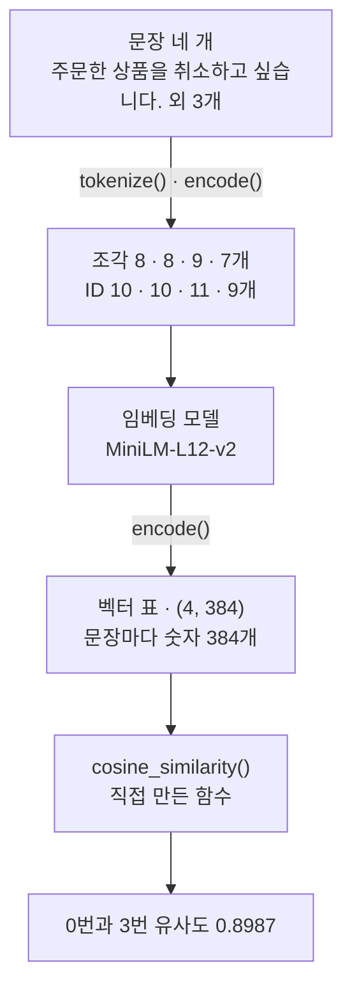
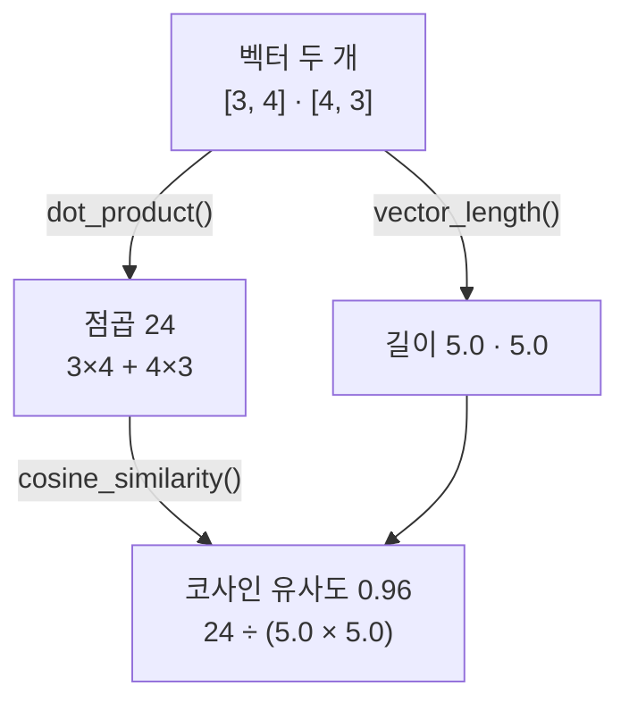
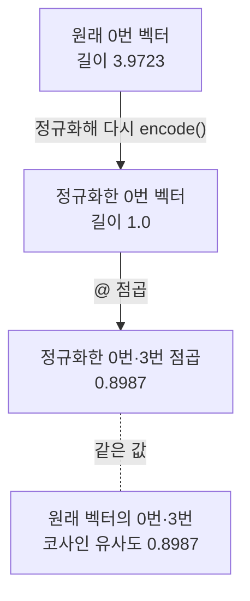
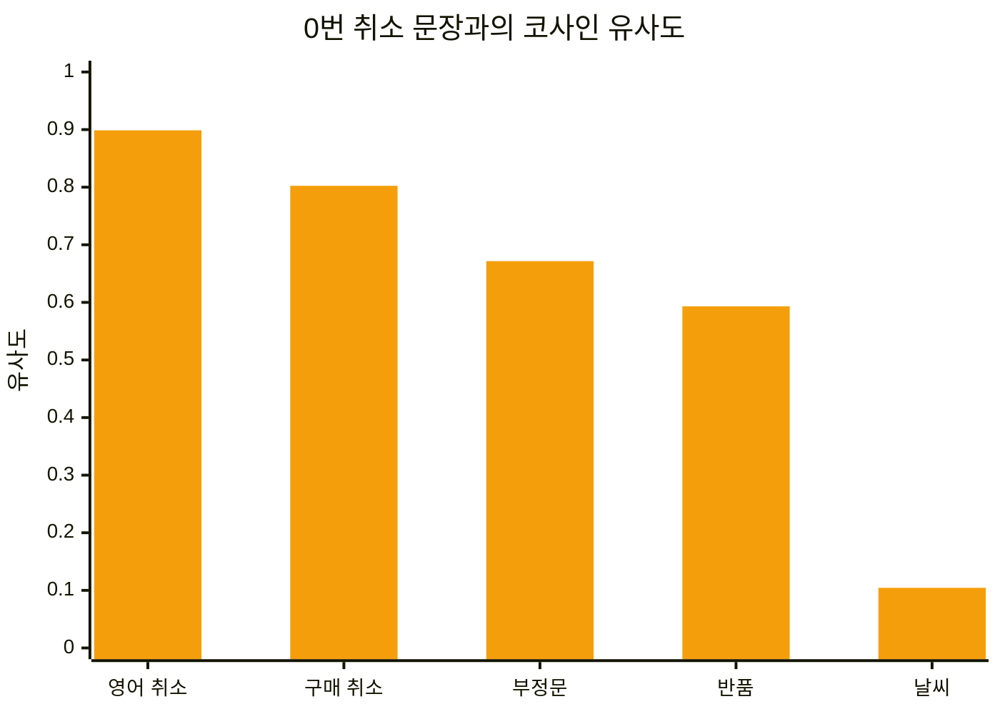

# 02-임베딩과-의미-유사도

## _src 본문 (HTML 원본)

```html
<!--meta: 강의 1.5h · 실습 1h | 코드 Jupyter Notebook | 새 용어 7 -->
<h2 id="b1"><span class="no">1</span>학습 목표</h2>
<div class="goal"><ul><li>임베딩 모델이 문장을 토큰 수와 관계없이 숫자 384개짜리 벡터로 바꾸는 과정을 노트북 출력으로 설명할 수 있습니다.</li><li>점곱과 벡터 길이로 코사인 유사도를 직접 계산하고, 정규화한 벡터의 점곱과 비교할 수 있습니다.</li><li>같은 코사인 유사도를 NumPy의 기호 <code>@</code>와 함수 <code>np.linalg.norm()</code>으로 적고, 반복문 판과 값이 같은지 확인할 수 있습니다.</li><li>부정문이 반품 문장보다 높게 나온 결과로, 유사도가 높다는 값을 어디까지 믿을지 설명할 수 있습니다.</li></ul></div>
<h2 id="b2"><span class="no">2</span>이 내용을 배우는 이유</h2>
<p>검색 기능을 만들다 보면 낱말이 달라도 뜻이 가까운 글을 찾아야 합니다. 질문이 「구매를 취소하려면 어떻게 하나요?」라면 「주문한 상품을 취소하고 싶습니다.」도 찾아 주어야 합니다. 두 문장에서 같은 낱말은 취소 하나뿐이라, 낱말을 맞춰 보는 방법으로는 이런 짝을 놓치기 쉽습니다.</p>
<p>임베딩은 문장을 숫자 목록으로 바꿔, 뜻이 가까운지를 계산으로 비교하게 합니다. Ch 9 03절 임베딩과 벡터스토어에서는 문서와 질문을 이렇게 바꿔 가까운 문서를 찾습니다. 그 전에 이 숫자가 알려 주는 것과 알려 주지 않는 것을 직접 확인합니다.</p>
<p><strong>이 절의 질문</strong> — 낱말이 달라도 뜻이 비슷한 문장을 숫자로 비교할 수 있을까요? 그 숫자가 높으면 같은 뜻이라고 말할 수 있을까요?</p>
<h2 id="b3"><span class="no">3</span>앞에서 배운 내용</h2>
<p>01절에서는 토큰화기가 글을 조각(토큰)으로 나누고, 조각마다 번호(토큰 ID)를 붙이는 과정을 봤습니다. 같은 18글자 문장이 GPT-2 토큰화기에서 39토큰, KLUE 토큰화기에서 9토큰이었습니다. 이 절의 임베딩 모델도 자기 토큰화기로 문장을 먼저 나눕니다. 조각을 보는 메서드 이름 <code>tokenize()</code>도 같습니다.</p>
<p>01절 그림에서 ID 목록을 받는 모델은 실행하지 않아 회색 점선으로 그렸습니다. 이 절에서는 모델을 실제로 실행해 문장 하나를 숫자 384개로 바꿉니다. 모델 파일은 01절의 <code>from_pretrained()</code>처럼 이름과 판 번호(revision)로 받습니다.</p>
<p>함수는 Ch 2 04절처럼 셀 하나에 하나씩 정의하고, 정의 셀과 호출 셀을 나눕니다. 반복 번호 <code>i</code>와 <code>range()</code>는 Ch 2 02절에서 배웠습니다. 튜플을 두 이름으로 풀어 담는 <code>for</code> 줄은 Ch 2 03절에서 배웠고 01절에서도 썼습니다. 반올림 함수 <code>round()</code>는 Ch 2 04절에서 봤습니다.</p>
<p>숫자 표의 모양을 알려 주는 속성 <code>shape</code>는 Ch 4 01절 데이터프레임에서 썼습니다. 표준 라이브러리 모듈 <code>math</code>는 Ch 2 07절에서 본 표준 라이브러리의 하나로, 이 절에서 처음 씁니다. 11절의 기사 요약 글은 Ch 4 05절 기사 A10의 요약 칸과 같은 글입니다.</p>
<h2 id="b4"><span class="no">4</span>핵심 개념</h2>
<h3>비유로 시작하기</h3>
<p>둥근 나무판 한가운데에 못이 있고, 연필 세 자루의 뒤끝이 모두 못 옆에 모여 있습니다. 파란 연필 두 자루는 길이가 다르지만 나란히 같은 쪽을 가리킵니다. 주황 연필 한 자루는 파란 연필과 직각인 쪽을 가리킵니다.</p>
<p>이 장면을 임베딩으로 옮기면 연필 한 자루가 문장 하나의 벡터입니다. 연필이 가리키는 방향이 뜻을 나타내고, 두 연필 사이의 벌어진 각이 뜻의 차이입니다. 각이 좁을수록 뜻이 가깝다고 봅니다. 연필 길이는 이 비교에 쓰지 않습니다.</p>
{{img:02-5-연필-원판|흰 바탕의 둥근 나무판 가운데 못에서 긴 파란 연필과 짧은 파란 연필이 나란히 오른쪽을 가리키고, 주황 연필 하나가 곧장 위를 가리켜 파란 연필과 직각을 이루는 삽화|길이가 달라도 같은 쪽을 가리키는 두 연필은 뜻이 가까운 문장이고, 직각으로 벌어진 연필은 뜻이 먼 문장입니다.}}
<p><strong>그림 읽기</strong> — 나무판 가운데 갈색 못에서 파란 연필 두 자루가 나란히 오른쪽을 가리킵니다. 위쪽 연필은 판 끝까지 닿을 만큼 길고, 아래쪽 연필은 그 절반쯤입니다. 길이는 달라도 방향이 같으니 뜻이 가까운 두 문장입니다.</p>
<p>주황 연필은 못에서 곧장 위를 가리켜, 파란 연필과 직각을 이룹니다. 노트북의 날씨 문장처럼 뜻이 먼 문장입니다. 연필 수와 각도는 실제 값이 아니고, 방향으로 뜻을 비교한다는 관계만 보여 줍니다. 판이 시계처럼 보여도 시각을 뜻하지 않고, 연필이 가리키는 방향만 봅니다.</p>
<h3>이 절에서 쓰는 말</h3>
<table><thead><tr><th>용어</th><th>뜻</th><th>이 절에서 보이는 모습</th></tr></thead><tbody>
<tr><td>임베딩(embedding)</td><td>글을 정해진 개수의 숫자 목록으로 바꾼 결과. 지도에서 장소를 위도와 경도 두 숫자로 적는 일과 비슷함</td><td>문장마다 숫자 384개</td></tr>
<tr><td>벡터(vector)</td><td>순서가 정해진 숫자 목록. 출발점에서 뻗은 화살표로 볼 수 있음</td><td><code>[3, 4]</code>, <code>vectors[0]</code></td></tr>
<tr><td>NumPy 배열(array)</td><td>숫자를 행과 열로 담은 표. 패키지 NumPy가 만들고, 기호 <code>@</code>(점곱)와 함수 <code>np.linalg.norm()</code>(길이)으로 한꺼번에 계산함</td><td><code>벡터 표의 모양: (4, 384)</code>, <code>NumPy로 계산한 유사도: 0.8987</code></td></tr>
<tr><td>점곱(dot product)</td><td>두 벡터에서 같은 자리 숫자끼리 곱해 모두 더한 값</td><td><code>점곱: 24</code></td></tr>
<tr><td>벡터의 길이</td><td>숫자마다 제곱해 더한 값의 제곱근</td><td><code>[3, 4]의 길이: 5.0</code></td></tr>
<tr><td>코사인 유사도(cosine similarity)</td><td>점곱을 두 벡터 길이의 곱으로 나눈 값. 방향이 같으면 1, 직각이면 0</td><td><code>0.96</code>, <code>유사도 0.8987</code></td></tr>
<tr><td>정규화(normalization)</td><td>벡터의 숫자를 벡터 길이로 나눠 길이를 1로 맞추는 일</td><td><code>normalize_embeddings=True</code>, 길이 <code>1.0</code></td></tr>
</tbody></table>
<h3>문장이 벡터가 되기까지</h3>
<p>임베딩 모델은 먼저 문장을 토큰으로 나눕니다. 노트북의 문장 네 개는 조각 8, 8, 9, 7개였습니다. 토큰화기가 앞뒤에 특수 토큰 두 개를 더해, 모델에는 ID 10, 10, 11, 9개가 들어갔습니다. 모델은 ID마다 숫자 목록을 만든 뒤, 특수 토큰까지 모두 평균을 내어 문장 하나의 벡터로 합칩니다.</p>
<p>평균을 내는 방식은 내려받은 설정 파일 <code>1_Pooling/config.json</code>으로 확인했습니다. 특수 토큰까지 평균에 넣는다는 점은 교재를 만들 때 기기 셸에서 확인했습니다. 토큰마다 만든 숫자 목록은 노트북에서 출력하지 않았습니다. 평균으로 합치므로 ID 수가 달라도 벡터 크기는 모두 384입니다. 네 문장의 벡터를 모은 숫자 표의 모양은 <code>(4, 384)</code>였습니다.</p>
{{mermaid:02-1-임베딩-흐름|맨 위 초록 상자 문장 네 개가 토큰화기의 tokenize()와 encode()로 노란 상자 조각 8, 8, 9, 7개와 ID 10, 10, 11, 9개가 되고, 보라 상자 임베딩 모델 MiniLM-L12-v2를 거쳐 encode()로 노란 상자 벡터 표 (4, 384)가 된 뒤, 파랑 상자 cosine_similarity() 직접 만든 함수를 지나 노란 상자 0번과 3번 유사도 0.8987이 되는 흐름도|ID 수가 10, 10, 11, 9개로 달라도 네 문장은 모두 숫자 384개짜리 벡터가 되고, 직접 만든 함수로 0번과 3번의 유사도 0.8987을 계산했습니다.}}
<p><strong>도식 읽기</strong> — 위에서 아래로 읽습니다. 맨 위 초록 상자는 노트북에 넣은 문장 네 개이고, 노란 상자는 출력으로 확인한 값입니다. 화살표 위 글자는 실행한 메서드입니다. 가운데 보라 상자가 이 절에서 실행한 임베딩 모델입니다.</p>
<p>보라 상자 아래 노란 상자가 네 문장의 벡터 표입니다. 그 아래 파랑 상자는 노트북에서 직접 정의한 함수 <code>cosine_similarity()</code>입니다. 맨 아래 노란 상자는 이 함수로 계산한 0번과 3번 문장의 유사도입니다.</p>
<h3>방향을 비교하는 코사인 유사도</h3>
<p>숫자 두 개짜리 벡터 <code>[3, 4]</code>는 출발점에서 동쪽으로 3칸, 북쪽으로 4칸 간 화살표입니다. 두 벡터의 점곱은 같은 자리 숫자끼리 곱해 더한 값입니다. 벡터 <code>[3, 4]</code>와 <code>[4, 3]</code>의 점곱은 3×4와 4×3을 더한 24입니다.</p>
<p>점곱은 방향이 비슷할수록 커지지만, 화살표가 길어져도 커집니다. 그래서 두 벡터의 길이로 나눠 방향만 남깁니다. 벡터의 길이는 숫자마다 제곱해 더한 값의 제곱근입니다. 벡터 <code>[3, 4]</code>의 길이는 9와 16을 더한 25의 제곱근인 5입니다.</p>
<p>코사인 유사도는 점곱을 두 벡터 길이의 곱으로 나눈 값입니다. 식은 <code>점곱 ÷ (길이 × 길이)</code>입니다. 앞의 두 벡터에 넣으면 24 ÷ (5 × 5)로 0.96이 됩니다. 방향이 똑같으면 1, 서로 직각이면 0입니다.</p>
<h3>정규화하면 점곱이 곧 유사도입니다</h3>
<p>정규화는 벡터의 숫자를 모두 벡터 길이로 나눠, 길이를 1로 맞추는 일입니다. 연필을 모두 같은 길이로 맞추고 방향만 남기는 일과 같습니다. 길이가 1인 두 벡터는 길이의 곱도 1이라, 점곱이 곧 코사인 유사도가 됩니다.</p>
<p>메서드 <code>encode()</code>에 인자 <code>normalize_embeddings=True</code>를 주면 정규화한 벡터를 반환합니다. 노트북에서 원래 0번 벡터의 길이는 3.9723이었고, 정규화한 0번 벡터의 길이는 1.0이었습니다.</p>
<h2 id="b5"><span class="no">5</span>실행 예제</h2>
<p>노트북은 먼저 임베딩 모델을 받아 벡터 크기와 최대 토큰 수를 확인합니다. 문장 네 개를 토큰으로 나눠 보고, 숫자 표로 바꿉니다. 이어서 숫자 두 개짜리 벡터로 점곱, 길이, 코사인 유사도 함수를 하나씩 만들어 문장 벡터에 씁니다. 같은 계산을 NumPy로 한 번 더 적어 값을 비교합니다. 끝으로 정규화한 벡터와 비교하고, 비교 문장을 바꿔 봅니다.</p>
<p>인터넷 서비스의 모델을 부르지 않으므로 API 키가 필요 없고 비용도 들지 않습니다. 내 컴퓨터에서 메서드 <code>encode()</code>를 5번 실행합니다. 첫 실행은 모델 파일 약 500MB를 내려받으려고 인터넷에 접속합니다.</p>
{{notebook:02-임베딩과-의미-유사도}}
<p class="look"><b>확인할 점</b> — 3절 ID 수와 4절 <code>벡터 표의 모양: (4, 384)</code>를 함께 봅니다. 6절에서 자기 자신과의 유사도 <code>1.0</code>, 직각인 짝의 <code>0.0</code>을 확인합니다. 7절의 <code>유사도 0.8987</code>이 8절 NumPy 값, 9절 정규화한 벡터의 점곱과 같은지 비교합니다.</p>
<h3>문장 네 개와 벡터 표</h3>
<p>모델이 알려 준 벡터의 숫자 개수는 384, 최대 토큰 수는 128이었습니다. 문장 네 개의 조각 수는 <code>조각 8</code>, <code>조각 8</code>, <code>조각 9</code>, <code>조각 7</code>로 조금씩 달랐습니다. ID 수는 앞뒤 특수 토큰 <code>&lt;s&gt;</code>, <code>&lt;/s&gt;</code>를 더해 <code>ID 10</code>, <code>ID 10</code>, <code>ID 11</code>, <code>ID 9</code>였습니다. 0번 문장의 조각 <code>'▁주문'</code>, <code>'▁취소'</code> 앞의 <code>▁</code>는 앞에 공백이 있었다는 표시입니다.</p>
<p>그런데 벡터 표의 모양은 <code>(4, 384)</code>로, 네 벡터가 모두 숫자 384개였습니다. 0번 벡터의 앞 다섯 값은 <code>0.03628663</code> 같은 작은 소수와 음수였습니다. 숫자 하나만 보고는 취소인지 날씨인지 읽을 수 없습니다. 벡터 두 개를 비교해야 뜻이 가까운지 알 수 있습니다.</p>
<h3>숫자 두 개로 확인한 계산</h3>
<p>함수 <code>dot_product()</code>는 반복 번호 <code>i</code>로 같은 자리 숫자를 곱해 더합니다. 함수 <code>vector_length()</code>는 자기 자신과의 점곱에 <code>math.sqrt()</code>로 제곱근을 씌웁니다. 함수 <code>cosine_similarity()</code>는 앞의 두 함수를 불러 점곱을 길이의 곱으로 나눕니다.</p>
{{mermaid:02-2-화살표-계산|맨 위 초록 상자 벡터 두 개 [3, 4]와 [4, 3]에서 dot_product()로 왼쪽 노란 상자 점곱 24, vector_length()로 오른쪽 노란 상자 길이 5.0과 5.0이 나오고, 두 상자가 아래 노란 상자 코사인 유사도 0.96, 24 ÷ (5.0 × 5.0)으로 모이는 흐름도|점곱 24를 두 길이의 곱 25로 나누면 코사인 유사도 0.96입니다.}}
<p><strong>도식 읽기</strong> — 위에서 아래로 읽습니다. 맨 위 초록 상자는 노트북에서 만든 두 벡터입니다. 왼쪽 갈래는 점곱 24, 오른쪽 갈래는 두 길이 5.0입니다. 두 갈래가 맨 아래 노란 상자에서 만나 코사인 유사도 0.96이 됩니다. 화살표 위 글자는 노트북에서 정의한 함수 이름입니다.</p>
<p>노트북에서는 같은 함수로 두 짝을 더 계산했습니다. 자기 자신과 비교한 <code>[3, 4]와 [3, 4]: 1.0</code>과, 직각인 <code>[3, 4]와 [4, -3]: 0.0</code>입니다.</p>
<h3>같은 계산을 NumPy로</h3>
<p>8절은 같은 계산을 패키지 NumPy로 적었습니다. 줄 <code>import numpy as np</code>로 불러오고, 함수 <code>np.array()</code>로 목록 <code>[3, 4]</code>를 배열로 바꿨습니다. 기호 <code>@</code>는 점곱을, 함수 <code>np.linalg.norm()</code>은 길이를 계산합니다. 출력은 <code>점곱: 24</code>와 <code>[3, 4]의 길이: 5.0</code>으로, 반복문 함수와 같았습니다.</p>
<p>문장 벡터 0번·3번의 유사도도 두 방법 모두 <code>0.8987</code>이었습니다. 반복문 함수 세 개로 한 계산을 세 줄로 적은 셈입니다. 이제부터 이 과정은 벡터 계산을 NumPy로 씁니다. 03절부터는 점곱과 가중합을 기호 <code>@</code>로 계산합니다.</p>
<h3>문장 벡터의 유사도와 정규화</h3>
<p>같은 함수를 384개짜리 문장 벡터에 썼습니다. 0번 취소 문장과 비교한 결과는 구매 취소 문장 <code>0.8024</code>, 날씨 문장 <code>0.1044</code>, 영어 취소 문장 <code>0.8987</code>이었습니다.</p>
<p>정규화한 벡터로 다시 받자 0번 벡터의 길이가 <code>3.9723</code>에서 <code>1.0</code>이 되었습니다. 정규화한 0번·3번 벡터의 점곱은 <code>0.8987</code>로, 길이로 나눠 구한 유사도와 같았습니다.</p>
{{mermaid:02-3-정규화|맨 위 노란 상자 원래 0번 벡터 길이 3.9723이 정규화해 다시 encode() 화살표로 노란 상자 정규화한 0번 벡터 길이 1.0이 되고, @ 점곱 화살표로 노란 상자 정규화한 0번과 3번 점곱 0.8987이 되며, 이 상자가 같은 값이라는 점선으로 맨 아래 노란 상자 원래 벡터의 0번과 3번 코사인 유사도 0.8987과 이어지는 흐름도|정규화하면 0번 벡터의 길이가 3.9723에서 1.0이 되고, 0번·3번의 점곱 0.8987이 코사인 유사도와 같아집니다.}}
<p><strong>도식 읽기</strong> — 위에서 아래로 읽습니다. 네 상자는 모두 출력으로 확인한 값이라 노랑입니다. 첫 화살표는 인자 <code>normalize_embeddings=True</code>를 주고 <code>encode()</code>를 다시 실행한 단계입니다. 맨 아래 상자는 7절에서 원래 벡터로 구한 유사도이고, 바로 위 점곱과 같은 값이라 점선으로 이었습니다.</p>
<h2 id="b6"><span class="no">6</span>실험 결과 해석</h2>
<p>0번 문장 「주문한 상품을 취소하고 싶습니다.」와 가장 가까운 문장은 영어 문장이었습니다. 두 문장은 낱말이 하나도 겹치지 않는데도 유사도가 0.8987이었습니다. 같은 한국어로 쓴 구매 취소 문장은 0.8024였고, 날씨 문장은 0.1044로 직각에 가까웠습니다.</p>
<p>값 바꿔 보기에서는 0번 문장의 낱말만 바꾼 두 문장을 비교했습니다. 취소를 반품으로 바꾼 문장은 0.5931이었습니다. 뒤를 부정으로 바꾼 「주문한 상품을 취소하고 싶지 않습니다.」는 0.6716이었습니다.</p>
<p>부정문은 뜻이 반대인데도 반품 문장보다 높았고, 날씨 문장보다 훨씬 높았습니다. 이 모델은 낱말 대부분이 같은 부정문을 가깝게 두었습니다. 유사도 순서는 뜻이 같은 순서가 아닙니다.</p>
{{mermaid:02-4-유사도-비교|가로축에 영어 취소, 구매 취소, 부정문, 반품, 날씨, 세로축에 유사도 0부터 1까지를 둔 주황 막대그래프로, 막대 높이가 0.8987, 0.8024, 0.6716, 0.5931, 0.1044로 왼쪽에서 오른쪽으로 낮아지는 그림|0번 취소 문장과의 유사도는 영어 취소 0.8987, 구매 취소 0.8024, 부정문 0.6716, 반품 0.5931, 날씨 0.1044 순이었습니다.}}
<p><strong>도식 읽기</strong> — 막대 하나가 0번 문장과 비교한 문장 하나이고, 막대 높이가 코사인 유사도입니다. 왼쪽부터 큰 값 순서로 놓았습니다. 가운데 부정문 막대가 오른쪽 반품 막대보다 높고, 맨 오른쪽 날씨 막대만 0.1 근처로 낮습니다. 막대가 한 종류라 색은 주황 하나입니다.</p>
<p>마지막으로 앞에서 본 문장 쌍 두 개를 비교했습니다. 01절의 한국어·영어 문장 쌍은 GPT-2 토큰화기에서 39토큰과 7토큰으로 크게 달랐는데, 유사도는 0.8312였습니다. Ch 4 기사 요약 「주말 방문객 증가로 음식점 매출이 늘었습니다.」와 낱말을 바꾼 문장은 0.9517이었습니다.</p>
<p>결론은 두 가지입니다. 이 모델은 언어나 낱말이 달라도 뜻이 같은 문장을 가까운 벡터로 만들었습니다. 그러나 뜻이 반대인 부정문도 0.6716으로 높게 나와, 유사도가 높다고 같은 뜻이라고 판정할 수는 없습니다.</p>
<p>이번에 비교한 것은 모델 하나와 짧은 문장 열 개입니다. 부정문도 한 문장만 봤으므로, 모든 부정문이 높게 나온다고 일반화할 수 없습니다. 긴 글, 다른 분야의 글, 다른 임베딩 모델은 실행하지 않았습니다.</p>
<h2 id="b7"><span class="no">7</span>주의할 점과 실무 메모</h2>
<ul><li>「유사도 0.8 이상이면 같은 뜻」 같은 기준은 모델과 자료마다 다릅니다. 이 절의 값을 다른 모델의 기준으로 옮겨 쓰지 않습니다. 다른 임베딩 모델은 이번에 실행하지 않았습니다.</li>
<li>낱말이 거의 같고 뜻이 반대인 문장, 취소와 반품처럼 절차가 다른 문장도 꽤 높은 값이 나왔습니다. 검색 결과를 쓰는 기능은 질문과 정답 문서를 모아 따로 확인합니다. 검색 품질을 재는 방법은 Ch 11 평가 기초에서 다룹니다.</li>
<li>이 모델은 특수 토큰 두 개를 포함해 앞부분부터 최대 128토큰까지만 읽고, 나머지는 잘라 냅니다. 자르는 설정은 설치한 패키지 소스 <code>models/Transformer.py</code>에서 확인했습니다. 특수 토큰을 포함해 센다는 점은 기기 셸에서 확인했습니다. 128토큰보다 긴 글은 이번에 실행하지 않았습니다.</li>
<li>이 절은 계산 원리를 보려고 <code>for</code>로 먼저 계산하고, 같은 값을 NumPy로 확인했습니다. 교재를 만들 때 반올림하기 전 두 값을 따로 출력하니 <code>0.8987315</code>와 <code>0.8987313</code>이었습니다. 두 방법은 숫자를 더하는 차례가 달라 끝자리가 달라질 수 있어, 이런 값은 반올림해 비교합니다. 라이브러리에도 유사도를 계산하는 메서드 <code>model.similarity()</code>가 있지만, 이번에는 실행하지 않았습니다.</li>
<li>모델 파일은 첫 실행 때 사용자 폴더의 캐시에 받아 두고, 다음 실행부터 다시 씁니다. 교재 실행 컴퓨터에서 받은 파일은 약 500MB였습니다. 인터넷이 없는 곳에서 실행하는 경우는 이번에 실행하지 않았습니다.</li>
<li>판 번호를 고정하지 않으면 모델 파일이 바뀌었을 때 벡터와 유사도가 달라질 수 있습니다. 판 번호를 뺀 경우는 이번에 실행하지 않았습니다.</li>
<li>교재 출력은 2026-09-21에 Linux의 Python 3.12.13과 CPU용 torch 2.8.0으로 만들었습니다. 패키지는 sentence-transformers 5.1.1, transformers 4.56.2, numpy 2.3.3입니다. GPU, Windows·macOS와 다른 버전에서는 실행하지 않았습니다.</li></ul>
<h2 id="b8"><span class="no">8</span>정리와 다음 절</h2>
<ul><li>임베딩 모델은 문장을 토큰으로 나눈 뒤, 토큰 수와 관계없이 숫자 384개짜리 벡터 하나로 바꿨습니다.</li><li>코사인 유사도는 점곱을 두 벡터 길이의 곱으로 나눈 값입니다. 정규화한 벡터라면 점곱이 곧 코사인 유사도입니다. 패키지 NumPy의 <code>@</code>와 <code>np.linalg.norm()</code>으로 적어도 값이 같았습니다.</li><li>영어 취소 문장은 0.8987로 가장 가까웠고, 부정문도 0.6716으로 반품 문장보다 높았습니다. 유사도는 뜻이 가까운 정도를 어림하는 값이지 같은 뜻의 판정이 아닙니다.</li></ul>
<p><strong>다음 학습과 이어지는 지점</strong> — <a href="03-어텐션-직관.html">03절 어텐션 직관</a>에서는 한 토큰이 다른 토큰 가운데 어느 쪽을 더 참고하는지 직관으로 봅니다.</p>
<h2 id="b9"><span class="no">9</span>복습 문제</h2><details class="quiz"><summary>문제와 해설</summary>
<p class="quiz-q">1. 조각 8개짜리 문장과 조각 7개짜리 문장을 이 절의 모델로 바꾸면 벡터의 숫자는 각각 몇 개인가요? · 기초</p><p class="quiz-a"><b>해설</b> — 둘 다 384개입니다. 모델이 ID마다 만든 숫자 목록을 특수 토큰까지 평균으로 합치므로, ID 수가 달라도 벡터 크기는 같습니다. 노트북의 벡터 표 모양도 <code>(4, 384)</code>였습니다.</p>
<p class="quiz-q">2. 벡터 <code>[3, 4]</code>와 <code>[4, 3]</code>의 코사인 유사도를 점곱과 길이로 계산해 보세요. · 기초</p><p class="quiz-a"><b>해설</b> — 점곱은 3×4와 4×3을 더한 24입니다. 두 길이는 모두 5이므로 길이의 곱은 25입니다. 코사인 유사도는 24 ÷ 25로 0.96입니다.</p>
<p class="quiz-q">3. 정규화한 벡터끼리는 점곱만 계산해도 코사인 유사도가 되는 까닭은 무엇인가요? · 적용</p><p class="quiz-a"><b>해설</b> — 정규화한 벡터는 길이가 1이라, 두 길이의 곱도 1입니다. 점곱을 1로 나누면 값이 그대로입니다. 노트북에서 정규화한 0번·3번 벡터의 점곱 0.8987이 7절 유사도와 같았습니다.</p>
<p class="quiz-q">4. 부정문 「주문한 상품을 취소하고 싶지 않습니다.」가 0번 문장과 0.6716으로 반품 문장 0.5931보다 높았습니다. 이 결과로 무엇을 알 수 있나요? · 분석</p><p class="quiz-a"><b>해설</b> — 코사인 유사도가 높다고 뜻이 같다고 판정할 수 없다는 점입니다. 이 모델은 낱말 대부분이 같은 부정문을 가깝게 두었습니다. 다만 부정문 한 개로 본 결과라, 모든 부정문에 같다고 일반화하지 않습니다.</p>
<p class="quiz-q">5. 동료가 주문 상담 검색에 「유사도 0.8 이상이면 같은 질문으로 본다」는 규칙을 넣자고 합니다. 이 절의 결과로 어떤 점을 확인하자고 말할 수 있나요? · 분석</p><p class="quiz-a"><b>해설</b> — 기준값은 모델과 자료마다 다르므로, 실제 질문과 정답을 모아 그 기준으로 맞는지 확인해야 합니다. 이 절에서도 뜻이 반대인 부정문이 0.6716, 절차가 다른 반품 문장이 0.5931로 꽤 높았습니다. 한 모델과 짧은 문장 열 개로 본 값이라 그대로 기준으로 쓰지 않습니다.</p>
</details>
<h2 id="b10"><span class="no">10</span>참고 자료</h2>
<ul><li><a href="https://sbert.net/docs/sentence_transformer/usage/semantic_textual_similarity.html">Sentence Transformers 의미 유사도 공식 문서</a> · 확인 2026-09-09</li><li><a href="https://huggingface.co/sentence-transformers/paraphrase-multilingual-MiniLM-L12-v2/tree/e8f8c211226b894fcb81acc59f3b34ba3efd5f42">MiniLM-L12-v2 다국어 모델 파일과 Apache-2.0 라이선스</a> · 판 e8f8c21 · 확인 2026-09-16</li><li><a href="https://huggingface.co/docs/transformers/">Hugging Face Transformers 공식 문서</a> · 확인 2026-09-09 · transformers 4.56.2</li></ul>
```

## 노트북 셀 (순서대로)

### [0] markdown {'html': 'skip'}

# 임베딩과 의미 유사도

**이 노트북에서 할 일**

1. 문장 네 개를 임베딩 모델에 넣어, 문장마다 숫자 384개로 된 목록(벡터)을 만듭니다.
2. 두 벡터의 방향이 얼마나 비슷한지 코사인 유사도를 직접 만든 함수로 계산하고, 같은 계산을 NumPy로 적어 봅니다.
3. 낱말 하나를 바꾸거나 부정문으로 바꿔, 유사도가 뜻의 차이를 어디까지 보여 주는지 확인합니다.

**준비물** — API 키는 필요 없습니다. 인터넷 서비스의 모델을 부르지 않고, 내 컴퓨터에서 임베딩 모델을 실행합니다.
그래서 비용은 들지 않습니다. 문장을 벡터로 바꾸는 메서드 `encode()`는 모두 5번 실행합니다.

실행 시간은 1분 안팎입니다. 첫 실행에서는 Hugging Face 사이트에서 모델 파일을 내려받으므로 인터넷 연결이 필요합니다.
교재 실행 컴퓨터에서 받은 모델 파일은 합쳐 약 500MB였습니다.

**기준 버전** — 실습 폴더에 고정한 sentence-transformers 5.1.1을 씁니다.
함께 고정한 transformers는 4.56.2, torch는 2.8.0, numpy는 2.3.3입니다.
모델은 `sentence-transformers/paraphrase-multilingual-MiniLM-L12-v2`이고, 판 번호(revision)를 `e8f8c211226b894fcb81acc59f3b34ba3efd5f42`로 고정해 받습니다.


교재 출력은 Linux의 Python 3.12.13과 CPU용 torch(2.8.0+cpu)로 만들었습니다. 다른 버전, GPU, Windows·macOS에서는 이번에 실행하지 않았습니다.

실습 폴더 `labs/part1/ch05-llm-principles`에서 01절과 같은 `.venv` 커널을 고른 뒤 첫 셀부터 순서대로 실행합니다.

### [1] markdown {'html': 'skip'}

## 오늘 볼 그림


위에서 아래로 읽습니다. 초록 상자의 문장 네 개는 먼저 토큰으로 나뉘고, 보라 상자의 임베딩 모델이 문장마다 숫자 384개를 만듭니다.
파랑 상자는 이 노트북에서 직접 만드는 함수이고, 노란 상자는 출력으로 확인하는 값입니다.

### [2] markdown {}

## 1. 준비

이 절은 파일을 읽거나 만들지 않습니다. 준비 셀에서는 계산에 쓸 모듈 두 개를 불러오고 버전을 확인합니다.

표준 라이브러리 모듈 `math`는 제곱근 같은 수학 함수를 모아 둔 기능 묶음입니다.
패키지 sentence-transformers는 문장을 벡터로 바꾸는 모델을 불러오고 실행하게 해 줍니다.
함수 `warnings.filterwarnings()` 줄은 01절처럼 진행 표시 위젯이 없다는 경고 한 줄을 끕니다. 계산 결과와 관계없는 경고입니다.

### [3] code {'execution': {'iopub.execute_input': '2026-09-21T03:14:20.742976Z', 'iopub.status.busy': '2026-09-21T03:14:20.742751Z', 'iopub.status.idle': '2026-09-21T03:14:25.236249Z', 'shell.execute_reply': '2026-09-21T03:14:25.235688Z'}, 'lesson_role': 'setup'}

```python
# 계산에 쓸 math 모듈과 문장 임베딩 패키지를 불러오고 버전을 확인합니다
import math
import warnings

# 진행 표시 위젯이 없다는 경고(TqdmWarning)는 계산과 관계없어 화면에 내지 않습니다
warnings.filterwarnings("ignore", message="IProgress not found")

import sentence_transformers
from sentence_transformers import SentenceTransformer

print("sentence-transformers 버전:", sentence_transformers.__version__)
```

출력:
```
sentence-transformers 버전: 5.1.1

```

### [4] markdown {}

**결과 읽기** — 출력 줄은 `sentence-transformers 버전: 5.1.1`입니다. 준비물에 적은 기준 버전과 같습니다.

### [5] markdown {}

## 2. 임베딩 모델 준비

임베딩(embedding)은 글을 정해진 개수의 숫자 목록으로 바꾼 결과입니다. 지도에서 장소 하나를 위도와 경도 두 숫자로 적는 일과 비슷합니다.
이 절의 모델은 문장 하나를 숫자 384개로 적습니다. 순서가 정해진 숫자 목록을 벡터(vector)라고 부릅니다.

클래스 `SentenceTransformer(모델 이름, revision=판 번호)`는 01절의 `from_pretrained()`처럼 모델 파일을 받아 모델 객체를 만듭니다.
메서드 `get_sentence_embedding_dimension()`은 벡터 하나에 든 숫자 개수를 반환합니다. 속성 `max_seq_length`는 문장에서 읽는 최대 토큰 수입니다.

실행 전에 예상합니다. 여러 나라 말을 다루는 모델이니, 벡터의 숫자 개수는 수천 개쯤일 것 같습니다.

### [6] code {'execution': {'iopub.execute_input': '2026-09-21T03:14:25.237450Z', 'iopub.status.busy': '2026-09-21T03:14:25.237306Z', 'iopub.status.idle': '2026-09-21T03:14:26.357634Z', 'shell.execute_reply': '2026-09-21T03:14:26.356851Z'}}

```python
# 다국어 문장 임베딩 모델을 고정 판 번호로 받아 만들고, 벡터 크기를 확인합니다
model_name = "sentence-transformers/paraphrase-multilingual-MiniLM-L12-v2"
model_revision = "e8f8c211226b894fcb81acc59f3b34ba3efd5f42"
# SentenceTransformer(모델 이름, revision=판 번호)는 모델 파일을 받아 모델 객체를 만듭니다
model = SentenceTransformer(model_name, revision=model_revision)
# 문장 하나를 숫자 몇 개로 나타내는지 반환합니다
dimension = model.get_sentence_embedding_dimension()
print("벡터의 숫자 개수:", dimension)
# 문장에서 앞부분부터 읽는 최대 토큰 수입니다
print("최대 토큰 수:", model.max_seq_length)
```

출력:
```
벡터의 숫자 개수: 384
최대 토큰 수: 128

```

### [7] markdown {}

**결과 읽기** — 벡터의 숫자 개수는 `384`이고, 최대 토큰 수는 `128`입니다. 예상보다 숫자 개수가 적습니다.

첫 실행에서는 모델 파일을 내려받는 진행 표시가 더 나올 수 있습니다. 숫자 개수 384는 모델 설정이 정한 값입니다.
다음 셀에서는 문장이 이 모델 안에서 먼저 어떤 토큰으로 나뉘는지 봅니다.

### [8] markdown {}

## 3. 문장 네 개를 토큰으로 나누기

임베딩 모델도 01절에서 본 것처럼 글을 먼저 토큰으로 나눕니다. 속성 `model.tokenizer`가 이 모델의 토큰화기이고, 메서드 `tokenize()`는 01절과 같습니다.
토큰화기의 메서드 `encode()`와 `convert_ids_to_tokens()`도 01절과 같습니다. 4절에서 쓰는 모델의 `encode()`와는 이름만 같습니다.

비교할 문장은 네 개입니다. 주문 취소 문장, 같은 뜻을 다른 낱말로 쓴 문장, 날씨 문장, 같은 뜻의 영어 문장입니다.
실행 전에 예상합니다. 문장 길이가 비슷하니 조각 수도 비슷하겠지만, 똑같지는 않을 것입니다.
01절 KLUE 토큰화기처럼 ID 수가 조각 수보다 많은지도 봅니다.

### [9] code {'execution': {'iopub.execute_input': '2026-09-21T03:14:26.359465Z', 'iopub.status.busy': '2026-09-21T03:14:26.359276Z', 'iopub.status.idle': '2026-09-21T03:14:26.367648Z', 'shell.execute_reply': '2026-09-21T03:14:26.367004Z'}}

```python
# 비교할 문장 네 개를 목록에 담고, 이 모델의 토큰화기로 문장마다 조각 수와 ID 수를 셉니다
sentences = [
    "주문한 상품을 취소하고 싶습니다.",
    "구매를 취소하려면 어떻게 하나요?",
    "내일 서울은 비가 옵니다.",
    "I want to cancel my order.",
]
for sentence in sentences:
    pieces = model.tokenizer.tokenize(sentence)
    # 모델에 넣는 것은 조각이 아니라 ID 목록입니다(01절)
    ids = model.tokenizer.encode(sentence)
    print("조각", len(pieces), "| ID", len(ids), "|", sentence)
first_ids = model.tokenizer.encode(sentences[0])
print("0번 문장의 ID를 되돌린 조각 목록:", model.tokenizer.convert_ids_to_tokens(first_ids))
```

출력:
```
조각 8 | ID 10 | 주문한 상품을 취소하고 싶습니다.
조각 8 | ID 10 | 구매를 취소하려면 어떻게 하나요?
조각 9 | ID 11 | 내일 서울은 비가 옵니다.
조각 7 | ID 9 | I want to cancel my order.
0번 문장의 ID를 되돌린 조각 목록: ['<s>', '▁주문', '한', '▁상품', '을', '▁취소', '하고', '▁싶습니다', '.', '</s>']

```

### [10] markdown {}

**결과 읽기** — 조각 수는 네 줄 차례로 `조각 8`, `조각 8`, `조각 9`, `조각 7`입니다. 예상대로 비슷하지만 같지는 않습니다.
ID 수는 `ID 10`, `ID 10`, `ID 11`, `ID 9`로, 네 줄 모두 조각 수보다 2개 많습니다.

마지막 줄의 목록은 `['<s>', '▁주문', '한', '▁상품', '을', '▁취소', '하고', '▁싶습니다', '.', '</s>']`입니다.
01절 KLUE의 `[CLS]`, `[SEP]`처럼, 이 토큰화기는 앞뒤에 특수 토큰 `<s>`와 `</s>`를 더했습니다. 조각 앞의 `▁` 표시는 그 앞에 공백이 있었다는 뜻입니다.
01절 GPT-2 조각의 `Ġ`와 뜻이 같고 모양만 다릅니다. KLUE 조각의 `##`은 반대로 공백 없이 이어진다는 표시였습니다.

### [11] markdown {}

## 4. 문장을 벡터로 바꾸기

메서드 `encode(문장 목록)`는 문장마다 숫자 384개를 한 줄로 담은 숫자 표를 반환합니다. 이 표는 NumPy라는 패키지의 배열(array)입니다.
Ch 4 01절의 데이터프레임처럼 속성 `shape`가 `(행 수, 열 수)`를 알려 줍니다. 표의 `vectors[0]`은 0번 행, 곧 0번 문장의 벡터입니다.

실행 전에 예상합니다. 3절에서 ID 수가 9~11개로 달랐으니, 벡터의 숫자 개수도 문장마다 다를 것 같습니다.

### [12] code {'execution': {'iopub.execute_input': '2026-09-21T03:14:26.369060Z', 'iopub.status.busy': '2026-09-21T03:14:26.368931Z', 'iopub.status.idle': '2026-09-21T03:14:26.488448Z', 'shell.execute_reply': '2026-09-21T03:14:26.487988Z'}}

```python
# 문장 네 개를 벡터로 바꾸고, 숫자 표의 모양과 0번 벡터의 앞 다섯 값을 봅니다
# encode(문장 목록)는 문장마다 숫자 384개를 한 행으로 담은 NumPy 배열을 반환합니다
vectors = model.encode(sentences)
print("벡터 표의 모양:", vectors.shape)
first_vector = vectors[0]
print("0번 벡터의 숫자 개수:", len(first_vector))
print("0번 벡터의 앞 다섯 값:", first_vector[0:5])
# 행 수는 넣은 문장 수, 열 수는 모델 설정이 정해서 매번 같습니다
assert vectors.shape == (4, 384)
```

출력:
```
벡터 표의 모양: (4, 384)
0번 벡터의 숫자 개수: 384
0번 벡터의 앞 다섯 값: [ 0.03628663  0.03654783  0.04329514 -0.10407412 -0.03251115]

```

### [13] markdown {}

**결과 읽기** — 벡터 표의 모양은 `(4, 384)`이고, 0번 벡터의 숫자 개수는 `384`입니다. 예상과 달리 ID 수가 달라도 벡터 크기는 모두 같습니다.

라벨 줄 끝의 앞 다섯 값은 `0.03628663`처럼 작은 소수이고, 음수도 섞여 있습니다.
숫자 하나만 보고는 취소인지 날씨인지 읽을 수 없습니다. 벡터 두 개를 비교해야 뜻이 가까운지 알 수 있습니다.

### [14] markdown {}

## 5. 숫자 두 개짜리 벡터로 계산 원리 보기

384개를 한꺼번에 보기 전에 숫자 두 개짜리 벡터로 계산을 익힙니다. 벡터 `[3, 4]`는 출발점에서 동쪽으로 3칸, 북쪽으로 4칸 간 화살표로 볼 수 있습니다.
두 화살표의 방향이 얼마나 같은지 나타내는 값을 코사인 유사도(cosine similarity)라고 부릅니다.

계산의 첫 단계는 점곱(dot product)입니다. 같은 자리의 숫자끼리 곱해 모두 더한 값입니다.
아래 함수 `dot_product()`는 반복 번호 `i`로 두 벡터의 같은 자리 숫자를 짝지어 곱합니다. 이 셀은 함수를 정의만 합니다.

### [15] code {'execution': {'iopub.execute_input': '2026-09-21T03:14:26.489239Z', 'iopub.status.busy': '2026-09-21T03:14:26.489161Z', 'iopub.status.idle': '2026-09-21T03:14:26.491008Z', 'shell.execute_reply': '2026-09-21T03:14:26.490649Z'}}

```python
# 두 벡터의 점곱(같은 자리 숫자끼리 곱해 모두 더한 값)을 반환하는 함수를 정의합니다
def dot_product(first, second):
    total = 0
    # 반복 번호 i로 두 벡터의 같은 자리 숫자를 짝지어 곱하고 더합니다
    for i in range(len(first)):
        total = total + first[i] * second[i]
    return total
```

출력:
```

```

### [16] markdown {}

**결과 읽기** — 정의만 하는 셀이라 출력이 없습니다. 다음 셀에서 화살표 두 개로 호출합니다.

실행 전에 예상합니다. 벡터 `[3, 4]`와 `[4, 3]`의 점곱은 3×4와 4×3을 더한 값입니다.

### [17] code {'execution': {'iopub.execute_input': '2026-09-21T03:14:26.491725Z', 'iopub.status.busy': '2026-09-21T03:14:26.491653Z', 'iopub.status.idle': '2026-09-21T03:14:26.493259Z', 'shell.execute_reply': '2026-09-21T03:14:26.492953Z'}}

```python
# 숫자 두 개짜리 벡터 두 개를 만들고 점곱을 계산합니다
first_arrow = [3, 4]
second_arrow = [4, 3]
arrow_dot = dot_product(first_arrow, second_arrow)
print("점곱:", arrow_dot)
```

출력:
```
점곱: 24

```

### [18] markdown {}

**결과 읽기** — 출력 줄은 `점곱: 24`입니다. 3×4 = 12와 4×3 = 12를 더한 값과 같습니다.

점곱은 방향이 비슷할수록 커지지만, 화살표가 길어져도 커집니다. 그래서 방향만 비교하려면 화살표의 길이로 나눕니다.

### [19] markdown {}

## 6. 벡터의 길이와 코사인 유사도

벡터의 길이는 숫자마다 제곱해 더한 뒤 제곱근을 구한 값입니다. 동쪽 3칸, 북쪽 4칸 떨어진 곳까지 곧게 가면 5칸이 되는 계산입니다.
숫자마다 제곱해 더한 값은 자기 자신과의 점곱과 같으므로, 앞에서 만든 `dot_product()`를 다시 씁니다.
함수 `math.sqrt(수)`는 제곱근을 반환합니다.

### [20] code {'execution': {'iopub.execute_input': '2026-09-21T03:14:26.493847Z', 'iopub.status.busy': '2026-09-21T03:14:26.493780Z', 'iopub.status.idle': '2026-09-21T03:14:26.495280Z', 'shell.execute_reply': '2026-09-21T03:14:26.494976Z'}}

```python
# 벡터의 길이(자기 자신과의 점곱에 제곱근을 씌운 값)를 반환하는 함수를 정의합니다
def vector_length(vector):
    # 자기 자신과의 점곱은 숫자마다 제곱해 더한 값입니다
    squared_sum = dot_product(vector, vector)
    # math.sqrt(수)는 제곱근을 반환합니다
    return math.sqrt(squared_sum)
```

출력:
```

```

### [21] markdown {}

**결과 읽기** — 정의만 하는 셀이라 출력이 없습니다.

이제 코사인 유사도 함수를 정의합니다. 점곱을 두 벡터 길이의 곱으로 나눈 값입니다.
방향이 똑같으면 1, 서로 직각이면 0에 가까워집니다.

### [22] code {'execution': {'iopub.execute_input': '2026-09-21T03:14:26.495884Z', 'iopub.status.busy': '2026-09-21T03:14:26.495812Z', 'iopub.status.idle': '2026-09-21T03:14:26.497231Z', 'shell.execute_reply': '2026-09-21T03:14:26.496948Z'}}

```python
# 두 벡터의 코사인 유사도(점곱을 두 길이의 곱으로 나눈 값)를 반환하는 함수를 정의합니다
def cosine_similarity(first, second):
    dot = dot_product(first, second)
    # 두 길이를 곱한 값으로 나누면 화살표 길이와 관계없이 방향만 비교합니다
    length_product = vector_length(first) * vector_length(second)
    return dot / length_product
```

출력:
```

```

### [23] markdown {}

**결과 읽기** — 정의만 하는 셀이라 출력이 없습니다. 다음 셀에서 길이와 유사도를 함께 계산합니다.

실행 전에 예상합니다. 두 화살표의 길이는 모두 5이고, 유사도는 24를 25로 나눈 값일 것입니다.
화살표 `[4, -3]`은 `[3, 4]`와 직각이라 점곱이 0이 됩니다.

### [24] code {'execution': {'iopub.execute_input': '2026-09-21T03:14:26.497792Z', 'iopub.status.busy': '2026-09-21T03:14:26.497735Z', 'iopub.status.idle': '2026-09-21T03:14:26.499515Z', 'shell.execute_reply': '2026-09-21T03:14:26.499250Z'}}

```python
# 화살표의 길이와, 세 가지 짝의 코사인 유사도를 계산합니다
print("[3, 4]의 길이:", vector_length(first_arrow))
print("[4, 3]의 길이:", vector_length(second_arrow))
cross_arrow = [4, -3]
similar_score = cosine_similarity(first_arrow, second_arrow)
print("[3, 4]와 [4, 3]:", similar_score)
self_score = cosine_similarity(first_arrow, first_arrow)
print("[3, 4]와 [3, 4]:", self_score)
cross_score = cosine_similarity(first_arrow, cross_arrow)
print("[3, 4]와 [4, -3]:", cross_score)
```

출력:
```
[3, 4]의 길이: 5.0
[4, 3]의 길이: 5.0
[3, 4]와 [4, 3]: 0.96
[3, 4]와 [3, 4]: 1.0
[3, 4]와 [4, -3]: 0.0

```

### [25] markdown {}

**결과 읽기** — 두 길이는 `5.0`입니다. 유사도는 `[3, 4]와 [4, 3]: 0.96`, `[3, 4]와 [3, 4]: 1.0`, `[3, 4]와 [4, -3]: 0.0`입니다.

방향이 거의 같은 짝은 1에 가깝고, 자기 자신은 정확히 1, 직각인 짝은 0입니다. 예상과 같습니다.

### [26] markdown {}

## 7. 문장 벡터의 코사인 유사도

같은 함수를 4절의 문장 벡터에 씁니다. 숫자가 384개로 늘었을 뿐 계산 방법은 같습니다.
0번 취소 문장을 기준으로 나머지 세 문장과 비교합니다. 함수 `round(값, 4)`는 Ch 2 04절에서처럼 소수 넷째 자리까지 반올림합니다.

실행 전에 예상합니다. 같은 한국어로 쓴 1번 문장이 영어로 쓴 3번 문장보다 0번과 더 가까울 것 같습니다.

### [27] code {'execution': {'iopub.execute_input': '2026-09-21T03:14:26.500104Z', 'iopub.status.busy': '2026-09-21T03:14:26.500040Z', 'iopub.status.idle': '2026-09-21T03:14:26.502305Z', 'shell.execute_reply': '2026-09-21T03:14:26.501959Z'}}

```python
# 0번 취소 문장과 나머지 세 문장의 코사인 유사도를 계산합니다
print("0번 문장:", sentences[0])
for number in range(1, len(sentences)):
    similarity = cosine_similarity(vectors[0], vectors[number])
    print("비교 문장", number, "| 유사도", round(similarity, 4), "|", sentences[number])
```

출력:
```
0번 문장: 주문한 상품을 취소하고 싶습니다.
비교 문장 1 | 유사도 0.8024 | 구매를 취소하려면 어떻게 하나요?
비교 문장 2 | 유사도 0.1044 | 내일 서울은 비가 옵니다.
비교 문장 3 | 유사도 0.8987 | I want to cancel my order.

```

### [28] markdown {}

**결과 읽기** — 세 줄은 차례로 `비교 문장 1 | 유사도 0.8024`, `비교 문장 2 | 유사도 0.1044`, `비교 문장 3 | 유사도 0.8987`입니다.

예상과 달리 영어 문장 3번이 0번과 가장 가깝습니다. 낱말이 하나도 겹치지 않지만, 이 모델은 같은 뜻이면 언어가 달라도 비슷한 방향의 벡터를 만들었습니다.
날씨 문장 2번은 0에 가까워, 두 화살표가 거의 직각입니다.

### [29] markdown {}

## 8. 같은 계산을 NumPy로

5~7절에서는 `for`로 한 자리씩 곱해 더했습니다. 계산의 뜻을 보려고 고른 방법입니다.
같은 계산은 패키지 NumPy(넘파이)로 더 짧게 적을 수 있습니다. 숫자 표를 한꺼번에 계산하는 패키지이고, 4절 `encode()`가 반환한 벡터 표도 NumPy 배열입니다.

줄 `import numpy as np`는 이 패키지를 짧은 이름 `np`로 불러옵니다. 함수 `np.array(목록)`은 Python 목록을 NumPy 배열로 바꿉니다.
기호 `@`는 두 배열의 점곱을 계산합니다. 함수 `np.linalg.norm(배열)`은 벡터의 길이를 반환합니다.

실행 전에 예상합니다. 5·6절 화살표로 계산하면 점곱 24와 길이 5.0이 그대로 나올 것입니다.

### [30] code {'execution': {'iopub.execute_input': '2026-09-21T03:14:26.503045Z', 'iopub.status.busy': '2026-09-21T03:14:26.502958Z', 'iopub.status.idle': '2026-09-21T03:14:26.504980Z', 'shell.execute_reply': '2026-09-21T03:14:26.504577Z'}}

```python
# NumPy를 짧은 이름 np로 불러오고, 5절 화살표 두 개를 배열로 바꿔 점곱과 길이를 계산합니다
import numpy as np

first_array = np.array(first_arrow)
second_array = np.array(second_arrow)
# 기호 @는 같은 자리 숫자끼리 곱해 모두 더한 점곱입니다
print("점곱:", first_array @ second_array)
# np.linalg.norm()은 숫자마다 제곱해 더한 값의 제곱근, 곧 벡터의 길이를 반환합니다
print("[3, 4]의 길이:", np.linalg.norm(first_array))
```

출력:
```
점곱: 24
[3, 4]의 길이: 5.0

```

### [31] markdown {}

**결과 읽기** — 출력 줄은 `점곱: 24`와 `[3, 4]의 길이: 5.0`입니다. 5·6절에서 반복문 함수로 구한 값과 같습니다.

반복문 없이 기호 하나와 함수 하나로 같은 계산을 했습니다. 다음 셀은 숫자 384개짜리 문장 벡터로 비교합니다.
7절 반복문 함수 `cosine_similarity()`의 0번·3번 유사도와, NumPy로 계산한 유사도를 나란히 출력합니다. 두 값은 소수 넷째 자리까지 반올림합니다.

### [32] code {'execution': {'iopub.execute_input': '2026-09-21T03:14:26.505660Z', 'iopub.status.busy': '2026-09-21T03:14:26.505578Z', 'iopub.status.idle': '2026-09-21T03:14:26.507888Z', 'shell.execute_reply': '2026-09-21T03:14:26.507513Z'}}

```python
# 0번·3번 문장 벡터의 코사인 유사도를 NumPy로 계산해, 7절 반복문 함수의 값과 나란히 봅니다
numpy_dot = vectors[0] @ vectors[3]
length_product = np.linalg.norm(vectors[0]) * np.linalg.norm(vectors[3])
numpy_similarity = numpy_dot / length_product
loop_similarity = cosine_similarity(vectors[0], vectors[3])
print("NumPy로 계산한 유사도:", round(numpy_similarity, 4))
print("반복문 함수로 계산한 유사도:", round(loop_similarity, 4))
```

출력:
```
NumPy로 계산한 유사도: 0.8987
반복문 함수로 계산한 유사도: 0.8987

```

### [33] markdown {}

**결과 읽기** — 두 줄 모두 `0.8987`입니다. 소수 넷째 자리까지 반올림한 값이 7절 반복문 함수와 같습니다.

반올림하기 전 값은 소수 일곱째 자리에서 조금 다릅니다. 교재를 만들 때 따로 출력해 확인했습니다.
두 방법은 숫자를 더하는 차례가 달라, 끝자리가 조금 다를 수 있습니다. 그래서 이 과정은 이런 값을 반올림해 비교합니다.

반복문 함수 세 개로 한 계산을 세 줄로 적었습니다. 이제부터 이 과정은 벡터 계산을 NumPy로 씁니다.
점곱·길이·코사인 유사도 같은 계산이 해당합니다. 반복문 판은 계산의 뜻을 처음 배울 때만 한 번 보입니다.

### [34] markdown {}

## 9. 정규화 — 길이를 1로 맞추기

정규화(normalization)는 벡터의 숫자를 모두 벡터 길이로 나눠, 길이를 1로 맞추는 일입니다. 화살표를 모두 한 뼘 길이로 자르고 방향만 남기는 일과 같습니다.
메서드 `encode()`에 인자 `normalize_embeddings=True`를 주면 정규화한 벡터를 반환합니다.

길이가 1인 벡터끼리는 길이의 곱도 1입니다. 그래서 점곱만 계산해도 코사인 유사도와 같은 값이 나올 것입니다.
실행 전에 예상합니다. 정규화한 0번·3번 벡터의 점곱은 7절의 0번·3번 유사도와 같을 것입니다. 길이와 점곱은 8절처럼 NumPy로 계산합니다.

### [35] code {'execution': {'iopub.execute_input': '2026-09-21T03:14:26.508449Z', 'iopub.status.busy': '2026-09-21T03:14:26.508393Z', 'iopub.status.idle': '2026-09-21T03:14:26.522346Z', 'shell.execute_reply': '2026-09-21T03:14:26.521988Z'}}

```python
# 같은 네 문장을 정규화한 벡터로 받고, 원래 벡터와 길이·점곱을 비교합니다
# normalize_embeddings=True를 주면 벡터마다 길이가 1이 되도록 나눈 값을 반환합니다
unit_vectors = model.encode(sentences, normalize_embeddings=True)
original_length = np.linalg.norm(vectors[0])
print("원래 0번 벡터의 길이:", round(original_length, 4))
unit_length = np.linalg.norm(unit_vectors[0])
print("정규화한 0번 벡터의 길이:", round(unit_length, 4))
unit_dot = unit_vectors[0] @ unit_vectors[3]
print("정규화한 0번·3번 벡터의 점곱:", round(unit_dot, 4))
```

출력:
```
원래 0번 벡터의 길이: 3.9723
정규화한 0번 벡터의 길이: 1.0
정규화한 0번·3번 벡터의 점곱: 0.8987

```

### [36] markdown {}

**결과 읽기** — 원래 0번 벡터의 길이는 `3.9723`이고, 정규화한 0번 벡터의 길이는 `1.0`입니다. 정규화한 0번·3번 벡터의 점곱은 `0.8987`입니다.

예상대로 7절의 `유사도 0.8987`과 같습니다. 정규화한 벡터라면 점곱이 곧 코사인 유사도입니다.

### [37] markdown {}

## 10. 값 바꿔 보기 — 낱말 하나 바꾸기

0번 문장에서 낱말만 바꾼 두 문장을 만듭니다. 하나는 취소를 반품으로 바꾼 문장이고, 다른 하나는 뒤를 부정으로 바꾼 문장입니다.
바꾸는 값은 비교할 문장이고, 모델과 함수는 그대로입니다.

실행 전에 예상합니다. 반품 문장은 뜻이 다른 절차라 7절의 1번보다 낮을 것입니다.
부정문은 뜻이 반대이니, 날씨 문장만큼 낮을 것이라고 예상해 봅니다.

### [38] code {'execution': {'iopub.execute_input': '2026-09-21T03:14:26.523002Z', 'iopub.status.busy': '2026-09-21T03:14:26.522935Z', 'iopub.status.idle': '2026-09-21T03:14:26.536274Z', 'shell.execute_reply': '2026-09-21T03:14:26.535924Z'}}

```python
# 0번 문장의 낱말을 바꾼 두 문장을 벡터로 바꾸고, 0번 문장과의 유사도를 계산합니다
changed_sentences = ["주문한 상품을 반품하고 싶습니다.", "주문한 상품을 취소하고 싶지 않습니다."]
changed_vectors = model.encode(changed_sentences)
for number in range(len(changed_sentences)):
    similarity = cosine_similarity(vectors[0], changed_vectors[number])
    print("유사도", round(similarity, 4), "|", changed_sentences[number])
```

출력:
```
유사도 0.5931 | 주문한 상품을 반품하고 싶습니다.
유사도 0.6716 | 주문한 상품을 취소하고 싶지 않습니다.

```

### [39] markdown {}

**결과 읽기** — 반품 문장은 `유사도 0.5931`, 부정문은 `유사도 0.6716`입니다.

반품 문장은 예상대로 1번 문장보다 낮았습니다. 부정문은 예상과 달리 날씨 문장보다 훨씬 높고, 반품 문장보다도 높습니다.
이 모델은 낱말 대부분이 같은 부정문을 가깝게 두었습니다. 유사도가 높다고 같은 뜻이라고 판정할 수 없는 까닭입니다.

### [40] markdown {}

## 11. 앞에서 본 문장 쌍 비교하기

01절에서 토큰 수를 센 한국어·영어 문장 쌍을 벡터로 비교합니다. 이 쌍은 GPT-2 토큰화기에서 39토큰과 7토큰으로 크게 달랐습니다.
Ch 4 05절 기사 A10의 요약 글과, 같은 내용을 다른 낱말로 쓴 문장도 짝지었습니다.

목록 안의 튜플을 `for` 줄에서 두 이름으로 풀어 담는 모양은 01절 노트북의 8절과 같습니다.
실행 전에 예상합니다. 두 쌍 모두 뜻이 같으니 유사도가 0.8 안팎일 것입니다.

### [41] code {'execution': {'iopub.execute_input': '2026-09-21T03:14:26.536966Z', 'iopub.status.busy': '2026-09-21T03:14:26.536907Z', 'iopub.status.idle': '2026-09-21T03:14:26.569056Z', 'shell.execute_reply': '2026-09-21T03:14:26.568723Z'}}

```python
# 01절의 한국어·영어 문장 쌍과, Ch 4 기사 요약을 다른 낱말로 쓴 문장 쌍을 비교합니다
sentence_pairs = [
    ("오늘 주문 상태를 확인해 주세요.", "Please check today's order status."),
    ("주말 방문객 증가로 음식점 매출이 늘었습니다.", "주말에 식당 손님이 늘어 매출이 올랐습니다."),
]
for first_sentence, second_sentence in sentence_pairs:
    pair_vectors = model.encode([first_sentence, second_sentence])
    similarity = cosine_similarity(pair_vectors[0], pair_vectors[1])
    print("유사도", round(similarity, 4), "|", first_sentence, "|", second_sentence)
```

출력:
```
유사도 0.8312 | 오늘 주문 상태를 확인해 주세요. | Please check today's order status.
유사도 0.9517 | 주말 방문객 증가로 음식점 매출이 늘었습니다. | 주말에 식당 손님이 늘어 매출이 올랐습니다.

```

### [42] markdown {}

**결과 읽기** — 01절 문장 쌍은 `유사도 0.8312`, 기사 요약 쌍은 `유사도 0.9517`입니다.

두 쌍 모두 예상한 0.8 안팎보다 높았습니다. 토큰 수가 크게 다른 두 언어의 문장도, 낱말이 거의 다른 두 한국어 문장도 가까운 벡터가 되었습니다.
다만 문장 쌍 두 개로 본 결과라, 다른 문장에서도 늘 이렇게 높다고 볼 수는 없습니다.

### [43] markdown {}

## 정리

- 임베딩 모델은 문장을 토큰으로 나눈 뒤, 토큰 수와 관계없이 숫자 384개로 된 벡터 하나로 바꿨습니다.
- 코사인 유사도는 점곱을 두 길이의 곱으로 나눈 값입니다. 패키지 NumPy의 `@`와 `np.linalg.norm()`으로 적어도 값이 같았습니다.
- 0번 취소 문장과 영어 취소 문장은 0.8987, 날씨 문장은 0.1044였습니다. 부정문도 0.6716으로 반품 문장보다 높았습니다.

이번에는 모델 하나로 짧은 문장 열 개만 비교했습니다. 128토큰보다 긴 글, 다른 임베딩 모델, 검색 품질 측정은 실행하지 않았습니다.
다음 03절에서는 모델이 문장을 처리할 때 한 토큰이 다른 토큰 가운데 어느 쪽을 더 참고하는지 직관으로 봅니다.

## 그림

### 02-1-임베딩-흐름.mmd



- 설명 대상 문장: 임베딩 모델은 먼저 문장을 토큰으로 나눕니다. 모델은 ID마다 숫자 목록을 만든 뒤 특수 토큰까지 평균을 내어 문장 하나의 벡터로 합칩니다.
- 캡션: ID 수가 10, 10, 11, 9개로 달라도 네 문장은 모두 숫자 384개짜리 벡터가 되고, 직접 만든 함수로 0번과 3번의 유사도 0.8987을 계산했습니다.
- 읽는 법: 위에서 아래로 읽습니다. 초록 상자는 넣은 문장(3절 목록), 노란 상자는 출력으로 확인한 값입니다. 3절 `조각 8 | ID 10`·`조각 8 | ID 10`·`조각 9 | ID 11`·`조각 7 | ID 9`, 4절 `벡터 표의 모양: (4, 384)`, 7절 `비교 문장 3 | 유사도 0.8987`입니다. 보라 상자는 실행한 임베딩 모델, 파랑 상자는 노트북에서 정의한 함수입니다. 화살표 위 글자는 실행한 메서드입니다.
- alt: 맨 위 초록 상자 문장 네 개가 토큰화기의 tokenize()와 encode()로 노란 상자 조각 8, 8, 9, 7개와 ID 10, 10, 11, 9개가 되고, 보라 상자 임베딩 모델 MiniLM-L12-v2를 거쳐 encode()로 노란 상자 벡터 표 (4, 384)가 된 뒤, 파랑 상자 cosine_similarity() 직접 만든 함수를 지나 노란 상자 0번과 3번 유사도 0.8987이 되는 흐름도

### 02-2-화살표-계산.mmd



- 설명 대상 문장: 코사인 유사도는 점곱을 두 벡터 길이의 곱으로 나눈 값입니다. 두 벡터의 길이는 모두 5.0이라, 24 ÷ 25로 0.96이 됩니다.
- 캡션: 점곱 24를 두 길이의 곱 25로 나누면 코사인 유사도 0.96입니다.
- 읽는 법: 위에서 아래로 읽습니다. 초록 상자는 5절에서 만든 벡터 `[3, 4]`·`[4, 3]`, 왼쪽 노란 상자는 `점곱: 24`, 오른쪽 노란 상자는 6절 `[3, 4]의 길이: 5.0`·`[4, 3]의 길이: 5.0`, 아래 노란 상자는 `[3, 4]와 [4, 3]: 0.96`입니다. 화살표 위 글자는 정의한 함수 이름입니다.
- alt: 맨 위 초록 상자 벡터 두 개 [3, 4]와 [4, 3]에서 dot_product()로 왼쪽 노란 상자 점곱 24, vector_length()로 오른쪽 노란 상자 길이 5.0과 5.0이 나오고, 두 상자가 아래 노란 상자 코사인 유사도 0.96, 24 ÷ (5.0 × 5.0)으로 모이는 흐름도

### 02-3-정규화.mmd



- 설명 대상 문장: 길이가 1인 두 벡터는 길이의 곱도 1이라, 점곱이 곧 코사인 유사도가 됩니다.
- 캡션: 정규화하면 0번 벡터의 길이가 3.9723에서 1.0이 되고, 0번·3번의 점곱 0.8987이 코사인 유사도와 같아집니다.
- 읽는 법: 위에서 아래로 읽습니다. 노란 상자 네 개는 모두 출력으로 확인한 값입니다. 9절 `원래 0번 벡터의 길이: 3.9723` → `정규화한 0번 벡터의 길이: 1.0` → `정규화한 0번·3번 벡터의 점곱: 0.8987`이고, 점선으로 이은 맨 아래 상자는 7절 `비교 문장 3 | 유사도 0.8987`입니다.
- alt: 맨 위 노란 상자 원래 0번 벡터 길이 3.9723이 정규화해 다시 encode() 화살표로 노란 상자 정규화한 0번 벡터 길이 1.0이 되고, @ 점곱 화살표로 노란 상자 정규화한 0번과 3번 점곱 0.8987이 되며, 이 상자가 같은 값이라는 점선으로 맨 아래 노란 상자 원래 벡터의 0번과 3번 코사인 유사도 0.8987과 이어지는 흐름도

### 02-4-유사도-비교.mmd



- 설명 대상 문장: 부정문은 0.6716으로 반품 문장 0.5931보다 높았습니다. 유사도 순서는 뜻이 같은 순서가 아닙니다.
- 캡션: 0번 취소 문장과의 유사도는 영어 취소 0.8987, 구매 취소 0.8024, 부정문 0.6716, 반품 0.5931, 날씨 0.1044 순이었습니다.
- 읽는 법: 막대 하나가 0번 문장과 비교한 문장 하나이고, 높이가 코사인 유사도입니다. 왼쪽부터 7절 `유사도 0.8987`(영어 취소)·`유사도 0.8024`(구매 취소), 9절 `유사도 0.6716`(부정문)·`유사도 0.5931`(반품), 7절 `유사도 0.1044`(날씨)를 큰 값부터 놓았습니다. 막대가 한 종류라 색은 주황 하나입니다.
- alt: 가로축에 영어 취소, 구매 취소, 부정문, 반품, 날씨, 세로축에 유사도 0부터 1까지를 둔 주황 막대그래프로, 막대 높이가 0.8987, 0.8024, 0.6716, 0.5931, 0.1044로 왼쪽에서 오른쪽으로 낮아지는 그림

### 02-5-연필-원판.prompt.md

# 삽화 — 02-5 연필 원판

- 상태: 2026-09-16 생성·검수 통과(2회 생성, 1회 탈락). 모델 nano_banana_pro(서버 표기 nano_banana_2), 16:9, 2k(2752×1536), 장당 2크레딧, 합계 4크레딧(생성 전 잔액 2900).
- 1회차 job 64d86066-26b5-460d-8cc3-61dc0cf254a9 탈락: 연필이 네 자루(파랑 셋·주황 하나)로 나왔고, 넷째 파란 연필이 오른쪽 아래를 가리켜 「같은 색 = 비슷한 방향」 관계가 깨짐. 원판 일부에 밝은 부채꼴 음영도 있어 뜻 없는 요소가 생김.
- 2회차 채택 job 21f75add-e266-4919-bb4b-24c1b7bc9222. 교재 파일은 폭 1100px(1100×614)로 줄여 저장했고, 저장 PNG를 기기에서 다시 받아 채택 job 결과(같은 폭으로 줄임)와 픽셀 대조해 차이 0(bbox 없음)을 확인. 탈락본과는 다름.
- 검수 메모(저장 파일 기준): 흰 바탕 가운데 연한 주황빛 둥근 나무판 하나, 한가운데 갈색 둥근 못. 연필은 세 자루뿐. 주황 연필 한 자루는 못에서 곧장 위(판 위쪽 끝)를 가리킴. 파란 연필 두 자루는 못 옆에서 나란히 오른쪽을 가리키고, 위쪽 파란 연필은 판 오른쪽 끝까지 닿는 긴 연필, 아래쪽은 그 절반쯤 되는 짧은 연필. 주황과 파랑이 직각. 판의 왼쪽 절반·아래쪽 절반은 비어 있음. 글자·숫자·눈금·사람·화면 없음. 그림만 보고 「길이가 달라도 같은 쪽을 가리키는 두 자루와, 직각으로 벌어진 한 자루」가 읽힘. 시계 바늘처럼 보일 수 있으나 숫자·눈금이 없어 시각을 뜻하지 않음(검토 대상).
- 프롬프트와 다른 점: 「거의 같은 방향, 아주 좁은 틈」을 요청했으나 두 파란 연필이 평행으로 나란함(각이 거의 0). 본문은 저장 파일대로 「나란히 같은 쪽」으로 씀(검토 1차 C-5에서 기록 고침).
- 설명 대상 문장: 이 장면을 임베딩으로 옮기면 연필 한 자루가 문장 하나의 벡터입니다. 연필이 가리키는 방향이 뜻을 나타내고, 두 연필 사이의 벌어진 각이 뜻의 차이입니다.
- 넣을 자리: 02절 핵심 개념 「비유로 시작하기」 둘째 단락 바로 아래
- 구성 요소와 배치: 가운데 원판과 못(출발점), 위쪽 주황 연필(뜻이 다른 문장, 날씨 문장), 오른쪽 파란 연필 두 자루(뜻이 같은 문장 둘, 길이가 다름 = 벡터 길이는 비교에 쓰지 않음)
- 시선 순서: 가운데 못 → 오른쪽으로 나란한 파란 연필 두 자루(길이 차이) → 위쪽 주황 연필 → 파랑과 주황 사이 직각
- 대응: 연필 = 문장 벡터, 가리키는 방향 = 뜻, 벌어진 각 = 뜻의 차이(코사인 유사도는 각이 좁을수록 1, 직각이면 0), 연필 길이 = 벡터 길이(정규화하면 모두 같은 길이). 연필 수·각도는 실제 값이 아님
- 01절과 이어짐: 01-5와 같은 파란색 사물(블록 → 연필), 나무판

## 프롬프트 (채택본, 2회차)

Simple flat educational illustration, white background, limited soft palette, clean outlines, plain everyday objects, no text, no letters, no numbers, no logos.
Seen from directly above: one large round light wooden board lies flat in the exact middle of the picture, with wide white margins around it. A small dark wooden peg sits at the exact center of the board. The board is one even color, with no shaded areas, no markings, no ticks, no lines.
Only three pencils in total are on the board: exactly two blue pencils and exactly one orange pencil. The back end of each pencil touches the central peg, and each pencil points outward from the center.
The orange pencil points straight up, toward the top edge of the board.
The two blue pencils both point to the right, toward the right edge of the board, lying almost on top of each other with only a very narrow gap between them. One blue pencil is long. The other blue pencil is clearly shorter, about half as long.
So the orange pencil and the blue pencils form a clear right angle. The whole lower half and the whole left half of the board are completely empty.
No people, no hands, no monitors, no screens, no computers, no arrows, no labels, no signs, no clock numbers, no other objects.

## 프롬프트 (1회차, 탈락)

Simple flat educational illustration, white background, limited soft palette, clean outlines, plain everyday objects, no text, no letters, no numbers, no logos.
Seen from directly above: one large round light wooden board lies flat in the exact middle of the picture, with wide white margins around it. A small dark wooden peg sits at the exact center of the board. The board surface is plain, with no markings, no ticks, no lines.
Exactly three pencils lie flat on the board. The back end of every pencil touches the central peg, and every pencil points outward from the center, like hands of a clock.
Two blue pencils point toward the upper right in almost exactly the same direction, with only a very narrow gap between them. One of these blue pencils is long and the other blue pencil is clearly shorter, about half as long.
One orange pencil points toward the upper left, at a right angle to the two blue pencils, so there is a wide empty gap between the orange pencil and the blue pencils.
No people, no hands, no monitors, no screens, no computers, no arrows, no labels, no signs, no clock numbers, no other objects.

