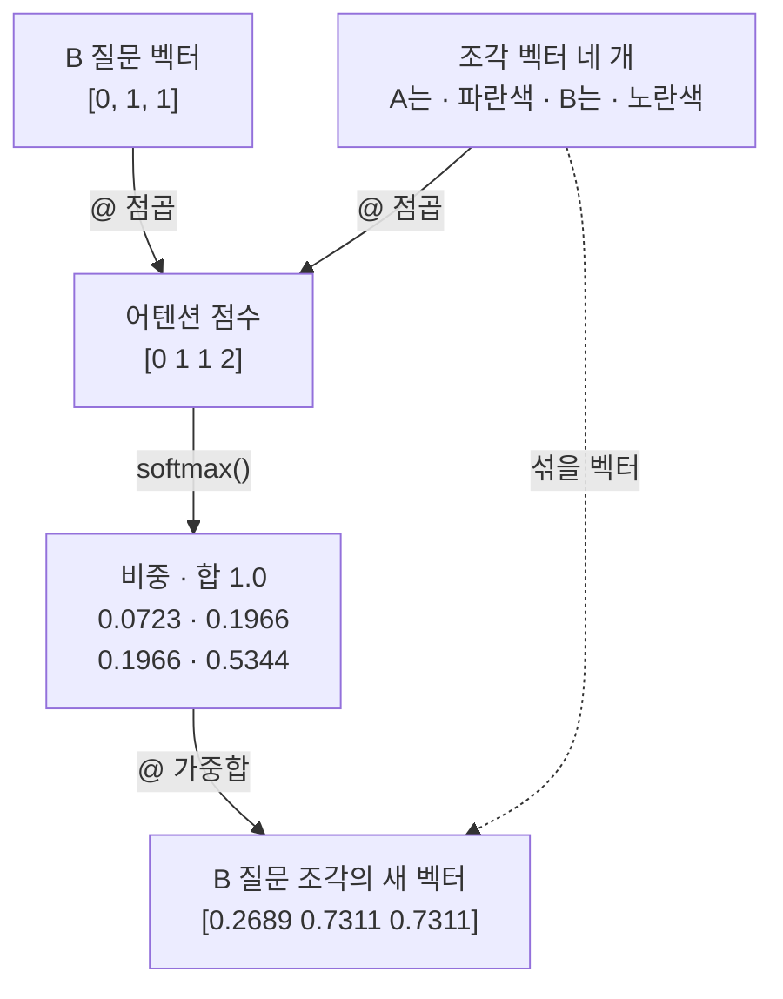
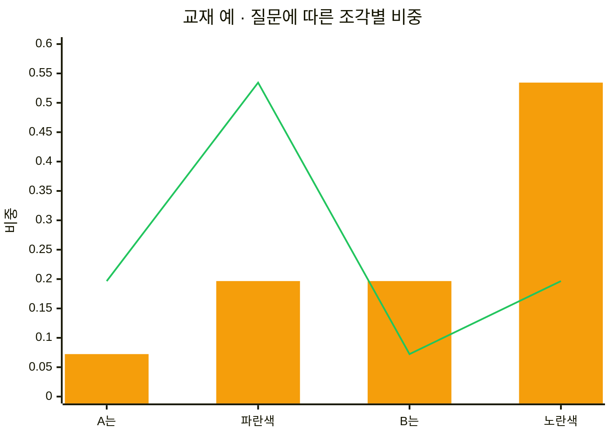
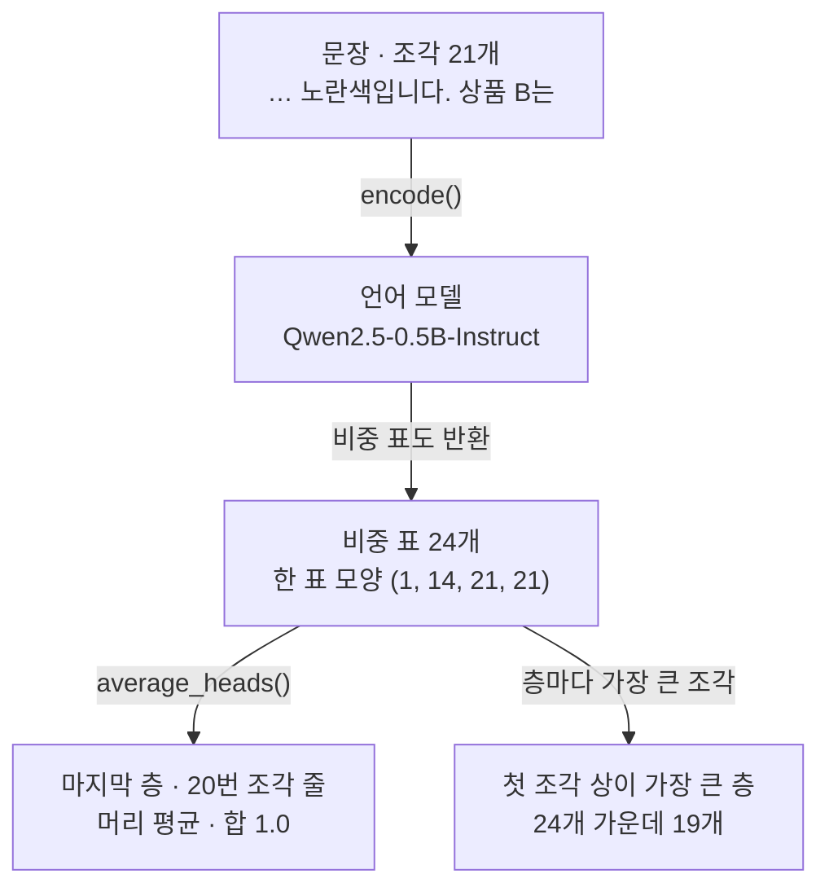
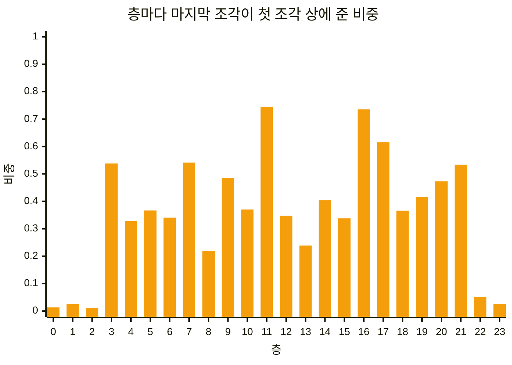

# 03-어텐션-직관

## _src 본문 (HTML 원본)

```html
<!--meta: 강의 1h · 실습 0.5h | 코드 Jupyter Notebook | 새 용어 7 -->
<h2 id="b1"><span class="no">1</span>학습 목표</h2>
<div class="goal"><ul><li>어텐션이 점수, 비중, 새 벡터 순서로 토큰의 벡터를 새로 만드는 과정을 작은 숫자 계산으로 설명할 수 있습니다.</li><li>질문 벡터를 B에서 A로 바꿨을 때 가장 큰 비중이 옮겨 가는 조각을 노트북 출력으로 확인할 수 있습니다.</li><li>실제 언어 모델에서 꺼낸 어텐션 비중을 읽고, 비중이 크다는 값을 어디까지 믿을지 설명할 수 있습니다.</li></ul></div>
<h2 id="b2"><span class="no">2</span>이 내용을 배우는 이유</h2>
<p>「상품 A는 파란색이고 상품 B는 노란색입니다.」 뒤에 「상품 B는」이 오면, 사람은 이어질 말로 노란색을 떠올립니다. 그러려면 앞 문장에서 B와 노란색 쪽을 다시 봐야 합니다. 앞의 조각을 모두 같은 양으로 섞으면 A의 색과 B의 색을 가려내기 어렵습니다. 모델도 그렇게 계산하는지는 비중을 꺼내 봐야 알 수 있습니다.</p>
<p>어텐션은 조각마다 섞는 양을 달리하는 계산입니다. 에이전트를 만들 때는 모델에 긴 글을 넣고, 필요한 부분을 모델이 찾아 쓰기를 기대합니다. 그 기대가 어디까지 맞는지 알려면, 어텐션 비중이 알려 주는 것과 알려 주지 않는 것을 직접 봐야 합니다.</p>
<p><strong>이 절의 질문</strong> — 모델은 한 조각의 벡터를 새로 만들 때 다른 조각들을 얼마만큼씩 섞을까요? 그 비중이 크면 모델이 그 조각을 근거로 삼았다고 말할 수 있을까요?</p>
<h2 id="b3"><span class="no">3</span>앞에서 배운 내용</h2>
<p>01절에서는 토큰화기가 글을 조각(토큰)으로 나누고 조각마다 번호(토큰 ID)를 붙이는 과정을 봤습니다. 이 절도 01절의 메서드 <code>encode()</code>와 <code>decode()</code>로 문장을 조각으로 나눕니다. 언어 모델은 01절 <code>AutoTokenizer</code>처럼 이름과 판 번호(revision)로 받습니다.</p>
<p>02절에서는 문장을 숫자 목록인 벡터로 바꾸고, 점곱으로 두 벡터의 방향을 비교했습니다. 방향이 비슷할수록 점곱이 컸습니다. 02절 임베딩 모델은 토큰마다 만든 숫자 목록을 평균으로 합쳐 문장 벡터를 만들었습니다. 이 절은 토큰마다 만든 숫자 목록이 서로를 참고해 바뀌는 계산을 봅니다.</p>
<p>함수는 02절처럼 셀 하나에 하나씩 정의하고, 정의 셀과 호출 셀을 나눕니다. 벡터 계산은 02절 8절처럼 패키지 NumPy로 합니다. 함수 <code>np.array()</code>로 목록을 배열로 바꾸고, 기호 <code>@</code>로 점곱을 계산합니다. 빈 목록에 <code>for</code>와 <code>append()</code>로 값을 모으는 모양은 Ch 2 03절에서 배웠습니다.</p>
<p>숫자 표의 모양을 보는 속성 <code>shape</code>는 02절 NumPy 배열과 Ch 4 01절 데이터프레임에서 썼습니다. 가장 큰 값의 자리는 이 절에서 처음 쓰는 NumPy 함수 <code>np.argmax()</code>로 찾습니다.</p>
<h2 id="b4"><span class="no">4</span>핵심 개념</h2>
<h3>비유로 시작하기</h3>
<p>주스 가게에서 큰 컵 하나를 채우는 장면을 떠올려 봅니다. 앞에는 주스 네 가지가 있고, 한 컵에 층층이 따르는 양을 저마다 다르게 정합니다. 컵은 하나라서, 한 가지를 많이 따르면 나머지는 적게 따릅니다. 어느 주스를 많이 따를지는 손님의 주문이 정합니다. 다 따르면 숟가락으로 저어 한 가지 색으로 섞습니다.</p>
<p>이 장면을 어텐션으로 옮기면 주스 한 가지가 조각 하나의 벡터이고, 층의 두께가 비중입니다. 층을 모두 합치면 컵 하나, 곧 1입니다. 손님의 주문이 질문 벡터이고, 섞은 컵이 질문 조각의 새 벡터입니다.</p>
{{img:03-5-주스-두-컵|나무 탁자 위 크기가 같은 투명 컵 두 개 가운데 왼쪽 컵에는 아래부터 얇은 하늘색, 파란색, 연노랑, 가장 두꺼운 진노랑 주스 층이 쌓여 있고, 가운데 숟가락이 놓였으며, 오른쪽 컵은 같은 높이까지 연두빛 노랑 한 가지 색 주스로 찬 삽화|두께가 다른 주스 네 층을 한 컵에 담았다가 섞으면, 가장 두꺼운 노란 층의 빛깔이 강한 한 가지 색이 됩니다.}}
<p><strong>그림 읽기</strong> — 왼쪽 컵에는 아래부터 얇은 하늘색 층, 파란 층, 연노랑 층, 가장 두꺼운 진노랑 층이 쌓여 있습니다. 네 층의 두께가 조각 네 개의 비중이고, 네 층을 합치면 가득 찬 컵 하나입니다.</p>
<p>가운데 숟가락 오른쪽의 컵은 크기와 높이가 같고, 연두빛 노랑 한 가지 색입니다. 가장 두꺼운 노란 층의 빛깔이 강하게 남았습니다. 층 두께는 실제 비중 값이 아니고, 비중대로 섞는다는 관계만 보여 줍니다.</p>
<h3>이 절에서 쓰는 말</h3>
<table><thead><tr><th>용어</th><th>뜻</th><th>이 절에서 보이는 모습</th></tr></thead><tbody>
<tr><td>어텐션(attention)</td><td>한 토큰의 벡터를 새로 만들 때 다른 토큰의 벡터를 얼마만큼씩 섞을지 정해 섞는 계산. 질문을 듣고 메모에서 관련된 쪽을 더 눈여겨보는 일과 비슷함</td><td>점수 → 비중 → 새 벡터</td></tr>
<tr><td>어텐션 점수</td><td>질문 벡터와 조각 벡터의 점곱. 방향이 비슷할수록 큼</td><td><code>B 질문의 점수: [0 1 1 2]</code></td></tr>
<tr><td>소프트맥스(softmax)</td><td>점수 목록을 모두 0보다 크고 합이 1인 목록으로 바꾸는 계산</td><td><code>softmax(scores_b)</code></td></tr>
<tr><td>비중(weight)</td><td>여러 값을 섞을 때 값마다 주는 몫. 모두 더하면 1</td><td><code>0.5344</code>, <code>비중의 합: 1.0</code></td></tr>
<tr><td>가중합(weighted sum)</td><td>자리마다 비중과 값을 곱해 모두 더한 값. 비중이 모두 같으면 평균</td><td><code>[0.2689 0.7311 0.7311]</code></td></tr>
<tr><td>층(layer)과 머리(head)</td><td>언어 모델이 차례로 거치는 계산 단계와, 한 층에서 어텐션을 나란히 계산하는 한 단위</td><td><code>층 수: 24</code>, <code>층마다 머리 수: 14</code></td></tr>
<tr><td>텐서(tensor)</td><td>PyTorch가 만드는 숫자 표. NumPy 배열처럼 모양을 가짐</td><td><code>torch.Size([1, 14, 21, 21])</code></td></tr>
</tbody></table>
<h3>세 단계로 만드는 새 벡터</h3>
<p>어텐션은 조각 하나의 벡터를 새로 만들 때 세 단계로 계산합니다. 먼저 질문 벡터와 조각 벡터의 점곱으로 조각마다 점수를 냅니다. 다음으로 소프트맥스로 점수를 합이 1인 비중으로 바꿉니다. 마지막으로 비중대로 조각 벡터를 섞어 새 벡터를 만듭니다.</p>
<p>노트북은 조각 네 개에 숫자 세 개짜리 벡터를 정해 이 계산을 따라갑니다. 숫자 세 개는 차례로 A와 관련된 정도, B와 관련된 정도, 색을 나타내는 정도입니다. 손으로 따라가려고 교재에서 정한 숫자입니다. 02절에서 봤듯이 실제 모델의 벡터는 숫자 하나만 보고 뜻을 읽을 수 없습니다.</p>
{{mermaid:03-1-어텐션-계산|맨 위 초록 상자 B 질문 벡터 [0, 1, 1]과 초록 상자 조각 벡터 네 개가 기호 @ 점곱으로 노란 상자 어텐션 점수 [0 1 1 2]가 되고, softmax()로 노란 상자 비중 합 1.0, 0.0723, 0.1966, 0.1966, 0.5344가 된 뒤, 기호 @ 가중합으로 노란 상자 새 벡터 [0.2689 0.7311 0.7311]이 되며, 조각 벡터에서 새 벡터로 섞을 벡터라는 점선이 이어지는 흐름도|B 질문 벡터와 조각 벡터의 점수 [0 1 1 2]가 비중 0.0723, 0.1966, 0.1966, 0.5344가 되고, 이 비중대로 섞은 새 벡터는 [0.2689 0.7311 0.7311]이었습니다.}}
<p><strong>도식 읽기</strong> — 위에서 아래로 읽습니다. 맨 위 초록 상자 두 개는 교재에서 정한 질문 벡터와 조각 벡터입니다. 노란 상자 세 개는 출력으로 확인한 점수, 비중, 새 벡터입니다. 화살표 위 글자는 계산에 쓴 기호 <code>@</code>와 노트북에서 정의한 함수 <code>softmax()</code>입니다.</p>
<p>오른쪽 점선은 조각 벡터가 마지막 단계에서 섞을 재료로 다시 쓰인다는 뜻입니다. 점수를 매길 때도, 섞을 때도 같은 조각 벡터를 씁니다.</p>
<h3>점수를 비중으로 바꾸는 소프트맥스</h3>
<p>점수는 합이 정해져 있지 않고, 0이나 음수도 될 수 있습니다. 그래서 점수를 모두 0보다 크고 합이 1인 비중으로 바꿉니다. 이 계산이 소프트맥스입니다.</p>
<p>소프트맥스는 먼저 점수마다 수 e(약 2.718)를 점수만큼 거듭제곱합니다. 그리고 거듭제곱 하나하나를 거듭제곱의 합으로 나눕니다. 식으로 쓰면 <code>비중 = e의 점수 거듭제곱 ÷ 거듭제곱의 합</code>입니다.</p>
<p>B 질문의 점수 0, 1, 1, 2를 넣으면 거듭제곱은 1, 2.718, 2.718, 7.389이고 합은 약 13.826입니다. 노란색 조각의 비중은 7.389 ÷ 13.826으로 0.5344입니다. 점수가 1 크면 거듭제곱이 약 2.7배라, 큰 점수 쪽 비중이 도드라집니다.</p>
<h3>비중대로 섞는 가중합</h3>
<p>가중합은 자리마다 비중과 조각 벡터의 숫자를 곱해 모두 더한 값입니다. B 질문의 새 벡터 첫째 자리는 <code>A는</code>과 파란색 조각의 비중만 더한 0.2689입니다. 둘째 자리와 셋째 자리는 0.7311로, B와 색 쪽 정보가 더 많이 섞였습니다. 노트북은 가중합도 기호 <code>@</code>로 계산합니다. 비중 배열을 앞에, 조각 벡터 표를 뒤에 두면 자리마다 곱해 더한 값이 나옵니다.</p>
<p>비중이 모두 0.25로 같으면 가중합은 평균입니다. 노트북에서 같은 비중으로 섞은 결과는 <code>[0.5 0.5 0.5]</code>였습니다. 02절 임베딩 모델이 토큰 벡터를 평균으로 합친 일은, 모든 조각에 같은 비중을 준 가중합과 같습니다.</p>
<h3>실제 모델의 층과 머리</h3>
<p>실제 언어 모델은 이 계산을 여러 층에서 되풀이합니다. 한 층에서 나온 조각 벡터가 다음 층에 들어갑니다. 층마다 어텐션을 여러 번 나란히 계산하는데, 그 한 단위를 머리라고 부릅니다. 이 흐름은 설치한 transformers 4.56.2의 Qwen2 모델 코드에서 확인했습니다.</p>
<p>노트북의 Qwen2.5-0.5B-Instruct는 층 24개, 층마다 머리 14개였습니다. 그래서 비중 표도 층마다 머리 수만큼 있습니다. 다음 조각을 고르는 이 모델은 뒤에 올 조각을 보지 않고 계산합니다. 노트북에서 2번 조각의 줄은 3번 자리부터 비중이 0이었습니다.</p>
<h2 id="b5"><span class="no">5</span>실행 예제</h2>
<p>노트북은 먼저 숫자 세 개짜리 벡터로 점수, 비중, 새 벡터를 차례로 계산합니다. 질문 벡터를 B에서 A로 바꿔 비중을 비교합니다. 이어서 언어 모델을 받아 문장 하나를 계산하고, 층마다 어텐션 비중 표를 꺼냅니다. 머리 14개를 평균한 줄을 읽고, 층마다 가장 큰 비중을 찾습니다. 마지막으로 문장 끝의 B를 A로 바꿔 한 번 더 계산합니다.</p>
<p>인터넷 서비스의 모델을 부르지 않으므로 API 키가 필요 없고 비용도 들지 않습니다. 내 컴퓨터에서 모델 계산을 2번 합니다. 첫 실행은 모델 파일 약 1GB를 내려받으려고 인터넷에 접속합니다.</p>
<p>강의 시간에는 노트북 2~5번(교재 예의 점수·비중·새 벡터)과 7·9번 결과를 설명합니다. 6·8·10번은 셀을 함께 실행하고, 결과 읽기는 실습 시간에 이어서 읽습니다. 끝의 「원리 더 알아보기」는 다음 조각 후보의 확률을 보는 심화 셀이고, 실습 시간에 읽습니다.</p>
{{notebook:03-어텐션-직관}}
<p class="look"><b>확인할 점</b> — 3절에서 노란색 조각의 비중 <code>0.5344</code>와 <code>비중의 합: 1.0</code>을 봅니다. 5절 표에서 가장 큰 비중이 어느 줄로 옮겨 갔는지 확인합니다. 9절 <code>첫 조각이 가장 큰 층 수: 19</code>와 10절 색 조각 비중의 변화를 비교합니다.</p>
<h3>작은 숫자로 따라간 계산</h3>
<p>질문 벡터 <code>[0, 1, 1]</code>로 계산한 점수는 <code>[0 1 1 2]</code>였습니다. NumPy 배열이라 값 사이에 쉼표 없이 출력됩니다. 소프트맥스로 바꾼 비중은 <code>0.0723</code>, <code>0.1966</code>, <code>0.1966</code>, <code>0.5344</code>이고, 합은 <code>1.0</code>이었습니다. 점수 0인 조각 <code>A는</code>도 비중이 0이 아니라 작은 양수였습니다.</p>
<p>질문 벡터를 <code>[1, 0, 1]</code>로 바꾸자 점수는 <code>[1 2 0 1]</code>이 되었습니다. 표의 파란색 줄은 <code>파란색 | 0.1966 | 0.5344</code>, 노란색 줄은 <code>노란색 | 0.5344 | 0.1966</code>이었습니다. 조각 벡터는 그대로이고 질문 벡터만 바꿨는데, 가장 큰 비중이 옮겨 갔습니다.</p>
{{mermaid:03-2-질문별-비중|가로축에 A는, 파란색, B는, 노란색, 세로축에 비중 0부터 0.6까지를 둔 그래프로, 주황 막대는 0.0723, 0.1966, 0.1966, 0.5344로 노란색에서 가장 높고, 초록 선은 0.1966, 0.5344, 0.0723, 0.1966으로 파란색에서 가장 높은 그림|주황 막대(B 질문)는 노란색 조각이 0.5344로 가장 높고, 초록 선(A 질문)은 파란색 조각이 0.5344로 가장 높습니다.}}
<p><strong>도식 읽기</strong> — 가로축은 조각 네 개, 세로축은 비중입니다. 주황 막대가 B 질문의 비중이고, 초록 선이 A 질문의 비중입니다. 이 그래프에는 범례가 없어 막대와 선의 모양으로 구분합니다. 막대는 오른쪽 끝 노란색에서, 선은 둘째 파란색에서 가장 높습니다.</p>
<h3>실제 모델에서 꺼낸 비중</h3>
<p>모델 준비 셀은 <code>층 수: 24</code>와 <code>층마다 머리 수: 14</code>를 출력했습니다. 문장은 <code>토큰 수: 21</code>이었고, 파란색은 <code>' 파'</code>, <code>'란'</code>, <code>'색'</code> 세 조각이었습니다. 한 층 표의 모양은 <code>torch.Size([1, 14, 21, 21])</code>로, 조각 21개 × 21개 표가 머리마다 한 장씩 있었습니다.</p>
<p>함수 <code>average_heads()</code>는 텐서를 목록으로 바꾼 뒤 NumPy 배열로 만들고, 메서드 <code>mean(axis=0)</code>으로 머리 14개의 비중을 자리마다 평균 냅니다. 0번 층에서 2번 조각의 줄은 <code>[0.1912, 0.416, 0.3928, 0.0, 0.0, 0.0]</code>이었습니다. 앞 세 자리만 비중이 있었습니다.</p>
<p>마지막 층에서 마지막 조각 <code>' 는'</code>의 줄은 합이 <code>1.0</code>이었습니다. 비중이 가장 큰 자리는 자기 자신인 20번 <code>0.2029</code>, <code>A는</code>의 <code>는</code>인 3번 <code>0.1617</code>, 마침표인 16번 <code>0.135</code>였습니다. 노란색의 첫 조각 12번은 <code>0.0365</code>, 10번 조각 <code>B</code>는 <code>0.0093</code>이었습니다.</p>
{{mermaid:03-3-실제-모델-흐름|맨 위 초록 상자 문장 조각 21개가 encode()로 보라 상자 언어 모델 Qwen2.5-0.5B-Instruct에 들어가고, 비중 표도 반환 화살표로 노란 상자 비중 표 24개 한 표 모양 (1, 14, 21, 21)이 된 뒤, 왼쪽은 average_heads()로 노란 상자 마지막 층 20번 조각 줄 머리 평균 합 1.0, 오른쪽은 층마다 가장 큰 조각 화살표로 노란 상자 첫 조각 상이 가장 큰 층 24개 가운데 19개로 갈라지는 흐름도|조각 21개짜리 문장을 Qwen2.5-0.5B-Instruct로 계산해 비중 표 24개를 받았고, 머리 평균으로 보니 24개 층 가운데 19개에서 첫 조각 상의 비중이 가장 컸습니다.}}
<p><strong>도식 읽기</strong> — 위에서 아래로 읽습니다. 맨 위 초록 상자는 넣은 문장이고, 가운데 보라 상자가 이 절에서 실행한 언어 모델입니다. 노란 상자 세 개는 출력으로 확인한 값입니다. 비중 표 상자 아래에서 두 갈래로 나뉩니다.</p>
<p>왼쪽 갈래는 마지막 층에서 20번 조각의 줄을 머리 평균으로 읽은 결과입니다. 오른쪽 갈래는 층 24개에서 가장 큰 조각을 찾아 센 결과입니다. 오른쪽 화살표는 함수 <code>average_heads()</code>와 <code>np.argmax()</code>를 층마다 부른 단계입니다.</p>
<h2 id="b6"><span class="no">6</span>실험 결과 해석</h2>
<p>교재 예에서는 질문 벡터 하나만 바꿔도 비중이 뚜렷하게 옮겨 갔습니다. 질문 대상이 B일 때는 노란색 조각이, A일 때는 파란색 조각이 0.5344였습니다. 점수가 질문 벡터와의 점곱이라, 질문 벡터가 바뀌면 점수부터 바뀌기 때문입니다.</p>
<p>실제 모델에서도 계산의 모양은 같았습니다. 출력한 두 줄 모두 비중의 합이 1이었고, 뒤에 올 조각에는 비중이 0이었습니다. 그러나 비중이 큰 조각은 교재 예와 달랐습니다.</p>
<p>층마다 마지막 조각의 줄을 보니, 24개 층 가운데 19개에서 첫 조각 「상」의 비중이 가장 컸습니다. 11번 층에서는 0.7446으로 줄 전체의 4분의 3에 가까웠습니다. 첫 조각 「상」은 질문 대상도 색도 아닙니다.</p>
{{mermaid:03-4-층별-첫-조각|가로축에 층 0부터 23, 세로축에 비중 0부터 1까지를 둔 주황 막대그래프로, 0~2번 층과 22~23번 층 막대는 바닥 근처로 낮고, 3번부터 21번 층 막대는 0.2에서 0.74 사이로 높으며 11번과 16번 층이 가장 높은 그림|마지막 조각이 첫 조각 상에 준 비중은 3~21번 층에서 0.2195~0.7446으로 크고, 0~2번·22~23번 층에서는 0.0121~0.0518로 작았습니다.}}
<p><strong>도식 읽기</strong> — 막대 하나가 층 하나이고, 막대 높이는 마지막 조각이 첫 조각 「상」에 준 비중입니다. 왼쪽 끝 세 막대와 오른쪽 끝 두 막대만 바닥 근처로 낮습니다. 가운데 3번부터 21번 층 막대는 모두 0.2보다 높고, 11번과 16번 층이 가장 높습니다. 막대가 한 종류라 색은 주황 하나입니다.</p>
<p>값 바꿔 보기에서는 문장 끝의 B만 A로 바꿔 마지막 층의 색 조각 비중을 비교했습니다. 파란색 첫 조각은 0.0555에서 0.0531로 작아졌고, 노란색 첫 조각은 0.0365에서 0.0437로 커졌습니다. 교재 예와 반대 방향이고, 바뀐 크기도 0.01보다 작았습니다.</p>
<p>결론은 두 가지입니다. 실제 모델도 조각마다 다른 비중을 주고, 그 비중으로 벡터를 섞습니다. 그러나 비중이 큰 조각은 질문 대상도 색도 아닌 첫 조각이었습니다. 비중 표만으로는 모델이 무엇을 근거로 다음 조각을 고르는지 가려낼 수 없었습니다.</p>
<p>「원리 더 알아보기」 셀에서는 B 문장 뒤에 올 다음 조각 후보의 확률도 봤습니다. 1위는 <code>' 상'</code>(0.2224)이었고, 파란색의 첫 조각이 0.1008로 2위였습니다. 노란색의 첫 조각은 0.0087로, 더 큰 후보가 14개였습니다. 이 모델은 이 문장 뒤에 노란색을 먼저 잇지 않았으므로, 노란색 조각의 비중이 작은 것을 틀린 비중이라고 볼 수도 없습니다.</p>
<p>이번에 본 것은 모델 하나, 문장 두 개, 마지막 조각의 줄, 머리 14개의 평균입니다. 머리를 하나씩 본 경우와 다른 문장은 실행하지 않았습니다. 여러 언어 모델에서 첫 조각에 큰 비중이 몰린다고 보고한 연구가 참고 자료에 있습니다. 이 모델에서도 늘 그런지는 이번 두 문장만으로 말할 수 없습니다.</p>
<h2 id="b7"><span class="no">7</span>주의할 점과 실무 메모</h2>
<ul><li>실제 모델은 조각 벡터에서 질문용, 비교용, 섞을 재료용 벡터를 따로 만듭니다. 영어 이름은 query, key, value입니다. 점곱은 머리 하나가 쓰는 숫자 개수의 제곱근으로 나눈 뒤 소프트맥스에 넣습니다. 설치한 transformers 4.56.2의 Qwen2 코드에서 확인했고, 교재 예는 이 두 가지를 뺐습니다.</li>
<li>인자 <code>attn_implementation="eager"</code>는 비중을 꺼내 보려고 준 값입니다. 다른 계산 방식(sdpa)은 <code>output_attentions=True</code>를 줘도 비중을 반환하지 않는다고 소스에서 확인했습니다. 두 방식의 속도 차이는 이번에 측정하지 않았습니다.</li>
<li>머리 14개를 평균하면 머리마다 다른 모습이 가려집니다. 이 절의 결론은 머리 평균 줄에 대한 것입니다.</li>
<li>어텐션 비중을 그림으로 보여 주는 도구는 모델 안을 둘러보는 데 쓰고, 답이 맞는지는 질문과 정답을 모아 따로 확인합니다. 답이 근거 문서와 맞는지 재는 방법은 Ch 15 평가 심화에서 다룹니다.</li>
<li>이 절은 다음 조각 후보의 확률을 「원리 더 알아보기」에서 한 자리만 봤습니다. 모델이 답을 만드는 실행은 04절 컨텍스트 윈도에서 처음 합니다. 후보 점수(로짓)와 조각을 고르는 방식은 06절 temperature와 샘플링에서 다룹니다.</li>
<li>모델 파일은 첫 실행 때 약 1GB를 받아 캐시에 둡니다. 노트북과 같은 계산을 스크립트로 실행했을 때 Python이 쓴 메모리는 최대 약 3.4GB였습니다. 메모리가 더 적은 컴퓨터는 이번에 실행하지 않았습니다.</li>
<li>교재 출력은 2026-09-21에 Linux의 Python 3.12.13과 CPU용 torch 2.8.0으로 만들었습니다. 패키지는 transformers 4.56.2와 NumPy 2.3.3이고, 모델 판 번호는 <code>7ae5576…</code>입니다. GPU, Windows·macOS와 다른 버전에서는 실행하지 않았습니다.</li></ul>
<h2 id="b8"><span class="no">8</span>정리와 다음 절</h2>
<ul><li>어텐션은 점곱으로 점수를 내고, 소프트맥스로 합이 1인 비중을 만든 뒤, 비중대로 조각 벡터를 섞어 새 벡터를 만듭니다.</li><li>교재 예에서 질문 벡터를 B에서 A로 바꾸자, 가장 큰 비중 0.5344가 노란색 조각에서 파란색 조각으로 옮겨 갔습니다.</li><li>실제 모델은 24개 층 가운데 19개에서 첫 조각에 가장 큰 비중을 주었습니다. 비중 표는 계산의 한 부분이지, 모델이 삼은 근거의 증명이 아닙니다.</li></ul>
<p><strong>다음 학습과 이어지는 지점</strong> — <a href="04-컨텍스트-윈도.html">04절 컨텍스트 윈도</a>에서는 모델에 한 번에 넣을 수 있는 토큰 수의 한도를 확인합니다. 그리고 그 한도를 입력과 출력에 나눠 배정하는 계산을 합니다.</p>
<h2 id="b9"><span class="no">9</span>복습 문제</h2><details class="quiz"><summary>문제와 해설</summary>
<p class="quiz-q">1. 점수 <code>[0, 1, 1, 2]</code>를 소프트맥스로 바꾼 비중을 모두 더하면 얼마인가요? 가장 큰 비중은 어느 조각인가요? · 기초</p><p class="quiz-a"><b>해설</b> — 합은 1입니다. 소프트맥스는 거듭제곱을 거듭제곱의 합으로 나누므로 합이 늘 1이 됩니다. 가장 큰 비중은 점수 2인 노란색 조각의 0.5344입니다.</p>
<p class="quiz-q">2. 조각 네 개에 비중 0.25를 똑같이 주고 가중합을 구하면 무엇이 되나요? 02절과 어떻게 이어지나요? · 기초</p><p class="quiz-a"><b>해설</b> — 네 벡터의 평균이 됩니다. 노트북에서는 <code>[0.5 0.5 0.5]</code>였습니다. 02절 임베딩 모델이 토큰 벡터를 평균으로 합친 일은, 모든 조각에 같은 비중을 준 가중합입니다.</p>
<p class="quiz-q">3. 질문 벡터 <code>[1, 0, 1]</code>과 조각 벡터 <code>[1, 0, 0]</code>, <code>[1, 0, 1]</code>, <code>[0, 1, 0]</code>, <code>[0, 1, 1]</code>의 점수를 손으로 계산해 보세요. 비중이 가장 큰 조각은 어느 것인가요? · 적용</p><p class="quiz-a"><b>해설</b> — 점수는 차례로 1, 2, 0, 1입니다. 점수가 가장 큰 둘째 조각, 곧 파란색 조각의 비중이 가장 큽니다. 노트북 5절에서도 파란색 조각이 0.5344였습니다.</p>
<p class="quiz-q">4. 실제 모델에서 24개 층 가운데 19개가 첫 조각 「상」에 가장 큰 비중을 주었습니다. 모델이 「상」을 근거로 다음 말을 고른다고 말할 수 있나요? · 분석</p><p class="quiz-a"><b>해설</b> — 말할 수 없습니다. 「상」은 질문 대상도 색도 아닌데 가장 큰 비중을 받았고, 비중 표에는 모델이 다음 조각으로 무엇을 고르는지가 나오지 않습니다. 문장 두 개의 머리 평균으로 본 결과라는 점도 함께 적습니다.</p>
<p class="quiz-q">5. 동료가 어텐션 그림에서 문서 한 줄의 비중이 크니, 보고서에 「모델이 그 줄을 근거로 답했다」고 쓰자고 합니다. 이 절의 결과로 무엇을 말할 수 있나요? · 분석</p><p class="quiz-a"><b>해설</b> — 비중은 층과 머리마다 다르고, 뜻과 관계없는 첫 조각에 몰리기도 했습니다. 이 절에서는 대상을 바꿔도 색 조각 비중이 0.01보다 적게 바뀌었습니다. 그래서 답이 그 줄과 맞는지는 질문과 정답을 모아 따로 확인하자고 말합니다.</p>
</details>
<h2 id="b10"><span class="no">10</span>참고 자료</h2>
<ul><li><a href="https://arxiv.org/abs/1706.03762">Vaswani et al., Attention Is All You Need</a> · 확인 2026-09-09</li><li><div><a href="https://arxiv.org/abs/2309.17453">Xiao et al., Efficient Streaming Language Models with Attention Sinks</a></div>2023 · 첫 토큰에 몰리는 비중을 보고한 논문 · 확인 2026-09-16</li><li><a href="https://huggingface.co/Qwen/Qwen2.5-0.5B-Instruct/tree/7ae557604adf67be50417f59c2c2f167def9a775">Qwen2.5-0.5B-Instruct 모델 파일(Apache-2.0)</a> · 판 7ae5576 · 확인 2026-09-16</li><li><a href="https://huggingface.co/docs/transformers/">Hugging Face Transformers 공식 문서</a> · 확인 2026-09-09 · transformers 4.56.2</li></ul>
```

## 노트북 셀 (순서대로)

### [0] markdown {'html': 'skip'}

# 어텐션 직관

**이 노트북에서 할 일**

1. 숫자 세 개짜리 작은 벡터로 어텐션 점수, 비중, 새 벡터를 차례로 계산합니다.
2. 질문 벡터를 B에서 A로 바꿔, 가장 큰 비중이 어느 조각으로 옮겨 가는지 확인합니다.
3. 실제 언어 모델의 어텐션 비중을 꺼내, 교재 예와 무엇이 다른지 봅니다.

**준비물** — API 키는 필요 없습니다. 인터넷 서비스의 모델을 부르지 않고, 내 컴퓨터에서 작은 언어 모델을 실행합니다.
그래서 비용은 들지 않습니다. 모델 계산은 모두 2번 합니다.

실행 시간은 2분 안팎입니다. 첫 실행에서는 Hugging Face 사이트에서 모델 파일을 내려받으므로 인터넷 연결이 필요합니다.
교재 실행 컴퓨터에서 받은 모델 파일은 합쳐 약 1GB(954MiB)였습니다.
노트북과 같은 계산을 스크립트로 실행했을 때 Python이 쓴 메모리는 최대 약 3.4GB였습니다.

**강의와 실습 범위** — 강의 시간에는 2~5번(교재 예의 점수·비중·새 벡터)과 7·9번 결과를 설명합니다.
6·8·10번은 셀을 함께 실행하고, 결과 읽기는 실습 시간에 이어서 읽습니다. 끝의 「원리 더 알아보기」도 실습 시간에 읽습니다.

**기준 버전** — 실습 폴더에 고정한 transformers 4.56.2와 torch 2.8.0을 씁니다. 함께 고정한 NumPy는 2.3.3입니다.
모델은 `Qwen/Qwen2.5-0.5B-Instruct`이고, 판 번호(revision)를 `7ae557604adf67be50417f59c2c2f167def9a775`로 고정해 받습니다.

교재 출력은 Linux의 Python 3.12.13과 CPU용 torch(2.8.0+cpu)로 만들었습니다. 다른 버전, GPU, Windows·macOS에서는 이번에 실행하지 않았습니다.

실습 폴더 `labs/part1/ch05-llm-principles`에서 01절과 같은 `.venv` 커널을 고른 뒤 첫 셀부터 순서대로 실행합니다.

### [1] markdown {'html': 'skip'}

## 오늘 볼 그림


위에서 아래로 읽습니다. 초록 상자는 교재에서 정한 작은 벡터이고, 노란 상자는 출력으로 확인하는 값입니다.
화살표 위 글자는 계산에 쓰는 기호와 이 노트북에서 만드는 함수입니다. 점수를 비중으로 바꾸고, 비중대로 조각 벡터를 섞어 새 벡터를 만듭니다.

### [2] markdown {}

## 1. 준비

이 절은 파일을 읽거나 만들지 않습니다. 준비 셀에서는 계산에 쓸 모듈과 패키지를 불러오고 버전을 확인합니다.

패키지 NumPy는 02절 8절에서 점곱과 길이를 한꺼번에 계산한 패키지입니다. 이 절도 벡터 계산을 NumPy로 합니다.
패키지 transformers는 01절에서 토큰화기를 불러온 패키지이고, 이번에는 언어 모델도 함께 불러옵니다.
함수 `warnings.filterwarnings()` 줄은 01절처럼 진행 표시 위젯이 없다는 경고 한 줄을 끕니다. 계산 결과와 관계없는 경고입니다.

### [3] code {'execution': {'iopub.execute_input': '2026-09-21T03:19:32.874318Z', 'iopub.status.busy': '2026-09-21T03:19:32.874040Z', 'iopub.status.idle': '2026-09-21T03:19:36.888187Z', 'shell.execute_reply': '2026-09-21T03:19:36.887863Z'}, 'lesson_role': 'setup'}

```python
# 계산에 쓸 NumPy와 transformers 패키지를 불러오고 버전을 확인합니다
import warnings

# 진행 표시 위젯이 없다는 경고(TqdmWarning)는 계산과 관계없어 화면에 내지 않습니다
warnings.filterwarnings("ignore", message="IProgress not found")

import numpy as np
import transformers
from transformers import AutoModelForCausalLM, AutoTokenizer

print("NumPy 버전:", np.__version__)
print("transformers 버전:", transformers.__version__)
```

출력:
```
NumPy 버전: 2.3.3
transformers 버전: 4.56.2

```

### [4] markdown {}

**결과 읽기** — 출력 줄은 `NumPy 버전: 2.3.3`과 `transformers 버전: 4.56.2`입니다. 준비물에 적은 기준 버전과 같습니다.

### [5] markdown {}

## 2. 어텐션 점수 — 질문 벡터와 조각 벡터의 점곱

어텐션(attention)은 한 토큰의 벡터를 새로 만들 때, 다른 토큰의 벡터를 얼마만큼씩 섞을지 정하는 계산입니다.
친구가 「B 상품 색이 뭐였지?」라고 물으면, 우리는 메모에서 B가 적힌 쪽을 더 눈여겨봅니다. 어텐션은 이 눈여겨보는 정도를 숫자로 계산합니다.

먼저 숫자 세 개짜리 작은 벡터로 계산을 따라갑니다. 첫 단계는 02절에서 배운 점곱입니다.
두 벡터의 방향이 비슷할수록 점곱이 커지므로, 질문 벡터와 조각 벡터의 점곱을 어텐션 점수로 씁니다.

조각 네 개는 문장 「상품 A는 파란색이고 상품 B는 노란색입니다.」에서 고른 낱말입니다.
벡터의 숫자 세 개는 차례로 A와 관련된 정도, B와 관련된 정도, 색을 나타내는 정도로 정했습니다.
손으로 계산을 따라가려고 교재에서 정한 숫자입니다. 02절에서 봤듯이 실제 모델의 벡터는 숫자 하나만 보고 뜻을 읽을 수 없습니다.

「B의 색은?」을 묻는 조각의 질문 벡터는 `[0, 1, 1]`로 둡니다. B 자리와 색 자리에만 1이 있습니다.

조각 벡터 네 개는 02절 8절의 `np.array()`로 한 행에 조각 하나씩, 4행 3열 배열(표)로 만듭니다.
표 `@` 벡터는 표의 행마다 벡터와 점곱을 계산해, 행 수만큼의 점수를 한 번에 반환합니다. 결과도 NumPy 배열이라 값 사이에 쉼표 없이 출력됩니다.
실행 전에 예상합니다. 노란색 조각은 B와 색을 모두 가져, 점수가 가장 클 것입니다.

### [6] code {'execution': {'iopub.execute_input': '2026-09-21T03:19:36.889173Z', 'iopub.status.busy': '2026-09-21T03:19:36.889040Z', 'iopub.status.idle': '2026-09-21T03:19:36.891366Z', 'shell.execute_reply': '2026-09-21T03:19:36.890992Z'}}

```python
# 조각 네 개의 교재용 벡터와 B의 색을 묻는 질문 벡터로, 조각마다 어텐션 점수를 계산합니다
word_pieces = ["A는", "파란색", "B는", "노란색"]
# 한 행이 조각 하나이고, 숫자 세 개는 차례로 A와 관련된 정도, B와 관련된 정도, 색을 나타내는 정도입니다
piece_vectors = np.array([[1, 0, 0], [1, 0, 1], [0, 1, 0], [0, 1, 1]])
question_b = np.array([0, 1, 1])
# 표 @ 벡터는 행마다 점곱을 계산합니다. 질문 벡터와 조각 벡터의 점곱이 그 조각의 어텐션 점수입니다
scores_b = piece_vectors @ question_b
print("조각:", word_pieces)
print("B 질문의 점수:", scores_b)
```

출력:
```
조각: ['A는', '파란색', 'B는', '노란색']
B 질문의 점수: [0 1 1 2]

```

### [7] markdown {}

**결과 읽기** — 출력 줄은 `B 질문의 점수: [0 1 1 2]`입니다. 예상대로 노란색 조각의 점수가 가장 큽니다.

조각 파란색은 색 자리만, 조각 `B는`은 B 자리만 질문 벡터와 겹쳐 1점입니다. 조각 `A는`은 겹치는 자리가 없어 0점입니다.

### [8] markdown {}

## 3. 소프트맥스 — 점수를 비중으로 바꾸기

점수를 그대로 섞는 양으로 쓰기는 어렵습니다. 합이 정해져 있지 않고, 0점이나 음수 점수도 나올 수 있습니다.
그래서 점수를 모두 0보다 크고 합이 1인 비중(weight)으로 바꿉니다. 이 계산을 소프트맥스(softmax)라고 부릅니다.

소프트맥스는 두 단계입니다. 점수마다 수 e(약 2.718)를 점수만큼 거듭제곱하고, 그 값을 거듭제곱의 합으로 나눕니다.
점수가 1 크면 거듭제곱은 약 2.7배가 되어, 큰 점수가 더 도드라집니다.

함수 `np.exp(배열)`은 값마다 e를 그만큼 거듭제곱한 배열을 반환합니다. 배열의 메서드 `sum()`은 값을 모두 더합니다.
배열을 수 하나로 나누면 값마다 나눈 배열이 됩니다. 이 셀은 함수를 정의만 합니다.

### [9] code {'execution': {'iopub.execute_input': '2026-09-21T03:19:36.891989Z', 'iopub.status.busy': '2026-09-21T03:19:36.891917Z', 'iopub.status.idle': '2026-09-21T03:19:36.893410Z', 'shell.execute_reply': '2026-09-21T03:19:36.893138Z'}}

```python
# 점수 목록을 합이 1인 비중 목록으로 바꾸는 소프트맥스 함수를 정의합니다
def softmax(scores):
    # np.exp()는 점수마다 e의 거듭제곱을 구한 배열을 반환합니다
    powers = np.exp(scores)
    # 거듭제곱을 그 합으로 나누면 모두 0보다 크고 합이 1인 비중이 됩니다
    return powers / powers.sum()
```

출력:
```

```

### [10] markdown {}

**결과 읽기** — 정의만 하는 셀이라 출력이 없습니다. 다음 셀에서 2절의 점수로 호출합니다.

실행 전에 예상합니다. 점수 2의 거듭제곱은 약 7.389입니다. 네 거듭제곱의 합은 1 + 2.718 + 2.718 + 7.389로 약 13.826입니다.
노란색 조각의 비중은 7.389 ÷ 13.826으로 0.53쯤일 것입니다.

### [11] code {'execution': {'iopub.execute_input': '2026-09-21T03:19:36.894055Z', 'iopub.status.busy': '2026-09-21T03:19:36.893995Z', 'iopub.status.idle': '2026-09-21T03:19:36.895860Z', 'shell.execute_reply': '2026-09-21T03:19:36.895616Z'}}

```python
# B 질문의 점수를 비중으로 바꾸고, 조각마다 비중과 비중의 합을 출력합니다
weights_b = softmax(scores_b)
print("조각마다 점수와 비중:")
for number in range(len(word_pieces)):
    print(word_pieces[number], "| 점수", scores_b[number], "| 비중", round(weights_b[number], 4))
weight_total = weights_b.sum()
print("비중의 합:", round(weight_total, 4))
```

출력:
```
조각마다 점수와 비중:
A는 | 점수 0 | 비중 0.0723
파란색 | 점수 1 | 비중 0.1966
B는 | 점수 1 | 비중 0.1966
노란색 | 점수 2 | 비중 0.5344
비중의 합: 1.0

```

### [12] markdown {}

**결과 읽기** — 라벨 줄 아래 네 줄의 비중은 차례로 `0.0723`, `0.1966`, `0.1966`, `0.5344`입니다. 마지막 줄은 `비중의 합: 1.0`입니다.

예상대로 노란색 조각이 전체 비중의 절반 넘게 가져갔습니다. 점수가 1로 같은 파란색과 `B는` 조각은 비중도 같습니다.
점수 0인 조각 `A는`도 비중이 0이 아니라 작은 양수입니다.

### [13] markdown {}

## 4. 가중합 — 비중대로 섞어 새 벡터 만들기

비중이 정해지면 조각 벡터를 그 비중대로 섞습니다. 자리마다 비중과 조각 벡터의 숫자를 곱해 모두 더한 값을 가중합(weighted sum)이라고 부릅니다.
주스 네 가지를 서로 다른 양으로 부어 한 컵에 섞는 일과 비슷합니다. 어텐션은 이렇게 섞은 벡터를 질문 조각의 새 벡터로 씁니다.

가중합도 기호 `@`로 계산합니다. 비중 배열 `@` 조각 벡터 표는 조각마다 비중을 곱해, 자리마다 모두 더합니다.
비중 네 개와 4행 3열 표를 곱하면 숫자 세 개짜리 벡터가 나옵니다. 2절은 표를 앞에 두어 행마다 점곱을 구했고, 여기서는 비중을 앞에 두어 행을 섞습니다.
함수 `np.round(배열, 4)`는 값마다 소수 넷째 자리까지 반올림합니다.

다음 셀은 B 질문의 비중으로 새 벡터를 만듭니다. 비교를 위해 네 조각에 같은 비중 0.25를 준 경우도 계산합니다.
02절 임베딩 모델은 토큰마다 만든 숫자 목록을 평균으로 합쳤는데, 같은 비중으로 섞는 가중합이 바로 평균입니다.
실행 전에 예상합니다. 노란색 조각 `[0, 1, 1]`의 비중이 가장 크니, 새 벡터는 B 자리와 색 자리의 숫자가 A 자리보다 클 것입니다.

### [14] code {'execution': {'iopub.execute_input': '2026-09-21T03:19:36.896526Z', 'iopub.status.busy': '2026-09-21T03:19:36.896439Z', 'iopub.status.idle': '2026-09-21T03:19:36.898374Z', 'shell.execute_reply': '2026-09-21T03:19:36.898043Z'}}

```python
# B 질문의 비중대로 조각 벡터를 섞고, 같은 비중으로 섞은 평균과 비교합니다
# 비중 배열 @ 조각 벡터 표는 자리마다 비중과 숫자를 곱해 더한 가중합입니다
new_vector_b = weights_b @ piece_vectors
print("B 질문 조각의 새 벡터:", np.round(new_vector_b, 4))
# 02절 임베딩 모델처럼 모든 조각에 같은 비중을 주면 평균이 됩니다
equal_weights = np.array([0.25, 0.25, 0.25, 0.25])
average_vector = equal_weights @ piece_vectors
print("같은 비중으로 섞은 평균:", average_vector)
```

출력:
```
B 질문 조각의 새 벡터: [0.2689 0.7311 0.7311]
같은 비중으로 섞은 평균: [0.5 0.5 0.5]

```

### [15] markdown {}

**결과 읽기** — 새 벡터는 `B 질문 조각의 새 벡터: [0.2689 0.7311 0.7311]`입니다. 평균은 `같은 비중으로 섞은 평균: [0.5 0.5 0.5]`입니다.

예상대로 새 벡터는 B 자리와 색 자리가 0.7311로 A 자리보다 큽니다. 평균은 세 자리가 모두 같아, 무엇을 물었는지 드러나지 않습니다.
어텐션은 질문에 따라 섞는 양을 달리해, 질문 조각의 벡터에 B의 색 쪽 정보를 더 많이 담았습니다.

### [16] markdown {}

## 5. 값 바꿔 보기 — 질문 벡터를 A로 바꾸기

바꾸는 값은 질문 벡터 하나입니다. 「A의 색은?」을 묻도록 A 자리와 색 자리에 1을 둔 `[1, 0, 1]`로 바꿉니다.
조각 벡터와 계산 방법은 그대로 씁니다.

실행 전에 예상합니다. 가장 큰 비중 0.5344가 노란색 조각에서 파란색 조각으로 옮겨 갈 것입니다.

### [17] code {'execution': {'iopub.execute_input': '2026-09-21T03:19:36.898970Z', 'iopub.status.busy': '2026-09-21T03:19:36.898903Z', 'iopub.status.idle': '2026-09-21T03:19:36.901045Z', 'shell.execute_reply': '2026-09-21T03:19:36.900642Z'}}

```python
# 질문 벡터만 A의 색을 묻도록 바꿔 점수와 비중을 다시 계산하고, B 질문과 나란히 봅니다
question_a = np.array([1, 0, 1])
scores_a = piece_vectors @ question_a
weights_a = softmax(scores_a)
print("A 질문의 점수:", scores_a)
print("조각 | B 질문 비중 | A 질문 비중")
for number in range(len(word_pieces)):
    print(word_pieces[number], "|", round(weights_b[number], 4), "|", round(weights_a[number], 4))
```

출력:
```
A 질문의 점수: [1 2 0 1]
조각 | B 질문 비중 | A 질문 비중
A는 | 0.0723 | 0.1966
파란색 | 0.1966 | 0.5344
B는 | 0.1966 | 0.0723
노란색 | 0.5344 | 0.1966

```

### [18] markdown {}

**결과 읽기** — 점수는 `A 질문의 점수: [1 2 0 1]`입니다. 표의 파란색 줄은 `파란색 | 0.1966 | 0.5344`, 노란색 줄은 `노란색 | 0.5344 | 0.1966`입니다.

예상대로 가장 큰 비중이 노란색 조각에서 파란색 조각으로 옮겨 갔습니다. 조각 벡터는 그대로이고 질문 벡터만 바꿨는데, 비중이 달라졌습니다.
여기까지는 교재에서 정한 숫자로 본 계산입니다. 다음 절부터는 실제 언어 모델이 계산한 비중을 꺼내 봅니다.

### [19] markdown {}

## 6. 실제 언어 모델 준비

모델은 Qwen2.5-0.5B-Instruct입니다. 내 컴퓨터에서 실행할 수 있는 작은 언어 모델로, 04절 이후 절에서도 씁니다.
클래스 `AutoModelForCausalLM`은 앞 토큰들에 이어질 다음 토큰을 고르는 언어 모델을 불러옵니다.
01절 `AutoTokenizer`처럼 `from_pretrained(모델 이름, revision=판 번호)`로 만듭니다.

인자 `attn_implementation="eager"`는 어텐션 비중을 꺼내 볼 수 있는 계산 방식을 고릅니다.
설치한 transformers 4.56.2 소스에서, 다른 계산 방식(sdpa)은 비중을 반환하지 않는다고 확인했습니다. 이 인자를 뺀 실행은 이번에 하지 않았습니다.

언어 모델은 층(layer)을 여러 개 쌓아 차례로 계산하고, 층마다 어텐션을 여러 번 나란히 계산합니다. 나란히 계산하는 한 단위를 머리(head)라고 부릅니다.
실행 전에 예상합니다. 작은 모델이니 층과 머리가 몇 개뿐일 것입니다.

### [20] code {'execution': {'iopub.execute_input': '2026-09-21T03:19:36.901628Z', 'iopub.status.busy': '2026-09-21T03:19:36.901574Z', 'iopub.status.idle': '2026-09-21T03:19:38.306784Z', 'shell.execute_reply': '2026-09-21T03:19:38.305530Z'}}

```python
# 언어 모델과 토큰화기를 고정 판 번호로 받고, 층 수와 층마다 머리 수를 확인합니다
model_name = "Qwen/Qwen2.5-0.5B-Instruct"
model_revision = "7ae557604adf67be50417f59c2c2f167def9a775"
tokenizer = AutoTokenizer.from_pretrained(model_name, revision=model_revision)
# attn_implementation="eager"는 층마다 어텐션 비중을 꺼내 볼 수 있는 계산 방식입니다
model = AutoModelForCausalLM.from_pretrained(
    model_name,
    revision=model_revision,
    attn_implementation="eager",
)
print("층 수:", model.config.num_hidden_layers)
print("층마다 머리 수:", model.config.num_attention_heads)
```

출력:
```
층 수: 24
층마다 머리 수: 14

```

### [21] markdown {}

**결과 읽기** — 출력 줄은 `층 수: 24`와 `층마다 머리 수: 14`입니다. 예상보다 층과 머리가 많습니다.

이 모델은 층 24개를 차례로 거치고, 층마다 어텐션을 14번 나란히 계산합니다.
이 노트북의 출력은 2026-09-21에 이 모델과 판 번호로 실행한 결과입니다.

### [22] markdown {}

## 7. 문장을 조각으로 나누고 비중 표 받기

비교할 문장은 2절 문장 뒤에 「상품 B는」을 이어 붙인 글입니다. 모델은 이 글 다음에 올 조각을 고르려고 계산합니다.
01절처럼 메서드 `encode()`로 ID 목록을 만들고, ID를 하나씩 `decode()`로 되돌려 조각 글자를 봅니다.

실행 전에 예상합니다. 01절 GPT-2 토큰화기는 한글 한 글자를 여러 조각으로 나눴지만, 이 토큰화기는 조각이 더 적을 것입니다.

### [23] code {'execution': {'iopub.execute_input': '2026-09-21T03:19:38.309761Z', 'iopub.status.busy': '2026-09-21T03:19:38.309471Z', 'iopub.status.idle': '2026-09-21T03:19:38.316519Z', 'shell.execute_reply': '2026-09-21T03:19:38.315800Z'}}

```python
# 문장을 토큰 ID로 바꾸고, ID마다 되돌린 조각 글자를 목록에 모읍니다
sentence = "상품 A는 파란색이고 상품 B는 노란색입니다. 상품 B는"
id_list = tokenizer.encode(sentence)
token_pieces = []
for token_id in id_list:
    token_pieces.append(tokenizer.decode([token_id]))
print("토큰 수:", len(id_list))
print("조각 목록:", token_pieces)
```

출력:
```
토큰 수: 21
조각 목록: ['상', '품', ' A', '는', ' 파', '란', '색', '이고', ' 상', '품', ' B', '는', ' 노', '란', '색', '입니다', '.', ' 상', '품', ' B', '는']

```

### [24] markdown {}

**결과 읽기** — 출력 줄은 `토큰 수: 21`입니다. 조각 목록에서 파란색은 `' 파'`, `'란'`, `'색'` 세 조각으로 나뉘었습니다.

조각 앞의 공백은 원래 글의 띄어쓰기입니다. 조각은 `'이고'`처럼 두세 글자이거나 한 글자였습니다. 이 문장에서는 01절 GPT-2 토큰화기처럼 한 글자를 여러 조각으로 나눈 곳이 없었습니다.
다만 교재를 만들 때 확인하니 「빨간색」의 「 빨」은 이 토큰화기에서도 조각 세 개로 나뉘어, 이 문장에는 넣지 않았습니다.
조각 번호는 0부터 세므로, 마지막 조각은 20번 `' 는'`입니다.

### [25] markdown {}

모델 객체를 함수처럼 부르면 ID 목록으로 한 번 계산합니다. 인자 `output_attentions=True`를 주면 층마다 어텐션 비중 표를 함께 반환합니다.
메서드 `encode()`에 인자 `return_tensors="pt"`를 주면 ID 목록을 PyTorch의 숫자 표로 반환합니다.
이런 숫자 표를 텐서(tensor)라고 부릅니다. 02절의 NumPy 배열처럼 속성 `shape`로 모양을 봅니다.

실행 전에 예상합니다. 비중 표는 층 수만큼 24개이고, 한 표에는 조각 21개와 21개가 짝지어 있을 것입니다.

### [26] code {'execution': {'iopub.execute_input': '2026-09-21T03:19:38.318132Z', 'iopub.status.busy': '2026-09-21T03:19:38.317975Z', 'iopub.status.idle': '2026-09-21T03:19:38.550641Z', 'shell.execute_reply': '2026-09-21T03:19:38.550150Z'}}

```python
# 문장을 텐서로 바꿔 모델을 한 번 계산하고, 층마다 받은 어텐션 비중 표의 모양을 봅니다
# return_tensors="pt"를 주면 ID 목록을 PyTorch 텐서로 반환합니다
input_ids = tokenizer.encode(sentence, return_tensors="pt")
# output_attentions=True를 주면 계산 결과에 층마다 어텐션 비중 표가 함께 들어 있습니다
outputs = model(input_ids=input_ids, output_attentions=True)
print("비중 표 수:", len(outputs.attentions))
print("한 층 표의 모양:", outputs.attentions[0].shape)
```

출력:
```
비중 표 수: 24
한 층 표의 모양: torch.Size([1, 14, 21, 21])

```

### [27] markdown {}

**결과 읽기** — 출력 줄은 `비중 표 수: 24`와 `한 층 표의 모양: torch.Size([1, 14, 21, 21])`입니다.

모양의 네 수는 차례로 문장 수 1, 머리 수 14, 조각 수 21, 조각 수 21입니다. 한 층에 조각 21개 × 21개 표가 머리마다 한 장씩, 14장 있습니다.
표의 한 줄은 조각 하나가 다른 조각들에 준 비중입니다. 3절에서 계산한 `weights_b`가 이 표의 한 줄과 같은 역할입니다.

### [28] markdown {}

## 8. 머리 14개를 평균해 한 줄 읽기

한 조각의 줄은 머리마다 따로 있습니다. 여기서는 머리 14개의 비중을 자리마다 평균 내어 한 줄로 봅니다.

메서드 `tolist()`는 텐서를 Python 목록으로 바꿉니다. 층 표의 `[0]`은 첫 문장이고, 그 안에 머리 14개의 표가 있습니다.
이 목록을 `np.array()`로 바꾸면 모양이 `(14, 21, 21)`인 배열이 됩니다. 메서드 `mean(axis=0)`은 첫째 축, 곧 머리 14개를 따라 평균을 냅니다.

아래 함수는 층 표 하나와 줄 번호를 받아, 머리 평균 줄을 배열로 반환합니다. 이 셀은 함수를 정의만 합니다.

### [29] code {'execution': {'iopub.execute_input': '2026-09-21T03:19:38.551551Z', 'iopub.status.busy': '2026-09-21T03:19:38.551478Z', 'iopub.status.idle': '2026-09-21T03:19:38.553303Z', 'shell.execute_reply': '2026-09-21T03:19:38.552958Z'}}

```python
# 층 표 하나에서 줄 하나를 골라, 머리 14개의 비중을 자리마다 평균 낸 배열을 반환합니다
def average_heads(layer_table, row_number):
    # 첫 문장(0번)의 표를 목록으로 바꾼 뒤 NumPy 배열로 만들면 모양이 (머리 수, 조각 수, 조각 수)입니다
    head_list = layer_table[0].tolist()
    heads = np.array(head_list)
    # axis=0은 첫째 축(머리)을 따라 평균을 낸다는 뜻입니다
    average_table = heads.mean(axis=0)
    return average_table[row_number]
```

출력:
```

```

### [30] markdown {}

**결과 읽기** — 정의만 하는 셀이라 출력이 없습니다.

먼저 0번 층에서 2번 조각 `' A'`의 줄을 봅니다. 다음 조각을 고르는 모델은 뒤에 올 글을 보지 않고 계산합니다.
실행 전에 예상합니다. 2번 조각의 줄은 0~2번 자리에만 비중이 있고, 3번 자리부터는 0일 것입니다.

### [31] code {'execution': {'iopub.execute_input': '2026-09-21T03:19:38.554002Z', 'iopub.status.busy': '2026-09-21T03:19:38.553938Z', 'iopub.status.idle': '2026-09-21T03:19:38.556456Z', 'shell.execute_reply': '2026-09-21T03:19:38.556063Z'}}

```python
# 0번 층에서 2번 조각의 줄을 머리 평균으로 구하고, 앞 여섯 자리를 반올림해 봅니다
third_row = average_heads(outputs.attentions[0], 2)
rounded_row = np.round(third_row[0:6], 4)
# tolist()는 NumPy 배열도 Python 목록으로 바꿉니다. 목록으로 출력하면 값 사이에 쉼표가 보입니다
print("0번 층, 2번 조각 줄의 앞 여섯 자리:", rounded_row.tolist())
```

출력:
```
0번 층, 2번 조각 줄의 앞 여섯 자리: [0.1912, 0.416, 0.3928, 0.0, 0.0, 0.0]

```

### [32] markdown {}

**결과 읽기** — 출력 줄 끝의 목록은 `[0.1912, 0.416, 0.3928, 0.0, 0.0, 0.0]`입니다.

예상대로 0~2번 자리의 비중만 0보다 크고, 세 값을 더하면 1입니다. 3번 자리부터는 `0.0`입니다.
2번 조각은 자기 자신과 앞 조각 두 개에만 비중을 나눴습니다.

### [33] markdown {}

이번에는 마지막 층에서 마지막 조각(20번 `' 는'`)의 줄을 봅니다. 모델이 다음 조각을 고르기 바로 전에 계산한 줄입니다.
층 번호는 0부터 세므로, 마지막 층은 표 수에서 1을 뺀 23번입니다.

실행 전에 예상합니다. 3절 교재 예처럼, B와 노란색 조각의 비중이 가장 클 것이라고 예상해 봅니다.

### [34] code {'execution': {'iopub.execute_input': '2026-09-21T03:19:38.557108Z', 'iopub.status.busy': '2026-09-21T03:19:38.557047Z', 'iopub.status.idle': '2026-09-21T03:19:38.559545Z', 'shell.execute_reply': '2026-09-21T03:19:38.559231Z'}}

```python
# 마지막 층에서 마지막 조각의 줄을 머리 평균으로 구해, 자리마다 비중과 합을 출력합니다
last_layer = len(outputs.attentions) - 1
last_number = len(id_list) - 1
last_row = average_heads(outputs.attentions[last_layer], last_number)
print("마지막 층, 마지막 조각의 줄(자리 | 조각 | 비중):")
for position in range(len(last_row)):
    print(position, "|", token_pieces[position], "|", round(last_row[position], 4))
row_total = last_row.sum()
print("비중의 합:", round(row_total, 4))
```

출력:
```
마지막 층, 마지막 조각의 줄(자리 | 조각 | 비중):
0 | 상 | 0.0262
1 | 품 | 0.0341
2 |  A | 0.0178
3 | 는 | 0.1617
4 |  파 | 0.0555
5 | 란 | 0.0249
6 | 색 | 0.018
7 | 이고 | 0.0649
8 |  상 | 0.0745
9 | 품 | 0.0296
10 |  B | 0.0093
11 | 는 | 0.028
12 |  노 | 0.0365
13 | 란 | 0.006
14 | 색 | 0.006
15 | 입니다 | 0.0106
16 | . | 0.135
17 |  상 | 0.03
18 | 품 | 0.019
19 |  B | 0.0095
20 | 는 | 0.2029
비중의 합: 1.0

```

### [35] markdown {}

**결과 읽기** — 라벨 줄 아래 21줄에서 비중이 가장 큰 자리는 20번 `0.2029`, 3번 `0.1617`, 16번 `0.135`입니다. 마지막 줄은 `비중의 합: 1.0`입니다.

세 자리는 차례로 자기 자신 `는`, 앞 문장 `A는`의 `는`, 마침표 `.`입니다. 노란색의 첫 조각 12번은 `0.0365`, 10번 조각 `B`는 `0.0093`이었습니다.
예상과 달리 이 줄에서는 B와 노란색 조각에 비중이 몰리지 않았습니다. 다만 층 24개 가운데 한 층, 머리 평균 한 줄만 본 결과입니다.

### [36] markdown {}

## 9. 층마다 가장 큰 비중 찾기

이번에는 층 24개에서 마지막 조각의 줄을 모두 보고, 층마다 비중이 가장 큰 조각을 찾습니다.
함수 `np.argmax(배열)`은 가장 큰 값이 있는 자리 번호를 반환합니다. 가장 큰 값이 여럿이면 앞쪽 자리 번호를 반환합니다.

다음 셀은 층마다 첫 조각(0번 `상`)의 비중과, 비중이 가장 큰 조각을 한 줄씩 출력합니다. 마지막에는 첫 조각이 가장 큰 층의 수를 셉니다.
실행 전에 예상합니다. 층마다 가장 큰 조각이 제각각이고, 첫 조각이 가장 큰 층은 거의 없을 것입니다.

### [37] code {'execution': {'iopub.execute_input': '2026-09-21T03:19:38.560206Z', 'iopub.status.busy': '2026-09-21T03:19:38.560143Z', 'iopub.status.idle': '2026-09-21T03:19:38.567415Z', 'shell.execute_reply': '2026-09-21T03:19:38.567042Z'}}

```python
# 층마다 마지막 조각의 줄에서 첫 조각의 비중과 가장 큰 조각을 찾고, 첫 조각이 가장 큰 층을 셉니다
first_top_count = 0
print("층마다 마지막 조각의 줄(층 | 첫 조각 비중 | 가장 큰 조각 | 그 비중):")
for layer_number in range(len(outputs.attentions)):
    row = average_heads(outputs.attentions[layer_number], last_number)
    # np.argmax()는 가장 큰 값이 있는 자리 번호를 반환합니다
    top = np.argmax(row)
    if top == 0:
        first_top_count = first_top_count + 1
    print(layer_number, "|", round(row[0], 4), "|", token_pieces[top], "|", round(row[top], 4))
print("첫 조각이 가장 큰 층 수:", first_top_count)
```

출력:
```
층마다 마지막 조각의 줄(층 | 첫 조각 비중 | 가장 큰 조각 | 그 비중):
0 | 0.0132 | 는 | 0.2217
1 | 0.0255 |  B | 0.2099
2 | 0.0121 | . | 0.4365
3 | 0.5382 | 상 | 0.5382
4 | 0.3278 | 상 | 0.3278
5 | 0.3668 | 상 | 0.3668
6 | 0.3405 | 상 | 0.3405
7 | 0.5412 | 상 | 0.5412
8 | 0.2195 | 상 | 0.2195
9 | 0.4855 | 상 | 0.4855
10 | 0.3703 | 상 | 0.3703
11 | 0.7446 | 상 | 0.7446
12 | 0.3477 | 상 | 0.3477
13 | 0.2389 | 상 | 0.2389
14 | 0.4044 | 상 | 0.4044
15 | 0.338 | 상 | 0.338
16 | 0.7356 | 상 | 0.7356
17 | 0.6151 | 상 | 0.6151
18 | 0.3661 | 상 | 0.3661
19 | 0.4163 | 상 | 0.4163
20 | 0.4729 | 상 | 0.4729
21 | 0.5335 | 상 | 0.5335
22 | 0.0518 | 는 | 0.2298
23 | 0.0262 | 는 | 0.2029
첫 조각이 가장 큰 층 수: 19

```

### [38] markdown {}

**결과 읽기** — 라벨 줄 아래 24줄 가운데 3번부터 21번 층까지는 가장 큰 조각이 첫 조각 `상`입니다. 마지막 줄은 `첫 조각이 가장 큰 층 수: 19`입니다.

11번 층에서는 첫 조각의 비중이 `0.7446`으로, 줄 전체의 4분의 3에 가깝습니다. 0~2번 층과 22~23번 층만 `는`, `B`, `.` 같은 다른 조각이 가장 컸습니다.
예상과 달리 첫 조각 `상`은 질문 대상도 색도 아닌데 대부분의 층에서 가장 큰 비중을 받았습니다.

### [39] markdown {}

## 10. 값 바꿔 보기 — 실제 모델에서 대상 바꾸기

5절 교재 예에서는 질문을 A로 바꾸자 가장 큰 비중이 파란색 조각으로 옮겨 갔습니다. 실제 모델에서도 그런지 확인합니다.

바꾸는 값은 문장 끝의 B 하나입니다. 「상품 A는」으로 끝나는 문장으로 모델을 한 번 더 계산합니다.
조각 수가 21개로 같아서, 자리 번호도 그대로 씁니다. 모양이 같은지는 `assert` 줄로 확인합니다.

실행 전에 예상합니다. 문장 끝이 A이면 파란색 조각(4~6번)의 비중이 커지고, 노란색 조각(12~14번)의 비중은 작아질 것입니다.

### [40] code {'execution': {'iopub.execute_input': '2026-09-21T03:19:38.568076Z', 'iopub.status.busy': '2026-09-21T03:19:38.568013Z', 'iopub.status.idle': '2026-09-21T03:19:38.724317Z', 'shell.execute_reply': '2026-09-21T03:19:38.723986Z'}}

```python
# 문장 끝 대상만 A로 바꿔 모델을 다시 계산하고, 마지막 층에서 색 조각의 비중을 B 문장과 비교합니다
sentence_a = "상품 A는 파란색이고 상품 B는 노란색입니다. 상품 A는"
input_ids_a = tokenizer.encode(sentence_a, return_tensors="pt")
# 조각 수가 같아야 같은 자리 번호로 비교할 수 있습니다
assert input_ids_a.shape == input_ids.shape
outputs_a = model(input_ids=input_ids_a, output_attentions=True)
last_row_a = average_heads(outputs_a.attentions[last_layer], last_number)
# 4~6번은 파란색, 12~14번은 노란색의 조각 자리입니다
color_positions = [4, 5, 6, 12, 13, 14]
print("마지막 층, 마지막 조각의 색 조각 비중(자리 | 조각 | B 문장 | A 문장):")
for position in color_positions:
    print(position, "|", token_pieces[position], "|", round(last_row[position], 4), "|", round(last_row_a[position], 4))
```

출력:
```
마지막 층, 마지막 조각의 색 조각 비중(자리 | 조각 | B 문장 | A 문장):
4 |  파 | 0.0555 | 0.0531
5 | 란 | 0.0249 | 0.0247
6 | 색 | 0.018 | 0.0191
12 |  노 | 0.0365 | 0.0437
13 | 란 | 0.006 | 0.0086
14 | 색 | 0.006 | 0.0071

```

### [41] markdown {}

**결과 읽기** — 라벨 줄 아래 여섯 줄에서 파란색 첫 조각 4번은 `0.0555`에서 `0.0531`로 조금 작아졌습니다. 노란색 첫 조각 12번은 `0.0365`에서 `0.0437`로 조금 커졌습니다.

예상과 반대 방향이고, 바뀐 크기도 0.01보다 작습니다. 머리 14개를 평균한 마지막 층 한 줄에서는 교재 예처럼 비중이 뚜렷하게 옮겨 가지 않았습니다.
머리를 하나씩 본 경우, 다른 층, 다른 문장은 이번에 실행하지 않았습니다.

### [42] markdown {}

## 원리 더 알아보기 — 다음 조각 후보의 확률

이 소제목의 두 코드 셀은 심화 셀입니다. 뒤의 정리 셀은 여기서 만든 이름을 쓰지 않습니다.

모델 계산 결과 `outputs`에는 비중 표 말고도, 자리마다 다음 조각 후보에 매긴 점수가 들어 있습니다.
속성 `outputs.logits`가 그 점수 텐서이고, `outputs.logits[0][자리]`는 그 자리 다음에 올 후보마다 점수를 하나씩 담습니다.
3절 함수 `softmax()`로 바꾸면 합이 1인 확률이 되고, 9절 함수 `np.argmax()`로 1위 후보를 찾습니다.
이 점수는 06절에서 로짓이라는 이름으로 다시 다룹니다.

실행 전에 예상합니다. 사람이라면 「상품 B는」 뒤에 노란색을 떠올리니, 노란색의 첫 조각 `' 노'`가 1위일 것 같습니다.

### [43] code {'execution': {'iopub.execute_input': '2026-09-21T03:19:38.725141Z', 'iopub.status.busy': '2026-09-21T03:19:38.725078Z', 'iopub.status.idle': '2026-09-21T03:19:38.731279Z', 'shell.execute_reply': '2026-09-21T03:19:38.730906Z'}, 'lesson_level': 'deep-dive'}

```python
# 마지막 조각 자리에서 다음 조각 후보마다 매긴 점수를 확률로 바꾸고, 1위 후보를 찾습니다
# outputs.logits[0][자리]는 그 자리 다음에 올 후보마다 점수를 담은 텐서입니다
next_scores = outputs.logits[0][last_number].tolist()
next_probabilities = softmax(next_scores)
best_id = np.argmax(next_probabilities)
print("후보 수:", len(next_probabilities))
# 조각 글자 앞의 공백이 보이도록 목록에 담아 출력합니다
print("1위 후보 조각:", [tokenizer.decode([best_id])])
print("1위 후보의 확률:", round(next_probabilities[best_id], 4))
```

출력:
```
후보 수: 151936
1위 후보 조각: [' 상']
1위 후보의 확률: 0.2224

```

### [44] markdown {}

**결과 읽기** — 출력 줄은 `후보 수: 151936`, `1위 후보 조각: [' 상']`, `1위 후보의 확률: 0.2224`입니다.

예상과 달리 1위 후보는 노란색의 첫 조각 `' 노'`가 아니라 `' 상'`이었습니다. 후보 수 151936은 모델이 다음 조각으로 점수를 매긴 후보의 수입니다.

### [45] code {'execution': {'iopub.execute_input': '2026-09-21T03:19:38.732009Z', 'iopub.status.busy': '2026-09-21T03:19:38.731942Z', 'iopub.status.idle': '2026-09-21T03:19:38.734183Z', 'shell.execute_reply': '2026-09-21T03:19:38.733799Z'}, 'lesson_level': 'deep-dive'}

```python
# 파란색(4번)과 노란색(12번)의 첫 조각이 받은 확률과, 그보다 확률이 큰 후보 수를 셉니다
first_color_positions = [4, 12]
print("색 첫 조각(자리 | 조각 | 확률 | 확률이 더 큰 후보 수):")
for position in first_color_positions:
    color_id = id_list[position]
    color_probability = next_probabilities[color_id]
    # 배열 > 값은 자리마다 True·False를 담은 배열이고, np.sum()은 True를 1로 세어 더합니다
    higher_count = np.sum(next_probabilities > color_probability)
    print(position, "|", token_pieces[position], "|", round(color_probability, 4), "|", higher_count)
```

출력:
```
색 첫 조각(자리 | 조각 | 확률 | 확률이 더 큰 후보 수):
4 |  파 | 0.1008 | 1
12 |  노 | 0.0087 | 14

```

### [46] markdown {}

**결과 읽기** — 라벨 줄 아래 두 줄에서 파란색 첫 조각은 확률 `0.1008`, 더 큰 후보 수 `1`로 2위였습니다. 노란색 첫 조각은 확률 `0.0087`이고, 더 큰 후보가 `14`개였습니다.

이 모델은 「상품 B는」 뒤에 노란색보다 파란색의 첫 조각에 더 큰 확률을 주었습니다. 노란색을 먼저 잇지 않았으니, 노란색 조각의 비중이 작은 것을 틀린 비중이라고 볼 수도 없습니다.
이 확률은 다음 조각 하나에 대한 값이고, 모델이 글을 이어 쓰는 실행은 04절에서 합니다. 문장 하나로 본 결과라, 다른 문장에서도 같다고 말하지 않습니다.

### [47] markdown {}

## 정리

- 어텐션 계산은 세 단계였습니다. 점곱으로 점수를 내고, 소프트맥스로 합이 1인 비중을 만들고, 비중대로 조각 벡터를 섞었습니다.
- 교재 예에서 질문 벡터를 B에서 A로 바꾸자, 가장 큰 비중 0.5344가 노란색 조각에서 파란색 조각으로 옮겨 갔습니다.
- 실제 모델은 층 24개 가운데 19개에서 첫 조각 「상」에 가장 큰 비중을 주었습니다. 대상을 A로 바꿔도 색 조각의 비중은 0.01보다 적게 바뀌었습니다.

그래서 비중 표 한 장을 보고 모델이 무엇을 근거로 답하는지 말할 수는 없습니다. 이번에는 문장 두 개와 머리 평균만 봤습니다.
다음 04절에서는 모델에 한 번에 넣을 수 있는 토큰 수의 한도인 컨텍스트 윈도를 계산합니다.

## 그림

### 03-1-어텐션-계산.mmd



- 설명 대상 문장: 어텐션은 조각 하나의 벡터를 새로 만들 때 세 단계로 계산합니다. 점곱으로 점수를 내고, 소프트맥스로 합이 1인 비중으로 바꾸고, 비중대로 조각 벡터를 섞습니다.
- 캡션: B 질문 벡터와 조각 벡터의 점수 [0 1 1 2]가 비중 0.0723, 0.1966, 0.1966, 0.5344가 되고, 이 비중대로 섞은 새 벡터는 [0.2689 0.7311 0.7311]이었습니다.
- 읽는 법: 위에서 아래로 읽습니다. 맨 위 초록 상자 두 개는 교재에서 정한 질문 벡터와 조각 벡터(2절 셀)입니다. 노란 상자는 출력으로 확인한 값으로, 2절 `B 질문의 점수: [0 1 1 2]`, 3절 비중 `0.0723`·`0.1966`·`0.1966`·`0.5344`와 `비중의 합: 1.0`, 4절 `B 질문 조각의 새 벡터: [0.2689 0.7311 0.7311]`입니다. 화살표 위 글자는 계산에 쓴 기호 `@`와 노트북에서 정의한 함수 `softmax()`입니다. 오른쪽 점선은 조각 벡터가 마지막 섞기 단계에 다시 쓰인다는 뜻입니다.
- alt: 맨 위 초록 상자 B 질문 벡터 [0, 1, 1]과 초록 상자 조각 벡터 네 개가 기호 @ 점곱으로 노란 상자 어텐션 점수 [0 1 1 2]가 되고, softmax()로 노란 상자 비중 합 1.0, 0.0723, 0.1966, 0.1966, 0.5344가 된 뒤, 기호 @ 가중합으로 노란 상자 새 벡터 [0.2689 0.7311 0.7311]이 되며, 조각 벡터에서 새 벡터로 섞을 벡터라는 점선이 이어지는 흐름도

### 03-2-질문별-비중.mmd



- 설명 대상 문장: 질문 벡터만 B에서 A로 바꿔도 가장 큰 비중 0.5344가 노란색 조각에서 파란색 조각으로 옮겨 갑니다.
- 캡션: 주황 막대(B 질문)는 노란색 조각이 0.5344로 가장 높고, 초록 선(A 질문)은 파란색 조각이 0.5344로 가장 높습니다.
- 읽는 법: 가로축은 조각 네 개, 세로축은 비중입니다. 주황 막대는 3절 B 질문의 비중이고, 초록 선은 5절 A 질문의 비중입니다(`파란색 | 0.1966 | 0.5344`, `노란색 | 0.5344 | 0.1966`). 막대 그래프라 범례가 없어 막대와 선의 모양으로 구분합니다. 점수가 같은 두 조각은 비중도 0.1966으로 같습니다.
- alt: 가로축에 A는, 파란색, B는, 노란색, 세로축에 비중 0부터 0.6까지를 둔 그래프로, 주황 막대는 0.0723, 0.1966, 0.1966, 0.5344로 노란색에서 가장 높고, 초록 선은 0.1966, 0.5344, 0.0723, 0.1966으로 파란색에서 가장 높은 그림

### 03-3-실제-모델-흐름.mmd



- 설명 대상 문장: 모델을 한 번 계산하면 층 24개마다 머리 14장의 비중 표를 받고, 머리 평균 줄로 마지막 조각의 비중과 층마다 가장 큰 조각을 봅니다.
- 캡션: 조각 21개짜리 문장을 Qwen2.5-0.5B-Instruct로 계산해 비중 표 24개를 받았고, 머리 평균으로 보니 24개 층 가운데 19개에서 첫 조각 상의 비중이 가장 컸습니다.
- 읽는 법: 위에서 아래로 읽습니다. 초록 상자는 7절에서 넣은 문장(`토큰 수: 21`), 보라 상자는 실행한 언어 모델입니다. 노란 상자는 출력으로 확인한 값으로, 7절 `비중 표 수: 24`·`torch.Size([1, 14, 21, 21])`, 8절 마지막 층 줄의 `비중의 합: 1.0`, 9절 `첫 조각이 가장 큰 층 수: 19`입니다. 화살표 위 글자는 실행한 메서드와 노트북에서 정의한 함수, 또는 그 단계에서 한 일입니다.
- alt: 맨 위 초록 상자 문장 조각 21개가 encode()로 보라 상자 언어 모델 Qwen2.5-0.5B-Instruct에 들어가고, 비중 표도 반환 화살표로 노란 상자 비중 표 24개 한 표 모양 (1, 14, 21, 21)이 된 뒤, 왼쪽은 average_heads()로 노란 상자 마지막 층 20번 조각 줄 머리 평균 합 1.0, 오른쪽은 층마다 가장 큰 조각 화살표로 노란 상자 첫 조각 상이 가장 큰 층 24개 가운데 19개로 갈라지는 흐름도

### 03-4-층별-첫-조각.mmd



- 설명 대상 문장: 실제 모델은 층 24개 가운데 19개에서, 질문 대상도 색도 아닌 첫 조각 「상」에 가장 큰 비중을 주었습니다.
- 캡션: 마지막 조각이 첫 조각 상에 준 비중은 3~21번 층에서 0.2195~0.7446으로 크고, 0~2번·22~23번 층에서는 0.0121~0.0518로 작았습니다.
- 읽는 법: 가로축은 층 번호 0~23, 세로축은 머리 14개를 평균한 비중입니다. 막대 높이는 9절 출력의 둘째 칸(첫 조각 비중)입니다. 가장 높은 막대는 11번 층 `0.7446`, 다음은 16번 층 `0.7356`입니다. 막대가 한 종류라 색은 주황 하나입니다.
- alt: 가로축에 층 0부터 23, 세로축에 비중 0부터 1까지를 둔 주황 막대그래프로, 0~2번 층과 22~23번 층 막대는 바닥 근처로 낮고, 3번부터 21번 층 막대는 0.2에서 0.74 사이로 높으며 11번과 16번 층이 가장 높은 그림

### 03-5-주스-두-컵.prompt.md

# 삽화 — 03-5 주스 두 컵

- 상태: 2026-09-16 생성·검수 통과(2회 생성, 1회 탈락). 모델 nano_banana_pro(서버 표기 nano_banana_2), 16:9, 2k(2752×1536), 장당 2크레딧, 합계 4크레딧(생성 전 잔액 2896).
- 1회차 job 0f0976e4-9ec4-4e08-bd18-b1a93628fde4 탈락: 작은 계량컵 네 개(연파랑 아주 조금·파랑·연노랑·노랑 절반)와 큰 컵 하나는 나왔으나, 큰 컵이 작은 컵 네 개에 든 양을 합친 것보다 훨씬 커서 「비중을 모두 합치면 컵 하나(1)」 관계가 깨짐. 큰 컵 안이 주황·초록 세로 띠 두 개로 나뉘어 섞인 음료로 읽히지 않음.
- 2회차 채택 job 89ca5f48-3a7c-4ee9-b611-ad25ea6e1959. 구도를 「층을 쌓은 컵 → 섞은 컵」으로 바꿈(층 두께 = 비중, 가득 찬 한 컵 = 비중의 합 1). 교재 파일은 폭 1100px(1100×614)로 줄여 저장했고, 저장 PNG를 기기에서 다시 받아 채택 job 결과(같은 폭으로 줄임)와 픽셀 대조해 차이 0(bbox 없음)을 확인. 탈락본과는 다름(최대 차이 245).
- 검수 메모(저장 파일 기준): 흰 바탕, 나무 탁자 위에 크기가 같은 투명 컵 두 개가 간격을 두고 서 있고, 두 컵 사이 탁자 위에 작은 금속 숟가락 하나가 누워 있음. 왼쪽 컵은 가득 차 있고 아래부터 연한 하늘색 얇은 층, 파란 층, 연노랑 층, 가장 두꺼운 진노랑 층(컵의 절반 가까이) 네 층이 곧은 경계로 쌓임. 오른쪽 컵은 같은 높이까지 연두빛 노랑 한 가지 색으로 고르게 참. 글자·숫자·눈금·사람·손·화면·병 없음. 그림만 보고 「두께가 다른 네 층을 한 컵에 담았다가 섞으면 노란빛이 강한 한 가지 색이 된다」가 읽힘.
- 프롬프트와 다른 점: 맨 아래 연한 하늘색 층이 요청(컵의 14분의 1)보다 조금 두껍고, 진노랑 층이 요청(절반 조금 넘게)보다 조금 얇아 절반에 조금 못 미침. 층 두께의 순서(가장 얇은 층 → 비슷한 두 층 → 가장 두꺼운 층)는 맞음. 본문은 층 두께를 실제 값으로 읽지 않는다고 적음.
- 설명 대상 문장: 이 장면을 어텐션으로 옮기면 주스 한 가지가 조각 하나의 벡터이고, 층의 두께가 비중입니다. 층을 모두 합치면 컵 하나, 곧 1입니다. 섞은 컵이 질문 조각의 새 벡터입니다.
- 넣을 자리: 03절 핵심 개념 「비유로 시작하기」 둘째 단락 바로 아래
- 구성 요소와 배치: 왼쪽 층을 쌓은 컵(조각 네 개와 비중), 가운데 숟가락(섞기 = 가중합), 오른쪽 섞은 컵(새 벡터). 두 컵의 크기·높이가 같음(비중을 모두 합치면 1)
- 시선 순서: 왼쪽 컵 아래 얇은 층 → 위로 갈수록 두꺼워지는 층 → 가장 두꺼운 노란 층 → 가운데 숟가락 → 오른쪽 노란빛이 강한 한 가지 색 컵
- 대응: 주스 층 네 개 = 조각 네 개(A는·파란색·B는·노란색, 교재 예 비중 0.0723·0.1966·0.1966·0.5344), 층 두께 = 비중, 가득 찬 한 컵 = 비중의 합 1, 섞은 컵 = 가중합으로 만든 새 벡터(노란색 조각 비중이 커 노란빛이 강함), 손님의 주문 = 질문 벡터(그림에는 없음, 본문 문장으로만). 층 두께는 실제 값이 아님
- 01·02절과 이어짐: 01-5 블록 쟁반·02-5 연필 원판과 같은 흰 바탕·나무 사물, 파란색 사물

## 프롬프트 (채택본, 2회차)

Simple flat educational illustration, white background, limited soft palette, clean outlines, plain everyday objects, no text, no letters, no numbers, no logos.
Front view of one plain light wooden table, with wide white space above it.
On the table stand exactly two identical tall clear drinking glasses of exactly the same size, side by side with a wide empty gap between them. One small plain metal spoon lies flat on the table in the gap.
The left glass is completely full to the rim and shows exactly four flat horizontal layers of juice stacked from bottom to top, with clearly different thicknesses: at the bottom a very thin layer of pale blue juice (one fourteenth of the glass), above it a layer of blue juice (one fifth of the glass), above it a layer of pale yellow juice (one fifth of the glass), and on top a thick layer of bright yellow juice filling a little more than half of the glass. The boundaries between layers are straight and sharp.
The right glass is also completely full to the rim, filled to exactly the same height, with juice of one single even color, a light yellow-green, with no layers, no stripes and no bands.
Nothing else is on the table.
No bottles, no jugs, no pouring, no straws, no fruit, no ice, no people, no hands, no arrows, no monitors, no screens, no labels, no signs, no measuring marks, no other objects.

## 프롬프트 (1회차, 탈락)

Simple flat educational illustration, white background, limited soft palette, clean outlines, plain everyday objects, no text, no letters, no numbers, no logos.
Front view of one plain light wooden table across the picture, with wide white space above it.
On the left two thirds of the table, exactly four identical small clear measuring glasses stand in one straight row with equal gaps. Each small glass holds a clearly different amount of juice:
the first glass (far left) holds only a very thin layer of pale blue juice at the bottom;
the second glass is one fifth full of blue juice;
the third glass is one fifth full of pale yellow juice;
the fourth glass is a little more than half full of bright yellow juice.
On the right third of the table stands exactly one large clear drinking glass, completely full of mixed juice that is mostly yellow with a slight green tint.
The large glass is clearly bigger than the small glasses. Nothing else is on the table.
No bottles, no jugs, no pouring, no straws, no fruit, no people, no hands, no arrows, no monitors, no screens, no labels, no signs, no measuring marks, no other objects.

