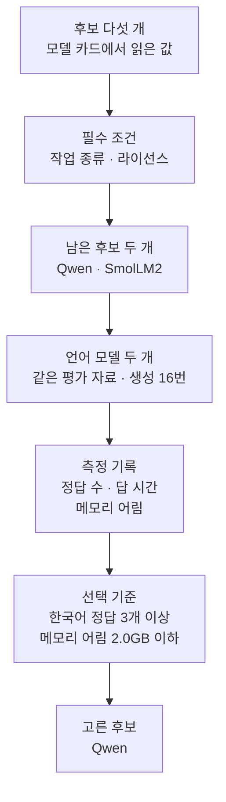
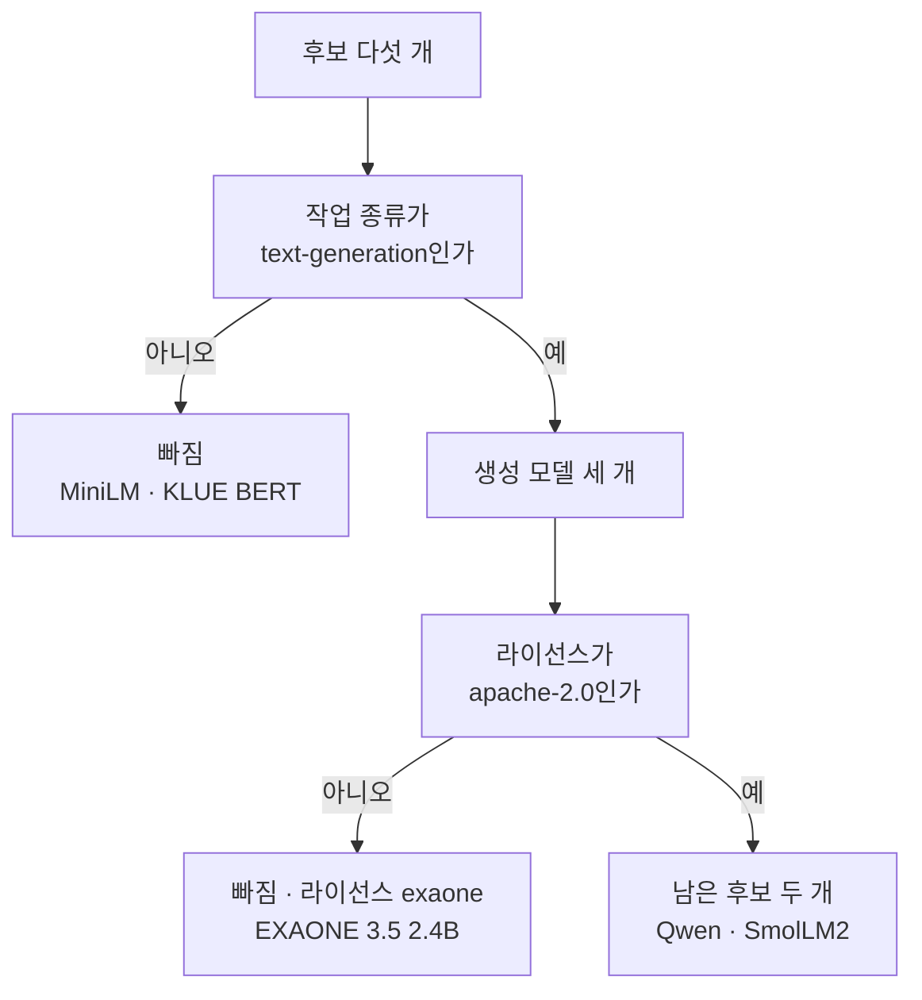
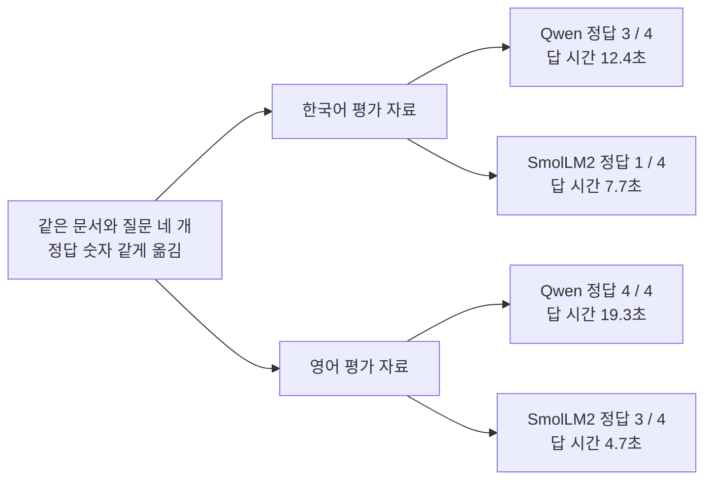
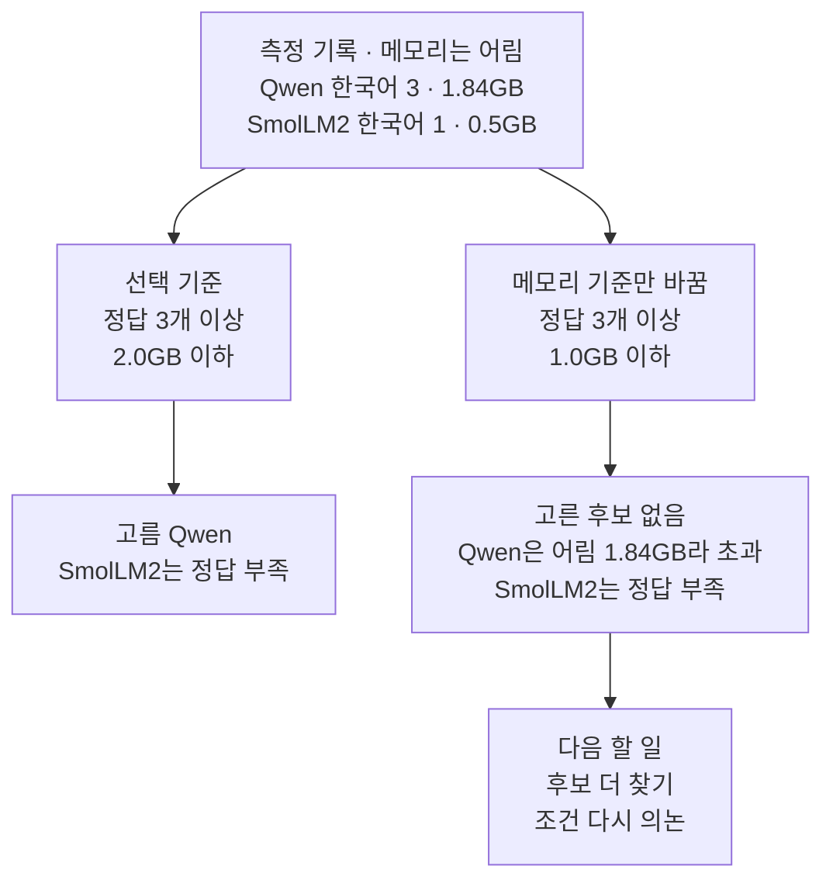

# 08-모델-선택-기준

## _src 본문 (HTML 원본)

```html
<!--meta: 강의 1h · 실습 0.5h | 코드 Jupyter Notebook | 새 용어 7 -->
<h2 id="b1"><span class="no">1</span>학습 목표</h2>
<div class="goal"><ul><li>작업 종류와 라이선스를 필수 조건으로 정해, 모델 카드에서 읽은 후보를 측정 전에 거를 수 있습니다.</li><li>남은 후보를 같은 평가 자료로 재고, 정답 수·답 시간·메모리 어림이 각각 무엇을 재는지 구분할 수 있습니다.</li><li>평가 자료의 언어나 선택 기준이 바뀌면 고르는 후보가 달라지는 까닭을 설명할 수 있습니다.</li></ul></div>
<h2 id="b2"><span class="no">2</span>이 내용을 배우는 이유</h2>
<p>모델을 고를 때는 이름이 널리 알려진 모델부터 떠올리기 쉽습니다. 하지만 그 모델이 우리 작업의 입력과 출력 모양에 맞지 않을 수 있습니다. 라이선스가 서비스 방식과 맞지 않으면, 실행은 되어도 서비스에 쓸 수 없습니다.</p>
<p>조건에 맞는 모델이라도 우리 질문에 잘 답하는지는 따로 재야 합니다. 01절에서는 토큰화기마다 한국어 조각 수가 달랐습니다. 07절에서는 문서를 넣어도 문서에 없는 문장이 붙었습니다. 그래서 같은 평가 자료로 후보를 재고, 미리 정한 기준으로 고릅니다.</p>
<p><strong>이 절의 질문</strong> — 정확도, 속도, 메모리, 라이선스 조건이 다를 때 모델 후보를 어떻게 비교할까요? 측정 결과로 무엇을 고를 수 있고, 무엇은 말할 수 없을까요?</p>
<h2 id="b3"><span class="no">3</span>앞에서 배운 내용</h2>
<p>01절에서는 같은 한국어 문장을 GPT-2와 KLUE 토큰화기로 나눠, 조각 수가 39개와 9개로 다른 것을 봤습니다. 모델을 받을 때는 판 번호(revision)를 고정해 같은 파일을 받게 했습니다. 이 절도 두 후보의 판 번호를 고정하고, 같은 문장의 조각 수를 비교합니다.</p>
<p>02절의 MiniLM은 문장을 벡터로 바꾸는 모델이었고, 03~07절의 Qwen은 글을 이어 쓰는 모델이었습니다. 04절에서는 모델 설정의 컨텍스트 한도 <code>max_position_embeddings</code>가 32768인 것을 확인했습니다. 이 절의 후보 표에는 두 모델과 01절 토큰화기의 모델 KLUE BERT가 함께 들어갑니다.</p>
<p>05절 함수 <code>ask_model()</code>과 07절 함수 <code>make_input()</code>·<code>find_numbers()</code>는 도구 파일 <code>llm_tools.py</code>에서 가져옵니다. 07절 8절에서는 문서를 넣은 답에 정답 숫자가 있는지로 판정했습니다. 이 절의 평가 자료는 04절 환불 문장, 05절 확인 코드, 07절 문서 두 개로 만듭니다. 생성은 06절에서 본 뽑기를 끈 설정입니다.</p>
<p>딕셔너리와 튜플 풀어 담기는 Ch 2 03절에서, <code>time.perf_counter()</code>와 <code>round()</code>로 걸린 시간을 재는 방법은 Ch 2 12절에서 배웠습니다.</p>
<h2 id="b4"><span class="no">4</span>핵심 개념</h2>
<h3>비유로 시작하기</h3>
<p>빵을 썰 도구를 고른다고 생각합니다. 숟가락과 포크는 하는 일이 달라서 먼저 옆으로 뺍니다. 잘 드는 칼이라도 잠긴 상자에 들어 있어 쓸 수 없으면 뺍니다.</p>
<p>남은 칼이 두 자루라면 똑같은 빵을 하나씩 썰어 봅니다. 빵이 서로 다르면 칼 차이인지 빵 차이인지 알 수 없습니다. 이 절의 모델 선택도 먼저 빼고, 남은 후보를 같은 자료로 잽니다.</p>
{{img:08-5-빵-칼|나무 탁자 왼쪽에 숟가락과 포크가 든 바구니와 자물쇠 달린 투명 상자 속 칼이 놓여 있고, 오른쪽 같은 도마 두 개 위의 같은 빵 가운데 긴 빵칼로 썬 빵은 고르게, 작은 칼로 썬 빵은 부스러지게 썰린 삽화|숟가락·포크와 잠긴 상자 속 칼은 옆으로 빼 두고, 남은 칼 두 자루로 똑같은 빵을 잘라 결과를 나란히 비교합니다.}}
<p><strong>그림 읽기</strong> — 나무 탁자 왼쪽에 숟가락과 포크가 든 바구니가 있고, 그 옆 투명 상자 속 칼에는 자물쇠가 달려 있습니다. 오른쪽에는 같은 도마 두 개에 같은 둥근 빵이 하나씩 놓여 있습니다. 긴 빵칼 옆 빵은 고르게 썰렸고, 작은 칼 옆 빵은 울퉁불퉁하게 부스러졌습니다.</p>
<p>숟가락과 포크는 작업 종류가 다른 후보이고, 잠긴 상자 속 칼은 라이선스가 맞지 않는 후보입니다. 같은 빵 두 덩이는 같은 평가 자료이고, 썬 모양은 측정 결과입니다. 이 절에서는 한국어 평가 자료가 빵에 해당합니다.</p>
<h3>이 절에서 쓰는 말</h3>
<table><thead><tr><th>용어</th><th>뜻</th><th>이 절에서 보이는 모습</th></tr></thead><tbody>
<tr><td>모델 카드(model card)</td><td>모델을 올린 곳이 쓰임, 라이선스, 크기, 한계를 적어 둔 설명 페이지. 가전제품의 제품 설명서와 비슷함</td><td>Hugging Face 모델 페이지의 설명. 2026-09-16에 확인</td></tr>
<tr><td>작업 종류(task)</td><td>모델이 받는 입력과 내는 출력의 모양</td><td><code>text-generation</code>, <code>sentence-similarity</code>, <code>fill-mask</code></td></tr>
<tr><td>라이선스(license)</td><td>모델 파일을 쓸 때 지켜야 하는 조건</td><td><code>apache-2.0</code>, <code>exaone</code>, <code>cc-by-sa-4.0</code></td></tr>
<tr><td>필수 조건</td><td>하나라도 맞지 않으면 성능을 재기 전에 빼는 조건. 빵 썰기에서 숟가락을 먼저 빼는 것과 같음</td><td><code>남은 후보 수: 2</code></td></tr>
<tr><td>파라미터(parameter)</td><td>학습으로 정해져 모델 파일에 저장된 숫자 하나하나(07절 「모델 파일의 숫자」)</td><td><code>파라미터 수: 494032768</code></td></tr>
<tr><td>평가 자료(evaluation set)</td><td>후보들에 똑같이 넣을 질문과 정답 기준의 모음. 지원자에게 나눠 주는 같은 시험지와 비슷함</td><td>문서, 질문, 정답 숫자 세 칸짜리 항목 네 개</td></tr>
<tr><td>선택 기준</td><td>측정한 값에 거는 서비스 조건. 측정하기 전에 정함</td><td>한국어 정답 3개 이상, 메모리 어림 2.0GB 이하</td></tr>
</tbody></table>
<h3>거르기와 재기를 나눕니다</h3>
<p>모델 선택은 두 단계로 나눕니다. 첫 단계는 필수 조건으로 거르기입니다. 작업 종류나 라이선스가 맞지 않으면 성능이 좋아도 쓸 수 없으니, 재기 전에 뺍니다.</p>
<p>둘째 단계는 남은 후보를 같은 평가 자료로 재는 것입니다. 같은 문서와 질문, 같은 출력 몫, 같은 판정 규칙을 씁니다. 조건 하나라도 후보마다 다르면, 결과 차이가 모델 때문인지 조건 때문인지 알 수 없습니다.</p>
<p>선택 기준은 측정하기 전에 정합니다. 결과를 본 뒤에 기준을 정하면, 마음에 드는 모델이 남도록 기준을 맞추기 쉽습니다. 노트북은 모델을 부르기 전인 4절에서 기준 두 가지를 적습니다.</p>
{{mermaid:08-1-선택-흐름|초록 상자 후보 다섯 개가 파란 상자 필수 조건을 지나 초록 상자 남은 후보 두 개가 되고, 보라 상자 언어 모델 두 개 같은 평가 자료 생성 16번, 노란 상자 측정 기록, 파란 상자 선택 기준을 거쳐 노란 상자 고른 후보 Qwen으로 가는 위에서 아래 흐름도|후보 다섯 개를 필수 조건으로 두 개까지 거르고, 같은 평가 자료로 잰 기록에 미리 정한 선택 기준을 적용해 Qwen을 골랐습니다.}}
<p><strong>도식 읽기</strong> — 위에서 아래로 읽습니다. 초록 상자는 노트북에 적은 후보이고, 파란 상자 두 개는 노트북에서 정한 조건입니다. 보라 상자는 실행한 언어 모델 두 개이고, 노란 상자는 출력으로 확인한 측정 기록과 고른 후보입니다.</p>
<p>선택 기준 상자는 측정 기록 아래에 있지만, 기준을 적은 때는 측정 전입니다. 그림은 기준을 기록에 적용하는 순서를 보여 줍니다.</p>
<h3>측정값마다 재는 것이 다릅니다</h3>
<p>모델을 메모리에 올리면 파라미터 하나마다 저장할 자리가 필요합니다. 이 절의 모델은 숫자 하나를 4바이트(32비트 실수)로 올립니다. 그래서 식은 <code>파라미터 수 × 4 ÷ (1024 × 1024 × 1024)</code>입니다. 모델 Qwen은 494,032,768 × 4바이트라서 약 1.84GB, 모델 SmolLM2는 약 0.5GB입니다.</p>
<p>이 메모리 어림은 파라미터만 셉니다. 노트북과 같은 계산을 스크립트로 실행했을 때 Python이 쓴 메모리는 최대 약 3.4GB였습니다. 그래서 어림은 후보끼리 크기를 견주는 데 쓰고, 실제 메모리는 따로 잽니다.</p>
<p>불러오기 시간은 모델 파일이 캐시에 있을 때 한 번 잰 값입니다. 처음 내려받는 시간과 답을 만드는 시간은 들어 있지 않습니다.</p>
<p>답 시간은 평가 자료 네 개의 답을 모두 받는 데 걸린 초입니다. 입력을 조각으로 나누는 시간, 새 조각을 만드는 시간, 첫 생성 준비 시간이 함께 들어 있습니다. 답이 길면 새 조각을 더 만들므로 시간도 늘어납니다. 첫 조각이 나올 때까지의 시간은 따로 재지 않았습니다.</p>
<p>정답 수는 07절 정답 숫자 규칙으로 셉니다. 평가 자료가 네 개뿐이라, 한 개 차이도 25%p 차이로 커 보입니다. 한국어 문장 조각 수는 같은 문장이 조각 몇 개가 되는지입니다. 조각이 많으면 04절의 컨텍스트 한도와 출력 몫을 더 빨리 씁니다.</p>
<h2 id="b5"><span class="no">5</span>실행 예제</h2>
<p>노트북은 모델 카드에서 읽은 후보 다섯 개를 표로 만들고, 필수 조건으로 거릅니다. 평가 자료와 선택 기준을 먼저 적은 뒤, 남은 두 모델을 불러와 기본 정보와 메모리 어림을 출력합니다. 두 모델에 한국어 평가 자료를 넣고, 값 바꿔 보기로 영어 평가 자료를 넣습니다. 마지막에 선택 기준으로 고르고, 메모리 기준만 바꿔 다시 판정합니다.</p>
<p>인터넷 서비스의 모델을 부르지 않으므로 API 키가 필요 없고 비용도 들지 않습니다. 모델이 답을 만드는 계산은 모두 16번이고, 실행에는 1분 안팎이 걸립니다. 새 후보 SmolLM2 파일은 캐시에 없으면 약 270MB를 내려받습니다.</p>
{{notebook:08-모델-선택-기준}}
<p class="look"><b>확인할 점</b> — 3절에서 EXAONE 줄이 <code>True | False</code>인 까닭을 봅니다. 5절 두 모델의 <code>한국어 문장 조각 수</code>를 비교합니다. 6절과 7절에서 SmolLM2의 <code>정답 수</code>가 어떻게 달라지는지, 9절에서 고른 후보가 남는지 확인합니다.</p>
<h3>필수 조건으로 거른 결과</h3>
<p>작업 종류가 <code>text-generation</code>이 아닌 MiniLM과 KLUE BERT가 먼저 빠졌습니다. EXAONE 3.5 2.4B는 생성 모델이지만 라이선스가 <code>exaone</code>이라 빠졌습니다. 모델 카드가 가리키는 라이선스 문서는 연구 목적 이용만 허락하고 상업 이용을 금지합니다.</p>
{{mermaid:08-2-필수-조건-거르기|초록 상자 후보 다섯 개가 파란 상자 작업 종류가 text-generation인가에서 아니오는 회색 상자 MiniLM과 KLUE BERT, 예는 초록 상자 생성 모델 세 개로 가고, 파란 상자 라이선스가 apache-2.0인가에서 아니오는 회색 상자 EXAONE 3.5 2.4B, 예는 초록 상자 남은 후보 두 개 Qwen과 SmolLM2로 가는 흐름도|작업 종류 확인에서 두 후보, 라이선스 확인에서 한 후보가 빠져 생성 모델 두 개가 남습니다.}}
<p><strong>도식 읽기</strong> — 위에서 아래로 읽습니다. 파란 상자 두 개는 노트북 3절의 필수 조건이고, 화살표의 예·아니오는 출력의 <code>True</code>·<code>False</code> 칸입니다. 회색 상자는 조건에서 빠져 이후에 실행하지 않은 후보입니다. 조건에 맞지 않은 것이지 실패한 실행이 아니라서 빨강으로 칠하지 않았습니다.</p>
<p>남은 두 후보는 조건에 맞을 뿐입니다. 이 단계에서는 어떤 모델도 실행하지 않았으므로, 한국어 질문에 얼마나 맞게 답하는지는 아직 모릅니다.</p>
<h3>두 후보의 기본 정보</h3>
<p>Qwen 모델은 <code>파라미터 수: 494032768</code>, <code>컨텍스트 한도: 32768</code>입니다. SmolLM2 모델은 <code>파라미터 수: 134515008</code>, <code>컨텍스트 한도: 8192</code>입니다. 두 파라미터 수는 모델 카드에 적힌 크기 0.49B, 135M과 맞습니다.</p>
<p>같은 문장 「노을 워커 3의 배터리 용량은 4200mAh입니다.」는 Qwen에서 23조각, SmolLM2에서 47조각이었습니다. 같은 한국어 글을 넣으면 SmolLM2는 컨텍스트 한도와 출력 몫을 두 배 넘게 빨리 씁니다. 불러오기 시간은 <code>1.6</code>초와 <code>0.9</code>초였고, 둘 다 캐시에 있을 때 한 번 잰 값입니다.</p>
<h3>한국어 평가 자료의 결과</h3>
<p>Qwen 모델은 네 개 가운데 세 개를 맞혔습니다. 첫 항목에서 문서는 7일인데, 답은 <code>환불은 결제일로부터 14일 이내에 신청해야 합니다.</code>였습니다. 셋째 답은 07절 8절과 같은 입력이라, 문서에 없는 뒤 문장까지 07절 답과 같았습니다.</p>
<p>SmolLM2 모델은 한 개만 맞혔고, 그 답도 문서 문장을 그대로 옮긴 것입니다. 나머지 답은 질문을 되풀이하거나 관계없는 안내 글을 적었습니다. 한 답은 출력 몫 64조각에서 끊겨 마지막 글자가 깨졌습니다. 답 시간은 Qwen 12.4초, SmolLM2 7.7초였습니다.</p>
<h2 id="b6"><span class="no">6</span>실험 결과 해석</h2>
<p>먼저 평가 자료의 언어입니다. 셋째 문서는 정답 숫자를 같게 두려고 「300 dollars」로 옮겨, 금액 단위도 달라졌습니다. 같은 문서와 질문을 영어로 옮기자 Qwen은 4개, SmolLM2는 3개를 맞혔습니다. 모델 SmolLM2는 한국어 1개에서 영어 3개로 늘었고, 모델 카드의 「주로 영어」라는 설명과 맞는 결과입니다.</p>
{{mermaid:08-3-언어별-정답-수|왼쪽 초록 상자 정답 숫자를 같게 옮긴 문서와 질문 네 개가 초록 상자 한국어 평가 자료와 영어 평가 자료로 나뉘고, 한국어는 노란 상자 Qwen 정답 3 / 4 답 시간 12.4초와 SmolLM2 정답 1 / 4 답 시간 7.7초, 영어는 노란 상자 Qwen 정답 4 / 4 답 시간 19.3초와 SmolLM2 정답 3 / 4 답 시간 4.7초로 가는 흐름도|정답 숫자를 같게 옮긴 한국어·영어 평가 자료를 넣자, SmolLM2 정답 수는 1 / 4에서 3 / 4로 달라졌습니다.}}
<p><strong>도식 읽기</strong> — 왼쪽에서 오른쪽으로 읽습니다. 초록 상자는 노트북 4절과 7절의 평가 자료이고, 노란 상자 네 개는 6절과 7절 출력의 정답 수와 답 시간입니다. 위 두 상자가 한국어, 아래 두 상자가 영어 결과입니다. 맨 왼쪽 상자의 「같게 옮김」은 정답 숫자를 같게 두었다는 뜻이고, 영어 셋째 문서는 금액 단위가 달러로 바뀌었습니다.</p>
<p>영어 평가 자료로만 쟀다면 SmolLM2도 쓸 만한 후보로 보였을 것입니다. 한국어로 답할 서비스라면 한국어 평가 자료로 재야 합니다. 평가 자료는 서비스에 실제로 들어올 입력과 같은 언어와 모양으로 만듭니다.</p>
<p>정답 수를 읽을 때는 판정 규칙의 한계도 함께 봅니다. 모델 SmolLM2의 영어 넷째 답은 <code>4200 * 1000 = 420</code>처럼 틀린 계산을 붙였는데도, 4200이 들어 있어 맞은 답으로 셌습니다. 07절에서 본 것처럼 숫자 규칙은 문장의 뜻을 보지 않습니다.</p>
<p>답 시간은 모델 크기만으로 정해지지 않았습니다. Qwen 모델은 영어 답 네 개 가운데 두 개를 64조각 끝까지 이어 써서, 한국어 12.4초보다 긴 19.3초가 걸렸습니다. SmolLM2 모델의 영어 4.7초와 비교할 때도 답 길이가 다르다는 점을 함께 적어야 합니다.</p>
<p>이제 선택 기준입니다. 미리 정한 기준 「한국어 정답 3개 이상, 메모리 어림 2.0GB 이하」로는 Qwen이 <code>True</code>였습니다. Qwen 모델의 한국어 정답은 기준과 같은 3개라서, 「이상」이라는 경계에서 통과했습니다.</p>
{{mermaid:08-4-메모리-기준|맨 위 노란 상자 측정 기록 메모리는 어림 Qwen 한국어 3 1.84GB SmolLM2 한국어 1 0.5GB에서 두 갈래로 나뉘어, 왼쪽 파란 상자 선택 기준 2.0GB 이하는 노란 상자 고름 Qwen으로, 오른쪽 파란 상자 메모리 기준만 바꿈 1.0GB 이하는 노란 상자 고른 후보 없음을 거쳐 회색 상자 다음 할 일로 가는 흐름도|같은 측정 기록이라도 메모리 기준을 2.0GB에서 1.0GB로 바꾸면 고른 후보가 Qwen에서 없음으로 바뀝니다.}}
<p><strong>도식 읽기</strong> — 위에서 아래로 읽고, 두 갈래를 나란히 비교합니다. 맨 위 노란 상자는 측정 기록이고, 파란 상자 두 개는 노트북 4절 기준과 9절에서 바꾼 기준입니다. 아래 노란 상자는 8절과 9절의 판정이고, 회색 상자는 노트북에서 실행하지 않은 다음 할 일입니다.</p>
<p>메모리 기준만 1.0GB로 낮추자 두 후보 모두 <code>False</code>였습니다. 조건을 채운 후보가 없다는 것도 결과입니다. 이때는 한국어를 지원하는 더 작은 후보를 찾아 같은 평가 자료로 다시 재거나, 서비스 조건을 다시 의논합니다.</p>
<p>결과를 본 뒤 한국어 정답 기준을 1개로 낮춰 SmolLM2를 남기면 안 됩니다. 기준을 결과에 맞추면, 기준을 미리 정한 뜻이 사라집니다. SmolLM2 모델의 한국어 답은 대부분 질문에 답하지 못했습니다.</p>
<p>이 결과를 넓혀 말하지 않습니다. 본 것은 모델 두 개, 평가 자료 네 개씩, 한 컴퓨터에서 한 번 잰 시간입니다.</p>
<p>작업 중 기기 셸에서 영어 지원금 문서를 「3 million won」으로 적어 봤습니다. 그러자 Qwen이 「15 billion won」이라고 답했습니다. 그래서 Qwen의 영어 정답 4개도 옮긴 문장에 따라 달라질 수 있습니다. 이 실행은 노트북에 넣지 않았습니다.</p>
<h2 id="b7"><span class="no">7</span>주의할 점과 실무 메모</h2>
<ul><li>모델 카드의 값은 확인한 날짜와 판 번호를 함께 적습니다. 이 절의 후보 표는 2026-09-16에 확인했습니다. 라이선스와 설명은 새 판에서 바뀔 수 있습니다.</li>
<li>모델 카드는 요약 칸만 보지 말고 본문도 읽습니다. Qwen 카드의 요약 칸 언어는 영어 하나이지만, 본문은 한국어를 포함한 29개가 넘는 언어를 지원한다고 적습니다.</li>
<li>라이선스 판단은 이 교재가 대신하지 않습니다. KLUE BERT의 <code>cc-by-sa-4.0</code>처럼 표시와 공유 조건이 붙은 라이선스도 있습니다. 실제 서비스 전에는 원문과 조직의 정책을 확인합니다.</li>
<li>사용자 메시지만 넣으면 채팅 템플릿이 모델마다 다른 기본 지시를 넣습니다. 기기 셸에서 확인하니 Qwen은 「You are Qwen, created by Alibaba Cloud.」로 시작했습니다. 모델 SmolLM2는 「You are a helpful AI assistant」로 시작했습니다. 같은 사용자 메시지라도 모델에 들어간 입력 전체는 같지 않습니다.</li>
<li>기기 셸에서 SmolLM2 토큰화기의 조각 이름을 보니, 첫 글자 「노」가 조각 세 개로 나뉘었습니다. 01절 GPT-2 토큰화기의 한글 조각과 비슷한 모양입니다. 노트북에는 조각 수만 넣었습니다.</li>
<li>SmolLM2 설정 파일은 숫자 자료형을 bfloat16으로 적지만, 노트북에서 따로 정하지 않고 불러오니 <code>torch.float32</code>였습니다. 자료형을 바꿔 불러오면 메모리 어림도 달라집니다. 자료형을 바꾼 실행은 하지 않았습니다.</li>
<li>시간은 실행마다 조금씩 달라집니다. 작업 중 같은 계산을 스크립트로 한 번 더 실행했을 때 한국어 답 시간은 11.6초와 6.9초였습니다. 후보를 실제로 비교할 때는 같은 답 길이로 여러 번 재고, 가운데 값과 느린 경우를 함께 기록합니다.</li>
<li>인터넷 서비스의 모델은 파라미터 수와 메모리 대신, 토큰당 요금과 한도를 공식 문서에서 확인합니다. Ch 6 06절은 요금을 확인한 날짜를 기록에 함께 남깁니다.</li>
<li>교재를 만들 때는 기기 셸에서 두 모델을 먼저 실행해 보고 출력 몫을 64로 정했습니다. 32에서는 SmolLM2의 한국어 답이 모두 끊겼습니다. 기준 값 3개와 2.0GB는 흐름을 보여 주려고 정한 예입니다. 이 값을 노트북에 적은 것도 탐색 실행에서 두 모델의 정답 수를 본 뒤였습니다. 실제 선택에서는 서비스 요구에서 기준을 먼저 정해 기록합니다.</li>
<li>두 모델을 한 커널에 함께 올리면 메모리를 더 씁니다. 노트북과 같은 계산을 스크립트로 실행했을 때 최대 약 3.4GB였고, 교재를 만든 컴퓨터의 메모리는 3.8GB입니다.</li>
<li>교재 출력은 2026-09-16에 Linux(aarch64) 컴퓨터에서 만들었습니다. 쓴 Python은 3.12.13, torch는 CPU용 2.8.0, transformers는 4.56.2입니다. 모델 판 번호는 Qwen <code>7ae5576…</code>, SmolLM2 <code>12fd25f…</code>입니다. GPU, Windows·macOS에서는 실행하지 않았습니다.</li></ul>
<h2 id="b8"><span class="no">8</span>정리와 다음 절</h2>
<ul><li>작업 종류와 라이선스로 후보 다섯 개를 먼저 걸렀습니다. 남은 두 개는 조건에 맞을 뿐, 답을 잘한다는 뜻은 아니었습니다.</li><li>같은 한국어 평가 자료로 재자 Qwen은 3개, SmolLM2는 1개를 맞혔습니다. 영어 자료에서는 SmolLM2도 3개를 맞혀, 서비스와 같은 언어로 재야 했습니다.</li><li>미리 정한 기준으로 Qwen을 골랐고, 메모리 기준만 1.0GB로 낮추자 고른 후보가 없었습니다. 평가 자료가 네 개뿐이라 일반 순위로 말할 수 없습니다.</li></ul>
<p><strong>다음 학습과 이어지는 지점</strong> — <a href="09-LLM-동작-원리-실습.html">09절 LLM 동작 원리 실습</a>에서는 01~08절의 모델과 함수를 한 노트북에 모읍니다. 이 절에서 고른 Qwen에 질문과 가까운 문서를 골라 넣고, 07절 판정 규칙으로 답을 점검합니다. Ch 6 이후 인터넷 서비스의 모델과 평가로 이어지는 연결은 09절 끝에서 안내합니다.</p>
<h2 id="b9"><span class="no">9</span>복습 문제</h2><details class="quiz"><summary>문제와 해설</summary>
<p class="quiz-q">1. EXAONE 3.5 2.4B는 작업 종류가 맞았는데도 필수 조건에서 빠졌습니다. 까닭은 무엇인가요? · 기초</p><p class="quiz-a"><b>해설</b> — 이 절의 가정은 회사 서비스에 넣을 모델이라, 라이선스를 <code>apache-2.0</code>으로 정했습니다. EXAONE 라이선스의 이름은 <code>exaone</code>이고, 라이선스 문서는 연구 목적 이용만 허락하고 상업 이용을 금지합니다. 그래서 출력 줄이 <code>True | False</code>였습니다.</p>
<p class="quiz-q">2. SmolLM2의 메모리 어림 0.5GB는 어떻게 나왔나요? · 기초</p><p class="quiz-a"><b>해설</b> — 파라미터 수 134,515,008에 숫자 하나의 크기 4바이트를 곱하면 538,060,032바이트입니다. 이를 1024 × 1024 × 1024로 나누면 약 0.501이고, 소수 둘째 자리로 반올림하면 0.5입니다. 이 값은 파라미터만 센 어림이라 실제 메모리보다 작습니다.</p>
<p class="quiz-q">3. 영어로 답하는 서비스를 메모리가 작은 기기에 넣습니다. 기준 「영어 정답 3개 이상, 메모리 어림 1.0GB 이하」로는 어느 후보가 남나요? · 적용</p><p class="quiz-a"><b>해설</b> — 8절 출력에서 SmolLM2는 영어 정답 3개, 메모리 어림 0.5GB라 두 기준을 채웁니다. Qwen 모델은 영어 정답 4개지만 1.84GB라 빠집니다. 노트북에서 실행하지 않은 기준이라, 9절 셀 아래에 새 셀을 만들어 확인합니다. 영어 넷째 답처럼 판정 규칙이 틀린 계산을 맞다고 센 경우도 있어, 답을 읽어 확인해야 합니다.</p>
<p class="quiz-q">4. 동료가 영어 평가 답 시간 19.3초와 4.7초를 보고 「SmolLM2가 네 배 빠른 모델이다」라고 합니다. 무엇이라고 답하나요? · 분석</p><p class="quiz-a"><b>해설</b> — Qwen 모델은 영어 답 네 개 가운데 두 개를 64조각 끝까지 이어 썼습니다. SmolLM2 모델은 짧게 끝낸 답이 많아, 두 모델이 만든 조각 수가 다릅니다. 답 시간에는 첫 생성 준비 시간도 들어 있고, 한 번만 잰 값입니다. 속도를 비교하려면 같은 답 길이로 여러 번 재야 한다고 답합니다.</p>
<p class="quiz-q">5. 9절에서 고른 후보가 없자 누군가 「SmolLM2가 메모리에 맞으니 한국어 정답 기준을 1개로 낮추자」고 합니다. 이 제안의 문제와 다른 방법은 무엇인가요? · 분석</p><p class="quiz-a"><b>해설</b> — 결과를 본 뒤 원하는 모델이 남도록 기준을 바꾸면, 기준을 미리 정한 뜻이 사라집니다. SmolLM2 모델의 한국어 답은 한 개만 맞았고, 그것도 문서 문장을 옮긴 답이었습니다. 한국어를 지원하는 더 작은 후보를 찾아 같은 평가 자료로 재거나, 기기와 서비스 조건을 다시 의논합니다.</p>
</details>
<h2 id="b10"><span class="no">10</span>참고 자료</h2>
<ul><li><a href="https://huggingface.co/Qwen/Qwen2.5-0.5B-Instruct/tree/7ae557604adf67be50417f59c2c2f167def9a775">Qwen2.5-0.5B-Instruct 모델 카드(Apache-2.0)</a> · 판 7ae5576 · 확인 2026-09-16</li><li><a href="https://huggingface.co/HuggingFaceTB/SmolLM2-135M-Instruct/tree/12fd25f77366fa6b3b4b768ec3050bf629380bac">SmolLM2-135M-Instruct 모델 카드(Apache-2.0)</a> · 판 12fd25f · 확인 2026-09-16</li><li><a href="https://huggingface.co/LGAI-EXAONE/EXAONE-3.5-2.4B-Instruct/blob/ccce25bd39c141fe053e0bc75818a8f5fe962802/LICENSE">EXAONE 3.5 2.4B 라이선스 문서(1.1 - NC)</a> · 판 ccce25b · 확인 2026-09-16</li><li><a href="https://huggingface.co/sentence-transformers/paraphrase-multilingual-MiniLM-L12-v2/tree/e8f8c211226b894fcb81acc59f3b34ba3efd5f42">multilingual MiniLM 모델 카드(Apache-2.0)</a> · 판 e8f8c21 · 확인 2026-09-16</li><li><a href="https://huggingface.co/klue/bert-base/tree/77c8b3d707df785034b4e50f2da5d37be5f0f546">KLUE BERT base 모델 카드(CC-BY-SA-4.0)</a> · 판 77c8b3d · 확인 2026-09-16</li></ul>
```

## 노트북 셀 (순서대로)

### [0] markdown {'html': 'skip'}

# 모델 선택 기준

**이 노트북에서 할 일**

1. 모델 카드에서 읽은 후보 다섯 개를 작업 종류와 라이선스로 거릅니다.
2. 남은 생성 모델 두 개를 불러와, 같은 평가 자료로 정답 수와 답 시간을 기록합니다.
3. 평가 자료의 언어와 메모리 기준을 바꿔 보고, 미리 정한 기준으로 후보를 고릅니다.

**준비물** — API 키는 필요 없습니다. 인터넷 서비스의 모델을 부르지 않고, 내 컴퓨터에서 작은 언어 모델 두 개를 실행합니다.
그래서 비용은 들지 않습니다. 모델이 답을 만드는 계산은 모두 16번 합니다.

실행 시간은 1분 안팎입니다. Qwen 모델 파일은 03~07절과 같은 약 1GB(954MiB)입니다.
SmolLM2 모델은 이 절에서 처음 씁니다. 캐시에 없으면 약 270MB를 Hugging Face 사이트에서 내려받습니다.
노트북과 같은 계산을 스크립트로 실행했을 때 Python이 쓴 메모리는 최대 약 3.4GB였습니다.

**기준 버전** — 실습 폴더에 고정한 transformers 4.56.2와 torch 2.8.0을 씁니다.
모델 `Qwen/Qwen2.5-0.5B-Instruct`는 판 번호 `7ae557604adf67be50417f59c2c2f167def9a775`로 받습니다.
모델 `HuggingFaceTB/SmolLM2-135M-Instruct`는 판 번호 `12fd25f77366fa6b3b4b768ec3050bf629380bac`로 받습니다.

후보 표의 작업 종류와 라이선스는 2026-09-16에 Hugging Face 모델 카드에서 확인한 값입니다. 모델 카드는 나중에 바뀔 수 있습니다.
교재 출력은 Linux(aarch64)의 Python 3.12.13과 CPU용 torch(2.8.0+cpu)로 만들었습니다. 다른 버전, GPU, Windows·macOS에서는 이번에 실행하지 않았습니다.

실습 폴더 `labs/part1/ch05-llm-principles`에서 01절과 같은 `.venv` 커널을 고른 뒤 첫 셀부터 순서대로 실행합니다.

### [1] markdown {'html': 'skip'}

## 오늘 볼 그림


위에서 아래로 읽습니다. 초록 상자는 노트북에 적은 후보이고, 파란 상자는 노트북에서 정한 조건입니다.
보라 상자는 실행한 언어 모델이고, 노란 상자는 출력으로 확인하는 측정 기록과 판정입니다.

### [2] markdown {}

## 1. 준비

이 절은 파일을 읽거나 만들지 않습니다. 준비 셀에서는 transformers 패키지와 시간을 재는 모듈을 불러옵니다.

함수 `warnings.filterwarnings()` 줄은 01절처럼 진행 표시 위젯이 없다는 경고 한 줄을 끕니다.
함수 `transformers.logging.set_verbosity_error()`는 04절처럼, 생성 셀에서 나오는 오류가 아닌 안내를 화면에 내지 않게 합니다.
모듈 `time`은 Ch 2 12절에서 `time.perf_counter()`로 걸린 시간을 잴 때 쓴 표준 라이브러리입니다.

앞에서 배운 함수는 `llm_tools.py`에 모아 두었습니다. 파일을 열면 코드를 볼 수 있습니다. 노트북과 같은 폴더(`notebooks/`)에 있는 파일입니다.

이 노트북은 05절 `ask_model()`과 07절 `make_input()`·`find_numbers()`를 가져옵니다.
도구 파일의 `make_input()`은 07절과 계산이 같고, 토큰화기를 첫 인자로 받습니다. 함수 `ask_model()`은 07절처럼 모델·토큰화기·입력 글·출력 몫을 받습니다.

### [3] code {'execution': {'iopub.execute_input': '2026-09-21T03:16:49.558177Z', 'iopub.status.busy': '2026-09-21T03:16:49.558001Z', 'iopub.status.idle': '2026-09-21T03:16:54.225330Z', 'shell.execute_reply': '2026-09-21T03:16:54.224885Z'}, 'lesson_role': 'setup'}

```python
# time 모듈과 transformers 패키지, 앞 절 함수를 불러오고, 오류가 아닌 안내 경고를 줄인 뒤 버전을 확인합니다
import time
import warnings

# 진행 표시 위젯이 없다는 경고(TqdmWarning)는 계산과 관계없어 화면에 내지 않습니다
warnings.filterwarnings("ignore", message="IProgress not found")

import transformers
from transformers import AutoModelForCausalLM, AutoTokenizer
# 05절 답 받기 함수와 07절 입력·숫자 찾기 함수를 도구 파일에서 가져옵니다
from llm_tools import ask_model, find_numbers, make_input

# 생성 셀의 안내(오류 아님)를 화면에 내지 않습니다
transformers.logging.set_verbosity_error()
print("transformers 버전:", transformers.__version__)
```

출력:
```
transformers 버전: 4.56.2

```

### [4] markdown {}

**결과 읽기** — 출력 줄은 `transformers 버전: 4.56.2`입니다. 준비물에 적은 기준 버전과 같습니다.

### [5] markdown {}

## 2. 모델 카드에서 읽은 후보 표

모델 카드(model card)는 모델을 올린 곳이 쓰임, 라이선스, 크기, 한계를 적어 둔 설명 페이지입니다. 가전제품을 사기 전에 읽는 제품 설명서와 비슷합니다.
이 셀의 후보 표는 2026-09-16에 Hugging Face 모델 카드에서 읽은 값을 옮겨 적은 것입니다.

후보는 다섯 개입니다. 03~07절의 Qwen, 02절의 MiniLM, 01절 토큰화기의 모델인 KLUE BERT에 생성 모델 두 개를 더했습니다.
새 후보 SmolLM2-135M-Instruct는 Hugging Face가 공개한 작은 모델입니다. 새 후보 EXAONE-3.5-2.4B-Instruct는 LG AI연구원이 공개한 모델입니다.

칸 `task`에는 작업 종류를, 칸 `license`에는 라이선스 이름을 적습니다. 두 칸의 뜻은 3절에서 풉니다.
여러 줄로 나오는 표라서 라벨 줄을 먼저 출력합니다.

### [6] code {'execution': {'iopub.execute_input': '2026-09-21T03:16:54.226317Z', 'iopub.status.busy': '2026-09-21T03:16:54.226189Z', 'iopub.status.idle': '2026-09-21T03:16:54.228318Z', 'shell.execute_reply': '2026-09-21T03:16:54.227981Z'}}

```python
# 모델 카드에서 읽은 후보 다섯 개의 이름, 작업 종류, 라이선스를 목록에 담습니다
candidates = [
    {"name": "Qwen/Qwen2.5-0.5B-Instruct", "task": "text-generation", "license": "apache-2.0"},
    {"name": "HuggingFaceTB/SmolLM2-135M-Instruct", "task": "text-generation", "license": "apache-2.0"},
    {"name": "LGAI-EXAONE/EXAONE-3.5-2.4B-Instruct", "task": "text-generation", "license": "exaone"},
    {"name": "sentence-transformers/paraphrase-multilingual-MiniLM-L12-v2", "task": "sentence-similarity", "license": "apache-2.0"},
    {"name": "klue/bert-base", "task": "fill-mask", "license": "cc-by-sa-4.0"},
]
print("모델 이름 | 작업 종류 | 라이선스")
for candidate in candidates:
    print(candidate["name"], "|", candidate["task"], "|", candidate["license"])
```

출력:
```
모델 이름 | 작업 종류 | 라이선스
Qwen/Qwen2.5-0.5B-Instruct | text-generation | apache-2.0
HuggingFaceTB/SmolLM2-135M-Instruct | text-generation | apache-2.0
LGAI-EXAONE/EXAONE-3.5-2.4B-Instruct | text-generation | exaone
sentence-transformers/paraphrase-multilingual-MiniLM-L12-v2 | sentence-similarity | apache-2.0
klue/bert-base | fill-mask | cc-by-sa-4.0

```

### [7] markdown {}

**결과 읽기** — 라벨 줄 아래 다섯 줄이 후보입니다. 첫 줄은 `Qwen/Qwen2.5-0.5B-Instruct | text-generation | apache-2.0`이고, 셋째 줄 EXAONE의 라이선스는 `exaone`입니다.

이 표는 성능 순위가 아닙니다. 모델 카드에 적힌 값을 옮겨 적었을 뿐이고, 아직 어떤 모델도 실행하지 않았습니다.

### [8] markdown {}

## 3. 필수 조건으로 거르기

작업 종류(task)는 모델이 받는 입력과 내는 출력의 모양입니다. 작업 이름 `text-generation`은 입력 뒤에 글을 이어 쓰는 모델입니다.
작업 이름 `sentence-similarity`는 02절처럼 문장을 벡터로 바꾸는 모델이고, `fill-mask`는 문장 속 가린 자리에 올 조각을 맞히는 모델입니다.

라이선스(license)는 모델 파일을 쓸 때 지켜야 하는 조건입니다. 라이선스 Apache-2.0은 조건을 지키면 상업 서비스에도 쓸 수 있습니다.

EXAONE 모델 카드의 라이선스 칸은 `other`이고, 라이선스 이름이 `exaone`입니다.
이 모델 카드는 라이선스 문서 `EXAONE AI Model License Agreement 1.1 - NC`를 가리킵니다.
이 문서는 연구 목적 이용만 허락하고 상업 이용을 금지합니다.
이 노트북은 법률 판단을 하지 않습니다. 실제 서비스에 넣기 전에는 라이선스 원문과 조직의 정책을 확인합니다.

필수 조건은 하나라도 맞지 않으면 성능을 재기 전에 빼는 조건입니다. 이 절은 회사의 한국어 상담 서비스에 넣을 생성 모델을 고른다고 가정합니다.
그래서 작업 종류는 `text-generation`, 라이선스는 팀이 검토를 마친 `apache-2.0`만 허용합니다.

실행 전에 예상합니다. 작업 종류에서 두 개, 라이선스에서 한 개가 빠져 후보 두 개가 남을 것입니다.

### [9] code {'execution': {'iopub.execute_input': '2026-09-21T03:16:54.228982Z', 'iopub.status.busy': '2026-09-21T03:16:54.228912Z', 'iopub.status.idle': '2026-09-21T03:16:54.231018Z', 'shell.execute_reply': '2026-09-21T03:16:54.230653Z'}}

```python
# 필수 조건 두 가지(작업 종류, 라이선스)를 모두 채운 후보만 남깁니다
required_task = "text-generation"
required_license = "apache-2.0"
remaining = []
print("모델 이름 | 작업 종류 맞음 | 라이선스 맞음")
for candidate in candidates:
    task_ok = candidate["task"] == required_task
    license_ok = candidate["license"] == required_license
    print(candidate["name"], "|", task_ok, "|", license_ok)
    if task_ok and license_ok:
        remaining.append(candidate)
print("남은 후보 수:", len(remaining))
```

출력:
```
모델 이름 | 작업 종류 맞음 | 라이선스 맞음
Qwen/Qwen2.5-0.5B-Instruct | True | True
HuggingFaceTB/SmolLM2-135M-Instruct | True | True
LGAI-EXAONE/EXAONE-3.5-2.4B-Instruct | True | False
sentence-transformers/paraphrase-multilingual-MiniLM-L12-v2 | False | True
klue/bert-base | False | False
남은 후보 수: 2

```

### [10] markdown {}

**결과 읽기** — 라벨 줄 아래에서 `True | True`인 줄은 Qwen과 SmolLM2 두 줄이고, 마지막 줄은 `남은 후보 수: 2`입니다. 예상과 같습니다.

EXAONE 줄은 `True | False`로, 작업 종류는 맞지만 라이선스가 달라 빠졌습니다. 나머지 두 후보 MiniLM과 KLUE BERT는 작업 종류가 달라 빠졌습니다.
두 조건을 통과했다는 것은 조건에 맞는다는 뜻일 뿐입니다. 남은 두 모델이 한국어 질문에 얼마나 맞게 답하는지는 아직 모릅니다.

### [11] markdown {}

## 4. 평가 자료와 선택 기준을 먼저 정하기

평가 자료(evaluation set)는 후보들에 똑같이 넣을 질문과 정답 기준을 모은 것입니다. 여러 지원자에게 같은 시험지를 나눠 주는 것과 비슷합니다.
Ch 11에서는 평가에 반복해서 쓰는 질문 모음을 질의셋이라고 부릅니다.

한국어 평가 자료 네 개는 앞 절에서 쓴 문서와 질문입니다. 04절 환불 문장, 05절 해바라기 작전 확인 코드, 07절 8절 문서 두 개입니다.
한 항목은 문서, 질문, 정답 숫자 세 칸의 목록입니다. 출력 몫은 07절과 같은 64로 정합니다.

선택 기준은 측정한 값에 거는 서비스 조건입니다. 결과를 보기 전에 정해야, 원하는 모델이 남도록 기준을 바꾸는 일을 막을 수 있습니다.
이 절의 기준은 두 가지입니다. 한국어 평가 자료 네 개 가운데 세 개 이상 맞히고, 5절에서 어림할 메모리가 2.0GB 이하여야 합니다. 이 교재의 기준 값은 흐름을 보여 주려고 정한 예입니다.

### [12] code {'execution': {'iopub.execute_input': '2026-09-21T03:16:54.231630Z', 'iopub.status.busy': '2026-09-21T03:16:54.231551Z', 'iopub.status.idle': '2026-09-21T03:16:54.233383Z', 'shell.execute_reply': '2026-09-21T03:16:54.233108Z'}}

```python
# 두 후보에 똑같이 넣을 한국어 평가 자료 네 개와 출력 몫, 선택 기준을 정합니다
output_budget = 64
# 한 항목은 [문서, 질문, 정답 숫자]입니다
korean_items = [
    ["환불은 결제일로부터 7일 이내에 신청합니다.", "환불은 며칠 이내에 신청하나요?", "7"],
    ["해바라기 작전의 확인 코드는 314159입니다.", "해바라기 작전의 확인 코드만 답하세요.", "314159"],
    ["해바라기 연구소의 초록 패스 제도는 2026년에 연구자 한 명당 300만 원을 지원합니다.", "2026년 '해바라기 연구소'의 초록 패스 제도 지원금은 얼마인가요?", "300"],
    ["노을 워커 3의 배터리 용량은 4200mAh입니다.", "'노을 워커 3'의 배터리 용량은 몇 mAh인가요?", "4200"],
]
# 선택 기준: 한국어 정답 수의 최소값과 메모리 어림의 최대값(GB)
min_korean_correct = 3
max_memory_gb = 2.0
print("한국어 평가 자료 수:", len(korean_items))
print("선택 기준:", min_korean_correct, "개 이상 정답,", max_memory_gb, "GB 이하")
```

출력:
```
한국어 평가 자료 수: 4
선택 기준: 3 개 이상 정답, 2.0 GB 이하

```

### [13] markdown {}

**결과 읽기** — 출력 줄은 `한국어 평가 자료 수: 4`와 `선택 기준: 3 개 이상 정답, 2.0 GB 이하`입니다. 쉼표로 넘긴 값 사이에 빈칸이 들어가 `3 개`로 보입니다.

이제 평가 자료 하나를 받아 항목마다 답을 받고, 맞은 답의 수를 세는 함수를 정의합니다. 문서와 질문은 05·07절처럼 줄바꿈으로 이어 사용자 메시지에 담습니다.
입력은 07절 `make_input()`에 빈 시스템 지시 `""`을 넣어 만듭니다. 그러면 04절에서 본 것처럼 채팅 템플릿이 모델마다 정해 둔 기본 지시를 넣습니다.
답은 05절 `ask_model()`로 받고, 07절 8절 규칙처럼 `find_numbers()`가 찾은 목록에 정답 숫자가 있으면 맞은 답으로 셉니다.

반복 앞뒤에서 `time.perf_counter()`를 읽어, 네 답을 받는 데 걸린 전체 시간을 셉니다. 반환값은 맞은 수와 걸린 초 두 개이고, Ch 2 03절의 튜플 풀어 담기로 받습니다.
함수 안의 이름 `tokenizer`와 `model`은 함수를 부르는 순간의 값을 읽습니다. 그래서 지금은 이 이름이 없어도 정의할 수 있습니다. 이 셀은 함수를 정의만 합니다.

### [14] code {'execution': {'iopub.execute_input': '2026-09-21T03:16:54.233993Z', 'iopub.status.busy': '2026-09-21T03:16:54.233928Z', 'iopub.status.idle': '2026-09-21T03:16:54.235811Z', 'shell.execute_reply': '2026-09-21T03:16:54.235530Z'}}

```python
# 평가 자료를 받아 항목마다 답과 판정을 출력하고, 맞은 수와 걸린 초를 반환하는 함수를 정의합니다
def run_evaluation(items):
    correct_count = 0
    start_time = time.perf_counter()
    for document, question, correct_number in items:
        input_text = make_input(tokenizer, "", document + "\n" + question)
        answer = ask_model(model, tokenizer, input_text, output_budget)
        # 07절 정답 숫자 규칙: 답에서 찾은 숫자 목록에 정답 숫자가 있는지 봅니다
        is_correct = correct_number in find_numbers(answer)
        print(correct_number, "|", is_correct, "|", answer.replace("\n", " "))
        if is_correct:
            correct_count = correct_count + 1
    elapsed = time.perf_counter() - start_time
    return correct_count, round(elapsed, 1)
```

출력:
```

```

### [15] markdown {}

**결과 읽기** — 정의만 하는 셀이라 출력이 없습니다.

## 5. 남은 후보 불러오기

남은 두 후보를 내 컴퓨터에 불러옵니다. 01절처럼 판 번호(revision)를 고정해, 나중에 실행해도 같은 파일을 받게 합니다.
필수 조건에서 빠진 EXAONE은 내려받지 않습니다. 모델 파일 기준으로 이 모델의 파라미터는 약 24억 개입니다.

### [16] code {'execution': {'iopub.execute_input': '2026-09-21T03:16:54.236453Z', 'iopub.status.busy': '2026-09-21T03:16:54.236393Z', 'iopub.status.idle': '2026-09-21T03:16:54.238188Z', 'shell.execute_reply': '2026-09-21T03:16:54.237821Z'}}

```python
# 불러올 두 후보의 판 번호를 고정하고, 남은 후보마다 판 번호를 출력합니다
revisions = {
    "Qwen/Qwen2.5-0.5B-Instruct": "7ae557604adf67be50417f59c2c2f167def9a775",
    "HuggingFaceTB/SmolLM2-135M-Instruct": "12fd25f77366fa6b3b4b768ec3050bf629380bac",
}
print("모델 이름 | 판 번호")
for candidate in remaining:
    model_name = candidate["name"]
    print(model_name, "|", revisions[model_name])
```

출력:
```
모델 이름 | 판 번호
Qwen/Qwen2.5-0.5B-Instruct | 7ae557604adf67be50417f59c2c2f167def9a775
HuggingFaceTB/SmolLM2-135M-Instruct | 12fd25f77366fa6b3b4b768ec3050bf629380bac

```

### [17] markdown {}

**결과 읽기** — 라벨 줄 아래 두 줄은 `Qwen/Qwen2.5-0.5B-Instruct | 7ae557604adf67be50417f59c2c2f167def9a775`와 SmolLM2 줄입니다. 남은 후보 두 개 모두 판 번호가 있습니다.

다음은 후보 이름을 받아 토큰화기와 모델을 불러오고, 불러오는 데 걸린 초를 함께 반환하는 함수입니다.
반환값이 세 개라서 튜플로 받습니다. 이 셀은 함수를 정의만 합니다.

### [18] code {'execution': {'iopub.execute_input': '2026-09-21T03:16:54.238801Z', 'iopub.status.busy': '2026-09-21T03:16:54.238740Z', 'iopub.status.idle': '2026-09-21T03:16:54.240429Z', 'shell.execute_reply': '2026-09-21T03:16:54.240044Z'}}

```python
# 후보 이름을 받아 고정한 판 번호로 토큰화기와 모델을 불러오고, 걸린 초와 함께 반환하는 함수를 정의합니다
def load_candidate(model_name):
    revision = revisions[model_name]
    start_time = time.perf_counter()
    loaded_tokenizer = AutoTokenizer.from_pretrained(model_name, revision=revision)
    loaded_model = AutoModelForCausalLM.from_pretrained(model_name, revision=revision)
    elapsed = time.perf_counter() - start_time
    return loaded_tokenizer, loaded_model, round(elapsed, 1)
```

출력:
```

```

### [19] markdown {}

**결과 읽기** — 정의만 하는 셀이라 출력이 없습니다.

남은 두 후보를 차례로 불러와 딕셔너리 `loaded_models`에 담습니다. 키는 모델 이름이고, 값은 토큰화기와 모델을 담은 목록입니다.
두 모델을 함께 메모리에 올리므로, 메모리가 작은 컴퓨터에서는 다른 노트북의 커널을 먼저 종료합니다.

메서드 `num_parameters()`는 모델의 파라미터 수를 정수로 반환합니다. 파라미터(parameter)는 학습으로 정해져 모델 파일에 저장된 숫자 하나하나입니다.
컨텍스트 한도는 04절에서 본 설정 값 `max_position_embeddings`입니다. 한국어 문장 조각 수는 07절 확인 문장을 각 토큰화기로 나눈 수입니다.

실행 전에 예상합니다. 파라미터가 적은 SmolLM2가 더 빨리 불러와지고, 같은 문장의 조각 수는 두 모델이 비슷할 것입니다.

### [20] code {'execution': {'iopub.execute_input': '2026-09-21T03:16:54.240983Z', 'iopub.status.busy': '2026-09-21T03:16:54.240925Z', 'iopub.status.idle': '2026-09-21T03:16:56.692596Z', 'shell.execute_reply': '2026-09-21T03:16:56.691645Z'}}

```python
# 남은 두 후보를 차례로 불러와 이름으로 담고, 불러오기 시간과 기본 정보를 출력합니다
sample_sentence = "노을 워커 3의 배터리 용량은 4200mAh입니다."
loaded_models = {}
for candidate in remaining:
    model_name = candidate["name"]
    loaded_tokenizer, loaded_model, load_seconds = load_candidate(model_name)
    loaded_models[model_name] = [loaded_tokenizer, loaded_model]
    print("모델 이름:", model_name)
    print("불러오기 시간(초):", load_seconds)
    print("파라미터 수:", loaded_model.num_parameters())
    print("컨텍스트 한도:", loaded_model.config.max_position_embeddings)
    token_ids = loaded_tokenizer.encode(sample_sentence)
    print("한국어 문장 조각 수:", len(token_ids))
```

출력:
```
모델 이름: Qwen/Qwen2.5-0.5B-Instruct
불러오기 시간(초): 1.6
파라미터 수: 494032768
컨텍스트 한도: 32768
한국어 문장 조각 수: 23
모델 이름: HuggingFaceTB/SmolLM2-135M-Instruct
불러오기 시간(초): 0.9
파라미터 수: 134515008
컨텍스트 한도: 8192
한국어 문장 조각 수: 47

```

### [21] markdown {}

**결과 읽기** — Qwen 모델은 `파라미터 수: 494032768`, `컨텍스트 한도: 32768`, `한국어 문장 조각 수: 23`입니다. SmolLM2 모델은 `파라미터 수: 134515008`, `컨텍스트 한도: 8192`, `한국어 문장 조각 수: 47`입니다.
불러오기 시간은 Qwen 모델 `1.6`초, SmolLM2 모델 `0.9`초입니다. 두 모델 파일이 이미 캐시에 있을 때 한 번 잰 값이라, 처음 내려받는 시간은 들어 있지 않습니다.

예상과 달리 같은 한국어 문장을 SmolLM2 토큰화기는 두 배 넘는 조각으로 나눴습니다. 01절에서 GPT-2와 KLUE의 조각 수가 달랐던 것처럼, 토큰화기마다 한국어를 나누는 방식이 다릅니다.
파라미터 수는 두 모델 모두 모델 카드에 적힌 크기(0.49B, 135M)와 맞습니다. 이 노트북의 출력은 2026-09-21에 이 두 모델과 판 번호로 실행한 결과입니다.

다음 셀은 파라미터 수로 모델을 올릴 때 드는 메모리를 어림합니다. 이 라이브러리는 따로 정하지 않으면 숫자 하나를 32비트 실수(float32), 곧 4바이트로 올립니다.
식은 `파라미터 수 × 4 ÷ (1024 × 1024 × 1024)`이고, 1GB를 1024 × 1024 × 1024바이트로 셉니다. Qwen 모델은 494032768 × 4바이트라서 약 1.84GB입니다.

### [22] code {'execution': {'iopub.execute_input': '2026-09-21T03:16:56.694204Z', 'iopub.status.busy': '2026-09-21T03:16:56.694107Z', 'iopub.status.idle': '2026-09-21T03:16:56.698459Z', 'shell.execute_reply': '2026-09-21T03:16:56.698064Z'}}

```python
# 파라미터 수로, 모델의 숫자만 메모리에 올릴 때 드는 크기(GB)를 어림합니다
bytes_per_number = 4
bytes_per_gb = 1024 * 1024 * 1024
memory_by_name = {}
print("모델 이름 | 숫자 자료형 | 메모리 어림(GB)")
for model_name in loaded_models:
    loaded_model = loaded_models[model_name][1]
    total_bytes = loaded_model.num_parameters() * bytes_per_number
    memory_gb = round(total_bytes / bytes_per_gb, 2)
    memory_by_name[model_name] = memory_gb
    print(model_name, "|", loaded_model.dtype, "|", memory_gb)
```

출력:
```
모델 이름 | 숫자 자료형 | 메모리 어림(GB)
Qwen/Qwen2.5-0.5B-Instruct | torch.float32 | 1.84
HuggingFaceTB/SmolLM2-135M-Instruct | torch.float32 | 0.5

```

### [23] markdown {}

**결과 읽기** — 라벨 줄 아래 두 줄의 숫자 자료형은 모두 `torch.float32`입니다. 메모리 어림은 Qwen `1.84`, SmolLM2 `0.5`입니다.

이 값은 파라미터만 센 어림입니다. 노트북과 같은 계산을 스크립트로 실행했을 때 Python이 쓴 메모리는 최대 약 3.4GB로, 두 어림을 더한 값보다 컸습니다.
모델을 불러오는 동안 쓰는 메모리, 계산 중간값, 라이브러리 자체가 쓰는 메모리가 더해질 수 있습니다. 그래서 어림은 후보끼리 크기를 견주는 데 쓰고, 실제 메모리는 따로 잽니다.

### [24] markdown {}

## 6. 한국어 평가 자료로 재기

두 후보에 한국어 평가 자료를 같은 순서로 넣습니다. 함수 `run_evaluation()`은 바깥 이름 `tokenizer`와 `model`을 읽어 두 도구 함수에 넘깁니다.
그래서 후보마다 두 이름에 그 후보의 토큰화기와 모델을 담은 뒤 함수를 부릅니다.

답 시간은 네 답을 받는 데 걸린 전체 초입니다. 답의 길이와 첫 생성 준비에 드는 시간도 들어 있습니다.
실행 전에 예상합니다. 07절 8절처럼 문서를 넣었으니 Qwen 모델은 네 개 모두 맞히고, 작은 SmolLM2는 몇 개를 틀릴 것입니다.

### [25] code {'execution': {'iopub.execute_input': '2026-09-21T03:16:56.699440Z', 'iopub.status.busy': '2026-09-21T03:16:56.699304Z', 'iopub.status.idle': '2026-09-21T03:17:16.751139Z', 'shell.execute_reply': '2026-09-21T03:17:16.750598Z'}}

```python
# 두 후보에 한국어 평가 자료를 같은 순서로 넣고, 정답 수와 답 시간을 기록합니다
korean_correct_by_name = {}
for model_name in loaded_models:
    # run_evaluation() 함수가 읽는 두 이름에 이번 후보를 담습니다
    tokenizer = loaded_models[model_name][0]
    model = loaded_models[model_name][1]
    print("모델 이름:", model_name)
    print("정답 숫자 | 정답 숫자 있음 | 답")
    correct_count, answer_seconds = run_evaluation(korean_items)
    korean_correct_by_name[model_name] = correct_count
    print("정답 수:", correct_count, "/", len(korean_items))
    print("답 시간(초):", answer_seconds)
```

출력:
```
모델 이름: Qwen/Qwen2.5-0.5B-Instruct
정답 숫자 | 정답 숫자 있음 | 답
7 | False | 환불은 결제일로부터 14일 이내에 신청해야 합니다.<|im_end|>
314159 | True | 314159<|im_end|>
300 | True | 해바라기 연구소의 초록 패스 제도는 2026년에 연구자 한 명당 300만원을 지원합니다. 이는 연구자의 일상적인 생활과 휴식을 제공하는 데 있어 중요한 지원책입니다.<|im_end|>
4200 | True | "노을 워커 3"의 배터리 용량은 4200mAh입니다.<|im_end|>
정답 수: 3 / 4
답 시간(초): 12.4
모델 이름: HuggingFaceTB/SmolLM2-135M-Instruct
정답 숫자 | 정답 숫자 있음 | 답
7 | False | 환불은 며칠 이내에 신청하나요?<|im_end|>
314159 | False | 아래 답변을 입력하세요.  ``` 아래 답변을 입력하세요.  
300 | False | 2026년 '해바라기 연구소'의 초록 패스 제도 지원금은 얼�
4200 | True | 노을 워커 3의 배터리 용량은 4200mAh입니다.<|im_end|>
정답 수: 1 / 4
답 시간(초): 7.7

```

### [26] markdown {}

**결과 읽기** — Qwen 모델은 `정답 수: 3 / 4`입니다. 첫 항목에서 문서는 7일인데, 답은 `환불은 결제일로부터 14일 이내에 신청해야 합니다.<|im_end|>`였습니다.
SmolLM2 모델은 `정답 수: 1 / 4`입니다. 맞은 한 개도 문서 문장 `노을 워커 3의 배터리 용량은 4200mAh입니다.<|im_end|>`를 그대로 옮긴 답입니다.

예상과 달리 Qwen 모델도 문서가 있는 질문 하나를 틀렸습니다. 셋째 답은 07절 8절과 같은 입력이라, 문서에 없는 뒤 문장까지 07절 답과 같았습니다.
SmolLM2 모델의 나머지 답은 질문을 되풀이하거나 질문과 관계없는 안내 글을 적었습니다. 한 답은 출력 몫에서 끊겨 마지막 글자가 깨졌습니다.

답 시간은 Qwen 모델 `12.4`초, SmolLM2 모델 `7.7`초입니다. 한 번 잰 값이고, 다시 실행하면 조금 달라집니다.

### [27] markdown {}

## 7. 값 바꿔 보기 — 영어 평가 자료

바꾸는 값은 평가 자료의 언어입니다. 문서 네 개와 질문을 영어로 옮기고, 정답 숫자는 그대로 둡니다.
셋째 문서의 「300만 원」은 영어로 옮기면 숫자가 달라집니다. 그래서 정답 숫자가 300으로 같도록 「300 dollars」로 적었습니다. 이 문서만 언어와 함께 금액 단위도 바뀌었습니다.

SmolLM2 모델 카드는 이 모델이 주로 영어를 이해하고 만든다고 적었습니다.
실행 전에 예상합니다. SmolLM2 모델의 정답 수는 한국어보다 늘고, Qwen 모델은 한국어와 비슷할 것입니다.

### [28] code {'execution': {'iopub.execute_input': '2026-09-21T03:17:16.752560Z', 'iopub.status.busy': '2026-09-21T03:17:16.752474Z', 'iopub.status.idle': '2026-09-21T03:17:16.754406Z', 'shell.execute_reply': '2026-09-21T03:17:16.754176Z'}}

```python
# 한국어 평가 자료와 정답 숫자가 같은 영어 평가 자료 네 개를 만듭니다
english_items = [
    ["Refunds must be requested within 7 days of the payment date.", "Within how many days must a refund be requested?", "7"],
    ["The confirmation code for Operation Sunflower is 314159.", "Answer only with the confirmation code for Operation Sunflower.", "314159"],
    ["In 2026, the Green Pass program of the Sunflower Institute gives each researcher 300 dollars.", "How much does the Green Pass program of the Sunflower Institute give in 2026?", "300"],
    ["The battery capacity of the Noeul Walker 3 is 4200mAh.", "What is the battery capacity of the Noeul Walker 3 in mAh?", "4200"],
]
print("영어 평가 자료 수:", len(english_items))
```

출력:
```
영어 평가 자료 수: 4

```

### [29] markdown {}

**결과 읽기** — 출력 줄은 `영어 평가 자료 수: 4`입니다. 한국어 평가 자료와 항목 수가 같습니다.

다음 셀은 6절과 같은 반복입니다. 평가 자료만 `english_items`로 바꿔 넣고, 정답 수를 딕셔너리 `english_correct_by_name`에 담습니다.

### [30] code {'execution': {'iopub.execute_input': '2026-09-21T03:17:16.755062Z', 'iopub.status.busy': '2026-09-21T03:17:16.755001Z', 'iopub.status.idle': '2026-09-21T03:17:40.758418Z', 'shell.execute_reply': '2026-09-21T03:17:40.757997Z'}}

```python
# 값 하나(평가 자료의 언어)만 바꿔, 두 후보에 영어 평가 자료를 넣습니다
english_correct_by_name = {}
for model_name in loaded_models:
    tokenizer = loaded_models[model_name][0]
    model = loaded_models[model_name][1]
    print("모델 이름:", model_name)
    print("정답 숫자 | 정답 숫자 있음 | 답")
    correct_count, answer_seconds = run_evaluation(english_items)
    english_correct_by_name[model_name] = correct_count
    print("정답 수:", correct_count, "/", len(english_items))
    print("답 시간(초):", answer_seconds)
```

출력:
```
모델 이름: Qwen/Qwen2.5-0.5B-Instruct
정답 숫자 | 정답 숫자 있음 | 답
7 | True | The standard timeframe for requesting a refund is typically 7 days from the payment date. This allows you to process your request and potentially receive a refund as soon as possible after receiving it. However, specific policies may vary depending on the service or product you're using, so it's best to check the official terms and conditions
314159 | True | 314159<|im_end|>
300 | True | The amount of money given to each researcher under the Green Pass program at the Sunflower Institute in 2026 is $300. This is a fixed stipend that remains constant regardless of any changes or adjustments made to the program over time. The program's structure and funding sources have not been altered since
4200 | True | The battery capacity of the Noeul Walker 3 is indeed 4200mAh (milliamp-hours). This means that the device can provide up to 4200 milliamp hours of power when fully charged.<|im_end|>
정답 수: 4 / 4
답 시간(초): 19.3
모델 이름: HuggingFaceTB/SmolLM2-135M-Instruct
정답 숫자 | 정답 숫자 있음 | 답
7 | True | To ensure timely refunds, it is recommended to request a refund within 7 days of the payment date.<|im_end|>
314159 | True | The confirmation code for Operation Sunflower is 314159.<|im_end|>
300 | False | The Green Pass program of the Sunflower Institute in 2026 is $100,000.<|im_end|>
4200 | True | To find the battery capacity of the Noeul Walker 3, we need to convert the battery capacity to mAh.  1. Convert the battery capacity to mAh: 4200mAh (mAh) = 4200 * 1000 = 420
정답 수: 3 / 4
답 시간(초): 4.7

```

### [31] markdown {}

**결과 읽기** — Qwen 모델은 `정답 수: 4 / 4`, SmolLM2 모델은 `정답 수: 3 / 4`입니다. 예상대로 SmolLM2 모델의 정답 수가 한국어 1개에서 영어 3개로 늘었습니다.
답 시간은 Qwen 모델 `19.3`초, SmolLM2 모델 `4.7`초입니다.

SmolLM2 모델이 틀린 셋째 답은 `$100,000`이라는 지어낸 금액입니다. 넷째 답은 `4200 * 1000 = 420`처럼 틀린 계산을 붙였는데도, 정답 숫자 4200이 들어 있어 True로 셌습니다.
이것은 07절에서 본 판정 규칙의 한계입니다. 규칙은 숫자 글자만 보고 문장의 뜻은 보지 않습니다.

Qwen 모델은 영어 답 네 개 가운데 두 개를 출력 몫 64조각 끝까지 이어 써서, 한국어보다 답 시간이 길었습니다. 답 시간은 모델 크기뿐 아니라 답의 길이에 따라서도 달라집니다.
영어 평가 자료로만 쟀다면 SmolLM2 모델도 쓸 만한 후보로 보였을 것입니다. 한국어로 답할 서비스라면 한국어 평가 자료의 결과를 봐야 합니다.

### [32] markdown {}

## 8. 선택 기준으로 고르기

4절에서 미리 정한 선택 기준 두 가지로 후보마다 고를지 판정합니다. 이 서비스는 한국어로 답하므로, 기준에는 한국어 정답 수를 씁니다.
영어 정답 수는 비교하려고 함께 출력만 합니다. 두 기준을 모두 채워야 `True`입니다.

실행 전에 예상합니다. 한국어 정답 3개와 메모리 어림 1.84GB로 두 기준을 채운 Qwen 모델만 `True`일 것입니다.

### [33] code {'execution': {'iopub.execute_input': '2026-09-21T03:17:40.759212Z', 'iopub.status.busy': '2026-09-21T03:17:40.759115Z', 'iopub.status.idle': '2026-09-21T03:17:40.761388Z', 'shell.execute_reply': '2026-09-21T03:17:40.761067Z'}}

```python
# 4절에서 정한 선택 기준 두 가지로, 후보마다 고를지 판정합니다
print("모델 이름 | 한국어 정답 수 | 영어 정답 수 | 메모리 어림(GB) | 고름")
for model_name in loaded_models:
    korean_correct = korean_correct_by_name[model_name]
    english_correct = english_correct_by_name[model_name]
    memory_gb = memory_by_name[model_name]
    # 한국어 정답 수와 메모리 어림, 두 기준을 모두 채워야 고릅니다
    chosen = korean_correct >= min_korean_correct and memory_gb <= max_memory_gb
    print(model_name, "|", korean_correct, "|", english_correct, "|", memory_gb, "|", chosen)
```

출력:
```
모델 이름 | 한국어 정답 수 | 영어 정답 수 | 메모리 어림(GB) | 고름
Qwen/Qwen2.5-0.5B-Instruct | 3 | 4 | 1.84 | True
HuggingFaceTB/SmolLM2-135M-Instruct | 1 | 3 | 0.5 | False

```

### [34] markdown {}

**결과 읽기** — 라벨 줄 아래 두 줄은 `Qwen/Qwen2.5-0.5B-Instruct | 3 | 4 | 1.84 | True`와 `HuggingFaceTB/SmolLM2-135M-Instruct | 1 | 3 | 0.5 | False`입니다. 예상과 같습니다.

Qwen 모델은 한국어 정답이 기준과 같은 3개입니다. 기준이 「3개 이상」이라 경계값에서 통과했습니다.
SmolLM2 모델은 메모리 기준은 채웠지만 한국어 정답 수가 기준보다 적어 빠졌습니다.

### [35] markdown {}

## 9. 값 바꿔 보기 — 메모리 기준 낮추기

바꾸는 값은 메모리 기준 `max_memory_gb` 하나입니다. 같은 서비스를 모델에 메모리를 1.0GB까지만 줄 수 있는 기기에 넣는다고 가정합니다.
한국어 정답 기준은 그대로 둡니다.

실행 전에 예상합니다. Qwen 모델은 메모리 어림이 1.0GB를 넘어 빠질 것입니다. SmolLM2 모델은 한국어 정답이 모자라 그대로 빠져, 고른 후보가 없을 것입니다.

### [36] code {'execution': {'iopub.execute_input': '2026-09-21T03:17:40.762117Z', 'iopub.status.busy': '2026-09-21T03:17:40.762042Z', 'iopub.status.idle': '2026-09-21T03:17:40.764210Z', 'shell.execute_reply': '2026-09-21T03:17:40.763719Z'}}

```python
# 메모리 기준 하나만 1.0GB로 낮추고, 같은 판정을 다시 합니다
max_memory_gb = 1.0
print("모델 이름 | 한국어 정답 수 | 메모리 어림(GB) | 고름")
for model_name in loaded_models:
    korean_correct = korean_correct_by_name[model_name]
    memory_gb = memory_by_name[model_name]
    chosen = korean_correct >= min_korean_correct and memory_gb <= max_memory_gb
    print(model_name, "|", korean_correct, "|", memory_gb, "|", chosen)
```

출력:
```
모델 이름 | 한국어 정답 수 | 메모리 어림(GB) | 고름
Qwen/Qwen2.5-0.5B-Instruct | 3 | 1.84 | False
HuggingFaceTB/SmolLM2-135M-Instruct | 1 | 0.5 | False

```

### [37] markdown {}

**결과 읽기** — 라벨 줄 아래 두 줄은 `Qwen/Qwen2.5-0.5B-Instruct | 3 | 1.84 | False`와 `HuggingFaceTB/SmolLM2-135M-Instruct | 1 | 0.5 | False`입니다. 예상과 같이 고른 후보가 없습니다.

두 기준을 모두 채운 후보가 없다는 것도 결과입니다. 이때는 한국어를 지원하는 더 작은 후보를 찾아 같은 평가 자료로 다시 잽니다.
또는 서비스 조건을 다시 의논합니다. 결과를 본 뒤 한국어 정답 기준을 1개로 낮춰 SmolLM2를 남기면, 기준을 미리 정한 뜻이 사라집니다.

### [38] markdown {}

## 정리

- 모델 카드의 작업 종류와 라이선스로 후보 다섯 개를 먼저 걸렀습니다. 남은 두 개는 조건에 맞을 뿐, 답을 잘한다는 뜻은 아니었습니다.
- 같은 한국어 평가 자료로 재자 Qwen은 3개, SmolLM2는 1개를 맞혔습니다. 영어 평가 자료에서는 SmolLM2도 3개를 맞혀, 서비스와 같은 언어로 재야 했습니다.
- 미리 정한 기준으로 Qwen을 골랐고, 메모리 기준만 1.0GB로 낮추자 고른 후보가 없었습니다. 평가 자료는 네 개뿐이라 모델의 일반 순위로 말할 수 없습니다.

다음 09절 실습에서는 이 절에서 고른 Qwen에 질문과 가까운 문서를 골라 넣고, 07절 판정 규칙으로 답을 점검합니다.

## 그림

### 08-1-선택-흐름.mmd



- 설명 대상 문장: 모델 선택은 필수 조건으로 거르기와 같은 평가 자료로 재기로 나눕니다. 선택 기준은 측정하기 전에 정하고, 측정 기록에 그 기준을 적용해 고릅니다.
- 캡션: 후보 다섯 개를 필수 조건으로 두 개까지 거르고, 같은 평가 자료로 잰 기록에 미리 정한 선택 기준을 적용해 Qwen을 골랐습니다.
- 읽는 법: 위에서 아래로 읽습니다. 초록 상자는 노트북에 적은 후보(2절 다섯 개, 3절 `남은 후보 수: 2`), 파란 상자는 노트북에서 정한 조건(3절 필수 조건, 4절 선택 기준)입니다. 보라 상자는 실행한 언어 모델 두 개로 6·7절에서 생성 16번을 합니다. 노란 상자는 5~7절의 측정 기록과 8절 판정 결과 `True`인 Qwen입니다. 선택 기준 상자는 기록 아래에 있지만, 노트북에서는 측정 전인 4절에 적었습니다.
- alt: 초록 상자 후보 다섯 개가 파란 상자 필수 조건 작업 종류와 라이선스를 지나 초록 상자 남은 후보 두 개 Qwen과 SmolLM2가 되고, 보라 상자 언어 모델 두 개 같은 평가 자료 생성 16번, 노란 상자 측정 기록, 파란 상자 선택 기준 한국어 정답 3개 이상 메모리 어림 2.0GB 이하를 거쳐 노란 상자 고른 후보 Qwen으로 가는 위에서 아래 흐름도

### 08-2-필수-조건-거르기.mmd



- 설명 대상 문장: 작업 종류에서 MiniLM과 KLUE BERT가, 라이선스에서 EXAONE이 빠져 Qwen과 SmolLM2가 남았습니다.
- 캡션: 작업 종류 확인에서 두 후보, 라이선스 확인에서 한 후보가 빠져 생성 모델 두 개가 남습니다.
- 읽는 법: 위에서 아래로 읽습니다. 초록 상자는 노트북 2절 후보 표와 남은 후보, 파란 상자는 3절 필수 조건 `required_task`·`required_license`입니다. 화살표의 예·아니오는 출력의 `True`·`False` 칸입니다. 회색 상자는 조건에서 빠져 이후에 실행하지 않은 후보이고, 실패가 아니라서 빨강을 쓰지 않았습니다.
- alt: 초록 상자 후보 다섯 개가 파란 상자 작업 종류가 text-generation인가로 이어져, 아니오는 회색 상자 빠짐 MiniLM과 KLUE BERT, 예는 초록 상자 생성 모델 세 개로 가고, 다시 파란 상자 라이선스가 apache-2.0인가에서 아니오는 회색 상자 빠짐 라이선스 exaone EXAONE 3.5 2.4B, 예는 초록 상자 남은 후보 두 개 Qwen과 SmolLM2로 가는 흐름도

### 08-3-언어별-정답-수.mmd



- 설명 대상 문장: 평가 자료의 언어만 바꾸자 SmolLM2의 정답 수가 1개에서 3개로 늘었고, Qwen은 영어 답을 길게 써서 답 시간이 늘었습니다.
- 캡션: 정답 숫자를 같게 옮긴 한국어·영어 평가 자료를 넣자, SmolLM2 정답 수는 1 / 4에서 3 / 4로 달라졌습니다.
- 읽는 법: 왼쪽에서 오른쪽으로 읽습니다. 초록 상자는 노트북 4·7절의 평가 자료입니다. 노란 상자 네 개는 6·7절 출력의 `정답 수`와 `답 시간(초)`입니다. 위 두 상자가 한국어, 아래 두 상자가 영어 결과입니다. 영어 셋째 문서는 「300 dollars」로 옮겨 금액 단위도 바뀌었습니다. 답 시간은 한 번 잰 값이라 다시 실행하면 달라집니다.
- alt: 왼쪽 초록 상자 정답 숫자를 같게 옮긴 문서와 질문 네 개가 초록 상자 한국어 평가 자료와 영어 평가 자료로 나뉘고, 한국어는 노란 상자 Qwen 정답 3 / 4 답 시간 12.4초와 SmolLM2 정답 1 / 4 답 시간 7.7초, 영어는 노란 상자 Qwen 정답 4 / 4 답 시간 19.3초와 SmolLM2 정답 3 / 4 답 시간 4.7초로 가는 흐름도

### 08-4-메모리-기준.mmd



- 설명 대상 문장: 미리 정한 기준에서는 Qwen을 골랐고, 메모리 기준만 1.0GB로 낮추자 고른 후보가 없었습니다.
- 캡션: 같은 측정 기록이라도 메모리 기준을 2.0GB에서 1.0GB로 바꾸면 고른 후보가 Qwen에서 없음으로 바뀝니다.
- 읽는 법: 위에서 아래로 읽고, 두 갈래를 나란히 비교합니다. 맨 위 노란 상자는 5·6절 출력의 한국어 정답 수와 메모리 어림입니다. 파란 상자 두 개는 4절 선택 기준과 9절에서 바꾼 기준입니다. 아래 노란 상자는 8·9절의 `True`·`False` 판정이고, 회색 상자는 노트북에서 실행하지 않은 다음 할 일입니다.
- alt: 맨 위 노란 상자 측정 기록 메모리는 어림 Qwen 한국어 3 1.84GB SmolLM2 한국어 1 0.5GB에서 두 갈래로 나뉘어, 왼쪽 파란 상자 선택 기준 정답 3개 이상 2.0GB 이하는 노란 상자 고름 Qwen으로, 오른쪽 파란 상자 메모리 기준만 바꿈 1.0GB 이하는 노란 상자 고른 후보 없음을 거쳐 회색 상자 다음 할 일 후보 더 찾기 조건 다시 의논으로 가는 흐름도

### 08-5-빵-칼.prompt.md

# 삽화 — 08-5 빵 칼

- 상태: 2026-09-16 생성·검수 통과(1회 생성). 모델 nano_banana_pro(서버 표기 nano_banana_2), 16:9, 2k(2752×1536), 장당 2크레딧, 합계 2크레딧(생성 전 잔액 2884). 채택 job db84bae9-aafb-4b91-a276-a0b9672da9c8. 교재 파일은 폭 1100px(1100×614)로 줄여 저장했고, 저장 PNG를 기기에서 다시 받아 채택 job 결과(같은 폭으로 줄임)와 픽셀 대조해 차이 0(bbox 없음)을 확인.
- 검수 메모(저장 파일 기준): 흰 바탕에 연한 나무 탁자 하나. 왼쪽부터 숟가락·포크가 든 바구니, 자물쇠가 옆면에 달린 투명 상자 속 칼, 도마 위 빵(긴 톱날 빵칼, 고른 조각 여러 장), 도마 위 같은 빵(작은 칼, 부스러진 조각과 빵가루). 사람·손·글자·숫자·화면·화살표 없음. 그림만 보고 「쓸 수 없는 도구는 옆에 두고, 남은 칼 두 자루로 같은 빵을 썰어 비교」가 읽힘.
- 프롬프트와 다른 점(채택 판단): 바구니와 잠긴 상자가 도마와 한 줄로 붙어 있어 「따로 떼어 둠」이 약하지만, 바구니·잠긴 상자에는 빵이 없어 쓰지 않은 도구로 읽혀 채택. 자물쇠가 작음.
- 설명 대상 문장: 하는 일이 다르거나 쓸 수 없는 도구는 먼저 빼고, 남은 도구는 같은 재료로 써 봐야 어느 쪽이 맞는지 보입니다.
- 넣을 자리: 08절 핵심 개념 「비유로 시작하기」 둘째 단락 바로 아래
- 구성 요소와 배치(왼쪽 → 오른쪽): 숟가락·포크 바구니 → 잠긴 상자 속 칼 → 빵칼과 고르게 썬 빵 → 작은 칼과 부스러진 빵
- 시선 순서: 쓰지 않는 도구 두 묶음 → 같은 빵 두 덩이 → 썬 모양의 차이
- 대응: 숟가락·포크 = 작업 종류가 다른 후보(MiniLM·KLUE BERT), 잠긴 상자 속 칼 = 라이선스가 맞지 않는 후보(EXAONE), 같은 빵 = 같은 평가 자료, 두 칼 = 남은 후보 두 개, 썬 모양 = 정답 수 같은 측정 결과
- 01~07절과 이어짐: 01·04·05·06절은 블록 쟁반·그릇, 07절은 퍼즐 조각으로 조각·문장·내용을 셈했음. 이 절은 「도구 고르기」라 부엌 도구로 바꿈. 같은 나무 탁자·흰 바탕 구도는 07-5와 같음

## 프롬프트 (채택본)

Simple flat educational illustration, white background, limited soft palette, clean outlines, plain everyday objects, no text, no letters, no numbers, no logos.
Front view from slightly above of one plain light wooden kitchen table, with wide white space around everything.
On the left end of the table, set clearly apart from the rest: one small empty shallow basket holding a spoon and a fork, and next to it one bread knife sealed inside a small closed transparent plastic box with a small padlock on its lid.
On the right part of the table, two identical wooden cutting boards side by side, each with one identical round loaf of bread.
On the left cutting board, a large bread knife lies beside its loaf, which is cut into neat, even, clean slices.
On the right cutting board, a small short knife lies beside its loaf, which is cut into uneven, torn, crumbly slices with many crumbs around.
No people, no hands, no arrows, no labels, no signs, no monitors, no screens, no computers, no other objects.

