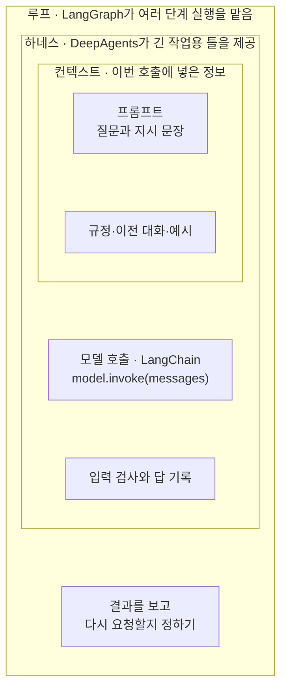
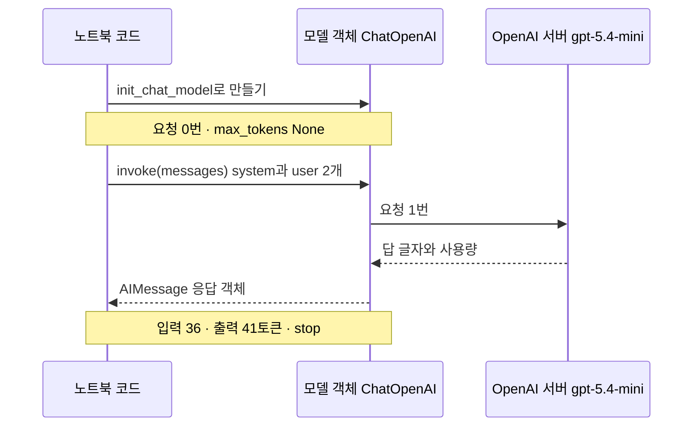
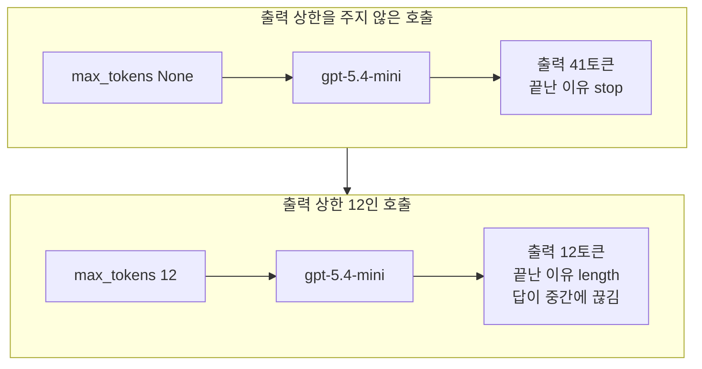
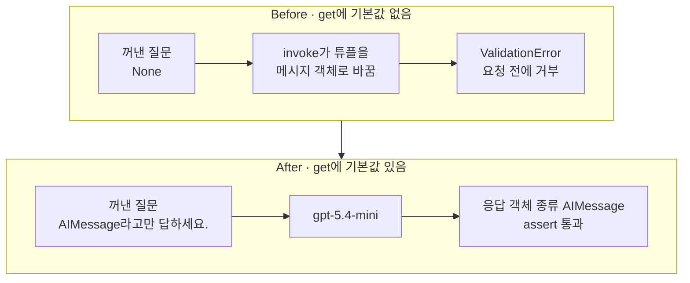

# 01-계층-지도와-첫-호출

## _src 본문 (HTML 원본)

```html
<!--meta: 강의 1h · 실습은 챕터 전체 10h 안에서 진행합니다. -->
<h2 id="b1"><span class="no">1</span>학습 목표</h2>
<div class="goal"><p>이 절을 마치면 다음을 할 수 있습니다.</p><ul><li>프롬프트·컨텍스트·하네스·루프가 무엇을 가리키는지 예를 들어 말할 수 있습니다.</li><li>LangChain, LangGraph, DeepAgents를 계층 지도의 알맞은 자리에 놓을 수 있습니다.</li><li>모델 객체를 만드는 줄과 요청을 보내는 줄을 나누고, 응답 객체에서 답·토큰 수·끝난 이유를 읽을 수 있습니다.</li></ul></div>
<h2 id="b2"><span class="no">2</span>이 내용을 배우는 이유</h2>
<p>모델을 부르는 예제를 찾아보면 여러 제품 이름이 함께 나옵니다. 그 이름을 모두 설치해야 첫 질문을 보낼 수 있는 것은 아닙니다. 이 절에서는 LangChain으로 모델 객체 하나를 만들고 질문을 보냅니다.</p>
<p>이름마다 맡는 자리를 먼저 나눠 두면, 문제가 생겼을 때 볼 곳도 나뉩니다. 질문을 잘못 적은 경우와 필요한 자료를 빠뜨린 경우는 고칠 곳이 다릅니다. 요청을 보내기도 전에 입력이 거부된 경우도 따로 봐야 합니다.</p>
<p><strong>이 절의 질문</strong> — LangChain의 공통 모델 인터페이스는 첫 호출의 어느 부분을 맡을까요?</p>
<h2 id="b3"><span class="no">3</span>앞에서 배운 내용</h2>
<p>Part 1에서는 인터넷 서비스의 모델을 한 번도 부르지 않았습니다. Ch 5의 모델은 모두 내 컴퓨터에서 실행했습니다. 이 절부터는 제공자의 서버에 있는 모델에 요청을 보냅니다.</p>
<table><thead><tr><th>앞 절</th><th>배운 것</th><th>이 절에서 이어지는 곳</th></tr></thead><tbody>
<tr><td>Ch 2 03절</td><td>튜플 풀어 담기, 딕셔너리 <code>get(키, 기본값)</code></td><td>메시지 튜플 목록, Before·After에서 질문 꺼내기</td></tr>
<tr><td>Ch 2 05절</td><td>오류 이름만 받는 <code>try/except 이름 as error</code></td><td>Before에서 <code>ValidationError</code> 받기</td></tr>
<tr><td>Ch 3 01·05절</td><td>무시 규칙의 <code>.env</code>, <code>git status --short --ignored</code>, 시크릿 폐기·교체</td><td><code>.env</code>의 <code>OPENAI_API_KEY</code></td></tr>
<tr><td>Ch 5 04절</td><td>역할 딕셔너리 메시지, 출력 몫 <code>max_new_tokens</code>, 끊긴 답 <code>새 조각 수: 8</code></td><td>메시지 튜플, 출력 상한 <code>max_tokens=12</code></td></tr>
<tr><td>Ch 5 06절</td><td>temperature는 뽑기를 켠 호출에서만 쓰임, 뽑기를 끈 설정 <code>do_sample=False</code></td><td>서비스 모델의 <code>temperature=0</code></td></tr>
<tr><td>Ch 5 07·08절</td><td>환각 판정 규칙과 그 한계, 필수 조건과 선택 기준</td><td>답 내용은 판정하지 않음, 고정한 모델 이름</td></tr>
</tbody></table>
<p>Ch 5 04절에서는 역할 딕셔너리 목록을 채팅 템플릿으로 합친 글까지 눈으로 봤습니다. 서비스 모델은 제공자 쪽에서 이 일을 하므로 합친 글이 보이지 않습니다. 이 절의 튜플 <code>("system", …)</code>은 그 딕셔너리와 같은 역할·내용 묶음입니다.</p>
<p>Ch 5 08절에서는 필수 조건(작업 종류·라이선스)으로 후보를 거르고, 미리 정한 선택 기준으로 모델을 골랐습니다. 이 절의 <code>openai:gpt-5.4-mini</code>는 교재가 Part 2부터 고정해 쓰는 모델입니다. 이 모델을 08절 절차로 다른 후보와 비교하지는 않았습니다. 코드가 후보 가운데 모델을 스스로 고르지도 않습니다.</p>
<p>실습 폴더 <code>labs/part2/ch06-langchain-start</code>에서 Ch 1 03절처럼 <code>uv sync --locked</code>를 실행하고 <code>.venv</code> 커널을 고릅니다. 모델을 부르려면 인터넷 연결과 프로젝트 폴더 <code>.env</code> 파일의 <code>OPENAI_API_KEY</code>가 필요합니다. 노트북은 앞 절 없이 새 커널에서 시작합니다.</p>
<h2 id="b4"><span class="no">4</span>핵심 개념</h2>
<h3>비유로 시작하기</h3>
<p>도서관 상담 창구를 떠올려 봅니다. 이용자가 노란 쪽지에 「책을 몇 권 빌릴 수 있나요?」라고 적어 냅니다. 상담원은 쪽지만 보지 않고, 대출 규정 서류철을 함께 펼쳐 봅니다.</p>
<p>쪽지와 서류철은 쟁반에 담겨 오고, 쟁반에는 도장과 상담 기록 공책도 있습니다. 쟁반은 둥근 회전 받침 위에 놓여, 답이 모자라면 한 바퀴 돌려 다시 앞으로 가져올 수 있습니다.</p>
{{img:01-5-상담-창구-회전-받침|나무 책상 위 둥근 나무 회전 받침에 네모난 나무 쟁반이 놓여 있고, 쟁반 왼쪽에는 흰 종이를 담아 펼친 서류철과 그 위에 반쯤 걸친 노란 쪽지가, 오른쪽에는 나무 도장과 파란 공책이 놓인 삽화|노란 쪽지는 서류철 위에, 서류철은 도장·공책과 함께 쟁반 안에, 쟁반은 둥근 회전 받침 위에 있습니다. 안에서 밖으로 갈수록 범위가 넓어집니다.}}
<p><strong>그림 읽기</strong> — 가장 작은 노란 쪽지가 펼친 서류철 위에 반쯤 걸쳐 있고, 서류철에는 흰 종이가 들어 있습니다. 서류철은 나무 도장, 파란 공책과 함께 네모난 쟁반 안에 있습니다. 쟁반은 그보다 큰 둥근 나무 회전 받침 위에 놓여 있습니다.</p>
<p>노란 쪽지가 프롬프트, 종이를 담은 서류철이 컨텍스트입니다. 도장과 공책까지 담은 쟁반이 하네스이고, 쟁반을 돌려 다시 앞으로 가져오는 받침이 루프입니다. 물건의 크기와 개수는 실제 값이 아닙니다. Ch 5에서는 쟁반의 칸이 토큰 자리였지만, 이 그림의 쟁반은 호출을 둘러싼 준비와 검사를 뜻합니다.</p>
<h3>네 범위: 프롬프트·컨텍스트·하네스·루프</h3>
<p>프롬프트(prompt)는 우리가 모델에게 직접 적은 질문과 지시입니다. 상담 쪽지에 적은 글과 같습니다. 노트북에서는 <code>두 문장 이내의 한국어로 답하세요.</code>와 user 질문이 프롬프트입니다.</p>
<p>컨텍스트(context)는 이번 호출에서 모델이 참고하도록 넣은 정보 전체입니다. 쪽지와 함께 펼친 규정 서류, 앞선 대화, 예시가 여기에 들어갑니다. 폴더에 규정 파일이 있다고 모델이 그 파일을 읽지는 않습니다. 코드가 내용을 메시지 목록에 넣어야 컨텍스트가 됩니다.</p>
<p>하네스(harness)는 모델 호출을 둘러싼 실행 틀입니다. 입력을 준비하고, 호출하고, 결과를 검사하고, 기록하는 코드가 여기에 속합니다. 창구의 쟁반·도장·공책과 같습니다. 이 절 After의 <code>assert</code> 줄도 결과를 검사하는 하네스의 작은 부분입니다.</p>
<p>루프(loop)는 결과를 보고 다음 단계를 정해 되풀이하는 흐름입니다. 답이 모자라면 자료를 더 넣어 다시 묻는 흐름이 예입니다. 이 절의 코드에는 루프가 없습니다. 모델을 네 번 불렀지만, 앞 답을 보고 다음 요청을 정하지는 않았기 때문입니다.</p>
{{mermaid:01-1-계층-지도|가장 바깥 루프 칸 안에 하네스 칸이, 그 안에 컨텍스트 칸이 있고, 컨텍스트 칸에는 초록 상자 프롬프트와 규정·이전 대화·예시, 하네스 칸에는 파란 상자 모델 호출과 회색 상자 입력 검사와 답 기록, 루프 칸 맨 아래에는 회색 상자 다시 요청할지 정하기가 있는 지도|프롬프트에서 루프까지 설명 범위를 넓힌 계층 지도입니다. 이 절이 실행한 곳은 파란 상자 모델 호출 하나입니다.}}
<p><strong>도식 읽기</strong> — 안쪽 칸에서 바깥 칸으로 읽습니다. 가장 안쪽 컨텍스트 칸의 초록 상자 두 개가 프롬프트와 그 밖에 넣은 정보입니다. 그 바깥 하네스 칸에 파란 상자 모델 호출과 회색 상자 입력 검사·답 기록이 있습니다.</p>
<p>가장 바깥 루프 칸의 맨 아래 회색 상자가 다시 요청할지 정하는 단계입니다. 칸 제목에는 그 범위를 맡는 제품 이름도 적었습니다. 칸의 포함 관계는 설명 범위의 넓이를 뜻하고, Python 객체가 안에 들어 있다는 뜻은 아닙니다.</p>
<h3>세 제품 이름을 지도에 놓기</h3>
<p>세 제품은 계층 지도의 서로 다른 칸을 맡습니다. 하나만 골라야 하는 관계가 아니고, 함께 쓸 수도 있습니다. 이 절에서 실행하는 제품은 LangChain 하나입니다.</p>
<table><thead><tr><th>이름</th><th>맡는 자리</th><th>이 교재에서 배우는 곳</th></tr></thead><tbody>
<tr><td>LangChain</td><td>여러 제공자의 모델과 메시지를 같은 방식으로 다루는 라이브러리. 지도의 모델 호출</td><td>Ch 6부터(이 절의 <code>init_chat_model</code>·<code>invoke</code>)</td></tr>
<tr><td>LangGraph</td><td>상태를 유지하며 여러 단계를 실행하는 틀. 지도의 루프</td><td>Ch 13 LangGraph 기초 — 흐름을 그래프로</td></tr>
<tr><td>DeepAgents</td><td>긴 작업에 필요한 기능을 갖춘 하네스</td><td>Ch 27 DeepAgents — Harness 계층</td></tr>
</tbody></table>
<p>Ch 13에서는 프로그램이 흐름을 정하는 그래프를 만듭니다. Ch 20에서는 모델이 도구를 고르는 흐름을 만듭니다. 두 흐름을 배우면 지도의 루프 칸에 서로 다른 표시로 적어 둡니다.</p>
<h3>이 절에서 쓰는 말</h3>
<table><thead><tr><th>용어</th><th>뜻</th><th>이 절에서 보이는 모습</th></tr></thead><tbody>
<tr><td>API(Application Programming Interface)</td><td>프로그램끼리 정해진 형식으로 요청과 응답을 주고받는 방식. 칸이 정해진 주문서 양식과 비슷함</td><td><code>model.invoke(messages)</code>가 보내는 요청</td></tr>
<tr><td>제공자(provider)</td><td>모델을 서버에서 운영하고 API를 여는 회사</td><td><code>openai:gpt-5.4-mini</code>의 콜론 앞 <code>openai</code></td></tr>
<tr><td>모델 객체</td><td>요청을 보낼 방법과 설정을 가진 Python 객체. 번호를 저장한 전화기와 비슷함</td><td><code>모델 객체 종류: ChatOpenAI</code></td></tr>
<tr><td>메시지와 역할(role)</td><td>누가 한 말인지 역할 이름을 붙인 글. system은 공통 지시, user는 이번 질문</td><td><code>system | 두 문장 이내의 한국어로 답하세요.</code></td></tr>
<tr><td>응답 객체</td><td>모델이 쓴 메시지를 담아 반환하는 객체. 답 글자, 사용량, 추가 정보를 함께 담음</td><td><code>응답 객체 종류: AIMessage</code></td></tr>
<tr><td>토큰 사용량</td><td>제공자의 토큰화기로 센 입력·출력 토큰 수. 속성 <code>usage_metadata</code></td><td><code>입력 토큰 수: 36</code>, <code>출력 토큰 수: 41</code></td></tr>
<tr><td>끝난 이유</td><td>답이 왜 멈췄는지 제공자가 알려 주는 값. 속성 <code>response_metadata</code>의 키 <code>finish_reason</code></td><td><code>끝난 이유: stop</code>, <code>끝난 이유: length</code></td></tr>
<tr><td>출력 상한</td><td>모델이 한 번에 쓸 답의 토큰 수 상한. 인자 <code>max_tokens</code>. Ch 5 04절 출력 몫(<code>max_new_tokens</code>)과 같은 뜻</td><td><code>출력 상한(max_tokens): 12</code></td></tr>
<tr><td>값 검사 오류</td><td>값의 모양이 정해진 모양과 다를 때 Pydantic 라이브러리가 내는 오류 <code>ValidationError</code>. 주소 칸이 빈 송장을 받지 않는 택배 접수대와 비슷함</td><td><code>2 validation errors for HumanMessage</code></td></tr>
</tbody></table>
<h3>준비하는 줄과 요청하는 줄</h3>
<p>함수 <code>init_chat_model()</code>은 모델 이름을 받아 모델 객체를 만듭니다. 전화기에 번호를 저장하는 일과 비슷해서, 저장만으로는 전화가 걸리지 않습니다. 노트북 2절에서 <code>모델 객체 종류: ChatOpenAI</code>를 확인할 때까지 요청은 0번입니다.</p>
<p>메서드 <code>invoke()</code>는 메시지 목록을 받아 요청을 보내고, 완성된 답을 응답 객체로 반환합니다. 대입문 <code>response = model.invoke(messages)</code>에서는 오른쪽 호출이 끝나야 왼쪽 이름에 응답 객체가 담깁니다. 이 셀을 다시 실행하면 요청과 사용량도 다시 생깁니다.</p>
<p>같은 모델 객체에 다른 메시지 목록을 넘기면 다른 질문을 보낼 수 있습니다. 앞 답을 다음 목록에 넣지 않으면 두 요청은 이어진 대화가 아닙니다.</p>
<h3>invoke 말고 다른 호출 방법</h3>
<p>모델 객체에는 메서드 <code>invoke()</code> 말고도 호출 메서드가 있습니다. 설치한 langchain-openai 1.6.0의 모델 객체에 아래 네 메서드가 있는 것을 확인했습니다. 이 절에서 실행한 것은 <code>invoke()</code>뿐입니다.</p>
<table><thead><tr><th>필요한 것</th><th>메서드</th><th>이 챕터에서</th></tr></thead><tbody>
<tr><td>완성된 답 하나</td><td><code>invoke()</code></td><td>01절에서 실행</td></tr>
<tr><td>도착하는 대로 받는 답의 일부</td><td><code>stream()</code></td><td>04절에서 실행</td></tr>
<tr><td>서로 관계없는 여러 입력의 답</td><td><code>batch()</code></td><td>실행하지 않음</td></tr>
<tr><td>답을 기다리는 동안 다른 비동기 작업</td><td><code>ainvoke()</code></td><td>실행하지 않음(Ch 2 12절 <code>await</code> 모양)</td></tr>
</tbody></table>
<p>메서드를 고르는 기준은 어느 것이 더 고급인지가 아닙니다. 완성된 답 하나, 도착하는 대로의 답, 서로 독립된 입력 목록 가운데 무엇이 필요한지로 고릅니다.</p>
<h2 id="b5"><span class="no">5</span>실행 예제</h2>
<p>노트북은 모델 객체를 만들고, 요청 없이 객체 종류를 확인합니다. 그다음 메시지 목록을 보내 응답 객체에서 답, 토큰 사용량, 끝난 이유를 읽습니다. 값 바꿔 보기는 질문 하나와 출력 상한 하나를 차례로 바꿉니다.</p>
<p>실제 OpenAI 모델을 temperature 0으로 부릅니다. 이 페이지의 출력은 2026-09-16에 실행한 결과이고, 모델 호출은 Before·After까지 모두 4번입니다. 예상 비용은 0.01달러 미만이고, 답 문장은 실행마다 달라질 수 있습니다.</p>
{{notebook:01-계층-지도와-첫-호출|example}}
<p class="look"><b>확인할 점</b> — 4절의 <code>응답 객체 종류: AIMessage</code> 줄과 <code>답:</code> 줄을 구분합니다. 앞 줄은 Python이 확인한 객체 종류이고, 뒤 줄은 모델이 쓴 글입니다. 7절에서는 <code>끝난 이유: length</code>를 확인합니다.</p>
<h3>첫 호출에서 오간 것</h3>
{{mermaid:01-2-첫-호출-순서|노트북 코드, 모델 객체 ChatOpenAI, OpenAI 서버 gpt-5.4-mini 세 세로줄 사이에서, init_chat_model 뒤 요청 0번 메모, invoke 뒤 모델 객체가 서버로 요청 1번을 보내고 답 글자와 사용량을 받아 AIMessage를 넘긴 뒤 입력 36, 출력 41토큰, stop 메모가 붙은 순서도|모델 객체를 만들 때는 요청이 없고, invoke 한 줄에서 요청 1번이 나갑니다. 응답 객체에는 입력 36, 출력 41토큰과 끝난 이유 stop이 담겼습니다.}}
<p><strong>도식 읽기</strong> — 세로줄은 왼쪽부터 노트북 코드, 모델 객체, OpenAI 서버입니다. 위에서 아래로 시간 순서이고, 실선은 요청, 점선은 응답입니다. 첫 노란 메모는 모델 객체를 만든 직후라 요청 0번, 출력 상한 <code>None</code>입니다.</p>
<p>메서드 <code>invoke()</code>를 부르면 모델 객체가 서버로 요청 1번을 보냅니다. 서버가 답 글자와 사용량을 보내면, 모델 객체가 <code>AIMessage</code> 응답 객체로 넘깁니다. 둘째 노란 메모는 응답을 받은 뒤 5절에서 읽은 값입니다.</p>
<p>입력 36토큰, 출력 41토큰은 제공자의 토큰화기로 센 값입니다. Ch 5 01절에서 본 것처럼 토큰화기마다 수가 달라, Qwen 조각 수와 나란히 비교하지 않습니다.</p>
<h3>출력 상한을 줄이면</h3>
<p>출력 상한(<code>max_tokens</code>)은 Ch 5 04절의 출력 몫(<code>max_new_tokens</code>)과 같은 뜻의 값이고, 모자라면 오류 없이 답이 끊깁니다. 이 교재는 Ch 6부터 서비스 모델의 이 값을 출력 상한이라고 부릅니다. 노트북 7절은 첫 호출과 같은 메시지를 출력 상한 12로 보냈습니다.</p>
{{mermaid:01-3-출력-상한-비교|위 칸은 초록 상자 max_tokens None에서 보라 상자 gpt-5.4-mini를 거쳐 노란 상자 출력 41토큰 끝난 이유 stop으로, 아래 칸은 초록 상자 max_tokens 12에서 보라 상자를 거쳐 노란 상자 출력 12토큰 끝난 이유 length 답이 중간에 끊김으로 이어지는 비교 그림|같은 메시지에서 출력 상한만 12로 줄이자, 답이 12토큰에서 끊기고 끝난 이유가 stop에서 length로 바뀌었습니다.}}
<p><strong>도식 읽기</strong> — 위 칸은 출력 상한을 주지 않은 5절 호출, 아래 칸은 출력 상한 12인 7절 호출입니다. 칸마다 왼쪽에서 오른쪽으로 읽습니다. 초록 상자는 우리가 준 설정, 보라 상자는 실행한 모델, 노란 상자는 출력으로 확인한 값입니다.</p>
<p>위 칸은 41토큰을 쓰고 <code>stop</code>으로 멈췄습니다. 아래 칸은 12토큰에서 <code>length</code>로 멈췄고, 답은 <code>LangChain 모델 인터페이스의 장점</code>에서 끊겼습니다. 오류는 나지 않았으므로 답 글자와 함께 끝난 이유를 확인합니다.</p>
<h2 id="b6"><span class="no">6</span>일부러 실패해 보기</h2>
<p>Before에서는 질문을 딕셔너리에서 이름으로 꺼냅니다. 없는 이름을 넣은 메서드 <code>get()</code>이 <code>None</code>을 반환하고, 그 값이 user 메시지의 내용 자리에 들어갑니다. 이 목록으로 <code>invoke()</code>를 부르면 실제 라이브러리 오류가 납니다.</p>
<p>LangChain 라이브러리는 튜플을 메시지 객체로 바꿀 때, 값의 모양을 Pydantic 라이브러리로 검사합니다. 택배 접수대가 주소 칸이 빈 송장을 받지 않는 것과 비슷합니다. 검사를 통과하지 못하면 오류 <code>ValidationError</code>가 납니다.</p>
<p>라이브러리 Pydantic과 이 오류 이름은 <a href="../../part1/ch02-python/10-Pydantic.html">Ch 2 10절 Pydantic</a>에서 자세히 다룹니다. 기본 경로(A 트랙)에서 그 절을 건너뛰었다면, 값의 모양이 틀렸다는 오류로만 알아 두면 됩니다. After에서는 <code>get()</code>에 기본값을 주어 질문이 비지 않게 고칩니다.</p>
{{notebook:01-계층-지도와-첫-호출|failure}}
<p>Before 출력의 첫 줄은 <code>오류 종류: ValidationError</code>, 오류 메시지 첫 줄은 <code>2 validation errors for HumanMessage</code>였습니다. 그 아래 <code>Input should be a valid string</code> 줄은 내용이 글자여야 한다는 뜻입니다. 설치한 langchain-core 1.6.2 소스에서, 이 검사가 요청을 보내기 전 단계라는 것을 확인했습니다.</p>
<p>After에서는 <code>꺼낸 질문: AIMessage라고만 답하세요.</code>가 나왔고, 같은 <code>invoke()</code>로 <code>응답 객체 종류: AIMessage</code>를 받았습니다. 답 줄도 <code>답: AIMessage</code>였습니다. 하지만 이 글은 모델이 쓴 것이라 객체 종류를 확인한 결과가 아닙니다.</p>
{{mermaid:01-4-Before-After|위 칸 Before는 초록 상자 꺼낸 질문 None이 파란 상자 invoke가 튜플을 메시지 객체로 바꿈을 거쳐 빨간 상자 ValidationError 요청 전에 거부로 이어지고, 아래 칸 After는 초록 상자 꺼낸 질문 AIMessage라고만 답하세요가 보라 상자 gpt-5.4-mini를 거쳐 노란 상자 응답 객체 종류 AIMessage assert 통과로 이어지는 비교 그림|get에 기본값이 없던 Before는 요청 전에 ValidationError로 거부되고, 기본값을 준 After는 AIMessage를 받았습니다.}}
<p><strong>도식 읽기</strong> — 위 칸이 Before, 아래 칸이 After이고, 칸마다 왼쪽에서 오른쪽으로 읽습니다. 초록 상자는 꺼낸 질문, 파란 상자는 튜플을 메시지 객체로 바꾸는 단계, 보라 상자는 실행한 모델입니다.</p>
<p>위 칸 끝의 빨간 상자는 요청을 보내기 전에 거부된 결과입니다. 노트북은 <code>try/except</code>로 받아 출력했지만, 받지 않으면 프로그램이 멈추므로 Before의 결함 결과로 칠했습니다. 아래 칸 끝의 노란 상자는 출력으로 확인한 응답 객체 종류와 <code>assert</code> 통과입니다.</p>
<h2 id="b7"><span class="no">7</span>주의할 점과 실무 메모</h2>
<ul><li>키 값, 인증 헤더, 환경 변수 전체를 출력해 문제를 찾지 않습니다. 노트북의 키 확인 셀은 <code>True</code> 또는 <code>False</code>만 출력합니다.</li>
<li>키를 적은 <code>.env</code> 파일은 저장소에 올리지 않습니다. Ch 3 01절처럼 <code>git status --short --ignored</code>로 이 파일이 무시 규칙에 걸리는지 확인합니다. 이미 커밋했다면 Ch 3 05절 순서대로 그 키부터 폐기·교체합니다.</li>
<li>서비스 모델의 temperature 0은 Ch 5 06절의 뽑기를 끈 설정(<code>do_sample=False</code>)과 같은 것이 아닙니다. 매번 비슷한 답을 고르지만 똑같은 답을 보장하지는 않습니다. 이 절에서 같은 셀을 두 번 실행해 비교하지는 않았습니다.</li>
<li>출력 상한 12는 끊기는 모습을 보려고 정한 예입니다. 교재를 만들 때 탐색 실행으로 끊기는 것을 먼저 확인한 뒤 정했습니다. 실제 서비스에서는 답 길이에 맞춰 정하고, 끝난 이유를 함께 확인합니다.</li>
<li>temperature, 출력 상한, 시간 제한 같은 인자의 이름과 범위는 제공자와 모델마다 다를 수 있습니다. 함수 <code>init_chat_model()</code>은 받은 인자를 고른 제공자의 모델 객체에 넘깁니다. 이 절은 OpenAI 모델 하나만 실행했습니다.</li>
<li>답 내용이 맞는지는 판정하지 않았습니다. Ch 5 07절의 판정 규칙은 숫자가 없는 주장을 놓치므로, 이 절의 설명 답에는 쓰지 못합니다. 이 절의 결론은 질문 세 개, 모델 하나, 한 번 실행한 범위입니다.</li>
<li>교재 출력은 Linux의 Python 3.12.13으로 만들었습니다. 패키지는 langchain 1.4.0, langchain-core 1.6.2, langchain-openai 1.6.0입니다. 다른 버전과 Windows·macOS에서는 실행하지 않았습니다.</li></ul>
<h2 id="b8"><span class="no">8</span>정리와 다음 절</h2>
<ul><li>프롬프트·컨텍스트·하네스·루프는 적은 질문에서 반복 흐름까지 범위를 넓혀 읽는 지도입니다. 이 절이 실행한 곳은 LangChain의 모델 호출 칸입니다.</li><li>함수 <code>init_chat_model()</code>은 모델 객체만 만들고, 메서드 <code>invoke()</code>가 요청을 보냅니다. 응답 객체 <code>AIMessage</code>에서 답·토큰 수·끝난 이유를 읽습니다.</li><li>출력 상한 12에서는 답이 오류 없이 끊기고 끝난 이유가 <code>length</code>였습니다. 질문이 <code>None</code>이면 요청 전에 <code>ValidationError</code>가 났습니다.</li></ul>
<p><strong>다음 학습과 이어지는 지점</strong> — 02절에서는 같은 역할과 내용을 메시지 객체 <code>SystemMessage</code>·<code>HumanMessage</code>로도 만들어 봅니다. 그리고 모델 이름과 제공자 이름을 하나씩 바꿔, 그대로 되는 것과 다시 확인할 것을 나눕니다.</p>
<h2 id="b9"><span class="no">9</span>복습 문제</h2>
<details class="quiz"><summary>문제 1 · 입력 자료의 범위</summary><p class="quiz-q">질문은 그대로 두고 대출 규정 본문을 메시지 목록에 함께 넣었습니다. 지도에서 어느 범위를 바꾼 것인가요?</p><p class="quiz-a"><b>해설</b> — 컨텍스트에 정보를 더한 것입니다. 질문 말고 모델이 참고할 자료가 늘었습니다. 규정 파일을 폴더에 저장만 하고 목록에 넣지 않았다면 컨텍스트는 그대로입니다.</p></details>
<details class="quiz"><summary>문제 2 · 실제 요청이 나가는 줄</summary><p class="quiz-q">모델 객체를 만드는 셀과 <code>invoke()</code> 셀 가운데, 어느 셀을 다시 실행하면 새 요청이 나가나요?</p><p class="quiz-a"><b>해설</b> — <code>invoke()</code> 셀입니다. 다시 실행할 때마다 요청과 사용량이 생깁니다. 노트북 2절에서 모델 객체를 확인할 때까지 요청은 0번이었습니다.</p></details>
<details class="quiz"><summary>문제 3 · 응답 객체의 종류</summary><p class="quiz-q">After에서 모델이 <code>AIMessage</code>라고 답했습니다. 응답 객체의 실제 종류는 무엇으로 확인해야 하나요?</p><p class="quiz-a"><b>해설</b> — Python의 <code>type(fixed).__name__</code>으로 확인합니다. 모델이 쓴 답 글은 종류를 검사한 결과가 아닙니다. 노트북은 이 값을 <code>assert</code>로 확인했습니다.</p></details>
<details class="quiz"><summary>문제 4 · 오류가 난 자리</summary><p class="quiz-q"><code>None</code> 질문이 <code>ValidationError</code>로 거부된 것을 모델의 환각 사례로 기록해도 되나요?</p><p class="quiz-a"><b>해설</b> — 안 됩니다. 이 오류는 튜플을 메시지 객체로 바꾸는 단계, 곧 요청을 보내기 전에 났습니다. 모델이 근거 없는 답을 쓴 상황과 나눠야 고칠 코드를 찾을 수 있습니다.</p></details>
<details class="quiz"><summary>문제 5 · 오류 없이 끊긴 답</summary><p class="quiz-q">출력 상한 12인 호출은 오류 없이 끝났습니다. 답이 끊긴 것은 출력의 어느 값으로 알 수 있나요?</p><p class="quiz-a"><b>해설</b> — 끝난 이유 <code>length</code>와 출력 토큰 수 <code>12</code>로 압니다. 출력 토큰 수가 상한과 같고, 모델이 스스로 멈춘 <code>stop</code>이 아닙니다. Ch 5 04절 출력 몫 8에서 끝 표시 없이 끊긴 답과 같은 모습입니다.</p></details>
<h2 id="b10"><span class="no">10</span>참고 자료</h2>
<p>문서는 2026-09-16에 다시 열어 확인했습니다. 메서드 이름과 기본 동작은 실습 가상환경에 설치한 패키지에서도 확인했습니다. 확인한 판은 <code>langchain 1.4.0</code>, <code>langchain-core 1.6.2</code>, <code>langchain-openai 1.6.0</code>입니다.</p>
<ul><li><div><a href="https://docs.langchain.com/oss/python/langchain/models">LangChain Models</a></div>모델 초기화와 invoke·stream·batch · 확인 2026-09-16</li><li><div><a href="https://docs.langchain.com/oss/python/langchain/messages">LangChain Messages</a></div>메시지와 응답 객체 · 확인 2026-09-16</li><li><div><a href="https://reference.langchain.com/python/langchain-core/language_models/chat_models">LangChain ChatModel API reference</a></div>모델 객체 메서드 설명 · 확인 2026-09-16</li><li><div><a href="https://docs.langchain.com/oss/python/concepts/context">LangChain Context</a></div>컨텍스트 개념 · 확인 2026-09-16</li><li><div><a href="https://github.com/langchain-ai/langchain/blob/master/LICENSE">LangChain MIT License</a></div>예제의 질문과 설명은 이 교재에 맞게 새로 썼습니다</li></ul>
```

## 노트북 셀 (순서대로)

### [0] markdown {'html': 'skip'}

# 계층 지도와 첫 호출

**이 노트북에서 할 일**

1. 모델 객체를 만드는 줄과 실제 요청을 보내는 줄을 나눠 실행합니다.
2. 역할과 내용을 묶은 메시지 목록을 보내고, 응답 객체에서 답과 사용량을 읽습니다.
3. 질문 하나, 출력 상한 하나를 바꿔 보고, 질문이 비어 있을 때 나는 오류를 고칩니다.

**준비물** — 프로젝트 폴더 `.env` 파일의 `OPENAI_API_KEY`가 필요합니다. 데이터 파일은 없습니다.
인터넷 서비스의 모델 `gpt-5.4-mini`를 모두 4번 부릅니다. 실행 시간은 1분 안팎입니다.
예상 비용은 0.01달러 미만입니다(06절에 적은 2026-09-09 공식 요금 기준).

**기준 버전** — 실습 폴더에 고정한 패키지 판을 씁니다. langchain 1.4.0, langchain-core 1.6.2, langchain-openai 1.6.0입니다.
pydantic 2.13.5, python-dotenv 1.2.3도 함께 씁니다. 교재 출력은 Linux의 Python 3.12.13으로 만들었습니다.
다른 버전과 Windows·macOS에서는 이번에 실행하지 않았습니다.

실습 폴더 `labs/part2/ch06-langchain-start`에서 `uv sync --locked`를 실행합니다.
그다음 이 폴더의 `.venv` 커널을 고르고 첫 셀부터 순서대로 실행합니다.

### [1] markdown {'html': 'skip'}

## 오늘 볼 그림


안쪽에서 바깥쪽으로 읽습니다. 가장 안쪽 초록 상자가 우리가 적은 프롬프트입니다.
바깥 칸으로 갈수록 이번 호출에 넣은 정보, 호출을 둘러싼 준비와 검사, 반복 흐름으로 범위가 넓어집니다.
이 노트북은 파란 상자 하나, 곧 LangChain으로 모델을 한 번 부르는 자리를 실행합니다.

### [2] markdown {}

## 1. 준비

첫 셀은 패키지를 설치하고 설치된 버전을 출력합니다. 설치에는 몇십 초가 걸릴 수 있습니다.
함수 `version()`은 패키지 이름을 받아 설치된 버전 글자를 반환합니다.

### [3] code {'execution': {'iopub.execute_input': '2026-09-16T23:36:18.579110Z', 'iopub.status.busy': '2026-09-16T23:36:18.578995Z', 'iopub.status.idle': '2026-09-16T23:36:19.874843Z', 'shell.execute_reply': '2026-09-16T23:36:19.874251Z'}, 'lesson_role': 'setup'}

```python
# 이 절에서 쓰는 패키지를 설치하고 버전을 확인합니다
%pip install -q "langchain==1.4.0" "langchain-openai==1.6.0" "pydantic==2.13.5" "python-dotenv==1.2.3"
from importlib.metadata import version

print("langchain:", version("langchain"))
print("langchain-core:", version("langchain-core"))
print("langchain-openai:", version("langchain-openai"))
print("pydantic:", version("pydantic"))
```

출력:
```
Note: you may need to restart the kernel to use updated packages.
langchain: 1.4.0
langchain-core: 1.6.2
langchain-openai: 1.6.0
pydantic: 2.13.5

```

### [4] markdown {}

**결과 읽기** — 출력 줄은 `langchain: 1.4.0`, `langchain-core: 1.6.2`, `langchain-openai: 1.6.0`, `pydantic: 2.13.5`입니다.
준비물에 적은 기준 버전과 같습니다. 패키지 langchain-core는 langchain을 설치할 때 함께 설치되는 기본 패키지입니다.

모델 객체를 만드는 함수를 불러옵니다. `from … import …` 모양은 Ch 2 07절에서 배웠습니다.

### [5] code {'execution': {'iopub.execute_input': '2026-09-16T23:36:19.876057Z', 'iopub.status.busy': '2026-09-16T23:36:19.875960Z', 'iopub.status.idle': '2026-09-16T23:36:20.295586Z', 'shell.execute_reply': '2026-09-16T23:36:20.295119Z'}, 'lesson_role': 'setup'}

```python
# 모델 객체를 만드는 함수를 불러옵니다
from langchain.chat_models import init_chat_model
```

출력:
```

```

### [6] markdown {}

API 키가 있는지 확인합니다. API 키는 서비스가 요청한 사람을 알아보는 비밀 글자입니다.
함수 `load_dotenv()`는 `.env` 파일의 줄을 환경 변수로 읽어 들입니다. 함수 `os.getenv()`는 그 이름의 값을 꺼내고, 없으면 `None`을 줍니다.

키 값은 출력하지 않고, 있는지만 봅니다. `True` 값이 나오면 다음으로 넘어갑니다.
Ch 3 01절처럼 `git status --short --ignored`로 `.env` 파일이 무시 규칙에 걸리는지도 확인합니다.

### [7] code {'execution': {'iopub.execute_input': '2026-09-16T23:36:20.296407Z', 'iopub.status.busy': '2026-09-16T23:36:20.296349Z', 'iopub.status.idle': '2026-09-16T23:36:20.302210Z', 'shell.execute_reply': '2026-09-16T23:36:20.301800Z'}, 'lesson_role': 'setup'}

```python
# .env 파일에서 OpenAI API 키를 읽습니다(키 값은 출력하지 않습니다)
import os
from dotenv import find_dotenv, load_dotenv

env_path = find_dotenv(usecwd=True)
load_dotenv(env_path)
has_key = os.getenv("OPENAI_API_KEY") is not None
print("OPENAI_API_KEY 설정 여부:", has_key)
assert has_key, "프로젝트 폴더의 .env 파일에 OPENAI_API_KEY를 적어 주세요."
```

출력:
```
OPENAI_API_KEY 설정 여부: True

```

### [8] markdown {}

실습에 쓸 모델을 준비합니다.
함수 `init_chat_model()`은 모델 이름을 받아, 그 모델에 요청을 보낼 수 있는 모델 객체를 만듭니다.
전화기에 번호를 저장해 두는 일과 비슷합니다. 저장만 해서는 아직 전화가 걸리지 않습니다.
이름 `openai:gpt-5.4-mini`에서 콜론 앞은 모델을 제공하는 회사(제공자), 뒤는 모델 이름입니다.

temperature 값은 답을 고를 때의 무작위 정도이고, 0으로 두면 매번 비슷한 답을 고릅니다.
추론 설정 `reasoning_effort="none"`은 모델이 긴 추론 없이 바로 답하게 합니다.

### [9] code {'execution': {'iopub.execute_input': '2026-09-16T23:36:20.302863Z', 'iopub.status.busy': '2026-09-16T23:36:20.302796Z', 'iopub.status.idle': '2026-09-16T23:36:21.327295Z', 'shell.execute_reply': '2026-09-16T23:36:21.326794Z'}}

```python
# 실습에 쓸 모델을 준비합니다
model = init_chat_model(
    "openai:gpt-5.4-mini",
    temperature=0,
    reasoning_effort="none",
)
print("모델 이름:", model.model_name)
print("temperature:", model.temperature)
```

출력:
```
모델 이름: gpt-5.4-mini
temperature: 0.0

```

### [10] markdown {}

**결과 읽기** — 출력 줄은 `모델 이름: gpt-5.4-mini`와 `temperature: 0.0`입니다. 이것으로 준비가 끝났습니다.
이 노트북의 출력은 2026-09-16에 이 모델로 실행한 결과입니다. 실행마다 답 문장이 달라질 수 있습니다.

Ch 5 06절의 로컬 모델은 뽑기를 끈 설정(`do_sample=False`)으로 같은 컴퓨터에서 다시 실행하면 글자까지 같은 답을 냈습니다.
서비스 모델의 temperature 0은 그 설정과 같은 것이 아닙니다. 매번 비슷한 답을 고르지만, 똑같은 답을 보장하지는 않습니다.

### [11] markdown {}

## 2. 모델 객체는 아직 요청을 보내지 않았습니다

앞 셀은 모델 객체를 만들기만 했습니다. 이 셀에서 객체의 종류와 출력 상한을 확인합니다.
함수 `type()`은 값의 자료형을 알려 주고(Ch 2 01절), 뒤에 붙인 `__name__`은 자료형의 이름 글자만 꺼냅니다.
출력 상한은 모델이 한 번에 쓸 답의 토큰 수 상한입니다. 7절에서 이 값을 바꿔 봅니다.

실행 전에 예상합니다. 출력 상한은 따로 주지 않았으니 비어 있을 것입니다.

### [12] code {'execution': {'iopub.execute_input': '2026-09-16T23:36:21.328268Z', 'iopub.status.busy': '2026-09-16T23:36:21.328187Z', 'iopub.status.idle': '2026-09-16T23:36:21.330212Z', 'shell.execute_reply': '2026-09-16T23:36:21.329889Z'}}

```python
# 모델 객체의 종류와 출력 상한을 확인합니다(이 셀은 요청을 보내지 않습니다)
model_type = type(model).__name__
print("모델 객체 종류:", model_type)
print("출력 상한(max_tokens):", model.max_tokens)
```

출력:
```
모델 객체 종류: ChatOpenAI
출력 상한(max_tokens): None

```

### [13] markdown {}

**결과 읽기** — 출력 줄은 `모델 객체 종류: ChatOpenAI`와 `출력 상한(max_tokens): None`입니다.
제공자 이름 openai에 맞춰 OpenAI용 모델 객체가 만들어졌습니다. 예상대로 출력 상한은 `None`이라 따로 정하지 않았습니다.

## 3. 메시지 목록 만들기

메시지는 누가 한 말인지 역할 이름을 붙인 글 하나입니다. 여기서는 `(역할, 내용)` 튜플로 적습니다.
역할 system은 모든 질문에 공통으로 적용할 지시이고, 역할 user는 이번 질문입니다.
Ch 5 04절의 역할 딕셔너리 `{"role": "system", "content": …}`와 같은 역할·내용 묶음입니다.

튜플을 목록에 담은 순서가 모델에 전달되는 순서입니다. 반복문의 `for role, content in messages:`는 튜플을 두 이름에 풀어 담습니다(Ch 2 03절).

### [14] code {'execution': {'iopub.execute_input': '2026-09-16T23:36:21.330909Z', 'iopub.status.busy': '2026-09-16T23:36:21.330857Z', 'iopub.status.idle': '2026-09-16T23:36:21.332954Z', 'shell.execute_reply': '2026-09-16T23:36:21.332619Z'}}

```python
# 공통 지시(system)와 이번 질문(user)을 튜플로 묶어 목록에 담습니다
messages = [
    ("system", "두 문장 이내의 한국어로 답하세요."),
    ("user", "LangChain 모델 인터페이스의 장점을 한 가지 설명하세요."),
]
# 튜플을 역할과 내용으로 풀어 담아 한 줄에 하나씩 출력합니다
print("메시지 목록:")
for role, content in messages:
    print(role, "|", content)
```

출력:
```
메시지 목록:
system | 두 문장 이내의 한국어로 답하세요.
user | LangChain 모델 인터페이스의 장점을 한 가지 설명하세요.

```

### [15] markdown {}

**결과 읽기** — 라벨 줄 아래 첫 줄은 `system | 두 문장 이내의 한국어로 답하세요.`, 둘째 줄은 user 질문입니다.
아직 목록만 만들었고 요청은 보내지 않았습니다.

## 4. 첫 호출: invoke

메서드 `invoke()`는 메시지 목록을 받아 모델에 요청을 보내고, 완성된 답을 응답 객체로 반환합니다.
이 줄을 실행하는 순간 인터넷으로 요청이 한 번 나가고, 답이 올 때까지 셀이 실행 중으로 표시됩니다.
이 셀을 다시 실행하면 요청이 다시 나가고 사용량도 다시 생깁니다.

실행 전에 예상합니다. 응답 객체의 종류는 문자열이 아니라 LangChain의 메시지 객체일 것입니다.

### [16] code {'execution': {'iopub.execute_input': '2026-09-16T23:36:21.333605Z', 'iopub.status.busy': '2026-09-16T23:36:21.333554Z', 'iopub.status.idle': '2026-09-16T23:36:23.085745Z', 'shell.execute_reply': '2026-09-16T23:36:23.084945Z'}}

```python
# 메시지 목록을 모델에 보내고, 완성된 답을 응답 객체로 받습니다(요청 1번)
response = model.invoke(messages)
response_type = type(response).__name__
print("응답 객체 종류:", response_type)
# 속성 text는 응답 객체에서 답 글자만 꺼냅니다(뒤에 괄호를 붙이지 않습니다)
print("답:", response.text)
```

출력:
```
응답 객체 종류: AIMessage
답: LangChain 모델 인터페이스의 장점은 다양한 LLM을 같은 방식으로 다룰 수 있어, 모델을 바꿔도 코드 수정이 적다는 점입니다.

```

### [17] markdown {}

**결과 읽기** — 첫 줄은 `응답 객체 종류: AIMessage`입니다. 모델이 쓴 메시지를 담는 객체라는 뜻입니다.
둘째 줄은 `답: LangChain 모델 인터페이스의 장점은`으로 시작합니다. 답 문장은 실행마다 달라질 수 있습니다.

첫 줄은 Python이 확인한 객체 종류이고, 둘째 줄은 모델이 쓴 글입니다. 답 내용이 맞는지는 이번에 판정하지 않았습니다.
Ch 5 07절의 판정 규칙(새 숫자·보류 문장)은 숫자가 없는 주장을 놓치므로, 이런 설명 문장을 판정하지 못합니다.

## 5. 응답 객체 안의 사용량과 끝난 이유

응답 객체에는 답 글자 말고도 정보가 들어 있습니다. 속성 `usage_metadata`는 토큰 사용량을 담은 딕셔너리입니다.
속성 `response_metadata`는 제공자가 보낸 추가 정보 딕셔너리이고, 키 `"finish_reason"`에 답이 끝난 이유가 있습니다.
딕셔너리에서 키로 값을 꺼내는 모양은 Ch 2 03절에서 배웠습니다.

### [18] code {'execution': {'iopub.execute_input': '2026-09-16T23:36:23.087292Z', 'iopub.status.busy': '2026-09-16T23:36:23.087165Z', 'iopub.status.idle': '2026-09-16T23:36:23.090207Z', 'shell.execute_reply': '2026-09-16T23:36:23.089532Z'}}

```python
# 응답 객체에서 토큰 사용량과 답이 끝난 이유를 꺼냅니다
usage = response.usage_metadata
print("입력 토큰 수:", usage["input_tokens"])
print("출력 토큰 수:", usage["output_tokens"])
print("합계 토큰 수:", usage["total_tokens"])
print("끝난 이유:", response.response_metadata["finish_reason"])
```

출력:
```
입력 토큰 수: 36
출력 토큰 수: 41
합계 토큰 수: 77
끝난 이유: stop

```

### [19] markdown {}

**결과 읽기** — 출력 줄은 `입력 토큰 수: 36`, `출력 토큰 수: 41`, `합계 토큰 수: 77`입니다.
끝난 이유는 `stop`으로, 모델이 답을 다 쓰고 스스로 멈췄다는 뜻입니다.

토큰 수는 제공자의 토큰화기로 센 값입니다. Ch 5 01절에서 본 것처럼 토큰화기마다 수가 다르므로, Qwen 조각 수와 비교하지 않습니다.
입력 토큰 수에는 우리가 적은 두 메시지 말고도 제공자 쪽에서 붙인 표시가 들어갈 수 있습니다. 그 글은 서비스 모델에서는 보이지 않습니다.

## 6. 값 바꿔 보기 1 — 질문만 바꾸기

바꾸는 값은 user 질문 하나입니다. 모델 객체와 system 메시지 `messages[0]`은 그대로 씁니다.
새 목록에는 앞 답을 넣지 않았습니다. 그래서 이 호출은 앞 호출과 이어진 대화가 아니라 따로 보낸 요청입니다.

실행 전에 예상합니다. 답 문장은 달라지지만, 응답 객체 종류는 똑같이 AIMessage일 것입니다.

### [20] code {'execution': {'iopub.execute_input': '2026-09-16T23:36:23.091535Z', 'iopub.status.busy': '2026-09-16T23:36:23.091408Z', 'iopub.status.idle': '2026-09-16T23:36:24.521461Z', 'shell.execute_reply': '2026-09-16T23:36:24.519303Z'}}

```python
# system 메시지는 그대로 두고 user 질문만 바꿔 다시 보냅니다(요청 1번)
changed_messages = [
    messages[0],
    ("user", "LangChain 모델 인터페이스를 한 문장으로 설명하세요."),
]
changed = model.invoke(changed_messages)
changed_type = type(changed).__name__
print("응답 객체 종류:", changed_type)
print("답:", changed.text)
```

출력:
```
응답 객체 종류: AIMessage
답: LangChain 모델 인터페이스는 다양한 LLM과 채팅 모델을 일관된 방식으로 호출하고, 입력·출력·스트리밍을 표준화해 애플리케이션에 쉽게 연결할 수 있게 해주는 추상화 계층입니다.

```

### [21] markdown {}

**결과 읽기** — 첫 줄은 예상대로 `응답 객체 종류: AIMessage`입니다. 답 줄은 한 문장으로 바뀌었습니다.
질문을 바꿔도 `invoke()`로 보내고 `text`로 읽는 순서는 같았습니다.

## 7. 값 바꿔 보기 2 — 출력 상한을 12로 줄이기

바꾸는 값은 출력 상한 하나입니다. 인자 `max_tokens=12`를 준 모델 객체를 새로 만들고, 첫 호출과 같은 목록을 보냅니다.

출력 상한은 Ch 5 04절의 출력 몫(`max_new_tokens`)과 같은 뜻의 값입니다. Ch 5에서는 출력 몫 8에서 답이 오류 없이 끊겼습니다.
12는 끊기는 모습을 보려고 정한 값입니다. 교재를 만들 때 탐색 실행으로 끊기는 것을 먼저 확인한 뒤 정했습니다.

실행 전에 예상합니다. 첫 호출의 답은 12토큰보다 길었으니, 이번에는 답이 중간에 끊길 것입니다.

### [22] code {'execution': {'iopub.execute_input': '2026-09-16T23:36:24.523673Z', 'iopub.status.busy': '2026-09-16T23:36:24.523444Z', 'iopub.status.idle': '2026-09-16T23:36:24.527680Z', 'shell.execute_reply': '2026-09-16T23:36:24.526920Z'}}

```python
# 출력 상한만 12토큰으로 준 모델 객체를 새로 만듭니다(이 셀은 요청을 보내지 않습니다)
short_model = init_chat_model(
    "openai:gpt-5.4-mini",
    temperature=0,
    reasoning_effort="none",
    max_tokens=12,
)
print("출력 상한(max_tokens):", short_model.max_tokens)
```

출력:
```
출력 상한(max_tokens): 12

```

### [23] markdown {}

**결과 읽기** — 출력 줄은 `출력 상한(max_tokens): 12`입니다. 2절의 `None`과 달리 상한이 정해졌습니다.

같은 메시지 목록 `messages`를 새 모델 객체로 보냅니다. 답, 출력 토큰 수, 끝난 이유를 봅니다.

### [24] code {'execution': {'iopub.execute_input': '2026-09-16T23:36:24.529272Z', 'iopub.status.busy': '2026-09-16T23:36:24.529125Z', 'iopub.status.idle': '2026-09-16T23:36:25.867964Z', 'shell.execute_reply': '2026-09-16T23:36:25.866745Z'}}

```python
# 첫 호출과 같은 메시지 목록을 보내고, 답과 끝난 이유를 봅니다(요청 1번)
short_response = short_model.invoke(messages)
short_usage = short_response.usage_metadata
print("답:", short_response.text)
print("출력 토큰 수:", short_usage["output_tokens"])
print("끝난 이유:", short_response.response_metadata["finish_reason"])
```

출력:
```
답: LangChain 모델 인터페이스의 장점
출력 토큰 수: 12
끝난 이유: length

```

### [25] markdown {}

**결과 읽기** — 출력 줄은 `출력 토큰 수: 12`와 `끝난 이유: length`입니다. 답 줄은 문장 가운데서 끊겼습니다.
끝난 이유 `length`는 출력 상한에 닿아 멈췄다는 뜻입니다. 5절의 `stop`과 다릅니다.

오류는 나지 않았고, 끊긴 답이 응답 객체에 그대로 담겼습니다. Ch 5 04절의 출력 몫 8과 같은 모습입니다.
답 글자만 보면 끊긴 줄 모르고 넘어갈 수 있으니, 끝난 이유를 함께 확인합니다.

### [26] markdown {'lesson_part': 'before'}

## 8. Before — 비어 있는 질문으로 호출하기

질문을 딕셔너리에서 이름으로 꺼내 쓴다고 해 봅니다. Ch 2 03절에서 배운 메서드 `get()`은 없는 키를 넣으면 `None`을 반환합니다.
그 `None`을 그대로 메시지 내용 자리에 넣으면 어떻게 되는지 봅니다.

실행 전에 예상합니다. 꺼낸 질문은 `None`이고, 메시지는 두 개일 것입니다.

### [27] code {'execution': {'iopub.execute_input': '2026-09-16T23:36:25.870649Z', 'iopub.status.busy': '2026-09-16T23:36:25.870243Z', 'iopub.status.idle': '2026-09-16T23:36:25.874643Z', 'shell.execute_reply': '2026-09-16T23:36:25.873950Z'}, 'lesson_part': 'before'}

```python
# 질문 사전에 없는 이름으로 질문을 꺼내 메시지 목록을 만듭니다
questions = {"장점": "LangChain 모델 인터페이스의 장점을 한 가지 설명하세요."}
empty_question = questions.get("단점")
print("꺼낸 질문:", empty_question)
bad_messages = [messages[0], ("user", empty_question)]
print("메시지 개수:", len(bad_messages))
```

출력:
```
꺼낸 질문: None
메시지 개수: 2

```

### [28] markdown {'lesson_part': 'before'}

**결과 읽기** — 출력 줄은 `꺼낸 질문: None`과 `메시지 개수: 2`입니다. 목록을 만들 때는 오류가 나지 않았습니다.

이 목록으로 호출합니다. LangChain 라이브러리는 튜플을 메시지 객체로 바꿀 때, 값의 모양을 Pydantic 라이브러리로 검사합니다.
택배 접수대가 주소 칸이 빈 송장을 받지 않는 것과 비슷합니다. 이 검사를 통과하지 못하면 `ValidationError`라는 오류가 납니다.

라이브러리 Pydantic과 이 오류 이름은 Ch 2 10절에서 자세히 다룹니다. 기본 경로(A 트랙)에서 그 절을 건너뛰었다면, 값의 모양이 틀렸다는 오류로만 알아 두면 됩니다.

오류 이름만 받는 `try/except 이름 as error:`는 Ch 2 05절 모양입니다. 받아서 출력하므로 셀은 끝까지 실행됩니다.
실행 전에 예상합니다. 내용 자리에 글자가 아닌 `None`이 있어 검사 오류가 날 것입니다.

### [29] code {'execution': {'iopub.execute_input': '2026-09-16T23:36:25.876190Z', 'iopub.status.busy': '2026-09-16T23:36:25.876069Z', 'iopub.status.idle': '2026-09-16T23:36:25.879553Z', 'shell.execute_reply': '2026-09-16T23:36:25.878909Z'}, 'lesson_part': 'before'}

```python
# 내용이 None인 목록으로 호출하고, 값 검사 오류만 받아 출력합니다
from pydantic import ValidationError

try:
    bad_response = model.invoke(bad_messages)
    print("답:", bad_response.text)
except ValidationError as error:
    print("오류 종류:", type(error).__name__)
    print("오류 메시지:")
    print(error)
```

출력:
```
오류 종류: ValidationError
오류 메시지:
2 validation errors for HumanMessage
content.str
  Input should be a valid string [type=string_type, input_value=None, input_type=NoneType]
    For further information visit https://errors.pydantic.dev/2.13/v/string_type
content.list[union[str,dict[any,any]]]
  Input should be a valid list [type=list_type, input_value=None, input_type=NoneType]
    For further information visit https://errors.pydantic.dev/2.13/v/list_type

```

### [30] markdown {'lesson_part': 'before'}

**결과 읽기** — 첫 줄은 `오류 종류: ValidationError`입니다. 라벨 줄 아래 오류 메시지는 `2 validation errors for HumanMessage`로 시작합니다.
그 아래 `Input should be a valid string` 줄은 내용이 글자여야 한다는 뜻입니다. 사람이 쓴 메시지 객체 이름이 HumanMessage입니다.

이 오류는 튜플을 메시지 객체로 바꾸는 단계에서 났습니다. 설치한 langchain-core 1.6.2 소스에서 이 단계가 요청 전이라는 것을 확인했습니다.
그래서 모델의 답이 틀린 것이 아니라, 요청을 보내기도 전에 입력이 거부된 것입니다. `try/except` 문장이 없으면 프로그램은 여기서 멈춥니다.

### [31] markdown {'lesson_part': 'after'}

## 9. After — 질문이 비어 있지 않게 고치기

Ch 2 03절처럼 메서드 `get()`에 둘째 인자로 기본값을 주면, 없는 키일 때 그 기본값을 반환합니다.
바꾸는 곳은 `get()` 호출 한 줄입니다. 기본 질문은 모델에게 객체 이름을 말하게 하는 글로 정했습니다.

실행 전에 예상합니다. 꺼낸 질문이 기본 질문 글로 바뀔 것입니다.

### [32] code {'execution': {'iopub.execute_input': '2026-09-16T23:36:25.880712Z', 'iopub.status.busy': '2026-09-16T23:36:25.880607Z', 'iopub.status.idle': '2026-09-16T23:36:25.883973Z', 'shell.execute_reply': '2026-09-16T23:36:25.883192Z'}, 'lesson_part': 'after'}

```python
# 없는 이름이면 기본 질문을 꺼내도록 get()에 기본값을 줍니다
default_question = "AIMessage라고만 답하세요."
filled_question = questions.get("단점", default_question)
print("꺼낸 질문:", filled_question)
fixed_messages = [messages[0], ("user", filled_question)]
print("메시지 개수:", len(fixed_messages))
```

출력:
```
꺼낸 질문: AIMessage라고만 답하세요.
메시지 개수: 2

```

### [33] markdown {'lesson_part': 'after'}

**결과 읽기** — 출력 줄은 `꺼낸 질문: AIMessage라고만 답하세요.`와 `메시지 개수: 2`입니다.

같은 모델 객체와 같은 `invoke()`로 다시 보냅니다. 마지막 줄의 `assert`는 응답 객체 종류가 AIMessage인지 확인합니다.
답 문장은 실행마다 달라질 수 있어 `assert`로 확인하지 않고, 매번 같아야 하는 객체 종류만 확인합니다.

### [34] code {'execution': {'iopub.execute_input': '2026-09-16T23:36:25.885411Z', 'iopub.status.busy': '2026-09-16T23:36:25.885309Z', 'iopub.status.idle': '2026-09-16T23:36:27.589923Z', 'shell.execute_reply': '2026-09-16T23:36:27.588890Z'}, 'lesson_part': 'after'}

```python
# 고친 목록을 같은 방법으로 보내고, 응답 객체 종류를 확인합니다(요청 1번)
fixed = model.invoke(fixed_messages)
fixed_type = type(fixed).__name__
print("답:", fixed.text)
print("응답 객체 종류:", fixed_type)
assert fixed_type == "AIMessage"
```

출력:
```
답: AIMessage
응답 객체 종류: AIMessage

```

### [35] markdown {'lesson_part': 'after'}

**결과 읽기** — 출력 줄은 `답: AIMessage`와 `응답 객체 종류: AIMessage`입니다. `assert`도 통과했습니다.

두 줄의 글자는 같지만 뜻이 다릅니다. 첫 줄은 모델이 쓴 글이고, 둘째 줄은 Python이 확인한 객체 종류입니다.
객체 종류는 둘째 줄처럼 코드로 확인합니다. 모델에게 말하게 한 글은 확인 결과가 아닙니다.

## 정리

- 함수 `init_chat_model()`은 모델 객체만 만들고, 메서드 `invoke()`가 실제 요청을 보냅니다. 이번 노트북의 요청은 4번이었습니다.
- 응답 객체 `AIMessage`의 `text`에 답이, `usage_metadata`에 토큰 수가, `response_metadata`에 끝난 이유가 있습니다.
- 출력 상한 12에서는 답이 오류 없이 끊기고 끝난 이유가 `length`였습니다. 질문이 `None`이면 요청 전에 `ValidationError`가 났습니다.

다음 02절에서는 메시지를 메시지 객체로도 만들어 봅니다. 그리고 모델 이름과 제공자 이름을 바꿔, 그대로 되는 것과 다시 확인할 것을 나눕니다.

## 그림

### 01-1-계층-지도.mmd



- 설명 대상 문장: 프롬프트·컨텍스트·하네스·루프는 적은 질문에서 반복 흐름까지 범위를 넓혀 읽는 지도입니다. 이 절이 실행한 곳은 LangChain의 모델 호출 칸입니다.
- 캡션: 프롬프트에서 루프까지 설명 범위를 넓힌 계층 지도입니다. 이 절이 실행한 곳은 파란 상자 모델 호출 하나입니다.
- 읽는 법: 안쪽 칸에서 바깥 칸으로 읽습니다. 컨텍스트 칸의 초록 상자 두 개(프롬프트, 규정·이전 대화·예시)는 넣은 문장, 하네스 칸의 파란 상자는 노트북이 실행한 `model.invoke(messages)`(4절), 회색 상자 입력 검사와 답 기록·다시 요청할지 정하기는 이 절에서 실행하지 않은 단계입니다. 칸 제목에 루프 = LangGraph, 하네스 = DeepAgents를 적었습니다. 포함 관계는 설명 범위이며 Python 객체의 포함이 아닙니다.
- alt: 가장 바깥 루프 칸 안에 하네스 칸이, 그 안에 컨텍스트 칸이 있고, 컨텍스트 칸에는 초록 상자 프롬프트와 규정·이전 대화·예시, 하네스 칸에는 파란 상자 모델 호출과 회색 상자 입력 검사와 답 기록, 루프 칸 맨 아래에는 회색 상자 다시 요청할지 정하기가 있는 지도

### 01-2-첫-호출-순서.mmd



- 설명 대상 문장: 함수 `init_chat_model()`은 모델 객체만 만들고, 메서드 `invoke()`가 요청을 보냅니다.
- 캡션: 모델 객체를 만들 때는 요청이 없고, invoke 한 줄에서 요청 1번이 나갑니다. 응답 객체에는 입력 36, 출력 41토큰과 끝난 이유 stop이 담겼습니다.
- 읽는 법: 세로줄은 왼쪽부터 노트북 코드, 모델 객체(2절 `모델 객체 종류: ChatOpenAI`), OpenAI 서버(`모델 이름: gpt-5.4-mini`)입니다. 실선 요청, 점선 응답. 첫 노란 메모는 2절 `출력 상한(max_tokens): None`(요청 전), 둘째 메모는 응답 뒤 5절 `입력 토큰 수: 36`·`출력 토큰 수: 41`·`끝난 이유: stop`입니다.
- alt: 노트북 코드, 모델 객체 ChatOpenAI, OpenAI 서버 gpt-5.4-mini 세 세로줄 사이에서, init_chat_model 뒤 요청 0번 메모, invoke 뒤 모델 객체가 서버로 요청 1번을 보내고 답 글자와 사용량을 받아 AIMessage를 넘긴 뒤 입력 36, 출력 41토큰, stop 메모가 붙은 순서도

### 01-3-출력-상한-비교.mmd



- 설명 대상 문장: 출력 상한(`max_tokens`)은 Ch 5 04절의 출력 몫(`max_new_tokens`)과 같은 뜻의 값이고, 모자라면 오류 없이 답이 끊깁니다.
- 캡션: 같은 메시지에서 출력 상한만 12로 줄이자, 답이 12토큰에서 끊기고 끝난 이유가 stop에서 length로 바뀌었습니다.
- 읽는 법: 위 칸은 5절 호출(2절 `출력 상한(max_tokens): None`, 5절 `출력 토큰 수: 41`·`끝난 이유: stop`), 아래 칸은 7절 호출(`출력 상한(max_tokens): 12`, `출력 토큰 수: 12`·`끝난 이유: length`, 답 `LangChain 모델 인터페이스의 장점`)입니다. 칸마다 왼쪽에서 오른쪽으로 읽습니다. 초록 설정, 보라 실행한 모델, 노랑 출력으로 확인한 값. 끊긴 답은 오류가 아니라 출력으로 확인한 결과라 노랑입니다(Ch 5 04-4 선례).
- alt: 위 칸은 초록 상자 max_tokens None에서 보라 상자 gpt-5.4-mini를 거쳐 노란 상자 출력 41토큰 끝난 이유 stop으로, 아래 칸은 초록 상자 max_tokens 12에서 보라 상자를 거쳐 노란 상자 출력 12토큰 끝난 이유 length 답이 중간에 끊김으로 이어지는 비교 그림

### 01-4-Before-After.mmd



- 설명 대상 문장: 질문이 `None`이면 요청 전에 `ValidationError`가 났습니다. 기본값을 준 After는 `AIMessage`를 받았습니다.
- 캡션: get에 기본값이 없던 Before는 요청 전에 ValidationError로 거부되고, 기본값을 준 After는 AIMessage를 받았습니다.
- 읽는 법: 위 칸 Before(8절 `꺼낸 질문: None` → `오류 종류: ValidationError`·`2 validation errors for HumanMessage`), 아래 칸 After(9절 `꺼낸 질문: AIMessage라고만 답하세요.` → `응답 객체 종류: AIMessage`, assert 통과). 칸마다 왼쪽에서 오른쪽. 빨간 상자는 try/except로 받아 출력했지만 받지 않으면 프로그램이 멈추는 Before 결함 결과(Ch 4 05-3 선례, 규격 §5-3).
- alt: 위 칸 Before는 초록 상자 꺼낸 질문 None이 파란 상자 invoke가 튜플을 메시지 객체로 바꿈을 거쳐 빨간 상자 ValidationError 요청 전에 거부로 이어지고, 아래 칸 After는 초록 상자 꺼낸 질문 AIMessage라고만 답하세요가 보라 상자 gpt-5.4-mini를 거쳐 노란 상자 응답 객체 종류 AIMessage assert 통과로 이어지는 비교 그림

### 01-5-상담-창구-회전-받침.prompt.md

# 삽화 — 01-5 상담 창구 회전 받침

- 상태: 2026-09-16 생성·검수 통과(1회 생성). 모델 nano_banana_pro(서버 표기 nano_banana_2), 16:9, 2k(2752×1536), 장당 2크레딧, 합계 2크레딧(생성 전 잔액 2880). 채택 job 5316229f-c92f-45b3-a562-9208ceda7568. 교재 파일은 폭 1100px(1100×614)로 줄여 저장했고, 저장 PNG를 기기에서 다시 받아 채택 job 결과(같은 폭으로 줄임)와 픽셀 대조해 차이 0(bbox 없음)을 확인.
- 검수 메모(저장 파일 기준): 흰 바탕, 연한 나무 책상 위에 책상보다 약간 작은 둥근 나무 판이 두 겹 테두리로 놓여 있음(회전 받침). 그 위 가운데에 낮은 테두리의 네모난 나무 쟁반. 쟁반 왼쪽에 표지를 왼쪽으로 펼친 갈색 서류철과 흰 종이 두 장, 연노랑 쪽지가 서류철 표지와 종이 사이에 반쯤 걸쳐 있음. 쟁반 오른쪽에 나무 손잡이 도장과 파란 공책. 글자·숫자·사람·손·화면·화살표 없음. 그림만 보고 「쪽지 < 서류철 < 쟁반 < 둥근 받침」 순서로 담긴 포함 관계가 읽힘. 둥근 판이 돌아간다는 것은 그림만으로는 약하게 보여, 그림 읽기에서 「회전 받침」이라고 이름을 적음.
- 설명 대상 문장: 노란 쪽지가 프롬프트, 종이를 담은 서류철이 컨텍스트입니다. 도장과 공책까지 담은 쟁반이 하네스이고, 쟁반을 돌려 다시 앞으로 가져오는 받침이 루프입니다.
- 넣을 자리: 01절 핵심 개념 「비유로 시작하기」 둘째 단락 바로 아래
- 구성 요소와 배치(안 → 밖): 노란 쪽지(프롬프트) → 흰 종이를 담은 서류철(컨텍스트) → 도장·공책과 함께 담은 쟁반(하네스: 검사·기록) → 둥근 회전 받침(루프)
- 시선 순서: 노란 쪽지 → 서류철 → 쟁반 오른쪽 도장·공책 → 쟁반 전체 → 둥근 받침 테두리
- 대응: 01-1 계층 지도의 네 칸과 1:1. 도장 = 결과 검사, 공책 = 기록. 개수·크기는 실제 값 아님
- 앞 챕터와 이어짐: Part 1 Ch 5의 나무 쟁반·블록 계열을 이어 나무 쟁반을 쓰되, 여기서는 쟁반이 토큰 칸이 아니라 하네스를 뜻함(그림 읽기에 적음)

## 프롬프트 (채택본)

Simple flat educational illustration, white background, limited soft palette, clean outlines, plain everyday objects, no text, no letters, no numbers, no logos.
View from slightly above and in front of one plain light wooden desk, with wide white space around everything.
On the desk lies one large round flat wooden turntable board (a lazy susan), clearly round, taking up most of the picture.
Centered on the round turntable sits one rectangular shallow wooden tray with low raised edges, clearly smaller than the turntable so the round edge of the turntable is visible all around it.
Inside the tray, on the left half, lies one open light brown cardboard folder holding two plain blank white sheets of paper.
On top of the white sheets, one small pale yellow card lies clearly sticking halfway out of the folder.
Inside the tray, on the right half, stand one plain wooden rubber stamp and one small closed plain blue notebook.
Nothing else is on the desk or the turntable.
No people, no hands, no monitors, no screens, no computers, no arrows, no labels, no signs, no writing on the card or papers, no other objects.

