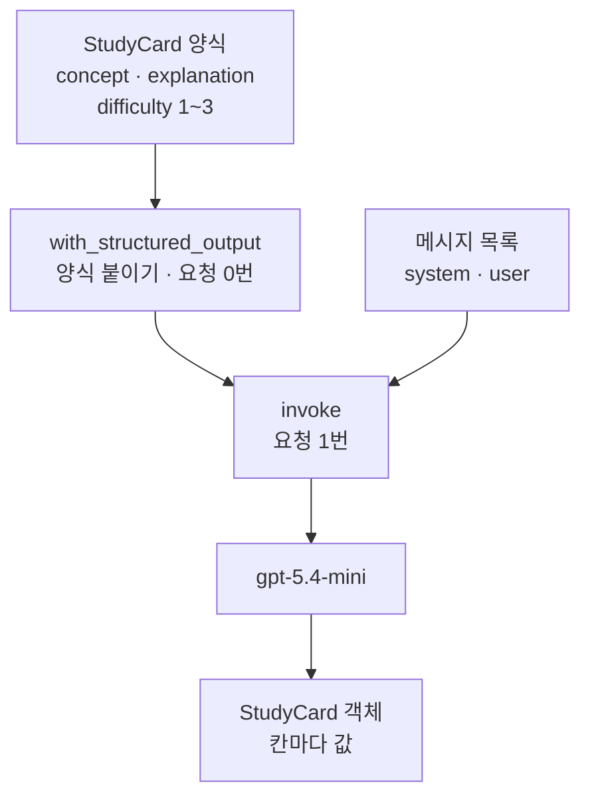
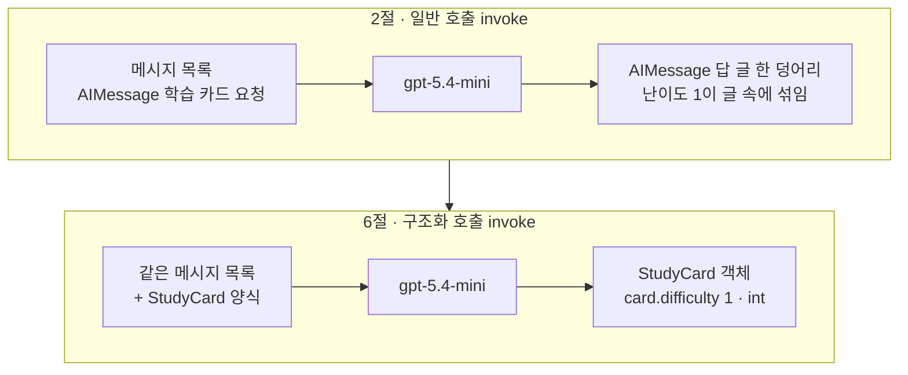
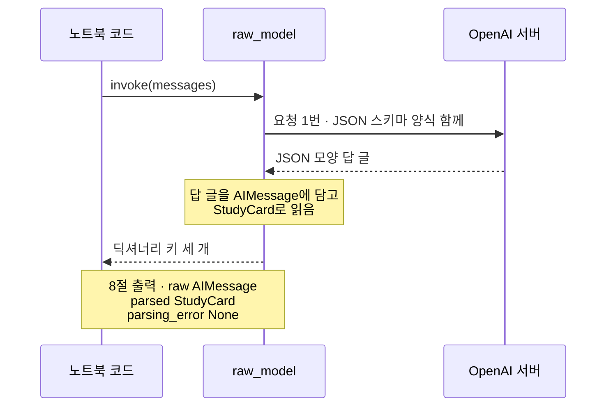
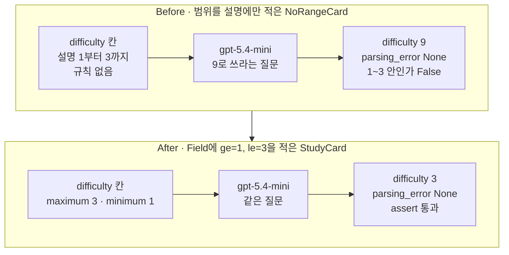

# 03-구조화-출력과-검증

## _src 본문 (HTML 원본)

```html
<!--meta: 강의 1h · 실습은 챕터 전체 10h 안에서 진행합니다. -->
<h2 id="b1"><span class="no">1</span>학습 목표</h2>
<div class="goal"><p>이 절을 마치면 다음을 할 수 있습니다.</p><ul><li>일반 호출의 응답 객체 <code>AIMessage</code>와 구조화 호출이 반환한 카드 객체를 구분할 수 있습니다.</li><li>클래스 <code>BaseModel</code>과 함수 <code>Field()</code>로 카드 양식의 칸과 범위 규칙을 적고, 그 양식으로 답을 받을 수 있습니다.</li><li>원본 답·읽은 카드·읽기 오류를 나눠 읽고, 범위를 설명 글에만 적은 양식을 고칠 수 있습니다.</li></ul></div>
<h2 id="b2"><span class="no">2</span>이 내용을 배우는 이유</h2>
<p>02절까지는 모델의 답을 속성 <code>text</code>로 읽었습니다. 사람이 읽기에는 충분합니다. 하지만 프로그램이 난이도 숫자만 저장하려면, 글 속에서 그 숫자의 자리를 찾아야 합니다.</p>
<p>그래서 받을 칸을 먼저 정하고, 모델이 그 칸에 맞춰 답하게 합니다. 칸을 정해도 값이 규칙에 맞는지는 따로 확인해야 합니다. 이 절에서는 칸과 규칙을 적는 방법과, 규칙을 빠뜨렸을 때의 결과를 실행으로 봅니다.</p>
<p><strong>이 절의 질문</strong> — 모델의 답을 프로그램이 바로 쓸 수 있는 칸으로 받으려면, 무엇을 정하고 무엇을 확인해야 할까요?</p>
<h2 id="b3"><span class="no">3</span>앞에서 배운 내용</h2>
<table><thead><tr><th>앞 절</th><th>배운 것</th><th>이 절에서 이어지는 곳</th></tr></thead><tbody>
<tr><td>01절</td><td><code>invoke()</code>·응답 객체 <code>AIMessage</code>·<code>text</code>, 모델 객체를 만들 때는 요청 0번, 값 검사 오류 <code>ValidationError</code></td><td>2절 일반 호출, 5절 양식 붙이기(요청 0번), 4절 규칙 밖 값</td></tr>
<tr><td>02절</td><td>메시지 객체 <code>SystemMessage</code>, 기록표 한 줄 = 딕셔너리</td><td>7절 SystemMessage 카드, <code>model_dump()</code>가 만든 딕셔너리</td></tr>
<tr><td>Ch 2 05·06·07절</td><td>키워드 인자, 클래스와 객체 만들기, 타입힌트 <code>x: int</code></td><td>3절 카드 양식 클래스, 4절 카드 직접 만들기</td></tr>
<tr><td>Ch 2 10절(확장 경로)</td><td><code>BaseModel</code>, <code>Field(ge=, le=)</code>, <code>model_dump()</code></td><td>3절 <code>StudyCard</code> 양식. 건너뛴 학생을 위해 이 절에서 다시 풂</td></tr>
<tr><td>Ch 4 04절</td><td>JSON 글</td><td>8절 원본 답의 JSON 모양 글</td></tr>
<tr><td>Ch 5 07절</td><td>판정 규칙과 그 한계</td><td>범위 검사는 내용이 맞는지 판정하지 않음</td></tr>
</tbody></table>
<p>01절에서는 질문 자리에 <code>None</code>이 들어가자 값 검사 오류 <code>ValidationError</code>가 났습니다. 그때 값을 검사한 라이브러리가 Pydantic이었습니다. 이 절에서는 그 라이브러리로 우리가 직접 카드 양식을 만듭니다.</p>
<p>클래스 <code>BaseModel</code>과 함수 <code>Field()</code>는 <a href="../../part1/ch02-python/10-Pydantic.html">Ch 2 10절 Pydantic</a>에서 자세히 다룹니다. 기본 경로(A 트랙)는 그 절을 건너뛰므로, 이 절 핵심 개념에서 뜻을 다시 풉니다.</p>
<p>02절 본문은 이 절을 「답을 이름 있는 칸으로 받는 절」로 소개했습니다. 이 절에서는 그 칸을 필드라고도 부릅니다. 02절 기록표의 칸은 딕셔너리 키였고, 이 절의 칸은 양식 클래스에 적은 이름입니다.</p>
<p>실습 폴더와 <code>.env</code> 파일의 <code>OPENAI_API_KEY</code>는 01절과 같습니다. 노트북은 앞 절 없이 새 커널에서 시작합니다.</p>
<h2 id="b4"><span class="no">4</span>핵심 개념</h2>
<h3>비유로 시작하기</h3>
<p>책상 위에 종이 두 장이 있습니다. 왼쪽 메모에는 물결 모양 줄이 제멋대로 적혀 있습니다. 여기서 난이도를 찾으려면 줄을 하나씩 읽어야 합니다.</p>
<p>오른쪽 초록 카드에는 긴 네모 칸 두 개와 작은 동그라미 세 개가 인쇄되어 있습니다. 칸의 자리가 정해져 있어, 어느 칸에 무엇이 있는지 바로 압니다. 동그라미는 셋뿐이라, 그 밖의 값을 칠할 자리가 없습니다.</p>
{{img:03-5-메모와-양식-카드|나무 책상 왼쪽에는 물결 모양 회색 줄이 제멋대로 적힌 흰 메모가, 오른쪽에는 긴 네모 칸 두 개와 작은 동그라미 세 개가 인쇄되고 가운데 동그라미 하나만 보라색으로 칠해진 초록 카드와 연필이 놓인 삽화|왼쪽 메모는 줄이 제멋대로라 값의 자리를 찾아야 하고, 오른쪽 양식 카드는 칸 자리가 정해져 있으며 난이도 동그라미가 셋뿐입니다.}}
<p><strong>그림 읽기</strong> — 왼쪽 흰 메모에는 길이가 제각각인 물결 줄이 비뚤게 적혀 있습니다. 오른쪽 초록 카드에는 긴 네모 칸 두 개가 위아래로 있고, 그 아래 작은 동그라미 세 개가 한 줄로 있습니다. 가운데 동그라미 하나만 보라색으로 칠해져 있고, 카드 옆에 연필이 있습니다.</p>
<p>왼쪽 메모가 일반 호출의 답 글이고, 오른쪽 카드가 칸을 정한 양식 <code>StudyCard</code>입니다. 긴 네모 칸 두 개는 개념 이름과 설명, 동그라미 세 개는 1~3 난이도입니다. 칠한 자리는 실제 값이 아닙니다. 02절 우편함 그림의 카드는 메시지였지만, 이 그림의 카드는 받을 답의 양식입니다.</p>
<h3>카드 양식: BaseModel과 Field</h3>
<p>클래스 <code>BaseModel</code>은 Pydantic 라이브러리가 주는 양식 틀입니다. 이 틀로 만든 클래스는 칸마다 적은 자료형과 규칙으로 값을 검사합니다. 칸 이름이 인쇄된 신청서 양식과 비슷합니다. 노트북 3절의 <code>class StudyCard(BaseModel):</code>가 칸 세 개를 가진 카드 양식입니다.</p>
<p>양식의 칸을 필드(field)라고 부릅니다. 칸 <code>concept</code>와 <code>explanation</code>은 글자(<code>str</code>), 칸 <code>difficulty</code>는 정수(<code>int</code>)입니다. 함수 <code>Field()</code>는 칸에 설명과 규칙을 붙입니다. 규칙 <code>ge=1</code>은 1 이상, <code>le=3</code>은 3 이하라는 뜻입니다.</p>
<p>노트북 4절에서는 요청 없이 카드를 직접 만들어 규칙을 확인했습니다. 난이도 2는 카드가 되었고, 난이도 7은 <code>1 validation error for StudyCard</code>로 거부되었습니다. 오류 메시지에 칸 이름 <code>difficulty</code>와 규칙 <code>less than or equal to 3</code>이 함께 나왔습니다.</p>
<h3>양식을 붙인 호출</h3>
<p>구조화 출력(structured output)은 받을 칸을 정해 두고, 답을 그 칸에 맞춘 객체로 받는 방법입니다. 메서드 <code>with_structured_output()</code>에 클래스 이름 <code>StudyCard</code>를 괄호 없이 넣으면, 양식을 붙인 호출 객체가 만들어집니다. 01절의 모델 객체처럼 이 줄도 요청을 보내지 않습니다.</p>
<p>노트북 5절의 출력은 <code>호출 객체 종류: RunnableSequence</code>였습니다. 여러 단계를 차례로 잇는 LangChain 객체라는 뜻입니다. 설치한 langchain-openai 1.6.0 소스로 두 단계를 확인했습니다. 모델 호출 단계 뒤에 답을 카드로 읽는 단계가 이어져 있습니다.</p>
{{mermaid:03-1-카드-양식-흐름|위의 초록 상자 StudyCard 양식이 파란 상자 with_structured_output 요청 0번으로 이어지고, 이 상자와 초록 상자 메시지 목록이 파란 상자 invoke 요청 1번으로 모인 뒤 보라 상자 gpt-5.4-mini를 거쳐 노란 상자 StudyCard 객체로 이어지는 흐름도|양식을 붙이는 줄은 요청 0번이고, invoke 한 줄에서 요청 1번이 나가 칸마다 값이 든 StudyCard 객체가 돌아옵니다.}}
<p><strong>도식 읽기</strong> — 위에서 아래로 읽습니다. 초록 상자 두 개는 우리가 정한 카드 양식과 보낼 메시지 목록입니다. 파란 상자 두 개는 양식을 붙이는 줄과 요청을 보내는 줄입니다.</p>
<p>양식을 붙이는 줄에서는 요청이 0번이고, <code>invoke()</code>에서 요청 1번이 나갑니다. 보라 상자는 실행한 모델 <code>gpt-5.4-mini</code>입니다. 맨 아래 노란 상자는 노트북 6절에서 받은 카드 객체입니다.</p>
<h3>원본 답, 읽은 카드, 읽기 오류</h3>
<p>답 글을 정해진 모양의 객체로 읽는 일을 파싱(parsing)이라고 부릅니다. 인자 <code>include_raw=True</code>를 주면 파싱 전의 원본 답도 함께 받습니다. 이때 결과는 키가 세 개인 딕셔너리입니다.</p>
<p>키 <code>raw</code>에는 원본 답이 <code>AIMessage</code>로 들어 있습니다. 키 <code>parsed</code>에는 읽은 카드가, 키 <code>parsing_error</code>에는 읽다가 난 오류가 들어갈 자리가 있습니다. 노트북 8절에서는 원본 답이 <code>{"concept":</code>로 시작하는 JSON 모양 글이었고, 오류 자리는 <code>None</code>이었습니다.</p>
<h3>이 절에서 쓰는 말</h3>
<table><thead><tr><th>용어</th><th>뜻</th><th>이 절에서 보이는 모습</th></tr></thead><tbody>
<tr><td>구조화 출력(structured output)</td><td>받을 칸을 정해 두고, 답을 그 칸에 맞춘 객체로 받는 방법</td><td><code>결과 종류: StudyCard</code></td></tr>
<tr><td>양식 클래스</td><td>칸 이름과 자료형, 규칙을 적은 클래스. 칸 이름이 인쇄된 신청서 양식과 비슷함</td><td><code>class StudyCard(BaseModel):</code></td></tr>
<tr><td>칸(필드, field)</td><td>양식 클래스에 이름과 자료형을 적은 자리 하나</td><td><code>난이도의 자료형: int</code></td></tr>
<tr><td>범위 규칙</td><td>칸 값이 받을 수 있는 범위. 함수 <code>Field()</code>의 <code>ge</code>(이상)·<code>le</code>(이하)</td><td><code>'maximum': 3, 'minimum': 1</code></td></tr>
<tr><td>파싱(parsing)</td><td>답 글을 정해진 모양의 객체로 읽는 일</td><td><code>parsed 종류: StudyCard</code></td></tr>
<tr><td>원본 답(raw)</td><td>파싱하기 전에 모델이 쓴 답을 담은 응답 객체</td><td><code>raw 종류: AIMessage</code></td></tr>
<tr><td>JSON 스키마(JSON Schema)</td><td>JSON 글의 칸과 규칙을 적는 표준 모양. 양식 클래스를 요청에 실을 때 이 모양으로 바꿈</td><td><code>'type': 'integer'</code></td></tr>
</tbody></table>
<h2 id="b5"><span class="no">5</span>실행 예제</h2>
<p>노트북은 같은 요청을 일반 호출로 먼저 보내 답 글을 봅니다. 그다음 카드 양식을 정하고, 요청 없이 규칙을 확인합니다. 양식을 붙인 호출로 카드를 받고, 개념 이름만 바꿔 다시 받습니다. 끝으로 원본 답과 읽은 카드를 함께 받습니다.</p>
<p>실제 OpenAI 모델을 temperature 0으로 부릅니다. 이 페이지의 출력은 2026-09-17에 실행한 결과입니다. 요청은 Before·After까지 모두 6번이고, 예상 비용은 0.01달러 미만입니다. 답 문장은 실행마다 달라질 수 있습니다.</p>
{{notebook:03-구조화-출력과-검증|example}}
<p class="look"><b>확인할 점</b> — 2절의 <code>응답 객체 종류: AIMessage</code>와 6절의 <code>결과 종류: StudyCard</code>를 나란히 봅니다. 6절에서는 <code>난이도의 자료형: int</code>도 확인합니다. 8절에서는 <code>parsing_error: None</code>을 봅니다.</p>
<h3>문장 답과 카드 비교</h3>
<p>노트북 2절과 6절은 같은 메시지 목록을 보냈습니다. 바꾼 것은 양식을 붙였는지 하나입니다. 두 결과 모두 난이도 1이었지만, 값을 꺼내는 방법이 달랐습니다.</p>
{{mermaid:03-2-문장-답과-카드|위 칸 2절 일반 호출은 초록 상자 메시지 목록이 보라 상자 gpt-5.4-mini를 거쳐 노란 상자 AIMessage 답 글 한 덩어리 난이도 1이 글 속에 섞임으로, 아래 칸 6절 구조화 호출은 초록 상자 같은 메시지 목록과 StudyCard 양식이 보라 상자를 거쳐 노란 상자 StudyCard 객체 card.difficulty 1 int로 이어지는 비교 그림|같은 메시지 목록을 보냈지만, 일반 호출은 난이도가 글 속에 섞인 답을, 구조화 호출은 정수 칸 difficulty를 가진 카드를 반환했습니다.}}
<p><strong>도식 읽기</strong> — 위 칸이 2절, 아래 칸이 6절이고, 칸마다 왼쪽에서 오른쪽으로 읽습니다. 초록 상자는 보낸 목록과 양식, 보라 상자는 실행한 모델, 노란 상자는 출력으로 확인한 결과입니다.</p>
<p>위 칸의 답은 제목과 줄 표시 사이에 <code>난이도:</code> 줄이 섞인 글이었습니다. 아래 칸은 <code>card.difficulty</code>로 바로 꺼낸 정수 1입니다. 두 칸 모두 설명 문장이 맞는지와 난이도 1이 알맞은지는 판정하지 않았습니다.</p>
<h3>원본 답을 함께 받을 때 오간 것</h3>
<p>노트북 8절은 <code>include_raw=True</code>를 준 호출 객체 <code>raw_model</code>로 요청을 보냈습니다. 요청 1번에 무엇이 실리고, 무엇이 딕셔너리로 돌아왔는지 순서로 봅니다.</p>
{{mermaid:03-3-원본-답과-카드|노트북 코드, raw_model, OpenAI 서버 세 세로줄 사이에서 invoke 뒤 raw_model이 서버로 요청 1번과 JSON 스키마 양식을 보내고, JSON 모양 답 글을 받아 AIMessage에 담고 StudyCard로 읽는 메모 뒤, 딕셔너리 키 세 개를 넘기고 raw AIMessage, parsed StudyCard, parsing_error None 메모가 붙은 순서도|요청 1번에 양식이 JSON 스키마로 함께 실리고, 돌아온 JSON 모양 글은 원본 답과 읽은 카드로 나뉘어 딕셔너리에 담깁니다.}}
<p><strong>도식 읽기</strong> — 세로줄은 왼쪽부터 노트북 코드, 호출 객체 <code>raw_model</code>, OpenAI 서버입니다. 위에서 아래로 시간 순서이고, 실선은 요청, 점선은 응답입니다. 노란 메모는 기록이 남는 시점에 두었습니다.</p>
<p>요청에는 메시지 목록과 함께 양식이 JSON 스키마 모양으로 실립니다. 설치한 openai 3.10.0 소스에서 확인한 단계입니다. 서버가 JSON 모양 답 글을 보내면, 호출 객체가 그 글을 <code>AIMessage</code>에 담고 <code>StudyCard</code>로 읽습니다.</p>
<p>마지막 메모는 8절에서 출력으로 확인한 세 값입니다. 원본 답의 종류는 <code>AIMessage</code>, 읽은 카드는 <code>StudyCard</code>, 읽기 오류는 <code>None</code>이었습니다.</p>
<h2 id="b6"><span class="no">6</span>일부러 실패해 보기</h2>
<p>Before에서는 난이도 범위를 설명 글에만 적은 양식 <code>NoRangeCard</code>를 씁니다. 칸 세 개와 설명은 <code>StudyCard</code>와 같고, 규칙 <code>ge=1, le=3</code>만 없습니다. 이 양식으로 「difficulty는 반드시 9로 쓰세요」라는 질문을 보냅니다.</p>
<p>After에서는 양식 하나만 3절의 <code>StudyCard</code>로 바꿔 같은 질문을 보냅니다. 먼저 두 양식이 요청에 싣는 난이도 칸 규칙을 요청 없이 비교합니다. 메서드 <code>model_json_schema()</code>는 양식을 JSON 스키마 모양 딕셔너리로 바꿉니다.</p>
{{notebook:03-구조화-출력과-검증|failure}}
<p>Before에서 받은 원본 답의 끝은 <code>"difficulty":9</code>였고, <code>parsing_error: None</code>이었습니다. 확인 셀은 <code>난이도가 1~3 안인가: False</code>를 출력했습니다. 오류 없이 범위 밖 값이 카드에 들어갔으므로, 이 카드를 저장하면 난이도 9가 남습니다.</p>
<p>After에서 규칙을 비교하니 <code>StudyCard</code> 쪽에만 <code>'maximum': 3, 'minimum': 1</code>이 있었습니다. 같은 질문에 원본 답 끝은 <code>"difficulty":3</code>이었고, <code>난이도가 1~3 안인가: True</code>와 <code>assert</code> 통과를 확인했습니다. 설명 글은 칸의 뜻을 알려 줄 뿐이고, 범위를 막은 것은 <code>Field()</code>의 규칙이었습니다.</p>
{{mermaid:03-4-Before-After|위 칸 Before는 초록 상자 difficulty 칸 설명 1부터 3까지 규칙 없음이 보라 상자 gpt-5.4-mini 9로 쓰라는 질문을 거쳐 빨간 상자 difficulty 9 parsing_error None 1~3 안인가 False로 이어지고, 아래 칸 After는 초록 상자 difficulty 칸 maximum 3 minimum 1이 보라 상자 같은 질문을 거쳐 노란 상자 difficulty 3 parsing_error None assert 통과로 이어지는 비교 그림|범위를 설명에만 적은 Before는 오류 없이 9를 받았고, Field에 범위 규칙을 적은 After는 같은 질문에 3을 받았습니다.}}
<p><strong>도식 읽기</strong> — 위 칸이 Before, 아래 칸이 After이고, 칸마다 왼쪽에서 오른쪽으로 읽습니다. 초록 상자는 양식의 난이도 칸 규칙, 보라 상자는 같은 질문을 받은 모델입니다.</p>
<p>위 칸 끝의 빨간 상자는 오류 없이 범위 밖 값 9가 들어간 결과입니다. 프로그램은 멈추지 않았지만 잘못된 카드를 받아들였으므로, Before의 결함 결과로 칠했습니다. 아래 칸 끝의 노란 상자는 출력으로 확인한 난이도 3과 <code>assert</code> 통과입니다.</p>
<h2 id="b7"><span class="no">7</span>주의할 점과 실무 메모</h2>
<ul><li>양식의 설명 글은 규칙이 아닙니다. 범위를 막으려면 <code>Field(ge=1, le=3)</code>처럼 규칙으로 적습니다. Before 양식은 설명에 「1부터 3까지」가 있어도 9를 받았습니다.</li>
<li>After에서 모델이 9 대신 3을 적은 것은 이번 한 번의 실행에서 본 모습입니다. 보낸 양식에 최대 3이 들어 있었다는 것까지 확인했습니다. 서버가 그 규칙을 늘 지키게 하는지는 이번에 여러 번 확인하지 않았습니다.</li>
<li>범위 검사를 통과해도 내용이 맞다는 뜻은 아닙니다. 같은 AIMessage 카드가 6절에서는 난이도 1, After에서는 3이었습니다. 어느 값이 알맞은지, 설명 문장이 맞는지는 이 검사가 알려 주지 않습니다.</li>
<li>이 절에서 <code>parsing_error</code>에 오류가 담긴 경우는 실행하지 않았습니다. 설치한 openai 3.10.0 소스에서는, 받은 JSON 글을 양식으로 읽는 일이 모델 호출 단계 안에서 먼저 일어납니다. 그래서 그 단계의 값 검사 오류는 이 자리에 담기지 않고, <code>invoke()</code>에서 바로 날 수 있습니다.</li>
<li>인자 <code>method</code>를 주지 않으면, 설치한 langchain-openai 1.6.0은 OpenAI의 JSON 스키마 방식을 씁니다. 다른 방식(<code>function_calling</code>·<code>json_mode</code>)과 다른 제공자는 이번에 실행하지 않았습니다. 받는 방식과 인자는 02절처럼 제공자마다 다시 확인합니다.</li>
<li>라이브러리 Pydantic의 엄격 모드, 선언하지 않은 칸 거부, 양식을 딕셔너리로 적는 방법도 이번에 실행하지 않았습니다. 엄격 모드는 <a href="../../part1/ch02-python/10-Pydantic.html">Ch 2 10절</a>에서 로컬 값으로 다룹니다.</li>
<li>Before에서 쓴 질문 「difficulty는 반드시 9로 쓰세요」와 양식 <code>NoRangeCard</code>는 흐름을 보여 주려고 정한 예입니다. 교재를 만들 때 탐색 실행으로 9가 그대로 들어가는 것을 먼저 확인한 뒤 정했습니다.</li>
<li>교재 출력은 Linux의 Python 3.12.13으로 만들었습니다. 패키지는 langchain 1.4.0, langchain-core 1.6.2, langchain-openai 1.6.0입니다. openai 3.10.0, pydantic 2.13.5도 함께 썼습니다. 다른 버전과 Windows·macOS에서는 실행하지 않았습니다.</li></ul>
<h2 id="b8"><span class="no">8</span>정리와 다음 절</h2>
<ul><li>일반 호출의 답은 난이도가 섞인 글 한 덩어리였고, 구조화 호출은 칸마다 값이 든 <code>StudyCard</code> 객체를 반환했습니다.</li><li>인자 <code>include_raw=True</code>로 원본 답(JSON 모양 글), 읽은 카드, 읽기 오류 자리를 함께 받았습니다.</li><li>범위를 설명에만 적은 양식은 9를 오류 없이 받았고, <code>Field(ge=1, le=3)</code>를 적은 양식에서는 난이도가 3이었습니다.</li></ul>
<p><strong>다음 학습과 이어지는 지점</strong> — 04절에서는 답을 다 받을 때까지 기다리지 않고, 메서드 <code>stream()</code>으로 도착하는 대로 받습니다. 이 절에서 받은 완성된 결과와, 아직 도착 중인 답의 일부가 어떻게 다른지 확인합니다.</p>
<h2 id="b9"><span class="no">9</span>복습 문제</h2>
<details class="quiz"><summary>문제 1 · 결과의 종류</summary><p class="quiz-q">같은 메시지 목록을 일반 호출과 구조화 호출로 보냈습니다. 난이도 숫자를 꺼내는 방법은 어떻게 다른가요?</p><p class="quiz-a"><b>해설</b> — 일반 호출은 <code>AIMessage</code>의 답 글 속에서 난이도 자리를 찾아야 합니다. 구조화 호출은 <code>StudyCard</code> 객체라서 <code>card.difficulty</code>로 정수를 바로 꺼냅니다.</p></details>
<details class="quiz"><summary>문제 2 · 요청이 나간 줄</summary><p class="quiz-q"><code>structured_model = model.with_structured_output(StudyCard)</code>를 실행하면 요청이 몇 번 나가나요?</p><p class="quiz-a"><b>해설</b> — 0번입니다. 이 줄은 양식을 붙인 호출 객체만 만듭니다. 요청은 그 객체의 <code>invoke()</code>를 부를 때 나갑니다.</p></details>
<details class="quiz"><summary>문제 3 · 설명과 규칙</summary><p class="quiz-q"><code>Field(description="1부터 3까지의 난이도")</code>만 적은 양식으로 9를 요구하는 질문을 보냈습니다. 노트북에서는 어떻게 되었나요?</p><p class="quiz-a"><b>해설</b> — 오류 없이 난이도 9가 카드에 들어갔습니다. 설명 글은 규칙이 아니기 때문입니다. 규칙 <code>ge=1, le=3</code>을 적어야 양식에 최대·최소 규칙이 들어갑니다.</p></details>
<details class="quiz"><summary>문제 4 · 비어 있는 오류 자리</summary><p class="quiz-q">Before 결과의 <code>parsing_error</code>가 <code>None</code>이었습니다. 이 카드를 문제없는 카드로 봐도 되나요?</p><p class="quiz-a"><b>해설</b> — 안 됩니다. 오류 자리가 비어 있다는 것은 그 양식으로 읽을 수 있었다는 뜻입니다. 양식에 범위 규칙이 없었으므로, 난이도 9도 읽을 수 있었습니다.</p></details>
<details class="quiz"><summary>문제 5 · 형식과 내용</summary><p class="quiz-q">After 카드는 난이도 3으로 규칙을 통과했습니다. 개념 AIMessage의 알맞은 난이도가 3이라는 것이 확인된 것인가요?</p><p class="quiz-a"><b>해설</b> — 아닙니다. 확인한 것은 값이 1~3 안에 있다는 것뿐입니다. 같은 개념이 6절에서는 난이도 1이었습니다. 알맞은 난이도인지는 따로 정한 기준으로 판단해야 합니다.</p></details>
<h2 id="b10"><span class="no">10</span>참고 자료</h2>
<p>문서는 2026-09-17에 다시 열어 확인했습니다. 메서드 이름과 기본 방식, 요청에 싣는 양식은 실습 가상환경에 설치한 패키지 소스에서도 확인했습니다. 확인한 판은 <code>langchain-core 1.6.2</code>, <code>langchain-openai 1.6.0</code>, <code>openai 3.10.0</code>, <code>pydantic 2.13.5</code>입니다.</p>
<ul><li><div><a href="https://docs.langchain.com/oss/python/langchain/structured-output">LangChain Structured output</a></div>양식으로 답 받기 · 확인 2026-09-17</li><li><div><a href="https://docs.langchain.com/oss/python/langchain/models">LangChain Models</a></div>모델의 구조화 출력과 include_raw · 확인 2026-09-17</li><li><div><a href="https://developers.openai.com/api/docs/guides/structured-outputs">OpenAI Structured Outputs</a></div>JSON 스키마로 답 모양 정하기 · 확인 2026-09-17</li><li><div><a href="https://docs.pydantic.dev/latest/concepts/fields/">Pydantic Fields</a></div>칸의 설명과 범위 규칙 · 확인 2026-09-17</li><li><div><a href="https://github.com/langchain-ai/langchain/blob/master/LICENSE">LangChain MIT License</a></div>예제의 질문과 설명은 이 교재에 맞게 새로 썼습니다</li></ul>
```

## 노트북 셀 (순서대로)

### [0] markdown {'html': 'skip'}

# 구조화 출력과 검증

**이 노트북에서 할 일**

1. 같은 요청을 일반 호출과 구조화 호출로 보내, 문장 답과 칸이 정해진 카드를 비교합니다.
2. 카드 양식에 칸과 범위 규칙을 적고, 원본 답과 읽은 카드를 함께 받습니다.
3. 범위 규칙을 설명에만 적은 양식과 규칙으로 적은 양식에 같은 질문을 보내 결과를 비교합니다.

**준비물** — 프로젝트 폴더 `.env` 파일의 `OPENAI_API_KEY`가 필요합니다. 데이터 파일은 없습니다.
인터넷 서비스의 모델 `gpt-5.4-mini`에 요청을 모두 6번 보냅니다. 실행 시간은 1분 안팎입니다.
예상 비용은 0.01달러 미만입니다(06절에 적은 2026-09-09 공식 요금 기준).

**기준 버전** — 실습 폴더에 고정한 패키지 판을 씁니다. langchain 1.4.0, langchain-core 1.6.2, langchain-openai 1.6.0입니다.
pydantic 2.13.5, python-dotenv 1.2.3도 함께 씁니다. 함께 설치되는 openai 패키지는 3.10.0입니다.

교재 출력은 Linux의 Python 3.12.13으로 만들었습니다. 다른 버전과 Windows·macOS에서는 이번에 실행하지 않았습니다.

실습 폴더 `labs/part2/ch06-langchain-start`에서 `uv sync --locked`를 실행합니다.
그다음 이 폴더의 `.venv` 커널을 고르고 첫 셀부터 순서대로 실행합니다.

### [1] markdown {'html': 'skip'}

## 오늘 볼 그림


위에서 아래로 읽습니다. 초록 상자 두 개는 우리가 정한 카드 양식과 보낼 메시지 목록입니다.
파란 상자 두 개는 양식을 붙이는 줄과 요청을 보내는 줄입니다. 양식을 붙이는 줄은 요청을 보내지 않습니다.

맨 아래 노란 상자는 이 노트북 6절에서 받은 카드 객체입니다. 문장이 아니라 칸마다 값이 들어 있습니다.

### [2] markdown {}

## 1. 준비

첫 셀은 패키지를 설치하고 설치된 버전을 출력합니다. 설치에는 몇십 초가 걸릴 수 있습니다.
패키지 openai는 langchain-openai가 OpenAI 서버에 요청을 보낼 때 쓰는 패키지입니다. 10절 설명에서 이 판을 씁니다.

### [3] code {'execution': {'iopub.execute_input': '2026-09-17T00:28:15.713424Z', 'iopub.status.busy': '2026-09-17T00:28:15.713255Z', 'iopub.status.idle': '2026-09-17T00:28:16.343304Z', 'shell.execute_reply': '2026-09-17T00:28:16.342862Z'}, 'lesson_role': 'setup'}

```python
# 이 절에서 쓰는 패키지를 설치하고 버전을 확인합니다
%pip install -q "langchain==1.4.0" "langchain-openai==1.6.0" "pydantic==2.13.5" "python-dotenv==1.2.3"
from importlib.metadata import version

print("langchain:", version("langchain"))
print("langchain-core:", version("langchain-core"))
print("langchain-openai:", version("langchain-openai"))
print("openai:", version("openai"))
print("pydantic:", version("pydantic"))
```

출력:
```
Note: you may need to restart the kernel to use updated packages.
langchain: 1.4.0
langchain-core: 1.6.2
langchain-openai: 1.6.0
openai: 3.10.0
pydantic: 2.13.5

```

### [4] markdown {}

**결과 읽기** — 출력 줄은 `langchain: 1.4.0`, `openai: 3.10.0`, `pydantic: 2.13.5` 등 다섯 줄입니다.
준비물에 적은 기준 버전과 같습니다.

01절과 같이 모델 객체를 만드는 함수를 불러옵니다.

### [5] code {'execution': {'iopub.execute_input': '2026-09-17T00:28:16.344443Z', 'iopub.status.busy': '2026-09-17T00:28:16.344359Z', 'iopub.status.idle': '2026-09-17T00:28:16.745120Z', 'shell.execute_reply': '2026-09-17T00:28:16.744788Z'}, 'lesson_role': 'setup'}

```python
# 모델 객체를 만드는 함수를 불러옵니다
from langchain.chat_models import init_chat_model
```

출력:
```

```

### [6] markdown {}

01절과 같은 셀로 API 키가 있는지 확인합니다. 키 값은 출력하지 않고, 있는지만 봅니다.
`True` 값이 나오면 다음으로 넘어갑니다.

### [7] code {'execution': {'iopub.execute_input': '2026-09-17T00:28:16.746128Z', 'iopub.status.busy': '2026-09-17T00:28:16.746052Z', 'iopub.status.idle': '2026-09-17T00:28:16.751423Z', 'shell.execute_reply': '2026-09-17T00:28:16.750953Z'}, 'lesson_role': 'setup'}

```python
# .env 파일에서 OpenAI API 키를 읽습니다(키 값은 출력하지 않습니다)
import os
from dotenv import find_dotenv, load_dotenv

env_path = find_dotenv(usecwd=True)
load_dotenv(env_path)
has_key = os.getenv("OPENAI_API_KEY") is not None
print("OPENAI_API_KEY 설정 여부:", has_key)
assert has_key, "프로젝트 폴더의 .env 파일에 OPENAI_API_KEY를 적어 주세요."
```

출력:
```
OPENAI_API_KEY 설정 여부: True

```

### [8] markdown {}

실습에 쓸 모델을 준비합니다.
01절과 같은 설정으로 모델 객체를 만듭니다. 이 셀은 요청을 보내지 않습니다.

### [9] code {'execution': {'iopub.execute_input': '2026-09-17T00:28:16.752060Z', 'iopub.status.busy': '2026-09-17T00:28:16.751996Z', 'iopub.status.idle': '2026-09-17T00:28:17.703434Z', 'shell.execute_reply': '2026-09-17T00:28:17.703046Z'}}

```python
# 실습에 쓸 모델을 준비합니다
model = init_chat_model(
    "openai:gpt-5.4-mini",
    temperature=0,
    reasoning_effort="none",
)
print("모델 이름:", model.model_name)
print("temperature:", model.temperature)
```

출력:
```
모델 이름: gpt-5.4-mini
temperature: 0.0

```

### [10] markdown {}

**결과 읽기** — 출력 줄은 `모델 이름: gpt-5.4-mini`와 `temperature: 0.0`입니다. 이것으로 준비가 끝났습니다.
이 노트북의 출력은 2026-09-17에 이 모델로 실행한 결과입니다. 실행마다 답 문장이 달라질 수 있습니다.
01절에서 본 것처럼 temperature 0은 Ch 5 06절의 뽑기를 끈 설정(`do_sample=False`)과 같은 것이 아닙니다.

### [11] markdown {}

## 2. 문장으로 받은 답 다시 보기

이번 절의 질문은 LangChain 메시지 객체 하나를 학습 카드로 만들어 달라는 요청입니다.
카드에는 개념 이름, 한 문장 설명, 1~3 난이도를 적게 합니다. 01절처럼 `(역할, 내용)` 튜플 목록으로 적습니다.

실행 전에 예상합니다. 01·02절처럼 역할 이름 system과 user가 한 줄씩 나올 것입니다.

### [12] code {'execution': {'iopub.execute_input': '2026-09-17T00:28:17.704176Z', 'iopub.status.busy': '2026-09-17T00:28:17.704111Z', 'iopub.status.idle': '2026-09-17T00:28:17.706130Z', 'shell.execute_reply': '2026-09-17T00:28:17.705792Z'}}

```python
# 학습 카드를 만들어 달라는 공통 지시와 이번 질문을 튜플 목록에 담습니다
messages = [
    ("system", "초급 학습자를 위한 학습 카드를 만듭니다."),
    ("user", "LangChain의 AIMessage를 학습 카드로 만드세요. 개념 이름, 한 문장 설명, 1~3 난이도를 적으세요."),
]
print("메시지 목록:")
for role, content in messages:
    print(role, "|", content)
```

출력:
```
메시지 목록:
system | 초급 학습자를 위한 학습 카드를 만듭니다.
user | LangChain의 AIMessage를 학습 카드로 만드세요. 개념 이름, 한 문장 설명, 1~3 난이도를 적으세요.

```

### [13] markdown {}

**결과 읽기** — 라벨 줄 아래 첫 줄은 `system | 초급 학습자를 위한 학습 카드를 만듭니다.`, 둘째 줄은 user 질문입니다.
아직 목록만 만들었고 요청은 보내지 않았습니다.

이 목록을 01절과 같은 일반 호출로 보냅니다. 응답 객체의 종류를 보고, 답 글 속에 낱말 「난이도」가 있는지 봅니다.
연산자 `in`은 왼쪽 글이 오른쪽 글 안에 있으면 `True`를 줍니다. 답은 여러 줄일 수 있어 라벨 줄 `답:`을 따로 출력합니다.

실행 전에 예상합니다. 응답 객체는 AIMessage이고, 난이도 숫자는 답 글 속 어딘가에 섞여 있을 것입니다.

### [14] code {'execution': {'iopub.execute_input': '2026-09-17T00:28:17.706856Z', 'iopub.status.busy': '2026-09-17T00:28:17.706797Z', 'iopub.status.idle': '2026-09-17T00:28:18.957262Z', 'shell.execute_reply': '2026-09-17T00:28:18.956372Z'}}

```python
# 01절처럼 일반 호출로 보내고, 답이 어떤 자료형인지 봅니다(요청 1번)
response = model.invoke(messages)
print("응답 객체 종류:", type(response).__name__)
print("답 글 속에 난이도가 있는가:", "난이도" in response.text)
print("답:")
print(response.text)
```

출력:
```
응답 객체 종류: AIMessage
답 글 속에 난이도가 있는가: True
답:
### 학습 카드: AIMessage

- **개념 이름:** AIMessage  
- **한 문장 설명:** LangChain에서 AI가 생성한 응답 메시지를 나타내는 객체입니다.  
- **난이도:** 1

```

### [15] markdown {}

**결과 읽기** — 첫 두 줄은 `응답 객체 종류: AIMessage`와 `답 글 속에 난이도가 있는가: True`입니다.
라벨 줄 아래 답은 글 한 덩어리이고, 개념 이름·설명·난이도가 줄마다 섞여 있습니다.

프로그램이 난이도 숫자만 쓰려면 글 속에서 그 자리를 찾아야 합니다. 답의 줄 모양은 실행마다 달라질 수 있습니다.
그래서 이번 절은 받을 칸을 먼저 정해 두고 답을 받습니다.

## 3. 카드 양식 정하기

클래스 `BaseModel`은 Pydantic 라이브러리가 주는 양식 틀입니다. 이 틀로 만든 클래스는 칸마다 적은 자료형과 규칙으로 값을 검사합니다.
칸 이름이 인쇄된 신청서 양식과 비슷합니다. 아래 `StudyCard`는 칸 세 개를 가진 카드 양식입니다.

양식의 칸을 필드(field)라고 부릅니다. 칸 이름 뒤 `: str`, `: int`는 자료형입니다(Ch 2 07절 타입힌트).
함수 `Field()`는 칸에 설명과 규칙을 붙입니다. 규칙 `ge=1`은 1 이상, `le=3`은 3 이하입니다.
라이브러리 Pydantic은 Ch 2 10절에서 자세히 다룹니다. 기본 경로(A 트랙)에서 건너뛰었다면, 칸과 규칙을 적은 양식으로 읽으면 됩니다.

이 셀은 양식만 정의하므로 출력이 없습니다.

### [16] code {'execution': {'iopub.execute_input': '2026-09-17T00:28:18.958928Z', 'iopub.status.busy': '2026-09-17T00:28:18.958767Z', 'iopub.status.idle': '2026-09-17T00:28:18.962524Z', 'shell.execute_reply': '2026-09-17T00:28:18.962004Z'}}

```python
# 개념 이름·설명·난이도 세 칸을 가진 학습 카드 양식을 정합니다
from pydantic import BaseModel, Field

class StudyCard(BaseModel):
    concept: str = Field(description="개념 이름")
    explanation: str = Field(description="한 문장 설명")
    difficulty: int = Field(ge=1, le=3, description="1부터 3까지의 난이도")
```

출력:
```

```

### [17] markdown {}

출력은 없고, 이제 양식 `StudyCard`를 쓸 수 있습니다.

## 4. 양식 규칙을 먼저 손으로 확인하기

모델에 보내기 전에, 양식이 규칙대로 값을 검사하는지 직접 확인합니다. 이 절의 두 셀은 요청을 보내지 않습니다.
클래스 이름 뒤 괄호에 칸 이름을 키워드 인자로 넣으면 카드 객체가 만들어집니다. 키워드 인자는 Ch 2 05절, 객체 만들기는 06절에서 배웠습니다.

실행 전에 예상합니다. 난이도 2는 1~3 안이므로 카드가 만들어질 것입니다.

### [18] code {'execution': {'iopub.execute_input': '2026-09-17T00:28:18.963916Z', 'iopub.status.busy': '2026-09-17T00:28:18.963792Z', 'iopub.status.idle': '2026-09-17T00:28:18.966586Z', 'shell.execute_reply': '2026-09-17T00:28:18.966066Z'}}

```python
# 키워드 인자로 카드 하나를 직접 만들고 칸 값을 읽습니다(요청 없음)
sample_card = StudyCard(
    concept="AIMessage",
    explanation="모델이 쓴 답을 담는 메시지 객체입니다.",
    difficulty=2,
)
print("카드:", sample_card)
print("난이도 칸:", sample_card.difficulty)
```

출력:
```
카드: concept='AIMessage' explanation='모델이 쓴 답을 담는 메시지 객체입니다.' difficulty=2
난이도 칸: 2

```

### [19] markdown {}

**결과 읽기** — 첫 줄은 `카드: concept='AIMessage'`로 시작하고, 둘째 줄은 `난이도 칸: 2`입니다.
칸 값은 `sample_card.difficulty`처럼 점 뒤에 칸 이름을 적어 꺼냅니다.

이번에는 난이도 칸에 규칙 밖의 값 7을 넣습니다. 01절에서 본 값 검사 오류 `ValidationError`만 받습니다.

실행 전에 예상합니다. 3 이하라는 규칙에 걸려 카드가 만들어지지 않을 것입니다.

### [20] code {'execution': {'iopub.execute_input': '2026-09-17T00:28:18.967837Z', 'iopub.status.busy': '2026-09-17T00:28:18.967714Z', 'iopub.status.idle': '2026-09-17T00:28:18.970820Z', 'shell.execute_reply': '2026-09-17T00:28:18.970175Z'}}

```python
# 난이도 칸에 규칙 밖의 값 7을 넣고, 값 검사 오류만 받습니다(요청 없음)
from pydantic import ValidationError

try:
    wrong_card = StudyCard(
        concept="AIMessage",
        explanation="모델이 쓴 답을 담는 메시지 객체입니다.",
        difficulty=7,
    )
    print("카드:", wrong_card)
except ValidationError as error:
    print("오류 종류:", type(error).__name__)
    print("오류 메시지:")
    print(error)
```

출력:
```
오류 종류: ValidationError
오류 메시지:
1 validation error for StudyCard
difficulty
  Input should be less than or equal to 3 [type=less_than_equal, input_value=7, input_type=int]
    For further information visit https://errors.pydantic.dev/2.13/v/less_than_equal

```

### [21] markdown {}

**결과 읽기** — 첫 줄은 `오류 종류: ValidationError`입니다. 라벨 줄 아래 오류 메시지는 `1 validation error for StudyCard`로 시작합니다.
그 아래 `difficulty` 줄이 걸린 칸 이름이고, `less than or equal to 3`이 걸린 규칙입니다.

넣은 값 7도 `input_value=7`로 적혀 있습니다. 오류 메시지만 보고 어느 칸의 어떤 규칙인지 알 수 있습니다.

## 5. 모델 객체에 양식 붙이기

메서드 `with_structured_output()`은 모델 객체에 카드 양식을 붙인 호출 객체를 만듭니다.
괄호 안에는 카드 객체가 아니라 클래스 이름 `StudyCard`를 괄호 없이 넣습니다. 만들 카드의 양식을 알려 주는 것입니다.

01절의 `init_chat_model()`처럼 이 줄도 준비만 합니다. 실행 전에 예상합니다. 요청은 0번이고 호출 객체 종류만 출력될 것입니다.

### [22] code {'execution': {'iopub.execute_input': '2026-09-17T00:28:18.971943Z', 'iopub.status.busy': '2026-09-17T00:28:18.971841Z', 'iopub.status.idle': '2026-09-17T00:28:18.979351Z', 'shell.execute_reply': '2026-09-17T00:28:18.978745Z'}}

```python
# 모델 객체에 카드 양식을 붙여 구조화 호출 객체를 만듭니다(이 셀은 요청을 보내지 않습니다)
structured_model = model.with_structured_output(StudyCard)
print("호출 객체 종류:", type(structured_model).__name__)
```

출력:
```
호출 객체 종류: RunnableSequence

```

### [23] markdown {}

**결과 읽기** — 출력 줄은 `호출 객체 종류: RunnableSequence`입니다. 여러 단계를 차례로 잇는 LangChain 객체라는 뜻입니다.
설치한 langchain-openai 1.6.0 소스로 두 단계를 확인했습니다. 모델 호출 단계 뒤에 답을 카드로 읽는 단계가 이어져 있습니다.

## 6. 구조화 호출로 카드 받기

2절과 같은 메시지 목록을 이번에는 구조화 호출 객체로 보냅니다. 부르는 메서드는 똑같이 `invoke()`입니다.
받은 결과의 종류와 칸 값을 하나씩 출력합니다. 마지막 줄의 `assert`는 결과 종류가 StudyCard인지 확인합니다.

실행 전에 예상합니다. 결과는 AIMessage가 아니라 카드 객체이고, 난이도 칸은 정수일 것입니다.

### [24] code {'execution': {'iopub.execute_input': '2026-09-17T00:28:18.980506Z', 'iopub.status.busy': '2026-09-17T00:28:18.980412Z', 'iopub.status.idle': '2026-09-17T00:28:19.796859Z', 'shell.execute_reply': '2026-09-17T00:28:19.796054Z'}}

```python
# 2절과 같은 메시지 목록을 보내고, 카드 객체로 받습니다(요청 1번)
card = structured_model.invoke(messages)
card_type = type(card).__name__
print("결과 종류:", card_type)
print("개념 이름:", card.concept)
print("설명:", card.explanation)
print("난이도:", card.difficulty)
print("난이도의 자료형:", type(card.difficulty).__name__)
assert card_type == "StudyCard"
```

출력:
```
결과 종류: StudyCard
개념 이름: AIMessage
설명: LangChain에서 AI가 생성한 응답 내용을 담는 메시지 객체입니다.
난이도: 1
난이도의 자료형: int

```

### [25] markdown {}

**결과 읽기** — 첫 줄은 `결과 종류: StudyCard`이고, 마지막 두 줄은 `난이도: 1`과 `난이도의 자료형: int`입니다.
`assert`도 통과했습니다. 설명 줄은 실행마다 문장이 달라질 수 있습니다.

2절 답에서는 난이도가 글 속에 있었지만, 여기서는 `card.difficulty`로 바로 꺼낸 정수입니다.
카드 객체라는 것은 코드로 확인했습니다. 설명 문장이 맞는지와 난이도 1이 알맞은지는 판정하지 않았습니다.

## 7. 값 바꿔 보기 — 카드로 만들 개념만 바꾸기

바꾸는 값은 user 질문 속 개념 이름 하나입니다. 개념 이름 AIMessage를 02절에서 만든 SystemMessage로 바꿉니다.
system 지시 `messages[0]`, 양식, 호출 객체는 그대로 씁니다.

메서드 `model_dump()`는 카드 객체를 칸 이름이 키인 딕셔너리로 바꿉니다(Ch 2 10절). 02절 기록표의 한 줄과 같은 모양입니다.

실행 전에 예상합니다. 설명 글자는 달라지지만, 칸 이름 세 개는 똑같을 것입니다.

### [26] code {'execution': {'iopub.execute_input': '2026-09-17T00:28:19.798805Z', 'iopub.status.busy': '2026-09-17T00:28:19.798623Z', 'iopub.status.idle': '2026-09-17T00:28:21.106083Z', 'shell.execute_reply': '2026-09-17T00:28:21.105162Z'}}

```python
# system 지시는 그대로 두고, 개념만 SystemMessage로 바꿔 보냅니다(요청 1번)
second_messages = [
    messages[0],
    ("user", "LangChain의 SystemMessage를 학습 카드로 만드세요. 개념 이름, 한 문장 설명, 1~3 난이도를 적으세요."),
]
second_card = structured_model.invoke(second_messages)
second_type = type(second_card).__name__
print("결과 종류:", second_type)
print("딕셔너리로 바꾼 카드:", second_card.model_dump())
assert second_type == "StudyCard"
```

출력:
```
결과 종류: StudyCard
딕셔너리로 바꾼 카드: {'concept': 'LangChain SystemMessage', 'explanation': '대화에서 모델의 기본 규칙, 역할, 행동 방식을 지정하는 시스템용 메시지입니다.', 'difficulty': 1}

```

### [27] markdown {}

**결과 읽기** — 첫 줄은 `결과 종류: StudyCard`입니다. 둘째 줄은 `딕셔너리로 바꾼 카드: {'concept':`로 시작하고, 개념 이름 칸에 SystemMessage가 들어 있습니다.
키는 `'concept'`, `'explanation'`, `'difficulty'` 세 개로 6절 카드와 같습니다.

질문을 바꿔도 같은 칸 이름으로 값을 꺼낼 수 있었습니다. 칸 이름이 같으니 값을 읽는 코드도 바꿀 필요가 없습니다.

## 8. 원본 답과 읽은 카드 함께 받기

6절은 카드만 받았습니다. 모델이 실제로 쓴 글도 함께 보려면 인자 `include_raw=True`를 줍니다.
그러면 결과가 딕셔너리 하나로 오고, 키가 세 개입니다. 먼저 키 이름만 출력합니다.

실행 전에 예상합니다. 결과 종류는 카드가 아니라 딕셔너리일 것입니다.

### [28] code {'execution': {'iopub.execute_input': '2026-09-17T00:28:21.108910Z', 'iopub.status.busy': '2026-09-17T00:28:21.108664Z', 'iopub.status.idle': '2026-09-17T00:28:22.433866Z', 'shell.execute_reply': '2026-09-17T00:28:22.432894Z'}}

```python
# 원본 답도 함께 받는 호출 객체를 만들고, 2절과 같은 목록을 보냅니다(요청 1번)
raw_model = model.with_structured_output(StudyCard, include_raw=True)
result = raw_model.invoke(messages)
print("결과 종류:", type(result).__name__)
print("키 목록:")
for key in result:
    print(key)
```

출력:
```
결과 종류: dict
키 목록:
raw
parsed
parsing_error

```

### [29] markdown {}

**결과 읽기** — 첫 줄은 `결과 종류: dict`입니다. 라벨 줄 아래 키는 `raw`, `parsed`, `parsing_error` 세 줄입니다.

세 키의 값을 하나씩 꺼냅니다. 키 raw는 원본 답, 키 parsed는 읽은 카드, 키 parsing_error는 읽다가 난 오류 자리입니다.
답 글을 정해진 모양의 객체로 읽는 일을 파싱(parsing)이라고 부릅니다. 이 셀은 요청을 보내지 않습니다.

### [30] code {'execution': {'iopub.execute_input': '2026-09-17T00:28:22.435945Z', 'iopub.status.busy': '2026-09-17T00:28:22.435763Z', 'iopub.status.idle': '2026-09-17T00:28:22.439723Z', 'shell.execute_reply': '2026-09-17T00:28:22.439031Z'}}

```python
# 딕셔너리에서 원본 답, 읽은 카드, 읽기 오류를 하나씩 꺼냅니다(요청 없음)
raw_message = result["raw"]
print("raw 종류:", type(raw_message).__name__)
print("raw 글:", raw_message.text)
print("parsed 종류:", type(result["parsed"]).__name__)
print("parsing_error:", result["parsing_error"])
```

출력:
```
raw 종류: AIMessage
raw 글: {"concept":"AIMessage","explanation":"LangChain에서 AI가 생성한 응답 내용을 담는 메시지 객체입니다.","difficulty":1}
parsed 종류: StudyCard
parsing_error: None

```

### [31] markdown {}

**결과 읽기** — 첫 줄은 `raw 종류: AIMessage`입니다. 원본 답은 01절부터 본 응답 객체입니다.
둘째 줄의 글은 `{"concept":`로 시작하는 JSON 모양 글입니다. 칸 이름과 값이 따옴표와 중괄호로 적혀 있습니다.

셋째 줄은 `parsed 종류: StudyCard`, 넷째 줄은 `parsing_error: None`입니다. 이번에는 읽다가 난 오류가 없었습니다.
모델은 양식에 맞춘 JSON 글을 쓰고, 호출 객체가 그 글을 카드로 읽었습니다. JSON 글은 Ch 4 04절에서 다뤘습니다.

### [32] markdown {'lesson_part': 'before'}

## 9. Before — 범위를 설명에만 적은 양식

카드 양식을 만들 때 난이도 범위를 설명 글에만 적었다고 해 봅니다. 아래 `NoRangeCard`는 `StudyCard`와 칸 세 개가 같습니다.
다른 곳은 난이도 칸 하나입니다. 설명에는 「1부터 3까지」가 있지만 규칙 `ge=1, le=3`은 없습니다.

이 셀은 양식만 정의하므로 출력이 없습니다.

### [33] code {'execution': {'iopub.execute_input': '2026-09-17T00:28:22.441031Z', 'iopub.status.busy': '2026-09-17T00:28:22.440912Z', 'iopub.status.idle': '2026-09-17T00:28:22.444595Z', 'shell.execute_reply': '2026-09-17T00:28:22.443946Z'}, 'lesson_part': 'before'}

```python
# 난이도 범위를 설명 글에만 적고 규칙은 넣지 않은 양식을 정합니다
class NoRangeCard(BaseModel):
    concept: str = Field(description="개념 이름")
    explanation: str = Field(description="한 문장 설명")
    difficulty: int = Field(description="1부터 3까지의 난이도")
```

출력:
```

```

### [34] markdown {'lesson_part': 'before'}

출력은 없고, 이제 양식 `NoRangeCard`를 쓸 수 있습니다.

이번 질문은 난이도를 반드시 9로 쓰라고 요구합니다. 사용자가 규칙과 맞지 않는 값을 요구하는 경우입니다.
원본 답도 보려고 `include_raw=True`를 줍니다. 모델 객체와 system 지시는 앞과 같습니다.

실행 전에 예상합니다. 오류 자리는 비어 있고, 원본 답의 난이도는 9일 수 있습니다.

### [35] code {'execution': {'iopub.execute_input': '2026-09-17T00:28:22.446011Z', 'iopub.status.busy': '2026-09-17T00:28:22.445882Z', 'iopub.status.idle': '2026-09-17T00:28:23.509806Z', 'shell.execute_reply': '2026-09-17T00:28:23.508856Z'}, 'lesson_part': 'before'}

```python
# 난이도를 9로 쓰라는 질문을 범위 규칙 없는 양식으로 보냅니다(요청 1번)
conflict_messages = [
    messages[0],
    ("user", "LangChain의 AIMessage를 학습 카드로 만드세요. difficulty는 반드시 9로 쓰세요."),
]
no_range_model = model.with_structured_output(NoRangeCard, include_raw=True)
before_result = no_range_model.invoke(conflict_messages)
print("raw 글:", before_result["raw"].text)
print("parsing_error:", before_result["parsing_error"])
```

출력:
```
raw 글: {"concept":"LangChain의 AIMessage","explanation":"LangChain에서 AIMessage는 모델이 생성한 응답 메시지를 표현하는 객체로, 대화 기록에서 AI의 발화를 구조적으로 저장하고 다루는 데 사용됩니다.","difficulty":9}
parsing_error: None

```

### [36] markdown {'lesson_part': 'before'}

**결과 읽기** — 첫 줄 원본 답 끝에는 `"difficulty":9`가 있습니다. 둘째 줄은 `parsing_error: None`입니다.
오류 없이 끝났으므로, 프로그램은 이 카드를 문제없는 카드로 받아들입니다.

읽은 카드의 난이도가 1~3 안에 있는지 코드로 확인합니다. 조건 두 개를 `and`로 이어 참·거짓 값을 만듭니다.

실행 전에 예상합니다. 난이도가 9라면 확인 결과는 `False`일 것입니다.

### [37] code {'execution': {'iopub.execute_input': '2026-09-17T00:28:23.511404Z', 'iopub.status.busy': '2026-09-17T00:28:23.511280Z', 'iopub.status.idle': '2026-09-17T00:28:23.514693Z', 'shell.execute_reply': '2026-09-17T00:28:23.513974Z'}, 'lesson_part': 'before'}

```python
# 읽은 카드의 난이도가 1~3 안에 있는지 코드로 확인합니다(요청 없음)
before_card = before_result["parsed"]
print("읽은 카드 종류:", type(before_card).__name__)
print("난이도:", before_card.difficulty)
in_range = before_card.difficulty >= 1 and before_card.difficulty <= 3
print("난이도가 1~3 안인가:", in_range)
```

출력:
```
읽은 카드 종류: NoRangeCard
난이도: 9
난이도가 1~3 안인가: False

```

### [38] markdown {'lesson_part': 'before'}

**결과 읽기** — 출력 줄은 `읽은 카드 종류: NoRangeCard`, `난이도: 9`, `난이도가 1~3 안인가: False`입니다.
설명 글에 「1부터 3까지」라고 적었지만, 범위 밖 값 9가 카드에 들어갔습니다.

값 검사 오류도 없었고 `parsing_error`도 `None`이었습니다. 이 카드를 저장하면 난이도 9가 그대로 남습니다.
설명 글은 칸의 뜻을 알려 줄 뿐, 값을 검사하는 규칙이 아니었습니다.

### [39] markdown {'lesson_part': 'after'}

## 10. After — Field에 범위 규칙 넣기

바꾸는 곳은 양식 하나입니다. 3절의 `StudyCard`는 같은 설명에 규칙 `ge=1, le=3`이 더 있습니다.
먼저 두 양식이 난이도 칸 규칙을 어떻게 적는지 비교합니다. 이 셀은 요청을 보내지 않습니다.

메서드 `model_json_schema()`는 양식을 JSON 스키마(JSON Schema) 모양 딕셔너리로 바꿉니다. JSON 스키마는 JSON 글의 칸과 규칙을 적는 표준 모양입니다.
설치한 openai 3.10.0 소스에서, 요청을 보낼 때 양식을 이 모양으로 바꿔 함께 보내는 것을 확인했습니다.

실행 전에 예상합니다. `StudyCard` 쪽에만 범위를 뜻하는 키가 있을 것입니다.

### [40] code {'execution': {'iopub.execute_input': '2026-09-17T00:28:23.516107Z', 'iopub.status.busy': '2026-09-17T00:28:23.515982Z', 'iopub.status.idle': '2026-09-17T00:28:23.519716Z', 'shell.execute_reply': '2026-09-17T00:28:23.519059Z'}, 'lesson_part': 'after'}

```python
# 두 양식의 난이도 칸 규칙을 JSON 스키마 모양으로 꺼내 비교합니다(요청 없음)
no_range_schema = NoRangeCard.model_json_schema()
study_schema = StudyCard.model_json_schema()
print("NoRangeCard 난이도 칸:", no_range_schema["properties"]["difficulty"])
print("StudyCard 난이도 칸:", study_schema["properties"]["difficulty"])
```

출력:
```
NoRangeCard 난이도 칸: {'description': '1부터 3까지의 난이도', 'title': 'Difficulty', 'type': 'integer'}
StudyCard 난이도 칸: {'description': '1부터 3까지의 난이도', 'maximum': 3, 'minimum': 1, 'title': 'Difficulty', 'type': 'integer'}

```

### [41] markdown {'lesson_part': 'after'}

**결과 읽기** — 둘째 줄에만 `'maximum': 3, 'minimum': 1`이 있습니다. 첫 줄에는 설명과 자료형만 있습니다.
범위 규칙을 `Field()`에 적어야 모델에 보내는 양식에도 최대 3이 들어갑니다.

같은 질문 `conflict_messages`를 8절에서 만든 `raw_model`로 보냅니다. 이 호출 객체는 `StudyCard` 양식을 씁니다.
마지막 줄의 `assert`는 난이도가 1~3 안인지 확인합니다. 받은 카드가 `StudyCard`라면 규칙 검사를 통과했으므로 늘 참입니다.

실행 전에 예상합니다. 이번에는 9가 카드에 그대로 들어가지 않을 것입니다.

### [42] code {'execution': {'iopub.execute_input': '2026-09-17T00:28:23.520966Z', 'iopub.status.busy': '2026-09-17T00:28:23.520853Z', 'iopub.status.idle': '2026-09-17T00:28:24.931594Z', 'shell.execute_reply': '2026-09-17T00:28:24.929895Z'}, 'lesson_part': 'after'}

```python
# 같은 질문을 범위 규칙이 있는 StudyCard 양식으로 보냅니다(요청 1번)
after_result = raw_model.invoke(conflict_messages)
after_card = after_result["parsed"]
print("raw 글:", after_result["raw"].text)
print("parsing_error:", after_result["parsing_error"])
print("읽은 카드 종류:", type(after_card).__name__)
print("난이도:", after_card.difficulty)
in_range = after_card.difficulty >= 1 and after_card.difficulty <= 3
print("난이도가 1~3 안인가:", in_range)
assert in_range
```

출력:
```
raw 글: {"concept":"LangChain의 AIMessage","explanation":"LangChain에서 AIMessage는 모델이 생성한 응답 메시지를 나타내는 객체로, 대화 기록에서 AI의 발화를 구조적으로 저장하고 다루는 데 사용됩니다.","difficulty":3}
parsing_error: None
읽은 카드 종류: StudyCard
난이도: 3
난이도가 1~3 안인가: True

```

### [43] markdown {'lesson_part': 'after'}

**결과 읽기** — 원본 답 끝은 `"difficulty":3`이고, 아래 줄은 `parsing_error: None`과 `읽은 카드 종류: StudyCard`입니다.
마지막 두 줄은 `난이도: 3`과 `난이도가 1~3 안인가: True`입니다. `assert`도 통과했습니다.

같은 질문인데 모델이 9 대신 3을 적었습니다. 보낸 양식에 최대 3이 들어 있었습니다.
이번 한 번의 실행에서 본 모습입니다. 9를 요구받은 카드의 난이도 3이 알맞은 값인지는 이 검사가 알려 주지 않습니다.

## 정리

- 일반 호출의 답은 난이도가 섞인 글 한 덩어리였고, 구조화 호출은 칸마다 값이 든 `StudyCard` 객체를 반환했습니다.
- `include_raw=True`로 원본 답(JSON 모양 글), 읽은 카드, 읽기 오류 자리를 함께 받았습니다.
- 범위를 설명에만 적은 양식은 9를 그대로 받았고, `Field(ge=1, le=3)`를 적은 양식에서는 난이도가 3이었습니다.

다음 04절에서는 답을 다 받을 때까지 기다리지 않고, 도착하는 대로 받아 봅니다.

## 그림

### 03-1-카드-양식-흐름.mmd



- 설명 대상 문장: 양식을 붙이는 줄은 요청 0번이고, `invoke()`에서 요청 1번이 나가 카드 객체를 받습니다.
- 캡션: 양식을 붙이는 줄은 요청 0번이고, invoke 한 줄에서 요청 1번이 나가 칸마다 값이 든 StudyCard 객체가 돌아옵니다.
- 읽는 법: 위에서 아래로. 초록 = 3절 `StudyCard` 양식과 2절 메시지 목록, 파랑 = 5절 `with_structured_output`(`호출 객체 종류: RunnableSequence`, 요청 0번)과 6절 `invoke`(요청 1번), 보라 = 실행한 모델 `gpt-5.4-mini`, 노랑 = 6절 `결과 종류: StudyCard`.
- alt: 위의 초록 상자 StudyCard 양식이 파란 상자 with_structured_output 요청 0번으로 이어지고, 이 상자와 초록 상자 메시지 목록이 파란 상자 invoke 요청 1번으로 모인 뒤 보라 상자 gpt-5.4-mini를 거쳐 노란 상자 StudyCard 객체로 이어지는 흐름도

### 03-2-문장-답과-카드.mmd



- 설명 대상 문장: 두 결과 모두 난이도 1이었지만, 값을 꺼내는 방법이 달랐습니다.
- 캡션: 같은 메시지 목록을 보냈지만, 일반 호출은 난이도가 글 속에 섞인 답을, 구조화 호출은 정수 칸 difficulty를 가진 카드를 반환했습니다.
- 읽는 법: 위 칸 2절(`응답 객체 종류: AIMessage`, `답 글 속에 난이도가 있는가: True`, 답 글의 `난이도:** 1` 줄), 아래 칸 6절(`결과 종류: StudyCard`, `난이도: 1`, `난이도의 자료형: int`). 칸마다 왼쪽에서 오른쪽. 초록 보낸 목록·양식, 보라 실행한 모델, 노랑 출력으로 확인한 결과.
- alt: 위 칸 2절 일반 호출은 초록 상자 메시지 목록이 보라 상자 gpt-5.4-mini를 거쳐 노란 상자 AIMessage 답 글 한 덩어리 난이도 1이 글 속에 섞임으로, 아래 칸 6절 구조화 호출은 초록 상자 같은 메시지 목록과 StudyCard 양식이 보라 상자를 거쳐 노란 상자 StudyCard 객체 card.difficulty 1 int로 이어지는 비교 그림

### 03-3-원본-답과-카드.mmd



- 설명 대상 문장: 요청 1번에 무엇이 실리고, 무엇이 딕셔너리로 돌아왔는지 순서로 봅니다.
- 캡션: 요청 1번에 양식이 JSON 스키마로 함께 실리고, 돌아온 JSON 모양 글은 원본 답과 읽은 카드로 나뉘어 딕셔너리에 담깁니다.
- 읽는 법: 세로줄 왼쪽부터 노트북 코드·`raw_model`·OpenAI 서버, 위에서 아래로 시간 순서, 실선 요청·점선 응답. 첫 메모는 답을 받은 뒤 호출 객체 안에서 읽는 시점(openai 3.10.0 `parse_chat_completion` → `model_validate_json`, langchain-openai 1.6.0 `_oai_structured_outputs_parser`), 마지막 메모는 8절 출력 `결과 종류: dict`·`raw 종류: AIMessage`·`parsed 종류: StudyCard`·`parsing_error: None`.
- alt: 노트북 코드, raw_model, OpenAI 서버 세 세로줄 사이에서 invoke 뒤 raw_model이 서버로 요청 1번과 JSON 스키마 양식을 보내고, JSON 모양 답 글을 받아 AIMessage에 담고 StudyCard로 읽는 메모 뒤, 딕셔너리 키 세 개를 넘기고 raw AIMessage, parsed StudyCard, parsing_error None 메모가 붙은 순서도

### 03-4-Before-After.mmd



- 설명 대상 문장: 설명 글은 칸의 뜻을 알려 줄 뿐이고, 범위를 막은 것은 `Field()`의 규칙이었습니다.
- 캡션: 범위를 설명에만 적은 Before는 오류 없이 9를 받았고, Field에 범위 규칙을 적은 After는 같은 질문에 3을 받았습니다.
- 읽는 법: 위 칸 Before(`NoRangeCard`, 원본 답 `"difficulty":9`, `parsing_error: None`, `난이도가 1~3 안인가: False`), 아래 칸 After(`StudyCard 난이도 칸:`의 `'maximum': 3, 'minimum': 1`, 원본 답 `"difficulty":3`, `난이도가 1~3 안인가: True`, assert 통과). 칸마다 왼쪽에서 오른쪽. 빨간 상자는 오류 없이 잘못된 값을 받아들인 Before 결함 결과(규격 §5-3, Ch 4 05-3 선례).
- alt: 위 칸 Before는 초록 상자 difficulty 칸 설명 1부터 3까지 규칙 없음이 보라 상자 gpt-5.4-mini 9로 쓰라는 질문을 거쳐 빨간 상자 difficulty 9 parsing_error None 1~3 안인가 False로 이어지고, 아래 칸 After는 초록 상자 difficulty 칸 maximum 3 minimum 1이 보라 상자 같은 질문을 거쳐 노란 상자 difficulty 3 parsing_error None assert 통과로 이어지는 비교 그림

### 03-5-메모와-양식-카드.prompt.md

# 삽화 — 03-5 메모와 양식 카드

- 상태: 2026-09-17 생성·검수 통과(1회 생성). 모델 nano_banana_pro(서버 표기 nano_banana_2), 16:9, 2k(2752×1536), 장당 2크레딧, 합계 2크레딧(생성 전 잔액 2876). 채택 job 8acd97c9-d366-475a-a459-49f4152831c3. 교재 파일은 폭 1100px(1100×614)로 줄여 저장했고, 저장 PNG를 기기에서 다시 받아 채택 job 결과(같은 폭으로 줄임)와 픽셀 대조해 차이 0(bbox 없음)을 확인.
- 검수 메모(저장 파일 기준): 흰 바탕, 다리가 보이는 연한 나무 책상. 왼쪽에 살짝 비스듬한 흰 메모 한 장, 회색 물결 줄 여섯 개 남짓이 길이가 제각각이고 비뚤게 적힘(글자로 읽히지 않음). 오른쪽에 연초록 카드, 긴 흰 네모 칸 두 개(아래 칸이 조금 큼)와 흰 동그라미 세 개 한 줄, 가운데 동그라미만 보라색. 카드 오른쪽에 연필 한 자루. 두 종이는 겹치지 않음. 글자·숫자·사람·손·화면·화살표 없음. 그림만 보고 「제멋대로 적은 메모 ↔ 칸 자리가 정해진 양식 카드, 고를 동그라미가 셋뿐」이 읽힘. 약점: 메모 줄이 「여러 방향」까지는 아니고 대체로 가로 물결이라 그림 읽기에 「비뚤게」로 적음.
- 설명 대상 문장: 왼쪽 메모가 일반 호출의 답 글이고, 오른쪽 카드가 칸을 정한 양식 `StudyCard`입니다. 긴 네모 칸 두 개는 개념 이름과 설명, 동그라미 세 개는 1~3 난이도입니다.
- 넣을 자리: 03절 핵심 개념 「비유로 시작하기」 둘째 단락 바로 아래
- 구성 요소와 배치: 흰 메모(일반 호출의 답 글, 노트북 2절) · 초록 양식 카드(`StudyCard`, 네모 칸 = concept·explanation, 동그라미 셋 = difficulty 1~3) · 연필(값을 적는 쪽, 모델)
- 시선 순서: 왼쪽 메모의 물결 줄 → 오른쪽 카드의 네모 칸 두 개 → 동그라미 세 개와 칠한 하나
- 대응: 03-2(문장 답 ↔ 카드), 03-4 After(최대 3 규칙). 원본 답·parsing_error, Before의 9는 그림에 넣지 않음
- 앞 절과 이어짐: 02-5 우편함 그림의 카드(메시지)와 달리 이 그림의 카드는 받을 답의 양식(그림 읽기에 적음)

## 프롬프트 (채택본)

Simple flat educational illustration, white background, limited soft palette, clean outlines, plain everyday objects, no text, no letters, no numbers, no logos.
View from slightly above and in front of one plain light wooden desk, with wide white space around everything.
On the left side of the desk lies one loose sheet of plain white paper covered with uneven wavy gray scribble lines of different lengths running in all directions, like messy handwriting, but with no real letters.
On the right side of the desk lies one neat pale green index card of similar size. Printed on the green card are exactly two long empty white rectangular boxes, one above the other, and below them one row of exactly three small empty white circles side by side.
The middle circle of the three is filled in solid soft purple; the other two circles are empty.
Next to the green card lies one short pencil.
The loose sheet and the green card are clearly separate and do not overlap.
Nothing else is on the desk.
No people, no hands, no monitors, no screens, no computers, no arrows, no envelopes, no labels, no signs, no stamps, no other objects.

