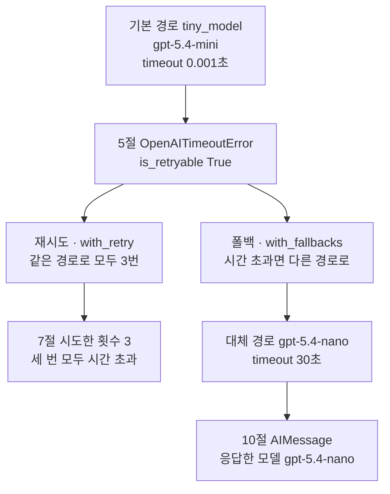
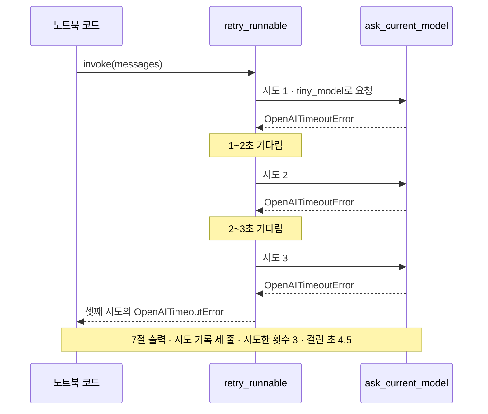
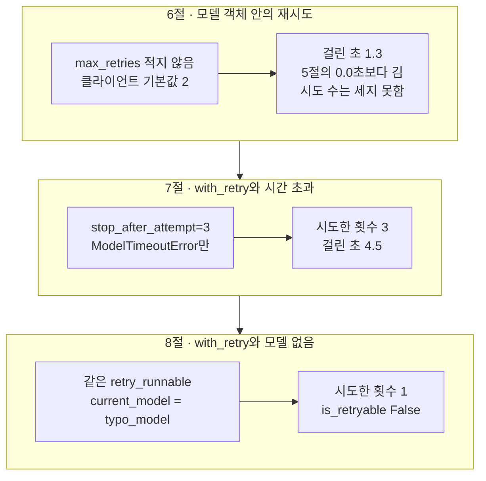
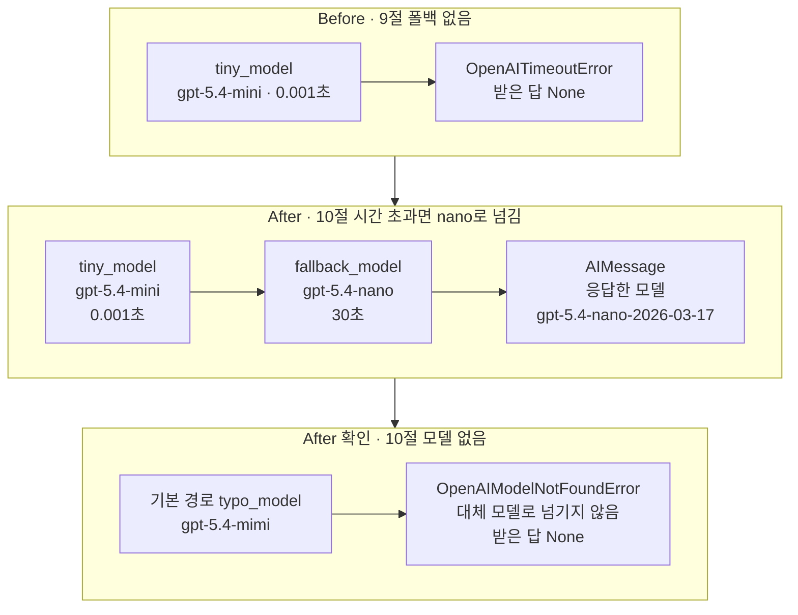

# 05-타임아웃-재시도-폴백

## _src 본문 (HTML 원본)

```html
<!--meta: 강의 1h · 실습은 챕터 전체 10h 안에서 진행합니다. -->
<h2 id="b1"><span class="no">1</span>학습 목표</h2>
<div class="goal"><p>이 절을 마치면 다음을 할 수 있습니다.</p><ul><li>모델 객체의 인자 <code>timeout</code>과 <code>max_retries</code>를 직접 적고, 적지 않았을 때 쓰이는 값을 출력으로 확인할 수 있습니다.</li><li>메서드 <code>with_retry()</code>에 다시 시도할 오류와 전체 시도 횟수를 적고, 시도한 횟수를 셀 수 있습니다.</li><li>메서드 <code>with_fallbacks()</code>로 정한 오류일 때만 대체 모델로 넘기고, 응답한 모델 이름을 기록할 수 있습니다.</li></ul></div>
<h2 id="b2"><span class="no">2</span>이 내용을 배우는 이유</h2>
<p>04절까지는 요청이 제시간에 끝났습니다. 서비스 모델은 인터넷 너머의 서버에서 답을 만듭니다. 그래서 네트워크나 서버 사정으로 답이 늦거나 오류가 날 수 있습니다.</p>
<p>아무 제한 없이 기다리면 사용자는 화면이 멈춘 것으로 생각합니다. 실패할 때마다 같은 요청을 끝없이 다시 보내면 기다리는 시간과 요청 수가 늘어납니다. 모델 이름 오타처럼, 다시 보내도 고쳐지지 않는 오류도 있습니다.</p>
<p>그래서 세 가지를 정합니다. 얼마나 기다릴지, 어떤 오류를 몇 번까지 다시 보낼지, 끝내 실패하면 어느 경로로 넘길지입니다. 다른 경로가 답했다면 그 사실도 기록해야 합니다.</p>
<p><strong>이 절의 질문</strong> — 요청이 늦거나 실패하면, 기다릴 시간과 다시 시도할 횟수, 넘길 경로를 어떻게 정하고 확인할까요?</p>
<h2 id="b3"><span class="no">3</span>앞에서 배운 내용</h2>
<table><thead><tr><th>앞 절</th><th>배운 것</th><th>이 절에서 이어지는 곳</th></tr></thead><tbody>
<tr><td>01절</td><td><code>invoke()</code>·<code>AIMessage</code>·끝난 이유, 모델 객체를 만들 때는 요청 0번, 인자를 더해 새 모델 객체 만들기(출력 상한 12)</td><td>4절 두 값을 적은 모델 객체, 5절 요청 없이 모델 객체 만들기</td></tr>
<tr><td>02절</td><td>모델 이름만 바꾼 <code>gpt-5.4-nano</code>, 모델 없음 오류 <code>ModelNotFoundError</code>와 404, 기록표의 실행 상태</td><td>8절·10절 없는 모델 이름, 10절 대체 모델</td></tr>
<tr><td>03절</td><td>양식을 붙이는 줄은 호출 객체 <code>RunnableSequence</code>만 만들고 요청 0번</td><td>7절 <code>RunnableRetry</code>, 10절 <code>RunnableWithFallbacks</code></td></tr>
<tr><td>04절</td><td>모르는 사용량은 0이 아니라 <code>None</code>, 받는 도중의 오류는 실행하지 않음</td><td>3절 비어 있는 설정 <code>None</code>, 주의 메모의 스트리밍</td></tr>
<tr><td>Ch 2 04·05·12절</td><td>함수 정의, <code>try/except 이름 as error</code>, <code>time.perf_counter()</code></td><td>7절 <code>ask_current_model()</code>, 5~10절 오류 받기, 걸린 초</td></tr>
<tr><td>Ch 5 08절</td><td>바깥 이름에 후보를 담고 함수 부르기, <code>round(값, 1)</code>, 한 번 잰 시간은 모델 속도가 아님</td><td>7·8절 <code>current_model</code> 바꾸기, 걸린 초 읽기</td></tr>
</tbody></table>
<p>01~04절의 모델 객체는 인자 <code>timeout</code>과 <code>max_retries</code>를 적지 않았습니다. 이 절에서 두 인자를 처음 적습니다. 적지 않았을 때 어떤 값이 쓰였는지도 노트북 3절에서 확인합니다.</p>
<p>04절 주의 메모에는 연결이 중간에 끊긴 스트리밍을 실행하지 않았다고 적었습니다. 이 절도 스트리밍 도중의 오류는 다루지 않고, <code>invoke()</code> 요청만 봅니다.</p>
<p>실습 폴더와 <code>.env</code> 파일의 <code>OPENAI_API_KEY</code>는 01절과 같습니다. 노트북은 앞 절 없이 새 커널에서 시작합니다.</p>
<h2 id="b4"><span class="no">4</span>핵심 개념</h2>
<h3>비유로 시작하기</h3>
<p>구슬을 나무 레일에 굴려 컵에 넣는 놀이를 떠올려 봅니다. 레일 끝의 문이 닫혀 있으면 구슬은 문 앞에서 멈춥니다.</p>
<p>모래시계가 다 떨어질 때까지 기다려도 문이 열리지 않으면, 같은 레일로 구슬을 몇 번 더 굴려 볼 수 있습니다. 그래도 막혀 있으면 옆길로 굴려 컵에 넣습니다.</p>
{{img:05-5-막힌-길과-옆길|나무 탁자 위 곧은 나무 레일 끝의 닫힌 작은 문 앞에 초록 구슬 세 알이 멈춰 있고 문 옆에 모래가 거의 다 떨어진 모래시계가 있으며, 레일 가운데에서 갈라진 옆길 끝의 둥근 컵에 주황 구슬 한 알이 들어 있는 삽화|같은 길로 보낸 초록 구슬 셋은 닫힌 문 앞에서 멈췄고, 갈라진 옆길로 간 주황 구슬만 컵에 도착했습니다.}}
<p><strong>그림 읽기</strong> — 나무 탁자 위 곧은 레일의 끝을 작은 문이 막고 있습니다. 문 앞에는 초록 구슬 세 알이 멈춰 있고, 문 옆에는 모래가 거의 다 떨어진 모래시계가 있습니다. 레일 가운데에서 옆길이 오른쪽 아래로 갈라지고, 그 끝 컵에 주황 구슬 한 알이 들어 있습니다.</p>
<p>모래시계는 기다리는 시간의 제한(타임아웃)입니다. 같은 레일로 굴린 구슬 셋은 같은 경로로 보낸 세 번의 시도(재시도)입니다. 옆길로 컵에 들어간 주황 구슬은 다른 모델이 보낸 답(폴백)입니다.</p>
<p>04절 그림의 구슬은 청크였지만, 이 그림의 구슬 한 알은 요청을 한 번 보내 보는 일입니다. 그림의 옆길은 구슬 셋보다 앞에서 갈라집니다. 노트북은 재시도와 폴백을 따로 실행했고, 한 호출에 함께 붙이지 않았습니다.</p>
<h3>타임아웃과 적지 않은 값</h3>
<p>타임아웃(timeout)은 답을 기다리는 최대 시간이고, 단위는 초입니다. 전화 신호음이 오래 가면 끊는 것과 비슷합니다. 노트북 4절은 인자 <code>timeout=30</code>을 적어 <code>timeout: 30.0</code>을 확인했습니다.</p>
<p>인자를 적지 않은 모델 객체는 어떨까요? 노트북 3절 출력은 <code>모델 객체 timeout: None</code>과 <code>openai 클라이언트 timeout: None</code>이었습니다. 설치한 langchain-openai 1.6.0과 openai 3.10.0 소스를 확인했습니다. 이 <code>None</code>은 시간 제한을 두지 않는다는 뜻이었습니다.</p>
<p>같은 출력의 <code>openai 클라이언트 max_retries: 2</code>도 봅니다. 모델 객체의 <code>max_retries</code>가 비어 있으면, 요청을 보내는 openai 패키지의 기본값 2가 쓰였습니다. 적지 않은 값도 어딘가에서 정해져 있으므로, 두 값은 코드에 적습니다.</p>
<h3>재시도와 다시 시도할 오류</h3>
<p>재시도(retry)는 실패한 요청을 같은 설정으로 다시 보내는 일입니다. 다시 보내 보는 한 번 한 번을 시도라고 부릅니다. 첫 시도를 포함해 센 수가 전체 시도 횟수입니다.</p>
<p>재시도는 모든 오류에 쓰지 않습니다. 서버가 잠깐 늦어서 난 시간 초과는 다시 보내면 성공할 수도 있습니다. 없는 모델 이름은 몇 번을 보내도 같은 404가 옵니다.</p>
<p>라이브러리 LangChain은 오류 종류마다 속성 <code>is_retryable</code>에 이 구분을 적어 둡니다. 노트북 5절의 시간 초과 오류는 <code>다시 시도할 수 있는 오류인가: True</code>였습니다. 8절의 모델 없음 오류는 <code>False</code>였습니다.</p>
<p>메서드 <code>with_retry()</code>는 호출 객체에 다시 시도 규칙을 붙입니다. 인자 <code>retry_if_exception_type</code>에는 다시 시도할 오류 이름을 적습니다. 인자 <code>stop_after_attempt</code>에는 전체 시도 횟수를 적습니다.</p>
<p>노트북 7절은 시도를 세려고, 요청을 보내는 함수를 클래스 <code>RunnableLambda</code>로 감쌌습니다. 감싼 결과는 03절의 <code>RunnableSequence</code>처럼 <code>invoke()</code>로 부르는 호출 객체입니다.</p>
<h3>폴백과 응답한 모델</h3>
<p>폴백(fallback)은 기본 경로가 실패하면 미리 정해 둔 다른 경로로 넘기는 일입니다. 전화가 안 되면 문자를 보내는 것과 비슷합니다. 메서드 <code>with_fallbacks()</code>는 대체 경로 목록과 넘길 오류 이름을 받습니다.</p>
<p>폴백으로 받은 답은 기본 경로가 성공했다는 뜻이 아닙니다. 노트북 10절에서 기본 경로는 <code>gpt-5.4-mini</code>였고, 응답한 모델은 <code>gpt-5.4-nano-2026-03-17</code>이었습니다. 그래서 답과 함께 응답 메타데이터의 키 <code>model_name</code>을 기록합니다.</p>
{{mermaid:05-1-세-가지-장치|맨 위 보라 상자 기본 경로 tiny_model gpt-5.4-mini timeout 0.001초가 노란 상자 5절 OpenAITimeoutError is_retryable True로 가고, 왼쪽 갈래는 파란 상자 재시도 with_retry 같은 경로로 모두 3번에서 노란 상자 7절 시도한 횟수 3으로, 오른쪽 갈래는 파란 상자 폴백 with_fallbacks에서 보라 상자 대체 경로 gpt-5.4-nano를 거쳐 노란 상자 10절 AIMessage 응답한 모델 gpt-5.4-nano로 이어지는 흐름도|기다리는 시간 0.001초에서 시간 초과 오류가 나자, 재시도는 같은 경로로 3번 시도했고 폴백은 gpt-5.4-nano로 넘겨 답을 받았습니다.}}
<p><strong>도식 읽기</strong> — 위에서 아래로 읽습니다. 맨 위 보라 상자는 기다리는 시간을 0.001초로 둔 기본 경로이고, 노란 상자는 출력으로 확인한 오류와 결과입니다. 파란 상자 두 개는 우리가 붙인 코드 줄입니다.</p>
<p>시간 초과 오류 아래에서 두 갈래로 나뉩니다. 왼쪽 갈래는 같은 경로로 모두 3번 시도했지만 세 번 모두 시간 초과였습니다. 오른쪽 갈래는 대체 경로 <code>gpt-5.4-nano</code>로 넘겨 <code>AIMessage</code>를 받았습니다. 두 갈래는 노트북 7절과 10절에서 따로 실행했습니다.</p>
<h3>이 절에서 쓰는 말</h3>
<table><thead><tr><th>용어</th><th>뜻</th><th>이 절에서 보이는 모습</th></tr></thead><tbody>
<tr><td>타임아웃(timeout)</td><td>답을 기다리는 최대 시간(초). 전화 신호음이 오래 가면 끊는 것과 비슷함</td><td><code>timeout: 30.0</code></td></tr>
<tr><td>재시도(retry)</td><td>실패한 요청을 같은 설정으로 다시 보내는 일. 모델 객체의 <code>max_retries</code>나 <code>with_retry()</code>로 정함</td><td><code>openai 클라이언트 max_retries: 2</code></td></tr>
<tr><td>시도</td><td>요청을 한 번 보내 보는 일. 첫 시도를 포함해 셈</td><td><code>시도한 횟수: 3</code></td></tr>
<tr><td>시간 초과 오류</td><td>정한 시간 안에 답이 오지 않을 때 나는 오류 <code>ModelTimeoutError</code></td><td><code>오류 종류: OpenAITimeoutError</code></td></tr>
<tr><td>다시 시도할 수 있는 오류</td><td>같은 요청을 다시 보내면 성공할 수도 있다고 LangChain이 정해 둔 오류. 속성 <code>is_retryable</code></td><td><code>다시 시도할 수 있는 오류인가: True</code></td></tr>
<tr><td>폴백(fallback)</td><td>기본 경로가 실패하면 미리 정한 다른 경로로 넘기는 일. 전화가 안 되면 문자를 보내는 것과 비슷함</td><td><code>호출 객체 종류: RunnableWithFallbacks</code></td></tr>
<tr><td>응답한 모델</td><td>실제로 답을 보낸 모델 이름. 응답 메타데이터의 키 <code>model_name</code></td><td><code>응답한 모델: gpt-5.4-nano-2026-03-17</code></td></tr>
</tbody></table>
<h2 id="b5"><span class="no">5</span>실행 예제</h2>
<p>노트북은 적지 않은 두 값을 먼저 봅니다. 두 값을 적은 모델로 답을 받고, 기다리는 시간 0.001초로 실제 시간 초과 오류를 받습니다. 그다음 모델 객체 안의 재시도와 <code>with_retry()</code>의 재시도를 차례로 봅니다.</p>
<p>실제 OpenAI 모델을 temperature 0으로 부릅니다. 이 페이지의 출력은 2026-09-17에 실행한 결과입니다. 요청 시도는 Before·After까지 모두 13번이고, 답을 받은 요청은 2번입니다. 예상 비용은 0.01달러 미만이고, 답 문장과 걸린 시간은 실행마다 달라질 수 있습니다.</p>
{{notebook:05-타임아웃-재시도-폴백|example}}
<p class="look"><b>확인할 점</b> — 3절의 <code>openai 클라이언트 max_retries: 2</code>와 5절의 <code>오류 종류: OpenAITimeoutError</code>를 봅니다. 7절에서는 <code>시도한 횟수: 3</code>을, 8절에서는 <code>시도한 횟수: 1</code>을 나란히 봅니다.</p>
<h3>다시 시도한 순서</h3>
<p>노트북 7절의 호출 객체 <code>retry_runnable</code>이 한 일을 시간 순서로 놓아 봅니다. 함수 <code>ask_current_model()</code>은 불릴 때마다 목록에 한 줄을 적고, <code>tiny_model</code>로 요청을 보냈습니다.</p>
{{mermaid:05-2-다시-시도-순서|노트북 코드, retry_runnable, ask_current_model 세 세로줄 사이에서 invoke 뒤 retry_runnable이 함수를 시도 1로 부르고 OpenAITimeoutError를 받은 뒤 1~2초 기다림 메모, 시도 2와 오류 뒤 2~3초 기다림 메모, 시도 3과 오류 뒤 셋째 시도의 OpenAITimeoutError를 노트북 코드로 넘기고 7절 출력 시도 기록 세 줄 시도한 횟수 3 걸린 초 4.5 메모가 붙은 순서도|호출 객체 retry_runnable은 시간 초과 오류를 받을 때마다 조금씩 더 기다린 뒤 함수를 다시 불렀고, 셋째 시도의 오류를 노트북 코드로 넘겼습니다.}}
<p><strong>도식 읽기</strong> — 세로줄은 왼쪽부터 노트북 코드, 호출 객체 <code>retry_runnable</code>, 함수 <code>ask_current_model</code>입니다. 위에서 아래로 시간 순서이고, 실선은 부르기, 점선은 받은 오류입니다.</p>
<p>호출 객체는 오류를 받을 때마다 조금 기다린 뒤 함수를 다시 불렀습니다. 기다린 시간은 설치한 langchain-core 1.6.2와 tenacity 9.1.4 소스로 계산한 범위입니다. 첫 기다림은 1~2초, 둘째는 2~3초이고, 노트북은 기다린 시간을 따로 재지 않았습니다.</p>
<p>셋째 시도의 오류는 노트북 코드까지 그대로 왔습니다. 맨 아래 노란 메모는 셀 출력 <code>시도한 횟수: 3</code>과 <code>걸린 초: 4.5</code>입니다. 두 기다림을 더하면 3~5초이고, 걸린 시간이 그 범위에 듭니다.</p>
<h3>다시 시도하는 두 자리</h3>
<p>노트북 6·7·8절은 다시 시도가 일어나는 두 자리를 봤습니다. 하나는 모델 객체 안의 openai 클라이언트이고, 다른 하나는 우리가 붙인 <code>with_retry()</code>입니다.</p>
{{mermaid:05-3-다시-시도-비교|위 칸 6절 모델 객체 안의 재시도는 초록 상자 max_retries 적지 않음 클라이언트 기본값 2가 노란 상자 걸린 초 1.3 5절의 0.0초보다 김 시도 수는 세지 못함으로, 가운데 칸 7절은 파란 상자 stop_after_attempt=3 ModelTimeoutError만이 노란 상자 시도한 횟수 3 걸린 초 4.5로, 아래 칸 8절은 파란 상자 같은 retry_runnable current_model = typo_model이 노란 상자 시도한 횟수 1 is_retryable False로 이어지는 비교 그림|적지 않은 max_retries도 기다린 시간을 늘렸고, with_retry는 시간 초과만 3번 시도했으며 모델 없음 오류는 1번으로 멈췄습니다.}}
<p><strong>도식 읽기</strong> — 위에서 아래로 세 칸을 읽고, 칸 안은 왼쪽에서 오른쪽으로 읽습니다. 초록 상자는 적지 않은 설정, 파란 상자는 코드 줄, 노란 상자는 출력으로 확인한 결과입니다.</p>
<p>위 칸은 <code>max_retries</code>를 적지 않은 6절입니다. 오류는 5절과 같았지만 <code>걸린 초: 1.3</code>으로 5절의 0.0초보다 길었습니다. openai 3.10.0 소스로는 시도 사이에 0.375~0.5초와 0.75~1초를 기다립니다. 두 기다림이 이 시간과 맞지만, 시도 수는 세지 못했습니다.</p>
<p>가운데 칸 7절은 시간 초과 오류만 다시 시도해서 시도가 3번이었습니다. 아래 칸 8절은 같은 호출 객체에 없는 모델 이름을 담았고, 모델 없음 오류로 1번에 멈췄습니다.</p>
<p>두 자리를 한 경로에 함께 두면 시도 수가 곱해집니다. 모델 객체 안에서 2번 더 시도하면 한 번 부를 때 요청은 3번입니다. 바깥 <code>with_retry()</code>가 이것을 3번 부르면 요청은 최대 3 × 3 = 9번입니다. 이 곱은 소스로 계산한 수이고, 이번에 실행하지 않았습니다.</p>
<p>그래서 노트북 7절은 안쪽에서 다시 시도하지 않는 모델(<code>max_retries: 0</code>)을 썼습니다. 함수가 센 시도 수가 요청을 보내 본 횟수와 같아지게 하려는 것입니다.</p>
<h2 id="b6"><span class="no">6</span>일부러 실패해 보기</h2>
<p>Before에서는 기본 경로 <code>tiny_model</code> 하나에만 요청을 보냅니다. 서버가 제시간에 답하지 못한 상황을 기다리는 시간 0.001초로 대신합니다. 받은 답을 담을 변수는 <code>None</code>으로 시작합니다.</p>
<p>After에서는 같은 기본 경로에 <code>with_fallbacks()</code>로 대체 모델 <code>gpt-5.4-nano</code>를 붙입니다. 넘길 오류는 <code>ModelTimeoutError</code> 하나만 적습니다. 끝으로 기본 경로를 없는 모델 이름으로 바꿔, 목록에 없는 오류도 넘기는지 봅니다.</p>
{{notebook:05-타임아웃-재시도-폴백|failure}}
<p>Before 출력은 <code>오류 종류: OpenAITimeoutError</code>와 <code>받은 답: None</code>이었습니다. 셀은 오류를 받아 끝까지 실행했지만, 사용자에게 보여 줄 답이 없습니다. 구문 <code>try</code>가 없었다면 이 셀은 오류로 멈췄을 것입니다.</p>
<p>After 출력은 <code>응답 객체 종류: AIMessage</code>와 <code>응답한 모델: gpt-5.4-nano-2026-03-17</code>이었습니다. 기본 경로 모델은 <code>gpt-5.4-mini</code>였으므로, 답은 대체 경로가 보냈습니다. 응답한 모델 이름에 nano가 들어 있는지 <code>assert</code>로 확인했습니다.</p>
<p>기본 경로를 <code>typo_model</code>로 바꾼 확인에서는 <code>오류 종류: OpenAIModelNotFoundError</code>와 <code>받은 답: None</code>이었습니다. 넘길 오류를 좁혀 두어서, 고쳐야 할 모델 이름 오류가 대체 모델의 답에 가려지지 않았습니다.</p>
{{mermaid:05-4-Before-After|위 칸 Before 9절 폴백 없음은 보라 상자 tiny_model gpt-5.4-mini 0.001초가 빨간 상자 OpenAITimeoutError 받은 답 None으로, 가운데 칸 After 10절은 보라 상자 tiny_model에서 보라 상자 fallback_model gpt-5.4-nano 30초를 거쳐 노란 상자 AIMessage 응답한 모델 gpt-5.4-nano-2026-03-17로, 아래 칸 After 확인은 초록 상자 기본 경로 typo_model gpt-5.4-mimi가 노란 상자 OpenAIModelNotFoundError 대체 모델로 넘기지 않음 받은 답 None으로 이어지는 비교 그림|폴백이 없는 Before는 답을 받지 못했고, After는 시간 초과 뒤 gpt-5.4-nano가 답했으며, 모델 없음 오류는 대체 모델로 넘기지 않았습니다.}}
<p><strong>도식 읽기</strong> — 위에서 아래로 세 칸을 읽고, 칸 안은 왼쪽에서 오른쪽으로 읽습니다. 보라 상자는 실행한 모델이고, 초록 상자는 없는 모델 이름을 넣은 설정입니다.</p>
<p>위 칸 끝의 빨간 상자는 답을 받지 못한 Before 결과입니다. 오류는 받아 출력했지만 사용자에게 답이 없으므로, 결함 결과로 칠했습니다. 가운데 칸과 아래 칸의 노란 상자는 출력으로 확인한 After 결과입니다.</p>
<h2 id="b7"><span class="no">7</span>주의할 점과 실무 메모</h2>
<ul><li>두 번째 시도에서 성공하는 장면은 이번에 실행하지 않았습니다. 수업 중에 서버를 잠깐만 늦게 만들 방법이 없었습니다. 노트북 7절의 세 시도는 모두 같은 원인으로 실패했습니다.</li>
<li>기다리는 시간 0.001초, 전체 시도 3번, 대체 모델 <code>gpt-5.4-nano</code>는 흐름을 보여 주려고 정한 예입니다. 교재를 만들 때 탐색 실행으로 시간 초과 오류, 시도 수, 대체 모델의 답을 먼저 확인한 뒤 정했습니다. 실제 서비스의 시간 제한은 사용자가 기다릴 수 있는 시간에 맞춰 정합니다.</li>
<li>시간 초과로 끝난 시도가 서버에 닿았는지는 이번 출력으로 알 수 없습니다. 그런 시도의 사용량과 요금도 이번에 확인하지 않았습니다. 기다림을 멈춘 것과 서버의 처리가 멈춘 것은 같은 일이라고 볼 수 없습니다.</li>
<li>걸린 시간은 한 번씩 잰 값입니다. Ch 5 08절처럼, 한 번 잰 시간으로 모델이나 네트워크의 속도를 말하지 않습니다.</li>
<li>온라인 LangChain Models 문서는 채팅 모델이 기본으로 6번까지 다시 시도한다고 안내합니다. 설치한 langchain-openai 1.6.0에서는 노트북 3절 출력대로 openai 클라이언트 값 2가 쓰였습니다. openai 패키지 설명서의 기본 시간 제한 10분도, 이 판 조합의 모델 객체에서는 <code>None</code>이었습니다. 판마다 다를 수 있으니 3절처럼 출력해 확인합니다.</li>
<li>요청 제한(429)·서버 오류(5xx)·인증 실패(401)는 이번에 실행하지 않았습니다. 설치한 langchain-core 1.6.2 소스에서 앞의 둘은 <code>is_retryable</code>이 <code>True</code>, 인증 실패는 <code>False</code>입니다. 설치한 openai 3.10.0 소스는 시간 초과·연결 오류·408·409·429·5xx만 스스로 다시 시도합니다. 404는 다시 시도하지 않습니다.</li>
<li>대체 경로까지 모두 실패하면, 설치한 langchain-core 1.6.2 소스에서는 기본 경로의 첫 오류가 납니다. 대체 경로의 오류가 아니라는 점을 기록할 때 헷갈리지 않습니다. 이번에 실행하지 않았습니다.</li>
<li>모델 호출 뒤의 저장이나 결제를 같은 함수에 넣고 다시 시도하지 않습니다. 다시 시도할 때마다 저장도 다시 일어날 수 있기 때문입니다. 이번에 실행하지 않았습니다.</li>
<li>스트리밍 도중의 시간 초과와 연결 끊김은 이번에 실행하지 않았습니다. 04절 주의 메모대로, 받는 도중의 오류는 <code>for</code> 줄에서 다시 납니다. 메서드 <code>with_retry()</code>를 스트리밍에 붙였을 때의 모습도 확인하지 않았습니다.</li>
<li>교재 출력은 Linux의 Python 3.12.13으로 만들었습니다. 패키지는 langchain 1.4.0, langchain-core 1.6.2, langchain-openai 1.6.0입니다. openai 3.10.0, tenacity 9.1.4, python-dotenv 1.2.3도 함께 썼습니다. 다른 버전과 Windows·macOS에서는 실행하지 않았습니다.</li></ul>
<h2 id="b8"><span class="no">8</span>정리와 다음 절</h2>
<ul><li>인자 <code>timeout</code>과 <code>max_retries</code>를 적지 않은 모델 객체는 시간 제한이 없었고, openai 클라이언트가 두 번 더 시도하게 되어 있었습니다.</li><li>메서드 <code>with_retry()</code>는 목록에 적은 시간 초과 오류만 모두 3번 시도했고, 모델 없음 오류는 1번에 멈췄습니다.</li><li>메서드 <code>with_fallbacks()</code>로 시간 초과일 때만 <code>gpt-5.4-nano</code>가 답했으므로, 답과 함께 응답한 모델 이름을 기록합니다.</li></ul>
<p><strong>다음 학습과 이어지는 지점</strong> — 06절에서는 같은 과제를 보내고 토큰 수, 비용, 걸린 시간을 한 기록에 모아 비교합니다. 다시 시도와 대체 경로는 요청 수와 응답한 모델을 바꾸므로, 그 기록에도 함께 적어야 합니다.</p>
<h2 id="b9"><span class="no">9</span>복습 문제</h2>
<details class="quiz"><summary>문제 1 · 적지 않은 시간 제한</summary><p class="quiz-q">함수 <code>init_chat_model()</code>에 인자 <code>timeout</code>을 적지 않은 모델 객체는 몇 초까지 기다리나요?</p><p class="quiz-a"><b>해설</b> — 이 교재의 판 조합에서는 시간 제한이 없습니다. 노트북 3절 출력이 <code>openai 클라이언트 timeout: None</code>이었습니다. 늦은 요청을 끊으려면 인자 <code>timeout</code>을 적습니다.</p></details>
<details class="quiz"><summary>문제 2 · 전체 시도 횟수</summary><p class="quiz-q">인자 <code>stop_after_attempt=3</code>이면 첫 실패 뒤에 세 번을 더 시도하나요?</p><p class="quiz-a"><b>해설</b> — 아닙니다. 첫 시도를 포함해 모두 3번입니다. 노트북 7절의 시도 기록도 세 줄이었습니다.</p></details>
<details class="quiz"><summary>문제 3 · 다시 시도하지 않은 오류</summary><p class="quiz-q">노트북 8절에서 같은 <code>retry_runnable</code>로 보냈는데 시도가 1번에 멈췄습니다. 왜 그런가요?</p><p class="quiz-a"><b>해설</b> — 모델 없음 오류는 인자 <code>retry_if_exception_type</code>의 목록에 없었기 때문입니다. 없는 모델 이름은 다시 보내도 같은 404가 오고, 오류의 <code>is_retryable</code>도 <code>False</code>였습니다. 모델 이름을 고쳐야 합니다.</p></details>
<details class="quiz"><summary>문제 4 · 겹친 재시도</summary><p class="quiz-q">안쪽 모델 객체가 <code>max_retries=2</code>이고, 바깥에 <code>stop_after_attempt=3</code>인 <code>with_retry()</code>를 붙였습니다. 계속 시간 초과가 나면 요청은 최대 몇 번 나갈까요?</p><p class="quiz-a"><b>해설</b> — 한 번 부를 때 안쪽에서 요청이 3번 나가고, 바깥에서 그것을 3번 부릅니다. 그래서 최대 3 × 3 = 9번입니다. 소스로 계산한 수이고, 이번 노트북에서는 실행하지 않았습니다.</p></details>
<details class="quiz"><summary>문제 5 · 폴백으로 받은 답의 기록</summary><p class="quiz-q">노트북 10절 After의 답을 기본 경로 모델 <code>gpt-5.4-mini</code>의 답으로 기록해도 되나요?</p><p class="quiz-a"><b>해설</b> — 안 됩니다. 응답한 모델은 <code>gpt-5.4-nano-2026-03-17</code>이었습니다. 기본 경로 이름으로 적으면 사용량과 답의 품질을 다른 모델의 것으로 셉니다.</p></details>
<h2 id="b10"><span class="no">10</span>참고 자료</h2>
<p>문서는 2026-09-17에 다시 열어 확인했습니다. 기본값, 다시 시도하는 오류, 기다리는 시간, 폴백 순서는 실습 가상환경에 설치한 패키지 소스에서도 확인했습니다. 확인한 판은 <code>langchain-core 1.6.2</code>, <code>langchain-openai 1.6.0</code>, <code>openai 3.10.0</code>, <code>tenacity 9.1.4</code>입니다.</p>
<ul><li><div><a href="https://docs.langchain.com/oss/python/langchain/models">LangChain Models</a></div>모델 초기화 인자 timeout·max_retries · 확인 2026-09-17</li><li><div><a href="https://reference.langchain.com/python/langchain-core/runnables/base/Runnable/with_retry">Runnable.with_retry reference</a></div>다시 시도할 오류와 전체 시도 횟수 · 확인 2026-09-17</li><li><div><a href="https://reference.langchain.com/python/langchain-core/runnables/base/Runnable/with_fallbacks">Runnable.with_fallbacks reference</a></div>대체 경로와 넘길 오류 · 확인 2026-09-17</li><li><div><a href="https://github.com/openai/openai-python">openai-python README</a></div>기본 재시도 횟수와 시간 제한 · 확인 2026-09-17</li><li><div><a href="https://github.com/langchain-ai/langchain/blob/master/LICENSE">LangChain MIT License</a></div>예제의 질문과 설명은 이 교재에 맞게 새로 썼습니다</li></ul>
```

## 노트북 셀 (순서대로)

### [0] markdown {'html': 'skip'}

# 타임아웃 재시도 폴백

**이 노트북에서 할 일**

1. 모델 객체가 답을 기다리는 시간과 다시 시도하는 횟수를 확인하고, 두 값을 직접 적어 요청을 보냅니다.
2. 시간 제한을 아주 짧게 두어 실제 시간 초과 오류를 받고, `with_retry()`로 다시 시도한 횟수를 셉니다.
3. 기본 경로가 시간 초과로 실패하면 `with_fallbacks()`로 다른 모델이 답하게 하고, 응답한 모델 이름을 확인합니다.

**준비물** — 프로젝트 폴더 `.env` 파일의 `OPENAI_API_KEY`가 필요합니다. 데이터 파일은 없습니다.

인터넷 서비스의 모델 `gpt-5.4-mini`와 `gpt-5.4-nano`에 요청을 모두 13번 시도합니다.
답을 받는 요청은 2번이고, 없는 모델 이름으로 보내 오류를 받는 요청이 2번입니다. 나머지 9번은 시간 제한에 걸립니다.

실행 시간은 1분 안팎입니다. 예상 비용은 0.01달러 미만입니다(06절에 적은 2026-09-09 공식 요금 기준).

**기준 버전** — 실습 폴더에 고정한 패키지 판을 씁니다. langchain 1.4.0, langchain-core 1.6.2, langchain-openai 1.6.0입니다.
함께 설치되는 openai 패키지는 3.10.0, tenacity는 9.1.4이고, python-dotenv는 1.2.3입니다.

교재 출력은 Linux의 Python 3.12.13으로 만들었습니다. 다른 버전과 Windows·macOS에서는 이번에 실행하지 않았습니다.

실습 폴더 `labs/part2/ch06-langchain-start`에서 `uv sync --locked`를 실행합니다.
그다음 이 폴더의 `.venv` 커널을 고르고 첫 셀부터 순서대로 실행합니다.

### [1] markdown {'html': 'skip'}

## 오늘 볼 그림


위에서 아래로 읽습니다. 맨 위 보라 상자는 기다리는 시간을 0.001초로 둔 기본 경로이고, 노란 상자는 출력으로 확인한 오류와 결과입니다.
시간 초과 오류 아래에서 두 갈래로 나뉩니다. 왼쪽 파란 상자는 같은 경로로 다시 시도하는 재시도, 오른쪽 파란 상자는 다른 모델로 넘기는 폴백입니다.

두 갈래는 7절과 10절에서 따로 실행합니다. 이 노트북은 두 장치를 한 호출에 함께 붙이지 않습니다.

### [2] markdown {}

## 1. 준비

첫 셀은 패키지를 설치하고 설치된 버전을 출력합니다. 설치에는 몇십 초가 걸릴 수 있습니다.
패키지 openai는 langchain-openai가 OpenAI 서버에 요청을 보낼 때 쓰는 패키지입니다. 패키지 tenacity는 7절의 `with_retry()`가 다시 시도할 때 씁니다.

### [3] code {'execution': {'iopub.execute_input': '2026-09-17T01:39:48.319341Z', 'iopub.status.busy': '2026-09-17T01:39:48.319172Z', 'iopub.status.idle': '2026-09-17T01:39:49.018342Z', 'shell.execute_reply': '2026-09-17T01:39:49.017737Z'}, 'lesson_role': 'setup'}

```python
# 이 절에서 쓰는 패키지를 설치하고 버전을 확인합니다
%pip install -q "langchain==1.4.0" "langchain-openai==1.6.0" "python-dotenv==1.2.3"
from importlib.metadata import version

print("langchain:", version("langchain"))
print("langchain-core:", version("langchain-core"))
print("langchain-openai:", version("langchain-openai"))
print("openai:", version("openai"))
print("tenacity:", version("tenacity"))
print("python-dotenv:", version("python-dotenv"))
```

출력:
```
Note: you may need to restart the kernel to use updated packages.
langchain: 1.4.0
langchain-core: 1.6.2
langchain-openai: 1.6.0
openai: 3.10.0
tenacity: 9.1.4
python-dotenv: 1.2.3

```

### [4] markdown {}

**결과 읽기** — 출력 줄은 `langchain: 1.4.0`, `openai: 3.10.0`, `tenacity: 9.1.4` 등 여섯 줄입니다.
준비물에 적은 기준 버전과 같습니다.

01절과 같이 모델 객체를 만드는 함수를 불러옵니다. 걸린 시간을 재는 모듈 `time`도 불러옵니다.
이 모듈은 Ch 2 12절에서 `time.perf_counter()`로 걸린 시간을 잴 때 썼습니다.

### [5] code {'execution': {'iopub.execute_input': '2026-09-17T01:39:49.019498Z', 'iopub.status.busy': '2026-09-17T01:39:49.019412Z', 'iopub.status.idle': '2026-09-17T01:39:49.399967Z', 'shell.execute_reply': '2026-09-17T01:39:49.399563Z'}, 'lesson_role': 'setup'}

```python
# 걸린 시간을 재는 모듈과 모델 객체를 만드는 함수를 불러옵니다
import time

from langchain.chat_models import init_chat_model
```

출력:
```

```

### [6] markdown {}

01절과 같은 셀로 API 키가 있는지 확인합니다. 키 값은 출력하지 않고, 있는지만 봅니다.
`True` 값이 나오면 다음으로 넘어갑니다.

### [7] code {'execution': {'iopub.execute_input': '2026-09-17T01:39:49.400802Z', 'iopub.status.busy': '2026-09-17T01:39:49.400727Z', 'iopub.status.idle': '2026-09-17T01:39:49.405429Z', 'shell.execute_reply': '2026-09-17T01:39:49.405128Z'}, 'lesson_role': 'setup'}

```python
# .env 파일에서 OpenAI API 키를 읽습니다(키 값은 출력하지 않습니다)
import os
from dotenv import find_dotenv, load_dotenv

env_path = find_dotenv(usecwd=True)
load_dotenv(env_path)
has_key = os.getenv("OPENAI_API_KEY") is not None
print("OPENAI_API_KEY 설정 여부:", has_key)
assert has_key, "프로젝트 폴더의 .env 파일에 OPENAI_API_KEY를 적어 주세요."
```

출력:
```
OPENAI_API_KEY 설정 여부: True

```

### [8] markdown {}

실습에 쓸 모델을 준비합니다.
01절과 같은 설정으로 모델 객체를 만듭니다. 이 셀은 요청을 보내지 않습니다.

### [9] code {'execution': {'iopub.execute_input': '2026-09-17T01:39:49.405951Z', 'iopub.status.busy': '2026-09-17T01:39:49.405903Z', 'iopub.status.idle': '2026-09-17T01:39:50.386958Z', 'shell.execute_reply': '2026-09-17T01:39:50.386535Z'}}

```python
# 실습에 쓸 모델을 준비합니다
model = init_chat_model(
    "openai:gpt-5.4-mini",
    temperature=0,
    reasoning_effort="none",
)
print("모델 이름:", model.model_name)
print("temperature:", model.temperature)
```

출력:
```
모델 이름: gpt-5.4-mini
temperature: 0.0

```

### [10] markdown {}

**결과 읽기** — 출력 줄은 `모델 이름: gpt-5.4-mini`와 `temperature: 0.0`입니다. 이것으로 준비가 끝났습니다.
이 노트북의 출력은 2026-09-17에 이 모델로 실행한 결과입니다. 실행마다 답 문장과 걸린 시간이 달라질 수 있습니다.
01절에서 본 것처럼 temperature 0은 Ch 5 06절의 뽑기를 끈 설정(`do_sample=False`)과 같은 것이 아닙니다.

### [11] markdown {}

## 2. 메시지 목록 만들기

이번 절의 질문은 재시도 횟수를 제한하는 이유입니다. system 지시는 02·04절의 「한 문장의 한국어로 답하세요.」를 다시 씁니다.
01절처럼 `(역할, 내용)` 튜플 목록으로 적고, 한 줄씩 출력합니다.

실행 전에 예상합니다. 역할 이름 system과 user가 한 줄씩 나올 것입니다.

### [12] code {'execution': {'iopub.execute_input': '2026-09-17T01:39:50.387632Z', 'iopub.status.busy': '2026-09-17T01:39:50.387566Z', 'iopub.status.idle': '2026-09-17T01:39:50.389326Z', 'shell.execute_reply': '2026-09-17T01:39:50.388969Z'}}

```python
# 한 문장으로 답하라는 공통 지시와 이번 질문을 튜플 목록에 담습니다
messages = [
    ("system", "한 문장의 한국어로 답하세요."),
    ("user", "재시도 횟수를 제한해야 하는 이유를 설명하세요."),
]
print("메시지 목록:")
for role, content in messages:
    print(role, "|", content)
```

출력:
```
메시지 목록:
system | 한 문장의 한국어로 답하세요.
user | 재시도 횟수를 제한해야 하는 이유를 설명하세요.

```

### [13] markdown {}

**결과 읽기** — 라벨 줄 아래 첫 줄은 `system | 한 문장의 한국어로 답하세요.`입니다. 둘째 줄은 `user | 재시도 횟수를 제한해야 하는 이유를 설명하세요.`입니다.
아직 목록만 만들었고 요청은 보내지 않았습니다.

## 3. 적지 않은 두 값 보기

01~04절의 모델 객체는 기다리는 시간과 다시 시도하는 횟수를 적지 않았습니다. 적지 않은 두 값이 무엇인지 봅니다.
기다리는 시간의 인자 이름은 `timeout`이지만, 모델 객체에는 속성 `request_timeout`으로 담깁니다. 다시 시도하는 횟수는 속성 `max_retries`입니다.

속성 `root_client`는 모델 객체가 요청을 보낼 때 쓰는 openai 패키지의 클라이언트(요청을 보내는 객체)입니다. 이 객체의 두 값도 함께 출력합니다.

실행 전에 예상합니다. 적지 않았으니 비어 있다는 뜻의 `None`이 보일 것입니다.

### [14] code {'execution': {'iopub.execute_input': '2026-09-17T01:39:50.390006Z', 'iopub.status.busy': '2026-09-17T01:39:50.389953Z', 'iopub.status.idle': '2026-09-17T01:39:50.391918Z', 'shell.execute_reply': '2026-09-17T01:39:50.391489Z'}}

```python
# 01~04절처럼 두 값을 적지 않은 모델 객체의 설정을 봅니다(요청 없음)
print("모델 객체 timeout:", model.request_timeout)
print("모델 객체 max_retries:", model.max_retries)
print("openai 클라이언트 timeout:", model.root_client.timeout)
print("openai 클라이언트 max_retries:", model.root_client.max_retries)
```

출력:
```
모델 객체 timeout: None
모델 객체 max_retries: None
openai 클라이언트 timeout: None
openai 클라이언트 max_retries: 2

```

### [15] markdown {}

**결과 읽기** — 출력 줄은 `모델 객체 timeout: None`, `모델 객체 max_retries: None`, `openai 클라이언트 timeout: None`, `openai 클라이언트 max_retries: 2`입니다.
모델 객체의 두 값은 비어 있지만, 클라이언트의 다시 시도 횟수는 2였습니다.

설치한 langchain-openai 1.6.0 소스에서, 비어 있는 `max_retries`는 클라이언트에 넘기지 않는 것을 확인했습니다. 그래서 openai 패키지의 기본값 2가 쓰입니다.
기다리는 시간 `None`은 시간 제한을 두지 않는다는 뜻입니다. 서버가 늦으면 답이 올 때까지 기다리게 됩니다. 늦은 서버에 보내는 장면은 이번에 실행하지 않았습니다.

적지 않은 값도 어딘가에서 정해져 있습니다. 4절부터는 두 값을 직접 적습니다.

## 4. 기다리는 시간과 다시 시도하는 횟수 적기

타임아웃(timeout)은 답을 기다리는 최대 시간이고, 단위는 초입니다. 전화 신호음이 오래 가면 끊는 것과 비슷합니다.
재시도(retry)는 실패한 요청을 같은 설정으로 다시 보내는 일입니다. 다시 보내 보는 한 번 한 번을 시도라고 부릅니다.

아래 셀은 `timeout=30`, `max_retries=1`을 준 새 모델 객체를 만듭니다. 01절 노트북 7절처럼 인자를 더해 새 객체를 만듭니다.
실패하면 한 번 더 보내므로, 시도는 최대 2번입니다. 이 셀은 요청을 보내지 않습니다.

실행 전에 예상합니다. 두 값이 `None` 대신 적은 값으로 보일 것입니다.

### [16] code {'execution': {'iopub.execute_input': '2026-09-17T01:39:50.392442Z', 'iopub.status.busy': '2026-09-17T01:39:50.392397Z', 'iopub.status.idle': '2026-09-17T01:39:50.395281Z', 'shell.execute_reply': '2026-09-17T01:39:50.394900Z'}}

```python
# 기다리는 시간 30초, 다시 시도 1번을 적은 모델 객체를 만듭니다(요청 없음)
limited_model = init_chat_model(
    "openai:gpt-5.4-mini",
    temperature=0,
    reasoning_effort="none",
    timeout=30,
    max_retries=1,
)
print("timeout:", limited_model.request_timeout)
print("max_retries:", limited_model.max_retries)
```

출력:
```
timeout: 30.0
max_retries: 1

```

### [17] markdown {}

**결과 읽기** — 출력 줄은 `timeout: 30.0`과 `max_retries: 1`입니다. 적은 값이 모델 객체에 담겼습니다.

이 모델 객체로 요청을 보냅니다. 01절처럼 답과 끝난 이유, 출력 토큰 수를 출력합니다.
응답 메타데이터의 키 `model_name`도 출력합니다. 서버가 실제로 답한 모델 이름이 담기는 키이고, 10절에서 다시 씁니다.

실행 전에 예상합니다. 30초 안에 답이 와서 끝난 이유는 stop일 것입니다.

### [18] code {'execution': {'iopub.execute_input': '2026-09-17T01:39:50.395935Z', 'iopub.status.busy': '2026-09-17T01:39:50.395878Z', 'iopub.status.idle': '2026-09-17T01:39:52.385944Z', 'shell.execute_reply': '2026-09-17T01:39:52.385188Z'}}

```python
# 두 값을 적은 모델 객체로 요청을 보내고, 답과 응답한 모델 이름을 봅니다(시도 1번)
limited_response = limited_model.invoke(messages)
print("답:", limited_response.text)
print("끝난 이유:", limited_response.response_metadata["finish_reason"])
print("출력 토큰 수:", limited_response.usage_metadata["output_tokens"])
print("응답한 모델:", limited_response.response_metadata["model_name"])
```

출력:
```
답: 재시도 횟수를 제한해야 하는 이유는 무한 반복으로 인한 시스템 자원 낭비와 장애 확산을 막고, 실패를 빠르게 감지해 적절한 복구나 대체 조치를 취할 수 있게 하기 위해서입니다.
끝난 이유: stop
출력 토큰 수: 60
응답한 모델: gpt-5.4-mini-2026-03-17

```

### [19] markdown {}

**결과 읽기** — 출력 줄은 한 문장 답, `끝난 이유: stop`, 출력 토큰 수, `응답한 모델: gpt-5.4-mini-2026-03-17`입니다.
응답한 모델 이름에는 모델 이름 뒤에 날짜가 붙은 판 이름이 담겼습니다.

오류 없이 답을 받았으므로, 이 셀에서 다시 시도가 있었는지는 알 수 없습니다. 기다리는 시간 30초가 쓰였는지도 이 출력에는 보이지 않습니다.
두 설정이 하는 일을 보려면, 실제로 실패하는 요청이 필요합니다.

## 5. 아주 짧은 시간 제한으로 실제 시간 초과 만들기

수업 중에 서버가 늦어지기를 기다릴 수는 없습니다. 대신 기다리는 시간을 0.001초로 아주 짧게 줍니다. 이렇게 하면 답이 오기 전에 실제로 시간 제한에 걸립니다.
다시 시도는 `max_retries=0`으로 끕니다. 그러면 시도는 1번뿐입니다.

실행 전에 예상합니다. 이 셀은 모델 객체만 만들어 오류가 나지 않을 것입니다.

### [20] code {'execution': {'iopub.execute_input': '2026-09-17T01:39:52.387610Z', 'iopub.status.busy': '2026-09-17T01:39:52.387491Z', 'iopub.status.idle': '2026-09-17T01:39:52.392490Z', 'shell.execute_reply': '2026-09-17T01:39:52.391836Z'}}

```python
# 기다리는 시간 0.001초, 다시 시도 0번인 모델 객체를 만듭니다(요청 없음)
tiny_model = init_chat_model(
    "openai:gpt-5.4-mini",
    temperature=0,
    reasoning_effort="none",
    timeout=0.001,
    max_retries=0,
)
print("timeout:", tiny_model.request_timeout)
print("max_retries:", tiny_model.max_retries)
```

출력:
```
timeout: 0.001
max_retries: 0

```

### [21] markdown {}

**결과 읽기** — 출력 줄은 `timeout: 0.001`과 `max_retries: 0`입니다. 01절에서 본 것처럼 모델 객체를 만들 때는 요청이 나가지 않아 오류도 없습니다.

이 모델 객체로 요청을 보냅니다. 오류 이름은 02절의 `ModelNotFoundError`처럼 `langchain_core.exceptions`에서 불러옵니다.
시간 초과 오류의 이름은 `ModelTimeoutError`입니다. 요청 앞뒤에서 `time.perf_counter()`를 읽어 걸린 시간도 셉니다. 함수 `round(값, 1)`은 소수 첫째 자리까지 남깁니다.

오류의 속성 `is_retryable`도 출력합니다. 같은 요청을 다시 보내면 성공할 수도 있는 오류인지, LangChain이 오류 종류마다 정해 둔 값입니다.

실행 전에 예상합니다. 시간 초과 오류를 받고, 걸린 시간은 1초보다 훨씬 짧을 것입니다.

### [22] code {'execution': {'iopub.execute_input': '2026-09-17T01:39:52.393726Z', 'iopub.status.busy': '2026-09-17T01:39:52.393617Z', 'iopub.status.idle': '2026-09-17T01:39:52.404449Z', 'shell.execute_reply': '2026-09-17T01:39:52.403763Z'}}

```python
# 시간 제한 0.001초 모델로 보내고, 받은 오류와 걸린 시간을 봅니다(시도 1번)
from langchain_core.exceptions import ModelTimeoutError

start_time = time.perf_counter()
try:
    tiny_model.invoke(messages)
except ModelTimeoutError as error:
    print("오류 종류:", type(error).__name__)
    print("오류 메시지:", error)
    print("다시 시도할 수 있는 오류인가:", error.is_retryable)
elapsed = time.perf_counter() - start_time
print("걸린 초:", round(elapsed, 1))
```

출력:
```
오류 종류: OpenAITimeoutError
오류 메시지: Request timed out.
다시 시도할 수 있는 오류인가: True
걸린 초: 0.0

```

### [23] markdown {}

**결과 읽기** — 출력 줄은 `오류 종류: OpenAITimeoutError`, `오류 메시지: Request timed out.`, `다시 시도할 수 있는 오류인가: True`, `걸린 초: 0.0`입니다.
02절의 `OpenAIModelNotFoundError`처럼, OpenAI 통합 패키지의 오류를 LangChain 공통 이름으로 받았습니다.

시간 초과는 다시 보내면 성공할 수도 있는 오류로 정해져 있습니다. 서버가 잠깐 늦었을 수 있기 때문입니다.
이번 오류는 우리가 시간 제한을 너무 짧게 준 탓입니다. 서버가 요청을 받았는지는 이 출력으로 알 수 없습니다.

## 6. 값 바꿔 보기 1 — max_retries 적지 않기

바꾸는 값은 `max_retries` 하나입니다. 5절의 `0`을 적지 않고, 기다리는 시간 0.001초는 그대로 둡니다.
3절에서 본 대로 적지 않으면 openai 클라이언트가 두 번 더 시도합니다. 한 셀에서 모델 객체를 만들고 바로 요청을 보냅니다.

실행 전에 예상합니다. 오류는 같지만, 다시 시도하느라 5절보다 오래 걸릴 것입니다.

### [24] code {'execution': {'iopub.execute_input': '2026-09-17T01:39:52.405496Z', 'iopub.status.busy': '2026-09-17T01:39:52.405404Z', 'iopub.status.idle': '2026-09-17T01:39:53.692272Z', 'shell.execute_reply': '2026-09-17T01:39:53.691399Z'}}

```python
# max_retries를 적지 않은 모델로 같은 요청을 보내고, 걸린 시간을 봅니다(시도 3번)
default_retry_model = init_chat_model(
    "openai:gpt-5.4-mini", temperature=0, reasoning_effort="none", timeout=0.001
)
start_time = time.perf_counter()
try:
    default_retry_model.invoke(messages)
except ModelTimeoutError as error:
    print("오류 종류:", type(error).__name__)
elapsed = time.perf_counter() - start_time
print("max_retries:", default_retry_model.max_retries)
print("openai 클라이언트 max_retries:", default_retry_model.root_client.max_retries)
print("걸린 초:", round(elapsed, 1))
```

출력:
```
오류 종류: OpenAITimeoutError
max_retries: None
openai 클라이언트 max_retries: 2
걸린 초: 1.3

```

### [25] markdown {}

**결과 읽기** — 출력 줄은 `오류 종류: OpenAITimeoutError`, `max_retries: None`, `openai 클라이언트 max_retries: 2`, `걸린 초: 1.3`입니다.
오류는 5절과 같았지만, 걸린 시간은 5절의 0.0초보다 길었습니다.

설치한 openai 3.10.0 소스에서, 시간 초과 뒤 다시 보내기 전에 기다리는 것을 확인했습니다. 첫 기다림은 0.375~0.5초, 둘째는 0.75~1초입니다.
두 번 기다린 시간이 이 셀의 걸린 시간과 맞습니다. 다만 시도 수를 직접 세지는 않았습니다. 7절에서는 시도를 세어 봅니다.

## 7. with_retry()로 다시 시도하기

모델 객체 안의 다시 시도는 몇 번 일어났는지 셀 수 없었습니다. 이번에는 LangChain의 메서드 `with_retry()`로 다시 시도하고, 시도를 우리 함수에서 셉니다.
먼저 요청을 보내는 함수를 하나 정의합니다. 함수 `ask_current_model()`은 바깥 이름 `current_model`에 담긴 모델 객체로 요청을 보냅니다.

Ch 5 08절에서 바깥 이름에 후보를 담고 함수를 부른 것과 같은 방법입니다. 부를 때마다 바깥 목록 `attempt_log`에 `"시도"` 한 줄을 적습니다.
이 셀은 함수를 정의만 하므로 출력이 없습니다.

### [26] code {'execution': {'iopub.execute_input': '2026-09-17T01:39:53.694316Z', 'iopub.status.busy': '2026-09-17T01:39:53.694161Z', 'iopub.status.idle': '2026-09-17T01:39:53.697081Z', 'shell.execute_reply': '2026-09-17T01:39:53.696452Z'}}

```python
# 시도할 때마다 기록 목록에 한 줄을 적고, 바깥 이름 current_model의 모델로 요청을 보내는 함수를 정의합니다
def ask_current_model(input_messages):
    attempt_log.append("시도")
    return current_model.invoke(input_messages)
```

출력:
```

```

### [27] markdown {}

**결과 읽기** — 정의만 하는 셀이라 출력이 없습니다. 바깥 이름 `current_model`과 `attempt_log`는 다음 셀에서 만듭니다.

클래스 `RunnableLambda`는 일반 함수를 `invoke()`로 부를 수 있는 호출 객체로 감쌉니다. 03절의 `RunnableSequence`와 같은 호출 객체입니다. 괄호 안에는 함수 이름만 괄호 없이 넣습니다.
메서드 `with_retry()`의 인자 `retry_if_exception_type`에는 다시 시도할 오류 이름을 튜플로 적습니다. `(ModelTimeoutError,)`처럼 쉼표를 붙여야 원소 하나짜리 튜플이 됩니다.

인자 `stop_after_attempt=3`은 첫 시도를 포함해 모두 3번까지 시도한다는 뜻입니다. 모델은 5절의 `tiny_model`을 씁니다. 이 모델은 `max_retries=0`이라 안에서 다시 시도하지 않습니다.
그래서 함수가 적은 시도 수가 요청을 보내 본 횟수와 같습니다. 이 셀은 요청을 보내지 않습니다.

실행 전에 예상합니다. 호출 객체의 종류 이름에 Retry라는 말이 들어 있을 것입니다.

### [28] code {'execution': {'iopub.execute_input': '2026-09-17T01:39:53.698324Z', 'iopub.status.busy': '2026-09-17T01:39:53.698216Z', 'iopub.status.idle': '2026-09-17T01:39:53.708689Z', 'shell.execute_reply': '2026-09-17T01:39:53.708047Z'}}

```python
# 함수를 호출 객체로 감싸고, 시간 초과 오류일 때만 모두 3번까지 시도하게 합니다(요청 없음)
from langchain_core.runnables import RunnableLambda

current_model = tiny_model
attempt_log = []
retry_runnable = RunnableLambda(ask_current_model).with_retry(
    retry_if_exception_type=(ModelTimeoutError,),
    stop_after_attempt=3,
)
print("호출 객체 종류:", type(retry_runnable).__name__)
```

출력:
```
호출 객체 종류: RunnableRetry

```

### [29] markdown {}

**결과 읽기** — 출력 줄은 `호출 객체 종류: RunnableRetry`입니다. 03절에서 양식을 붙인 줄처럼, 이 줄도 호출 객체만 만들고 요청은 보내지 않았습니다.

이 호출 객체로 요청을 보냅니다. 세 번 모두 실패하면 마지막 오류가 나므로, 5절처럼 오류 이름으로 받습니다.
시도 기록과 시도 수, 걸린 시간을 출력하고 시도 수를 `assert`로 확인합니다.

실행 전에 예상합니다. 세 번 모두 시간 제한에 걸려, 시도 기록에 세 줄이 남을 것입니다.

### [30] code {'execution': {'iopub.execute_input': '2026-09-17T01:39:53.710030Z', 'iopub.status.busy': '2026-09-17T01:39:53.709909Z', 'iopub.status.idle': '2026-09-17T01:39:58.170911Z', 'shell.execute_reply': '2026-09-17T01:39:58.170034Z'}}

```python
# 다시 시도하는 호출 객체로 보내고, 시도 기록과 걸린 시간을 봅니다(시도 3번)
start_time = time.perf_counter()
try:
    retry_runnable.invoke(messages)
except ModelTimeoutError as error:
    print("오류 종류:", type(error).__name__)
elapsed = time.perf_counter() - start_time
print("시도 기록:", attempt_log)
print("시도한 횟수:", len(attempt_log))
print("걸린 초:", round(elapsed, 1))
assert len(attempt_log) == 3
```

출력:
```
오류 종류: OpenAITimeoutError
시도 기록: ['시도', '시도', '시도']
시도한 횟수: 3
걸린 초: 4.5

```

### [31] markdown {}

**결과 읽기** — 출력 줄은 `오류 종류: OpenAITimeoutError`, `시도 기록: ['시도', '시도', '시도']`, `시도한 횟수: 3`, `걸린 초: 4.5`입니다. `assert`도 통과했습니다.
함수가 세 번 불렸고, 세 번째 시도의 오류가 셀까지 왔습니다.

걸린 시간이 6절보다 길었습니다. 설치한 langchain-core 1.6.2 소스에서, 다시 시도하기 전에 기다리는 것을 확인했습니다. 첫 기다림은 1~2초, 둘째는 2~3초입니다.
세 번 모두 같은 시간 제한이라 결과도 같았습니다. 실패한 원인이 그대로이면 다시 시도해도 성공하지 않습니다.

## 8. 값 바꿔 보기 2 — 다시 시도하지 않는 오류

바꾸는 값은 바깥 이름 `current_model` 하나입니다. 02절의 없는 모델 이름 `gpt-5.4-mimi`로 만든 모델 객체를 담습니다.
호출 객체 `retry_runnable`은 7절 그대로이고, 시도 기록 목록만 빈 목록으로 다시 만듭니다. 모델 없음 오류 `ModelNotFoundError`는 02절에서 받은 이름입니다.

실행 전에 예상합니다. 이 오류는 다시 시도할 오류 목록에 없으므로, 시도는 1번일 것입니다.

### [32] code {'execution': {'iopub.execute_input': '2026-09-17T01:39:58.172559Z', 'iopub.status.busy': '2026-09-17T01:39:58.172406Z', 'iopub.status.idle': '2026-09-17T01:39:58.386146Z', 'shell.execute_reply': '2026-09-17T01:39:58.384924Z'}}

```python
# 02절의 없는 모델 이름으로 바꾸고, 같은 호출 객체로 보냅니다(시도 1번)
from langchain_core.exceptions import ModelNotFoundError

typo_model = init_chat_model("openai:gpt-5.4-mimi", temperature=0, reasoning_effort="none")
current_model = typo_model
attempt_log = []
try:
    retry_runnable.invoke(messages)
except ModelNotFoundError as error:
    print("오류 종류:", type(error).__name__)
    print("다시 시도할 수 있는 오류인가:", error.is_retryable)
print("시도한 횟수:", len(attempt_log))
assert len(attempt_log) == 1
```

출력:
```
오류 종류: OpenAIModelNotFoundError
다시 시도할 수 있는 오류인가: False
시도한 횟수: 1

```

### [33] markdown {}

**결과 읽기** — 출력 줄은 `오류 종류: OpenAIModelNotFoundError`, `다시 시도할 수 있는 오류인가: False`, `시도한 횟수: 1`입니다. `assert`도 통과했습니다.
목록에 적지 않은 오류라서 `with_retry()`가 다시 시도하지 않았습니다.

없는 모델 이름은 몇 번을 다시 보내도 서버가 같은 404를 보냅니다. LangChain도 이 오류를 다시 시도할 수 없는 오류로 정해 두었습니다.
이런 오류는 다시 시도로 가리지 않고, 코드의 모델 이름을 고칩니다.

### [34] markdown {'lesson_part': 'before'}

## 9. Before — 폴백 없이 기본 경로만 쓰기

이제 사용자에게 답을 보여 줘야 하는 상황이라고 생각합니다. 기본 경로는 5절의 `tiny_model`입니다. 서버가 제시간에 답하지 못한 상황을 이 모델로 대신합니다.
받은 답을 담을 변수 `before_answer`를 `None`으로 두고, 요청이 성공할 때만 답 글을 담습니다.

실행 전에 예상합니다. 시간 초과 오류를 받고, 받은 답은 `None`일 것입니다.

### [35] code {'execution': {'iopub.execute_input': '2026-09-17T01:39:58.388219Z', 'iopub.status.busy': '2026-09-17T01:39:58.388050Z', 'iopub.status.idle': '2026-09-17T01:39:58.399589Z', 'shell.execute_reply': '2026-09-17T01:39:58.398868Z'}, 'lesson_part': 'before'}

```python
# 폴백 없이 시간 제한 0.001초 모델에만 보내고, 받은 답을 봅니다(시도 1번)
before_answer = None
try:
    before_response = tiny_model.invoke(messages)
    before_answer = before_response.text
except ModelTimeoutError as error:
    print("오류 종류:", type(error).__name__)
print("받은 답:", before_answer)
```

출력:
```
오류 종류: OpenAITimeoutError
받은 답: None

```

### [36] markdown {'lesson_part': 'before'}

**결과 읽기** — 출력 줄은 `오류 종류: OpenAITimeoutError`와 `받은 답: None`입니다.
이 셀은 오류를 받아 끝까지 실행했지만, 사용자에게 보여 줄 답이 없습니다. 구문 `try`가 없었다면 이 셀은 오류로 멈췄을 것입니다.

### [37] markdown {'lesson_part': 'after'}

## 10. After — 시간 초과일 때만 다른 모델로 넘기기

폴백(fallback)은 기본 경로가 실패하면 미리 정해 둔 다른 경로로 넘기는 일입니다. 전화가 안 되면 문자를 보내는 것과 비슷합니다.
메서드 `with_fallbacks()`는 대체 경로 목록을 받습니다. 인자 `exceptions_to_handle`에는 7절처럼 넘길 오류 이름을 튜플로 적습니다.

대체 경로는 02절에서 쓴 모델 `gpt-5.4-nano`입니다. 이 모델에는 4절처럼 `timeout=30`, `max_retries=1`을 적습니다. 이 셀은 요청을 보내지 않습니다.

실행 전에 예상합니다. 호출 객체의 종류 이름에 Fallbacks라는 말이 들어 있을 것입니다.

### [38] code {'execution': {'iopub.execute_input': '2026-09-17T01:39:58.400967Z', 'iopub.status.busy': '2026-09-17T01:39:58.400847Z', 'iopub.status.idle': '2026-09-17T01:39:58.410796Z', 'shell.execute_reply': '2026-09-17T01:39:58.410128Z'}, 'lesson_part': 'after'}

```python
# 대체 모델을 만들고, 시간 초과일 때만 그 모델로 넘기는 호출 객체를 만듭니다(요청 없음)
fallback_model = init_chat_model(
    "openai:gpt-5.4-nano",
    temperature=0,
    reasoning_effort="none",
    timeout=30,
    max_retries=1,
)
safe_model = tiny_model.with_fallbacks(
    [fallback_model],
    exceptions_to_handle=(ModelTimeoutError,),
)
print("호출 객체 종류:", type(safe_model).__name__)
```

출력:
```
호출 객체 종류: RunnableWithFallbacks

```

### [39] markdown {'lesson_part': 'after'}

**결과 읽기** — 출력 줄은 `호출 객체 종류: RunnableWithFallbacks`입니다. 기본 경로 `tiny_model`에 대체 경로 하나를 붙인 호출 객체입니다.

이 호출 객체로 9절과 같은 메시지 목록을 보냅니다. 답과 함께 기본 경로 모델 이름과, 4절의 키 `model_name`으로 응답한 모델 이름을 출력합니다.
응답한 모델 이름에 nano가 들어 있는지 `assert`로 확인합니다. 답 문장은 확인하지 않습니다.

실행 전에 예상합니다. 답은 받지만, 응답한 모델은 기본 경로의 mini가 아닐 것입니다.

### [40] code {'execution': {'iopub.execute_input': '2026-09-17T01:39:58.412134Z', 'iopub.status.busy': '2026-09-17T01:39:58.412029Z', 'iopub.status.idle': '2026-09-17T01:40:00.340105Z', 'shell.execute_reply': '2026-09-17T01:40:00.339167Z'}, 'lesson_part': 'after'}

```python
# 폴백을 붙인 호출 객체로 보내고, 답과 응답한 모델 이름을 봅니다(시도 2번)
after_response = safe_model.invoke(messages)
answered_model = after_response.response_metadata["model_name"]
print("응답 객체 종류:", type(after_response).__name__)
print("답:", after_response.text)
print("출력 토큰 수:", after_response.usage_metadata["output_tokens"])
print("기본 경로 모델:", tiny_model.model_name)
print("응답한 모델:", answered_model)
assert "nano" in answered_model
```

출력:
```
응답 객체 종류: AIMessage
답: 재시도 횟수를 제한해야 하는 이유는 무한 반복으로 인해 시스템 자원과 네트워크 부하가 과도하게 증가하고, 장애가 장기화될 때 전체 서비스 품질을 악화시키기 때문입니다.
출력 토큰 수: 54
기본 경로 모델: gpt-5.4-mini
응답한 모델: gpt-5.4-nano-2026-03-17

```

### [41] markdown {'lesson_part': 'after'}

**결과 읽기** — 출력 줄은 `응답 객체 종류: AIMessage`, 한 문장 답, 출력 토큰 수, `기본 경로 모델: gpt-5.4-mini`, `응답한 모델: gpt-5.4-nano-2026-03-17`입니다.
오류 없이 답을 받았고, `assert`도 통과했습니다.

답은 받았지만 기본 경로가 성공한 것은 아닙니다. 기본 경로는 시간 제한에 걸렸고, 대체 경로가 답했습니다.
그래서 답과 함께 응답한 모델 이름을 기록합니다. 기본 모델 이름으로 기록하면 사용량과 답의 품질을 다른 모델의 것으로 셉니다.

폴백도 목록에 적은 오류일 때만 넘기는지 확인합니다. 기본 경로를 8절의 `typo_model`로 바꾸고, 같은 대체 경로와 같은 오류 목록을 붙입니다.

실행 전에 예상합니다. 모델 없음 오류는 목록에 없으므로, 대체 모델이 답하지 않고 받은 답은 `None`일 것입니다.

### [42] code {'execution': {'iopub.execute_input': '2026-09-17T01:40:00.342110Z', 'iopub.status.busy': '2026-09-17T01:40:00.341964Z', 'iopub.status.idle': '2026-09-17T01:40:00.707950Z', 'shell.execute_reply': '2026-09-17T01:40:00.707052Z'}, 'lesson_part': 'after'}

```python
# 기본 경로를 없는 모델 이름으로 바꿔 같은 폴백을 붙이고 보냅니다(시도 1번)
typo_safe_model = typo_model.with_fallbacks(
    [fallback_model],
    exceptions_to_handle=(ModelTimeoutError,),
)
typo_answer = None
try:
    typo_response = typo_safe_model.invoke(messages)
    typo_answer = typo_response.text
except ModelNotFoundError as error:
    print("오류 종류:", type(error).__name__)
print("받은 답:", typo_answer)
assert typo_answer is None
```

출력:
```
오류 종류: OpenAIModelNotFoundError
받은 답: None

```

### [43] markdown {'lesson_part': 'after'}

**결과 읽기** — 출력 줄은 `오류 종류: OpenAIModelNotFoundError`와 `받은 답: None`입니다. `assert`도 통과했습니다.
대체 모델로 넘어가지 않고, 모델 없음 오류가 그대로 셀까지 왔습니다.

목록을 넓게 잡으면 모델 이름 오타도 대체 모델의 답에 가려집니다. 넘길 오류를 좁혀 두면, 고쳐야 할 오류는 드러납니다.

## 정리

- 두 값을 적지 않은 모델 객체는 시간 제한이 없었고, openai 클라이언트의 다시 시도 횟수는 2였습니다.
- 메서드 `with_retry()`는 목록에 적은 시간 초과 오류만 모두 3번 시도했고, 모델 없음 오류는 1번으로 멈췄습니다.
- 메서드 `with_fallbacks()`는 시간 초과일 때만 `gpt-5.4-nano`로 넘겼으므로, 응답한 모델 이름을 함께 기록합니다.

다음 06절에서는 같은 과제를 보내고 토큰 수, 비용, 걸린 시간을 한 기록에 모아 비교합니다.

## 그림

### 05-1-세-가지-장치.mmd



- 설명 대상 문장: 시간 초과 오류를 받으면, 같은 경로로 다시 시도하거나 다른 경로로 넘깁니다.
- 캡션: 기다리는 시간 0.001초에서 시간 초과 오류가 나자, 재시도는 같은 경로로 3번 시도했고 폴백은 gpt-5.4-nano로 넘겨 답을 받았습니다.
- 읽는 법: 위에서 아래로. 보라 = 실행한 모델(5절 `tiny_model` `timeout: 0.001`, 10절 `fallback_model` `gpt-5.4-nano` `timeout=30`), 노랑 = 5절 `오류 종류: OpenAITimeoutError`·`다시 시도할 수 있는 오류인가: True`, 7절 `시도한 횟수: 3`, 10절 `응답 객체 종류: AIMessage`·`응답한 모델: gpt-5.4-nano-2026-03-17`, 파랑 = 7절 `with_retry()`·10절 `with_fallbacks()` 줄. 두 갈래는 따로 실행했고 한 호출에 함께 붙이지 않았습니다.
- alt: 맨 위 보라 상자 기본 경로 tiny_model gpt-5.4-mini timeout 0.001초가 노란 상자 5절 OpenAITimeoutError is_retryable True로 가고, 왼쪽 갈래는 파란 상자 재시도 with_retry 같은 경로로 모두 3번에서 노란 상자 7절 시도한 횟수 3으로, 오른쪽 갈래는 파란 상자 폴백 with_fallbacks에서 보라 상자 대체 경로 gpt-5.4-nano를 거쳐 노란 상자 10절 AIMessage 응답한 모델 gpt-5.4-nano로 이어지는 흐름도

### 05-2-다시-시도-순서.mmd



- 설명 대상 문장: 호출 객체가 함수를 세 번 부르고, 시도 사이마다 기다렸습니다.
- 캡션: 호출 객체 retry_runnable은 시간 초과 오류를 받을 때마다 조금씩 더 기다린 뒤 함수를 다시 불렀고, 셋째 시도의 오류를 노트북 코드로 넘겼습니다.
- 읽는 법: 세로줄 왼쪽부터 노트북 코드·호출 객체 `retry_runnable`·함수 `ask_current_model`(안에서 `tiny_model`로 요청), 위에서 아래로 시간 순서. 실선은 부르기, 점선은 오류. 기다림 메모는 설치한 langchain-core 1.6.2 `RunnableRetry`와 tenacity 9.1.4 `wait_exponential_jitter` 기본값(1초 × 2의 거듭제곱 + 0~1초) 소스로 계산한 범위이고 노트북은 따로 재지 않았습니다. 마지막 메모는 7절 출력 `시도 기록: ['시도', '시도', '시도']`·`시도한 횟수: 3`·`걸린 초: 4.5`.
- alt: 노트북 코드, retry_runnable, ask_current_model 세 세로줄 사이에서 invoke 뒤 retry_runnable이 함수를 시도 1로 부르고 OpenAITimeoutError를 받은 뒤 1~2초 기다림 메모, 시도 2와 오류 뒤 2~3초 기다림 메모, 시도 3과 오류 뒤 셋째 시도의 OpenAITimeoutError를 노트북 코드로 넘기고 7절 출력 시도 기록 세 줄 시도한 횟수 3 걸린 초 4.5 메모가 붙은 순서도

### 05-3-다시-시도-비교.mmd



- 설명 대상 문장: 모델 객체 안의 재시도는 걸린 시간으로만 보였고, with_retry()는 시도를 셀 수 있었으며 목록에 없는 오류는 다시 시도하지 않았습니다.
- 캡션: 적지 않은 max_retries도 기다린 시간을 늘렸고, with_retry는 시간 초과만 3번 시도했으며 모델 없음 오류는 1번으로 멈췄습니다.
- 읽는 법: 위에서 아래로 세 칸, 칸 안은 왼쪽에서 오른쪽. 위 칸 6절(`max_retries: None`·`openai 클라이언트 max_retries: 2`·`걸린 초: 1.3`, 5절 `걸린 초: 0.0`과 비교), 가운데 칸 7절(`stop_after_attempt=3`·`retry_if_exception_type=(ModelTimeoutError,)` → `시도한 횟수: 3`·`걸린 초: 4.5`), 아래 칸 8절(같은 `retry_runnable`, `current_model = typo_model` → `시도한 횟수: 1`·`다시 시도할 수 있는 오류인가: False`). 초록 적지 않은 설정, 파랑 코드 줄, 노랑 출력으로 확인한 결과.
- alt: 위 칸 6절 모델 객체 안의 재시도는 초록 상자 max_retries 적지 않음 클라이언트 기본값 2가 노란 상자 걸린 초 1.3 5절의 0.0초보다 김 시도 수는 세지 못함으로, 가운데 칸 7절은 파란 상자 stop_after_attempt=3 ModelTimeoutError만이 노란 상자 시도한 횟수 3 걸린 초 4.5로, 아래 칸 8절은 파란 상자 같은 retry_runnable current_model = typo_model이 노란 상자 시도한 횟수 1 is_retryable False로 이어지는 비교 그림

### 05-4-Before-After.mmd



- 설명 대상 문장: 폴백이 없으면 답이 없고, 시간 초과일 때만 nano로 넘기면 답을 받으며, 모델 없음 오류는 넘기지 않습니다.
- 캡션: 폴백이 없는 Before는 답을 받지 못했고, After는 시간 초과 뒤 gpt-5.4-nano가 답했으며, 모델 없음 오류는 대체 모델로 넘기지 않았습니다.
- 읽는 법: 위에서 아래로 세 칸, 칸 안은 왼쪽에서 오른쪽. 위 칸 9절 Before(`오류 종류: OpenAITimeoutError`·`받은 답: None`, 빨강), 가운데 칸 10절 After(`호출 객체 종류: RunnableWithFallbacks`, `응답 객체 종류: AIMessage`·`기본 경로 모델: gpt-5.4-mini`·`응답한 모델: gpt-5.4-nano-2026-03-17`), 아래 칸 10절 After 확인(`오류 종류: OpenAIModelNotFoundError`·`받은 답: None`). 보라 실행한 모델, 초록 없는 모델 이름 설정, 노랑 출력으로 확인한 결과.
- alt: 위 칸 Before 9절 폴백 없음은 보라 상자 tiny_model gpt-5.4-mini 0.001초가 빨간 상자 OpenAITimeoutError 받은 답 None으로, 가운데 칸 After 10절은 보라 상자 tiny_model에서 보라 상자 fallback_model gpt-5.4-nano 30초를 거쳐 노란 상자 AIMessage 응답한 모델 gpt-5.4-nano-2026-03-17로, 아래 칸 After 확인은 초록 상자 기본 경로 typo_model gpt-5.4-mimi가 노란 상자 OpenAIModelNotFoundError 대체 모델로 넘기지 않음 받은 답 None으로 이어지는 비교 그림

### 05-5-막힌-길과-옆길.prompt.md

# 삽화 — 05-5 막힌 길과 옆길

- 상태: 2026-09-17 생성·검수 통과(1회 생성). 모델 nano_banana_pro(서버 표기 nano_banana_2), 16:9, 2k(2752×1536), 장당 2크레딧, 합계 2크레딧(생성 전 잔액 2872). 채택 job 059a0a41-a739-4fde-affa-e2062fc5c922. 04절과 같이 기기 셸에서 job 결과 원본을 `curl`로 받아(SHA-256 앞 16자 `46a0b39482c8d1f4`) 기기 PIL로 폭 1100px(1100×614)로 줄여 저장했고, 저장 PNG를 다시 읽어 같은 폭으로 줄인 job 결과와 픽셀 대조해 차이 0(bbox 없음)을 확인.
- 검수 메모(저장 파일 기준): 흰 바탕, 다리가 보이는 연한 나무 탁자. 왼쪽에서 오른쪽으로 곧게 뻗은 나무 레일 끝을 작은 나무 문(울타리 모양)이 가로막고, 문 바로 앞에 초록 구슬 세 알이 붙어서 멈춰 있음. 문 오른쪽에 모래시계 하나, 모래는 거의 다 아래로 떨어지고 위쪽 목에 가는 모래 줄기만 남음. 레일 가운데쯤에서 옆길 레일이 오른쪽 아래로 휘어 갈라지고, 끝의 둥근 나무 컵에 주황 구슬 한 알. 글자·숫자·사람·손·화면·화살표 없음. 그림만 보고 「같은 길로 보낸 구슬은 막힌 문 앞에서 멈췄고, 옆길로 간 구슬만 컵에 도착」이 읽힘. 약점: 옆길은 구슬 셋보다 앞(왼쪽)에서 갈라져 「실패한 뒤 옆길로」라는 순서는 그림만으로 보이지 않음(그림 읽기에서 비유로 설명), 모래시계 위쪽에 모래가 조금 남음(그림 읽기에 「거의 다」로 적음).
- 설명 대상 문장: 막힌 문 앞에 멈춘 구슬 셋이 같은 경로로 다시 보낸 시도이고, 옆길로 컵에 들어간 주황 구슬이 대체 경로의 답입니다.
- 넣을 자리: 05절 핵심 개념 「비유로 시작하기」 둘째 단락 바로 아래
- 구성 요소와 배치: 모래시계(기다리는 시간 제한, 노트북 5절 `timeout: 0.001`) · 막힌 문과 앞에 멈춘 초록 구슬 셋(같은 경로로 모두 3번 시도, 7절 `시도한 횟수: 3`) · 갈라진 옆길과 컵의 주황 구슬(대체 경로 `gpt-5.4-nano`가 보낸 답, 10절)
- 시선 순서: 왼쪽 곧은 레일 → 문 앞 구슬 셋과 모래시계 → 갈라진 옆길 → 컵의 주황 구슬
- 대응: 05-1(두 갈래), 05-2(세 번 시도), 05-4(After 폴백). 404 확인·max_retries 기본값은 그림에 넣지 않음. 노트북은 재시도와 폴백을 한 호출에 함께 붙이지 않았으므로 그림의 두 길도 「두 가지 대처」로 읽고, 차례로 붙인 흐름으로 설명하지 않음
- 앞 절과 이어짐: 04-5 구슬 꿰기의 파란 구슬(청크)과 겹치지 않게 실·꼬리표를 빼고 초록·주황 구슬을 레일 위에 둠. 구슬의 뜻이 다르다고(청크가 아니라 요청 한 번) 그림 읽기에 적음. 01 창구·02 우편함·03 카드의 쪽지·카드·쟁반은 쓰지 않음

## 프롬프트 (채택본)

Simple flat educational illustration, white background, limited soft palette, clean outlines, plain everyday objects, no text, no letters, no numbers, no logos.
View from slightly above one plain light wooden table, with wide white space around everything.
On the table lies one simple wooden marble track made of plain wooden rails. The track starts at the left side and runs straight to the right.
Near the right end, the straight track is blocked by one small closed wooden gate standing across the rails.
Exactly three identical round green marbles have stopped in a row on the track, touching each other, directly in front of the closed gate. Nothing has passed the gate.
Next to the closed gate stands one small sand hourglass whose sand has completely fallen into the bottom half; the top half is empty.
Before the three green marbles, a second wooden track clearly branches off from the straight track and curves down toward the lower right, ending in one small open wooden cup.
Inside that cup sits exactly one round orange marble.
The branch track is open with no gate.
No people, no hands, no monitors, no screens, no computers, no phones, no arrows, no signs, no labels, no beads on strings, no trays, no cards, no other objects.

