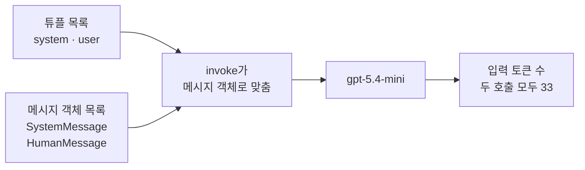
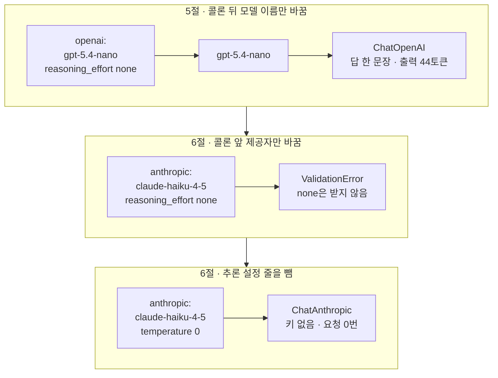
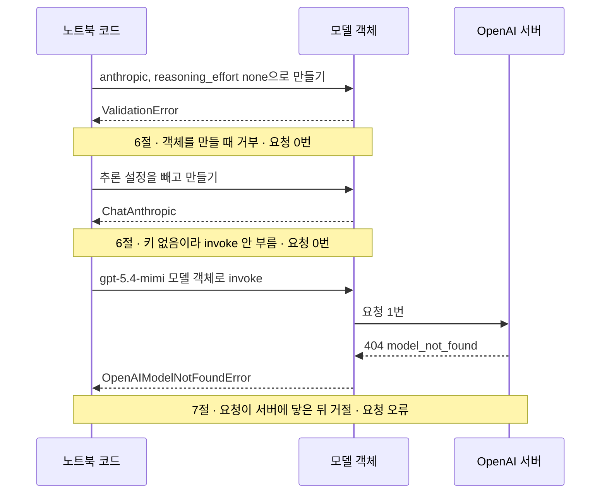
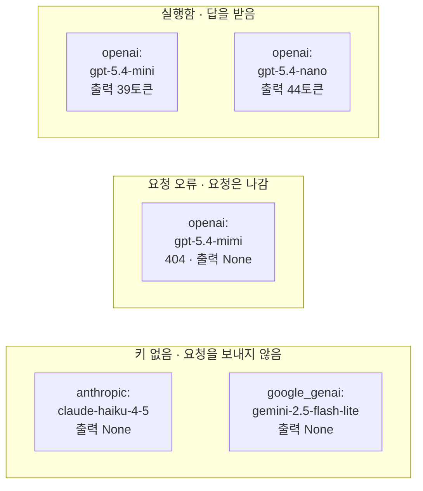

# 02-메시지와-제공자-전환

## _src 본문 (HTML 원본)

```html
<!--meta: 강의 1h · 실습은 챕터 전체 10h 안에서 진행합니다. -->
<h2 id="b1"><span class="no">1</span>학습 목표</h2>
<div class="goal"><p>이 절을 마치면 다음을 할 수 있습니다.</p><ul><li>튜플 <code>("user", …)</code>과 메시지 객체 <code>HumanMessage(…)</code>를 같은 역할의 다른 표기로 읽을 수 있습니다.</li><li>모델 이름의 콜론 뒤와 앞을 바꿨을 때, 그대로 되는 것과 다시 확인할 인자를 나눌 수 있습니다.</li><li>실행함·키 없음·요청 오류를 기록표에 서로 다른 상태로 적을 수 있습니다.</li></ul></div>
<h2 id="b2"><span class="no">2</span>이 내용을 배우는 이유</h2>
<p>첫 호출이 되면 다른 모델에도 같은 질문을 보내 보고 싶어집니다. 이때 질문까지 바꾸면 답이 달라진 이유를 나누기 어렵습니다. 그래서 메시지 목록은 그대로 두고 모델 설정만 바꿉니다.</p>
<p>함수 <code>init_chat_model()</code>은 여러 제공자의 모델 객체를 같은 모양의 줄로 만들어 줍니다. 그렇다고 키와 인자까지 같아지지는 않습니다. 이 절에서는 그대로 쓸 수 있는 부분과 제공자마다 다시 확인할 부분을 실행으로 나눕니다.</p>
<p><strong>이 절의 질문</strong> — 같은 메시지를 여러 모델 설정에 보낼 때, 무엇을 고정하고 무엇을 기록해야 할까요?</p>
<h2 id="b3"><span class="no">3</span>앞에서 배운 내용</h2>
<table><thead><tr><th>앞 절</th><th>배운 것</th><th>이 절에서 이어지는 곳</th></tr></thead><tbody>
<tr><td>01절</td><td>메시지 튜플 목록, <code>init_chat_model()</code>·<code>invoke()</code>, 응답의 <code>text</code>·<code>usage_metadata</code></td><td>튜플 목록과 메시지 객체 목록을 같은 모델로 보내기</td></tr>
<tr><td>01절</td><td>모델 객체를 만들 때는 요청 0번, 값 검사 오류 <code>ValidationError</code></td><td>5·6절에서 요청 없이 객체만 만들기, 6절 인자 거부</td></tr>
<tr><td>Ch 2 03절</td><td>튜플 풀어 담기, 딕셔너리 <code>get(키, 기본값)</code></td><td>다른 제공자 목록 반복, 상태별 줄 수 세기</td></tr>
<tr><td>Ch 2 04·05절</td><td>함수 정의, 오류 이름만 받는 <code>try/except 이름 as error</code></td><td>기록 함수 <code>make_record()</code>, 6·7절 오류 받기</td></tr>
<tr><td>Ch 5 04절</td><td>역할 딕셔너리 <code>{"role": "user", "content": …}</code></td><td>역할 이름 user와 human</td></tr>
<tr><td>Ch 5 08절</td><td>필수 조건과 선택 기준으로 모델 고르기</td><td>모델 이름을 바꿔 본 것은 모델 고르기가 아님</td></tr>
</tbody></table>
<p>01절에서는 튜플 <code>("system", …)</code>을 목록에 담아 보냈습니다. 튜플 내용이 <code>None</code>이면 요청 전에 <code>ValidationError</code>가 났습니다. 그 오류 메시지에 나온 이름 HumanMessage가 이 절에서 직접 만드는 메시지 객체입니다.</p>
<p>값 검사 오류의 뜻은 01절에서 풀었고, 자세한 내용은 <a href="../../part1/ch02-python/10-Pydantic.html">Ch 2 10절 Pydantic</a>에 있습니다. 이 절 6절에서 같은 이름의 오류를 다시 만납니다.</p>
<p>Ch 5 08절에서는 필수 조건으로 후보를 거르고, 미리 정한 선택 기준으로 모델을 골랐습니다. 이 절에서 <code>gpt-5.4-nano</code>로 바꿔 보는 것은 그 절차가 아닙니다. 같은 코드에서 모델 이름만 바꿀 수 있는지 확인하는 실험입니다.</p>
<p>실습 폴더와 <code>.env</code> 파일의 <code>OPENAI_API_KEY</code>는 01절과 같습니다. 이 절은 Anthropic·Google 키가 없어도 끝까지 실행됩니다. 노트북은 앞 절 없이 새 커널에서 시작합니다.</p>
<h2 id="b4"><span class="no">4</span>핵심 개념</h2>
<h3>비유로 시작하기</h3>
<p>책상 위에 우편함 세 개가 있습니다. 파란 카드에는 공통 지시를, 노란 카드에는 이번 질문을 적어 한 벌로 겹칩니다. 똑같은 카드 한 벌을 우편함마다 하나씩 준비합니다.</p>
<p>초록 우편함 두 개는 모양이 같고 크기만 다릅니다. 두 곳 모두 입구에 카드가 들어갑니다. 회색 우편함은 모양이 다르고 입구에 자물쇠가 걸려 있어, 카드가 그 앞 책상에 그대로 남습니다.</p>
{{img:02-5-우편함-세-개|나무 책상 위에 모양이 같은 초록 상자 우편함 큰 것과 작은 것, 둥근 지붕의 회색 우편함이 나란히 있고, 두 초록 우편함 입구에는 파란 카드를 노란 카드 위에 겹친 한 벌이 반쯤 꽂혀 있으며, 자물쇠가 걸린 회색 우편함 앞 책상에는 같은 카드 한 벌이 놓인 삽화|같은 카드 한 벌을 우편함 세 곳에 준비했습니다. 초록 우편함 두 곳에는 들어가고, 자물쇠가 걸린 회색 우편함 앞에서는 책상에 남습니다.}}
<p><strong>그림 읽기</strong> — 왼쪽의 큰 초록 우편함과 가운데의 작은 초록 우편함은 모양이 같습니다. 두 입구에는 파란 카드를 노란 카드 위에 겹친 한 벌이 반쯤 꽂혀 있습니다. 오른쪽 회색 우편함은 지붕이 둥글고 입구에 자물쇠가 걸려, 같은 카드 한 벌이 그 앞 책상에 놓여 있습니다.</p>
<p>카드 한 벌이 메시지 목록이고, 파란 카드와 노란 카드가 system과 user 역할입니다. 우편함은 모델이고, 우편함의 색과 모양은 제공자입니다. 자물쇠는 준비되지 않은 키입니다. 01절 창구 그림의 노란 쪽지는 프롬프트 전체였지만, 이 그림의 노란 카드는 user 질문 하나입니다.</p>
<h3>메시지 객체와 역할 이름</h3>
<p>메시지 객체(message object)는 역할을 클래스 이름으로 드러낸 메시지입니다. 카드 색으로 지시와 질문을 나누는 것과 비슷합니다. 노트북 3절에서는 <code>SystemMessage("한 문장의 한국어로 답하세요.")</code>처럼 괄호 안에 내용을 넣어 만들었습니다.</p>
<p>튜플과 메시지 객체는 같은 역할의 다른 표기입니다. 튜플의 역할 이름 user는 객체에서 클래스 <code>HumanMessage</code>가 됩니다. 속성 <code>type</code>에는 human으로 적힙니다. 두 이름이 달라도 제공자가 달라진 것은 아닙니다.</p>
<p>메서드 <code>invoke()</code>는 튜플을 받으면 먼저 메시지 객체로 바꿉니다. 01절에서 설치한 langchain-core 1.6.2 소스로 확인한 단계입니다. 노트북 4절에서 두 목록을 보낸 호출의 입력 토큰 수는 모두 33으로 같았습니다.</p>
{{mermaid:02-1-두-표기-같은-요청|왼쪽 초록 상자 튜플 목록과 초록 상자 메시지 객체 목록이 파란 상자 invoke가 메시지 객체로 맞춤으로 모이고, 보라 상자 gpt-5.4-mini를 거쳐 노란 상자 입력 토큰 수 두 호출 모두 33으로 이어지는 흐름도|튜플 목록과 메시지 객체 목록은 invoke 안에서 같은 메시지 객체가 됩니다. 따로 보낸 두 호출의 입력 토큰 수는 모두 33이었습니다.}}
<p><strong>도식 읽기</strong> — 왼쪽에서 오른쪽으로 읽습니다. 초록 상자 두 개는 같은 역할과 내용을 튜플과 메시지 객체로 적은 목록입니다. 두 목록은 파란 상자에서 메시지 객체로 맞춰진 뒤, 보라 상자 <code>gpt-5.4-mini</code>로 갑니다.</p>
<p>노란 상자는 노트북 4절에서 출력으로 확인한 입력 토큰 수입니다. 실제로는 두 목록을 따로 두 번 보냈습니다. 두 호출이 같은 길을 지난다는 뜻으로 그림에서는 한 줄로 합쳤습니다.</p>
<h3>모델 이름의 콜론 앞과 뒤</h3>
<p>01절에서 본 것처럼 <code>openai:gpt-5.4-mini</code>의 콜론 앞은 제공자, 뒤는 모델 이름입니다. 함수 <code>init_chat_model()</code>은 콜론 앞 이름으로 모델 객체의 종류를 고릅니다. 설치한 langchain 1.4.0 소스에서 짝을 확인했습니다. 이름 anthropic은 ChatAnthropic을 만듭니다. 이름 google_genai는 ChatGoogleGenerativeAI를 만듭니다.</p>
<p>통합 패키지(integration package)는 공통 호출을 한 제공자의 요청 형식으로 바꾸는 패키지입니다. 나라마다 콘센트 모양이 달라 변환 플러그를 끼우는 것과 비슷합니다. 준비 셀에서 설치한 langchain-anthropic 1.7.1이 anthropic용 통합 패키지입니다.</p>
<p>함수 <code>init_chat_model()</code>은 모델 이름 말고 받은 인자를 고른 모델 객체에 그대로 넘깁니다. 그래서 인자 이름이 같아도 받는 값은 제공자마다 다를 수 있습니다. 노트북 6절에서 Anthropic 모델 객체는 <code>reasoning_effort="none"</code>을 받지 않았습니다.</p>
<h3>이 절에서 쓰는 말</h3>
<table><thead><tr><th>용어</th><th>뜻</th><th>이 절에서 보이는 모습</th></tr></thead><tbody>
<tr><td>메시지 객체(message object)</td><td>역할을 클래스 이름으로 드러낸 메시지. 카드 색으로 지시와 질문을 나누는 것과 비슷함</td><td><code>SystemMessage | system | 한 문장의 한국어로 답하세요.</code></td></tr>
<tr><td>역할 이름</td><td>메시지 객체의 속성 <code>type</code>에 적힌 이름. 튜플의 user가 객체에서는 human</td><td><code>HumanMessage | human |</code></td></tr>
<tr><td>통합 패키지(integration package)</td><td>공통 호출을 한 제공자의 요청 형식으로 바꿔 주는 패키지</td><td><code>langchain-anthropic: 1.7.1</code></td></tr>
<tr><td>실행 상태</td><td>설정마다 요청이 어떻게 끝났는지 기록표에 적은 값. 실행함·키 없음·요청 오류. 키가 있는데 이 노트북이 부르지 않은 제공자는 <code>키 있음, 부르지 않음</code></td><td><code>openai:gpt-5.4-mimi | 요청 오류 | None</code></td></tr>
<tr><td>모델 없음 오류</td><td>요청한 모델을 서버가 찾지 못했을 때 나는 오류 <code>ModelNotFoundError</code>. 없는 방 번호로 보낸 편지가 되돌아오는 것과 비슷함</td><td><code>오류 종류: OpenAIModelNotFoundError</code></td></tr>
<tr><td>상태 코드</td><td>서버가 요청 결과를 숫자로 알려 주는 값. 404는 요청한 대상을 찾지 못했다는 뜻</td><td><code>Error code: 404</code></td></tr>
</tbody></table>
<h2 id="b5"><span class="no">5</span>실행 예제</h2>
<p>노트북은 같은 역할과 내용을 튜플 목록과 메시지 객체 목록으로 만들어 같은 모델에 보냅니다. 그다음 모델 이름과 제공자 이름을 하나씩 바꾸고, 없는 모델 이름으로도 요청을 보냅니다. 마지막에 결과를 기록표에 적고 상태별로 셉니다.</p>
<p>실제 OpenAI 모델을 temperature 0으로 부릅니다. 이 페이지의 출력은 2026-09-17에 실행한 결과입니다. 요청은 모두 4번이고, 그중 답을 받은 호출은 3번입니다. 예상 비용은 0.01달러 미만이고, 답 문장은 실행마다 달라질 수 있습니다.</p>
{{notebook:02-메시지와-제공자-전환}}
<p class="look"><b>확인할 점</b> — 4절 마지막 줄 <code>두 호출의 입력 토큰 수가 같은가: True</code>를 봅니다. 6절에서는 오류 메시지 첫 줄 <code>1 validation error for ChatAnthropic</code>을 봅니다. 7절에서는 <code>Error code: 404</code>를 봅니다.</p>
<h3>모델 이름을 하나씩 바꾸면</h3>
<p>노트북 5절은 콜론 뒤만 <code>gpt-5.4-nano</code>로 바꿨고, 6절은 콜론 앞을 anthropic으로 바꿨습니다. 5절은 같은 코드로 답을 받았습니다. 6절은 인자 한 줄을 지워야 모델 객체가 만들어졌습니다.</p>
{{mermaid:02-2-모델-이름-바꾸기|위 칸은 초록 상자 openai gpt-5.4-nano reasoning_effort none이 보라 상자 gpt-5.4-nano를 거쳐 노란 상자 ChatOpenAI 답 한 문장 출력 44토큰으로, 가운데 칸은 초록 상자 anthropic claude-haiku-4-5 reasoning_effort none이 노란 상자 ValidationError none은 받지 않음으로, 아래 칸은 초록 상자 anthropic claude-haiku-4-5 temperature 0이 노란 상자 ChatAnthropic 키 없음 요청 0번으로 이어지는 그림|콜론 뒤 모델 이름만 바꾸면 같은 코드로 답을 받았고, 콜론 앞 제공자를 바꾸자 reasoning_effort none이 거부되었습니다. 추론 설정 줄을 빼자 ChatAnthropic이 만들어졌습니다.}}
<p><strong>도식 읽기</strong> — 위에서 아래로 세 칸을 읽고, 칸 안은 왼쪽에서 오른쪽으로 읽습니다. 초록 상자는 넘긴 모델 이름과 인자, 보라 상자는 실행한 모델, 노란 상자는 출력으로 확인한 값입니다.</p>
<p>맨 위 칸은 nano 모델이 한 문장으로 답하고 출력 44토큰을 쓴 결과입니다. 가운데 칸의 노란 상자는 값 none이 거부된 결과입니다. 노트북은 이 오류를 받아 출력했고, 다음 셀에서 인자 한 줄을 지워 고칩니다.</p>
<p>맨 아래 칸은 추론 설정 줄을 뺀 뒤 <code>ChatAnthropic</code> 객체가 만들어진 결과입니다. 키가 없어 이 객체로는 요청을 보내지 않았습니다.</p>
<h3>멈춘 자리가 다른 세 경우</h3>
<p>노트북 6절과 7절에는 답을 받지 못한 경우가 셋 있습니다. 인자가 거부된 경우, 키가 없어 부르지 않은 경우, 서버가 거절한 경우입니다. 세 경우는 요청이 나갔는지가 달라서 기록도 다르게 합니다.</p>
{{mermaid:02-3-멈춘-자리|노트북 코드, 모델 객체, OpenAI 서버 세 세로줄 사이에서 anthropic 모델 객체를 만들다 ValidationError를 받고 요청 0번 메모, 추론 설정을 빼고 ChatAnthropic을 받은 뒤 키 없음이라 invoke 안 부름 메모, gpt-5.4-mimi로 invoke하자 모델 객체가 서버로 요청 1번을 보내고 404 model_not_found를 받아 OpenAIModelNotFoundError를 넘긴 뒤 요청 오류 메모가 붙은 순서도|앞의 두 경우는 요청이 0번이고, 없는 모델 이름만 요청 1번이 서버까지 가서 404로 거절되었습니다.}}
<p><strong>도식 읽기</strong> — 세로줄은 왼쪽부터 노트북 코드, 모델 객체, OpenAI 서버입니다. 위에서 아래로 시간 순서이고, 실선은 요청, 점선은 응답입니다. 노란 메모는 각 경우가 끝난 뒤 출력으로 확인한 것입니다.</p>
<p>첫 메모는 모델 객체를 만들다 <code>ValidationError</code>로 멈춘 경우라 요청 0번입니다. 둘째 메모는 <code>ChatAnthropic</code> 객체를 받았지만, 키가 없어 <code>invoke()</code>를 부르지 않은 경우입니다.</p>
<p>마지막 경우만 요청 1번이 서버까지 갔습니다. 서버가 <code>404 model_not_found</code>를 보내자, 모델 객체가 <code>OpenAIModelNotFoundError</code>로 넘겼습니다. 그래서 기록표에는 이 경우만 요청 오류로 적었습니다.</p>
<h2 id="b6"><span class="no">6</span>실험 결과 해석</h2>
<p>노트북 8절 기록표는 다섯 줄입니다. 9절 출력은 <code>상태별 줄 수: {'실행함': 2, '요청 오류': 1, '키 없음': 2}</code>였습니다.</p>
{{mermaid:02-4-기록표|위 칸 실행함에는 노란 상자 openai gpt-5.4-mini 출력 39토큰과 openai gpt-5.4-nano 출력 44토큰, 가운데 칸 요청 오류에는 노란 상자 openai gpt-5.4-mimi 404 출력 None, 아래 칸 키 없음에는 회색 상자 anthropic claude-haiku-4-5 출력 None과 google_genai gemini-2.5-flash-lite 출력 None이 있는 기록표 그림|기록표 다섯 줄을 상태별로 나눴습니다. 답을 받은 두 줄만 출력 토큰 수가 있고, 나머지 세 줄은 0이 아니라 None입니다.}}
<p><strong>도식 읽기</strong> — 위에서 아래로 상태별 칸을 읽습니다. 노란 상자는 출력으로 확인한 결과이고, 회색 상자는 요청을 보내지 않은 설정입니다. 요청 오류 칸도 노랑입니다. 코드가 오류를 받아 기록표의 상태로 적었기 때문입니다.</p>
<p>이 기록표로 말할 수 있는 것은 OpenAI 모델 두 개가 같은 메시지에 한 문장으로 답했다는 것까지입니다. 출력 39토큰과 44토큰은 한 번씩 받은 값이라 두 모델의 차이로 일반화하지 않습니다. 두 답이 맞는 설명인지도 이번에 판정하지 않았습니다.</p>
<p>키 없음 두 줄은 모델이 나쁘다는 결과가 아니라, 실행하지 않았다는 기록입니다. 출력 토큰 수를 0이 아니라 <code>None</code>으로 적은 이유도 같습니다. 세 제공자의 품질과 속도 순위는 이 표로 정할 수 없습니다. Anthropic·Google 키를 준비한 컴퓨터에서는 두 줄이 <code>키 있음, 부르지 않음</code>으로 나옵니다. 이 노트북은 그때도 두 제공자에 요청을 보내지 않습니다.</p>
<p>같은 입력을 temperature 0으로 두 번 보냈을 때, 입력 토큰 수는 33으로 같았지만 답의 낱말 몇 개가 달랐습니다. 튜플 목록 호출의 「말투」가 메시지 객체 목록 호출에서는 「톤」으로 나왔습니다. 01절에서 말한 「비슷한 답, 똑같다고 보장하지 않음」을 이번 실행에서 한 번 본 것입니다.</p>
<h2 id="b7"><span class="no">7</span>주의할 점과 실무 메모</h2>
<ul><li>키 값은 출력하지 않습니다. 이 절도 키 설정 여부 <code>True</code>·<code>False</code>만 출력했습니다. 한 제공자의 키를 다른 제공자의 변수 이름에 옮겨 적지 않습니다.</li>
<li>키 설정 여부 <code>True</code>는 인증에 성공했다는 뜻이 아닙니다. 요청을 보내 답을 받아야 그 키로 그 모델을 쓸 수 있다는 것이 확인됩니다.</li>
<li>이 절은 Anthropic·Google에 요청을 보내지 않았습니다. 두 제공자의 답, 사용량, 인자 지원은 키를 준비한 환경에서 따로 확인합니다. 키 없이 <code>invoke()</code>를 부르면 어떻게 되는지도 이번에 실행하지 않았습니다.</li>
<li>교재를 만들 때 탐색 실행에서, Google 모델 객체는 키가 없으면 만드는 단계에서 <code>ValidationError</code>가 났습니다. 그래서 노트북은 Google 모델 객체를 만들지 않고 키만 확인합니다. 그 오류 메시지는 <code>GOOGLE_API_KEY</code>와 <code>GEMINI_API_KEY</code>를 함께 안내했지만, 노트북은 앞의 이름만 확인합니다.</li>
<li>제공자를 바꿀 때는 인자를 다시 확인합니다. Anthropic 모델 객체는 인자 <code>reasoning_effort</code>에 max·xhigh·high·medium·low만 받았습니다. 설치한 langchain-anthropic 1.7.1에서 본 값이라, 패키지 판이 바뀌면 받는 값도 바뀔 수 있습니다.</li>
<li>오류 이름 <code>ModelNotFoundError</code>는 설치한 소스에서 OpenAI·Anthropic·Google 통합 패키지가 모두 씁니다. 이번에 실제로 받은 것은 OpenAI의 404 하나입니다. 모델 이름 오타는 모델 객체를 만들 때가 아니라 요청을 보낸 뒤에 드러났습니다.</li>
<li>메시지 역할은 권한이 아닙니다. system 메시지에 적은 규칙을 모델이 늘 지킨다는 보장은 없습니다. 이 절은 규칙을 어기라고 요구하는 user 질문을 실행하지 않았습니다. 중요한 규칙은 출력 검사로 함께 확인합니다.</li>
<li>모델 이름 <code>gpt-5.4-nano</code>와 오타 <code>gpt-5.4-mimi</code>는 흐름을 보여 주려고 정한 예입니다. 오타 이름의 404 거절과 Anthropic 인자 거부는 교재를 만들 때 탐색 실행으로 먼저 확인했습니다.</li>
<li>교재 출력은 Linux의 Python 3.12.13으로 만들었습니다. 패키지는 langchain 1.4.0, langchain-core 1.6.2, langchain-openai 1.6.0입니다. langchain-anthropic 1.7.1, langchain-google-genai 4.4.0도 설치했습니다. 다른 버전과 Windows·macOS에서는 실행하지 않았습니다.</li></ul>
<h2 id="b8"><span class="no">8</span>정리와 다음 절</h2>
<ul><li>튜플 <code>("user", …)</code>과 메시지 객체 <code>HumanMessage(…)</code>는 같은 역할의 다른 표기였고, 두 호출의 입력 토큰 수가 33으로 같았습니다.</li><li>콜론 뒤 모델 이름만 바꾸면 같은 코드로 답을 받았습니다. 콜론 앞 제공자를 바꾸자 <code>reasoning_effort="none"</code>이 요청 전에 거부되었습니다.</li><li>답을 받은 호출은 실행함, 키가 없어 부르지 않은 제공자는 키 없음, 서버가 거절한 요청은 요청 오류로 따로 적었습니다.</li></ul>
<p><strong>다음 학습과 이어지는 지점</strong> — 03절에서는 답을 자유로운 문장 대신 이름 있는 칸으로 받습니다. 이 절에서 읽은 응답 객체 <code>AIMessage</code>와, 칸이 정해진 결과가 어떻게 다른지 확인합니다.</p>
<h2 id="b9"><span class="no">9</span>복습 문제</h2>
<details class="quiz"><summary>문제 1 · 두 역할 이름</summary><p class="quiz-q">튜플의 <code>user</code>와 메시지 객체의 <code>human</code>은 서로 다른 제공자를 뜻하나요?</p><p class="quiz-a"><b>해설</b> — 아닙니다. 같은 역할의 다른 표기입니다. 제공자는 모델 이름의 콜론 앞에서 정해집니다. 두 목록을 보낸 호출의 입력 토큰 수도 33으로 같았습니다.</p></details>
<details class="quiz"><summary>문제 2 · 요청이 나간 셀</summary><p class="quiz-q">노트북 5절에서 nano 모델 객체를 만든 셀을 실행했을 때 요청은 몇 번 나갔나요?</p><p class="quiz-a"><b>해설</b> — 0번입니다. 01절처럼 모델 객체를 만드는 줄은 요청을 보내지 않습니다. 요청은 다음 셀의 <code>invoke()</code>에서 나갔습니다.</p></details>
<details class="quiz"><summary>문제 3 · 그대로 옮긴 인자</summary><p class="quiz-q">OpenAI 모델에 쓰던 인자를 그대로 두고 콜론 앞만 anthropic으로 바꿨습니다. 무슨 일이 났고, 요청은 나갔나요?</p><p class="quiz-a"><b>해설</b> — Anthropic 모델 객체를 만들 때 <code>ValidationError</code>가 났습니다. 인자 <code>reasoning_effort</code>의 값 none을 받지 않았기 때문입니다. 객체를 만드는 단계라 요청은 나가지 않았습니다.</p></details>
<details class="quiz"><summary>문제 4 · 실행하지 않은 줄</summary><p class="quiz-q">키가 없는 Google 줄의 출력 토큰 수를 0으로 적으면 어떤 오해가 생기나요?</p><p class="quiz-a"><b>해설</b> — 답을 받았는데 아주 짧았던 것처럼 보입니다. 실제로는 요청이 없었으므로 상태 키 없음과 <code>None</code>을 적습니다.</p></details>
<details class="quiz"><summary>문제 5 · 오타가 드러난 자리</summary><p class="quiz-q">모델 이름 오타 <code>gpt-5.4-mimi</code>는 모델 객체를 만들 때 알 수 있었나요?</p><p class="quiz-a"><b>해설</b> — 아닙니다. 모델 객체는 만들어졌고, 요청이 서버에 닿은 뒤 404로 거절되었습니다. 요청이 나갔으므로 6절의 인자 거부와 달리 요청 오류로 기록합니다.</p></details>
<h2 id="b10"><span class="no">10</span>참고 자료</h2>
<p>문서는 2026-09-17에 다시 열어 확인했습니다. 클래스 이름, 인자 값, 오류 이름은 실습 가상환경에 설치한 패키지 소스에서도 확인했습니다. 확인한 판은 <code>langchain 1.4.0</code>, <code>langchain-core 1.6.2</code>, <code>langchain-openai 1.6.0</code>, <code>langchain-anthropic 1.7.1</code>, <code>langchain-google-genai 4.4.0</code>입니다.</p>
<ul><li><div><a href="https://docs.langchain.com/oss/python/langchain/messages">LangChain Messages</a></div>메시지 객체와 역할 · 확인 2026-09-17</li><li><div><a href="https://docs.langchain.com/oss/python/langchain/models">LangChain Models</a></div>제공자와 모델 이름을 함께 적는 모델 초기화 · 확인 2026-09-17</li><li><div><a href="https://docs.langchain.com/oss/python/integrations/chat/anthropic">ChatAnthropic integration</a></div>Anthropic 통합 패키지와 키 이름 · 확인 2026-09-17</li><li><div><a href="https://docs.langchain.com/oss/python/integrations/chat/google_generative_ai">ChatGoogleGenerativeAI integration</a></div>Google 통합 패키지와 키 이름 · 확인 2026-09-17</li><li><div><a href="https://github.com/langchain-ai/langchain/blob/master/LICENSE">LangChain MIT License</a></div>예제의 질문과 설명은 이 교재에 맞게 새로 썼습니다</li></ul>
```

## 노트북 셀 (순서대로)

### [0] markdown {'html': 'skip'}

# 메시지와 제공자 전환

**이 노트북에서 할 일**

1. 같은 역할과 내용을 튜플 목록과 메시지 객체 목록으로 만들어 같은 모델에 보냅니다.
2. 모델 이름과 제공자 이름을 하나씩 바꿔, 그대로 되는 것과 다시 확인할 것을 나눕니다.
3. 실행함·키 없음·요청 오류를 기록표에 서로 다른 상태로 적습니다.

**준비물** — 프로젝트 폴더 `.env` 파일의 `OPENAI_API_KEY`가 필요합니다. 데이터 파일은 없습니다.
Anthropic·Google 키는 없어도 됩니다. 이 노트북은 두 제공자에 요청을 보내지 않습니다.

인터넷 서비스에 요청을 모두 4번 보냅니다. `gpt-5.4-mini` 2번, `gpt-5.4-nano` 1번, 없는 모델 이름 1번입니다.
실행 시간은 1분 안팎이고, 예상 비용은 0.01달러 미만으로 잡았습니다.
요금은 06절 4절에서 2026-09-17에 확인한 mini·nano 공식 요금 기준입니다.

**기준 버전** — 실습 폴더에 고정한 패키지 판을 씁니다. langchain 1.4.0, langchain-core 1.6.2, langchain-openai 1.6.0입니다.
통합 패키지 langchain-anthropic 1.7.1과 langchain-google-genai 4.4.0도 씁니다. pydantic 2.13.5, python-dotenv 1.2.3도 함께 씁니다.

교재 출력은 Linux의 Python 3.12.13으로 만들었습니다. 다른 버전과 Windows·macOS에서는 이번에 실행하지 않았습니다.

실습 폴더 `labs/part2/ch06-langchain-start`에서 `uv sync --locked`를 실행합니다.
그다음 이 폴더의 `.venv` 커널을 고르고 첫 셀부터 순서대로 실행합니다.

### [1] markdown {'html': 'skip'}

## 오늘 볼 그림


왼쪽에서 오른쪽으로 읽습니다. 초록 상자 두 개는 같은 역할과 내용을 두 가지로 적은 목록입니다.
파란 상자에서 두 목록이 같은 메시지 객체로 맞춰지고, 보라 상자 모델에 요청이 갑니다.
노란 상자는 이 노트북 4절에서 두 호출의 입력 토큰 수를 비교한 결과입니다.

### [2] markdown {}

## 1. 준비

첫 셀은 패키지를 설치하고 설치된 버전을 출력합니다. 설치에는 몇십 초가 걸릴 수 있습니다.
01절보다 두 패키지가 늘었습니다. 콜론 앞 제공자 이름이 anthropic, google_genai일 때 모델 객체를 만드는 패키지입니다.

### [3] code {'execution': {'iopub.execute_input': '2026-09-17T00:02:05.441933Z', 'iopub.status.busy': '2026-09-17T00:02:05.441754Z', 'iopub.status.idle': '2026-09-17T00:02:06.162326Z', 'shell.execute_reply': '2026-09-17T00:02:06.161975Z'}, 'lesson_role': 'setup'}

```python
# 이 절에서 쓰는 패키지를 설치하고 버전을 확인합니다
%pip install -q "langchain==1.4.0" "langchain-openai==1.6.0" "langchain-anthropic==1.7.1" "langchain-google-genai==4.4.0" "pydantic==2.13.5" "python-dotenv==1.2.3"
from importlib.metadata import version

print("langchain:", version("langchain"))
print("langchain-core:", version("langchain-core"))
print("langchain-openai:", version("langchain-openai"))
print("langchain-anthropic:", version("langchain-anthropic"))
print("langchain-google-genai:", version("langchain-google-genai"))
```

출력:
```
Note: you may need to restart the kernel to use updated packages.
langchain: 1.4.0
langchain-core: 1.6.2
langchain-openai: 1.6.0
langchain-anthropic: 1.7.1
langchain-google-genai: 4.4.0

```

### [4] markdown {}

**결과 읽기** — 출력 줄은 `langchain-anthropic: 1.7.1`, `langchain-google-genai: 4.4.0` 등 다섯 줄입니다.
준비물에 적은 기준 버전과 같습니다. 두 패키지처럼 공통 호출을 한 제공자의 요청 형식으로 바꾸는 패키지를 통합 패키지라고 부릅니다.

01절과 같이 모델 객체를 만드는 함수를 불러옵니다.

### [5] code {'execution': {'iopub.execute_input': '2026-09-17T00:02:06.163533Z', 'iopub.status.busy': '2026-09-17T00:02:06.163450Z', 'iopub.status.idle': '2026-09-17T00:02:06.539454Z', 'shell.execute_reply': '2026-09-17T00:02:06.539018Z'}, 'lesson_role': 'setup'}

```python
# 모델 객체를 만드는 함수를 불러옵니다
from langchain.chat_models import init_chat_model
```

출력:
```

```

### [6] markdown {}

01절과 같은 셀로 API 키가 있는지 확인합니다. 키 값은 출력하지 않고, 있는지만 봅니다.
`True` 값이 나오면 다음으로 넘어갑니다. 다른 두 제공자의 키는 6절과 8절에서 따로 확인합니다.

### [7] code {'execution': {'iopub.execute_input': '2026-09-17T00:02:06.540305Z', 'iopub.status.busy': '2026-09-17T00:02:06.540223Z', 'iopub.status.idle': '2026-09-17T00:02:06.545171Z', 'shell.execute_reply': '2026-09-17T00:02:06.544865Z'}, 'lesson_role': 'setup'}

```python
# .env 파일에서 OpenAI API 키를 읽습니다(키 값은 출력하지 않습니다)
import os
from dotenv import find_dotenv, load_dotenv

env_path = find_dotenv(usecwd=True)
load_dotenv(env_path)
has_key = os.getenv("OPENAI_API_KEY") is not None
print("OPENAI_API_KEY 설정 여부:", has_key)
assert has_key, "프로젝트 폴더의 .env 파일에 OPENAI_API_KEY를 적어 주세요."
```

출력:
```
OPENAI_API_KEY 설정 여부: True

```

### [8] markdown {}

실습에 쓸 모델을 준비합니다.
01절과 같은 설정으로 모델 객체를 만듭니다. 이 셀은 요청을 보내지 않습니다.

### [9] code {'execution': {'iopub.execute_input': '2026-09-17T00:02:06.545804Z', 'iopub.status.busy': '2026-09-17T00:02:06.545729Z', 'iopub.status.idle': '2026-09-17T00:02:07.460299Z', 'shell.execute_reply': '2026-09-17T00:02:07.459997Z'}}

```python
# 실습에 쓸 모델을 준비합니다
model = init_chat_model(
    "openai:gpt-5.4-mini",
    temperature=0,
    reasoning_effort="none",
)
print("모델 이름:", model.model_name)
print("temperature:", model.temperature)
```

출력:
```
모델 이름: gpt-5.4-mini
temperature: 0.0

```

### [10] markdown {}

**결과 읽기** — 출력 줄은 `모델 이름: gpt-5.4-mini`와 `temperature: 0.0`입니다. 이것으로 준비가 끝났습니다.
이 노트북의 출력은 2026-09-17에 이 모델로 실행한 결과입니다. 실행마다 답 문장이 달라질 수 있습니다.
01절에서 본 것처럼 temperature 0은 Ch 5 06절의 뽑기를 끈 설정(`do_sample=False`)과 같은 것이 아닙니다.

### [11] markdown {}

## 2. 튜플 목록 다시 보기

01절에서는 메시지를 `(역할, 내용)` 튜플로 적었습니다. 이번 절도 같은 모양으로 시작합니다.
system 메시지는 답의 길이 규칙이고, user 메시지는 메시지 역할에 대한 질문입니다.

실행 전에 예상합니다. 01절처럼 역할 이름 system과 user가 한 줄씩 나올 것입니다.

### [12] code {'execution': {'iopub.execute_input': '2026-09-17T00:02:07.461059Z', 'iopub.status.busy': '2026-09-17T00:02:07.460996Z', 'iopub.status.idle': '2026-09-17T00:02:07.463005Z', 'shell.execute_reply': '2026-09-17T00:02:07.462677Z'}}

```python
# 공통 지시(system)와 이번 질문(user)을 튜플로 묶어 목록에 담습니다
messages = [
    ("system", "한 문장의 한국어로 답하세요."),
    ("user", "채팅 모델에서 system 메시지의 역할은 무엇인가요?"),
]
print("튜플 목록:")
for role, content in messages:
    print(role, "|", content)
```

출력:
```
튜플 목록:
system | 한 문장의 한국어로 답하세요.
user | 채팅 모델에서 system 메시지의 역할은 무엇인가요?

```

### [13] markdown {}

**결과 읽기** — 라벨 줄 아래 두 줄은 `system | 한 문장의 한국어로 답하세요.`와 user 질문입니다.
아직 목록만 만들었고 요청은 보내지 않았습니다.

## 3. 메시지 객체로 같은 뜻 만들기

메시지 객체는 역할을 클래스 이름으로 드러낸 메시지입니다. 카드 색으로 지시와 질문을 나누는 것과 비슷합니다.
클래스 `SystemMessage`는 공통 지시, 클래스 `HumanMessage`는 사람이 쓴 이번 질문을 담습니다. 괄호 안 글이 내용입니다.

01절 노트북 8절의 오류 메시지에서 이름 HumanMessage를 이미 봤습니다. 튜플도 `invoke()` 안에서 이 객체로 바뀝니다.
속성 `type`은 객체에 적힌 역할 이름이고, 속성 `content`는 내용입니다.

실행 전에 예상합니다. 튜플의 user 자리에 해당하는 객체의 역할 이름도 user일까요?

### [14] code {'execution': {'iopub.execute_input': '2026-09-17T00:02:07.463536Z', 'iopub.status.busy': '2026-09-17T00:02:07.463482Z', 'iopub.status.idle': '2026-09-17T00:02:07.466330Z', 'shell.execute_reply': '2026-09-17T00:02:07.466080Z'}}

```python
# 같은 역할과 내용을 메시지 객체로 만듭니다(이 셀은 요청을 보내지 않습니다)
from langchain.messages import HumanMessage, SystemMessage

message_objects = [
    SystemMessage("한 문장의 한국어로 답하세요."),
    HumanMessage("채팅 모델에서 system 메시지의 역할은 무엇인가요?"),
]
# 클래스 이름 | 역할 이름 | 내용 순서로 한 줄씩 출력합니다
print("메시지 객체 목록:")
for message in message_objects:
    class_name = type(message).__name__
    print(class_name, "|", message.type, "|", message.content)
```

출력:
```
메시지 객체 목록:
SystemMessage | system | 한 문장의 한국어로 답하세요.
HumanMessage | human | 채팅 모델에서 system 메시지의 역할은 무엇인가요?

```

### [15] markdown {}

**결과 읽기** — 라벨 줄 아래 첫 줄은 `SystemMessage | system | 한 문장의 한국어로 답하세요.`입니다.
둘째 줄은 `HumanMessage | human |`으로 시작합니다. 튜플의 user 자리가 객체에서는 역할 이름 human으로 적힙니다.

두 이름은 같은 역할을 가리키는 다른 표기입니다. 제공자가 달라진 것이 아닙니다.
객체를 만들기만 해서는 답이 나오지 않습니다. 요청은 여전히 0번입니다.

## 4. 두 목록을 같은 모델로 보내기

같은 모델 객체에 튜플 목록과 메시지 객체 목록을 차례로 보냅니다. 바꾸는 것은 목록의 표기 하나입니다.
두 호출의 입력 토큰 수를 비교하면, 제공자가 같은 입력을 받았는지 확인할 수 있습니다.

실행 전에 예상합니다. 표기만 다르고 역할과 내용이 같으니 입력 토큰 수도 같을 것입니다.

### [16] code {'execution': {'iopub.execute_input': '2026-09-17T00:02:07.466904Z', 'iopub.status.busy': '2026-09-17T00:02:07.466850Z', 'iopub.status.idle': '2026-09-17T00:02:09.024564Z', 'shell.execute_reply': '2026-09-17T00:02:09.024045Z'}}

```python
# 튜플 목록을 보내고 답과 입력 토큰 수를 봅니다(요청 1번)
tuple_response = model.invoke(messages)
tuple_usage = tuple_response.usage_metadata
print("답:", tuple_response.text)
print("입력 토큰 수:", tuple_usage["input_tokens"])
```

출력:
```
답: system 메시지는 채팅 모델의 기본 규칙, 역할, 말투, 안전 제약을 설정해 이후 대화 전반의 응답 방식을 안내하는 지침입니다.
입력 토큰 수: 33

```

### [17] markdown {}

**결과 읽기** — 답 줄은 `system 메시지는 채팅 모델의`로 시작하는 한 문장입니다. 둘째 줄은 `입력 토큰 수: 33`입니다.

이번에는 메시지 객체 목록을 같은 모델 객체로 보냅니다. 마지막 줄의 `assert`는 두 입력 토큰 수가 같은지 확인합니다.
답 문장은 실행마다 달라질 수 있어 확인하지 않고, 같은 입력이면 같아야 하는 토큰 수만 확인합니다.

### [18] code {'execution': {'iopub.execute_input': '2026-09-17T00:02:09.026106Z', 'iopub.status.busy': '2026-09-17T00:02:09.025962Z', 'iopub.status.idle': '2026-09-17T00:02:10.303045Z', 'shell.execute_reply': '2026-09-17T00:02:10.301712Z'}}

```python
# 메시지 객체 목록을 보내고, 튜플 목록 호출과 입력 토큰 수를 비교합니다(요청 1번)
object_response = model.invoke(message_objects)
object_usage = object_response.usage_metadata
print("답:", object_response.text)
print("입력 토큰 수:", object_usage["input_tokens"])
print("출력 토큰 수:", object_usage["output_tokens"])
same_input = tuple_usage["input_tokens"] == object_usage["input_tokens"]
print("두 호출의 입력 토큰 수가 같은가:", same_input)
assert same_input
```

출력:
```
답: system 메시지는 채팅 모델의 기본 규칙, 역할, 톤, 제약을 설정해 이후 대화 전반의 동작을 안내하는 지침입니다.
입력 토큰 수: 33
출력 토큰 수: 39
두 호출의 입력 토큰 수가 같은가: True

```

### [19] markdown {}

**결과 읽기** — 입력 토큰 수는 이번에도 `입력 토큰 수: 33`이고, 마지막 줄은 `두 호출의 입력 토큰 수가 같은가: True`입니다.
`assert`도 통과했습니다. 출력 토큰 수는 `출력 토큰 수: 39`입니다.

입력 토큰 수는 같았지만, 답 문장은 낱말 몇 개가 달랐습니다. 튜플 목록 호출의 「말투」가 이번에는 「톤」으로 나왔습니다.
01절에서 말한 대로 temperature 0이어도 똑같은 답을 보장하지 않습니다. 이번에 한 번 실행해 본 모습입니다.

## 5. 값 바꿔 보기 1 — 모델 이름만 바꾸기

바꾸는 값은 콜론 뒤 모델 이름 하나입니다. 모델 이름 `gpt-5.4-mini`를 같은 제공자의 다른 모델 `gpt-5.4-nano`로 바꿉니다.
다른 인자와 메시지 객체 목록은 그대로 둡니다. 이 셀은 모델 객체만 만들고 요청을 보내지 않습니다.

실행 전에 예상합니다. 제공자 이름이 openai 그대로이니 모델 객체 종류도 ChatOpenAI일 것입니다.

### [20] code {'execution': {'iopub.execute_input': '2026-09-17T00:02:10.305215Z', 'iopub.status.busy': '2026-09-17T00:02:10.305069Z', 'iopub.status.idle': '2026-09-17T00:02:10.309643Z', 'shell.execute_reply': '2026-09-17T00:02:10.308929Z'}}

```python
# 콜론 뒤 모델 이름만 nano로 바꿔 모델 객체를 만듭니다(이 셀은 요청을 보내지 않습니다)
nano_model = init_chat_model(
    "openai:gpt-5.4-nano",
    temperature=0,
    reasoning_effort="none",
)
nano_type = type(nano_model).__name__
print("모델 객체 종류:", nano_type)
print("모델 이름:", nano_model.model_name)
```

출력:
```
모델 객체 종류: ChatOpenAI
모델 이름: gpt-5.4-nano

```

### [21] markdown {}

**결과 읽기** — 출력 줄은 `모델 객체 종류: ChatOpenAI`와 `모델 이름: gpt-5.4-nano`입니다. 예상대로 종류는 같습니다.

같은 메시지 객체 목록을 nano 모델로 보냅니다. 메서드 `invoke()`로 보내고 `text`로 읽는 줄은 4절과 같습니다.

### [22] code {'execution': {'iopub.execute_input': '2026-09-17T00:02:10.310989Z', 'iopub.status.busy': '2026-09-17T00:02:10.310880Z', 'iopub.status.idle': '2026-09-17T00:02:11.150395Z', 'shell.execute_reply': '2026-09-17T00:02:11.148831Z'}}

```python
# 같은 메시지 객체 목록을 nano 모델로 보냅니다(요청 1번)
nano_response = nano_model.invoke(message_objects)
nano_usage = nano_response.usage_metadata
print("답:", nano_response.text)
print("입력 토큰 수:", nano_usage["input_tokens"])
print("출력 토큰 수:", nano_usage["output_tokens"])
```

출력:
```
답: 시스템 메시지는 모델이 따라야 할 기본 지침(역할, 톤, 제약, 우선순위)을 설정해 응답의 방향을 통제하는 역할을 합니다.
입력 토큰 수: 33
출력 토큰 수: 44

```

### [23] markdown {}

**결과 읽기** — 출력 줄은 `입력 토큰 수: 33`과 `출력 토큰 수: 44`입니다. 답 줄은 `시스템 메시지는`으로 시작하는 한 문장입니다.
입력 토큰 수는 mini 호출과 같고, 출력 토큰 수는 mini의 39와 다릅니다.

모델 이름을 바꿔도 모델 객체를 만들고, `invoke()`로 보내고, `text`로 읽는 줄은 그대로였습니다.
한 번씩 받은 두 답으로 두 모델의 품질을 비교하지는 않습니다.

## 6. 값 바꿔 보기 2 — 콜론 앞 제공자 이름 바꾸기

이번에는 콜론 앞 제공자 이름을 anthropic으로 바꿉니다. 모델 이름은 Anthropic의 `claude-haiku-4-5`입니다.
다른 인자는 5절과 똑같이 둡니다. 함수 `init_chat_model()`은 받은 인자를 고른 제공자의 모델 객체에 그대로 넘깁니다.

인자 값이 틀리면 01절 노트북 8절에서 본 값 검사 오류 `ValidationError`가 날 수 있습니다. 그래서 그 오류 이름만 받습니다.
이 셀은 모델 객체를 만들기만 하므로 Anthropic 키가 없어도 실행됩니다.

실행 전에 예상합니다. 5절처럼 모델 객체가 만들어질까요?

### [24] code {'execution': {'iopub.execute_input': '2026-09-17T00:02:11.152443Z', 'iopub.status.busy': '2026-09-17T00:02:11.152268Z', 'iopub.status.idle': '2026-09-17T00:02:11.825807Z', 'shell.execute_reply': '2026-09-17T00:02:11.825425Z'}}

```python
# 제공자 이름만 anthropic으로 바꾸고 다른 인자는 그대로 넘깁니다(요청 없음)
from pydantic import ValidationError

try:
    claude_model = init_chat_model(
        "anthropic:claude-haiku-4-5",
        temperature=0,
        reasoning_effort="none",
    )
    print("모델 객체 종류:", type(claude_model).__name__)
except ValidationError as error:
    print("오류 종류:", type(error).__name__)
    print("오류 메시지:")
    print(error)
```

출력:
```
오류 종류: ValidationError
오류 메시지:
1 validation error for ChatAnthropic
reasoning_effort
  Input should be 'max', 'xhigh', 'high', 'medium' or 'low' [type=literal_error, input_value='none', input_type=str]
    For further information visit https://errors.pydantic.dev/2.13/v/literal_error

```

### [25] markdown {}

**결과 읽기** — 첫 줄은 `오류 종류: ValidationError`입니다. 라벨 줄 아래 오류 메시지는 `1 validation error for ChatAnthropic`로 시작합니다.

그 아래 두 줄은 인자 `reasoning_effort`의 값이 `'max', 'xhigh', 'high', 'medium' or 'low'` 가운데 하나여야 한다는 뜻입니다.
OpenAI 모델에 준 값 none을 Anthropic 모델 객체는 받지 않았습니다. 요청을 보내기 전, 객체를 만드는 단계에서 거부되었습니다.

같은 인자 이름이라도 받는 값은 제공자마다 다를 수 있습니다. 모델 이름만 바꾸면 끝나는 것이 아니라, 넘기는 인자도 다시 확인합니다.

### [26] markdown {}

이번에는 OpenAI용 추론 설정을 빼고 같은 제공자 이름으로 모델 객체를 만듭니다. 바꾸는 곳은 인자 한 줄을 지운 것입니다.
Anthropic 키가 있는지도 확인합니다. 키가 없으면 이 모델에는 요청을 보내지 않습니다.

실행 전에 예상합니다. 이번에는 Anthropic용 모델 객체가 만들어질 것입니다.

### [27] code {'execution': {'iopub.execute_input': '2026-09-17T00:02:11.826506Z', 'iopub.status.busy': '2026-09-17T00:02:11.826444Z', 'iopub.status.idle': '2026-09-17T00:02:11.828354Z', 'shell.execute_reply': '2026-09-17T00:02:11.828070Z'}}

```python
# OpenAI용 추론 설정을 빼고 Anthropic 모델 객체를 만듭니다(요청 없음)
claude_model = init_chat_model(
    "anthropic:claude-haiku-4-5",
    temperature=0,
)
claude_type = type(claude_model).__name__
print("모델 객체 종류:", claude_type)
has_claude_key = os.getenv("ANTHROPIC_API_KEY") is not None
print("ANTHROPIC_API_KEY 설정 여부:", has_claude_key)
```

출력:
```
모델 객체 종류: ChatAnthropic
ANTHROPIC_API_KEY 설정 여부: False

```

### [28] markdown {}

**결과 읽기** — 출력 줄은 `모델 객체 종류: ChatAnthropic`과 `ANTHROPIC_API_KEY 설정 여부: False`입니다.
콜론 앞 이름을 바꾸자 01절의 ChatOpenAI 대신 다른 모델 객체가 만들어졌습니다.

키가 없으므로 이 모델 객체로는 `invoke()`를 부르지 않습니다. 키 없이 부르면 어떻게 되는지는 이번에 실행하지 않았습니다.

## 7. 없는 모델 이름으로 요청 보내기

이번에는 요청은 나가지만 서버가 거절하는 경우를 봅니다. 모델 이름을 `gpt-5.4-mini`의 오타 `gpt-5.4-mimi`로 적습니다.
모델 객체는 이름을 검사하지 않고 만들어집니다. 이름이 틀렸다는 것은 요청을 받은 서버가 알려 줍니다.

오류 이름 `ModelNotFoundError`는 LangChain이 정한, 요청한 모델을 찾지 못한 오류입니다. 없는 방 번호로 보낸 편지가 되돌아오는 것과 비슷합니다.
설치한 소스에서 OpenAI·Anthropic·Google 통합 패키지가 모두 이 이름을 쓰는 것을 확인했습니다. 실행한 것은 OpenAI뿐입니다.

실행 전에 예상합니다. 답 대신 모델을 찾지 못했다는 오류가 출력될 것입니다.

### [29] code {'execution': {'iopub.execute_input': '2026-09-17T00:02:11.828945Z', 'iopub.status.busy': '2026-09-17T00:02:11.828888Z', 'iopub.status.idle': '2026-09-17T00:02:12.352419Z', 'shell.execute_reply': '2026-09-17T00:02:12.351219Z'}}

```python
# 없는 모델 이름으로 요청을 보내고, 모델을 찾지 못한 오류만 받습니다(요청 1번)
from langchain_core.exceptions import ModelNotFoundError

typo_model = init_chat_model("openai:gpt-5.4-mimi", temperature=0, reasoning_effort="none")
try:
    typo_response = typo_model.invoke(message_objects)
    print("답:", typo_response.text)
except ModelNotFoundError as error:
    print("오류 종류:", type(error).__name__)
    print("오류 메시지:")
    print(error)
```

출력:
```
오류 종류: OpenAIModelNotFoundError
오류 메시지:
Error code: 404 - {'error': {'message': 'The model `gpt-5.4-mimi` does not exist or you do not have access to it.', 'type': 'invalid_request_error', 'param': None, 'code': 'model_not_found'}}

```

### [30] markdown {}

**결과 읽기** — 첫 줄은 `오류 종류: OpenAIModelNotFoundError`입니다. OpenAI 통합 패키지가 붙인 이름이고, `ModelNotFoundError`의 한 종류라서 `except ModelNotFoundError` 줄이 이 오류를 받았습니다.
라벨 줄 아래 오류 메시지는 `Error code: 404`로 시작하고, 코드 `model_not_found`가 들어 있습니다.

숫자 404는 서버가 요청한 대상을 찾지 못했다고 알려 주는 상태 코드입니다. 이 오류는 요청이 서버에 닿은 뒤에 났습니다.
6절의 `ValidationError`는 요청 전에 났으므로, 두 오류는 멈춘 자리가 다릅니다.

## 8. 실행 상태를 기록표에 적기

지금까지 모델 설정마다 결과가 달랐습니다. 답을 받은 호출, 키가 없어 부르지 않은 제공자, 서버가 거절한 요청이 있습니다.
이 결과를 한 줄씩 같은 모양의 딕셔너리로 적습니다. 먼저 한 줄 기록을 만드는 함수를 정의합니다(Ch 2 04절).
이 셀은 함수만 정의하므로 출력이 없습니다.

### [31] code {'execution': {'iopub.execute_input': '2026-09-17T00:02:12.354646Z', 'iopub.status.busy': '2026-09-17T00:02:12.354438Z', 'iopub.status.idle': '2026-09-17T00:02:12.359048Z', 'shell.execute_reply': '2026-09-17T00:02:12.357920Z'}}

```python
# 모델 이름·상태·출력 토큰 수를 한 줄 기록(딕셔너리)으로 만듭니다
def make_record(model_id, status, output_tokens):
    record = {"모델": model_id, "상태": status, "출력 토큰 수": output_tokens}
    return record
```

출력:
```

```

### [32] markdown {}

출력은 없고, 이제 함수 `make_record()`를 쓸 수 있습니다.

실행한 세 요청을 먼저 적습니다. 답을 받은 두 호출은 상태 실행함과 출력 토큰 수를 적습니다.
7절 요청은 상태 요청 오류로 적고, 출력 토큰 수 자리에는 0이 아니라 `None`을 넣습니다. 받은 답이 없기 때문입니다.

### [33] code {'execution': {'iopub.execute_input': '2026-09-17T00:02:12.361002Z', 'iopub.status.busy': '2026-09-17T00:02:12.360852Z', 'iopub.status.idle': '2026-09-17T00:02:12.364837Z', 'shell.execute_reply': '2026-09-17T00:02:12.364082Z'}}

```python
# 실제로 요청을 보낸 세 설정을 기록 목록에 담습니다
records = []
mini_record = make_record("openai:gpt-5.4-mini", "실행함", object_usage["output_tokens"])
records.append(mini_record)
nano_record = make_record("openai:gpt-5.4-nano", "실행함", nano_usage["output_tokens"])
records.append(nano_record)
typo_record = make_record("openai:gpt-5.4-mimi", "요청 오류", None)
records.append(typo_record)
print("기록한 줄 수:", len(records))
```

출력:
```
기록한 줄 수: 3

```

### [34] markdown {}

**결과 읽기** — 출력 줄은 `기록한 줄 수: 3`입니다.

다른 두 제공자는 키가 있는지만 보고 상태를 적습니다. 반복문은 `(모델 이름, 키 이름)` 튜플을 두 이름에 풀어 담습니다.
이 노트북은 두 제공자에 요청을 보내지 않습니다. 그래서 키가 있어도 상태를 「키 있음, 부르지 않음」으로 적습니다.

실행 전에 예상합니다. 이 컴퓨터의 `.env`에는 두 키가 없으니 두 줄 모두 키 없음일 것입니다.

### [35] code {'execution': {'iopub.execute_input': '2026-09-17T00:02:12.366472Z', 'iopub.status.busy': '2026-09-17T00:02:12.366341Z', 'iopub.status.idle': '2026-09-17T00:02:12.369534Z', 'shell.execute_reply': '2026-09-17T00:02:12.369035Z'}}

```python
# 다른 두 제공자는 요청 없이 키가 있는지만 보고 상태를 적습니다
other_providers = [
    ("anthropic:claude-haiku-4-5", "ANTHROPIC_API_KEY"),
    ("google_genai:gemini-2.5-flash-lite", "GOOGLE_API_KEY"),
]
for model_id, key_name in other_providers:
    if os.getenv(key_name) is None:
        status = "키 없음"
    else:
        status = "키 있음, 부르지 않음"
    other_record = make_record(model_id, status, None)
    records.append(other_record)
print("기록한 줄 수:", len(records))
```

출력:
```
기록한 줄 수: 5

```

### [36] markdown {}

**결과 읽기** — 출력 줄은 `기록한 줄 수: 5`입니다. 키 없음 두 줄이 더해졌습니다.

기록표 전체를 한 줄에 한 설정씩 출력합니다. 칸은 모델 이름, 상태, 출력 토큰 수 순서입니다.

### [37] code {'execution': {'iopub.execute_input': '2026-09-17T00:02:12.370713Z', 'iopub.status.busy': '2026-09-17T00:02:12.370620Z', 'iopub.status.idle': '2026-09-17T00:02:12.373454Z', 'shell.execute_reply': '2026-09-17T00:02:12.372887Z'}}

```python
# 기록 목록을 모델 | 상태 | 출력 토큰 수 모양으로 출력합니다
print("기록표:")
for record in records:
    print(record["모델"], "|", record["상태"], "|", record["출력 토큰 수"])
```

출력:
```
기록표:
openai:gpt-5.4-mini | 실행함 | 39
openai:gpt-5.4-nano | 실행함 | 44
openai:gpt-5.4-mimi | 요청 오류 | None
anthropic:claude-haiku-4-5 | 키 없음 | None
google_genai:gemini-2.5-flash-lite | 키 없음 | None

```

### [38] markdown {}

**결과 읽기** — 라벨 줄 아래 첫 줄은 `openai:gpt-5.4-mini | 실행함 | 39`, 둘째 줄은 `openai:gpt-5.4-nano | 실행함 | 44`입니다.
셋째 줄은 `openai:gpt-5.4-mimi | 요청 오류 | None`입니다. 넷째·다섯째 줄은 `키 없음 | None`으로 끝납니다.

답을 받지 못한 세 줄의 출력 토큰 수는 0이 아니라 `None`입니다. 0으로 적으면 답을 받았는데 짧았던 것처럼 보입니다.

## 9. 실험 결과 해석 — 상태별로 세기

상태마다 몇 줄인지 셉니다. 딕셔너리 `get(키, 기본값)`으로 처음 나온 상태는 0에서 시작합니다(Ch 2 03절).
마지막 줄의 `assert`는 실행함이 2줄인지 확인합니다. 이 값은 코드가 정한 요청 수라서 매번 같아야 합니다.

### [39] code {'execution': {'iopub.execute_input': '2026-09-17T00:02:12.374542Z', 'iopub.status.busy': '2026-09-17T00:02:12.374442Z', 'iopub.status.idle': '2026-09-17T00:02:12.377320Z', 'shell.execute_reply': '2026-09-17T00:02:12.376809Z'}}

```python
# 상태 이름마다 몇 줄인지 셉니다
status_counts = {}
for record in records:
    status = record["상태"]
    status_counts[status] = status_counts.get(status, 0) + 1
print("상태별 줄 수:", status_counts)
assert status_counts["실행함"] == 2
```

출력:
```
상태별 줄 수: {'실행함': 2, '요청 오류': 1, '키 없음': 2}

```

### [40] markdown {}

**결과 읽기** — 출력 줄은 `상태별 줄 수: {'실행함': 2, '요청 오류': 1, '키 없음': 2}`입니다. `assert`도 통과했습니다.

이 기록표로 말할 수 있는 것은 OpenAI 모델 두 개가 같은 메시지에 답했다는 것까지입니다.
키 없음 줄은 모델이 나쁘다는 측정 결과가 아니고, 실행하지 않았다는 기록입니다. 세 제공자의 품질이나 속도 순위는 정할 수 없습니다.

## 정리

- 튜플 `("user", …)`와 객체 `HumanMessage(…)`는 같은 역할의 다른 표기였고, 두 호출의 입력 토큰 수가 같았습니다.
- 콜론 뒤 모델 이름만 바꾸면 같은 코드로 답을 받았습니다. 콜론 앞 제공자를 바꾸자 `reasoning_effort="none"`이 거부되었습니다.
- 답을 받은 호출, 키가 없어 부르지 않은 제공자, 서버가 거절한 요청을 기록표에 서로 다른 상태로 적었습니다.

다음 03절에서는 답을 자유로운 문장 대신 이름 있는 칸으로 받고, 그 값을 검사합니다.

## 그림

### 02-1-두-표기-같은-요청.mmd



- 설명 대상 문장: 튜플과 메시지 객체는 같은 역할의 다른 표기입니다. 노트북 4절에서 두 목록을 보낸 호출의 입력 토큰 수는 모두 33으로 같았습니다.
- 캡션: 튜플 목록과 메시지 객체 목록은 invoke 안에서 같은 메시지 객체가 됩니다. 따로 보낸 두 호출의 입력 토큰 수는 모두 33이었습니다.
- 읽는 법: 왼쪽에서 오른쪽. 초록 상자 두 개는 2절 튜플 목록(`system | 한 문장의 한국어로 답하세요.`)과 3절 메시지 객체 목록(`SystemMessage | system | …`, `HumanMessage | human | …`), 파란 상자는 튜플을 메시지 객체로 바꾸는 invoke 안 단계(langchain-core 1.6.2 `_convert_to_message`, 01절에서 확인), 보라 상자는 실행한 모델(`모델 이름: gpt-5.4-mini`), 노란 상자는 4절 `입력 토큰 수: 33` 두 번과 `두 호출의 입력 토큰 수가 같은가: True`입니다. 실제로는 두 호출을 따로 보냈고, 그림은 같은 길이라는 뜻으로 합쳤습니다.
- alt: 왼쪽 초록 상자 튜플 목록과 초록 상자 메시지 객체 목록이 파란 상자 invoke가 메시지 객체로 맞춤으로 모이고, 보라 상자 gpt-5.4-mini를 거쳐 노란 상자 입력 토큰 수 두 호출 모두 33으로 이어지는 흐름도

### 02-2-모델-이름-바꾸기.mmd



- 설명 대상 문장: 5절은 같은 코드로 답을 받았습니다. 6절은 인자 한 줄을 지워야 모델 객체가 만들어졌습니다.
- 캡션: 콜론 뒤 모델 이름만 바꾸면 같은 코드로 답을 받았고, 콜론 앞 제공자를 바꾸자 reasoning_effort none이 거부되었습니다. 추론 설정 줄을 빼자 ChatAnthropic이 만들어졌습니다.
- 읽는 법: 위에서 아래로 세 칸, 칸 안은 왼쪽에서 오른쪽. 위 칸 5절(`모델 객체 종류: ChatOpenAI`·`모델 이름: gpt-5.4-nano`, 답 한 문장, `출력 토큰 수: 44`), 가운데 칸 6절 첫 셀(`1 validation error for ChatAnthropic`, `Input should be 'max', 'xhigh', 'high', 'medium' or 'low'`), 아래 칸 6절 둘째 셀(`모델 객체 종류: ChatAnthropic`·`ANTHROPIC_API_KEY 설정 여부: False`). 초록 넘긴 이름·인자, 보라 실행한 모델, 노랑 출력으로 확인한 값. 가운데 칸 `ValidationError`도 노트북이 받아 출력한 오류라 노랑입니다(experiment 형식의 값 바꿔 보기라 Before가 아님, 다음 셀에서 인자 줄을 지워 고침, 규격 §5-3·Ch 5 `ValueError` 선례, 검토 02-1).
- alt: 위 칸은 초록 상자 openai gpt-5.4-nano reasoning_effort none이 보라 상자 gpt-5.4-nano를 거쳐 노란 상자 ChatOpenAI 답 한 문장 출력 44토큰으로, 가운데 칸은 초록 상자 anthropic claude-haiku-4-5 reasoning_effort none이 노란 상자 ValidationError none은 받지 않음으로, 아래 칸은 초록 상자 anthropic claude-haiku-4-5 temperature 0이 노란 상자 ChatAnthropic 키 없음 요청 0번으로 이어지는 그림

### 02-3-멈춘-자리.mmd



- 설명 대상 문장: 세 경우는 요청이 나갔는지가 달라서 기록도 다르게 합니다.
- 캡션: 앞의 두 경우는 요청이 0번이고, 없는 모델 이름만 요청 1번이 서버까지 가서 404로 거절되었습니다.
- 읽는 법: 세로줄은 왼쪽부터 노트북 코드, 모델 객체, OpenAI 서버. 위에서 아래로 시간 순서, 실선 요청·점선 응답, 메모는 각 경우가 끝난 뒤(노랑). 첫 경우 6절 `오류 종류: ValidationError`(객체를 만들 때, 요청 0번), 둘째 경우 6절 `모델 객체 종류: ChatAnthropic`·`ANTHROPIC_API_KEY 설정 여부: False`(invoke 안 부름), 셋째 경우 7절 `Error code: 404`·`model_not_found`·`오류 종류: OpenAIModelNotFoundError`(요청 1번 뒤 거절, 기록표 요청 오류). 모델 객체 세로줄은 두 종류(ChatAnthropic, ChatOpenAI)를 한 줄로 합쳐 그렸습니다.
- alt: 노트북 코드, 모델 객체, OpenAI 서버 세 세로줄 사이에서 anthropic 모델 객체를 만들다 ValidationError를 받고 요청 0번 메모, 추론 설정을 빼고 ChatAnthropic을 받은 뒤 키 없음이라 invoke 안 부름 메모, gpt-5.4-mimi로 invoke하자 모델 객체가 서버로 요청 1번을 보내고 404 model_not_found를 받아 OpenAIModelNotFoundError를 넘긴 뒤 요청 오류 메모가 붙은 순서도

### 02-4-기록표.mmd



- 설명 대상 문장: 키 없음 두 줄은 모델이 나쁘다는 결과가 아니라, 실행하지 않았다는 기록입니다.
- 캡션: 기록표 다섯 줄을 상태별로 나눴습니다. 답을 받은 두 줄만 출력 토큰 수가 있고, 나머지 세 줄은 0이 아니라 None입니다.
- 읽는 법: 위에서 아래로 상태별 칸. 8절 기록표 라벨 줄 아래 `openai:gpt-5.4-mini | 실행함 | 39`, `openai:gpt-5.4-nano | 실행함 | 44`, `openai:gpt-5.4-mimi | 요청 오류 | None`, `anthropic:claude-haiku-4-5 | 키 없음 | None`, `google_genai:gemini-2.5-flash-lite | 키 없음 | None`, 9절 `상태별 줄 수: {'실행함': 2, '요청 오류': 1, '키 없음': 2}`. 노랑 출력으로 확인한 결과(요청 오류도 코드가 받아 상태로 기록한 오류라 노랑), 회색 요청을 보내지 않은 설정.
- alt: 위 칸 실행함에는 노란 상자 openai gpt-5.4-mini 출력 39토큰과 openai gpt-5.4-nano 출력 44토큰, 가운데 칸 요청 오류에는 노란 상자 openai gpt-5.4-mimi 404 출력 None, 아래 칸 키 없음에는 회색 상자 anthropic claude-haiku-4-5 출력 None과 google_genai gemini-2.5-flash-lite 출력 None이 있는 기록표 그림

### 02-5-우편함-세-개.prompt.md

# 삽화 — 02-5 우편함 세 개

- 상태: 2026-09-17 생성·검수 통과(1회 생성). 모델 nano_banana_pro(서버 표기 nano_banana_2), 16:9, 2k(2752×1536), 장당 2크레딧, 합계 2크레딧(생성 전 잔액 2878). 채택 job 8465ddcc-47a5-402c-bd1a-f18a946f31d6. 교재 파일은 폭 1100px(1100×614)로 줄여 저장했고, 저장 PNG를 기기에서 다시 받아 채택 job 결과(같은 폭으로 줄임)와 픽셀 대조해 차이 0(bbox 없음)을 확인.
- 검수 메모(저장 파일 기준): 흰 바탕, 연한 나무 책상 위 뒤쪽에 우편함 세 개가 한 줄로 있음. 왼쪽 큰 초록 상자 우편함과 가운데 작은 초록 상자 우편함은 같은 모양·같은 색, 각 앞면 가로 입구에 연파랑 카드가 연노랑 카드 위에 겹친 한 벌이 반쯤 꽂혀 있음. 오른쪽은 둥근 지붕의 회색 우편함, 입구에 황동 자물쇠, 같은 카드 한 벌이 그 앞 책상 위에 납작하게 놓임. 글자·숫자·사람·손·화면·화살표 없음. 그림만 보고 「같은 카드 한 벌, 같은 모양 두 곳에는 들어가고 잠긴 다른 모양 한 곳에는 못 들어감」이 읽힘. 약점: 크고 작은 초록 우편함이 「같은 제공자의 다른 모델」이라는 뜻은 그림만으로는 약해 그림 읽기에서 이름을 붙임.
- 설명 대상 문장: 카드 한 벌이 메시지 목록이고, 파란 카드와 노란 카드가 system과 user 역할입니다. 우편함은 모델이고, 우편함의 색과 모양은 제공자입니다. 자물쇠는 준비되지 않은 키입니다.
- 넣을 자리: 02절 핵심 개념 「비유로 시작하기」 둘째 단락 바로 아래
- 구성 요소와 배치: 카드 한 벌(파란 카드 = system, 노란 카드 = user) × 3 → 큰 초록 우편함(gpt-5.4-mini) · 작은 초록 우편함(gpt-5.4-nano) · 자물쇠 걸린 둥근 회색 우편함(키 없는 다른 제공자)
- 시선 순서: 왼쪽 큰 초록 우편함의 카드 → 가운데 작은 초록 우편함의 같은 카드 → 오른쪽 자물쇠 → 책상에 남은 카드
- 대응: 02-4 기록표의 실행함(초록 두 곳)과 키 없음(회색). 요청 오류(없는 모델 이름)와 인자 거부는 그림에 넣지 않음
- 앞 절과 이어짐: 01-5 창구 그림의 노란 쪽지(프롬프트 전체)와 달리 이 그림의 노란 카드는 user 질문 하나(그림 읽기에 적음)

## 프롬프트 (채택본)

Simple flat educational illustration, white background, limited soft palette, clean outlines, plain everyday objects, no text, no letters, no numbers, no logos.
View from slightly above and in front of one long plain light wooden desk, with wide white space around everything.
On the desk stand three plain boxy mailboxes in one row, evenly spaced, each with one narrow horizontal slot on its front.
The left mailbox and the middle mailbox have exactly the same shape and the same soft green color; the middle one is clearly smaller than the left one.
The right mailbox has a different rounded top and a soft gray color, and one small closed brass padlock hangs across its slot.
For the left mailbox and for the middle mailbox, one identical pair of cards, a small light blue card lying on top of a slightly larger pale yellow card, is clearly sticking halfway out of the front slot.
For the right locked mailbox, the same identical pair of cards, a small light blue card on top of a pale yellow card, lies flat on the desk directly in front of it, not inserted.
Nothing else is on the desk.
No people, no hands, no monitors, no screens, no computers, no arrows, no envelopes, no stamps, no labels, no signs, no writing on the cards, no other objects.

