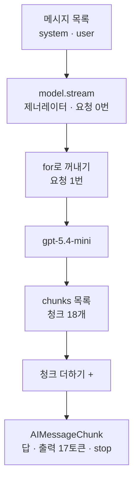
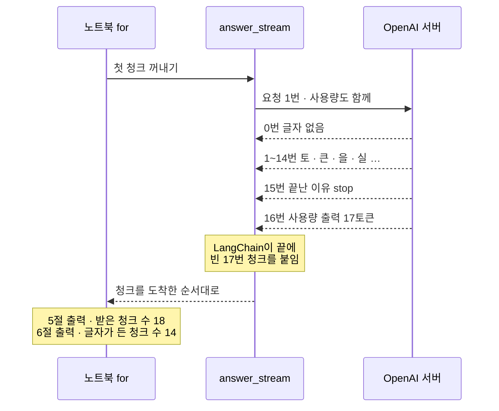
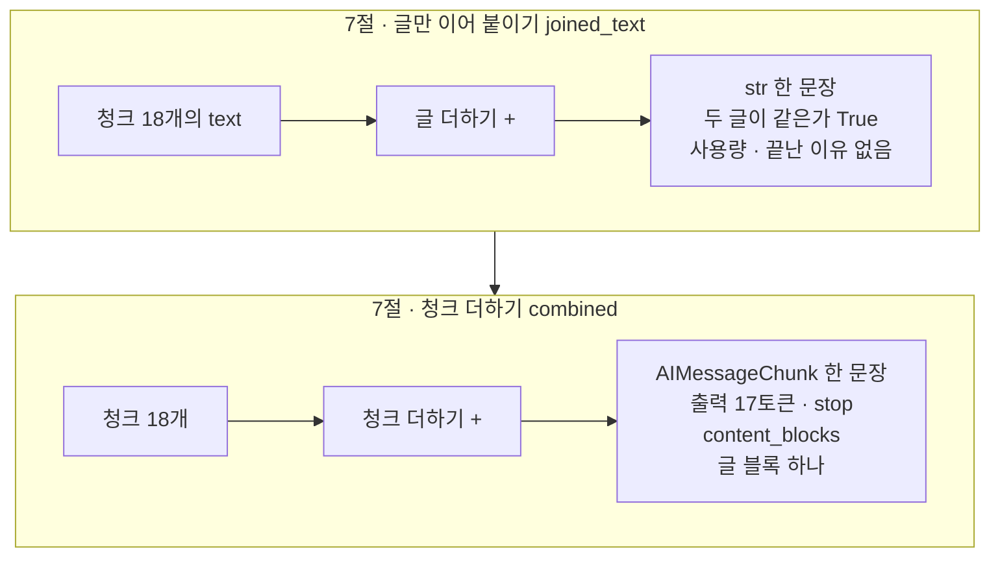
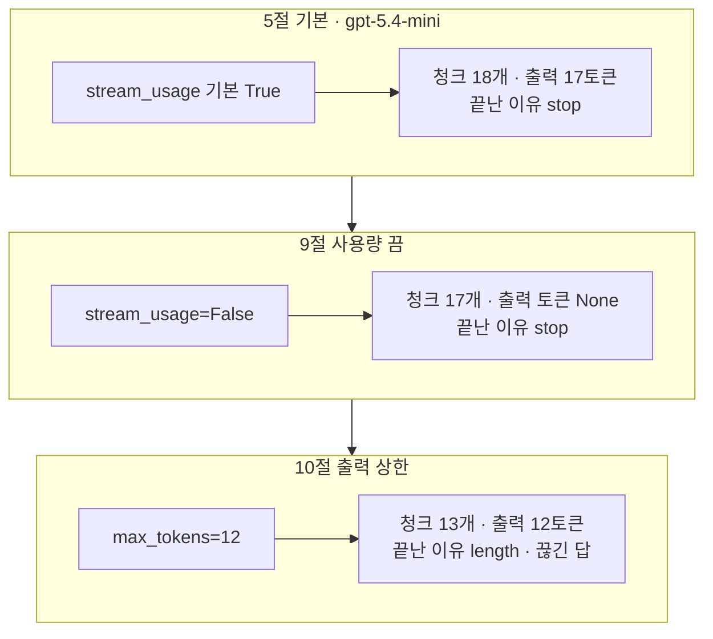

# 04-스트리밍과-content-blocks

## _src 본문 (HTML 원본)

```html
<!--meta: 강의 1h · 실습은 챕터 전체 10h 안에서 진행합니다. -->
<h2 id="b1"><span class="no">1</span>학습 목표</h2>
<div class="goal"><p>이 절을 마치면 다음을 할 수 있습니다.</p><ul><li>메서드 <code>invoke()</code>와 <code>stream()</code>이 반환하는 것을 구분하고, 요청이 나가는 줄을 찾을 수 있습니다.</li><li>도착한 스트림 청크를 <code>+</code>로 합쳐 답·사용량·끝난 이유를 읽고, 속성 <code>content_blocks</code>의 내용 블록을 읽을 수 있습니다.</li><li>사용량이 든 스트림 청크가 없거나 출력 상한에서 끊긴 스트리밍을 출력으로 알아보고, 모르는 사용량을 <code>None</code>으로 적을 수 있습니다.</li></ul></div>
<h2 id="b2"><span class="no">2</span>이 내용을 배우는 이유</h2>
<p>03절까지는 메서드 <code>invoke()</code>로 답을 받았습니다. 이 호출은 답이 끝까지 만들어진 뒤에야 응답 객체를 반환합니다. 답이 길면 첫 글자를 보기까지 그만큼 기다립니다.</p>
<p>답을 끝까지 기다리지 않고, 도착하는 대로 받아 쓰는 방법을 스트리밍(streaming)이라고 부릅니다. 채팅 화면에서 글이 조금씩 늘어나는 모습은 대개 이 방법으로 만듭니다. 다만 화면에 글이 보인 것과 답을 끝까지 받은 것은 다른 일입니다.</p>
<p>답을 저장하거나 사용량을 기록하려면, 도착한 답의 일부를 모으고 끝까지 받았는지 확인해야 합니다. 이 절에서는 받는 방법, 모으는 방법, 끝을 알려 주는 값을 실행으로 봅니다.</p>
<p><strong>이 절의 질문</strong> — 도착하는 대로 받은 답의 일부를 어떻게 모아야, 완성된 답과 사용량, 끝난 이유를 확인할 수 있을까요?</p>
<h2 id="b3"><span class="no">3</span>앞에서 배운 내용</h2>
<table><thead><tr><th>앞 절</th><th>배운 것</th><th>이 절에서 이어지는 곳</th></tr></thead><tbody>
<tr><td>01절</td><td><code>invoke()</code>·응답 객체 <code>AIMessage</code>·<code>text</code>, <code>usage_metadata</code>·<code>finish_reason</code>, 출력 상한 12에서 끝난 이유 <code>length</code>, 모델 객체를 만들 때는 요청 0번</td><td>3절 일반 호출, 4절 요청 0번, 7절 합친 메시지의 사용량·끝난 이유, 10절 출력 상한 12</td></tr>
<tr><td>01절 호출 메서드 표</td><td><code>stream()</code> = 도착하는 대로 받는 답의 일부, 「04절에서 실행」</td><td>4·5절 <code>stream()</code></td></tr>
<tr><td>02절</td><td>system 지시 「한 문장의 한국어로 답하세요.」, 기록표에서 모르는 출력 토큰 수는 <code>None</code></td><td>2절 메시지 목록, 9절 기록할 출력 토큰 수</td></tr>
<tr><td>03절</td><td>양식을 붙이는 줄 <code>with_structured_output()</code>도 요청 0번, 원본 답은 JSON 모양 글</td><td>4절 요청 0번, 주의 메모의 구조화 호출</td></tr>
<tr><td>Ch 2 02·03절</td><td><code>enumerate()</code>, 슬라이싱 <code>[1:]</code></td><td>6절 스트림 청크 번호, 7절 나머지 스트림 청크 더하기</td></tr>
<tr><td>Ch 5 01·04절</td><td>조각(토큰) 수는 토큰화기마다 다름, 출력 몫이 모자라면 오류 없이 끊긴 답</td><td>7절 스트림 청크 수와 출력 토큰 수, 10절 끊긴 답</td></tr>
</tbody></table>
<p>01절 호출 메서드 표는 <code>stream()</code>을 「도착하는 대로 받는 답의 일부」로 소개했습니다. 그리고 04절에서 실행한다고 적었습니다. 이 절에서 그 메서드를 실행하고, 속성 <code>content_blocks</code>도 처음 씁니다.</p>
<p>Ch 5에서 「조각」은 토큰을 뜻했습니다. 이 절에서 도착하는 답의 일부는 토큰과 단위가 달라서, 스트림 청크(chunk)라는 다른 이름으로 부릅니다.</p>
<p>실습 폴더와 <code>.env</code> 파일의 <code>OPENAI_API_KEY</code>는 01절과 같습니다. 노트북은 앞 절 없이 새 커널에서 시작합니다.</p>
<h2 id="b4"><span class="no">4</span>핵심 개념</h2>
<h3>비유로 시작하기</h3>
<p>구슬 팔찌를 받는 방법은 두 가지입니다. 다 꿴 팔찌를 한 번에 받을 수도 있고, 구슬을 한 알씩 받아 실에 꿰어 갈 수도 있습니다.</p>
<p>한 알씩 받으면 다 받기 전에도 꿴 만큼 모양을 볼 수 있습니다. 하지만 줄의 맨 끝에 오는 꼬리표까지 받아야, 구슬이 다 왔다는 것을 압니다.</p>
{{img:04-5-구슬-꿰기|나무 탁자 왼쪽에는 매듭으로 묶은 파란 구슬 팔찌가, 오른쪽에는 U자로 굽은 실 아래쪽에 파란 구슬 다섯 알이 꿰어져 있고 그 오른쪽에 아직 꿰지 않은 구슬 세 알과 빈 노란 꼬리표가 한 줄로 기다리는 삽화|왼쪽 팔찌는 한 번에 받은 완성된 답이고, 오른쪽은 구슬을 한 알씩 꿰는 중이며 줄 맨 끝에 꼬리표가 기다립니다.}}
<p><strong>그림 읽기</strong> — 나무 탁자 왼쪽에 파란 구슬 팔찌가 매듭으로 묶여 있습니다. 오른쪽에는 U자로 굽은 실이 있고, 아래쪽 실에 같은 구슬 다섯 알이 꿰어져 있습니다. 그 오른쪽에 아직 꿰지 않은 구슬 세 알이 한 줄로 기다리고, 줄 맨 끝에 글자 없는 노란 꼬리표가 있습니다.</p>
<p>완성된 팔찌가 <code>invoke()</code>의 응답 객체이고, 실에 꿴 구슬 한 알이 <code>stream()</code>으로 받은 스트림 청크 하나입니다. 기다리는 구슬은 아직 도착하지 않은 스트림 청크입니다. 줄 끝의 꼬리표는 글자 없이 끝난 이유와 사용량을 담은 끝 쪽 스트림 청크입니다.</p>
<p>Ch 5 그림의 블록은 토큰이었지만, 이 그림의 구슬은 토큰과 단위가 다른 스트림 청크입니다. 구슬 수는 실제 스트림 청크 수가 아니고, 구슬 크기가 같아도 스트림 청크마다 든 글자 수는 다릅니다.</p>
<h3>stream()을 부르는 줄과 요청이 나가는 줄</h3>
<p>메서드 <code>stream()</code>은 <code>invoke()</code>와 같은 메시지 목록을 받습니다. 다만 완성된 답 대신, 답의 일부를 차례로 꺼낼 수 있는 객체를 반환합니다. 노트북 4절의 출력은 <code>stream이 준 객체 종류: generator</code>였습니다.</p>
<p>제너레이터(generator)는 값을 미리 만들어 두지 않고, <code>for</code>가 하나를 꺼낼 때마다 다음 값을 만드는 객체입니다. 한 장을 뽑아야 다음 장이 올라오는 티슈 상자와 비슷합니다. 그래서 <code>stream()</code>을 부르는 줄에서는 요청이 나가지 않고, 첫 스트림 청크를 꺼낼 때 나갑니다.</p>
<p>01절에서 모델 객체를 만든 줄, 03절에서 양식을 붙인 줄과 같은 준비 줄입니다. 요청이 나가는 때는 설치한 langchain-core 1.6.2 소스로 확인했습니다. 노트북 5절에서 끝까지 꺼낸 같은 객체를 다시 꺼내자 <code>다시 꺼낸 청크 수: 0</code>이었습니다.</p>
<h3>스트림 청크와 더하기</h3>
<p>스트림 청크(chunk)는 스트리밍에서 한 번에 도착하는 답의 일부입니다. 구슬 팔찌의 구슬 한 알과 비슷합니다. 노트북 5절에서는 <code>|토|큰|을| 실|시간|으로|</code>처럼 스트림 청크 경계가 낱말과 달랐습니다.</p>
<p>스트림 청크 하나하나는 LangChain 메시지 객체 <code>AIMessageChunk</code>입니다. 연산자 <code>+</code>로 더하면 글은 순서대로 이어지고, 사용량과 끝난 이유도 한 객체에 모입니다. 노트북 7절의 합친 객체는 <code>출력 토큰 수: 17</code>과 <code>끝난 이유: stop</code>을 가졌습니다.</p>
<p>스트림 청크를 세어 토큰 수를 대신하지 않습니다. 글자가 든 스트림 청크는 14개였고, 제공자가 센 출력 토큰은 17개였습니다.</p>
{{mermaid:04-1-스트리밍-흐름|위의 초록 상자 메시지 목록이 파란 상자 model.stream 제너레이터 요청 0번, 파란 상자 for로 꺼내기 요청 1번, 보라 상자 gpt-5.4-mini, 노란 상자 chunks 목록 청크 18개, 파란 상자 청크 더하기를 거쳐 노란 상자 AIMessageChunk 답 출력 17토큰 stop으로 이어지는 흐름도|stream을 부르는 줄은 요청 0번이고, for가 첫 스트림 청크를 꺼낼 때 요청 1번이 나갑니다. 도착한 스트림 청크 18개를 더해 합친 메시지 하나를 얻습니다.}}
<p><strong>도식 읽기</strong> — 위에서 아래로 읽습니다. 초록 상자는 보낼 메시지 목록, 파란 상자 세 개는 우리가 적은 코드 줄입니다. 보라 상자는 실행한 모델 <code>gpt-5.4-mini</code>입니다.</p>
<p>둘째 파란 상자에서 처음으로 요청이 나갑니다. 노란 상자 두 개는 출력으로 확인한 값입니다. 목록에 모은 스트림 청크 18개와, 더해서 얻은 <code>AIMessageChunk</code>입니다.</p>
<h3>content, text, content_blocks</h3>
<p>메시지 객체에는 답의 내용을 읽는 속성이 셋 있습니다. 속성 <code>content</code>는 제공자에게서 받은 내용을 담은 값입니다. 이번 답은 글 하나라서 자료형이 <code>str</code>이었습니다. 속성 <code>text</code>는 그 내용에서 글 부분만 꺼낸 값입니다.</p>
<p>속성 <code>content_blocks</code>는 내용을 종류가 붙은 딕셔너리 목록으로 보여 줍니다. 이 딕셔너리 하나를 내용 블록(content block)이라고 부릅니다. 택배 상자마다 「식품」「의류」처럼 품목을 적어 두는 것과 비슷합니다.</p>
<p>노트북 8절의 합친 답은 키 <code>type</code>이 <code>text</code>인 글 블록 하나였습니다. 글자가 없는 0번 스트림 청크는 빈 목록 <code>[]</code>이었습니다. 설치한 langchain-core 1.6.2에는 추론·그림·도구 호출 같은 블록 종류도 정해져 있습니다. 이번 답에는 글 블록만 있었습니다.</p>
<h3>이 절에서 쓰는 말</h3>
<table><thead><tr><th>용어</th><th>뜻</th><th>이 절에서 보이는 모습</th></tr></thead><tbody>
<tr><td>스트리밍(streaming)</td><td>답을 끝까지 기다리지 않고, 도착하는 대로 받아 쓰는 방법</td><td><code>for chunk in answer_stream:</code></td></tr>
<tr><td>스트림 청크(chunk)</td><td>스트리밍에서 한 번에 도착하는 답의 일부. 토큰과 단위가 다름. 구슬 한 알과 비슷함</td><td><code>받은 청크 수: 18</code></td></tr>
<tr><td>제너레이터(generator)</td><td><code>for</code>가 하나를 꺼낼 때마다 다음 값을 만드는 객체. 한 장 뽑으면 다음 장이 올라오는 티슈 상자와 비슷함</td><td><code>stream이 준 객체 종류: generator</code></td></tr>
<tr><td>합친 메시지</td><td>스트림 청크를 모두 <code>+</code>로 더한 <code>AIMessageChunk</code>. 글·사용량·끝난 이유를 함께 가짐</td><td><code>합친 객체 종류: AIMessageChunk</code></td></tr>
<tr><td>사용량이 든 스트림 청크</td><td>글자 없이 토큰 사용량을 담아 끝 쪽에 오는 스트림 청크. 인자 <code>stream_usage</code>로 켜고 끔</td><td><code>16 | 끝난 이유: None | 사용량 있음: True</code></td></tr>
<tr><td>내용 블록(content block)</td><td>내용 하나를 키 <code>type</code>에 종류를 적어 담은 딕셔너리. 속성 <code>content_blocks</code>의 원소</td><td><code>[{'type': 'text', 'text': '토'}]</code></td></tr>
</tbody></table>
<h2 id="b5"><span class="no">5</span>실행 예제</h2>
<p>노트북은 같은 메시지 목록을 <code>invoke()</code>로 먼저 보내 기준 답을 봅니다. 그다음 <code>stream()</code>으로 스트림 청크를 받아 목록에 담고, 글자가 없는 스트림 청크를 살펴봅니다. 끝으로 스트림 청크를 합쳐 사용량·끝난 이유·내용 블록을 읽습니다.</p>
<p>실제 OpenAI 모델을 temperature 0으로 부릅니다. 이 페이지의 출력은 2026-09-17에 실행한 결과입니다. 요청은 값 바꿔 보기까지 모두 4번이고, 예상 비용은 0.01달러 미만입니다. 답 문장과 스트림 청크 경계는 실행마다 달라질 수 있습니다.</p>
<p>강의 시간에는 노트북 3~7절(invoke와 stream, 글자 없는 스트림 청크, 합치기)을 설명합니다. 8~11절(content_blocks, 값 바꿔 보기, 결과 해석)은 함께 실행하고 실습 시간에 읽습니다.</p>
{{notebook:04-스트리밍과-content-blocks}}
<p class="look"><b>확인할 점</b> — 4절 <code>stream이 준 객체 종류: generator</code>와 5절 <code>받은 청크 수: 18</code>을 봅니다. 6절에서는 <code>15 | 끝난 이유: stop | 사용량 있음: False</code> 줄을 찾습니다. 7절에서는 <code>합친 객체 종류: AIMessageChunk</code>를 봅니다.</p>
<h3>스트림 청크가 도착한 순서</h3>
<p>노트북 5절과 6절의 출력을 시간 순서로 다시 놓아 봅니다. 요청 1번에 스트림 청크 18개가 차례로 도착했고, 그중 넷은 글자가 없었습니다.</p>
{{mermaid:04-2-청크-도착-순서|노트북 for, answer_stream, OpenAI 서버 세 세로줄 사이에서 첫 청크를 꺼내자 answer_stream이 서버로 요청 1번을 보내고, 서버가 0번 글자 없음, 1~14번 글자 청크, 15번 끝난 이유 stop, 16번 사용량 출력 17토큰을 차례로 보낸 뒤 LangChain이 빈 17번 청크를 붙인다는 메모와, 받은 청크 수 18과 글자가 든 청크 수 14 메모가 붙은 순서도|요청은 첫 스트림 청크를 꺼낼 때 한 번 나가고, 글자가 든 스트림 청크 뒤에 끝난 이유와 사용량을 담은 스트림 청크가 따로 도착합니다.}}
<p><strong>도식 읽기</strong> — 세로줄은 왼쪽부터 노트북의 <code>for</code>, 제너레이터 <code>answer_stream</code>, OpenAI 서버입니다. 위에서 아래로 시간 순서이고, 실선은 요청, 점선은 응답입니다.</p>
<p>노트북 출력만으로는 어느 스트림 청크가 서버에서 왔는지 알 수 없습니다. 아래 서버 쪽 순서는 교재를 만들 때 openai 패키지의 원시 스트림을 탐색 실행해 본 결과입니다.</p>
<p>서버는 글자 없는 0번 스트림 청크를 먼저 보내고, 1~14번에 글을 나눠 보냈습니다. 끝난 이유 <code>stop</code>은 15번 스트림 청크에, 출력 17토큰의 사용량은 16번 스트림 청크에 따로 왔습니다. 마지막 빈 17번 스트림 청크는 서버가 아니라 LangChain이 붙였습니다. 설치한 langchain-core 1.6.2 소스에서 확인한 내용입니다.</p>
<p>맨 아래 노란 메모는 스트림 청크를 다 받은 뒤 출력으로 확인한 두 수입니다. 스트림 청크 18개 가운데 글자가 든 스트림 청크는 14개였습니다.</p>
<h3>글만 이어 붙인 글과 합친 메시지</h3>
<p>노트북 7절은 같은 스트림 청크 18개를 두 방법으로 모았습니다. 스트림 청크의 글만 이어 붙인 방법과, 스트림 청크 자체를 <code>+</code>로 더한 방법입니다.</p>
{{mermaid:04-3-이어-붙인-글과-합친-메시지|위 칸 글만 이어 붙이기는 노란 상자 청크 18개의 text가 파란 상자 글 더하기를 거쳐 노란 상자 str 한 문장 두 글이 같은가 True 사용량 끝난 이유 없음으로, 아래 칸 청크 더하기는 노란 상자 청크 18개가 파란 상자 청크 더하기를 거쳐 노란 상자 AIMessageChunk 한 문장 출력 17토큰 stop content_blocks 글 블록 하나로 이어지는 비교 그림|두 방법 모두 같은 문장을 얻었지만, 사용량과 끝난 이유는 스트림 청크를 더한 합친 메시지에만 남았습니다.}}
<p><strong>도식 읽기</strong> — 위 칸은 글만 이어 붙인 <code>joined_text</code>, 아래 칸은 스트림 청크를 더한 <code>combined</code>입니다. 칸마다 왼쪽에서 오른쪽으로 읽습니다. 노란 상자는 출력으로 확인한 값, 파란 상자는 더하는 코드 줄입니다.</p>
<p>위 칸 끝의 글은 <code>두 글이 같은가: True</code>로 아래 칸과 같은 문장이었습니다. 하지만 자료형이 <code>str</code>이라 사용량과 끝난 이유를 담을 곳이 없습니다. 아래 칸 끝의 합친 메시지는 출력 17토큰과 <code>stop</code>을 가졌고, 8절에서 글 블록 하나를 보였습니다.</p>
<h2 id="b6"><span class="no">6</span>실험 결과 해석</h2>
<p>노트북 11절은 세 번의 스트리밍을 한 줄씩 나란히 출력했습니다. 라벨 줄 아래 세 줄은 <code>기본 | 18 | 17 | stop</code>, <code>사용량 끔 | 17 | None | stop</code>, <code>출력 상한 12 | 13 | 12 | length</code>였습니다.</p>
{{mermaid:04-4-세-번-비교|위 칸 5절 기본은 초록 상자 stream_usage 기본 True가 노란 상자 청크 18개 출력 17토큰 끝난 이유 stop으로, 가운데 칸 9절 사용량 끔은 초록 상자 stream_usage False가 노란 상자 청크 17개 출력 토큰 None 끝난 이유 stop으로, 아래 칸 10절 출력 상한은 초록 상자 max_tokens 12가 노란 상자 청크 13개 출력 12토큰 끝난 이유 length 끊긴 답으로 이어지는 비교 그림|사용량을 끄면 출력 토큰 수가 None으로 남고, 출력 상한 12에서는 오류 없이 끊겨 끝난 이유가 length였습니다.}}
<p><strong>도식 읽기</strong> — 위에서 아래로 세 번의 실행을 읽고, 칸 안은 왼쪽에서 오른쪽으로 읽습니다. 초록 상자는 바꾼 설정, 노란 상자는 출력으로 확인한 결과입니다. 세 칸 모두 같은 모델 <code>gpt-5.4-mini</code>와 같은 메시지 목록을 썼습니다.</p>
<p>세 번 모두 오류 없이 끝나 결과 상자를 노랑으로 칠했습니다. 아래 칸의 끊긴 답도 01절의 끊긴 답처럼, 출력으로 확인한 결과라 노랑입니다.</p>
<p>가운데 줄은 답을 받았는데도 출력 토큰 수가 <code>None</code>이었습니다. 사용량이 든 스트림 청크를 받지 않았을 뿐, 요청 1번의 토큰은 쓰였습니다. 그래서 9절은 0이 아니라 <code>None</code>을 기록했습니다. 02절 기록표의 규칙과 같습니다.</p>
<p>아래 줄의 합친 답은 「토큰을 실시간으로 순차 전」에서 끊겼습니다. 그래도 오류는 나지 않았습니다. 화면에 찍힌 글만 보면 끊긴 줄 알기 어려우므로, 끝났는지는 합친 메시지의 끝난 이유로 확인합니다.</p>
<p>스트림 청크 수는 세 번 모두 달랐습니다. 이 수에는 LangChain이 붙인 빈 스트림 청크도 들어 있고, 속도나 품질을 뜻하지 않습니다. 설정마다 한 번씩 실행한 결과라, 이 표로 모델을 비교하지 않습니다.</p>
<p>7절의 <code>3절 invoke 답과 글이 같은가: False</code>는 두 요청의 답 낱말이 달랐다는 뜻입니다. 한편 9절 스트리밍의 답은 5절 스트리밍 답과 같은 문장이었습니다. temperature 0이어도 따로 보낸 요청의 답은 같다고 보장하지 않습니다. 끝까지 받은 요청 세 번을 한 번씩 본 결과라, 스트리밍 여부가 문장을 바꾼다고 말할 수 없습니다.</p>
<h2 id="b7"><span class="no">7</span>주의할 점과 실무 메모</h2>
<ul><li>한 번 끝까지 꺼낸 제너레이터는 비어 있습니다. 노트북 5절의 다음 셀에서 <code>다시 꺼낸 청크 수: 0</code>이었습니다. 다시 받으려면 <code>stream()</code>을 다시 부르고, 그때 요청이 새로 나갑니다.</li>
<li>인자 <code>stream_usage</code>의 기본값은 환경에 따라 다릅니다. 설치한 langchain-openai 1.6.0 소스에서는 기본 주소를 쓸 때 켭니다. 환경 변수 <code>OPENAI_BASE_URL</code>로 다른 주소를 쓰면 켜지 않습니다. 다른 주소와 다른 제공자는 이번에 실행하지 않았습니다.</li>
<li>온라인 ChatOpenAI 문서는 스트리밍 사용량을 받으려면 <code>stream_usage=True</code>를 주라고 안내합니다. 설치한 판은 기본 주소에서 이미 켜 두었고, 노트북 4절 출력도 <code>True</code>였습니다. 사용량이 꼭 필요하면 이 값을 먼저 출력해 확인합니다.</li>
<li>연결이 중간에 끊긴 경우는 이번에 실행하지 않았습니다. 설치한 langchain-core 1.6.2 소스에서는 받는 도중 오류가 나면 <code>for</code> 줄에서 그 오류가 다시 납니다. 그때까지 목록에 담긴 스트림 청크는 끝까지 받은 답이 아니므로, 끝난 이유가 없는 채로 저장하지 않습니다.</li>
<li>첫 스트림 청크가 도착하기까지 걸린 시간은 이번에 재지 않았습니다. 스트림 청크 수로 속도를 짐작하지 않습니다. 호출에 걸린 시간은 06절에서 측정합니다.</li>
<li>03절의 구조화 호출을 스트리밍으로 받는 것은 이번에 실행하지 않았습니다. 받는 도중의 글은 JSON 모양 글의 앞부분일 수 있습니다. 카드로 읽는 일은 답을 끝까지 받은 뒤에 합니다.</li>
<li>설치한 langchain-core 1.6.2의 속성 <code>text</code>는 종류가 text인 블록만 모읍니다. 추론·그림·도구 호출 블록과 다른 제공자의 <code>content</code> 모양은 이번에 실행하지 않았습니다. 그런 답에서 <code>text</code>만 읽으면 글이 아닌 내용이 빠질 수 있습니다.</li>
<li>채팅 화면처럼 도착할 때마다 글을 보여 주려면, 반복문 안에서 스트림 청크의 글을 바로 출력합니다. 교재를 만들 때 그렇게 실행해 보니 노트북 파일에 출력이 스트림 청크마다 따로 저장되어 이 페이지에서 칸이 나뉘었습니다. 그래서 노트북은 스트림 청크 경계에 <code>|</code>를 넣어 모은 뒤 한 번에 출력합니다.</li>
<li>값 바꿔 보기의 <code>stream_usage=False</code>와 출력 상한 12는 흐름을 보여 주려고 정한 예입니다. 교재를 만들 때 탐색 실행으로 사용량 <code>None</code>과 끝난 이유 <code>length</code>를 먼저 확인한 뒤 정했습니다. 출력 상한 12는 01절 노트북 7절의 값을 이어 썼습니다.</li>
<li>교재 출력은 Linux의 Python 3.12.13으로 만들었습니다. 패키지는 langchain 1.4.0, langchain-core 1.6.2, langchain-openai 1.6.0입니다. openai 3.10.0, python-dotenv 1.2.3도 함께 썼습니다. 다른 버전과 Windows·macOS에서는 실행하지 않았습니다.</li></ul>
<h2 id="b8"><span class="no">8</span>정리와 다음 절</h2>
<ul><li>메서드 <code>invoke()</code>는 답을 다 받은 뒤 <code>AIMessage</code> 하나를 반환했습니다. 메서드 <code>stream()</code>은 제너레이터를 반환했고, 첫 스트림 청크를 꺼낼 때 요청이 나갔습니다.</li><li>스트림 청크 18개를 <code>+</code>로 더하자 글·사용량·끝난 이유가 <code>AIMessageChunk</code> 하나에 모였습니다. 끝난 이유와 사용량은 글자가 없는 끝 쪽 스트림 청크에 따로 왔습니다.</li><li>사용량 받기를 끄면 출력 토큰 수를 <code>None</code>으로 기록했습니다. 출력 상한 12에서는 오류 없이 끊겼고, 끝난 이유 <code>length</code>로 알아봤습니다.</li></ul>
<p><strong>다음 학습과 이어지는 지점</strong> — 05절에서는 요청이 늦거나 오류가 날 때를 다룹니다. 기다리는 시간과 다시 시도하는 횟수를 정하고, 실패하면 쓸 다른 경로를 준비합니다.</p>
<h2 id="b9"><span class="no">9</span>복습 문제</h2>
<details class="quiz"><summary>문제 1 · 요청이 나가는 줄</summary><p class="quiz-q"><code>answer_stream = model.stream(messages)</code> 한 줄만 실행하면 요청이 몇 번 나가나요?</p><p class="quiz-a"><b>해설</b> — 0번입니다. 메서드 <code>stream()</code>은 제너레이터를 반환할 뿐입니다. 요청은 <code>for</code>가 첫 스트림 청크를 꺼낼 때 나갑니다.</p></details>
<details class="quiz"><summary>문제 2 · 다시 꺼내기</summary><p class="quiz-q">4절 셀은 그대로 두고, 5절 셀만 한 번 더 실행했습니다. 받은 스트림 청크 수는 어떻게 될까요?</p><p class="quiz-a"><b>해설</b> — 0개가 됩니다. 4절의 제너레이터는 이미 끝까지 꺼냈기 때문입니다. 노트북에서도 같은 객체를 다시 꺼내자 <code>다시 꺼낸 청크 수: 0</code>이었습니다. 4절 셀부터 다시 실행해야 새 요청이 나갑니다.</p></details>
<details class="quiz"><summary>문제 3 · 끊긴 답 알아보기</summary><p class="quiz-q">스트림 청크의 글만 이어 붙여 저장했습니다. 출력 상한에 닿아 끊긴 답인지 알 수 있나요?</p><p class="quiz-a"><b>해설</b> — 알 수 없습니다. 이번 실행에서 끝난 이유는 글자가 없는 끝 쪽 스트림 청크에 있었습니다. 스트림 청크를 <code>+</code>로 합쳐 끝난 이유가 <code>length</code>인지 확인합니다.</p></details>
<details class="quiz"><summary>문제 4 · 사용량이 없을 때</summary><p class="quiz-q">인자 <code>stream_usage=False</code>로 받은 합친 메시지의 사용량이 <code>None</code>입니다. 출력 토큰 수를 0으로 기록해도 되나요?</p><p class="quiz-a"><b>해설</b> — 안 됩니다. 요청을 보내 답을 받았으므로 토큰은 쓰였습니다. 사용량이 든 스트림 청크를 받지 않아 모를 뿐이므로 <code>None</code>으로 기록합니다.</p></details>
<details class="quiz"><summary>문제 5 · 스트림 청크 수와 토큰 수</summary><p class="quiz-q">글자가 든 스트림 청크가 14개였습니다. 출력 토큰 수도 14라고 적어도 되나요?</p><p class="quiz-a"><b>해설</b> — 안 됩니다. 같은 실행에서 제공자가 센 출력 토큰은 17개였습니다. 사용량은 스트림 청크를 세지 말고 <code>usage_metadata</code>에서 읽습니다.</p></details>
<details class="quiz"><summary>문제 6 · 내용 블록의 종류</summary><p class="quiz-q">합친 답의 <code>content_blocks</code>는 딕셔너리 하나짜리 목록이었습니다. 키 <code>type</code>은 무엇을 알려 주나요?</p><p class="quiz-a"><b>해설</b> — 블록에 든 내용의 종류입니다. 이번 답은 <code>text</code> 블록 하나였습니다. 추론이나 도구 호출 같은 다른 종류는 이번 답에 없었습니다.</p></details>
<h2 id="b10"><span class="no">10</span>참고 자료</h2>
<p>문서는 2026-09-17에 다시 열어 확인했습니다. 요청이 나가는 때, 스트림 청크 더하기, 사용량을 함께 받는 설정의 기본값은 실습 가상환경의 패키지 소스에서도 확인했습니다. 확인한 판은 <code>langchain-core 1.6.2</code>, <code>langchain-openai 1.6.0</code>, <code>openai 3.10.0</code>입니다.</p>
<ul><li><div><a href="https://docs.langchain.com/oss/python/langchain/models">LangChain Models</a></div>스트림 청크를 받아 합치는 방법 · 확인 2026-09-17</li><li><div><a href="https://docs.langchain.com/oss/python/langchain/messages">LangChain Messages</a></div>메시지 내용과 내용 블록 · 확인 2026-09-17</li><li><div><a href="https://docs.langchain.com/oss/python/integrations/chat/openai">LangChain ChatOpenAI</a></div>스트리밍 사용량 설정 · 확인 2026-09-17</li><li><div><a href="https://docs.python.org/3.12/glossary.html#term-generator">Python Glossary: generator</a></div>제너레이터의 뜻 · 확인 2026-09-17</li><li><div><a href="https://github.com/langchain-ai/langchain/blob/master/LICENSE">LangChain MIT License</a></div>예제의 질문과 설명은 이 교재에 맞게 새로 썼습니다</li></ul>
```

## 노트북 셀 (순서대로)

### [0] markdown {'html': 'skip'}

# 스트리밍과 content blocks

**이 노트북에서 할 일**

1. 같은 메시지를 `invoke()`로 한 번에 받고, `stream()`으로 도착하는 대로도 받습니다.
2. 도착한 스트림 청크를 합쳐 답, 사용량, 끝난 이유를 찾고 `content_blocks`를 읽습니다.
3. 사용량 받기를 끄거나 출력 상한을 12로 줄여, 스트림 청크와 기록할 값이 어떻게 달라지는지 봅니다.

**준비물** — 프로젝트 폴더 `.env` 파일의 `OPENAI_API_KEY`가 필요합니다. 데이터 파일은 없습니다.
인터넷 서비스의 모델 `gpt-5.4-mini`에 요청을 모두 4번 보냅니다. 실행 시간은 1분 안팎입니다.
예상 비용은 0.01달러 미만입니다(06절 4절에서 2026-09-17에 확인한 공식 요금 기준).

**강의와 실습 범위** — 강의 시간에는 3~7절(invoke와 stream, 글자 없는 스트림 청크, 합치기)을 설명합니다.
8~11절(content_blocks, 값 바꿔 보기, 결과 해석)은 함께 실행하고 실습 시간에 읽습니다.

**기준 버전** — 실습 폴더에 고정한 패키지 판을 씁니다. langchain 1.4.0, langchain-core 1.6.2, langchain-openai 1.6.0입니다.
함께 설치되는 openai 패키지는 3.10.0이고, python-dotenv는 1.2.3입니다.

교재 출력은 Linux의 Python 3.12.13으로 만들었습니다. 다른 버전과 Windows·macOS에서는 이번에 실행하지 않았습니다.

실습 폴더 `labs/part2/ch06-langchain-start`에서 `uv sync --locked`를 실행합니다.
그다음 이 폴더의 `.venv` 커널을 고르고 첫 셀부터 순서대로 실행합니다.

### [1] markdown {'html': 'skip'}

## 오늘 볼 그림


위에서 아래로 읽습니다. 초록 상자는 보낼 메시지 목록이고, 파란 상자는 우리가 적은 코드 줄입니다.
메서드 `stream()`을 부르는 줄은 요청을 보내지 않습니다. 요청은 `for`가 첫 스트림 청크를 꺼낼 때 나갑니다.

노란 상자 두 개는 출력으로 확인한 값입니다. 도착한 스트림 청크를 목록에 모은 뒤, 더해서 하나로 합칩니다.

### [2] markdown {}

## 1. 준비

첫 셀은 패키지를 설치하고 설치된 버전을 출력합니다. 설치에는 몇십 초가 걸릴 수 있습니다.
패키지 openai는 langchain-openai가 OpenAI 서버에 요청을 보낼 때 쓰는 패키지입니다.

### [3] code {'execution': {'iopub.execute_input': '2026-09-17T01:07:55.918870Z', 'iopub.status.busy': '2026-09-17T01:07:55.918645Z', 'iopub.status.idle': '2026-09-17T01:07:56.607542Z', 'shell.execute_reply': '2026-09-17T01:07:56.606978Z'}, 'lesson_role': 'setup'}

```python
# 이 절에서 쓰는 패키지를 설치하고 버전을 확인합니다
%pip install -q "langchain==1.4.0" "langchain-openai==1.6.0" "python-dotenv==1.2.3"
from importlib.metadata import version

print("langchain:", version("langchain"))
print("langchain-core:", version("langchain-core"))
print("langchain-openai:", version("langchain-openai"))
print("openai:", version("openai"))
print("python-dotenv:", version("python-dotenv"))
```

출력:
```
Note: you may need to restart the kernel to use updated packages.
langchain: 1.4.0
langchain-core: 1.6.2
langchain-openai: 1.6.0
openai: 3.10.0
python-dotenv: 1.2.3

```

### [4] markdown {}

**결과 읽기** — 출력 줄은 `langchain: 1.4.0`, `langchain-core: 1.6.2`, `openai: 3.10.0` 등 다섯 줄입니다.
준비물에 적은 기준 버전과 같습니다.

01절과 같이 모델 객체를 만드는 함수를 불러옵니다.

### [5] code {'execution': {'iopub.execute_input': '2026-09-17T01:07:56.608556Z', 'iopub.status.busy': '2026-09-17T01:07:56.608474Z', 'iopub.status.idle': '2026-09-17T01:07:56.981246Z', 'shell.execute_reply': '2026-09-17T01:07:56.980808Z'}, 'lesson_role': 'setup'}

```python
# 모델 객체를 만드는 함수를 불러옵니다
from langchain.chat_models import init_chat_model
```

출력:
```

```

### [6] markdown {}

01절과 같은 셀로 API 키가 있는지 확인합니다. 키 값은 출력하지 않고, 있는지만 봅니다.
`True` 값이 나오면 다음으로 넘어갑니다.

### [7] code {'execution': {'iopub.execute_input': '2026-09-17T01:07:56.982032Z', 'iopub.status.busy': '2026-09-17T01:07:56.981975Z', 'iopub.status.idle': '2026-09-17T01:07:56.986508Z', 'shell.execute_reply': '2026-09-17T01:07:56.986196Z'}, 'lesson_role': 'setup'}

```python
# .env 파일에서 OpenAI API 키를 읽습니다(키 값은 출력하지 않습니다)
import os
from dotenv import find_dotenv, load_dotenv

env_path = find_dotenv(usecwd=True)
load_dotenv(env_path)
has_key = os.getenv("OPENAI_API_KEY") is not None
print("OPENAI_API_KEY 설정 여부:", has_key)
assert has_key, "프로젝트 폴더의 .env 파일에 OPENAI_API_KEY를 적어 주세요."
```

출력:
```
OPENAI_API_KEY 설정 여부: True

```

### [8] markdown {}

실습에 쓸 모델을 준비합니다.
01절과 같은 설정으로 모델 객체를 만듭니다. 이 셀은 요청을 보내지 않습니다.

### [9] code {'execution': {'iopub.execute_input': '2026-09-17T01:07:56.987102Z', 'iopub.status.busy': '2026-09-17T01:07:56.987049Z', 'iopub.status.idle': '2026-09-17T01:07:57.947384Z', 'shell.execute_reply': '2026-09-17T01:07:57.947044Z'}}

```python
# 실습에 쓸 모델을 준비합니다
model = init_chat_model(
    "openai:gpt-5.4-mini",
    temperature=0,
    reasoning_effort="none",
)
print("모델 이름:", model.model_name)
print("temperature:", model.temperature)
```

출력:
```
모델 이름: gpt-5.4-mini
temperature: 0.0

```

### [10] markdown {}

**결과 읽기** — 출력 줄은 `모델 이름: gpt-5.4-mini`와 `temperature: 0.0`입니다. 이것으로 준비가 끝났습니다.
이 노트북의 출력은 2026-09-17에 이 모델로 실행한 결과입니다. 실행마다 답 문장과 스트림 청크 경계가 달라질 수 있습니다.
01절에서 본 것처럼 temperature 0은 Ch 5 06절의 뽑기를 끈 설정(`do_sample=False`)과 같은 것이 아닙니다.

### [11] markdown {}

## 2. 메시지 목록 만들기

이번 절의 질문은 LangChain 스트리밍을 짧게 설명해 달라는 요청입니다. system 지시는 02절의 「한 문장의 한국어로 답하세요.」를 다시 씁니다.
01절처럼 `(역할, 내용)` 튜플 목록으로 적고, 한 줄씩 출력합니다.

실행 전에 예상합니다. 역할 이름 system과 user가 한 줄씩 나올 것입니다.

### [12] code {'execution': {'iopub.execute_input': '2026-09-17T01:07:57.948113Z', 'iopub.status.busy': '2026-09-17T01:07:57.948051Z', 'iopub.status.idle': '2026-09-17T01:07:57.950079Z', 'shell.execute_reply': '2026-09-17T01:07:57.949763Z'}}

```python
# 한 문장으로 답하라는 공통 지시와 이번 질문을 튜플 목록에 담습니다
messages = [
    ("system", "한 문장의 한국어로 답하세요."),
    ("user", "LangChain 스트리밍을 열두 단어 이내로 설명하세요."),
]
print("메시지 목록:")
for role, content in messages:
    print(role, "|", content)
```

출력:
```
메시지 목록:
system | 한 문장의 한국어로 답하세요.
user | LangChain 스트리밍을 열두 단어 이내로 설명하세요.

```

### [13] markdown {}

**결과 읽기** — 라벨 줄 아래 첫 줄은 `system | 한 문장의 한국어로 답하세요.`입니다. 둘째 줄은 `user | LangChain 스트리밍을 열두 단어 이내로 설명하세요.`입니다.
아직 목록만 만들었고 요청은 보내지 않았습니다.

## 3. invoke()로 한 번에 받기

먼저 01절과 같은 일반 호출로 보냅니다. 메서드 `invoke()`는 답이 끝까지 만들어진 뒤에 응답 객체 하나를 반환합니다.
응답 객체의 종류, 답, 출력 토큰 수, 끝난 이유를 출력합니다. 모두 01절 노트북에서 읽은 값입니다.

실행 전에 예상합니다. 응답 객체는 AIMessage이고, 끝난 이유는 stop일 것입니다.

### [14] code {'execution': {'iopub.execute_input': '2026-09-17T01:07:57.950670Z', 'iopub.status.busy': '2026-09-17T01:07:57.950612Z', 'iopub.status.idle': '2026-09-17T01:08:00.149536Z', 'shell.execute_reply': '2026-09-17T01:08:00.148606Z'}}

```python
# 01절처럼 일반 호출로 보내고, 답을 다 받은 뒤 값을 읽습니다(요청 1번)
response = model.invoke(messages)
print("응답 객체 종류:", type(response).__name__)
print("답:", response.text)
print("출력 토큰 수:", response.usage_metadata["output_tokens"])
print("끝난 이유:", response.response_metadata["finish_reason"])
```

출력:
```
응답 객체 종류: AIMessage
답: LangChain 스트리밍은 생성 중 결과를 실시간 전송합니다.
출력 토큰 수: 19
끝난 이유: stop

```

### [15] markdown {}

**결과 읽기** — 출력 줄은 `응답 객체 종류: AIMessage`, 한 문장 답, `출력 토큰 수: 19`, `끝난 이유: stop`입니다.
이 셀은 답이 끝까지 만들어진 뒤에 네 줄을 출력했습니다.

답이 길면 첫 글자를 보기까지 그만큼 기다립니다. 4절부터는 같은 목록을 보내고, 답을 도착하는 대로 받습니다.

## 4. stream()을 부르는 줄

메서드 `stream()`은 `invoke()`와 같은 메시지 목록을 받습니다. 다만 완성된 답 대신, 답의 일부를 차례로 꺼낼 수 있는 객체를 반환합니다.
이렇게 도착하는 답의 일부 하나를 스트림 청크(chunk)라고 부릅니다. 실에 한 알씩 꿰는 구슬 하나와 비슷합니다.

Ch 5에서 「조각」은 토큰을 뜻했습니다. 스트림 청크는 토큰과 단위가 달라서 다른 이름으로 부릅니다.
아래 셀은 `stream()`을 부르기만 하고, 스트림 청크를 꺼내지는 않습니다. 사용량을 함께 받는 설정 `stream_usage`도 출력합니다.

실행 전에 예상합니다. 01절의 모델 객체를 만든 줄처럼, 이 줄에서는 아직 요청이 나가지 않을 것입니다.

### [16] code {'execution': {'iopub.execute_input': '2026-09-17T01:08:00.151287Z', 'iopub.status.busy': '2026-09-17T01:08:00.151139Z', 'iopub.status.idle': '2026-09-17T01:08:00.154580Z', 'shell.execute_reply': '2026-09-17T01:08:00.153832Z'}}

```python
# stream()을 부르기만 하고, 받은 객체의 종류와 사용량 설정을 봅니다(이 셀은 요청을 보내지 않습니다)
answer_stream = model.stream(messages)
print("stream이 준 객체 종류:", type(answer_stream).__name__)
print("stream_usage 설정:", model.stream_usage)
```

출력:
```
stream이 준 객체 종류: generator
stream_usage 설정: True

```

### [17] markdown {}

**결과 읽기** — 첫 줄은 `stream이 준 객체 종류: generator`이고, 둘째 줄은 `stream_usage 설정: True`입니다.
제너레이터(generator)는 값을 미리 만들어 두지 않고, `for`가 하나를 꺼낼 때마다 다음 값을 만드는 객체입니다.

그래서 이 줄에서는 요청이 나가지 않았습니다. 설치한 langchain-core 1.6.2 소스에서, 첫 스트림 청크를 꺼낼 때 요청을 보내는 것을 확인했습니다.
설정 `True`는 끝 쪽에 사용량을 담은 스트림 청크도 함께 받는다는 뜻입니다. 설치한 langchain-openai 1.6.0이 기본으로 켜 두는 값입니다.

## 5. 도착하는 대로 받기

4절의 객체 `answer_stream`에서 `for`로 스트림 청크를 하나씩 꺼냅니다. 첫 스트림 청크를 꺼낼 때 요청 1번이 나갑니다.
스트림 청크마다 목록 `chunks`에 담고, 스트림 청크의 글 `chunk.text` 뒤에 `|`를 붙여 글 `shown_text`에 모읍니다. 속성 `text`는 01절 응답 객체에서 읽은 그 속성입니다.

반복이 끝나면 모은 글을 한 번에 출력합니다. 기호 `|`와 `|` 사이가 스트림 청크 하나입니다.
셀 주석과 출력 라벨의 「청크」는 스트림 청크를 줄여 쓴 말입니다.

실행 전에 예상합니다. `|` 사이에 낱말이 하나씩 들어 있을 것 같지만, 실제 경계는 다를 수 있습니다.

### [18] code {'execution': {'iopub.execute_input': '2026-09-17T01:08:00.155967Z', 'iopub.status.busy': '2026-09-17T01:08:00.155848Z', 'iopub.status.idle': '2026-09-17T01:08:01.125030Z', 'shell.execute_reply': '2026-09-17T01:08:01.124111Z'}}

```python
# 청크를 도착하는 대로 꺼내 목록에 담고, 청크 경계에 |를 넣어 글을 모읍니다(요청 1번)
chunks = []
shown_text = ""
for chunk in answer_stream:
    chunks.append(chunk)
    shown_text = shown_text + chunk.text + "|"
print("청크 경계를 | 로 표시한 글:")
print(shown_text)
print("받은 청크 수:", len(chunks))
```

출력:
```
청크 경계를 | 로 표시한 글:
|토|큰|을| 실|시간|으로| 순|차| 전|송|하는| 기능|입니다|.||||
받은 청크 수: 18

```

### [19] markdown {}

**결과 읽기** — 라벨 줄 아래 글은 `|토|큰|을| 실|시간|으로|`로 시작하고, `기능|입니다|.||||`로 끝납니다. 마지막 줄은 `받은 청크 수: 18`입니다.
스트림 청크의 경계는 낱말과 달랐습니다. 낱말 「토큰을」이 `토`, `큰`, `을` 세 스트림 청크로 나뉘어 도착했습니다.

맨 앞의 `|`와 끝의 겹친 `|`는 글자가 없는 스트림 청크입니다. 6절에서 이 스트림 청크들을 살펴봅니다.
채팅 화면처럼 도착할 때마다 보여 주려면, 반복문 안에서 스트림 청크의 글을 바로 출력합니다. 이 노트북은 출력을 한 덩어리로 남기려고 반복이 끝난 뒤 출력했습니다.

이번에는 이미 끝까지 꺼낸 같은 객체 `answer_stream`에서 한 번 더 꺼내 봅니다. 꺼낸 스트림 청크 수를 셉니다.

실행 전에 예상합니다. 제너레이터는 끝까지 꺼냈으므로, 새 요청 없이 0개일 것입니다.

### [20] code {'execution': {'iopub.execute_input': '2026-09-17T01:08:01.127220Z', 'iopub.status.busy': '2026-09-17T01:08:01.127031Z', 'iopub.status.idle': '2026-09-17T01:08:01.130558Z', 'shell.execute_reply': '2026-09-17T01:08:01.129988Z'}}

```python
# 이미 끝까지 꺼낸 answer_stream에서 다시 꺼내 청크 수를 셉니다(요청 없음)
again_count = 0
for chunk in answer_stream:
    again_count = again_count + 1
print("다시 꺼낸 청크 수:", again_count)
assert again_count == 0
```

출력:
```
다시 꺼낸 청크 수: 0

```

### [21] markdown {}

**결과 읽기** — 출력 줄은 `다시 꺼낸 청크 수: 0`이고, `assert`도 통과했습니다.
한 번 끝까지 꺼낸 제너레이터는 비어 있습니다. 5절 셀을 다시 실행하려면 4절 셀부터 다시 실행합니다.

## 6. 글자가 없는 스트림 청크 살펴보기

5절 출력의 맨 앞과 끝에는 글자 없이 `|`만 찍힌 스트림 청크가 있었습니다. 이 스트림 청크들이 무엇을 담았는지 봅니다.
함수 `enumerate()`는 목록의 값을 번호와 함께 꺼냅니다(Ch 2 02절). 번호는 0부터 셉니다.

글자가 없는 스트림 청크는 번호, 끝난 이유, 사용량이 있는지를 출력합니다. 글자가 든 스트림 청크는 개수만 셉니다.
메서드 `get(키)`는 키가 없으면 `None`을 줍니다(01절). 스트림 청크마다 끝난 이유가 있는지 이것으로 봅니다.

실행 전에 예상합니다. 끝난 이유와 사용량은 답의 끝 쪽 스트림 청크에 있을 것입니다.

### [22] code {'execution': {'iopub.execute_input': '2026-09-17T01:08:01.132325Z', 'iopub.status.busy': '2026-09-17T01:08:01.132179Z', 'iopub.status.idle': '2026-09-17T01:08:01.135300Z', 'shell.execute_reply': '2026-09-17T01:08:01.134981Z'}}

```python
# 글자가 없는 청크의 번호·끝난 이유·사용량 여부를 보고, 글자가 든 청크 수를 셉니다(요청 없음)
text_chunk_count = 0
print("글자가 없는 청크:")
for number, chunk in enumerate(chunks):
    if chunk.text == "":
        finish_reason = chunk.response_metadata.get("finish_reason")
        has_usage = chunk.usage_metadata is not None
        print(number, "| 끝난 이유:", finish_reason, "| 사용량 있음:", has_usage)
    else:
        text_chunk_count = text_chunk_count + 1
print("글자가 든 청크 수:", text_chunk_count)
```

출력:
```
글자가 없는 청크:
0 | 끝난 이유: None | 사용량 있음: False
15 | 끝난 이유: stop | 사용량 있음: False
16 | 끝난 이유: None | 사용량 있음: True
17 | 끝난 이유: None | 사용량 있음: False
글자가 든 청크 수: 14

```

### [23] markdown {}

**결과 읽기** — 라벨 줄 아래는 네 줄이고, 번호 `0`인 첫 스트림 청크에는 끝난 이유도 사용량도 없습니다.
끝난 이유는 `15 | 끝난 이유: stop | 사용량 있음: False` 줄에 있습니다. 사용량은 그다음 `16` 줄에 있습니다.

마지막 `17`번 스트림 청크도 글자가 없습니다. 설치한 langchain-core 1.6.2 소스에서, 스트림 끝에 빈 스트림 청크 하나를 붙이는 것을 확인했습니다.
마지막 줄은 `글자가 든 청크 수: 14`입니다. 받은 스트림 청크 18개 가운데 넷은 글자가 없었습니다.

## 7. 스트림 청크 합치기

스트림 청크 하나하나는 LangChain 메시지 객체입니다. 그래서 연산자 `+`로 더할 수 있습니다.
더하면 글은 순서대로 이어지고, 사용량과 끝난 이유도 한 객체에 모입니다. 설치한 langchain-core 1.6.2 소스로 확인한 더하기 규칙입니다.

첫 스트림 청크 `chunks[0]`을 시작 값으로 두고, 나머지 `chunks[1:]`을 차례로 더합니다. 슬라이싱 `[1:]`은 Ch 2 03절에서 배웠습니다.
마지막 줄은 3절 `invoke()` 답과 글이 같은지 비교한 결과입니다. 비교 결과는 02절처럼 변수에 담아 출력합니다.

실행 전에 예상합니다. 합친 객체의 종류는 3절의 AIMessage와 다를 것입니다.

### [24] code {'execution': {'iopub.execute_input': '2026-09-17T01:08:01.136471Z', 'iopub.status.busy': '2026-09-17T01:08:01.136331Z', 'iopub.status.idle': '2026-09-17T01:08:01.140488Z', 'shell.execute_reply': '2026-09-17T01:08:01.139800Z'}}

```python
# 첫 청크에 나머지 청크를 차례로 더해 하나로 합칩니다(요청 없음)
combined = chunks[0]
for chunk in chunks[1:]:
    combined = combined + chunk
same_as_invoke = combined.text == response.text
print("합친 객체 종류:", type(combined).__name__)
print("합친 답:", combined.text)
print("출력 토큰 수:", combined.usage_metadata["output_tokens"])
print("끝난 이유:", combined.response_metadata["finish_reason"])
print("3절 invoke 답과 글이 같은가:", same_as_invoke)
```

출력:
```
합친 객체 종류: AIMessageChunk
합친 답: 토큰을 실시간으로 순차 전송하는 기능입니다.
출력 토큰 수: 17
끝난 이유: stop
3절 invoke 답과 글이 같은가: False

```

### [25] markdown {}

**결과 읽기** — 첫 줄은 `합친 객체 종류: AIMessageChunk`입니다. 아래로 `출력 토큰 수: 17`과 `끝난 이유: stop`이 이어집니다.
합친 객체 하나에서 3절과 같은 이름으로 사용량과 끝난 이유를 읽었습니다.

6절에서 글자가 든 스트림 청크는 14개였고, 출력 토큰은 17개로 두 수가 달랐습니다. 사용량 토큰은 제공자가 센 값이라, 스트림 청크를 세어 대신하지 않습니다.

마지막 줄은 `3절 invoke 답과 글이 같은가: False`입니다. 3절 답은 「LangChain 스트리밍은」으로 시작했고, 이번 답은 「토큰을」로 시작했습니다.
temperature 0이어도 따로 보낸 요청의 답은 같다고 보장하지 않습니다. 다시 실행하면 두 답이 같게 나와 `True`일 수도 있습니다.

스트림 청크의 글만 모아도 같은 문장이 될까요? 빈 글 `""`에서 시작해, 스트림 청크마다 `chunk.text`를 이어 붙입니다.

실행 전에 예상합니다. 문장은 합친 답과 같지만, 이어 붙인 글에는 사용량과 끝난 이유가 없을 것입니다.

### [26] code {'execution': {'iopub.execute_input': '2026-09-17T01:08:01.141658Z', 'iopub.status.busy': '2026-09-17T01:08:01.141550Z', 'iopub.status.idle': '2026-09-17T01:08:01.144500Z', 'shell.execute_reply': '2026-09-17T01:08:01.144057Z'}}

```python
# 청크의 글만 이어 붙인 글을 만들고, 합친 답의 글과 비교합니다(요청 없음)
joined_text = ""
for chunk in chunks:
    joined_text = joined_text + chunk.text
same_text = joined_text == combined.text
print("이어 붙인 글의 자료형:", type(joined_text).__name__)
print("두 글이 같은가:", same_text)
assert same_text
```

출력:
```
이어 붙인 글의 자료형: str
두 글이 같은가: True

```

### [27] markdown {}

**결과 읽기** — 출력 줄은 `이어 붙인 글의 자료형: str`과 `두 글이 같은가: True`입니다. `assert`도 통과했습니다.
글만 이어 붙여도 문장은 같았습니다. 하지만 자료형 str인 글에는 사용량과 끝난 이유를 담을 곳이 없습니다.

화면에 보여 줄 글만 필요하면 글을 이어 붙여도 됩니다. 사용량과 끝난 이유까지 기록하려면 스트림 청크를 `+`로 합칩니다.

## 8. content, text, content_blocks

메시지 객체에는 답의 내용을 읽는 속성이 셋 있습니다. 속성 `content`는 제공자에게서 받은 내용을 담은 값입니다.
속성 `text`는 그 내용에서 글 부분만 꺼낸 값입니다. 속성 `content_blocks`는 내용을 종류가 붙은 딕셔너리 목록으로 보여 줍니다.

이 딕셔너리 하나를 내용 블록(content block)이라고 부릅니다. 합친 답과 0번·1번 스트림 청크에서 이 값들을 출력합니다.

실행 전에 예상합니다. 글자가 없는 0번 스트림 청크의 블록 목록은 비어 있을 것입니다.

### [28] code {'execution': {'iopub.execute_input': '2026-09-17T01:08:01.145609Z', 'iopub.status.busy': '2026-09-17T01:08:01.145475Z', 'iopub.status.idle': '2026-09-17T01:08:01.148569Z', 'shell.execute_reply': '2026-09-17T01:08:01.147870Z'}}

```python
# 합친 답과 0번·1번 청크의 content와 content_blocks를 나란히 봅니다(요청 없음)
print("합친 답 content 자료형:", type(combined.content).__name__)
print("합친 답 content:", combined.content)
print("합친 답 content_blocks:", combined.content_blocks)
print("0번 청크 content_blocks:", chunks[0].content_blocks)
print("1번 청크 content_blocks:", chunks[1].content_blocks)
```

출력:
```
합친 답 content 자료형: str
합친 답 content: 토큰을 실시간으로 순차 전송하는 기능입니다.
합친 답 content_blocks: [{'type': 'text', 'text': '토큰을 실시간으로 순차 전송하는 기능입니다.'}]
0번 청크 content_blocks: []
1번 청크 content_blocks: [{'type': 'text', 'text': '토'}]

```

### [29] markdown {}

**결과 읽기** — 첫 줄은 `합친 답 content 자료형: str`이고, 둘째 줄은 7절의 합친 답과 같은 문장입니다.
셋째 줄은 `[{'type': 'text', 'text': '토큰을`로 시작하는, 블록 하나짜리 목록입니다.

블록에는 키 `type`에 종류, 키 `text`에 글이 들어 있습니다. 넷째 줄은 `0번 청크 content_blocks: []`로 빈 목록입니다.
다섯째 줄은 `1번 청크 content_blocks: [{'type': 'text', 'text': '토'}]`입니다. 글자가 든 스트림 청크는 글 블록 하나를 가졌습니다.

이번 답에는 종류가 text인 블록만 있었습니다. 추론, 그림, 도구 호출 같은 다른 종류의 블록은 이번에 받지 않았습니다.

## 9. 값 바꿔 보기 1 — 사용량이 든 스트림 청크 받지 않기

바꾸는 값은 `stream()`에 넘기는 인자 `stream_usage` 하나입니다. 4절에서 `True`였던 값을 `False`로 줍니다.
메시지 목록과 모델 객체는 그대로 씁니다. 이번에는 `for` 줄에서 `stream()`을 바로 부르고, 7절처럼 스트림 청크를 합칩니다.

실행 전에 예상합니다. 6절의 사용량이 든 스트림 청크 하나가 빠지고, 합친 답의 사용량은 `None`일 것입니다.

### [30] code {'execution': {'iopub.execute_input': '2026-09-17T01:08:01.149680Z', 'iopub.status.busy': '2026-09-17T01:08:01.149590Z', 'iopub.status.idle': '2026-09-17T01:08:02.036272Z', 'shell.execute_reply': '2026-09-17T01:08:02.034930Z'}}

```python
# 인자 stream_usage=False로 같은 질문을 스트리밍하고 청크를 합칩니다(요청 1번)
no_usage_chunks = []
for chunk in model.stream(messages, stream_usage=False):
    no_usage_chunks.append(chunk)
no_usage_combined = no_usage_chunks[0]
for chunk in no_usage_chunks[1:]:
    no_usage_combined = no_usage_combined + chunk
print("받은 청크 수:", len(no_usage_chunks))
print("합친 답:", no_usage_combined.text)
print("사용량:", no_usage_combined.usage_metadata)
print("끝난 이유:", no_usage_combined.response_metadata["finish_reason"])
```

출력:
```
받은 청크 수: 17
합친 답: 토큰을 실시간으로 순차 전송하는 기능입니다.
사용량: None
끝난 이유: stop

```

### [31] markdown {}

**결과 읽기** — 출력 줄은 `받은 청크 수: 17`, 한 문장 답, `사용량: None`, `끝난 이유: stop`입니다.
5절보다 스트림 청크가 하나 적습니다. 답과 끝난 이유는 받았지만 사용량은 없습니다.

사용량이 없다고 토큰을 쓰지 않은 것은 아닙니다. 요청 1번을 보내 답을 받았으므로 토큰은 쓰였습니다.

그러면 기록표에는 출력 토큰 수를 무엇으로 적어야 할까요? 02절 기록표는 출력 토큰 수를 모르는 줄에 0이 아니라 `None`을 적었습니다.
여기서도 사용량이 있을 때만 출력 토큰 수를 꺼내고, 없으면 `None`으로 둡니다.

실행 전에 예상합니다. 기록할 값은 0이 아니라 `None`일 것입니다.

### [32] code {'execution': {'iopub.execute_input': '2026-09-17T01:08:02.038819Z', 'iopub.status.busy': '2026-09-17T01:08:02.038614Z', 'iopub.status.idle': '2026-09-17T01:08:02.042833Z', 'shell.execute_reply': '2026-09-17T01:08:02.042045Z'}}

```python
# 사용량이 있을 때만 출력 토큰 수를 꺼내고, 없으면 None으로 둡니다(요청 없음)
no_usage_metadata = no_usage_combined.usage_metadata
if no_usage_metadata is None:
    no_usage_tokens = None
else:
    no_usage_tokens = no_usage_metadata["output_tokens"]
print("기록할 출력 토큰 수:", no_usage_tokens)
assert no_usage_tokens is None
```

출력:
```
기록할 출력 토큰 수: None

```

### [33] markdown {}

**결과 읽기** — 출력 줄은 `기록할 출력 토큰 수: None`이고, `assert`도 통과했습니다.
0으로 적으면 토큰을 하나도 쓰지 않은 호출처럼 보입니다. 모르는 값은 `None`으로 남깁니다.

## 10. 값 바꿔 보기 2 — 출력 상한 12로 줄이기

이번에 바꾸는 값은 출력 상한 하나입니다. 01절 노트북 7절처럼 인자 `max_tokens=12`를 준 새 모델 객체를 만듭니다.
사용량 설정은 4절과 같은 기본값이고, 메시지 목록도 그대로입니다. 이 셀은 요청을 보내지 않습니다.

실행 전에 예상합니다. 출력 상한은 01절 노트북 7절과 같은 12로 보일 것입니다.

### [34] code {'execution': {'iopub.execute_input': '2026-09-17T01:08:02.044628Z', 'iopub.status.busy': '2026-09-17T01:08:02.044499Z', 'iopub.status.idle': '2026-09-17T01:08:02.048689Z', 'shell.execute_reply': '2026-09-17T01:08:02.048073Z'}}

```python
# 01절처럼 출력 상한 12인 모델 객체를 만듭니다(이 셀은 요청을 보내지 않습니다)
short_model = init_chat_model(
    "openai:gpt-5.4-mini",
    temperature=0,
    reasoning_effort="none",
    max_tokens=12,
)
print("출력 상한(max_tokens):", short_model.max_tokens)
```

출력:
```
출력 상한(max_tokens): 12

```

### [35] markdown {}

**결과 읽기** — 출력 줄은 `출력 상한(max_tokens): 12`입니다. 01절 노트북 7절과 같은 값입니다.

이 모델 객체로 같은 질문을 스트리밍합니다. 5절처럼 스트림 청크 경계에 `|`를 넣어 글을 모은 뒤 출력합니다.

실행 전에 예상합니다. 답이 중간에 끊겨도 스트림 청크는 오류 없이 도착할 것입니다.

### [36] code {'execution': {'iopub.execute_input': '2026-09-17T01:08:02.050000Z', 'iopub.status.busy': '2026-09-17T01:08:02.049902Z', 'iopub.status.idle': '2026-09-17T01:08:02.782697Z', 'shell.execute_reply': '2026-09-17T01:08:02.781608Z'}}

```python
# 출력 상한 12인 모델 객체로 같은 질문을 스트리밍하고, 청크 경계에 |를 넣어 글을 모읍니다(요청 1번)
short_chunks = []
short_shown_text = ""
for chunk in short_model.stream(messages):
    short_chunks.append(chunk)
    short_shown_text = short_shown_text + chunk.text + "|"
print("청크 경계를 | 로 표시한 글:")
print(short_shown_text)
```

출력:
```
청크 경계를 | 로 표시한 글:
|토|큰|을| 실|시간|으로| 순|차| 전||||

```

### [37] markdown {}

**결과 읽기** — 라벨 줄 아래 글은 `|토|큰|을| 실|시간|으로| 순|차| 전||||`입니다. 글이 「순차 전」에서 멈췄습니다.
오류 없이 셀이 끝났습니다. 화면에 글이 찍혔다고 해서, 답이 끝까지 온 것은 아닙니다.

끊겼는지는 스트림 청크를 합쳐 끝난 이유로 확인합니다. 7절과 같은 방법으로 합치고, 스트림 청크 수와 출력 토큰 수도 출력합니다.

실행 전에 예상합니다. 출력 토큰 수는 상한과 같고, 끝난 이유는 01절에서 본 length일 것입니다.

### [38] code {'execution': {'iopub.execute_input': '2026-09-17T01:08:02.784789Z', 'iopub.status.busy': '2026-09-17T01:08:02.784599Z', 'iopub.status.idle': '2026-09-17T01:08:02.789725Z', 'shell.execute_reply': '2026-09-17T01:08:02.788826Z'}}

```python
# 출력 상한 12로 받은 청크를 합쳐 출력 토큰 수와 끝난 이유를 봅니다(요청 없음)
short_combined = short_chunks[0]
for chunk in short_chunks[1:]:
    short_combined = short_combined + chunk
print("받은 청크 수:", len(short_chunks))
print("합친 답:", short_combined.text)
print("출력 토큰 수:", short_combined.usage_metadata["output_tokens"])
print("끝난 이유:", short_combined.response_metadata["finish_reason"])
```

출력:
```
받은 청크 수: 13
합친 답: 토큰을 실시간으로 순차 전
출력 토큰 수: 12
끝난 이유: length

```

### [39] markdown {}

**결과 읽기** — 출력 줄은 `받은 청크 수: 13`, `합친 답: 토큰을 실시간으로 순차 전`, `출력 토큰 수: 12`, `끝난 이유: length`입니다.
01절에서 본 것처럼 끝난 이유 `length`는 출력 상한에 닿아 멈췄다는 뜻입니다.

6절에서 본 대로, 기본 스트리밍의 끝난 이유는 글자가 없는 15번 스트림 청크에 있었습니다. 글만 이어 붙여 저장하면 끊긴 답인지 알 수 없습니다.

## 11. 실험 결과 해석 — 세 번의 스트리밍 비교

5절 기본, 9절 사용량 끔, 10절 출력 상한 12의 결과를 한 줄씩 나란히 출력합니다.
사용량을 끈 줄의 출력 토큰 수는 9절에서 기록한 값 `no_usage_tokens`를 씁니다. 표 모양은 라벨 줄을 따로 출력합니다.

실행 전에 예상합니다. 사용량을 끈 줄만 출력 토큰 수가 `None`일 것입니다.

### [40] code {'execution': {'iopub.execute_input': '2026-09-17T01:08:02.791378Z', 'iopub.status.busy': '2026-09-17T01:08:02.791232Z', 'iopub.status.idle': '2026-09-17T01:08:02.795397Z', 'shell.execute_reply': '2026-09-17T01:08:02.794701Z'}}

```python
# 세 번의 스트리밍 결과를 한 줄씩 나란히 출력합니다(요청 없음)
base_tokens = combined.usage_metadata["output_tokens"]
short_tokens = short_combined.usage_metadata["output_tokens"]
base_finish = combined.response_metadata["finish_reason"]
no_usage_finish = no_usage_combined.response_metadata["finish_reason"]
short_finish = short_combined.response_metadata["finish_reason"]
print("실행 | 청크 수 | 출력 토큰 수 | 끝난 이유")
print("기본 |", len(chunks), "|", base_tokens, "|", base_finish)
print("사용량 끔 |", len(no_usage_chunks), "|", no_usage_tokens, "|", no_usage_finish)
print("출력 상한 12 |", len(short_chunks), "|", short_tokens, "|", short_finish)
```

출력:
```
실행 | 청크 수 | 출력 토큰 수 | 끝난 이유
기본 | 18 | 17 | stop
사용량 끔 | 17 | None | stop
출력 상한 12 | 13 | 12 | length

```

### [41] markdown {}

**결과 읽기** — 라벨 줄 아래 세 줄은 `기본 | 18 | 17 | stop`, `사용량 끔 | 17 | None | stop`, `출력 상한 12 | 13 | 12 | length`입니다.
스트림 청크 수는 세 번 모두 달랐습니다.

사용량을 끈 줄은 답을 받았는데도 출력 토큰 수가 `None`입니다. 모르는 값을 0으로 채우지 않았습니다.
출력 상한 12인 줄만 끝난 이유가 `length`입니다. 셋 다 오류 없이 끝났으므로, 끝났는지는 이 값으로 구분합니다.

이 표는 설정마다 한 번씩 실행한 결과입니다. 스트림 청크 수로 모델의 속도나 답의 품질을 비교하지 않습니다.

## 정리

- 메서드 `invoke()`는 답을 다 받은 뒤 `AIMessage` 하나를 반환했습니다. 메서드 `stream()`은 제너레이터를 반환했고, `for`로 꺼낼 때 요청이 나갔습니다.
- 스트림 청크 18개를 `+`로 합치자 글, 사용량, 끝난 이유가 `AIMessageChunk` 하나에 모였습니다. 끝난 이유와 사용량은 글자가 없는 끝 쪽 스트림 청크에 있었습니다.
- 사용량 받기를 끄면 출력 토큰 수를 `None`으로 적었고, 출력 상한 12에서는 오류 없이 끊겨 끝난 이유가 `length`였습니다.

다음 05절에서는 요청이 늦거나 오류가 날 때를 다룹니다. 기다리는 시간과 다시 시도하는 횟수를 정하고, 실패하면 쓸 다른 경로를 준비합니다.

## 그림

### 04-1-스트리밍-흐름.mmd



- 설명 대상 문장: 그래서 `stream()`을 부르는 줄에서는 요청이 나가지 않고, 첫 스트림 청크를 꺼낼 때 나갑니다.
- 캡션: stream을 부르는 줄은 요청 0번이고, for가 첫 스트림 청크를 꺼낼 때 요청 1번이 나갑니다. 도착한 스트림 청크 18개를 더해 합친 메시지 하나를 얻습니다.
- 읽는 법: 위에서 아래로. 초록 = 2절 메시지 목록, 파랑 = 4절 `model.stream`(`stream이 준 객체 종류: generator`, 요청 0번)·5절 `for`(요청 1번)·7절 청크 더하기, 보라 = 실행한 모델 `gpt-5.4-mini`, 노랑 = 5절 `받은 청크 수: 18`과 7절 `합친 객체 종류: AIMessageChunk`·`출력 토큰 수: 17`·`끝난 이유: stop`.
- alt: 위의 초록 상자 메시지 목록이 파란 상자 model.stream 제너레이터 요청 0번, 파란 상자 for로 꺼내기 요청 1번, 보라 상자 gpt-5.4-mini, 노란 상자 chunks 목록 청크 18개, 파란 상자 청크 더하기를 거쳐 노란 상자 AIMessageChunk 답 출력 17토큰 stop으로 이어지는 흐름도

### 04-2-청크-도착-순서.mmd



- 설명 대상 문장: 요청 1번에 스트림 청크 18개가 차례로 도착했고, 그중 넷은 글자가 없었습니다.
- 캡션: 요청은 첫 스트림 청크를 꺼낼 때 한 번 나가고, 글자가 든 스트림 청크 뒤에 끝난 이유와 사용량을 담은 스트림 청크가 따로 도착합니다.
- 읽는 법: 세로줄 왼쪽부터 노트북의 `for`·제너레이터 `answer_stream`·OpenAI 서버, 위에서 아래로 시간 순서, 실선 요청·점선 응답. 0번(글자 없음)·1~14번(글자)·15번(`끝난 이유: stop`)·16번(`사용량 있음: True`, 출력 17토큰)은 6절 출력. 첫 메모는 langchain-core 1.6.2 `BaseChatModel.stream`이 끝에 `chunk_position="last"` 빈 청크를 붙이는 시점(소스), 마지막 메모는 5절 `받은 청크 수: 18`·6절 `글자가 든 청크 수: 14`. 서버 첫 청크가 빈 글(role만)이고 사용량 청크가 따로 오는 모양은 교재 작성 때 openai 3.10.0으로 직접 받아 확인(탐색 실행).
- alt: 노트북 for, answer_stream, OpenAI 서버 세 세로줄 사이에서 첫 청크를 꺼내자 answer_stream이 서버로 요청 1번을 보내고, 서버가 0번 글자 없음, 1~14번 글자 청크, 15번 끝난 이유 stop, 16번 사용량 출력 17토큰을 차례로 보낸 뒤 LangChain이 빈 17번 청크를 붙인다는 메모와, 받은 청크 수 18과 글자가 든 청크 수 14 메모가 붙은 순서도

### 04-3-이어-붙인-글과-합친-메시지.mmd



- 설명 대상 문장: 두 방법 모두 같은 문장을 얻었지만, 사용량과 끝난 이유는 합친 메시지에만 남았습니다.
- 캡션: 두 방법 모두 같은 문장을 얻었지만, 사용량과 끝난 이유는 스트림 청크를 더한 합친 메시지에만 남았습니다.
- 읽는 법: 위 칸 `joined_text`(7절 `이어 붙인 글의 자료형: str`, `두 글이 같은가: True`), 아래 칸 `combined`(7절 `합친 객체 종류: AIMessageChunk`·`출력 토큰 수: 17`·`끝난 이유: stop`, 8절 `합친 답 content_blocks:` 블록 하나). 칸마다 왼쪽에서 오른쪽. 노랑 출력으로 확인한 값, 파랑 더하는 코드 줄.
- alt: 위 칸 글만 이어 붙이기는 노란 상자 청크 18개의 text가 파란 상자 글 더하기를 거쳐 노란 상자 str 한 문장 두 글이 같은가 True 사용량 끝난 이유 없음으로, 아래 칸 청크 더하기는 노란 상자 청크 18개가 파란 상자 청크 더하기를 거쳐 노란 상자 AIMessageChunk 한 문장 출력 17토큰 stop content_blocks 글 블록 하나로 이어지는 비교 그림

### 04-4-세-번-비교.mmd



- 설명 대상 문장: 사용량을 끄면 출력 토큰 수가 None으로 남고, 출력 상한 12에서는 오류 없이 끊겨 끝난 이유가 length였습니다.
- 캡션: 사용량을 끄면 출력 토큰 수가 None으로 남고, 출력 상한 12에서는 오류 없이 끊겨 끝난 이유가 length였습니다.
- 읽는 법: 위에서 아래로 11절 표의 세 줄(`기본 | 18 | 17 | stop`, `사용량 끔 | 17 | None | stop`, `출력 상한 12 | 13 | 12 | length`), 칸 안은 왼쪽에서 오른쪽. 초록 바꾼 설정(4절 `stream_usage 설정: True`, 9절 `stream_usage=False`, 10절 `max_tokens=12`), 노랑 출력으로 확인한 결과. 끊긴 답은 10절 `합친 답: 토큰을 실시간으로 순차 전`.
- alt: 위 칸 5절 기본은 초록 상자 stream_usage 기본 True가 노란 상자 청크 18개 출력 17토큰 끝난 이유 stop으로, 가운데 칸 9절 사용량 끔은 초록 상자 stream_usage False가 노란 상자 청크 17개 출력 토큰 None 끝난 이유 stop으로, 아래 칸 10절 출력 상한은 초록 상자 max_tokens 12가 노란 상자 청크 13개 출력 12토큰 끝난 이유 length 끊긴 답으로 이어지는 비교 그림

### 04-5-구슬-꿰기.prompt.md

# 삽화 — 04-5 구슬 꿰기

- 상태: 2026-09-17 생성·검수 통과(1회 생성). 모델 nano_banana_pro(서버 표기 nano_banana_2), 16:9, 2k(2752×1536), 장당 2크레딧, 합계 2크레딧(생성 전 잔액 2874). 채택 job 5a0f07fb-9684-4e97-9a3c-de45ca56da94. 교재 파일은 기기에서 job 결과 원본을 받아(SHA-256 앞 16자 `35330870e4429d21`, 클라우드에서 받은 원본과 같음) 폭 1100px(1100×614)로 줄여 저장했고, 저장 PNG를 다시 읽어 같은 폭으로 줄인 job 결과와 픽셀 대조해 차이 0(bbox 없음)을 확인.
- 검수 메모(저장 파일 기준): 흰 바탕, 다리가 보이는 연한 나무 탁자. 왼쪽에 파란 구슬 열다섯 알 남짓의 닫힌 팔찌, 위쪽에 작은 매듭. 오른쪽에 흰 실 한 가닥이 U자로 굽어 위쪽 끝은 탁자 오른쪽까지 뻗고, 아래쪽 실에 파란 구슬 다섯 알이 붙어 꿰어져 있으며 실 끝은 비어 있음. 그 오른쪽 탁자 위에 같은 구슬 세 알이 간격을 두고 한 줄, 줄 맨 끝에 고리 실이 달린 연노랑 빈 꼬리표. 글자·숫자·사람·손·화면·화살표 없음. 그림만 보고 「한 번에 받은 완성품 ↔ 한 알씩 꿰는 중, 기다리는 구슬 뒤 맨 끝에 꼬리표」가 읽힘. 약점: 프롬프트의 여섯 알이 다섯 알로 나왔고(그림 읽기에 다섯 알로 적음), 실이 곧게 뻗지 않고 U자로 굽어 위쪽 실이 기다리는 구슬 위를 지나감(관계 읽기에는 지장 없음).
- 설명 대상 문장: 완성된 팔찌가 `invoke()`의 응답 객체이고, 실에 꿴 구슬 한 알이 `stream()`으로 받은 청크 하나입니다. 줄 끝의 꼬리표는 글자 없이 끝난 이유와 사용량을 담은 끝 쪽 청크입니다.
- 넣을 자리: 04절 핵심 개념 「비유로 시작하기」 둘째 단락 바로 아래
- 구성 요소와 배치: 완성된 팔찌(`invoke()`의 `AIMessage`, 노트북 3절) · 실에 꿴 구슬(받아 `chunks`에 담은 청크, 5절) · 기다리는 구슬(아직 도착하지 않은 청크) · 줄 끝 꼬리표(끝난 이유·사용량 청크, 6절 17·18번)
- 시선 순서: 왼쪽 팔찌 → 오른쪽 실의 꿴 구슬 → 기다리는 구슬 세 알 → 맨 끝 꼬리표
- 대응: 04-1(청크 목록 → 합친 메시지), 04-2(끝 쪽 청크). LangChain이 붙인 빈 마지막 청크·사용량 끔·출력 상한은 그림에 넣지 않음
- 앞 절과 이어짐: 01-5 창구 그림의 노란 쪽지(프롬프트)·03-5 양식 카드와 겹치지 않게 쪽지·카드·쟁반을 쓰지 않음. Ch 5 블록(토큰)과 달리 구슬은 청크라고 그림 읽기에 적음

## 프롬프트 (채택본)

Simple flat educational illustration, white background, limited soft palette, clean outlines, plain everyday objects, no text, no letters, no numbers, no logos.
View from slightly above one plain light wooden table, with wide white space around everything.
On the left side of the table lies one finished bracelet of round soft blue beads, a complete closed circle tied with a small knot.
On the right side of the table, one long thin plain string lies straight from left to right. Exactly six round soft blue beads of the same size are already threaded onto the left part of this string, clearly sitting on the string one after another. The right part of the string is still empty.
To the right of the empty end of the string, on the table, three more loose soft blue beads of the same size wait in one straight row, not yet threaded, spaced apart like a queue.
At the very end of that row, after the last loose bead, lies one small blank light yellow paper tag with a short loop of thread, with nothing written on it.
The finished bracelet on the left and the string with beads on the right are clearly separate and do not touch.
No people, no hands, no monitors, no screens, no computers, no arrows, no boxes, no trays, no labels, no signs, no other objects.

