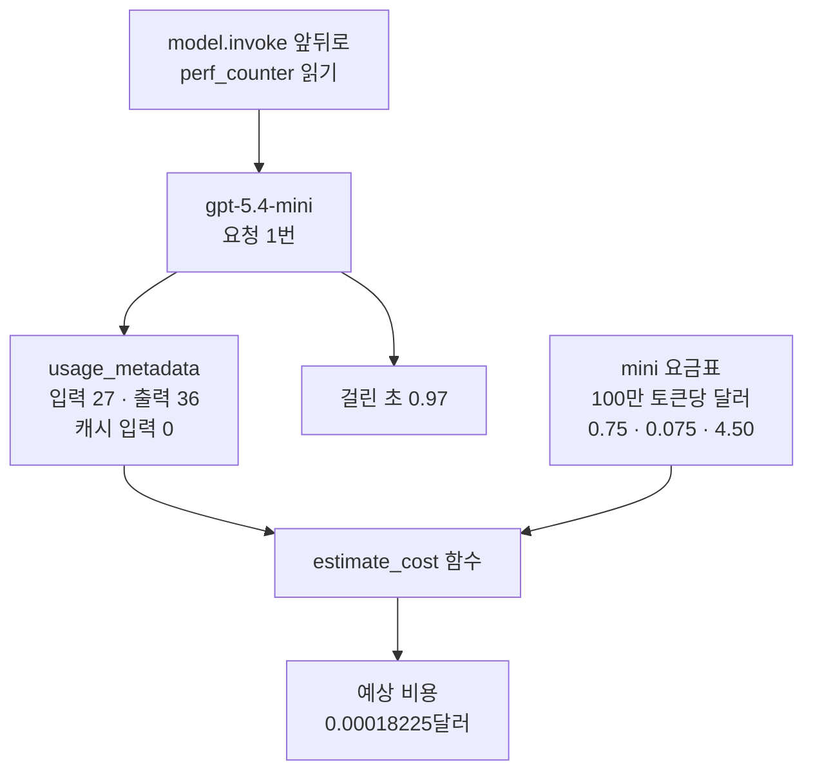
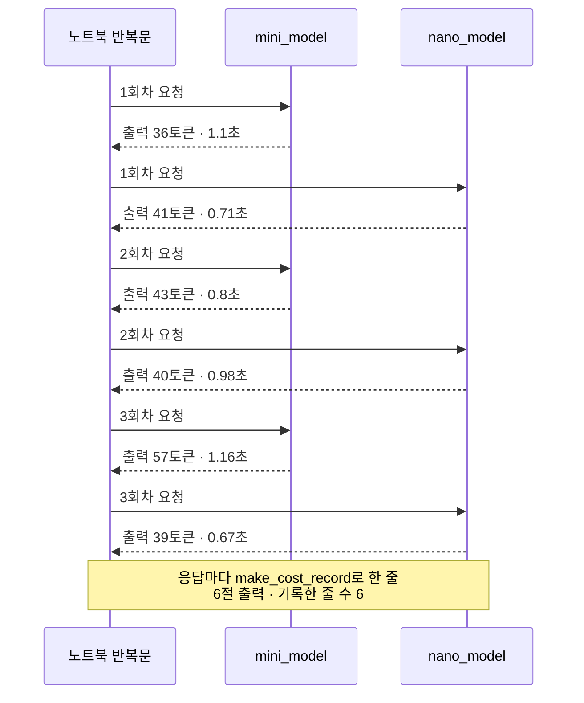
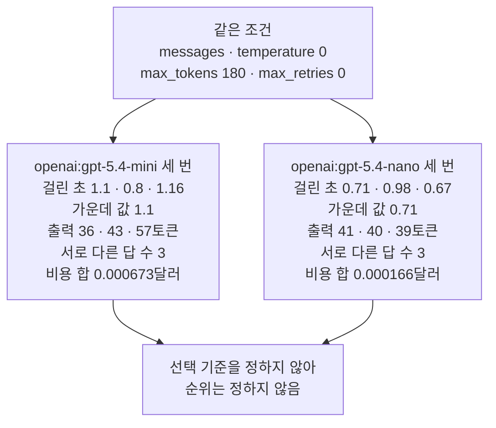
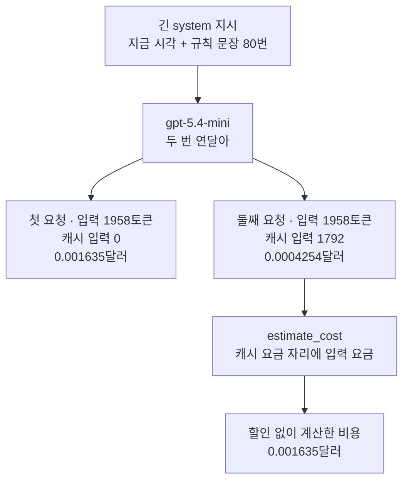

# 06-토큰-비용-지연-비교

## _src 본문 (HTML 원본)

```html
<!--meta: 강의 1h · 실습은 챕터 전체 10h 안에서 진행합니다. -->
<h2 id="b1"><span class="no">1</span>학습 목표</h2>
<div class="goal"><p>이 절을 마치면 다음을 할 수 있습니다.</p><ul><li>응답의 <code>usage_metadata</code>에서 입력·출력·캐시 입력 토큰 수를 읽고, 요청에 걸린 시간을 잴 수 있습니다.</li><li>확인한 날짜를 함께 적은 요금표로 요청 한 번의 예상 비용을 계산하는 함수를 만들 수 있습니다.</li><li>같은 조건으로 두 모델에 여러 번 보낸 기록을 한 줄에 한 요청씩 모으고, 그 기록으로 말할 수 있는 범위를 정할 수 있습니다.</li></ul></div>
<h2 id="b2"><span class="no">2</span>이 내용을 배우는 이유</h2>
<p>01~05절에서는 답을 받는 방법을 익혔습니다. 서비스에 모델을 쓰려면 답의 내용과 함께 비용과 기다리는 시간도 봐야 합니다. 요청 한 번은 싸고 빨라 보여도, 사용자가 많으면 합계가 커집니다.</p>
<p>두 모델을 비교하려면 같은 과제를 같은 조건으로 보내야 합니다. 그런데 토큰 수, 걸린 시간, 비용은 요청마다 달라질 수 있습니다. 그래서 한 번의 숫자로 결론을 내리지 않고, 요청마다 기록을 남깁니다.</p>
<p>모르는 값도 조심해야 합니다. 04절에서는 사용량을 끄자 출력 토큰 수가 <code>None</code>이었습니다. 이런 값을 0으로 채우면 돈이 들지 않은 요청처럼 보입니다.</p>
<p><strong>이 절의 질문</strong> — 같은 과제를 두 모델에 보낼 때, 토큰 수·비용·걸린 시간을 어떻게 재고 무엇을 기록해야 비교할 수 있을까요?</p>
<h2 id="b3"><span class="no">3</span>앞에서 배운 내용</h2>
<table><thead><tr><th>앞 절</th><th>배운 것</th><th>이 절에서 이어지는 곳</th></tr></thead><tbody>
<tr><td>01절</td><td><code>usage_metadata</code>의 입력·출력·합계 토큰 수, 끝난 이유, 출력 상한 <code>max_tokens</code></td><td>3절 사용량 딕셔너리 전체, 5절 출력 상한 180</td></tr>
<tr><td>02절</td><td>모델 이름만 바꾼 <code>gpt-5.4-nano</code>, 한 줄에 한 설정을 적은 기록표와 실행 상태</td><td>5절 후보 목록, 6절 기록표 한 줄 함수</td></tr>
<tr><td>04절</td><td>사용량을 끄면 <code>None</code>, 모르는 값은 0으로 채우지 않음</td><td>4절 사용량이 없을 때 비용 <code>None</code></td></tr>
<tr><td>05절</td><td><code>timeout</code>·<code>max_retries</code>, <code>time.perf_counter()</code>로 잰 걸린 초, 응답한 모델 <code>model_name</code></td><td>5절 <code>max_retries=0</code>, 6절 걸린 초와 응답한 모델</td></tr>
<tr><td>Ch 2 02~04절</td><td><code>range()</code>, <code>sorted()</code>·<code>set()</code>, 함수 정의와 반환</td><td>6절 반복, 8절 가운데 값과 서로 다른 답 수</td></tr>
<tr><td>Ch 4 05절, Ch 5 01·08절</td><td><code>json.dumps()</code>, <code>os.path.exists()</code>로 경로 고르기, 튜플 반환, 한 번 잰 시간은 모델 속도가 아님</td><td>10절 파일 저장, 6절 <code>timed_invoke()</code>, 8절 해석</td></tr>
</tbody></table>
<p>02절 기록표에는 Anthropic과 Google 모델을 키 없음 상태로 적었습니다. 교재를 만든 컴퓨터에는 두 제공자의 키가 없었습니다. 그래서 이 절도 두 제공자에는 요청을 보내지 않고, OpenAI 모델 둘을 비교합니다.</p>
<p>05절에서는 응답 메타데이터의 키 <code>model_name</code>을 처음 읽었습니다. 이 절도 기록표 한 줄마다 응답한 모델 이름을 함께 적습니다.</p>
<p>05절 4절의 모델 객체는 <code>timeout=30</code>, <code>max_retries=1</code>로 한 호출이 끝없이 기다리지 않게 했습니다. 이 절은 기다리는 시간 30초는 같게 두고, 다시 시도는 0번으로 끕니다. 다시 시도가 섞이면 요청 한 번과 기록 한 줄이 맞지 않기 때문입니다.</p>
<h2 id="b4"><span class="no">4</span>핵심 개념</h2>
<h3>비유로 시작하기</h3>
<p>같은 물건을 넣은 소포 두 개를 서로 다른 곳으로 부친다고 생각해 봅니다. 공정하게 비교하려면 소포마다 무게, 낸 요금, 걸린 시간을 한 줄에 함께 적어야 합니다.</p>
<p>요금은 무게에 무게당 값을 곱해 정해집니다. 걸린 시간은 날마다 달라질 수 있어, 한 번 부친 기록으로 어느 쪽이 늘 빠르다고 말하기 어렵습니다.</p>
{{img:06-5-소포-세-가지-재기|나무 탁자 위에 같은 크기의 갈색 소포를 올린 저울, 동전 더미, 초시계가 두 줄로 놓여 있고, 뒤쪽 줄은 파란 저울과 높은 동전 더미, 앞쪽 줄은 초록 저울과 낮은 동전 더미이며 두 줄의 저울 바늘과 초시계 바늘 방향이 서로 다른 삽화|같은 크기의 소포 두 개를 한 줄씩 저울, 동전 더미, 초시계와 나란히 놓았고, 두 줄은 저울 바늘과 동전 높이와 초시계 바늘이 서로 다릅니다.}}
<p><strong>그림 읽기</strong> — 나무 탁자 위에 물건이 앞뒤 두 줄로 놓여 있습니다. 줄마다 저울 위의 갈색 소포, 동전 더미, 초시계가 차례로 있습니다. 두 소포는 크기가 같습니다.</p>
<p>뒤쪽 줄은 파란 저울과 높은 동전 더미이고, 앞쪽 줄은 초록 저울과 두 닢짜리 낮은 동전 더미입니다. 두 저울의 바늘 방향이 다르고, 두 초시계의 바늘도 조금 다릅니다.</p>
<p>소포는 두 모델에 똑같이 보낸 메시지 목록입니다. 저울은 토큰 수, 동전은 예상 비용, 초시계는 걸린 시간입니다. 한 줄이 기록표 한 줄이고, 두 줄은 두 모델입니다.</p>
<p>05절 그림의 모래시계는 기다릴 수 있는 최대 시간이었습니다. 이 그림의 초시계는 실제로 걸린 시간을 잽니다. 동전 높이의 차이도 이번 실행의 차이일 뿐, 두 모델의 늘 같은 차이로 읽지 않습니다.</p>
<h3>토큰 사용량과 캐시 입력</h3>
<p>노트북 3절은 사용량 딕셔너리 전체를 출력했습니다. 입력 토큰 수 <code>'input_tokens': 27</code>과 출력 토큰 수 <code>'output_tokens': 36</code> 말고도 안쪽 딕셔너리 두 개가 있었습니다.</p>
<p>안쪽 딕셔너리 <code>input_token_details</code>의 키 <code>cache_read</code>는 캐시 입력 토큰 수입니다. 캐시 입력(cached input)은 제공자가 앞선 요청에서 처리해 둔 앞부분을 다시 쓴 입력 토큰입니다. 복사해 둔 서류를 다시 내면 새로 쓸 필요가 없는 것과 비슷합니다.</p>
<p>노트북 9절에서 긴 지시를 두 번 보내자, 둘째 요청의 입력 1958토큰 가운데 1792토큰이 캐시 입력이었습니다. 두 요청의 입력 토큰 수는 같았습니다. 이번 출력에서 캐시 입력은 입력 토큰 수 안의 일부로 보고되었습니다.</p>
<p>설치한 langchain-openai 1.6.0 소스도 확인했습니다. 서버가 보낸 입력 토큰 수 <code>prompt_tokens</code>를 <code>input_tokens</code>에, 캐시 토큰 수 <code>cached_tokens</code>를 <code>cache_read</code>에 그대로 담습니다.</p>
<h3>예상 비용 계산</h3>
<p>요금은 모델마다 100만 토큰당 달러로 정해져 있습니다. 입력, 캐시 입력, 출력의 요금이 서로 다릅니다. 2026-09-17에 OpenAI 모델 페이지에서 확인한 값은 아래와 같습니다.</p>
<table><thead><tr><th>모델</th><th>입력</th><th>캐시 입력</th><th>출력</th></tr></thead><tbody>
<tr><td><code>gpt-5.4-mini</code></td><td>0.75</td><td>0.075</td><td>4.50</td></tr>
<tr><td><code>gpt-5.4-nano</code></td><td>0.20</td><td>0.02</td><td>1.25</td></tr>
</tbody></table>
<p>단위는 100만 토큰당 달러입니다. mini 요금은 2026-09-09에 확인한 값과 같았습니다. 01~05절 준비물의 비용 어림도 이 요금표 기준입니다.</p>
<p>먼저 입력 토큰에서 캐시 입력을 뺀 나머지를 일반 입력으로 봅니다. 식은 <code>(일반 입력 × 입력 요금 + 캐시 입력 × 캐시 요금 + 출력 × 출력 요금) ÷ 1000000</code>입니다. 요금이 100만 토큰당 값이라 마지막에 100만으로 나눕니다.</p>
<p>노트북 3절 요청은 입력 27, 캐시 입력 0, 출력 36토큰이었습니다. mini 요금을 넣으면 <code>(27 × 0.75 + 0 × 0.075 + 36 × 4.50) ÷ 1000000</code>입니다. 괄호 안은 20.25 + 0 + 162 = 182.25라서, 예상 비용은 0.00018225달러입니다.</p>
<p>출력 요금이 입력 요금의 6배라서, 짧은 질문에서는 출력 토큰이 비용의 대부분을 차지했습니다. 이 값은 요금표로 계산한 어림이고, 실제 청구 금액을 확인한 것은 아닙니다.</p>
{{mermaid:06-1-요청-한-번의-기록|맨 위 파란 상자 model.invoke 앞뒤로 perf_counter 읽기가 보라 상자 gpt-5.4-mini 요청 1번으로 가고, 노란 상자 usage_metadata 입력 27 출력 36 캐시 입력 0과 노란 상자 걸린 초 0.97로 나뉜 뒤, 사용량 상자와 초록 상자 mini 요금표 100만 토큰당 달러 0.75 0.075 4.50이 파란 상자 estimate_cost 함수로 모여 노란 상자 예상 비용 0.00018225달러로 이어지는 흐름도|요청 한 번에서 입력 27·출력 36·캐시 입력 0토큰과 걸린 초 0.97을 읽고, mini 요금표로 예상 비용 0.00018225달러를 계산했습니다.}}
<p><strong>도식 읽기</strong> — 위에서 아래로 읽습니다. 파란 상자는 코드 줄과 함수, 보라 상자는 실행한 모델입니다. 초록 상자는 우리가 적은 요금표, 노란 상자는 출력으로 확인한 값입니다.</p>
<p>모델의 응답에서 노란 상자 두 개가 나옵니다. 사용량 상자와 초록 요금표가 함수 <code>estimate_cost</code>로 모여 예상 비용이 됩니다. 걸린 초는 비용 계산에 들어가지 않고 기록표에 따로 적습니다.</p>
<h3>걸린 시간과 가운데 값</h3>
<p>걸린 시간은 05절처럼 요청 앞뒤에서 <code>time.perf_counter()</code>를 읽어 뺀 값입니다. 요청을 보내기 시작한 때부터 응답 객체를 받을 때까지입니다. 네트워크와 서버에서 기다린 시간이 모두 들어 있어, 어느 구간이 늦었는지는 이 값 하나로 알 수 없습니다.</p>
<p>한 번 잰 시간은 우연히 빠르거나 느릴 수 있습니다. 그래서 같은 요청을 여러 번 보내고 가운데 값을 봅니다. 가운데 값(median)은 값을 크기 순서로 늘어놓았을 때 한가운데 있는 값입니다. 세 사람을 키 순서로 세우면 둘째 사람의 키입니다.</p>
<p>노트북 8절에서 mini의 걸린 초 1.1, 0.8, 1.16을 정렬하면 0.8, 1.1, 1.16입니다. 가운데 값은 1.1초입니다.</p>
<p>04절에서 재지 않은 첫 스트림 청크까지의 시간은 이 절에서도 재지 않았습니다. 채팅 화면이 처음 반응하는 때는 걸린 시간과 다를 수 있습니다.</p>
<h3>이 절에서 쓰는 말</h3>
<table><thead><tr><th>용어</th><th>뜻</th><th>이 절에서 보이는 모습</th></tr></thead><tbody>
<tr><td>캐시 입력(cached input)</td><td>제공자가 앞선 요청에서 처리해 둔 앞부분을 다시 쓴 입력 토큰. 일반 입력보다 싼 요금을 받음</td><td><code>'cache_read': 0</code></td></tr>
<tr><td>요금표</td><td>모델마다 100만 토큰당 달러로 정한 입력·캐시 입력·출력 요금과 확인한 날짜</td><td><code>요금 확인 날짜: 2026-09-17</code></td></tr>
<tr><td>예상 비용</td><td>토큰 수와 요금표로 계산한 요청 한 번의 달러. 실제 청구 금액이 아님</td><td><code>예상 비용(달러): 0.00018225</code></td></tr>
<tr><td>걸린 시간</td><td>요청을 보내기 시작해 응답 객체를 받을 때까지의 초</td><td><code>걸린 초: 0.97</code></td></tr>
<tr><td>가운데 값(median)</td><td>크기 순서로 늘어놓은 값의 한가운데. 키 순서로 선 세 사람 가운데 둘째의 키</td><td><code>가운데 값: 0.71</code></td></tr>
<tr><td>실행 이름(<code>run_id</code>)</td><td>저장한 기록 한 벌을 가리키는 이름. 이 절은 앞말과 실행 시각을 이어 만듦</td><td><code>실행 이름: ch06-provider-20260917T020433</code></td></tr>
</tbody></table>
<h2 id="b5"><span class="no">5</span>실행 예제</h2>
<p>노트북은 요청 한 번의 사용량과 걸린 시간을 먼저 봅니다. 요금표와 비용 함수를 만든 뒤, 같은 메시지를 mini와 nano에 세 번씩 번갈아 보냅니다. 끝으로 긴 지시를 두 번 보내 캐시 입력을 보고, 기록을 파일로 저장합니다.</p>
<p>실제 OpenAI 모델을 temperature 0으로 부릅니다. 이 페이지의 출력은 2026-09-17에 실행한 결과입니다. 요청은 모두 9번이고, 예상 비용은 0.01달러 미만입니다. 답 문장, 토큰 수, 걸린 시간은 실행마다 달라질 수 있습니다.</p>
<p>강의 시간에는 노트북 3~7절(사용량과 걸린 시간, 요금표, 기록표)을 설명합니다. 8~10절(모델마다 모아 보기, 긴 지시, 파일 저장)은 셀을 함께 실행하고, 결과 읽기는 실습 시간에 읽습니다.</p>
{{notebook:06-토큰-비용-지연-비교}}
<p class="look"><b>확인할 점</b> — 3절의 <code>'cache_read': 0</code>과 4절의 <code>예상 비용(달러): 0.00018225</code>를 봅니다. 7절 기록표에서는 입력 27이 여섯 줄 모두 같고, 출력 토큰 수와 걸린 초는 줄마다 다른지 봅니다.</p>
<h3>번갈아 보낸 순서</h3>
<p>노트북 6절 반복문은 한 모델에 세 번 연달아 보내지 않고, mini와 nano에 번갈아 보냈습니다. 네트워크 사정이 잠깐 나빠질 때 한 모델의 기록만 늦어지는 일을 줄이려는 순서입니다. 이 순서로 그런 치우침이 모두 없어지는지는 확인하지 않았습니다.</p>
{{mermaid:06-2-번갈아-보낸-순서|노트북 반복문, mini_model, nano_model 세 세로줄 사이에서 1회차부터 3회차까지 mini와 nano에 번갈아 실선 요청을 보내고 점선 응답 출력 36토큰 1.1초, 41토큰 0.71초, 43토큰 0.8초, 40토큰 0.98초, 57토큰 1.16초, 39토큰 0.67초를 받은 뒤 응답마다 make_cost_record로 한 줄 기록한 줄 수 6 노란 메모가 붙은 순서도|노트북 반복문은 mini와 nano에 번갈아 세 번씩 보냈고, 같은 모델에서도 출력 토큰 수와 걸린 초가 요청마다 달랐습니다.}}
<p><strong>도식 읽기</strong> — 세로줄은 왼쪽부터 노트북 반복문, <code>mini_model</code>, <code>nano_model</code>입니다. 위에서 아래로 시간 순서이고, 실선은 요청, 점선은 받은 응답입니다. 점선 라벨은 7절 기록표에 적힌 그 응답의 출력 토큰 수와 걸린 초입니다.</p>
<p>모델 mini의 출력 토큰 수는 36, 43, 57로 요청마다 달랐습니다. 맨 아래 노란 메모는 응답마다 기록표에 한 줄을 담았고, 6절 출력이 <code>기록한 줄 수: 6</code>이었다는 뜻입니다.</p>
<h3>캐시 입력이 생긴 두 요청</h3>
<p>노트북 9절은 system 지시 하나만 바꿨습니다. 규칙 문장을 80번 이어 붙이고, 맨 앞에 지금 시각을 붙였습니다. OpenAI 프롬프트 캐싱 안내는 앞부분 전체가 같아야 캐시를 다시 쓸 수 있다고 적습니다.</p>
<p>시각을 붙이면 노트북을 다시 실행해도 첫 요청의 앞부분이 이전 실행과 달라집니다. 같은 셀 안의 두 요청은 앞부분이 같습니다.</p>
{{mermaid:06-4-캐시-입력-두-요청|맨 위 초록 상자 긴 system 지시 지금 시각과 규칙 문장 80번이 보라 상자 gpt-5.4-mini 두 번 연달아로 가고, 노란 상자 첫 요청 입력 1958토큰 캐시 입력 0 0.001635달러와 노란 상자 둘째 요청 입력 1958토큰 캐시 입력 1792 0.0004254달러로 나뉜 뒤, 둘째 요청이 파란 상자 estimate_cost 캐시 요금 자리에 입력 요금을 거쳐 노란 상자 할인 없이 계산한 비용 0.001635달러로 이어지는 흐름도|입력 1958토큰짜리 긴 지시를 두 번 보내자 둘째 요청은 1792토큰이 캐시 입력이라 예상 비용이 0.001635달러에서 0.0004254달러로 줄었습니다.}}
<p><strong>도식 읽기</strong> — 위에서 아래로 읽습니다. 초록 상자는 넣은 긴 지시, 보라 상자는 실행한 모델, 노란 상자는 출력으로 확인한 값입니다. 두 요청의 입력은 1958토큰으로 같았고, 캐시 입력은 첫 요청 0, 둘째 요청 1792였습니다.</p>
<p>둘째 요청 아래의 파란 상자는 그 사용량을 캐시 요금 대신 입력 요금으로 다시 계산한 줄입니다. 결과 0.001635달러는 첫 요청 비용과 같았습니다. 두 요청의 출력 토큰 수가 37로 같았기 때문입니다.</p>
<h2 id="b6"><span class="no">6</span>실험 결과 해석</h2>
<p>노트북 7·8절은 여섯 줄을 모델마다 모았습니다. 입력 토큰 수는 여섯 줄 모두 27이었습니다. 같은 메시지를 보냈고, 이번 두 모델에서는 입력 토큰 수가 같게 보고되었습니다.</p>
<p>출력 토큰 수는 mini가 36·43·57, nano가 41·40·39였습니다. temperature 0이었지만 두 모델 모두 서로 다른 답 수가 <code>3</code>이었습니다. 출력 토큰 수가 달라지니 비용도 요청마다 달랐습니다.</p>
<p>걸린 초의 가운데 값은 mini 1.1초, nano 0.71초였습니다. 세 번 비용 합은 mini 0.000673달러, nano 0.000166달러였습니다. 이번 실행에서는 nano가 두 값 모두 작았습니다.</p>
{{mermaid:06-3-두-모델-세-번-비교|맨 위 초록 상자 같은 조건 messages temperature 0 max_tokens 180 max_retries 0이 노란 상자 openai gpt-5.4-mini 세 번 걸린 초 1.1 0.8 1.16 가운데 값 1.1 출력 36 43 57토큰 서로 다른 답 수 3 비용 합 0.000673달러와 노란 상자 openai gpt-5.4-nano 세 번 걸린 초 0.71 0.98 0.67 가운데 값 0.71 출력 41 40 39토큰 서로 다른 답 수 3 비용 합 0.000166달러로 갈라지고, 두 상자가 회색 상자 선택 기준을 정하지 않아 순위는 정하지 않음으로 모이는 비교 그림|같은 조건으로 세 번씩 보냈을 때 가운데 값은 mini 1.1초·nano 0.71초, 비용 합은 0.000673·0.000166달러였고, 이 기록으로 순위는 정하지 않았습니다.}}
<p><strong>도식 읽기</strong> — 위에서 아래로 읽습니다. 초록 상자는 두 모델에 똑같이 준 조건입니다. 노란 상자 둘은 모델마다 세 번의 출력을 모은 값입니다. 맨 아래 회색 상자는 이 기록으로 순위를 정하지 않았다는 뜻입니다.</p>
<p>이 결과로 nano가 더 빠르거나 더 좋은 모델이라고 말하지 않습니다. 교재를 만들 때 한 첫 새 커널 실행에서는 가운데 값이 mini 0.9초, nano 1.01초로 순서가 반대였습니다. 요청은 모델마다 세 번, 과제는 하나였습니다.</p>
<p>답이 과제를 잘 풀었는지는 토큰 수와 시간으로 알 수 없습니다. 그래서 기록표에 답 문장을 함께 적었습니다. 모델을 고르려면 Ch 5 08절처럼 선택 기준을 측정 전에 정하고, 답의 품질도 따로 확인해야 합니다. 이 절은 선택 기준을 정하지 않았습니다.</p>
<p>9절의 둘째 요청은 캐시 입력 덕분에 예상 비용이 0.001635달러에서 0.0004254달러로 줄었습니다. 캐시 입력이 생길지는 요청을 보내 봐야 알 수 있었습니다. 교재를 만들 때 규칙 문장 50번(약 1,250토큰)으로 보낸 두 요청은 둘 다 캐시 입력이 0이었습니다.</p>
<h2 id="b7"><span class="no">7</span>주의할 점과 실무 메모</h2>
<ul><li>요금은 2026-09-17에 OpenAI 모델 페이지에서 확인한 값입니다. 요금은 바뀔 수 있으니, 서비스에 쓰기 전에 공식 페이지를 다시 확인합니다. 두 모델 페이지는 데이터 처리 지역을 지정한 주소(regional processing)에 10%를 더 받는다고 적습니다. Batch 같은 다른 처리 방식의 요금은 이번에 확인하지 않았습니다.</li>
<li>예상 비용은 청구 금액이 아닙니다. 05절의 시간 초과 시도나 다시 시도한 요청에 요금이 붙는지는 이번에 확인하지 않았습니다.</li>
<li>함수 <code>estimate_cost()</code>는 캐시 입력 키가 없으면 0으로 계산합니다. 할인 없이 모두 입력 요금으로 계산하므로, 실제보다 크게 어림할 수 있습니다. 사용량 자체가 <code>None</code>이면 비용도 <code>None</code>으로 남깁니다.</li>
<li>반복 3번, 번갈아 보내는 순서, <code>max_retries=0</code>, 규칙 문장 80번은 흐름을 보여 주려고 정한 예입니다. 교재를 만들 때 탐색 실행으로 캐시 입력이 생기는 길이를 먼저 확인한 뒤 정했습니다. 규칙 문장 50번(약 1,250토큰)에서는 캐시 입력이 생기지 않았습니다.</li>
<li>OpenAI 캐싱 안내는 GPT-5.6보다 앞선 모델의 캐시 최소 길이가 요청 설정에 따라 다르다고 적습니다. 앞부분이 같아도 캐시 입력이 늘 생긴다고 보장하지 않습니다. 캐시가 얼마나 오래 남는지도 이번에 확인하지 않았습니다.</li>
<li>입력 토큰 수는 두 모델 모두 27이었습니다. Ch 5 01절에서는 토큰화기마다 같은 문장의 조각 수가 달랐습니다. 다른 제공자의 모델과 비교할 때 입력 토큰 수가 같다고 가정하지 않습니다.</li>
<li>첫 스트림 청크까지의 시간은 재지 않았습니다. 04절 모양 <code>for chunk in answer_stream:</code>에서 글자가 든 첫 스트림 청크를 받은 시각을 읽어야 잴 수 있고, 이번에 실행하지 않았습니다.</li>
<li>두 제공자 Anthropic과 Google의 모델에는 요청을 보내지 않았습니다. 두 제공자의 사용량 키 이름과 캐시 입력 보고 방식은 확인하지 않았습니다.</li>
<li>노트북 10절은 실습 폴더의 <code>runs/provider-comparison-continuity.json</code>을 덮어씁니다. 개선 전 노트북은 실행 시각별 사본을 따로 남겼지만, 이 판은 파일 하나만 씁니다. 기록표 줄의 키 이름은 한국어로 바뀌었고, 실행 이름과 요금표 키는 그대로입니다.</li>
<li>교재 출력은 Linux의 Python 3.12.13으로 만들었습니다. 패키지는 langchain 1.4.0, langchain-core 1.6.2, langchain-openai 1.6.0입니다. 함께 쓴 openai는 3.10.0, python-dotenv는 1.2.3입니다. 다른 버전과 Windows·macOS에서는 실행하지 않았습니다.</li></ul>
<h2 id="b8"><span class="no">8</span>정리와 다음 절</h2>
<ul><li>사용량의 입력·출력·캐시 입력 토큰 수와 요금표로 예상 비용을 계산했습니다. 모르는 사용량은 <code>None</code>으로 남겼습니다.</li><li>같은 조건으로 두 모델에 세 번씩 번갈아 보내자, 출력 토큰 수와 걸린 초가 요청마다 달랐습니다. 이 한 번의 실행으로 순위를 정하지 않았습니다.</li><li>앞부분이 같은 긴 지시를 두 번 보내자 둘째 요청에 캐시 입력이 생겨 예상 비용이 줄었습니다.</li></ul>
<p><strong>다음 학습과 이어지는 지점</strong> — 07절은 이 챕터의 실습입니다. 03절 학습 카드 요청에 05절 폴백을 붙이고, 이 절의 <code>estimate_cost()</code>·<code>timed_invoke()</code>로 요청마다 비용을 기록합니다. 대체 경로가 답하면 요금표를 응답한 모델 이름으로 골라야 하는 까닭을 확인합니다. 10절에서 저장한 파일은 07절이 쓰지 않고, Ch 7의 08절이 읽습니다.</p>
<h2 id="b9"><span class="no">9</span>복습 문제</h2>
<details class="quiz"><summary>문제 1 · 모르는 사용량</summary><p class="quiz-q">응답의 <code>usage_metadata</code>가 <code>None</code>일 때 비용을 0달러로 적어도 되나요?</p><p class="quiz-a"><b>해설</b> — 안 됩니다. 0달러는 돈이 들지 않은 요청처럼 보입니다. 노트북 4절의 <code>estimate_cost()</code>도 사용량이 없으면 <code>None</code>을 반환했습니다.</p></details>
<details class="quiz"><summary>문제 2 · 캐시 입력이 있는 비용</summary><p class="quiz-q">mini 요금으로 입력 100토큰 가운데 캐시 입력이 40, 출력이 10토큰이면 예상 비용은 얼마인가요?</p><p class="quiz-a"><b>해설</b> — 일반 입력은 100 − 40 = 60토큰입니다. 식은 <code>(60 × 0.75 + 40 × 0.075 + 10 × 4.50) ÷ 1000000</code>이고, 괄호 안이 93이라 0.000093달러입니다. 노트북 4절의 교재 예 출력 <code>9.3e-05</code>와 같습니다.</p></details>
<details class="quiz"><summary>문제 3 · 한 번의 기록과 순위</summary><p class="quiz-q">이번 실행에서 nano의 걸린 초 가운데 값이 더 작았습니다. 모델 nano가 늘 빠르다고 기록해도 되나요?</p><p class="quiz-a"><b>해설</b> — 안 됩니다. 요청은 모델마다 세 번, 과제는 하나였습니다. 교재를 만들 때 한 다른 새 커널 실행에서는 순서가 반대였습니다.</p></details>
<details class="quiz"><summary>문제 4 · 다시 시도를 끈 이유</summary><p class="quiz-q">노트북 5절은 비교할 두 모델을 <code>max_retries=0</code>으로 만들었습니다. 왜 그렇게 했나요?</p><p class="quiz-a"><b>해설</b> — 다시 시도가 일어나면 요청 한 번의 걸린 시간에 기다린 시간과 다른 요청이 섞입니다. 05절 6절에서도 다시 시도를 적지 않자 걸린 시간이 늘었습니다. 요청 한 번과 기록표 한 줄을 맞추려고 껐습니다.</p></details>
<details class="quiz"><summary>문제 5 · 긴 지시 앞의 시각</summary><p class="quiz-q">노트북 9절은 긴 지시 맨 앞에 지금 시각을 붙였습니다. 붙이지 않고 노트북을 몇 분 뒤 다시 실행하면 어떤 일이 생길 수 있나요?</p><p class="quiz-a"><b>해설</b> — 앞 실행과 앞부분이 같아져, 첫 요청부터 캐시 입력이 생길 수 있습니다. 그러면 첫 요청과 둘째 요청의 차이를 보기 어렵습니다. 이 경우는 이번에 실행하지 않았습니다.</p></details>
<h2 id="b10"><span class="no">10</span>참고 자료</h2>
<p>문서는 2026-09-17에 열어 확인했습니다. 사용량 키 이름과 캐시 입력을 담는 방식은 실습 가상환경의 <code>langchain-openai 1.6.0</code>·<code>langchain-core 1.6.2</code> 소스에서도 확인했습니다.</p>
<ul><li><div><a href="https://developers.openai.com/api/docs/models/gpt-5.4-mini">OpenAI GPT-5.4 mini</a></div>100만 토큰당 입력·캐시 입력·출력 요금, 날짜판 이름 · 확인 2026-09-17</li><li><div><a href="https://developers.openai.com/api/docs/models/gpt-5.4-nano">OpenAI GPT-5.4 nano</a></div>100만 토큰당 입력·캐시 입력·출력 요금 · 확인 2026-09-17</li><li><div><a href="https://developers.openai.com/api/docs/guides/prompt-caching">OpenAI Prompt caching</a></div>앞부분 일치와 캐시 최소 길이 · 확인 2026-09-17</li><li><div><a href="https://docs.langchain.com/oss/python/langchain/messages">LangChain Messages</a></div>사용량 <code>usage_metadata</code>와 안쪽 <code>input_token_details</code> 예 · 확인 2026-09-17</li><li><div><a href="https://github.com/langchain-ai/langchain/blob/master/LICENSE">LangChain MIT License</a></div>예제의 질문과 설명은 이 교재에 맞게 새로 썼습니다</li></ul>
```

## 노트북 셀 (순서대로)

### [0] markdown {'html': 'skip'}

# 토큰 비용 지연 비교

**이 노트북에서 할 일**

1. 요청 한 번의 사용량에서 입력·출력·캐시 입력 토큰 수를 읽고, 걸린 시간을 잽니다.
2. 공식 요금으로 예상 비용을 계산하는 함수를 만들고, 두 모델에 같은 메시지를 세 번씩 번갈아 보내 기록표에 모읍니다.
3. 긴 지시를 두 번 보내 캐시 입력을 확인하고, 기록을 Ch 7이 읽는 파일로 저장합니다.

**준비물** — 프로젝트 폴더 `.env` 파일의 `OPENAI_API_KEY`가 필요합니다. 읽는 데이터 파일은 없습니다.

인터넷 서비스의 모델 `gpt-5.4-mini`와 `gpt-5.4-nano`에 요청을 모두 9번 보냅니다. 모델별로는 mini에 6번, nano에 3번입니다.
실행 시간은 1분 안팎입니다. 예상 비용은 0.01달러 미만입니다(이 노트북 4절의 2026-09-17 공식 요금 기준).

마지막 셀은 실습 폴더의 `runs/provider-comparison-continuity.json` 파일을 새 기록으로 덮어씁니다.

**기준 버전** — 실습 폴더에 고정한 패키지 판을 씁니다. langchain 1.4.0, langchain-core 1.6.2, langchain-openai 1.6.0입니다.
함께 설치되는 openai 패키지는 3.10.0이고, python-dotenv는 1.2.3입니다.

교재 출력은 Linux의 Python 3.12.13으로 만들었습니다. 다른 버전과 Windows·macOS에서는 이번에 실행하지 않았습니다.

실습 폴더 `labs/part2/ch06-langchain-start`에서 `uv sync --locked`를 실행합니다.
그다음 이 폴더의 `.venv` 커널을 고르고 첫 셀부터 순서대로 실행합니다.

### [1] markdown {'html': 'skip'}

## 오늘 볼 그림


위에서 아래로 읽습니다. 초록 상자는 우리가 넣은 메시지와 요금표이고, 파란 상자는 코드 줄, 보라 상자는 실행한 모델입니다.
노란 상자는 출력으로 확인하는 값입니다. 토큰 수와 걸린 초는 응답에서, 예상 비용은 토큰 수와 요금표로 계산해서 얻습니다.

이 노트북은 요청 한 번을 이 흐름으로 기록표 한 줄에 담고, 같은 일을 두 모델에 세 번씩 되풀이합니다.

### [2] markdown {}

## 1. 준비

첫 셀은 패키지를 설치하고 설치된 버전을 출력합니다. 설치에는 몇십 초가 걸릴 수 있습니다.
패키지 openai는 langchain-openai가 OpenAI 서버에 요청을 보낼 때 쓰는 패키지입니다.

### [3] code {'execution': {'iopub.execute_input': '2026-09-17T02:04:23.625683Z', 'iopub.status.busy': '2026-09-17T02:04:23.625519Z', 'iopub.status.idle': '2026-09-17T02:04:24.247231Z', 'shell.execute_reply': '2026-09-17T02:04:24.246589Z'}, 'lesson_role': 'setup'}

```python
# 이 절에서 쓰는 패키지를 설치하고 버전을 확인합니다
%pip install -q "langchain==1.4.0" "langchain-openai==1.6.0" "python-dotenv==1.2.3"
from importlib.metadata import version

print("langchain:", version("langchain"))
print("langchain-core:", version("langchain-core"))
print("langchain-openai:", version("langchain-openai"))
print("openai:", version("openai"))
print("python-dotenv:", version("python-dotenv"))
```

출력:
```
Note: you may need to restart the kernel to use updated packages.
langchain: 1.4.0
langchain-core: 1.6.2
langchain-openai: 1.6.0
openai: 3.10.0
python-dotenv: 1.2.3

```

### [4] markdown {}

**결과 읽기** — 출력 줄은 `langchain: 1.4.0`, `langchain-openai: 1.6.0`, `openai: 3.10.0` 등 다섯 줄입니다.
준비물에 적은 기준 버전과 같습니다.

01절과 같이 모델 객체를 만드는 함수를 불러옵니다. 걸린 시간을 재는 모듈 `time`은 05절에서 썼습니다.
모듈 `json`은 9절에서 기록을 JSON 글로 바꿀 때 씁니다. Ch 4 05절에서 `json.dumps()`로 딕셔너리를 JSON 글로 바꿨습니다.

### [5] code {'execution': {'iopub.execute_input': '2026-09-17T02:04:24.248236Z', 'iopub.status.busy': '2026-09-17T02:04:24.248155Z', 'iopub.status.idle': '2026-09-17T02:04:24.608124Z', 'shell.execute_reply': '2026-09-17T02:04:24.607756Z'}, 'lesson_role': 'setup'}

```python
# 걸린 시간을 재는 모듈, JSON 글을 다루는 모듈, 모델 객체를 만드는 함수를 불러옵니다
import json
import time

from langchain.chat_models import init_chat_model
```

출력:
```

```

### [6] markdown {}

01절과 같은 셀로 API 키가 있는지 확인합니다. 키 값은 출력하지 않고, 있는지만 봅니다.
`True` 값이 나오면 다음으로 넘어갑니다.

### [7] code {'execution': {'iopub.execute_input': '2026-09-17T02:04:24.608970Z', 'iopub.status.busy': '2026-09-17T02:04:24.608906Z', 'iopub.status.idle': '2026-09-17T02:04:24.613551Z', 'shell.execute_reply': '2026-09-17T02:04:24.613279Z'}, 'lesson_role': 'setup'}

```python
# .env 파일에서 OpenAI API 키를 읽습니다(키 값은 출력하지 않습니다)
import os
from dotenv import find_dotenv, load_dotenv

env_path = find_dotenv(usecwd=True)
load_dotenv(env_path)
has_key = os.getenv("OPENAI_API_KEY") is not None
print("OPENAI_API_KEY 설정 여부:", has_key)
assert has_key, "프로젝트 폴더의 .env 파일에 OPENAI_API_KEY를 적어 주세요."
```

출력:
```
OPENAI_API_KEY 설정 여부: True

```

### [8] markdown {}

실습에 쓸 모델을 준비합니다.
01절과 같은 설정으로 모델 객체를 만듭니다. 이 셀은 요청을 보내지 않습니다.

### [9] code {'execution': {'iopub.execute_input': '2026-09-17T02:04:24.614127Z', 'iopub.status.busy': '2026-09-17T02:04:24.614080Z', 'iopub.status.idle': '2026-09-17T02:04:25.461275Z', 'shell.execute_reply': '2026-09-17T02:04:25.460892Z'}}

```python
# 실습에 쓸 모델을 준비합니다
model = init_chat_model(
    "openai:gpt-5.4-mini",
    temperature=0,
    reasoning_effort="none",
)
print("모델 이름:", model.model_name)
print("temperature:", model.temperature)
```

출력:
```
모델 이름: gpt-5.4-mini
temperature: 0.0

```

### [10] markdown {}

**결과 읽기** — 출력 줄은 `모델 이름: gpt-5.4-mini`와 `temperature: 0.0`입니다. 이것으로 준비가 끝났습니다.
이 노트북의 출력은 2026-09-17에 이 모델로 실행한 결과입니다. 실행마다 답 문장, 토큰 수, 걸린 시간이 달라질 수 있습니다.
01절에서 본 것처럼 temperature 0은 Ch 5 06절의 뽑기를 끈 설정(`do_sample=False`)과 같은 것이 아닙니다.

### [11] markdown {}

## 2. 메시지 목록 만들기

이번 절의 과제는 01절에서 받은 응답 객체 `AIMessage`의 역할을 설명하는 것입니다. system 지시는 02·04·05절의 「한 문장의 한국어로 답하세요.」를 다시 씁니다.
두 모델에 이 목록을 똑같이 보내므로, 목록은 한 번만 만듭니다.

실행 전에 예상합니다. 역할 이름 system과 user가 한 줄씩 나올 것입니다.

### [12] code {'execution': {'iopub.execute_input': '2026-09-17T02:04:25.462038Z', 'iopub.status.busy': '2026-09-17T02:04:25.461975Z', 'iopub.status.idle': '2026-09-17T02:04:25.464021Z', 'shell.execute_reply': '2026-09-17T02:04:25.463683Z'}}

```python
# 두 모델에 똑같이 보낼 지시와 과제를 튜플 목록에 담습니다
messages = [
    ("system", "한 문장의 한국어로 답하세요."),
    ("user", "AIMessage의 역할을 설명하세요."),
]
print("메시지 목록:")
for role, content in messages:
    print(role, "|", content)
```

출력:
```
메시지 목록:
system | 한 문장의 한국어로 답하세요.
user | AIMessage의 역할을 설명하세요.

```

### [13] markdown {}

**결과 읽기** — 라벨 줄 아래 첫 줄은 `system | 한 문장의 한국어로 답하세요.`입니다. 둘째 줄은 `user | AIMessage의 역할을 설명하세요.`입니다.
아직 목록만 만들었고 요청은 보내지 않았습니다.

## 3. 요청 한 번의 사용량과 걸린 시간

01절에서는 속성 `usage_metadata`에서 키 세 개를 꺼냈습니다. 이번에는 딕셔너리 전체를 출력해 안쪽 키까지 봅니다.
걸린 시간은 05절처럼 요청 앞뒤에서 `time.perf_counter()`를 읽어 뺍니다. 요청을 보내기 시작한 때부터 응답 객체를 받을 때까지의 시간입니다.

함수 `round(값, 2)`는 소수 둘째 자리까지 남깁니다. 05절의 걸린 초는 0.0처럼 짧은 값이 있어 둘째 자리까지 봅니다.

실행 전에 예상합니다. 사용량 딕셔너리에 01절의 세 키 말고 다른 키도 들어 있을 것입니다.

### [14] code {'execution': {'iopub.execute_input': '2026-09-17T02:04:25.464615Z', 'iopub.status.busy': '2026-09-17T02:04:25.464561Z', 'iopub.status.idle': '2026-09-17T02:04:26.439649Z', 'shell.execute_reply': '2026-09-17T02:04:26.439059Z'}}

```python
# 요청 한 번의 걸린 시간을 재고, 사용량 딕셔너리 전체를 봅니다(요청 1번)
start_time = time.perf_counter()
response = model.invoke(messages)
elapsed = time.perf_counter() - start_time
usage = response.usage_metadata
print("답:", response.text)
print("걸린 초:", round(elapsed, 2))
print("사용량:", usage)
```

출력:
```
답: AIMessage는 대화에서 AI가 생성한 응답 내용을 담아, 모델의 출력과 메타데이터를 구조적으로 표현하는 메시지입니다.
걸린 초: 0.97
사용량: {'input_tokens': 27, 'output_tokens': 36, 'total_tokens': 63, 'input_token_details': {'audio': 0, 'cache_read': 0}, 'output_token_details': {'audio': 0, 'reasoning': 0}}

```

### [15] markdown {}

**결과 읽기** — 출력 줄은 한 문장 답, `걸린 초: 0.97`, 사용량 딕셔너리입니다.
사용량 줄에는 `'input_tokens': 27`, `'output_tokens': 36`과 안쪽 딕셔너리 두 개가 보입니다.

안쪽 딕셔너리 `input_token_details`에는 `'cache_read': 0`이 있습니다. 캐시 입력 토큰 수라는 뜻이고, 이번 요청에서는 0이었습니다.

캐시 입력(cached input)은 제공자가 앞선 요청에서 처리해 둔 앞부분을 다시 쓴 입력 토큰입니다. 복사해 둔 서류를 다시 내면 새로 쓸 필요가 없는 것과 비슷합니다.
이 토큰은 일반 입력보다 싼 요금을 받습니다. 9절에서 캐시 입력이 0보다 큰 요청을 만들어 봅니다.

안쪽 딕셔너리 `output_token_details`의 `'reasoning': 0`은 모델이 답 전에 따로 쓴 추론 토큰 수입니다. 이번 요청은 `reasoning_effort="none"`이고, 이 값이 0이었습니다.

## 4. 요금표와 예상 비용 계산

요금은 모델마다 100만 토큰당 달러로 정해져 있습니다. 입력, 캐시 입력, 출력의 요금이 서로 다릅니다.
2026-09-17에 OpenAI 모델 페이지에서 확인한 값을 딕셔너리에 적습니다. 모델 mini는 입력 0.75, 캐시 입력 0.075, 출력 4.50달러입니다.

모델 nano는 입력 0.20, 캐시 입력 0.02, 출력 1.25달러입니다. 요금은 바뀔 수 있어 확인한 날짜를 함께 적습니다.
키 이름은 영어로 둡니다. Ch 7 08절 노트북이 이 이름으로 요금을 읽기 때문입니다.

실행 전에 예상합니다. 두 딕셔너리에 키가 세 개씩 보일 것입니다.

### [16] code {'execution': {'iopub.execute_input': '2026-09-17T02:04:26.441285Z', 'iopub.status.busy': '2026-09-17T02:04:26.441159Z', 'iopub.status.idle': '2026-09-17T02:04:26.444643Z', 'shell.execute_reply': '2026-09-17T02:04:26.444084Z'}}

```python
# 두 모델의 공식 요금(100만 토큰당 달러)과 확인한 날짜를 적습니다
pricing_date = "2026-09-17"
mini_prices = {"ordinary_input": 0.75, "cached_input": 0.075, "output": 4.50}
nano_prices = {"ordinary_input": 0.20, "cached_input": 0.02, "output": 1.25}
print("요금 확인 날짜:", pricing_date)
print("mini 요금:", mini_prices)
print("nano 요금:", nano_prices)
```

출력:
```
요금 확인 날짜: 2026-09-17
mini 요금: {'ordinary_input': 0.75, 'cached_input': 0.075, 'output': 4.5}
nano 요금: {'ordinary_input': 0.2, 'cached_input': 0.02, 'output': 1.25}

```

### [17] markdown {}

**결과 읽기** — 출력 줄은 `요금 확인 날짜: 2026-09-17`, `mini 요금: {'ordinary_input': 0.75, 'cached_input': 0.075, 'output': 4.5}`, nano 요금 줄입니다.
숫자 4.50은 출력에서 `4.5`로 보입니다. 값은 같습니다.

예상 비용은 토큰 수에 요금을 곱해 더합니다. 먼저 입력 토큰에서 캐시 입력을 뺀 나머지를 일반 입력으로 봅니다.
식은 `(일반 입력 × 입력 요금 + 캐시 입력 × 캐시 요금 + 출력 × 출력 요금) ÷ 1000000`입니다. 요금이 100만 토큰당 값이라 마지막에 100만으로 나눕니다.

교재 예로 입력 100토큰 가운데 캐시 입력이 40, 출력이 10토큰이라고 합니다. mini 요금이면 `(60 × 0.75 + 40 × 0.075 + 10 × 4.50) ÷ 1000000`입니다.
괄호 안은 45 + 3 + 45 = 93이라, 예상 비용은 0.000093달러입니다.

아래 셀은 이 식을 함수 `estimate_cost()`로 정의합니다. 사용량이 `None`이면 비용도 `None`을 반환합니다. 04절에서 사용량을 끄면 `None`이었기 때문입니다.

사용량에 캐시 입력 키가 없으면 `get(키, 0)`으로 0을 씁니다. 할인을 빼고 모두 입력 요금으로 계산한다는 뜻입니다.
이 셀은 함수를 정의만 하므로 출력이 없습니다.

### [18] code {'execution': {'iopub.execute_input': '2026-09-17T02:04:26.446096Z', 'iopub.status.busy': '2026-09-17T02:04:26.445977Z', 'iopub.status.idle': '2026-09-17T02:04:26.449305Z', 'shell.execute_reply': '2026-09-17T02:04:26.448633Z'}}

```python
# 사용량 딕셔너리와 세 요금으로 요청 한 번의 예상 비용(달러)을 계산하는 함수를 정의합니다
def estimate_cost(usage, input_rate, cached_input_rate, output_rate):
    if usage is None:
        return None
    # 캐시 입력 키가 없으면 할인 없이 모두 입력 요금으로 계산합니다
    details = usage.get("input_token_details", {})
    cache_read = details.get("cache_read", 0)
    normal_input = usage["input_tokens"] - cache_read
    input_cost = normal_input * input_rate + cache_read * cached_input_rate
    output_cost = usage["output_tokens"] * output_rate
    price_unit = 1000000
    return (input_cost + output_cost) / price_unit
```

출력:
```

```

### [19] markdown {}

**결과 읽기** — 정의만 하는 셀이라 출력이 없습니다. 이제 함수 `estimate_cost()`를 쓸 수 있습니다.

함수가 앞의 교재 예와 같은 값을 내는지 먼저 확인합니다. 사용량이 없는 경우도 함께 넣어 봅니다.
출력의 `9.3e-05`는 0.000093을 짧게 적은 모양입니다. 끝의 `e-05`는 소수점을 왼쪽으로 다섯 칸 옮긴다는 뜻입니다.

실행 전에 예상합니다. 교재 예는 0.000093달러, 사용량이 없으면 `None`일 것입니다.

### [20] code {'execution': {'iopub.execute_input': '2026-09-17T02:04:26.450567Z', 'iopub.status.busy': '2026-09-17T02:04:26.450453Z', 'iopub.status.idle': '2026-09-17T02:04:26.453607Z', 'shell.execute_reply': '2026-09-17T02:04:26.452997Z'}}

```python
# 교재 예 사용량과, 사용량이 없는 경우로 함수를 확인합니다(요청 없음)
example_usage = {
    "input_tokens": 100,
    "output_tokens": 10,
    "input_token_details": {"cache_read": 40},
}
example_cost = estimate_cost(
    example_usage, mini_prices["ordinary_input"], mini_prices["cached_input"], mini_prices["output"]
)
missing_cost = estimate_cost(
    None, mini_prices["ordinary_input"], mini_prices["cached_input"], mini_prices["output"]
)
print("교재 예 비용(달러):", example_cost)
print("사용량이 없을 때 비용:", missing_cost)
assert round(example_cost, 6) == 0.000093
```

출력:
```
교재 예 비용(달러): 9.3e-05
사용량이 없을 때 비용: None

```

### [21] markdown {}

**결과 읽기** — 출력 줄은 `교재 예 비용(달러): 9.3e-05`와 `사용량이 없을 때 비용: None`입니다. `assert`도 통과했습니다.
함수가 캐시 입력 40을 싼 요금으로 나눠 계산했습니다. 모르는 사용량은 0달러가 아니라 `None`으로 남았습니다.

이제 3절에서 받은 실제 사용량으로 계산합니다. 한 요청의 비용은 아주 작은 수라, 같은 요청을 1,000번 보낼 때의 비용도 함께 봅니다.

실행 전에 예상합니다. 캐시 입력이 0이므로, 입력 토큰은 모두 입력 요금으로 계산될 것입니다.

### [22] code {'execution': {'iopub.execute_input': '2026-09-17T02:04:26.455012Z', 'iopub.status.busy': '2026-09-17T02:04:26.454846Z', 'iopub.status.idle': '2026-09-17T02:04:26.457932Z', 'shell.execute_reply': '2026-09-17T02:04:26.457264Z'}}

```python
# 3절 요청의 실제 사용량으로 mini 요금 기준 예상 비용을 계산합니다
cost = estimate_cost(
    usage, mini_prices["ordinary_input"], mini_prices["cached_input"], mini_prices["output"]
)
request_count = 1000
print("예상 비용(달러):", cost)
print("같은 요청 1,000번의 예상 비용(달러):", round(cost * request_count, 4))
```

출력:
```
예상 비용(달러): 0.00018225
같은 요청 1,000번의 예상 비용(달러): 0.1823

```

### [23] markdown {}

**결과 읽기** — 출력 줄은 `예상 비용(달러): 0.00018225`와 `같은 요청 1,000번의 예상 비용(달러): 0.1823`입니다.
입력 27토큰보다 출력 36토큰의 비용이 훨씬 컸습니다. 출력 요금이 입력 요금의 6배이기 때문입니다.

이 값은 요금표로 계산한 예상 비용이고, 실제 청구 금액을 확인한 것은 아닙니다.

## 5. 두 모델을 같은 조건으로 준비

비교할 때는 모델 이름 말고 나머지 조건을 같게 둡니다. 메시지 목록은 2절의 `messages` 하나를 두 모델에 보냅니다.
설정은 temperature 0, 출력 상한(`max_tokens`) 180, 기다리는 시간 30초로 같게 둡니다. 출력 상한은 01절 7절에서 배운 값입니다.

다시 시도 횟수는 `max_retries=0`으로 끕니다. 05절 6절에서 다시 시도를 적지 않자, 기다린 시간이 걸린 시간에 들어갔습니다.
그러면 요청 한 번과 기록표 한 줄이 맞지 않게 됩니다. 이 셀은 요청을 보내지 않습니다.

실행 전에 예상합니다. 두 모델의 출력 상한이 같은 값으로 보일 것입니다.

### [24] code {'execution': {'iopub.execute_input': '2026-09-17T02:04:26.459131Z', 'iopub.status.busy': '2026-09-17T02:04:26.459042Z', 'iopub.status.idle': '2026-09-17T02:04:26.463866Z', 'shell.execute_reply': '2026-09-17T02:04:26.463394Z'}}

```python
# 설정이 같고 모델 이름만 다른 두 모델 객체와 후보 목록을 만듭니다(요청 없음)
mini_model = init_chat_model(
    "openai:gpt-5.4-mini", temperature=0, reasoning_effort="none",
    max_tokens=180, timeout=30, max_retries=0,
)
nano_model = init_chat_model(
    "openai:gpt-5.4-nano", temperature=0, reasoning_effort="none",
    max_tokens=180, timeout=30, max_retries=0,
)
# (기록할 모델 이름, 모델 객체, 요금표) 세 칸 튜플을 목록에 담습니다
candidates = [
    ("openai:gpt-5.4-mini", mini_model, mini_prices),
    ("openai:gpt-5.4-nano", nano_model, nano_prices),
]
print("후보 수:", len(candidates))
print("출력 상한(max_tokens):", mini_model.max_tokens, nano_model.max_tokens)
```

출력:
```
후보 수: 2
출력 상한(max_tokens): 180 180

```

### [25] markdown {}

**결과 읽기** — 출력 줄은 `후보 수: 2`와 `출력 상한(max_tokens): 180 180`입니다. 두 모델의 조건이 같게 준비되었습니다.

## 6. 요청 한 번을 기록표 한 줄로

같은 일을 여러 번 하므로 함수 두 개로 나눕니다. 첫 함수 `timed_invoke()`는 요청을 보내면서 걸린 시간을 잽니다.
응답 객체와 걸린 초를 튜플로 반환합니다. Ch 5 08절에서 함수가 튜플을 반환하고, 부르는 쪽에서 두 이름에 풀어 담았습니다.

이 셀은 함수를 정의만 하므로 출력이 없습니다.

### [26] code {'execution': {'iopub.execute_input': '2026-09-17T02:04:26.464860Z', 'iopub.status.busy': '2026-09-17T02:04:26.464736Z', 'iopub.status.idle': '2026-09-17T02:04:26.467260Z', 'shell.execute_reply': '2026-09-17T02:04:26.466741Z'}}

```python
# 모델 객체로 메시지 목록을 보내고, 응답 객체와 걸린 초를 튜플로 반환하는 함수를 정의합니다
def timed_invoke(run_model, input_messages):
    start_time = time.perf_counter()
    run_response = run_model.invoke(input_messages)
    run_elapsed = time.perf_counter() - start_time
    return run_response, run_elapsed
```

출력:
```

```

### [27] markdown {}

**결과 읽기** — 정의만 하는 셀이라 출력이 없습니다.

둘째 함수 `make_cost_record()`는 응답 객체와 걸린 초를 딕셔너리 한 줄로 만듭니다. 02절 기록표처럼 한 줄에 한 요청을 적습니다.
05절 10절처럼 응답 메타데이터의 `model_name`으로 응답한 모델도 적습니다. 답 문장도 함께 적습니다. 토큰 수와 시간이 어떤 답에서 나왔는지 나중에 읽기 위해서입니다.

이 함수는 이번 OpenAI 응답처럼 캐시 입력 키가 있다고 보고 바로 꺼냅니다. 키가 없는 응답이면 여기서 오류가 납니다.

이 셀도 함수를 정의만 하므로 출력이 없습니다.

### [28] code {'execution': {'iopub.execute_input': '2026-09-17T02:04:26.468335Z', 'iopub.status.busy': '2026-09-17T02:04:26.468247Z', 'iopub.status.idle': '2026-09-17T02:04:26.471182Z', 'shell.execute_reply': '2026-09-17T02:04:26.470731Z'}}

```python
# 응답 객체·걸린 초·요금표로 기록표 한 줄(딕셔너리)을 만드는 함수를 정의합니다
def make_cost_record(model_id, run_response, run_elapsed, prices):
    run_usage = run_response.usage_metadata
    run_cost = estimate_cost(run_usage, prices["ordinary_input"], prices["cached_input"], prices["output"])
    record = {
        "모델": model_id,
        "응답한 모델": run_response.response_metadata["model_name"],
        "답": run_response.text,
        "입력 토큰 수": run_usage["input_tokens"],
        "캐시 입력 토큰 수": run_usage["input_token_details"]["cache_read"],
        "출력 토큰 수": run_usage["output_tokens"],
        "끝난 이유": run_response.response_metadata["finish_reason"],
        "걸린 초": round(run_elapsed, 2),
        "예상 비용(달러)": run_cost,
    }
    return record
```

출력:
```

```

### [29] markdown {}

**결과 읽기** — 정의만 하는 셀이라 출력이 없습니다. 이제 두 함수를 반복문 안에서 부릅니다.

한 모델을 세 번 연달아 보내지 않고, mini와 nano를 번갈아 보냅니다. 네트워크 사정이 잠깐 나빠지면 한 모델의 기록만 늦어지는 일을 줄이려는 것입니다.
바깥 반복은 `range(3)`으로 세 번, 안쪽 반복은 후보 목록의 세 칸 튜플을 세 이름에 풀어 담습니다. 세 칸 풀어 담기는 Ch 5에서 썼습니다.

실행 전에 예상합니다. 요청 6번에 기록표는 6줄일 것입니다.

### [30] code {'execution': {'iopub.execute_input': '2026-09-17T02:04:26.472196Z', 'iopub.status.busy': '2026-09-17T02:04:26.472119Z', 'iopub.status.idle': '2026-09-17T02:04:31.911556Z', 'shell.execute_reply': '2026-09-17T02:04:31.910043Z'}}

```python
# 두 모델에 같은 메시지를 번갈아 세 번씩 보내고 기록표에 한 줄씩 담습니다(요청 6번)
repeat_count = 3
records = []
for round_number in range(repeat_count):
    for model_id, run_model, prices in candidates:
        sent_response, sent_seconds = timed_invoke(run_model, messages)
        record = make_cost_record(model_id, sent_response, sent_seconds, prices)
        records.append(record)
print("기록한 줄 수:", len(records))
assert len(records) == 6
```

출력:
```
기록한 줄 수: 6

```

### [31] markdown {}

**결과 읽기** — 출력 줄은 `기록한 줄 수: 6`입니다. `assert`도 통과했습니다.
요청 수는 코드가 정한 값이라 매번 같습니다. 토큰 수와 걸린 초는 실행마다 달라질 수 있어 `assert`로 확인하지 않습니다.

## 7. 기록표 읽기

기록표를 한 줄에 한 요청씩 출력합니다. 비용은 1,000번 보낼 때의 달러로 바꿔 보여 줍니다.
답 문장은 길어서 이 표에 넣지 않고, 다음 셀에서 따로 봅니다.

실행 전에 예상합니다. 입력 토큰 수는 같은 메시지라 모든 줄이 같고, 출력 토큰 수와 걸린 초는 줄마다 다를 것입니다.

### [32] code {'execution': {'iopub.execute_input': '2026-09-17T02:04:31.914413Z', 'iopub.status.busy': '2026-09-17T02:04:31.914217Z', 'iopub.status.idle': '2026-09-17T02:04:31.918710Z', 'shell.execute_reply': '2026-09-17T02:04:31.917849Z'}}

```python
# 기록표를 모델 | 입력 | 캐시 입력 | 출력 | 끝난 이유 | 걸린 초 | 1,000번 비용 모양으로 출력합니다
print("기록표(모델 | 입력 | 캐시 입력 | 출력 | 끝난 이유 | 걸린 초 | 1,000번 비용):")
for record in records:
    thousand_cost = round(record["예상 비용(달러)"] * request_count, 4)
    print(
        record["모델"], "|", record["입력 토큰 수"], "|", record["캐시 입력 토큰 수"], "|",
        record["출력 토큰 수"], "|", record["끝난 이유"], "|", record["걸린 초"], "|", thousand_cost,
    )
```

출력:
```
기록표(모델 | 입력 | 캐시 입력 | 출력 | 끝난 이유 | 걸린 초 | 1,000번 비용):
openai:gpt-5.4-mini | 27 | 0 | 36 | stop | 1.1 | 0.1823
openai:gpt-5.4-nano | 27 | 0 | 41 | stop | 0.71 | 0.0566
openai:gpt-5.4-mini | 27 | 0 | 43 | stop | 0.8 | 0.2137
openai:gpt-5.4-nano | 27 | 0 | 40 | stop | 0.98 | 0.0554
openai:gpt-5.4-mini | 27 | 0 | 57 | stop | 1.16 | 0.2767
openai:gpt-5.4-nano | 27 | 0 | 39 | stop | 0.67 | 0.0542

```

### [33] markdown {}

**결과 읽기** — 라벨 줄 아래 여섯 줄이 mini와 nano 차례로 번갈아 나옵니다. 첫 줄은 `openai:gpt-5.4-mini | 27 | 0 | 36 | stop | 1.1 | 0.1823`입니다.
입력 토큰 수는 여섯 줄 모두 27이고, 캐시 입력은 모두 0, 끝난 이유는 모두 stop이었습니다.

출력 토큰 수는 mini가 36·43·57, nano가 41·40·39였습니다. 같은 모델에 같은 메시지를 보냈지만 답의 길이가 요청마다 달랐습니다.
1,000번 비용은 mini가 0.1823~0.2767달러, nano가 0.0542~0.0566달러였습니다. 출력 토큰이 많은 줄일수록 비용이 컸습니다.
걸린 초도 같은 모델에서 줄마다 달랐습니다.

## 8. 실험 결과 해석 — 모델마다 모아 보기

한 번 잰 시간은 우연히 빠르거나 느릴 수 있습니다. 그래서 모델마다 세 번의 걸린 초를 모아 가운데 값을 봅니다.

가운데 값(median)은 값을 크기 순서로 늘어놓았을 때 한가운데 있는 값입니다. 세 사람 키를 줄 세우면 둘째 사람의 키입니다.
이 셀에서는 `sorted()`로 정렬한 목록의 가운데 자리 `int(len(ordered) / 2)`에서 꺼냅니다. 세 개면 1번 자리입니다.

집합 `set()`에 답 문장을 넣어 서로 다른 답이 몇 개인지도 셉니다. Ch 5 06절에서 같은 방법으로 답의 종류를 셌습니다.

실행 전에 예상합니다. temperature 0이라도 서로 다른 답이 1개보다 많은 모델이 있을 수 있습니다.

### [34] code {'execution': {'iopub.execute_input': '2026-09-17T02:04:31.919999Z', 'iopub.status.busy': '2026-09-17T02:04:31.919863Z', 'iopub.status.idle': '2026-09-17T02:04:31.923640Z', 'shell.execute_reply': '2026-09-17T02:04:31.923013Z'}}

```python
# 모델마다 걸린 초를 모아 가운데 값을 찾고, 서로 다른 답 수와 세 번의 비용 합을 봅니다
for model_id, run_model, prices in candidates:
    seconds = []
    answers = set()
    total_cost = 0
    for record in records:
        if record["모델"] == model_id:
            seconds.append(record["걸린 초"])
            answers.add(record["답"])
            total_cost = total_cost + record["예상 비용(달러)"]
    ordered = sorted(seconds)
    middle = ordered[int(len(ordered) / 2)]
    print(model_id, "| 걸린 초:", seconds, "| 가운데 값:", middle)
    print(model_id, "| 서로 다른 답 수:", len(answers), "| 세 번 비용 합(달러):", round(total_cost, 6))
```

출력:
```
openai:gpt-5.4-mini | 걸린 초: [1.1, 0.8, 1.16] | 가운데 값: 1.1
openai:gpt-5.4-mini | 서로 다른 답 수: 3 | 세 번 비용 합(달러): 0.000673
openai:gpt-5.4-nano | 걸린 초: [0.71, 0.98, 0.67] | 가운데 값: 0.71
openai:gpt-5.4-nano | 서로 다른 답 수: 3 | 세 번 비용 합(달러): 0.000166

```

### [35] markdown {}

**결과 읽기** — 출력은 모델마다 두 줄입니다. mini 첫 줄은 `openai:gpt-5.4-mini | 걸린 초: [1.1, 0.8, 1.16] | 가운데 값: 1.1`입니다.
nano 첫 줄은 `openai:gpt-5.4-nano | 걸린 초: [0.71, 0.98, 0.67] | 가운데 값: 0.71`입니다.
서로 다른 답 수는 두 모델 모두 `3`이었습니다. 세 번 비용 합은 mini `0.000673`, nano `0.000166`달러였습니다.

temperature 0이었지만 두 모델 모두 세 답이 서로 달랐습니다. 01절에 적은 대로, 매번 같은 답을 보장하지는 않습니다.

이번 실행에서는 nano의 걸린 초 가운데 값이 mini보다 작았고, 비용도 작았습니다. 다만 요청은 모델마다 세 번, 과제는 하나였습니다.
이 기록으로 nano가 늘 빠르다거나 더 좋은 모델이라고 말할 수 없습니다. 답이 과제를 잘 풀었는지는 토큰 수와 시간으로 알 수 없어, 답 문장을 따로 읽어야 합니다.

## 9. 값 바꿔 보기 — 긴 지시를 두 번 보내기

바꾸는 값은 system 지시 하나입니다. 같은 규칙 문장을 80번 이어 붙여 긴 지시를 만듭니다. user 과제는 2절의 `messages[1]`을 그대로 씁니다.
OpenAI 프롬프트 캐싱 안내는, 앞부분 전체가 앞선 요청과 같아야 캐시를 다시 쓸 수 있다고 적습니다.

그래서 지시 맨 앞에 지금 시각을 붙입니다. 노트북을 다시 실행해도 첫 요청의 앞부분이 이전 실행과 달라집니다.
함수 `time.strftime(모양)`은 지금 시각을 모양대로 적은 글을 반환합니다. 모양 글 `%Y%m%dT%H%M%S`는 연월일, 문자 T, 시분초 순서입니다.

실행 전에 예상합니다. 긴 지시의 글자 수가 3,000자보다 많을 것입니다.

### [36] code {'execution': {'iopub.execute_input': '2026-09-17T02:04:31.924761Z', 'iopub.status.busy': '2026-09-17T02:04:31.924658Z', 'iopub.status.idle': '2026-09-17T02:04:31.927535Z', 'shell.execute_reply': '2026-09-17T02:04:31.926986Z'}}

```python
# 지금 시각을 맨 앞에 두고 같은 규칙 문장을 80번 이어 붙여 긴 system 지시를 만듭니다(요청 없음)
rule_sentence = "상담 답변에는 확인한 사실만 적고, 확인하지 못한 내용은 확인하지 못했다고 적습니다. "
rule_count = 80
long_system = "작성 시각 " + time.strftime("%Y%m%dT%H%M%S") + ". "
for number in range(rule_count):
    long_system = long_system + rule_sentence
long_system = long_system + "한 문장의 한국어로 답하세요."
long_messages = [("system", long_system), messages[1]]
print("긴 지시의 글자 수:", len(long_system))
print("user 메시지:", long_messages[1])
```

출력:
```
긴 지시의 글자 수: 3879
user 메시지: ('user', 'AIMessage의 역할을 설명하세요.')

```

### [37] markdown {}

**결과 읽기** — 출력 줄은 `긴 지시의 글자 수: 3879`와 `user 메시지: ('user', 'AIMessage의 역할을 설명하세요.')`입니다.
지시만 길어졌고, 과제는 2절과 같습니다.

이 긴 메시지 목록을 mini 모델에 두 번 연달아 보냅니다. 두 번째 요청은 앞부분이 첫 요청과 같습니다.
6절의 두 함수로 기록표 줄을 만들고 7절과 같은 모양으로 출력합니다. 비용은 1,000번으로 바꾸지 않고 한 요청의 달러로 봅니다.

실행 전에 예상합니다. 첫 줄의 캐시 입력은 0이고, 둘째 줄에서는 0보다 클 것입니다.

### [38] code {'execution': {'iopub.execute_input': '2026-09-17T02:04:31.928817Z', 'iopub.status.busy': '2026-09-17T02:04:31.928700Z', 'iopub.status.idle': '2026-09-17T02:04:33.743363Z', 'shell.execute_reply': '2026-09-17T02:04:33.742205Z'}}

```python
# 긴 지시 메시지를 mini 모델로 두 번 연달아 보내고, 기록표 두 줄을 출력합니다(요청 2번)
send_count = 2
cache_records = []
for number in range(send_count):
    sent_response, sent_seconds = timed_invoke(mini_model, long_messages)
    record = make_cost_record("openai:gpt-5.4-mini", sent_response, sent_seconds, mini_prices)
    cache_records.append(record)
print("긴 지시 기록표(입력 | 캐시 입력 | 출력 | 걸린 초 | 예상 비용):")
for record in cache_records:
    print(
        record["입력 토큰 수"], "|", record["캐시 입력 토큰 수"], "|", record["출력 토큰 수"], "|",
        record["걸린 초"], "|", record["예상 비용(달러)"],
    )
```

출력:
```
긴 지시 기록표(입력 | 캐시 입력 | 출력 | 걸린 초 | 예상 비용):
1958 | 0 | 37 | 0.88 | 0.001635
1958 | 1792 | 37 | 0.93 | 0.0004254

```

### [39] markdown {}

**결과 읽기** — 라벨 줄 아래 첫 줄은 `1958 | 0 | 37 | 0.88 | 0.001635`, 둘째 줄은 `1958 | 1792 | 37 | 0.93 | 0.0004254`입니다.
두 요청의 입력 토큰 수는 같았고, 둘째 요청은 그 가운데 1792토큰이 캐시 입력이었습니다.

둘째 요청의 비용이 첫 요청보다 작았습니다. 이번에는 출력 토큰 수도 37로 같았지만, 실행마다 달라질 수 있습니다. 그래서 캐시 할인만의 차이를 따로 계산해 봅니다.
둘째 요청의 사용량을 캐시 요금 대신 입력 요금으로 한 번 더 계산합니다. 반복문이 끝난 뒤 `sent_response`에는 마지막인 둘째 응답이 남아 있습니다.

실행 전에 예상합니다. 할인 없이 계산한 값이 둘째 줄 비용보다 클 것입니다.

### [40] code {'execution': {'iopub.execute_input': '2026-09-17T02:04:33.745265Z', 'iopub.status.busy': '2026-09-17T02:04:33.745120Z', 'iopub.status.idle': '2026-09-17T02:04:33.748689Z', 'shell.execute_reply': '2026-09-17T02:04:33.748187Z'}}

```python
# 둘째 요청을 캐시 할인 없이 계산한 비용과 나란히 봅니다(요청 없음)
second_usage = sent_response.usage_metadata
no_discount_cost = estimate_cost(
    second_usage, mini_prices["ordinary_input"], mini_prices["ordinary_input"], mini_prices["output"]
)
second_cost = cache_records[1]["예상 비용(달러)"]
same_input = cache_records[0]["입력 토큰 수"] == cache_records[1]["입력 토큰 수"]
print("둘째 요청 예상 비용(달러):", second_cost)
print("캐시 할인 없이 계산한 비용(달러):", no_discount_cost)
print("두 요청의 입력 토큰 수가 같은가:", same_input)
assert same_input
```

출력:
```
둘째 요청 예상 비용(달러): 0.0004254
캐시 할인 없이 계산한 비용(달러): 0.001635
두 요청의 입력 토큰 수가 같은가: True

```

### [41] markdown {}

**결과 읽기** — 출력 줄은 `둘째 요청 예상 비용(달러): 0.0004254`, `캐시 할인 없이 계산한 비용(달러): 0.001635`, `두 요청의 입력 토큰 수가 같은가: True`입니다.
같은 사용량에서 캐시 할인만 빼니 비용이 약 3.8배로 커졌습니다. 이 값은 첫 요청의 비용과 같았습니다. 두 요청의 출력 토큰 수가 같았기 때문입니다.

캐시 입력이 생길지는 요청을 보내 봐야 압니다. 짧은 3·6절 요청은 모두 0이었고, 이번 긴 지시도 첫 요청은 0이었습니다.
교재를 만들 때 규칙 문장을 50번만 이어 붙인 지시(약 1,250토큰)는 두 번째 요청도 캐시 입력이 0이었습니다. 그래서 이 노트북은 80번으로 정했습니다.

## 10. 기록을 파일로 남기기

기록표는 노트북을 닫으면 사라집니다. 그래서 실행 조건과 요금표, 기록표를 JSON 파일 하나에 저장합니다.
Ch 7 08절 노트북이 이 파일을 읽어, 앞 실행의 이름 `run_id`와 요금을 확인합니다. 그래서 키 이름은 그 노트북이 읽는 이름을 씁니다.

실행 이름은 `ch06-provider-`와 지금 시각을 이어 붙여 만듭니다. 글 두 개를 `+`로 이으면 하나의 글이 됩니다.

실행 전에 예상합니다. 실행 이름이 `ch06-provider-`로 시작할 것입니다.

### [42] code {'execution': {'iopub.execute_input': '2026-09-17T02:04:33.749968Z', 'iopub.status.busy': '2026-09-17T02:04:33.749851Z', 'iopub.status.idle': '2026-09-17T02:04:33.753384Z', 'shell.execute_reply': '2026-09-17T02:04:33.752789Z'}}

```python
# 실행 이름·조건·요금표·기록표를 딕셔너리 하나에 모읍니다(9절 긴 지시 기록은 넣지 않습니다)
run_id = "ch06-provider-" + time.strftime("%Y%m%dT%H%M%S")
conditions = {"repetitions": repeat_count, "max_tokens": 180, "max_retries": 0, "messages": messages}
pricing = {"date": pricing_date, "unit": "USD per 1M tokens", "openai": mini_prices, "openai_nano": nano_prices}
run_record = {
    "run_id": run_id,
    "run_date": time.strftime("%Y-%m-%d"),
    "source_chapter": "ch06",
    "conditions": conditions,
    "pricing": pricing,
    "records": records,
}
print("실행 이름:", run_id)
print("담은 기록표 줄 수:", len(run_record["records"]))
```

출력:
```
실행 이름: ch06-provider-20260917T020433
담은 기록표 줄 수: 6

```

### [43] markdown {}

**결과 읽기** — 출력 줄은 `실행 이름: ch06-provider-20260917T020433`처럼 시각이 붙은 이름과 `담은 기록표 줄 수: 6`입니다.
요금표의 키 `openai`에는 mini 요금을 담았습니다. Ch 7 08절이 이 키로 mini 요금을 읽기 때문입니다. 기록표 줄의 키는 한국어이고, Ch 7 08절은 이 줄을 읽지 않습니다.

파일은 실습 폴더의 `runs` 폴더에 씁니다. 노트북을 `notebooks` 폴더에서 열면 `runs` 폴더는 한 칸 위에 있어 `../runs`로 적습니다.
함수 `os.path.exists()`는 경로 글자를 받아, 그 파일이나 폴더가 있으면 `True`를 반환합니다. 그 폴더가 없으면 프로젝트 맨 위 폴더에서 연 경우로 보고 긴 경로를 씁니다. Ch 5 01절 준비 셀과 같은 방법입니다.

함수 `json.dumps()`의 인자 `ensure_ascii=False`는 한글을 그대로 둡니다. 인자 `indent=2`는 안쪽을 두 칸씩 들여 씁니다. 두 인자는 Ch 4 05절에서 썼습니다.
쓴 파일을 다시 읽어 실행 이름이 같은지 확인합니다.

실행 전에 예상합니다. 다시 읽은 실행 이름이 위 셀과 같고, 기록표는 6줄일 것입니다.

### [44] code {'execution': {'iopub.execute_input': '2026-09-17T02:04:33.754544Z', 'iopub.status.busy': '2026-09-17T02:04:33.754412Z', 'iopub.status.idle': '2026-09-17T02:04:33.761687Z', 'shell.execute_reply': '2026-09-17T02:04:33.761078Z'}}

```python
# runs 폴더의 JSON 파일에 기록을 쓰고, 다시 읽어 확인합니다
record_path = "../runs/provider-comparison-continuity.json"
if not os.path.exists("../runs"):
    record_path = "labs/part2/ch06-langchain-start/runs/provider-comparison-continuity.json"
payload = json.dumps(run_record, ensure_ascii=False, indent=2)
with open(record_path, "w", encoding="utf-8") as file:
    file.write(payload)
with open(record_path, encoding="utf-8") as file:
    saved = json.loads(file.read())
print("다시 읽은 실행 이름이 같은가:", saved["run_id"] == run_id)
print("다시 읽은 기록표 줄 수:", len(saved["records"]))
assert saved["run_id"] == run_id
```

출력:
```
다시 읽은 실행 이름이 같은가: True
다시 읽은 기록표 줄 수: 6

```

### [45] markdown {}

**결과 읽기** — 출력 줄은 `다시 읽은 실행 이름이 같은가: True`와 `다시 읽은 기록표 줄 수: 6`입니다. `assert`도 통과했습니다.
파일 경로는 컴퓨터마다 달라서 출력하지 않았습니다. 이 노트북을 다시 실행하면 파일은 새 기록으로 바뀝니다.

## 정리

- 사용량 딕셔너리에서 입력·출력 토큰 수와 캐시 입력 토큰 수를 읽고, 요금표로 예상 비용을 계산했습니다.
- 같은 메시지를 두 모델에 세 번씩 번갈아 보내 기록표에 모았고, 걸린 초는 같은 모델에서도 요청마다 달랐습니다.
- 긴 지시를 두 번 보내자 둘째 요청에 캐시 입력이 생겨 예상 비용이 줄었고, 기록은 Ch 7이 읽는 파일로 저장했습니다.

다음 07절 실습에서는 학습 카드 요청에 폴백을 붙이고, 이 절의 비용 함수로 요청마다 기록을 남깁니다.
저장한 파일은 07절이 쓰지 않고, Ch 7 08절이 읽어 실행 출처를 확인합니다.

## 그림

### 06-1-요청-한-번의-기록.mmd



- 설명 대상 문장: 요청 한 번에서 토큰 수와 걸린 초는 응답에서 읽고, 예상 비용은 토큰 수와 요금표로 계산합니다.
- 캡션: 요청 한 번에서 입력 27·출력 36·캐시 입력 0토큰과 걸린 초 0.97을 읽고, mini 요금표로 예상 비용 0.00018225달러를 계산했습니다.
- 읽는 법: 위에서 아래로. 파란 상자 `model.invoke` 앞뒤 `perf_counter`(3절 코드) → 보라 상자 `gpt-5.4-mini` 요청 1번 → 노란 상자 두 개(3절 출력 `'input_tokens': 27`·`'output_tokens': 36`·`'cache_read': 0`, `걸린 초: 0.97`). 노란 사용량 상자와 초록 요금표(4절 `mini 요금`, 0.75·0.075·4.50)가 파란 `estimate_cost` 함수로 모여 노란 `예상 비용(달러): 0.00018225`로 이어짐. 걸린 초는 비용 계산에 들어가지 않음.
- alt: 맨 위 파란 상자 model.invoke 앞뒤로 perf_counter 읽기가 보라 상자 gpt-5.4-mini 요청 1번으로 가고, 노란 상자 usage_metadata 입력 27 출력 36 캐시 입력 0과 노란 상자 걸린 초 0.97로 나뉜 뒤, 사용량 상자와 초록 상자 mini 요금표 100만 토큰당 달러 0.75 0.075 4.50이 파란 상자 estimate_cost 함수로 모여 노란 상자 예상 비용 0.00018225달러로 이어지는 흐름도

### 06-2-번갈아-보낸-순서.mmd



- 설명 대상 문장: 반복문은 mini와 nano에 번갈아 요청을 보냈고, 응답마다 기록표에 한 줄을 담았습니다.
- 캡션: 노트북 반복문은 mini와 nano에 번갈아 세 번씩 보냈고, 같은 모델에서도 출력 토큰 수와 걸린 초가 요청마다 달랐습니다.
- 읽는 법: 세로줄 왼쪽부터 노트북 반복문·`mini_model`·`nano_model`, 위에서 아래로 시간 순서. 실선 요청, 점선 응답(7절 기록표 여섯 줄의 출력 토큰 수와 걸린 초: mini 36·1.1, nano 41·0.71, mini 43·0.8, nano 40·0.98, mini 57·1.16, nano 39·0.67). 맨 아래 노란 메모는 6절 출력 `기록한 줄 수: 6`.
- alt: 노트북 반복문, mini_model, nano_model 세 세로줄 사이에서 1회차부터 3회차까지 mini와 nano에 번갈아 실선 요청을 보내고 점선 응답 출력 36토큰 1.1초, 41토큰 0.71초, 43토큰 0.8초, 40토큰 0.98초, 57토큰 1.16초, 39토큰 0.67초를 받은 뒤 응답마다 make_cost_record로 한 줄 기록한 줄 수 6 노란 메모가 붙은 순서도

### 06-3-두-모델-세-번-비교.mmd



- 설명 대상 문장: 같은 조건으로 세 번씩 보낸 이번 기록에서 nano의 가운데 값과 비용이 작았지만, 선택 기준을 정하지 않았으므로 순위는 정하지 않습니다.
- 캡션: 같은 조건으로 세 번씩 보냈을 때 가운데 값은 mini 1.1초·nano 0.71초, 비용 합은 0.000673·0.000166달러였고, 이 기록으로 순위는 정하지 않았습니다.
- 읽는 법: 위에서 아래로. 초록 상자는 두 모델에 똑같이 준 조건(`messages`, temperature 0, 5절 `출력 상한(max_tokens): 180 180`, max_retries 0). 노란 상자 둘은 8절 출력(mini `걸린 초: [1.1, 0.8, 1.16] | 가운데 값: 1.1`·`서로 다른 답 수: 3`·`0.000673`, nano `[0.71, 0.98, 0.67]`·`0.71`·`3`·`0.000166`)과 7절 출력 토큰 수. 회색 상자는 판정하지 않은 결론.
- alt: 맨 위 초록 상자 같은 조건 messages temperature 0 max_tokens 180 max_retries 0이 노란 상자 openai gpt-5.4-mini 세 번 걸린 초 1.1 0.8 1.16 가운데 값 1.1 출력 36 43 57토큰 서로 다른 답 수 3 비용 합 0.000673달러와 노란 상자 openai gpt-5.4-nano 세 번 걸린 초 0.71 0.98 0.67 가운데 값 0.71 출력 41 40 39토큰 서로 다른 답 수 3 비용 합 0.000166달러로 갈라지고, 두 상자가 회색 상자 선택 기준을 정하지 않아 순위는 정하지 않음으로 모이는 비교 그림

### 06-4-캐시-입력-두-요청.mmd



- 설명 대상 문장: 앞부분이 같은 긴 지시를 두 번 보내자 둘째 요청에 캐시 입력이 생겼고, 캐시 할인만 빼고 계산하면 첫 요청 비용과 같았습니다.
- 캡션: 입력 1958토큰짜리 긴 지시를 두 번 보내자 둘째 요청은 1792토큰이 캐시 입력이라 예상 비용이 0.001635달러에서 0.0004254달러로 줄었습니다.
- 읽는 법: 위에서 아래로. 초록 상자 9절 긴 system 지시(지금 시각 + 규칙 문장 80번, `긴 지시의 글자 수: 3879`) → 보라 상자 `gpt-5.4-mini` 두 번 연달아 → 노란 상자 첫 요청 `1958 | 0 | 37 | 0.88 | 0.001635`, 둘째 요청 `1958 | 1792 | 37 | 0.93 | 0.0004254`. 둘째 요청 아래 파란 상자는 캐시 요금 자리에 입력 요금을 넣은 `estimate_cost` 호출, 노란 상자 `캐시 할인 없이 계산한 비용(달러): 0.001635`.
- alt: 맨 위 초록 상자 긴 system 지시 지금 시각과 규칙 문장 80번이 보라 상자 gpt-5.4-mini 두 번 연달아로 가고, 노란 상자 첫 요청 입력 1958토큰 캐시 입력 0 0.001635달러와 노란 상자 둘째 요청 입력 1958토큰 캐시 입력 1792 0.0004254달러로 나뉜 뒤, 둘째 요청이 파란 상자 estimate_cost 캐시 요금 자리에 입력 요금을 거쳐 노란 상자 할인 없이 계산한 비용 0.001635달러로 이어지는 흐름도

### 06-5-소포-세-가지-재기.prompt.md

# 삽화 — 06-5 소포 세 가지 재기

- 상태: 2026-09-17 생성·검수 통과(1회 생성). 모델 nano_banana_pro(서버 표기 nano_banana_2), 16:9, 2k(2752×1536), 장당 2크레딧, 합계 2크레딧(생성 전 잔액 2870). 채택 job a265a646-fb9e-4c11-8696-5a4bad360f33. 04·05절과 같이 기기 셸에서 job 결과 원본을 `curl`로 받아(SHA-256 앞 16자 `7a0aed7a2e365e77`) `uv run --with pillow`로 폭 1100px(1100×614)로 줄여 저장했고, 같은 폭으로 줄인 원본과 저장 PNG를 픽셀 대조해 차이 0(bbox 없음)을 확인.
- 검수 메모(저장 파일 기준): 흰 바탕 위 다리가 보이는 연한 나무 탁자. 뒤쪽 줄(왼쪽부터) 파란 몸통 저울 위 갈색 소포, 높은 금색 동전 더미(열 닢 안팎), 은색 초시계. 앞쪽 줄 초록 몸통 저울 위 같은 크기 소포, 낮은 동전 더미(두 닢), 은색 초시계. 두 줄은 약간 비스듬하지만 앞뒤로 나뉘어 읽힘. 저울 눈금판·초시계 판에 글자·숫자·눈금 없음. 저울 바늘은 뒤쪽이 오른쪽 위, 앞쪽이 왼쪽을 가리켜 다름. 초시계 바늘도 방향이 조금 다름. 사람·손·화면·화살표·쪽지 없음. 그림만 보고 「같은 소포를 두 번 재어, 무게·돈·시간을 줄마다 나란히 둔다」가 읽힘. 약점: 초시계 두 바늘의 차이가 작음(그림 읽기에 「조금 다름」으로 적음), 무게 바늘은 뒤쪽이 더 많이 돌았다는 정도만 보임.
- 설명 대상 문장: 같은 과제를 보낸 요청마다 양(토큰 수), 돈(예상 비용), 시간(걸린 초)을 한 줄에 함께 적어야 비교할 수 있습니다.
- 넣을 자리: 06절 핵심 개념 「비유로 시작하기」 둘째 단락 바로 아래
- 구성 요소와 배치: 같은 크기 소포 둘(같은 메시지 목록) · 저울(토큰 수, 노트북 3절 사용량) · 동전 더미(예상 비용, 4절) · 초시계(걸린 초, 3·6절) · 두 줄(기록표 두 줄, 두 모델)
- 시선 순서: 뒤쪽 줄 저울 → 동전 → 초시계 → 앞쪽 줄 같은 순서 → 두 줄 비교
- 대응: 06-1(요청 한 번의 기록), 06-3(두 모델 비교). 캐시 입력(06-4)과 세 번 반복은 그림에 넣지 않음. 동전 높이 차이는 이번 실행의 비용 차이를 가리키지만, 모델의 늘 그런 차이로 읽지 않는다고 그림 읽기에 적음
- 앞 절과 이어짐: 05-5 모래시계(타임아웃, 기다리는 최대 시간)와 뜻이 다르게 초시계(걸린 시간을 잼)를 씀. 01 창구·02 우편함·03 카드·04 구슬 꿰기·05 레일 구슬의 쪽지·카드·쟁반·구슬·모래시계는 쓰지 않음

## 프롬프트 (채택본)

Simple flat educational illustration, white background, limited soft palette, clean outlines, plain everyday objects, no text, no letters, no numbers, no logos.
View from slightly above one long plain light wooden table, with wide white space around everything.
On the table there are exactly two horizontal rows of objects, one row behind the other, clearly separated.
Each row, from left to right, has exactly three objects in a line: one small round kitchen scale with one identical small brown paper parcel sitting on it, then one stack of round gold coins, then one round silver stopwatch.
Both parcels are exactly the same size and shape.
The scale dials are plain with no marks, no numbers; the needle of the back row scale points a little further than the needle of the front row scale.
The coin stack in the back row is clearly tall (about eight coins); the coin stack in the front row is clearly short (about two coins).
The stopwatch faces are completely plain with no marks and no numbers; the single hand of each stopwatch points in a different direction.
The back row objects are light blue tinted where possible (scale body light blue), the front row scale body is light green, to tell the two rows apart.
No people, no hands, no monitors, no screens, no computers, no phones, no arrows, no labels, no paper notes, no cards, no trays, no marbles, no hourglasses, no other objects.

