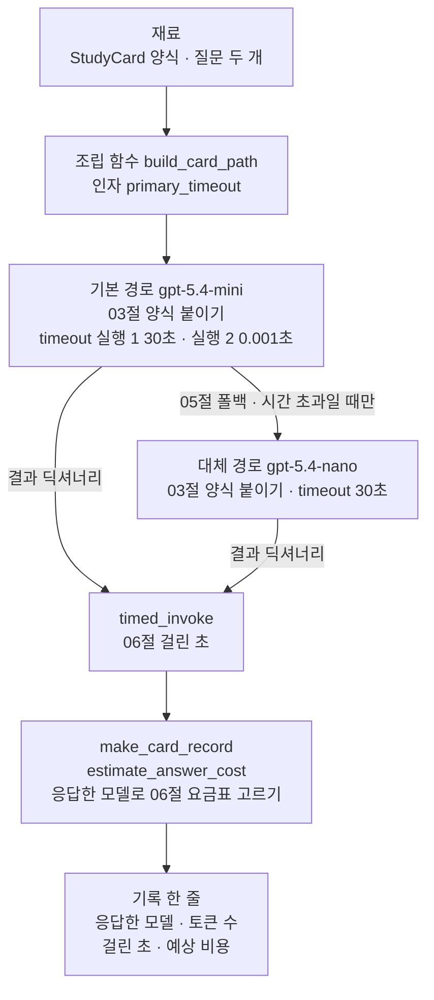
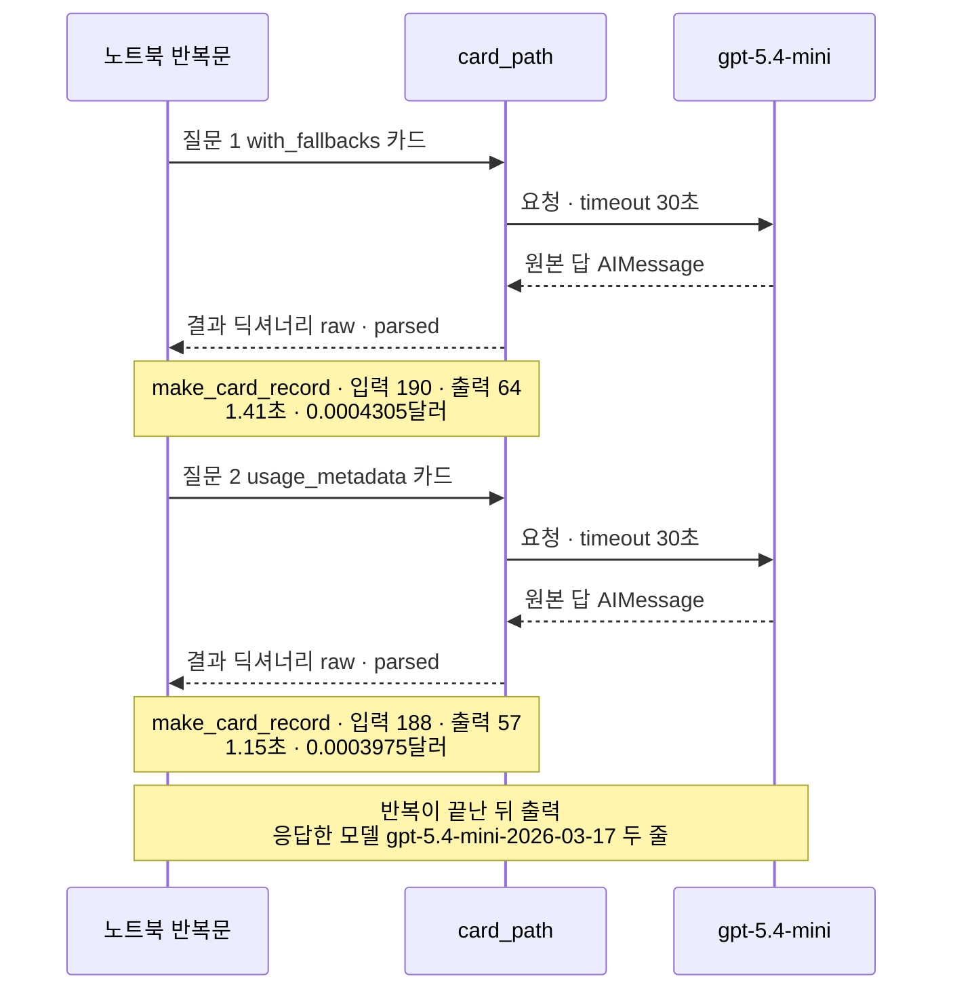
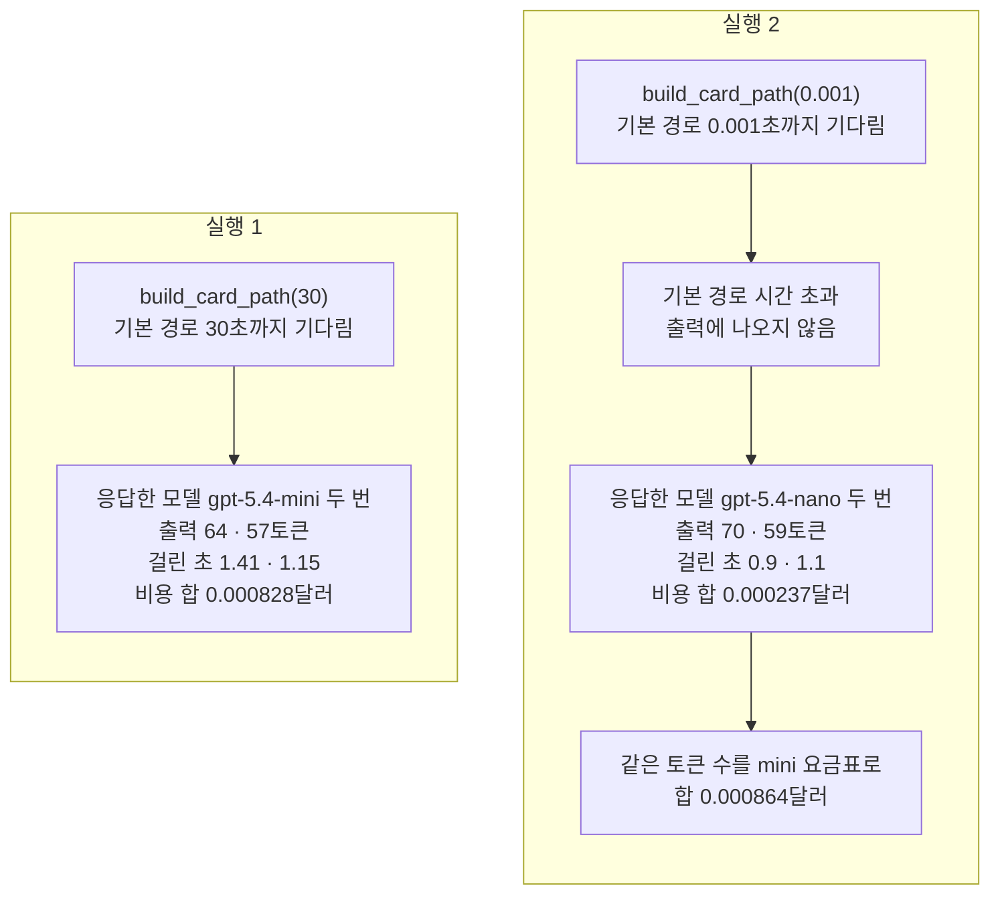

# 07-LangChain-실습

## _src 본문 (HTML 원본)

```html
<!--meta: 실습 30분 | 코드 Jupyter Notebook | 새 용어 0개 -->
<h2 id="b1"><span class="no">1</span>학습 목표</h2>
<div class="goal"><ul><li>03절 구조화 출력, 05절 폴백, 06절 비용 계산을 호출 객체 하나와 기록 함수로 조립할 수 있습니다.</li><li>기록 한 줄에서 응답한 모델, 토큰 수, 걸린 초, 예상 비용을 읽을 수 있습니다.</li><li>기다리는 시간 하나를 바꾼 두 실행을 비교하고, 요금표를 응답한 모델로 골라야 하는 이유를 설명할 수 있습니다.</li></ul></div>
<h2 id="b2"><span class="no">2</span>이 내용을 배우는 이유</h2>
<p>01~06절에서는 모델 호출의 기능을 하나씩 따로 익혔습니다. 실제 서비스에서는 이 기능이 한 요청에 함께 붙습니다. 답은 양식에 맞게 받고, 늦으면 다른 경로로 넘기고, 비용은 기록합니다.</p>
<p>이번 절은 이 챕터의 실습입니다. 앞 절에서 쓴 함수와 호출 객체를 한 노트북에 모아 강사와 함께 실행해 봅니다. 01~06절에서 쓴 이름만 쓰고, 따로 내는 과제는 없습니다.</p>
<p>실습 주제는 학습 카드 요청에 폴백과 비용 기록 붙이기입니다. 초급 학습자에게 LangChain 용어 카드를 만들어 주는 작은 도우미를 만듭니다. 기본 경로가 늦으면 대체 경로가 카드를 만들고, 요청마다 기록을 한 줄씩 남깁니다.</p>
<p><strong>이 절의 질문</strong> — 폴백을 붙인 요청에서 대체 경로가 답하면, 기록의 어느 값이 달라질까요? 예상 비용은 어떤 요금표로 계산해야 할까요?</p>
<h2 id="b3"><span class="no">3</span>앞에서 배운 내용</h2>
<p>이번 실습은 아래 절에서 배운 것을 그대로 가져옵니다.</p>
<table><thead><tr><th>절</th><th>배운 것</th><th>실습에서 쓰는 곳</th></tr></thead><tbody>
<tr><td>01절</td><td><code>init_chat_model(…, temperature=0, reasoning_effort="none")</code>, <code>usage_metadata</code>, 응답 메타데이터</td><td>준비 셀의 모델, 기록의 입력·출력 토큰 수</td></tr>
<tr><td>02절</td><td>모델 이름만 바꾼 <code>gpt-5.4-nano</code>, 한 줄에 한 요청을 적은 기록표</td><td>대체 경로 모델, 딕셔너리 하나로 만든 기록 한 줄</td></tr>
<tr><td>03절</td><td>양식 <code>StudyCard</code>와 <code>Field(ge=1, le=3)</code>, <code>with_structured_output(…, include_raw=True)</code>의 <code>raw</code>·<code>parsed</code></td><td>카드 양식, 두 경로의 구조화 호출, 기록의 설명·난이도</td></tr>
<tr><td>05절</td><td><code>timeout</code>·<code>max_retries</code>, <code>ModelTimeoutError</code>, <code>with_fallbacks([…], exceptions_to_handle=(…,))</code>, 응답한 모델 <code>model_name</code></td><td>조립 함수 <code>build_card_path()</code>, 실행 2의 0.001초, 요금표 고르기</td></tr>
<tr><td>06절</td><td>요금표, <code>estimate_cost()</code>, <code>timed_invoke()</code>, 캐시 입력 <code>cache_read</code>, <code>max_retries=0</code>으로 요청과 기록 맞추기</td><td>비용 계산, 걸린 초, 기록의 캐시 입력 토큰 수</td></tr>
<tr><td>Ch 4 06절, Ch 5 09절</td><td>기록 딕셔너리와 <code>print_report()</code></td><td>기록 출력</td></tr>
</tbody></table>
<p>질문 모양과 system 지시는 03절 학습 카드 요청과 같습니다. 카드로 만들 이름만 05절 <code>with_fallbacks</code>와 01·06절 <code>usage_metadata</code>로 바꿨습니다.</p>
<p>함수 <code>make_card_record()</code>와 <code>estimate_answer_cost()</code>는 이 실습에서 새로 정의합니다. 06절 <code>make_cost_record()</code>와 키가 달라서 이름을 따로 붙였습니다.</p>
<p>04절 스트리밍과 05절 <code>with_retry()</code>는 쓰지 않습니다. 이 실습은 파일에 쓰지 않으므로, 06절이 저장한 <code>runs/provider-comparison-continuity.json</code>도 그대로 둡니다.</p>
<h2 id="b4"><span class="no">4</span>핵심 개념</h2>
<h3>비유로 시작하기</h3>
<p>장난감 나무 레일을 떠올립니다. 레일은 두 갈래로 갈라지고, 위쪽 파란 길 끝의 문은 닫혀 있습니다. 문 앞 모래시계는 모래가 거의 다 떨어졌습니다.</p>
<p>카드는 아래쪽 주황 길을 따라가 주황 컵에 도착했습니다. 컵 옆에는 저울, 동전 더미, 초시계가 한 줄로 놓이고, 저울에는 주황 꼬리표가 달려 있습니다.</p>
{{img:07-4-갈림길-카드와-꼬리표|다리가 보이는 나무 탁자 왼쪽에서 나무 레일이 두 갈래로 갈라져, 위쪽 파란 길은 닫힌 나무 문과 모래가 거의 다 떨어진 모래시계 앞에서 끝나고, 아래쪽 주황 길은 주황 컵으로 이어져 컵 안에 긴 칸 두 개와 가운데만 보라로 칠한 동그라미 세 개가 있는 초록 카드가 서 있으며, 오른쪽에 주황 꼬리표를 단 저울, 동전 더미, 초시계가 한 줄로 놓인 삽화|위쪽 길이 막히자 옆길로 온 카드를 저울과 동전과 초시계로 재고, 어느 길로 왔는지 꼬리표로 남깁니다.}}
<p><strong>그림 읽기</strong> — 탁자 왼쪽에서 나무 레일 하나가 두 갈래로 갈라집니다. 위쪽 파란 길은 닫힌 나무 문 앞에서 끝나고, 그 앞에 모래가 거의 다 떨어진 모래시계가 서 있습니다. 아래쪽 주황 길은 오른쪽으로 더 이어져 주황 컵에 닿습니다.</p>
<p>컵 안에는 긴 칸 두 개와 동그라미 세 개가 그려진 초록 카드가 서 있고, 가운데 동그라미만 보라로 칠해져 있습니다. 컵 오른쪽에는 저울, 동전 네 닢 안팎의 더미, 초시계가 한 줄로 놓입니다. 저울에는 주황 길과 같은 색의 꼬리표가 달려 있습니다.</p>
<p>실습 코드도 같습니다. 두 갈래 레일은 기본 경로와 대체 경로를 붙인 호출 객체 <code>card_path</code>입니다. 모래시계는 05절 타임아웃이고, 닫힌 문은 시간 초과 오류입니다. 컵 속 초록 카드는 03절 <code>StudyCard</code>이고, 저울·동전·초시계는 06절 기록입니다. 주황 꼬리표는 기록에 적은 응답한 모델입니다.</p>
<p>05절 그림의 구슬 한 알은 요청 한 번이었고, 이 그림에서는 카드가 요청 결과입니다. 06절 그림은 기록 두 줄이었고, 이 그림은 요청 한 번의 기록 한 줄입니다.</p>
<h3>실습 함수의 구성</h3>
{{mermaid:07-1-조립도|맨 위 초록 상자 재료 StudyCard 양식과 질문 두 개가 파란 상자 조립 함수 build_card_path로 들어가고, 보라 상자 기본 경로 gpt-5.4-mini에서 시간 초과일 때만 보라 상자 대체 경로 gpt-5.4-nano로 갈라진 뒤, 두 경로의 결과 딕셔너리가 파란 상자 timed_invoke와 파란 상자 make_card_record estimate_answer_cost를 지나 노란 상자 기록 한 줄로 가는 조립도|조립 함수와 기록 함수의 순서. 기본 경로가 시간 초과로 실패할 때만 대체 경로로 넘어가고, 어느 경로가 답해도 같은 기록 한 줄을 남깁니다.}}
<p><strong>도식 읽기</strong> — 위에서 아래로 읽습니다. 초록 상자는 노트북에서 정한 카드 양식과 질문입니다. 파란 상자는 노트북에서 정의한 함수이고, 보라 상자 두 개는 답을 만드는 모델입니다. 맨 아래 노란 상자가 요청마다 남기는 기록 한 줄입니다.</p>
<p>기본 경로에서 대체 경로로 가는 화살표는 시간 초과일 때만 지납니다. 두 경로 모두 같은 모양의 결과 딕셔너리를 내놓습니다. 그래서 기록 함수는 어느 경로가 답했는지와 관계없이 한 줄을 만듭니다.</p>
<table><thead><tr><th>함수</th><th>하는 일</th><th>기록 키</th></tr></thead><tbody>
<tr><td><code>build_card_path(primary_timeout)</code></td><td>기본 경로 mini 모델을 만들고, 카드 양식과 폴백을 붙인 호출 객체를 반환</td><td>없음</td></tr>
<tr><td><code>timed_invoke(run_model, input_messages)</code></td><td>호출 객체로 메시지 목록을 보내고, 결과와 걸린 초를 반환</td><td>걸린 초</td></tr>
<tr><td><code>estimate_answer_cost(raw_message)</code></td><td>응답한 모델 이름으로 요금표를 골라 <code>estimate_cost()</code> 결과를 반환</td><td>예상 비용(달러)</td></tr>
<tr><td><code>make_card_record(result, run_elapsed)</code></td><td>결과 딕셔너리의 원본 답과 읽은 카드로 기록 딕셔너리를 만듦</td><td>응답한 모델, 설명, 난이도, 입력·캐시 입력·출력 토큰 수</td></tr>
</tbody></table>
<p>조립 함수의 인자는 기본 경로의 기다리는 시간 하나입니다. 다시 시도는 두 경로 모두 0번이라, 경로마다 요청 한 번이 시도 한 번입니다. 05절에서는 모델 객체에 <code>with_fallbacks()</code>를 붙였고, 이 실습은 카드 양식을 붙인 호출 객체에 붙입니다. 05절 7절에서 호출 객체 <code>RunnableLambda(ask_current_model)</code>에 <code>with_retry()</code>를 붙인 것처럼, 03절의 호출 객체에도 같은 메서드가 있습니다. 새 메서드가 아니라 붙이는 자리만 다릅니다.</p>
<h3>두 번의 실행</h3>
<p>질문은 두 개입니다. 첫 질문은 <code>with_fallbacks</code>, 둘째 질문은 <code>usage_metadata</code>의 학습 카드를 요청합니다.</p>
<p>실행 1은 기본 경로가 30초까지 기다립니다. 실행 2는 기다리는 시간만 05절 5절의 0.001초로 바꿉니다. 질문, 카드 양식, 대체 경로, 기록 함수는 두 실행이 같습니다.</p>
<h2 id="b5"><span class="no">5</span>실행 예제</h2>
<p>노트북은 먼저 준비 셀의 모델 설정을 보고, 카드 양식·질문·요금표를 만듭니다. 이어서 비용 함수 두 개, 기록 함수 세 개, 대체 경로, 조립 함수를 차례로 정의합니다. 그다음 실행 1, 실행 2, 두 실행 비교를 합니다.</p>
<p>실제 OpenAI 모델을 temperature 0으로 부릅니다. 이 페이지의 출력은 2026-09-17에 실행한 결과입니다. 답을 받는 요청은 4번이고, 실행 2에는 답 없이 시간 초과로 끝나는 시도가 2번 더 있습니다. 예상 비용은 0.01달러 미만이고, 카드 설명·토큰 수·걸린 시간은 실행마다 달라질 수 있습니다.</p>
{{notebook:07-LangChain-실습}}
<p class="look"><b>확인할 점</b> — 실행 1과 실행 2 기록의 <code>응답한 모델</code> 키를 봅니다. 9번 비교 표에서는 두 실행의 예상 비용 합을, 10번에서는 요금표를 잘못 고른 합을 확인합니다.</p>
<h3>실행 1의 실제 순서</h3>
{{mermaid:07-2-실행1-순서|노트북 반복문, card_path, gpt-5.4-mini 세 세로줄 사이에서 질문 1 with_fallbacks 카드를 card_path에 보내고 card_path가 timeout 30초 요청을 mini에 보내 원본 답 AIMessage를 받은 뒤 결과 딕셔너리를 반복문에 넘기고 노란 메모 입력 190 출력 64 1.41초 0.0004305달러, 질문 2 usage_metadata 카드도 같은 차례로 노란 메모 입력 188 출력 57 1.15초 0.0003975달러, 맨 아래 노란 메모 반복이 끝난 뒤 출력 응답한 모델 gpt-5.4-mini-2026-03-17 두 줄이 붙은 순서도|실행 1(기본 경로 30초)에서 반복문, 호출 객체, 기본 경로 모델이 주고받은 차례. 두 요청 모두 mini가 답해 대체 경로는 요청을 받지 않았습니다.}}
<p><strong>도식 읽기</strong> — 위에서 아래로 시간이 흐릅니다. 세로줄은 왼쪽부터 노트북 반복문, 호출 객체 <code>card_path</code>, 기본 경로 모델 <code>gpt-5.4-mini</code>입니다. 실선은 보낸 요청, 점선은 받은 결과입니다.</p>
<p>노란 메모 두 개는 결과를 받은 직후 <code>make_card_record()</code>로 만든 기록입니다. 대체 경로 nano는 실행 1에서 요청을 받지 않아 그림에 없습니다. 맨 아래 메모는 반복문이 끝난 뒤 출력한 내용입니다.</p>
<h2 id="b6"><span class="no">6</span>실험 결과 해석</h2>
<p>실행 1에서 두 기록 모두 <code>응답한 모델 | gpt-5.4-mini-2026-03-17</code>이었습니다. 첫 기록은 입력 190토큰, 출력 64토큰, 1.41초, 0.0004305달러였습니다. 식은 <code>(190 × 0.75 + 64 × 4.50) ÷ 1000000</code>이고, 괄호 안이 142.5 + 288 = 430.5입니다.</p>
<p>입력 190토큰은 06절 짧은 요청의 27토큰보다 훨씬 많았습니다. 질문이 길고, 구조화 호출은 카드 양식을 요청에 함께 싣습니다. 작업 중 기기 셸에서 같은 메시지를 양식 없이 보냈을 때는 입력이 61토큰이었습니다.</p>
<p>실행 2에서는 두 기록 모두 <code>응답한 모델 | gpt-5.4-nano-2026-03-17</code>이었습니다. 바꾼 값은 기본 경로의 기다리는 시간 하나였습니다. 시간 초과 오류는 폴백이 받아 넘겨서 출력에 나오지 않았고, 응답한 모델 이름으로 확인했습니다.</p>
{{mermaid:07-3-두-실행-비교|왼쪽 실행 1 칸은 초록 상자 build_card_path 30에서 노란 상자 응답한 모델 gpt-5.4-mini 두 번 출력 64 57토큰 걸린 초 1.41 1.15 비용 합 0.000828달러로 이어지고, 오른쪽 실행 2 칸은 초록 상자 build_card_path 0.001에서 회색 상자 기본 경로 시간 초과 출력에 나오지 않음, 노란 상자 응답한 모델 gpt-5.4-nano 두 번 출력 70 59토큰 걸린 초 0.9 1.1 비용 합 0.000237달러, 노란 상자 같은 토큰 수를 mini 요금표로 합 0.000864달러로 이어지는 비교 그림|기다리는 시간만 바꾼 두 실행. 실행 2는 nano가 답했고, 같은 토큰 수를 mini 요금표로 계산하면 비용 합이 0.000237달러에서 0.000864달러로 커집니다.}}
<p><strong>도식 읽기</strong> — 왼쪽 칸은 실행 1, 오른쪽 칸은 실행 2이고, 칸 안은 위에서 아래로 읽습니다. 맨 위 초록 상자는 조립 함수에 넣은 기다리는 시간입니다. 노란 상자는 노트북 9·10번 출력에서 읽은 응답한 모델, 토큰 수, 걸린 초, 비용입니다.</p>
<p>실행 2의 회색 상자는 기본 경로의 시간 초과입니다. 노트북 출력에는 나오지 않고, 응답한 모델이 nano라는 출력으로 알 수 있는 단계라서 회색으로 두었습니다. 폴백이 받아 넘긴 오류라 빨강으로 칠하지 않았습니다.</p>
<p>비교 표에서 예상 비용 합은 실행 1이 0.000828달러, 실행 2가 0.000237달러였습니다. 실행 2의 출력 토큰 수는 70·59로 실행 1의 64·57보다 많았는데도, 비용은 작았습니다. nano 요금표가 입력과 출력 모두 mini보다 싸기 때문입니다.</p>
<p>실행 2의 토큰 수를 기본 경로 mini 요금표로 계산하면 합이 0.000864달러였습니다. 응답한 모델 요금표로 계산한 0.000237달러의 약 3.6배입니다. 기본 경로 이름만 기록했다면 비용을 이만큼 크게 어림했을 것입니다.</p>
<p>걸린 초는 실행 1이 1.41·1.15초, 실행 2가 0.9·1.1초였습니다. 교재를 만들 때 같은 코드로 한 앞선 새 커널 실행에서는 실행 1이 1.06·0.98초, 실행 2가 0.86·1.22초였습니다. 요청이 두 번씩뿐이라 어느 실행이 늘 빠르다고 말하지 않습니다.</p>
<p>결론은 이렇습니다. 폴백을 붙인 요청에서 대체 경로가 답하자, 응답한 모델과 예상 비용이 달라졌습니다. 그래서 요금표는 기본 경로 이름이 아니라 응답한 모델 이름으로 골라야 합니다. 이 결과는 질문 두 개로 실행마다 한 번씩 본 것입니다.</p>
<h2 id="b7"><span class="no">7</span>주의할 점과 실무 메모</h2>
<ul><li>실행 2의 걸린 초에는 기본 경로의 실패한 시도와 대체 경로의 요청이 함께 들어 있습니다. 두 시간을 따로 재지 않았습니다. 05절 5절에서는 0.001초 시도가 0.0초로 끝났습니다.</li>
<li>시간 초과로 끝난 기본 경로 시도가 서버에 닿았는지, 요금이 붙는지는 이번에도 확인하지 않았습니다. 예상 비용은 답을 받은 요청의 사용량으로만 계산했습니다.</li>
<li>폴백은 인자 <code>exceptions_to_handle</code>에 적은 시간 초과 오류일 때만 넘깁니다. 설치한 langchain-core 1.6.2 소스에서 목록에 없는 오류는 바로 올라온다는 설명을 확인했습니다. 모델 이름 오타나 양식 검사 오류는 이 조립에서 일으켜 보지 않았습니다.</li>
<li>함수 <code>estimate_answer_cost()</code>는 응답한 모델 이름에 nano가 있는지만 봅니다. 대체 경로를 다른 모델로 바꾸면 이 조건과 요금표를 함께 고쳐야 합니다.</li>
<li>입력 190·188토큰에는 카드 양식 몫이 들어 있는 것으로 보입니다. 작업 중 기기 셸에서 같은 첫 질문을 양식 없이 보낸 요청은 61토큰이었습니다. 이 한 번의 비교로 양식 몫의 정확한 토큰 수를 말하지는 않습니다.</li>
<li>네 요청 모두 캐시 입력은 0이었습니다. 06절 9절에서는 약 1,250토큰 지시도 캐시가 생기지 않았으므로, 이 짧은 요청에서 캐시 할인을 기대하지 않았습니다.</li>
<li>실행 2의 값 0.001초는 05절 5절에서 시간 초과를 실제로 낸 값입니다. 교재를 만들 때 이 조립을 기기 셸에서 먼저 실행해, 두 질문 모두 nano가 답하는 것을 확인한 뒤 정했습니다. 흐름을 보여 주려고 정한 예입니다.</li>
<li>노트북은 새 커널에서 세 번 실행했습니다. 첫 실행은 호출 객체 종류를 반복문 앞에서 출력해 출력 칸이 둘로 나뉘었고, 그 줄을 반복문 뒤로 옮겼습니다. 뒤 두 번은 같은 코드로, 출력 줄 모양은 같고 토큰 수·걸린 초·설명 문장만 달랐습니다.</li>
<li>교재 출력은 Linux의 Python 3.12.13으로 만들었습니다. 패키지는 langchain 1.4.0, langchain-core 1.6.2, langchain-openai 1.6.0입니다. 함께 쓴 openai는 3.10.0, pydantic은 2.13.5, python-dotenv는 1.2.3입니다. 다른 버전과 Windows·macOS에서는 실행하지 않았습니다.</li></ul>
<h2 id="b8"><span class="no">8</span>정리와 다음 절</h2>
<ul><li>03절 구조화 출력, 05절 폴백, 06절 비용 계산을 조립 함수 <code>build_card_path()</code>와 기록 함수로 이었습니다.</li><li>실행 1은 기본 경로 mini가 두 카드를 답했습니다. 기다리는 시간만 0.001초로 바꾼 실행 2는 대체 경로 nano가 답했습니다.</li><li>실행 2의 토큰 수를 mini 요금표로 계산하면 비용 합이 약 3.6배로 커졌습니다. 폴백을 붙인 요청은 응답한 모델 이름으로 요금표를 고릅니다.</li></ul>
<p><strong>다음 학습과 이어지는 지점</strong> — Ch 6은 이 절에서 끝납니다. Ch 7 01절은 이 챕터의 <code>init_chat_model()</code>, <code>invoke()</code>, <code>usage_metadata</code>로 역할별 메시지와 제약을 다룹니다.</p>
<p>Ch 7의 08절은 06절에서 저장한 파일을 읽어 실행 출처를 확인합니다. 그다음 별도의 고객 문의와 세 프롬프트 버전을 같은 측정 항목으로 기록합니다. 질문과 실험 단위가 다르므로 두 챕터의 수치를 직접 비교하지 않습니다. 이 실습의 기록은 파일로 남기지 않아 Ch 7이 읽지 않습니다.</p>
<h2 id="b9"><span class="no">9</span>복습 문제</h2>
<details class="quiz"><summary>문제 1 · 보이지 않은 시간 초과</summary><p class="quiz-q">실행 2의 출력에는 시간 초과 오류가 없었습니다. 기본 경로가 실패했다는 것은 무엇으로 알 수 있나요?</p><p class="quiz-a"><b>해설</b> — 기록의 응답한 모델이 <code>gpt-5.4-nano-2026-03-17</code>이었습니다. 폴백이 시간 초과 오류를 받아 대체 경로로 넘겼기 때문에, 오류는 셀까지 오지 않았습니다. 그래서 응답한 모델 이름을 기록해야 실패를 알아볼 수 있습니다.</p></details>
<details class="quiz"><summary>문제 2 · 기록 한 줄의 비용</summary><p class="quiz-q">실행 1의 둘째 기록은 입력 188, 캐시 입력 0, 출력 57토큰이었습니다. mini 요금으로 예상 비용을 계산해 보세요.</p><p class="quiz-a"><b>해설</b> — 식은 <code>(188 × 0.75 + 0 × 0.075 + 57 × 4.50) ÷ 1000000</code>입니다. 괄호 안은 141 + 0 + 256.5 = 397.5라서 0.0003975달러입니다. 노트북 7번 출력의 둘째 기록 값과 같습니다.</p></details>
<details class="quiz"><summary>문제 3 · 넘길 오류 목록</summary><p class="quiz-q">조립 함수의 <code>exceptions_to_handle</code>에 시간 초과 말고 모든 오류를 적으면 어떤 일이 생길 수 있나요?</p><p class="quiz-a"><b>해설</b> — 05절 10절에서는 목록을 시간 초과 하나로 좁혀 모델 이름 오타가 드러났습니다. 소스로 보면 목록을 넓힐 때는 오타도 대체 경로의 답에 가려질 수 있습니다. 기록에는 nano가 답한 줄만 남아 고쳐야 할 오류를 놓칩니다. 이번 실습에서는 이 경우를 실행하지 않았습니다.</p></details>
<details class="quiz"><summary>문제 4 · 이 절의 질문</summary><p class="quiz-q">대체 경로가 답하자 기록의 어느 값이 달라졌고, 예상 비용은 어떤 요금표로 계산해야 하나요?</p><p class="quiz-a"><b>해설</b> — 응답한 모델이 mini에서 nano로 바뀌었고, 같은 토큰 수라도 요금표가 달라 예상 비용이 달라졌습니다. 출력 토큰 수와 걸린 초도 달랐지만, 06절에서 같은 모델도 요청마다 달랐으므로 폴백 때문이라고 말하지 않습니다. 요금표는 응답한 모델 이름으로 골라야 합니다. mini 요금표로 계산하면 합이 0.000237달러가 아니라 0.000864달러가 됩니다.</p></details>
<details class="quiz"><summary>문제 5 · 대체 경로를 기본으로</summary><p class="quiz-q">동료가 「실행 2가 더 빠르고 싸니, 기본 경로를 nano로 바꾸자」고 합니다. 무엇이라고 답하나요?</p><p class="quiz-a"><b>해설</b> — 걸린 초는 요청 두 번씩이고, 앞선 새 커널 실행에서는 실행 2 둘째 요청이 더 느렸습니다. 카드 설명의 품질도 비교하지 않았습니다. Ch 5 08절처럼 선택 기준을 먼저 정하고, 답의 품질을 따로 확인한 뒤 정하자고 답합니다.</p></details>
<h2 id="b10"><span class="no">10</span>참고 자료</h2>
<p>아래 문서는 03·05·06절 작업에서 2026-09-17에 확인했습니다. 폴백이 넘기는 오류 목록은 실습 가상환경의 <code>langchain-core 1.6.2</code> 소스에서도 확인했습니다.</p>
<ul><li><div><a href="https://docs.langchain.com/oss/python/langchain/structured-output">LangChain Structured output</a></div>양식으로 답 받기 · 확인 2026-09-17</li><li><div><a href="https://reference.langchain.com/python/langchain-core/runnables/base/Runnable/with_fallbacks">Runnable.with_fallbacks reference</a></div>대체 경로와 넘길 오류 · 확인 2026-09-17</li><li><div><a href="https://developers.openai.com/api/docs/models/gpt-5.4-mini">OpenAI GPT-5.4 mini</a></div>100만 토큰당 입력·캐시 입력·출력 요금 · 확인 2026-09-17</li><li><div><a href="https://developers.openai.com/api/docs/models/gpt-5.4-nano">OpenAI GPT-5.4 nano</a></div>100만 토큰당 입력·캐시 입력·출력 요금 · 확인 2026-09-17</li><li><div><a href="https://github.com/langchain-ai/langchain/blob/master/LICENSE">LangChain MIT License</a></div>예제의 질문과 설명은 이 교재에 맞게 새로 썼습니다</li></ul>
```

## 노트북 셀 (순서대로)

### [0] markdown {'html': 'skip'}

# LangChain 실습: 학습 카드 요청에 폴백과 비용 기록 붙이기

**이 노트북에서 할 일**

1. 03절 구조화 출력, 05절 폴백, 06절 비용 계산을 호출 객체 하나와 기록 함수로 조립합니다.
2. 기본 경로가 30초까지 기다리게 두고 학습 카드 두 장을 요청해, 응답한 모델과 비용을 기록합니다(실행 1).
3. 기본 경로의 기다리는 시간 하나만 0.001초로 바꿔 같은 요청을 보내고, 두 기록을 비교합니다(실행 2).

**준비물** — 프로젝트 폴더 `.env` 파일의 `OPENAI_API_KEY`가 필요합니다. 읽는 데이터 파일은 없습니다.

답을 받는 요청은 4번입니다. 모델별로는 `gpt-5.4-mini`에 2번, `gpt-5.4-nano`에 2번입니다.
실행 2에서는 답 없이 시간 초과로 끝나는 시도가 2번 더 있습니다.
실행 시간은 1분 안팎이고, 예상 비용은 0.01달러 미만입니다(06절 4절의 2026-09-17 공식 요금 기준).

이 노트북은 파일을 만들거나 고치지 않습니다. 06절이 저장한 `runs` 폴더의 파일도 건드리지 않습니다.

**기준 버전** — 실습 폴더에 고정한 패키지 판을 씁니다. langchain 1.4.0, langchain-core 1.6.2, langchain-openai 1.6.0입니다.
pydantic 2.13.5, python-dotenv 1.2.3도 함께 씁니다. 함께 설치되는 openai 패키지는 3.10.0입니다.

교재 출력은 Linux의 Python 3.12.13으로 만들었습니다. 다른 버전과 Windows·macOS에서는 이번에 실행하지 않았습니다.

실습 폴더 `labs/part2/ch06-langchain-start`에서 `uv sync --locked`를 실행합니다.
그다음 이 폴더의 `.venv` 커널을 고르고 첫 셀부터 순서대로 실행합니다.
01~06절에서 쓴 이름만 씁니다. 강사와 함께 셀을 차례로 실행하며, 따로 내는 과제는 없습니다.

### [1] markdown {'html': 'skip'}

## 오늘 볼 그림


위에서 아래로 읽습니다. 초록 상자는 노트북에서 정한 카드 양식과 질문 두 개이고, 파란 상자는 노트북에서 정의한 함수입니다.
보라 상자 두 개는 답을 만드는 모델입니다. 기본 경로가 시간 초과로 실패하면 대체 경로로 넘어갑니다.
맨 아래 노란 상자가 요청마다 한 줄씩 남기는 기록입니다.

### [2] markdown {}

## 1. 준비

첫 셀은 패키지를 설치하고 설치된 버전을 출력합니다. 설치에는 몇십 초가 걸릴 수 있습니다.
패키지 openai는 langchain-openai가 OpenAI 서버에 요청을 보낼 때 쓰는 패키지입니다.

### [3] code {'execution': {'iopub.execute_input': '2026-09-17T02:32:42.379711Z', 'iopub.status.busy': '2026-09-17T02:32:42.379555Z', 'iopub.status.idle': '2026-09-17T02:32:43.028119Z', 'shell.execute_reply': '2026-09-17T02:32:43.027533Z'}, 'lesson_role': 'setup'}

```python
# 이 절에서 쓰는 패키지를 설치하고 버전을 확인합니다
%pip install -q "langchain==1.4.0" "langchain-openai==1.6.0" "pydantic==2.13.5" "python-dotenv==1.2.3"
from importlib.metadata import version

print("langchain:", version("langchain"))
print("langchain-core:", version("langchain-core"))
print("langchain-openai:", version("langchain-openai"))
print("openai:", version("openai"))
print("pydantic:", version("pydantic"))
```

출력:
```
Note: you may need to restart the kernel to use updated packages.
langchain: 1.4.0
langchain-core: 1.6.2
langchain-openai: 1.6.0
openai: 3.10.0
pydantic: 2.13.5

```

### [4] markdown {}

**결과 읽기** — 출력 줄은 `langchain: 1.4.0`, `openai: 3.10.0`, `pydantic: 2.13.5` 등 다섯 줄입니다.
준비물에 적은 기준 버전과 같습니다.

이번 실습에서 쓸 이름을 불러옵니다. 모듈 `time`은 05·06절에서 걸린 시간을 잴 때 썼습니다.
오류 이름 `ModelTimeoutError`는 05절, 양식을 만드는 `BaseModel`과 `Field`는 03절에서 불러왔습니다.

### [5] code {'execution': {'iopub.execute_input': '2026-09-17T02:32:43.029220Z', 'iopub.status.busy': '2026-09-17T02:32:43.029131Z', 'iopub.status.idle': '2026-09-17T02:32:43.438433Z', 'shell.execute_reply': '2026-09-17T02:32:43.437992Z'}, 'lesson_role': 'setup'}

```python
# 걸린 시간을 재는 모듈, 모델 객체를 만드는 함수, 시간 초과 오류 이름, 양식 클래스 도구를 불러옵니다
import time

from langchain.chat_models import init_chat_model
from langchain_core.exceptions import ModelTimeoutError
from pydantic import BaseModel, Field
```

출력:
```

```

### [6] markdown {}

01절과 같은 셀로 API 키가 있는지 확인합니다. 키 값은 출력하지 않고, 있는지만 봅니다.
`True` 값이 나오면 다음으로 넘어갑니다.

### [7] code {'execution': {'iopub.execute_input': '2026-09-17T02:32:43.439517Z', 'iopub.status.busy': '2026-09-17T02:32:43.439456Z', 'iopub.status.idle': '2026-09-17T02:32:43.444369Z', 'shell.execute_reply': '2026-09-17T02:32:43.444023Z'}, 'lesson_role': 'setup'}

```python
# .env 파일에서 OpenAI API 키를 읽습니다(키 값은 출력하지 않습니다)
import os
from dotenv import find_dotenv, load_dotenv

env_path = find_dotenv(usecwd=True)
load_dotenv(env_path)
has_key = os.getenv("OPENAI_API_KEY") is not None
print("OPENAI_API_KEY 설정 여부:", has_key)
assert has_key, "프로젝트 폴더의 .env 파일에 OPENAI_API_KEY를 적어 주세요."
```

출력:
```
OPENAI_API_KEY 설정 여부: True

```

### [8] markdown {}

실습에 쓸 모델을 준비합니다.
01절과 같은 설정으로 모델 객체를 만듭니다. 이 셀은 요청을 보내지 않습니다.

### [9] code {'execution': {'iopub.execute_input': '2026-09-17T02:32:43.444911Z', 'iopub.status.busy': '2026-09-17T02:32:43.444858Z', 'iopub.status.idle': '2026-09-17T02:32:44.310757Z', 'shell.execute_reply': '2026-09-17T02:32:44.310449Z'}}

```python
# 실습에 쓸 모델을 준비합니다
model = init_chat_model(
    "openai:gpt-5.4-mini",
    temperature=0,
    reasoning_effort="none",
)
print("모델 이름:", model.model_name)
print("temperature:", model.temperature)
```

출력:
```
모델 이름: gpt-5.4-mini
temperature: 0.0

```

### [10] markdown {}

**결과 읽기** — 출력 줄은 `모델 이름: gpt-5.4-mini`와 `temperature: 0.0`입니다. 이것으로 준비가 끝났습니다.
이 노트북의 출력은 2026-09-17에 이 모델과 nano 모델로 실행한 결과입니다.
실행마다 카드 설명 문장, 토큰 수, 걸린 시간이 달라질 수 있습니다.

### [11] markdown {}

## 2. 실습 주제 — 학습 카드 요청에 폴백과 비용 기록 붙이기

초급 학습자에게 LangChain 용어 카드를 만들어 주는 작은 도우미를 떠올립니다. 카드는 03절 양식 `StudyCard`로 받습니다.
기본 경로 모델이 제시간에 답하지 못하면, 05절처럼 `gpt-5.4-nano`가 대신 답합니다.
요청마다 06절처럼 토큰 수, 걸린 시간, 예상 비용을 한 줄에 기록합니다.

기록에서 눈여겨볼 키는 응답한 모델입니다. 대체 경로가 답했으면 요금표도 nano의 것을 써야 합니다.
그래서 이 실습은 응답한 모델 이름을 보고 요금표를 고르는 함수를 만듭니다.

실행 1은 기본 경로가 30초까지 기다립니다. 실행 2는 기다리는 시간 하나만 05절 5절의 0.001초로 바꿉니다.
04절 스트리밍과 05절 `with_retry()`는 이번 실습에서 쓰지 않습니다.

먼저 준비 셀에서 만든 모델 객체 `model`의 두 설정을 봅니다. 05절 3절처럼 두 값을 적지 않은 모델입니다.

실행 전에 예상합니다. 두 값 모두 `None`일 것입니다.

### [12] code {'execution': {'iopub.execute_input': '2026-09-17T02:32:44.311495Z', 'iopub.status.busy': '2026-09-17T02:32:44.311437Z', 'iopub.status.idle': '2026-09-17T02:32:44.313322Z', 'shell.execute_reply': '2026-09-17T02:32:44.312994Z'}}

```python
# 준비 셀의 모델 객체에 적힌 기다리는 시간과 다시 시도 횟수를 봅니다(요청 없음)
print("모델 객체 timeout:", model.request_timeout)
print("모델 객체 max_retries:", model.max_retries)
```

출력:
```
모델 객체 timeout: None
모델 객체 max_retries: None

```

### [13] markdown {}

**결과 읽기** — 출력 줄은 `모델 객체 timeout: None`과 `모델 객체 max_retries: None`입니다. 예상과 같습니다.

05절 3절에서 본 것처럼, 이 모델은 기다리는 시간에 제한이 없습니다. 다시 시도는 openai 클라이언트의 기본값 2번을 따릅니다.
그래서 조립할 때는 두 경로 모두 두 값을 직접 적습니다. 이 `model`은 이 뒤로 요청에 쓰지 않습니다.

## 3. 재료 만들기 — 카드 양식과 질문 두 개

카드 양식은 03절과 같은 코드입니다. 칸은 개념 이름, 한 문장 설명, 난이도 세 개입니다.
난이도 칸에는 `Field(ge=1, le=3)`로 1부터 3까지라는 범위 규칙을 적습니다. 이 셀은 양식을 정의만 합니다.

### [14] code {'execution': {'iopub.execute_input': '2026-09-17T02:32:44.313944Z', 'iopub.status.busy': '2026-09-17T02:32:44.313885Z', 'iopub.status.idle': '2026-09-17T02:32:44.316034Z', 'shell.execute_reply': '2026-09-17T02:32:44.315727Z'}}

```python
# 개념 이름·설명·난이도 세 칸을 가진 학습 카드 양식을 정합니다(03절과 같은 코드)
class StudyCard(BaseModel):
    concept: str = Field(description="개념 이름")
    explanation: str = Field(description="한 문장 설명")
    difficulty: int = Field(ge=1, le=3, description="1부터 3까지의 난이도")
```

출력:
```

```

### [15] markdown {}

**결과 읽기** — 정의만 하는 셀이라 출력이 없습니다.

질문은 이 챕터에서 배운 이름 두 개의 카드를 만들어 달라는 요청입니다. 05절의 `with_fallbacks`와 01·06절의 `usage_metadata`입니다.
system 지시는 03절의 「초급 학습자를 위한 학습 카드를 만듭니다.」를 다시 씁니다. 질문마다 이 지시와 질문을 튜플 목록으로 묶어 보냅니다.

실행 전에 예상합니다. 질문 수는 2일 것입니다.

### [16] code {'execution': {'iopub.execute_input': '2026-09-17T02:32:44.316573Z', 'iopub.status.busy': '2026-09-17T02:32:44.316522Z', 'iopub.status.idle': '2026-09-17T02:32:44.318385Z', 'shell.execute_reply': '2026-09-17T02:32:44.318055Z'}}

```python
# 03절 system 지시 튜플과, 이 챕터에서 배운 이름 두 개의 카드를 요청하는 질문을 담습니다
system_message = ("system", "초급 학습자를 위한 학습 카드를 만듭니다.")
questions = [
    "LangChain의 with_fallbacks를 학습 카드로 만드세요. 개념 이름, 한 문장 설명, 1~3 난이도를 적으세요.",
    "LangChain의 usage_metadata를 학습 카드로 만드세요. 개념 이름, 한 문장 설명, 1~3 난이도를 적으세요.",
]
print("system 지시:", system_message[1])
print("질문 수:", len(questions))
```

출력:
```
system 지시: 초급 학습자를 위한 학습 카드를 만듭니다.
질문 수: 2

```

### [17] markdown {}

**결과 읽기** — 출력 줄은 `system 지시: 초급 학습자를 위한 학습 카드를 만듭니다.`와 `질문 수: 2`입니다.
아직 목록만 만들었고 요청은 보내지 않았습니다.

## 4. 재료 만들기 — 요금표와 비용 함수

두 모델의 요금표는 06절 4절과 같은 값입니다. 2026-09-17에 OpenAI 모델 페이지에서 확인한 100만 토큰당 달러입니다.

실행 전에 예상합니다. 두 딕셔너리에 키가 세 개씩 보일 것입니다.

### [18] code {'execution': {'iopub.execute_input': '2026-09-17T02:32:44.318927Z', 'iopub.status.busy': '2026-09-17T02:32:44.318874Z', 'iopub.status.idle': '2026-09-17T02:32:44.320838Z', 'shell.execute_reply': '2026-09-17T02:32:44.320500Z'}}

```python
# 06절 4절과 같은 두 모델의 공식 요금(100만 토큰당 달러)과 확인한 날짜를 적습니다
pricing_date = "2026-09-17"
mini_prices = {"ordinary_input": 0.75, "cached_input": 0.075, "output": 4.50}
nano_prices = {"ordinary_input": 0.20, "cached_input": 0.02, "output": 1.25}
print("요금 확인 날짜:", pricing_date)
print("mini 요금:", mini_prices)
print("nano 요금:", nano_prices)
```

출력:
```
요금 확인 날짜: 2026-09-17
mini 요금: {'ordinary_input': 0.75, 'cached_input': 0.075, 'output': 4.5}
nano 요금: {'ordinary_input': 0.2, 'cached_input': 0.02, 'output': 1.25}

```

### [19] markdown {}

**결과 읽기** — 출력 줄은 `요금 확인 날짜: 2026-09-17`, `mini 요금: {'ordinary_input': 0.75, 'cached_input': 0.075, 'output': 4.5}`, nano 요금 줄입니다.

다음은 06절과 같은 코드의 `estimate_cost()` 함수입니다. 사용량 딕셔너리와 세 요금으로 요청 한 번의 예상 비용을 계산합니다.
사용량이 `None`이면 `None`을, 캐시 입력 키가 없으면 캐시 입력을 0으로 봅니다. 이 셀은 함수를 정의만 합니다.

### [20] code {'execution': {'iopub.execute_input': '2026-09-17T02:32:44.321329Z', 'iopub.status.busy': '2026-09-17T02:32:44.321281Z', 'iopub.status.idle': '2026-09-17T02:32:44.323154Z', 'shell.execute_reply': '2026-09-17T02:32:44.322836Z'}}

```python
# 사용량 딕셔너리와 세 요금으로 요청 한 번의 예상 비용(달러)을 계산하는 함수를 정의합니다(06절과 같은 코드)
def estimate_cost(usage, input_rate, cached_input_rate, output_rate):
    if usage is None:
        return None
    # 캐시 입력 키가 없으면 할인 없이 모두 입력 요금으로 계산합니다
    details = usage.get("input_token_details", {})
    cache_read = details.get("cache_read", 0)
    normal_input = usage["input_tokens"] - cache_read
    input_cost = normal_input * input_rate + cache_read * cached_input_rate
    output_cost = usage["output_tokens"] * output_rate
    price_unit = 1000000
    return (input_cost + output_cost) / price_unit
```

출력:
```

```

### [21] markdown {}

**결과 읽기** — 정의만 하는 셀이라 출력이 없습니다.

다음 함수 `estimate_answer_cost()`는 원본 답 `AIMessage` 하나를 받습니다. 03절 8절에서 `include_raw=True`로 받은 `raw`가 이 객체입니다.
05절 10절처럼 응답 메타데이터의 `model_name`으로 응답한 모델 이름을 읽습니다.
이름에 nano가 들어 있으면 nano 요금표를, 아니면 mini 요금표를 골라 `estimate_cost()`를 부릅니다.

글자 포함 확인 `in`은 05절 10절 `assert "nano" in answered_model`에서 썼습니다. 이 셀도 함수를 정의만 합니다.

### [22] code {'execution': {'iopub.execute_input': '2026-09-17T02:32:44.323701Z', 'iopub.status.busy': '2026-09-17T02:32:44.323647Z', 'iopub.status.idle': '2026-09-17T02:32:44.325243Z', 'shell.execute_reply': '2026-09-17T02:32:44.324979Z'}}

```python
# 원본 답의 응답한 모델 이름으로 요금표를 골라 예상 비용을 반환하는 함수를 정의합니다
def estimate_answer_cost(raw_message):
    answered_model = raw_message.response_metadata["model_name"]
    # 대체 경로 nano가 답했으면 nano 요금표, 아니면 기본 경로 mini 요금표를 씁니다
    if "nano" in answered_model:
        prices = nano_prices
    else:
        prices = mini_prices
    run_usage = raw_message.usage_metadata
    return estimate_cost(run_usage, prices["ordinary_input"], prices["cached_input"], prices["output"])
```

출력:
```

```

### [23] markdown {}

**결과 읽기** — 정의만 하는 셀이라 출력이 없습니다.

## 5. 기록 장치 — 요청 한 번을 기록 한 줄로

첫 기록 함수는 06절과 같은 코드의 `timed_invoke()`입니다. 호출 객체로 메시지 목록을 보내고, 결과와 걸린 초를 튜플로 반환합니다.
06절에서는 모델 객체를 넣었지만, 메서드 `invoke()`가 있는 호출 객체라면 같은 방법으로 넣을 수 있습니다. 이 셀은 함수를 정의만 합니다.

### [24] code {'execution': {'iopub.execute_input': '2026-09-17T02:32:44.325805Z', 'iopub.status.busy': '2026-09-17T02:32:44.325742Z', 'iopub.status.idle': '2026-09-17T02:32:44.327347Z', 'shell.execute_reply': '2026-09-17T02:32:44.327036Z'}}

```python
# 호출 객체로 메시지 목록을 보내고, 결과와 걸린 초를 튜플로 반환하는 함수를 정의합니다(06절과 같은 코드)
def timed_invoke(run_model, input_messages):
    start_time = time.perf_counter()
    run_response = run_model.invoke(input_messages)
    run_elapsed = time.perf_counter() - start_time
    return run_response, run_elapsed
```

출력:
```

```

### [25] markdown {}

**결과 읽기** — 정의만 하는 셀이라 출력이 없습니다.

둘째 함수 `make_card_record()`는 03절 8절의 결과 딕셔너리와 걸린 초로 기록 한 줄을 만듭니다. 결과 딕셔너리의 키 `raw`에는 원본 답, `parsed`에는 읽은 카드가 있습니다.
기록 딕셔너리의 키는 8개입니다. 응답한 모델, 설명, 난이도, 입력·캐시 입력·출력 토큰 수, 걸린 초, 예상 비용입니다.

06절 `make_cost_record()`와 키가 달라서 이름을 따로 붙였습니다. 이 셀도 함수를 정의만 합니다.

### [26] code {'execution': {'iopub.execute_input': '2026-09-17T02:32:44.327867Z', 'iopub.status.busy': '2026-09-17T02:32:44.327822Z', 'iopub.status.idle': '2026-09-17T02:32:44.329526Z', 'shell.execute_reply': '2026-09-17T02:32:44.329198Z'}}

```python
# 구조화 호출의 결과 딕셔너리와 걸린 초로 기록 한 줄(딕셔너리)을 만드는 함수를 정의합니다
def make_card_record(result, run_elapsed):
    raw_message = result["raw"]
    run_usage = raw_message.usage_metadata
    record = {
        "응답한 모델": raw_message.response_metadata["model_name"],
        "설명": result["parsed"].explanation,
        "난이도": result["parsed"].difficulty,
        "입력 토큰 수": run_usage["input_tokens"],
        "캐시 입력 토큰 수": run_usage["input_token_details"]["cache_read"],
        "출력 토큰 수": run_usage["output_tokens"],
        "걸린 초": round(run_elapsed, 2),
        "예상 비용(달러)": estimate_answer_cost(raw_message),
    }
    return record
```

출력:
```

```

### [27] markdown {}

**결과 읽기** — 정의만 하는 셀이라 출력이 없습니다.

기록 한 줄을 키마다 한 줄씩 출력하는 함수는 Ch 4 06절과 Ch 5 09절의 `print_report()`를 그대로 가져옵니다.
이 셀도 함수를 정의만 합니다.

### [28] code {'execution': {'iopub.execute_input': '2026-09-17T02:32:44.330172Z', 'iopub.status.busy': '2026-09-17T02:32:44.330127Z', 'iopub.status.idle': '2026-09-17T02:32:44.331829Z', 'shell.execute_reply': '2026-09-17T02:32:44.331471Z'}}

```python
# Ch 4 06절·Ch 5 09절 함수: 기록 딕셔너리의 키와 값을 한 줄에 하나씩 출력합니다
def print_report(report):
    # items()는 키와 값의 짝을 차례로 내놓습니다
    for key, value in report.items():
        print(key, "|", value)
```

출력:
```

```

### [29] markdown {}

**결과 읽기** — 정의만 하는 셀이라 출력이 없습니다. 이 함수는 실행 1과 실행 2에서 기록마다 부릅니다.

## 6. 조립하기 — 폴백을 붙인 구조화 호출 객체

먼저 대체 경로를 만듭니다. 02절의 `gpt-5.4-nano` 모델에 03절처럼 카드 양식을 붙입니다.
인자 `include_raw=True`를 주어 읽은 카드와 원본 답을 함께 받습니다. 원본 답에 사용량과 응답한 모델 이름이 들어 있기 때문입니다.

기다리는 시간은 30초, 다시 시도는 06절 5절처럼 0번으로 둡니다. 요청 한 번과 기록 한 줄을 맞추려는 설정입니다. 이 셀은 요청을 보내지 않습니다.

실행 전에 예상합니다. 03절 5절처럼 호출 객체 종류는 `RunnableSequence`일 것입니다.

### [30] code {'execution': {'iopub.execute_input': '2026-09-17T02:32:44.332349Z', 'iopub.status.busy': '2026-09-17T02:32:44.332296Z', 'iopub.status.idle': '2026-09-17T02:32:44.337976Z', 'shell.execute_reply': '2026-09-17T02:32:44.337724Z'}}

```python
# 대체 경로: nano 모델에 카드 양식을 붙이고 원본 답도 함께 받게 합니다(요청 없음)
backup_model = init_chat_model(
    "openai:gpt-5.4-nano", temperature=0, reasoning_effort="none",
    timeout=30, max_retries=0,
)
backup_path = backup_model.with_structured_output(StudyCard, include_raw=True)
print("대체 경로 호출 객체 종류:", type(backup_path).__name__)
```

출력:
```
대체 경로 호출 객체 종류: RunnableSequence

```

### [31] markdown {}

**결과 읽기** — 출력 줄은 `대체 경로 호출 객체 종류: RunnableSequence`입니다. 예상과 같습니다.

이제 조립 함수 `build_card_path()`를 정의합니다. 인자는 기본 경로의 기다리는 시간 하나입니다. 실행 1과 실행 2는 이 값만 바꿉니다.
함수 안에서 기본 경로 mini 모델을 만들고, 카드 양식을 붙이고, 시간 초과일 때만 대체 경로로 넘기게 합니다. 주석마다 그 줄을 배운 절을 적었습니다.

05절에서는 모델 객체에 `with_fallbacks()`를 붙였습니다. 여기서는 카드 양식을 붙인 호출 객체에 붙입니다.
05절 7절에서 호출 객체 `RunnableLambda(ask_current_model)`에 `with_retry()`를 붙인 것처럼, 03절의 호출 객체에도 같은 메서드가 있습니다. 새 메서드가 아니라 붙이는 자리만 다릅니다.

함수 안에서 바깥 이름 `backup_path`를 읽습니다.
이 셀은 함수를 정의만 합니다.

### [32] code {'execution': {'iopub.execute_input': '2026-09-17T02:32:44.338524Z', 'iopub.status.busy': '2026-09-17T02:32:44.338478Z', 'iopub.status.idle': '2026-09-17T02:32:44.340317Z', 'shell.execute_reply': '2026-09-17T02:32:44.340075Z'}}

```python
# 조립: 기본 경로 모델 → 카드 양식 → 시간 초과일 때 대체 경로로 넘기는 호출 객체를 반환합니다
def build_card_path(primary_timeout):
    # 01·05절: 기본 경로 mini 모델, 기다리는 시간은 인자로 받고 다시 시도는 끕니다
    primary_model = init_chat_model(
        "openai:gpt-5.4-mini", temperature=0, reasoning_effort="none",
        timeout=primary_timeout, max_retries=0,
    )
    # 03절: 카드 양식을 붙이고 원본 답도 함께 받습니다
    primary_path = primary_model.with_structured_output(StudyCard, include_raw=True)
    # 05절: 시간 초과 오류일 때만 대체 경로로 넘깁니다
    card_path = primary_path.with_fallbacks([backup_path], exceptions_to_handle=(ModelTimeoutError,))
    return card_path
```

출력:
```

```

### [33] markdown {}

**결과 읽기** — 정의만 하는 셀이라 출력이 없습니다. 조립이 끝났으니, 이제 기다리는 시간만 넣어 호출 객체를 만들면 됩니다.

## 7. 실행 1 — 기본 경로가 30초까지 기다리기

조립 함수에 30을 넣어 호출 객체를 만들고, 질문 두 개를 차례로 보냅니다. 요청이 모두 끝난 뒤 기록을 출력합니다.
06절 인계대로, 요청을 기다리는 반복문 안에서는 출력하지 않습니다.

응답한 모델 이름에 mini가 들어 있는지 `assert`로 확인합니다. 설명 문장과 난이도는 실행마다 달라질 수 있어 확인하지 않습니다.

실행 전에 예상합니다. 호출 객체 종류는 05절 10절의 `RunnableWithFallbacks`일 것입니다.
기본 경로가 제시간에 답하므로 두 기록 모두 응답한 모델이 mini이고, 난이도는 1~3 안일 것입니다.

### [34] code {'execution': {'iopub.execute_input': '2026-09-17T02:32:44.340782Z', 'iopub.status.busy': '2026-09-17T02:32:44.340726Z', 'iopub.status.idle': '2026-09-17T02:32:46.902492Z', 'shell.execute_reply': '2026-09-17T02:32:46.901889Z'}}

```python
# 실행 1: 기본 경로가 30초까지 기다리는 호출 객체로 질문 두 개를 보냅니다(요청 2번)
card_path = build_card_path(30)
records_1 = []
for question in questions:
    input_messages = [system_message, ("user", question)]
    result, run_elapsed = timed_invoke(card_path, input_messages)
    record = make_card_record(result, run_elapsed)
    records_1.append(record)
# 요청이 모두 끝난 뒤 호출 객체 종류와 기록을 출력합니다
print("호출 객체 종류:", type(card_path).__name__)
for record in records_1:
    print("기록:")
    print_report(record)
    assert "mini" in record["응답한 모델"]
```

출력:
```
호출 객체 종류: RunnableWithFallbacks
기록:
응답한 모델 | gpt-5.4-mini-2026-03-17
설명 | 주요 체인이 실패하거나 원하는 결과를 내지 못할 때, 미리 정해둔 대체 체인으로 자동 전환해 더 안정적으로 동작하게 하는 기능입니다.
난이도 | 2
입력 토큰 수 | 190
캐시 입력 토큰 수 | 0
출력 토큰 수 | 64
걸린 초 | 1.41
예상 비용(달러) | 0.0004305
기록:
응답한 모델 | gpt-5.4-mini-2026-03-17
설명 | LangChain의 usage_metadata는 모델 호출에서 사용된 입력·출력 토큰 수 같은 사용량 정보를 기록해 비용과 성능을 확인하는 데 쓰입니다.
난이도 | 2
입력 토큰 수 | 188
캐시 입력 토큰 수 | 0
출력 토큰 수 | 57
걸린 초 | 1.15
예상 비용(달러) | 0.0003975

```

### [35] markdown {}

**결과 읽기** — 첫 줄은 `호출 객체 종류: RunnableWithFallbacks`입니다. 두 기록 모두 `응답한 모델 | gpt-5.4-mini-2026-03-17`이고, `assert`도 통과했습니다.
첫 기록은 `입력 토큰 수 | 190`, `출력 토큰 수 | 64`, `걸린 초 | 1.41`, `예상 비용(달러) | 0.0004305`입니다.

둘째 기록은 입력 188토큰, 출력 57토큰이었습니다. 두 카드의 난이도는 모두 2로, 03절 범위 규칙 1~3 안이었습니다.
설명 키에는 카드마다 한 문장 설명이 들어 있습니다. 실행마다 문장이 달라질 수 있습니다.

첫 기록의 비용은 06절 식으로 `(190 × 0.75 + 64 × 4.50) ÷ 1000000`입니다. 괄호 안은 142.5 + 288 = 430.5입니다.
입력 190토큰은 06절 짧은 요청의 27토큰보다 훨씬 많습니다. 질문이 길고, 구조화 호출은 카드 양식을 요청에 함께 싣기 때문입니다.

### [36] markdown {}

## 8. 실행 2 — 기다리는 시간 하나만 0.001초로

바꾸는 값은 조립 함수에 넣는 기다리는 시간 하나입니다. 05절 5절에서 시간 초과 오류를 실제로 낸 0.001초를 넣습니다.
질문, 카드 양식, 대체 경로, 기록 함수는 그대로입니다.

응답한 모델 이름에 nano가 들어 있는지 `assert`로 확인합니다. 기본 경로가 시간 초과로 실패했다면 매번 대체 경로가 답해야 하기 때문입니다.

실행 전에 예상합니다. 두 기록 모두 응답한 모델이 nano일 것입니다. 시간 초과 오류는 폴백이 받아 넘기므로 출력에 나오지 않을 것입니다.
예상 비용은 nano 요금표로 계산되어 실행 1보다 작을 것입니다.

### [37] code {'execution': {'iopub.execute_input': '2026-09-17T02:32:46.904130Z', 'iopub.status.busy': '2026-09-17T02:32:46.904007Z', 'iopub.status.idle': '2026-09-17T02:32:48.906555Z', 'shell.execute_reply': '2026-09-17T02:32:48.905763Z'}}

```python
# 실행 2: 기본 경로의 기다리는 시간만 0.001초로 바꿔 같은 질문 두 개를 보냅니다(시도 4번, 답 2번)
card_path = build_card_path(0.001)
records_2 = []
for question in questions:
    input_messages = [system_message, ("user", question)]
    result, run_elapsed = timed_invoke(card_path, input_messages)
    record = make_card_record(result, run_elapsed)
    records_2.append(record)
# 요청이 모두 끝난 뒤 호출 객체 종류와 기록을 출력합니다
print("호출 객체 종류:", type(card_path).__name__)
for record in records_2:
    print("기록:")
    print_report(record)
    assert "nano" in record["응답한 모델"]
```

출력:
```
호출 객체 종류: RunnableWithFallbacks
기록:
응답한 모델 | gpt-5.4-nano-2026-03-17
설명 | with_fallbacks는 실행 중 오류가 나거나 응답이 실패할 때, 미리 지정한 대체(폴백) 실행 경로로 자동 전환해 안정적으로 결과를 얻도록 하는 기능입니다.
난이도 | 2
입력 토큰 수 | 190
캐시 입력 토큰 수 | 0
출력 토큰 수 | 70
걸린 초 | 0.9
예상 비용(달러) | 0.0001255
기록:
응답한 모델 | gpt-5.4-nano-2026-03-17
설명 | LangChain에서 모델 호출 결과와 함께 제공되는 사용량 정보(예: 토큰 수, 비용/청구 관련 메타데이터)를 담은 필드입니다.
난이도 | 2
입력 토큰 수 | 188
캐시 입력 토큰 수 | 0
출력 토큰 수 | 59
걸린 초 | 1.1
예상 비용(달러) | 0.00011135

```

### [38] markdown {}

**결과 읽기** — 두 기록 모두 `응답한 모델 | gpt-5.4-nano-2026-03-17`이고, `assert`도 통과했습니다.
첫 기록은 `출력 토큰 수 | 70`, `걸린 초 | 0.9`, `예상 비용(달러) | 0.0001255`입니다. 입력 토큰 수는 실행 1과 같은 190과 188이었습니다.

바꾼 값은 기다리는 시간 하나였는데, 답한 모델이 바뀌었습니다. 출력에 시간 초과 오류는 보이지 않습니다.
폴백이 시간 초과 오류를 받아 대체 경로로 넘겼기 때문입니다. 기본 경로가 실패했다는 사실은 응답한 모델 이름으로 확인합니다.

첫 기록의 비용은 nano 요금표로 `(190 × 0.20 + 70 × 1.25) ÷ 1000000`입니다. 괄호 안은 38 + 87.5 = 125.5입니다.
걸린 초에는 기본 경로의 실패한 시도와 대체 경로의 요청이 함께 들어 있습니다. 두 시간을 따로 재지는 않았습니다.

### [39] markdown {}

## 9. 두 실행 비교하기

두 실행의 기록을 표 모양으로 나란히 놓고, 실행마다 예상 비용 합을 구합니다. 06절 7·8절 기록표와 같은 모양입니다.
튜플 목록 `runs`의 원소는 (실행 이름, 기록 목록) 튜플입니다.

실행 전에 예상합니다. 응답한 모델은 실행 1이 mini, 실행 2가 nano이고, 예상 비용 합은 실행 2가 더 작을 것입니다.

### [40] code {'execution': {'iopub.execute_input': '2026-09-17T02:32:48.908330Z', 'iopub.status.busy': '2026-09-17T02:32:48.908191Z', 'iopub.status.idle': '2026-09-17T02:32:48.912266Z', 'shell.execute_reply': '2026-09-17T02:32:48.911712Z'}}

```python
# 두 실행의 기록을 한 줄씩 나란히 출력하고, 실행마다 예상 비용 합을 구합니다(요청 없음)
runs = [("실행 1", records_1), ("실행 2", records_2)]
print("실행 | 응답한 모델 | 입력 | 캐시 입력 | 출력 | 걸린 초 | 예상 비용(달러)")
for run_name, run_records in runs:
    total_cost = 0
    for record in run_records:
        print(
            run_name, "|", record["응답한 모델"], "|", record["입력 토큰 수"], "|", record["캐시 입력 토큰 수"], "|",
            record["출력 토큰 수"], "|", record["걸린 초"], "|", record["예상 비용(달러)"],
        )
        total_cost = total_cost + record["예상 비용(달러)"]
    print(run_name, "| 예상 비용 합(달러):", round(total_cost, 6))
```

출력:
```
실행 | 응답한 모델 | 입력 | 캐시 입력 | 출력 | 걸린 초 | 예상 비용(달러)
실행 1 | gpt-5.4-mini-2026-03-17 | 190 | 0 | 64 | 1.41 | 0.0004305
실행 1 | gpt-5.4-mini-2026-03-17 | 188 | 0 | 57 | 1.15 | 0.0003975
실행 1 | 예상 비용 합(달러): 0.000828
실행 2 | gpt-5.4-nano-2026-03-17 | 190 | 0 | 70 | 0.9 | 0.0001255
실행 2 | gpt-5.4-nano-2026-03-17 | 188 | 0 | 59 | 1.1 | 0.00011135
실행 2 | 예상 비용 합(달러): 0.000237

```

### [41] markdown {}

**결과 읽기** — 라벨 줄 아래에 실행마다 기록 두 줄과 합계 한 줄이 나옵니다. 합계 줄은 `실행 1 | 예상 비용 합(달러): 0.000828`과 `실행 2 | 예상 비용 합(달러): 0.000237`입니다.
네 요청 모두 캐시 입력은 0이었습니다.

출력 토큰 수는 실행 1이 64·57, 실행 2가 70·59로, 실행 2가 더 많았습니다. 그런데도 비용 합은 실행 1이 실행 2의 약 3.5배였습니다.
nano 요금표가 입력과 출력 모두 mini보다 싸기 때문입니다.

걸린 초는 실행 1이 1.41·1.15초, 실행 2가 0.9·1.1초였습니다. 요청이 두 번씩뿐이라, 이 차이로 어느 경로가 늘 빠르다고 말하지 않습니다.

### [42] markdown {}

## 10. 응답한 모델을 적지 않았다면

실행 2의 기록을 응답한 모델 이름 없이, 기본 경로 이름 mini만 보고 계산했다고 해 봅니다. 그러면 요금표도 mini의 것을 고르게 됩니다.
실행 2 기록의 토큰 수를 사용량 딕셔너리 모양으로 다시 담아, mini 요금표로 `estimate_cost()`를 부릅니다.

실행 전에 예상합니다. mini 요금이 nano보다 비싸므로, 잘못 고른 요금표로 계산한 합이 더 클 것입니다.

### [43] code {'execution': {'iopub.execute_input': '2026-09-17T02:32:48.913790Z', 'iopub.status.busy': '2026-09-17T02:32:48.913663Z', 'iopub.status.idle': '2026-09-17T02:32:48.917459Z', 'shell.execute_reply': '2026-09-17T02:32:48.916824Z'}}

```python
# 실행 2의 토큰 수를 기본 경로 mini 요금표로 계산한 합과, 응답한 모델 요금표로 계산한 합을 비교합니다(요청 없음)
mini_price_total = 0
answered_price_total = 0
for record in records_2:
    token_usage = {
        "input_tokens": record["입력 토큰 수"],
        "output_tokens": record["출력 토큰 수"],
        "input_token_details": {"cache_read": record["캐시 입력 토큰 수"]},
    }
    wrong_cost = estimate_cost(token_usage, mini_prices["ordinary_input"], mini_prices["cached_input"], mini_prices["output"])
    mini_price_total = mini_price_total + wrong_cost
    answered_price_total = answered_price_total + record["예상 비용(달러)"]
print("응답한 모델 요금표로 계산한 합(달러):", round(answered_price_total, 6))
print("기본 경로 mini 요금표로 계산한 합(달러):", round(mini_price_total, 6))
```

출력:
```
응답한 모델 요금표로 계산한 합(달러): 0.000237
기본 경로 mini 요금표로 계산한 합(달러): 0.000864

```

### [44] markdown {}

**결과 읽기** — 출력 줄은 `응답한 모델 요금표로 계산한 합(달러): 0.000237`과 `기본 경로 mini 요금표로 계산한 합(달러): 0.000864`입니다.
토큰 수는 같은데, 요금표를 잘못 고르자 예상 비용 합이 약 3.6배로 커졌습니다.

기본 경로 이름만 기록했다면 실행 2의 비용을 이만큼 크게 어림했을 것입니다. 대체 경로가 답했다는 사실도 기록에서 사라집니다.
05절 10절에서 본 것처럼, 폴백을 붙인 요청은 응답한 모델 이름을 함께 기록합니다.

## 정리

- 03절 구조화 출력, 05절 폴백, 06절 비용 계산을 조립 함수 하나와 기록 함수로 이었습니다.
- 실행 1은 기본 경로 mini가 두 카드를 답했습니다. 실행 2는 기다리는 시간만 0.001초로 바꾸자 대체 경로 nano가 답했습니다.
- 폴백이 붙은 호출은 응답한 모델 이름을 기록해야, 요금표를 맞게 골라 예상 비용을 계산할 수 있습니다.

이 절로 Ch 6이 끝납니다. Ch 7 08절은 06절이 저장한 기록 파일을 읽어 실행 출처를 확인합니다.

## 그림

### 07-1-조립도.mmd



- 설명 대상 문장: 조립 함수 build_card_path()가 기본 경로 mini에 카드 양식과 폴백을 붙이고, timed_invoke()와 make_card_record()가 요청마다 기록 한 줄을 만듭니다.
- 캡션: 실습 호출 객체와 기록 함수의 조립 순서. 기본 경로가 시간 초과로 실패할 때만 대체 경로 nano로 넘어가고, 어느 경로가 답해도 같은 기록 한 줄을 남깁니다.
- 읽는 법: 위에서 아래로. 초록 = 노트북에서 정한 재료(3번 `StudyCard` 양식, `질문 수: 2`), 파랑 = 노트북에서 정의한 함수(6번 `build_card_path`, 5번 `timed_invoke`·`make_card_record`, 4번 `estimate_answer_cost`), 보라 = 답을 만드는 두 모델(6번 `timeout=30`·실행 1 30초·실행 2 0.001초), 노랑 = 7·8번 출력의 기록 한 줄. 요금표는 초록 상자로 따로 그리지 않고 파란 상자 라벨에 「06절 요금표 고르기」로 적었습니다.
- alt: 맨 위 초록 상자 재료 StudyCard 양식과 질문 두 개가 파란 상자 조립 함수 build_card_path로 들어가고, 보라 상자 기본 경로 gpt-5.4-mini 03절 양식 붙이기 timeout 실행 1 30초 실행 2 0.001초에서 05절 폴백 시간 초과일 때만 보라 상자 대체 경로 gpt-5.4-nano로 갈라진 뒤, 두 경로의 결과 딕셔너리가 파란 상자 timed_invoke와 파란 상자 make_card_record estimate_answer_cost 응답한 모델로 06절 요금표 고르기를 지나 노란 상자 기록 한 줄로 가는 조립도

### 07-2-실행1-순서.mmd



- 설명 대상 문장: 실행 1에서 반복문은 질문마다 card_path로 요청을 보냈고, 기본 경로 mini가 두 번 모두 답했으며, 결과를 받은 직후 기록을 만들었습니다.
- 캡션: 실행 1(기본 경로 30초)에서 반복문, 호출 객체, 기본 경로 모델이 주고받은 차례. 두 요청 모두 mini가 답해 대체 경로는 요청을 받지 않았습니다.
- 읽는 법: 위에서 아래로 시간. 실선 = 보낸 요청, 점선 = 받은 결과. 노란 메모 = 결과를 받은 직후 `make_card_record()`로 만든 기록(7번 출력 `입력 토큰 수 | 190`·`출력 토큰 수 | 64`·`걸린 초 | 1.41`·`예상 비용(달러) | 0.0004305`, `188`·`57`·`1.15`·`0.0003975`), 맨 아래 메모 = 반복이 끝난 뒤 출력한 `응답한 모델 | gpt-5.4-mini-2026-03-17` 두 줄. 참가자는 기본색(회색).
- alt: 노트북 반복문, card_path, gpt-5.4-mini 세 세로줄 사이에서 질문 1 with_fallbacks 카드를 실선으로 card_path에 보내고 card_path가 timeout 30초 요청을 mini에 보내 점선으로 원본 답 AIMessage를 받은 뒤 결과 딕셔너리 raw parsed를 반복문에 넘기고 노란 메모 make_card_record 입력 190 출력 64 1.41초 0.0004305달러, 질문 2 usage_metadata 카드도 같은 차례로 노란 메모 입력 188 출력 57 1.15초 0.0003975달러, 맨 아래 노란 메모 반복이 끝난 뒤 출력 응답한 모델 gpt-5.4-mini-2026-03-17 두 줄이 붙은 순서도

### 07-3-두-실행-비교.mmd



- 설명 대상 문장: 기본 경로의 기다리는 시간만 0.001초로 바꾸자 응답한 모델이 nano로 바뀌었고, 비용 합은 작아졌으며, 같은 토큰 수를 mini 요금표로 계산하면 약 3.6배였습니다.
- 캡션: 기다리는 시간만 바꾼 두 실행. 실행 2는 대체 경로 nano가 답했고, 같은 토큰 수를 기본 경로 mini 요금표로 계산하면 비용 합이 0.000237달러에서 0.000864달러로 커집니다.
- 읽는 법: 왼쪽 칸 실행 1, 오른쪽 칸 실행 2, 칸 안은 위에서 아래로. 초록 = 조립 함수에 넣은 기다리는 시간, 노랑 = 9번 비교 표(`실행 1 | 예상 비용 합(달러): 0.000828`, `실행 2 | 예상 비용 합(달러): 0.000237`, 출력 64·57/70·59, 걸린 초 1.41·1.15/0.9·1.1)와 10번 `기본 경로 mini 요금표로 계산한 합(달러): 0.000864`, 회색 = 노트북 출력에 나오지 않은 기본 경로의 시간 초과(응답한 모델이 nano라는 출력으로 알 수 있는 단계, 폴백이 받아 넘긴 오류라 빨강 아님).
- alt: 왼쪽 실행 1 칸은 초록 상자 build_card_path 30 기본 경로 30초까지 기다림에서 노란 상자 응답한 모델 gpt-5.4-mini 두 번 출력 64 57토큰 걸린 초 1.41 1.15 비용 합 0.000828달러로 이어지고, 오른쪽 실행 2 칸은 초록 상자 build_card_path 0.001 기본 경로 0.001초까지 기다림에서 회색 상자 기본 경로 시간 초과 출력에 나오지 않음, 노란 상자 응답한 모델 gpt-5.4-nano 두 번 출력 70 59토큰 걸린 초 0.9 1.1 비용 합 0.000237달러, 노란 상자 같은 토큰 수를 mini 요금표로 합 0.000864달러로 이어지는 비교 그림

### 07-4-갈림길-카드와-꼬리표.prompt.md

# 삽화 — 07-4 갈림길 카드와 꼬리표

- 상태: 2026-09-17 생성·검수 통과(1회 생성). 모델 nano_banana_pro(서버 표기 nano_banana_2), 16:9, 2k(2752×1536), 장당 2크레딧, 합계 2크레딧(생성 전 잔액 2868). 채택 job 3ae8b10f-fc06-4722-b32f-bc03771fb542. 04~06절과 같이 기기 셸에서 job 결과 원본을 `curl`로 받아(SHA-256 앞 16자 `33230a530531cef7`) `uv run --no-project --with pillow`로 폭 1100px(1100×614)로 줄여 저장했고, 같은 폭으로 줄인 원본과 저장 PNG를 픽셀 대조해 차이 0(bbox 없음)을 확인.
- 검수 메모(저장 파일 기준): 흰 바탕 위 다리가 보이는 연한 나무 탁자. 왼쪽에서 나무 레일 하나가 Y자로 갈라짐. 위쪽 파란 길은 세워 둔 닫힌 나무 문 앞에서 끝나고, 문 앞에 모래가 거의 다 아래로 떨어진 모래시계. 아래쪽 주황 길은 오른쪽으로 이어져 주황 컵에 닿음. 컵 안에 연한 초록 카드가 비스듬히 서 있고, 긴 빈칸 둘과 동그라미 셋(가운데만 보라). 컵 오른쪽에 저울(눈금판에 글자·숫자 없음, 바늘 있음), 금색 동전 네 닢 안팎, 은색 초시계가 한 줄. 저울 아래에 주황 꼬리표가 끈으로 달림. 글자·숫자·사람·손·화면·구슬·화살표 없음. 「위 길이 막히고 옆길로 온 카드를 재고, 옆길 색 꼬리표를 붙였다」가 그림만으로 읽혀 채택.
- 약점(채택 판단): 문이 레일을 가로막기보다 길 끝 옆에 서 있음(모래시계와 함께 길 끝이 막힌 모양으로 읽힘). 동전은 프롬프트의 세 닢보다 조금 많음. 관계에 영향이 없어 재생성하지 않음.
- 설명 대상 문장: 기본 경로가 시간 초과로 막히면 대체 경로가 카드를 만들고, 요청마다 토큰 수·비용·걸린 시간과 함께 어느 경로가 답했는지 기록합니다.
- 넣을 자리: 07절 핵심 개념 「비유로 시작하기」 둘째 단락 바로 아래
- 구성 요소와 배치(왼쪽 → 오른쪽): Y자 레일(위 파란 길 끝 닫힌 문·모래시계, 아래 주황 길 끝 주황 컵과 초록 카드) | 저울(주황 꼬리표)·동전 더미·초시계
- 시선 순서: 갈라지는 자리 → 닫힌 문과 모래시계 → 주황 길 → 컵 속 카드 → 꼬리표 단 저울 → 동전 → 초시계
- 대응: 두 갈래 레일 = 폴백을 붙인 호출 객체 `card_path`, 파란 길과 닫힌 문 = 기본 경로와 시간 초과 오류, 모래시계 = 05절 타임아웃, 주황 길과 컵 = 대체 경로와 받은 결과, 초록 카드 = 03절 `StudyCard`(동그라미 셋 = 난이도 1~3), 저울·동전·초시계 = 06절 토큰 수·예상 비용·걸린 초, 주황 꼬리표 = 기록의 응답한 모델. 장면은 실행 2
- 앞 절과 이어짐: 03-5 초록 양식 카드(칸 둘·동그라미 셋), 05-5 레일·모래시계·옆길, 06-5 저울·동전·초시계를 한 장면에 모음. 05-5의 구슬(요청 한 번)은 쓰지 않고 카드가 요청 결과라고 본문에 적음. 06-5는 두 줄(두 모델)이었고 이 그림은 한 줄(요청 한 번의 기록)

## 프롬프트 (채택본)

Simple flat educational illustration, white background, limited soft palette, clean outlines, plain everyday objects, no text, no letters, no numbers, no logos.
View from slightly above one long plain light wooden table, with wide white space around everything. All objects are small with clear empty space between them.
On the left side of the table lies one plain wooden toy track that starts as a single track and then splits into two branches, like the letter Y lying flat, both branches heading to the right.
The upper branch is painted light blue and ends at one small closed wooden door standing across the track. Right in front of the closed door stands one small hourglass whose sand has almost all fallen to the bottom.
The lower branch is painted orange and continues further to the right, ending in one small shallow orange cup.
Inside the orange cup lies one light green card. The card shows two long empty rectangles and, below them, a row of exactly three small circles; only the middle circle is filled purple.
To the right of the orange cup, in one straight row: one small round kitchen scale with a plain dial, one short stack of three gold coins, and one round silver stopwatch with a plain face.
One small plain orange tag hangs on a short string from the kitchen scale, the same orange as the lower branch.
No people, no hands, no marbles, no balls, no monitors, no screens, no computers, no phones, no arrows, no labels with writing, no paper notes other than the one green card, no other objects.

