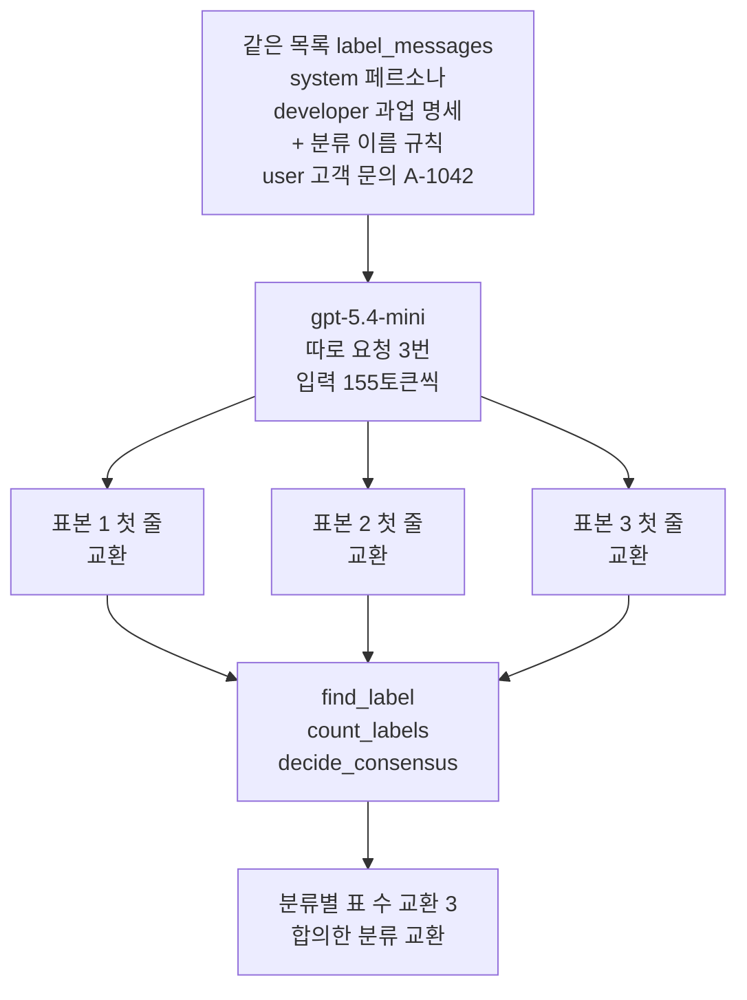
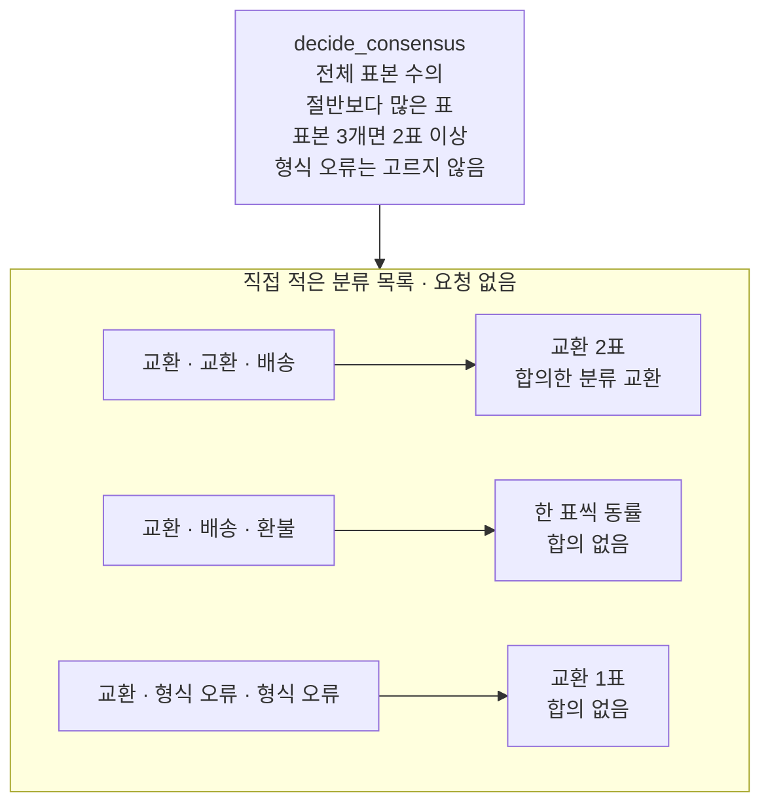
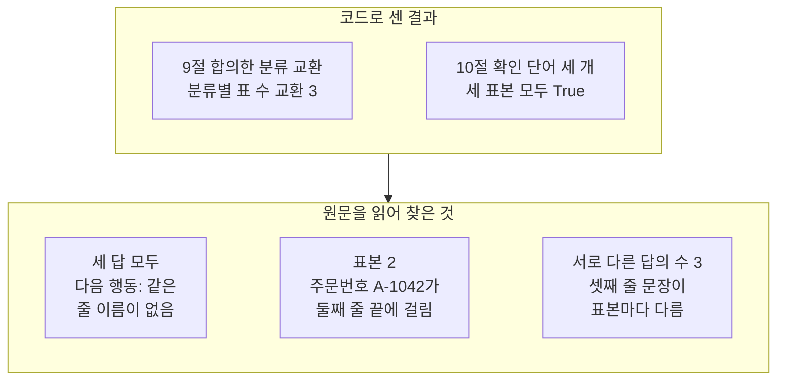
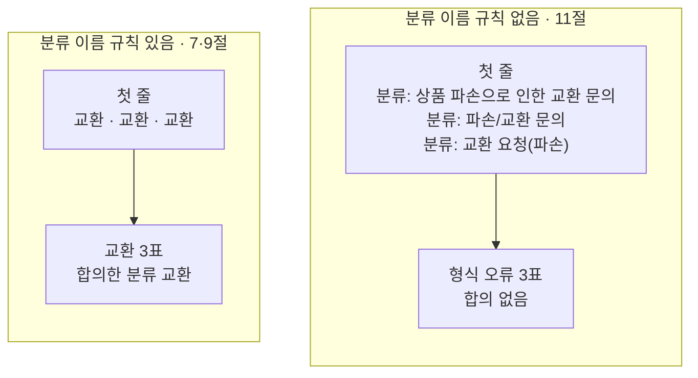

# 06-Self-Consistency와-표본-합의

## _src 본문 (HTML 원본)

```html
<!--meta: 강의 0.5h | 실습 0.5h | 코드 Jupyter Notebook | 새 용어 6 -->
<h2 id="b1"><span class="no">1</span>학습 목표</h2>
<div class="goal"><p>이 절을 마치면 다음을 할 수 있습니다.</p><ul><li>출력 형식에 허용 이름 규칙을 더하고, 같은 목록을 여러 번 따로 보내 기록을 모을 수 있습니다.</li><li>답의 첫 줄에서 분류 이름을 꺼내고, 허용 이름 밖의 답을 형식 오류로 기록할 수 있습니다.</li><li>분류별 표 수를 세고, 엄격 과반으로 합의한 분류나 합의 없음을 정할 수 있습니다.</li><li>합의한 분류와 답 내용을 따로 확인해야 하는 이유를 실행 결과로 설명할 수 있습니다.</li></ul></div>
<h2 id="b2"><span class="no">2</span>이 내용을 배우는 이유</h2>
<p>05절까지는 조건마다 요청을 한 번씩 보냈습니다. 그런데 같은 목록도 실행마다 분류 이름이 달라졌습니다. 03·04·05절에서 모두 본 일입니다.</p>
<p>한 번 받은 답만 보면, 여러 번 보내도 그 분류가 나오는지 알기 어렵습니다. 그래서 같은 요청을 여러 번 보내 답을 모으고, 가장 많이 나온 답을 고르는 방법이 있습니다. 2022년 논문은 이런 방법을 자기 일관성(Self-Consistency)이라고 불렀습니다.</p>
<p>여러 답이 한 분류에 모여도, 그 분류가 맞다는 보장은 없습니다. 답을 세려면 셀 수 있는 모양도 먼저 정해야 합니다. 이 절은 표를 세는 규칙과, 합의가 알려 주지 않는 것을 코드와 원문으로 확인합니다.</p>
<p><strong>이 절의 질문</strong> — 같은 목록을 여러 번 따로 보낸 답을 어떻게 모아 합의를 정하고, 그 합의로 알 수 없는 것은 무엇일까요?</p>
<h2 id="b3"><span class="no">3</span>앞에서 배운 내용</h2>
<table><thead><tr><th>앞 절</th><th>배운 것</th><th>이 절에서 이어지는 곳</th></tr></thead><tbody>
<tr><td>05절</td><td>답만 받는 목록(입력 134토큰), 분류 이름이 실행마다 달라짐, 반복문으로 줄 찾기</td><td>2절 목록, 3절 분류 이름 규칙, 11절 값 바꿔 보기</td></tr>
<tr><td>04절</td><td>대화 기록을 넣으면 앞 답이 다음 요청에 들어감</td><td>7절 앞 답을 넣지 않고 따로 보내기</td></tr>
<tr><td>03절</td><td>한 곳만 다르게 해 비교하기, 첫 줄 끝에 공백 두 칸이 붙은 답</td><td>3절 규칙 한 문장, 4절 <code>strip()</code></td></tr>
<tr><td>02절</td><td>과업 명세 네 글(목표·필수 정보·금지 사항·출력 형식), 줄 나누기 <code>split("\n")</code></td><td>2절 목록, 4절 첫 줄 꺼내기</td></tr>
<tr><td>01절</td><td><code>timed_invoke()</code>·<code>make_prompt_record()</code>, 확인 단어 표시는 품질 점수가 아님</td><td>6·7절 기록, 10절 표시</td></tr>
<tr><td>Ch 6 06절</td><td>요청마다 기록 한 줄, 집합 <code>set()</code>·<code>add()</code></td><td>8절 기록표와 서로 다른 답의 수</td></tr>
<tr><td>Ch 2</td><td>함수 정의와 반환, 딕셔너리 <code>get(키, 기본값)</code>, 빈 목록에 <code>append()</code></td><td>4·5절 함수, 5절 표 세기</td></tr>
</tbody></table>
<p>05절은 <code>timed_invoke()</code>와 <code>make_prompt_record()</code>로 조건마다 기록 한 줄을 만들었습니다. 이 절은 같은 두 함수를 반복문 안에서 불러, 표본마다 기록 한 줄을 모읍니다. 목록은 05절처럼 튜플 목록으로 만듭니다.</p>
<p>개선 전 이 절은 system에 「LABEL: 교환」 모양의 지시를, user에 옛 고객 문의 글 한 덩어리를 넣었습니다. 반복 요청도 한 줄 내포식으로 썼습니다. 이 절은 01~05절 목록 모양을 그대로 두고, 출력 형식에 규칙 한 문장만 더합니다. 요청은 반복문 안에서 보내고, 요청이 모두 끝난 뒤 한꺼번에 출력합니다.</p>
<h2 id="b4"><span class="no">4</span>핵심 개념</h2>
<h3>비유로 시작하기</h3>
<p>02~05절 그림의 나무 책상이 이번에는 한 개입니다. 뒤쪽에는 파란 명찰, 주황 클립보드, 금 간 컵이 그려진 노란 메모지가 놓여 있습니다. 앞쪽에는 모델 답을 뜻하는 연보라 카드가 세 장 있습니다.</p>
<p>반장 선거에서 표를 셀 때는 후보 명단에 있는 이름을 적은 표만 셉니다. 명단에 없는 이름을 적은 표는 무효표로 따로 둡니다. 이 절의 허용 이름과 형식 오류도 같은 방식입니다.</p>
{{img:06-5-세-카드와-조약돌|흰 바탕에 나무 책상 하나가 있고, 뒤쪽에 파란 명찰, 주황 클립보드, 금 간 컵이 그려진 노란 메모지가 놓여 있으며, 앞쪽의 연보라 카드 세 장은 위쪽 가장자리에 같은 짙은 회색 띠가 있고 아래 물결 줄 길이는 카드마다 다르고, 카드마다 나온 점선 실 세 가닥이 책상 앞 바닥의 흰 접시에 모이고 접시에는 같은 회색 조약돌 세 개가 담긴 삽화|세 답 카드의 위쪽 띠는 모두 같고, 카드마다 한 가닥씩 나온 실이 조약돌 세 개가 담긴 접시에 모입니다.}}
<p><strong>그림 읽기</strong> — 파란 명찰은 페르소나(system), 주황 클립보드는 과업 명세(developer)입니다. 노란 컵 메모지는 고객 문의(user)입니다. 연보라 카드 세 장은 같은 목록을 세 번 따로 보내 받은 세 답입니다. 카드 위쪽 가장자리의 짙은 회색 띠는 첫 줄 분류이고, 세 장 모두 같습니다.</p>
<p>띠 아래 물결 줄 두 개는 나머지 답 문장입니다. 물결 줄 길이는 카드마다 조금씩 다르고, 가운데 카드의 둘째 줄이 가장 짧습니다. 카드마다 한 가닥씩 나온 점선 실은 바닥의 흰 접시에 모이고, 접시에는 같은 조약돌이 세 개 있습니다. 조약돌 세 개가 교환 3표이고, 접시로 가지 않는 물결 줄은 표로 세지 않는 답 내용입니다.</p>
<h3>표본과 허용 이름</h3>
<p>표본(sample)은 같은 조건에서 받은 답 한 건입니다. 노트북 7절은 같은 목록을 세 번 따로 보내 표본 세 개를 모읍니다. 요청마다 세 메시지만 보내고, 04절처럼 앞 답을 대화 기록으로 넣지 않습니다.</p>
<p>표를 세려면 답마다 분류 이름 하나를 꺼내야 합니다. 노트북 3절은 출력 형식에 규칙 한 문장을 더합니다. 문장은 「분류 줄에는 배송, 교환, 환불 가운데 한 낱말만 적으세요.」입니다. 이렇게 미리 정한 이름 목록을 허용 이름이라고 부릅니다.</p>
<p>노트북 4절의 <code>find_label()</code> 함수는 답의 첫 줄에서 앞뒤 공백을 지우고, 허용 이름과 같은지 봅니다. 같으면 그 이름을, 아니면 「형식 오류」를 반환합니다. 「분류: 교환 요청(파손)」처럼 뜻이 비슷한 이름도 고쳐 세지 않습니다. 고쳐 세면 형식을 지키지 못한 답이 기록에서 사라지기 때문입니다.</p>
{{mermaid:06-1-세-표본과-합의|초록 상자 같은 목록 label_messages system 페르소나 developer 과업 명세 더하기 분류 이름 규칙 user 고객 문의 A-1042가 보라 상자 gpt-5.4-mini 따로 요청 3번 입력 155토큰씩으로 이어지고, 노란 상자 표본 1 2 3 첫 줄 교환 세 개로 갈라진 뒤 파란 상자 find_label count_labels decide_consensus로 모여 노란 상자 분류별 표 수 교환 3 합의한 분류 교환으로 이어지는 그림|같은 목록을 세 번 따로 보낸 답의 첫 줄이 모두 교환이라, 세 함수로 센 결과는 교환 3표와 합의한 분류 교환이었습니다.}}
<p><strong>도식 읽기</strong> — 위에서 아래로 읽습니다. 맨 위 초록 상자는 분류 이름 규칙을 더한 목록 <code>label_messages</code>입니다. 보라 상자에서 같은 목록을 세 번 따로 보냈고, 세 요청의 입력 토큰 수는 모두 155였습니다.</p>
<p>가운데 노란 상자 셋은 노트북 7절 출력의 세 답 첫 줄로, 모두 교환입니다. 파란 상자는 노트북에서 정의한 세 함수입니다. 맨 아래 노란 상자는 9절 출력의 표 수와 합의한 분류입니다.</p>
<h3>합의와 엄격 과반</h3>
<p>합의(consensus)는 모은 표를 보고 분류 하나를 고르는 규칙입니다. 이 절은 엄격 과반(strict majority)을 씁니다. 전체 표본 수의 절반보다 많은 표를 받은 분류가 있으면, 그 분류가 합의한 분류입니다.</p>
<p>식은 <code>표 수 &gt; 전체 표본 수 / 2</code>입니다. 표본이 3개면 절반은 1.5라서, 2표 이상이어야 합의입니다. 절반은 형식 오류까지 넣은 전체 표본 수로 계산합니다. 형식 오류는 표가 많아도 합의한 분류로 고르지 않습니다.</p>
<p>조건에 맞는 분류가 없으면 「합의 없음」입니다. 표 수가 같은 동률도, 형식 오류가 많은 경우도 여기에 들어갑니다. 노트북 5절은 요청을 보내기 전에, 직접 적은 분류 목록 세 개로 이 규칙을 확인합니다.</p>
{{mermaid:06-2-합의-규칙|위에 파란 상자 decide_consensus 전체 표본 수의 절반보다 많은 표 표본 3개면 2표 이상 형식 오류는 고르지 않음이 있고, 아래 큰 상자 직접 적은 분류 목록 요청 없음 안에서 초록 상자 교환 교환 배송은 노란 상자 교환 2표 합의한 분류 교환으로, 초록 상자 교환 배송 환불은 노란 상자 한 표씩 동률 합의 없음으로, 초록 상자 교환 형식 오류 형식 오류는 노란 상자 교환 1표 합의 없음으로 이어지는 그림|직접 적은 세 목록 가운데 교환이 2표인 목록만 합의한 분류가 교환이고, 동률과 형식 오류가 많은 목록은 합의 없음입니다.}}
<p><strong>도식 읽기</strong> — 맨 위 파란 상자는 <code>decide_consensus()</code> 함수의 규칙입니다. 아래 큰 상자 안에서 초록 상자는 직접 적은 분류 목록이고, 화살표 끝 노란 상자는 노트북 5절 출력입니다.</p>
<p>첫 목록은 교환 2표라 합의한 분류가 교환입니다. 둘째 목록은 세 이름이 한 표씩이라 합의 없음입니다. 셋째 목록은 형식 오류를 빼면 교환만 남지만, 전체 3개 가운데 1표라 합의 없음입니다.</p>
<h3>자기 일관성과 이 절이 따라 한 부분</h3>
<p>2022년 자기 일관성 논문은 05절에서 본 사고의 연쇄 프롬프트로 답을 한 번만 뽑지 않았습니다. 서로 다른 풀이를 여러 개 뽑은 뒤, 최종 답들로 다수결을 했습니다. 논문은 이 방법이 산수·상식 추론 문제의 성적을 올렸다고 보고했습니다.</p>
<p>논문은 풀이를 다양하게 뽑으려고 뽑기 설정을 썼습니다. 예를 들어 두 모델에는 temperature 0.5를 주고, 한 번 실행에 답 40개를 따로 뽑았습니다. 이 노트북은 01~05절과 같은 temperature 0이고, 풀이 없이 분류 줄만 받습니다.</p>
<p>그래서 이 절은 논문 방법 가운데 최종 답을 모아 세는 단계만 따라 합니다. 세 표본은 같은 모델이 같은 목록에 쓴 답이라, 서로 독립된 세 판단이라고 말하지 않습니다. 답을 일부러 다양하게 뽑으려고 temperature를 올린 요청은 이번에 실행하지 않았습니다.</p>
<h3>이 절에서 쓰는 말</h3>
<table><thead><tr><th>용어</th><th>뜻</th><th>이 절에서 보이는 모습</th></tr></thead><tbody>
<tr><td>표본(sample)</td><td>같은 조건에서 받은 답 한 건. 같은 설문지를 따로 받아 온 한 장과 비슷함</td><td><code>표본 1 답:</code></td></tr>
<tr><td>허용 이름</td><td>표를 세기 전에 정해 둔 분류 이름 목록. 선거의 후보 명단과 비슷함</td><td><code>허용 이름: ['배송', '교환', '환불']</code></td></tr>
<tr><td>형식 오류</td><td>첫 줄이 허용 이름과 같지 않은 답을 기록하는 이름. 명단에 없는 이름을 적은 무효표와 비슷함</td><td><code>분류: 교환 요청(파손) | 형식 오류</code></td></tr>
<tr><td>합의(consensus)</td><td>모은 표를 보고 분류 하나를 고르는 규칙과 그 결과</td><td><code>합의한 분류: 교환</code></td></tr>
<tr><td>엄격 과반(strict majority)</td><td>전체 표본 수의 절반보다 많은 표. 동률이나 딱 절반은 합의가 아님</td><td>표본 3개 중 2표 이상</td></tr>
<tr><td>자기 일관성(Self-Consistency)</td><td>풀이를 여러 번 따로 뽑아, 최종 답들로 다수결을 하는 방법(2022년 논문)</td><td>최종 답을 세는 단계만 따라 함</td></tr>
</tbody></table>
<h2 id="b5"><span class="no">5</span>실행 예제</h2>
<p>노트북은 05절 답만 받는 목록을 다시 만들고, 출력 형식에 분류 이름 규칙 한 문장을 더합니다. 분류 이름 꺼내기·표 세기·합의 정하기 함수를 정의하고, 직접 적은 글로 먼저 확인합니다. 그다음 같은 목록을 세 번 따로 보내 기록표와 합의를 봅니다. 마지막으로 규칙 없는 목록을 세 번 보내 비교합니다.</p>
<p>실제 OpenAI 모델을 temperature 0으로 부릅니다. 이 페이지의 출력은 2026-09-17에 실행한 결과입니다. 요청은 모두 6번이고, 예상 비용은 0.01달러 미만입니다. 답 문장은 실행마다 달라질 수 있습니다.</p>
{{notebook:06-Self-Consistency와-표본-합의}}
<p class="look"><b>확인할 점</b> — 5절 셋째 줄 <code>{'교환': 1, '형식 오류': 2} | 합의 없음</code>을 봅니다. 9절 <code>합의한 분류: 교환</code>과 7절 세 답의 원문을 함께 읽습니다. 11절 첫 줄 세 개가 모두 형식 오류인 이유를 찾습니다.</p>
<h3>합의와 답 원문</h3>
<p>노트북 9·10절의 코드 결과와, 7절 원문을 읽어 찾은 것을 한 그림에 모았습니다.</p>
{{mermaid:06-3-합의와-답-원문|위 큰 상자 코드로 센 결과 안에 노란 상자 9절 합의한 분류 교환 분류별 표 수 교환 3과 노란 상자 10절 확인 단어 세 개 세 표본 모두 True가 나란히 있고, 화살표 아래 큰 상자 원문을 읽어 찾은 것 안에 노란 상자 세 답 모두 다음 행동 같은 줄 이름이 없음, 표본 2 주문번호 A-1042가 둘째 줄 끝에 걸림, 서로 다른 답의 수 3 셋째 줄 문장이 표본마다 다름이 나란히 있는 그림|코드로 센 합의와 확인 단어 표시는 세 표본이 같다고 보여 주지만, 원문에는 줄 이름이 빠진 것과 표본마다 다른 문장이 있었습니다.}}
<p><strong>도식 읽기</strong> — 위 「코드로 센 결과」 큰 상자의 노란 상자 둘은 노트북 9절과 10절 출력입니다. 합의한 분류는 교환이고, 확인 단어 세 개는 세 표본 모두 True였습니다. 코드로 센 결과만 보면 세 답 사이에 차이가 없습니다.</p>
<p>아래 「원문을 읽어 찾은 것」 큰 상자는 7절 답을 사람이 읽고 적은 것입니다. 세 답 모두 05절 답에 있던 「다음 행동:」 같은 줄 이름이 없었습니다. 표본 2는 주문번호 A-1042가 둘째 줄 끝에 붙고, 셋째 줄이 「파손 사진과 함께 보내주시면」으로 이어졌습니다. 8절 출력대로 서로 다른 답은 3가지였고, 셋째 줄 문장이 표본마다 달랐습니다.</p>
<p>줄 이름은 규칙 문장을 더한 뒤 빠졌습니다. 탐색 실행 세 답과 앞선 새 커널 실행 세 답에서도 같았습니다. 줄 이름이 없으면 둘째 줄이 다음 행동인지, 고객에게 보낼 문장인지 글만 보고 정하기 어렵습니다.</p>
<h2 id="b6"><span class="no">6</span>실험 결과 해석</h2>
<p>분류 이름 규칙을 더한 목록의 세 답은 첫 줄이 모두 교환이었습니다. 표 수는 교환 3표, 합의한 분류는 교환이었습니다. 세 요청의 입력 토큰은 155씩이고, 출력 토큰은 61·52·63으로 합계 176이었습니다.</p>
<p>표본을 세 개 모으면 요청도 세 번입니다. 요청 세 번의 사용량과 시간을 모두 더한 값이 표본 합의 한 번의 값입니다. 이번 걸린 초 합계는 3.16초였고, 한 번 잰 값이라 속도 비교에 쓰지 않습니다.</p>
<p>합의한 분류가 교환이라는 것은 세 답의 첫 줄이 한 이름에 모였다는 뜻입니다. 고객이 새 상품으로 바꾸고 싶다고 적었으니, 교환은 문의 글과 맞아 보입니다. 그러나 이것은 사람이 문의를 읽고 한 판단이고, 노트북은 분류가 맞는지 판정하지 않았습니다. 같은 목록에 잘못된 규정이 있었다면 세 답이 같은 틀린 분류에 모일 수도 있습니다. 그런 목록은 이번에 실행하지 않았습니다.</p>
<h3>분류 이름 규칙을 빼면</h3>
<p>노트북 11절은 규칙 문장이 없는 05절 목록을 세 번 따로 보냈습니다. 바꾼 것은 보내는 목록 하나입니다.</p>
{{mermaid:06-4-규칙-있음과-없음|왼쪽 큰 상자 분류 이름 규칙 있음 7 9절 안에 노란 상자 첫 줄 교환 교환 교환이 노란 상자 교환 3표 합의한 분류 교환으로 이어지고, 오른쪽 큰 상자 분류 이름 규칙 없음 11절 안에 노란 상자 첫 줄 분류 상품 파손으로 인한 교환 문의, 분류 파손 교환 문의, 분류 교환 요청 파손이 노란 상자 형식 오류 3표 합의 없음으로 이어지는 그림|규칙이 있으면 첫 줄이 모두 교환이라 합의했고, 규칙이 없으면 첫 줄 이름이 세 가지로 달라 모두 형식 오류, 합의 없음이었습니다.}}
<p><strong>도식 읽기</strong> — 왼쪽 큰 상자는 규칙이 있는 목록, 오른쪽 큰 상자는 규칙이 없는 목록입니다. 두 큰 상자 모두 위 노란 상자가 세 답의 첫 줄, 아래 노란 상자가 표 수와 합의 결과입니다.</p>
<p>왼쪽은 첫 줄이 모두 허용 이름 교환이라, 교환 3표로 합의했습니다. 오른쪽은 세 첫 줄이 「분류:」로 시작하고 이름도 셋 다 달라 모두 형식 오류였습니다. 형식 오류는 합의한 분류로 고르지 않으므로 결과는 합의 없음입니다.</p>
<p>세 이름은 모두 교환을 뜻하지만, 글이 달라 이름 그대로는 모을 수 없습니다. 앞선 새 커널 실행에서는 「분류: 파손/교환 문의」가 두 번 나왔습니다. 탐색 실행에서는 「분류: 교환 요청(파손)」이 세 번 같았습니다. 규칙이 없으면 첫 줄이 같게 모이는지도 실행마다 달랐습니다.</p>
<p>규칙이 없는 세 답의 출력 토큰은 103·100·91로, 규칙이 있는 표본보다 많았습니다. 규칙이 있는 답은 줄 이름이 빠지고 문장이 짧았습니다. 이 결론은 고객 문의 하나·모델 하나·목록마다 세 번 실행한 범위입니다.</p>
<h2 id="b7"><span class="no">7</span>주의할 점과 실무 메모</h2>
<ul><li>허용 이름과 꺼내는 규칙은 표를 세기 전에 정합니다. 답을 본 뒤 규칙을 넓히면, 원하는 결과에 맞춰 규칙을 고르게 됩니다.</li>
<li>형식 오류를 가까운 이름으로 고쳐 세지 않습니다. 형식 오류 수도 기록해야 출력 형식을 고칠 근거가 남습니다.</li>
<li>이 절은 동률과 딱 절반을 합의로 치지 않았습니다. 유효한 답만 세어 절반을 정하는 규칙도 있으므로, 어떤 규칙을 썼는지 기록에 함께 적습니다.</li>
<li>표본 수만큼 요청과 요금이 늘어납니다. 이번 세 표본의 출력 토큰 합계는 176이었습니다.</li>
<li>여러 답의 합의는 규정 확인이나 사실 확인을 대신하지 않습니다. 합의한 분류가 있어도 답 원문을 읽습니다.</li>
<li>규칙 문장 「분류 줄에는 배송, 교환, 환불 가운데 한 낱말만 적으세요.」는 흐름을 보여 주려고 정한 예입니다. 교재를 만들 때 기기에서 먼저 규칙 있는 목록과 없는 목록을 세 번씩, 모두 6번 보냈습니다. 탐색에서도 규칙 있는 첫 줄은 모두 교환, 규칙 없는 첫 줄은 모두 「분류:」로 시작해 문구를 바꾸지 않았습니다.</li>
<li>규칙 문장을 더하자 줄 이름도 빠졌습니다. 줄 이름을 남기는 출력 형식 문구는 이번에 실행하지 않았습니다.</li>
<li>요청을 기다리는 반복문 안에서 출력하면 노트북 출력 칸이 여러 개로 나뉩니다. 요청이 모두 끝난 뒤 한꺼번에 출력합니다.</li>
<li>교재 출력은 Linux의 Python 3.12.13으로 만들었습니다. 패키지는 langchain 1.4.0, langchain-core 1.6.2입니다. langchain-openai 1.6.0, openai 3.10.0도 함께 썼습니다. 다른 버전과 Windows·macOS에서는 실행하지 않았습니다.</li></ul>
<h2 id="b8"><span class="no">8</span>정리와 다음 절</h2>
<ul><li>분류 이름 규칙 한 문장을 더하고 같은 목록을 세 번 따로 보내, 교환 3표·합의한 분류 교환을 얻었습니다.</li><li>규칙을 빼자 첫 줄 이름이 세 가지로 달라 모두 형식 오류였고, 합의 없음이었습니다.</li><li>합의는 첫 줄만 센 결과라, 줄 이름이 빠진 것과 문장 차이는 원문으로 확인했습니다.</li></ul>
<p><strong>다음 학습과 이어지는 지점</strong> — 이 절은 답의 첫 줄이 정한 모양인지 코드로 검사했습니다. 07절에서는 답을 JSON 모양으로 요청하고, 프로그램이 그 답을 읽을 수 있는지 따로 확인합니다.</p>
<h2 id="b9"><span class="no">9</span>복습 문제</h2>
<details class="quiz"><summary>문제 1 · 허용 이름</summary><p class="quiz-q">첫 줄 「분류: 교환 요청(파손)」은 교환을 뜻하는데, 노트북은 왜 형식 오류로 기록했나요?</p><p class="quiz-a"><b>해설</b> — 앞뒤 공백을 지운 첫 줄이 허용 이름 「배송」「교환」「환불」 가운데 하나와 같아야 하기 때문입니다. 뜻이 비슷한 이름을 고쳐 세면 형식을 지키지 못한 답이 기록에서 사라집니다.</p></details>
<details class="quiz"><summary>문제 2 · 엄격 과반</summary><p class="quiz-q">분류 목록이 교환·형식 오류·형식 오류이면 합의한 분류는 무엇인가요?</p><p class="quiz-a"><b>해설</b> — 합의 없음입니다. 절반은 전체 표본 수 3의 절반인 1.5이고, 교환은 1표라 절반보다 많지 않습니다. 형식 오류는 2표지만 합의한 분류로 고르지 않습니다.</p></details>
<details class="quiz"><summary>문제 3 · 따로 보내기</summary><p class="quiz-q">세 표본의 요청에 앞 표본의 답이 들어가지 않았다는 것을 코드에서 어떻게 알 수 있나요?</p><p class="quiz-a"><b>해설</b> — 반복문 안에서 매번 같은 <code>label_messages</code>만 <code>timed_invoke()</code>에 넘겼습니다. 04절처럼 앞 답을 대화 기록으로 목록에 넣는 코드가 없습니다.</p></details>
<details class="quiz"><summary>문제 4 · 합의와 원문</summary><p class="quiz-q">합의한 분류가 교환이고 확인 단어 표시가 모두 True였습니다. 그래도 원문을 읽어야 하는 이유는 무엇인가요?</p><p class="quiz-a"><b>해설</b> — 합의는 첫 줄만 세고, 표시는 낱말이 있는지만 봅니다. 원문에서는 세 답 모두 줄 이름이 빠졌고, 표본 2는 문장이 줄을 넘어 이어졌습니다.</p></details>
<details class="quiz"><summary>문제 5 · 자기 일관성</summary><p class="quiz-q">이 노트북을 논문의 자기 일관성 방법 전체라고 부를 수 없는 이유를 두 가지 적어 보세요.</p><p class="quiz-a"><b>해설</b> — 논문은 뽑기 설정으로 서로 다른 풀이를 여러 개 뽑았습니다. 노트북은 temperature 0으로 풀이 없이 분류 줄만 받았습니다. 또 노트북은 표본 3개의 최종 답을 세는 단계만 따라 했습니다.</p></details>
<h2 id="b10"><span class="no">10</span>참고 자료</h2>
<p>문서는 2026-09-17에 다시 열어 확인했습니다. 코드는 실습 가상환경에 설치한 <code>langchain 1.4.0</code>, <code>langchain-core 1.6.2</code>, <code>langchain-openai 1.6.0</code>으로 실행했습니다.</p>
<ul><li><div><a href="https://arxiv.org/abs/2203.11171">Self-Consistency Improves Chain of Thought Reasoning in Language Models</a></div>자기 일관성 논문(2022, 2023 개정판). 최종 답 다수결, 뽑기 설정과 답 40개 · 확인 2026-09-17</li><li><div><a href="https://github.com/langchain-ai/langchain/blob/master/LICENSE">LangChain MIT License</a></div>예제의 고객 문의·출력 형식과 설명은 이 교재에 맞게 새로 썼습니다</li></ul>
```

## 노트북 셀 (순서대로)

### [0] markdown {'html': 'skip'}

# Self Consistency와 표본 합의

**이 노트북에서 할 일**

1. 05절 답만 받는 목록에 분류 이름 규칙 한 문장을 더하고, 같은 목록을 세 번 따로 보냅니다.
2. 세 답의 첫 줄에서 분류 이름을 꺼내 표를 세고, 절반보다 많은 표를 받은 분류를 합의로 정합니다.
3. 합의와 답 내용을 따로 확인하고, 분류 이름 규칙이 없는 목록도 세 번 보내 비교합니다.

**준비물** — 프로젝트 폴더 `.env` 파일의 `OPENAI_API_KEY`가 필요합니다. 데이터 파일은 없습니다.

인터넷 서비스에 요청을 모두 6번 보냅니다. 모두 `gpt-5.4-mini`입니다.
실행 시간은 1분 안팎이고, 예상 비용은 0.01달러 미만으로 잡았습니다.
요금은 Ch 6 06절에서 2026-09-17에 확인한 mini 공식 요금 기준입니다.

**기준 버전** — 실습 폴더에 고정한 패키지 판을 씁니다. langchain 1.4.0, langchain-core 1.6.2, langchain-openai 1.6.0입니다.
openai 3.10.0, python-dotenv 1.2.3도 함께 씁니다.

교재 출력은 Linux의 Python 3.12.13으로 만들었습니다. 다른 버전과 Windows·macOS에서는 이번에 실행하지 않았습니다.

실습 폴더 `labs/part2/ch07-prompt-engineering`에서 `uv sync --locked`를 실행합니다.
그다음 이 폴더의 `.venv` 커널을 고르고 첫 셀부터 순서대로 실행합니다.

### [1] markdown {'html': 'skip'}

## 오늘 볼 그림


위에서 아래로 읽습니다. 맨 위 초록 상자는 분류 이름 규칙 한 문장을 더한 목록입니다.
보라 상자에서 같은 목록을 세 번 따로 보냅니다.

가운데 노란 상자 셋은 세 표본 답의 첫 줄입니다. 파란 상자는 이 노트북에서 정의하는 세 함수입니다.
맨 아래 노란 상자가 표를 센 결과와 합의한 분류이고, 9절에서 확인합니다.

### [2] markdown {}

## 1. 준비

첫 셀은 패키지를 설치하고 설치된 버전을 출력합니다. 설치에는 몇십 초가 걸릴 수 있습니다.
01~05절과 같은 실습 폴더와 같은 판입니다. 노트북은 앞 절 없이 새 커널에서 시작하므로 다시 확인합니다.

### [3] code {'execution': {'iopub.execute_input': '2026-09-17T06:00:32.126695Z', 'iopub.status.busy': '2026-09-17T06:00:32.126548Z', 'iopub.status.idle': '2026-09-17T06:00:32.735448Z', 'shell.execute_reply': '2026-09-17T06:00:32.734883Z'}, 'lesson_role': 'setup'}

```python
# 이 절에서 쓰는 패키지를 설치하고 버전을 확인합니다
%pip install -q "langchain==1.4.0" "langchain-openai==1.6.0" "python-dotenv==1.2.3"
from importlib.metadata import version

print("langchain:", version("langchain"))
print("langchain-core:", version("langchain-core"))
print("langchain-openai:", version("langchain-openai"))
print("openai:", version("openai"))
print("python-dotenv:", version("python-dotenv"))
```

출력:
```
Note: you may need to restart the kernel to use updated packages.
langchain: 1.4.0
langchain-core: 1.6.2
langchain-openai: 1.6.0
openai: 3.10.0
python-dotenv: 1.2.3

```

### [4] markdown {}

**결과 읽기** — 출력 줄은 `langchain: 1.4.0`, `langchain-core: 1.6.2`, `langchain-openai: 1.6.0` 등 다섯 줄입니다.
준비물에 적은 기준 버전과 같습니다.

걸린 시간을 재는 모듈 `time`(Ch 6 05절)과 모델 객체를 만드는 함수를 불러옵니다.

### [5] code {'execution': {'iopub.execute_input': '2026-09-17T06:00:32.736495Z', 'iopub.status.busy': '2026-09-17T06:00:32.736412Z', 'iopub.status.idle': '2026-09-17T06:00:33.081719Z', 'shell.execute_reply': '2026-09-17T06:00:33.081432Z'}, 'lesson_role': 'setup'}

```python
# 시간을 재는 모듈과 모델 객체를 만드는 함수를 불러옵니다
import time

from langchain.chat_models import init_chat_model
```

출력:
```

```

### [6] markdown {}

01~05절과 같은 셀로 API 키가 있는지 확인합니다. 키 값은 출력하지 않고, 있는지만 봅니다.
`True` 값이 나오면 다음으로 넘어갑니다.

### [7] code {'execution': {'iopub.execute_input': '2026-09-17T06:00:33.082565Z', 'iopub.status.busy': '2026-09-17T06:00:33.082502Z', 'iopub.status.idle': '2026-09-17T06:00:33.087329Z', 'shell.execute_reply': '2026-09-17T06:00:33.087005Z'}, 'lesson_role': 'setup'}

```python
# .env 파일에서 OpenAI API 키를 읽습니다(키 값은 출력하지 않습니다)
import os
from dotenv import find_dotenv, load_dotenv

env_path = find_dotenv(usecwd=True)
load_dotenv(env_path)
has_key = os.getenv("OPENAI_API_KEY") is not None
print("OPENAI_API_KEY 설정 여부:", has_key)
assert has_key, "프로젝트 폴더의 .env 파일에 OPENAI_API_KEY를 적어 주세요."
```

출력:
```
OPENAI_API_KEY 설정 여부: True

```

### [8] markdown {}

실습에 쓸 모델을 준비합니다.
01~05절과 같은 설정으로 모델 객체를 만듭니다. 이 셀은 요청을 보내지 않습니다.

### [9] code {'execution': {'iopub.execute_input': '2026-09-17T06:00:33.087846Z', 'iopub.status.busy': '2026-09-17T06:00:33.087783Z', 'iopub.status.idle': '2026-09-17T06:00:33.924429Z', 'shell.execute_reply': '2026-09-17T06:00:33.924051Z'}}

```python
# 실습에 쓸 모델을 준비합니다
model = init_chat_model(
    "openai:gpt-5.4-mini",
    temperature=0,
    reasoning_effort="none",
)
print("모델 이름:", model.model_name)
print("temperature:", model.temperature)
```

출력:
```
모델 이름: gpt-5.4-mini
temperature: 0.0

```

### [10] markdown {}

**결과 읽기** — 출력 줄은 `모델 이름: gpt-5.4-mini`와 `temperature: 0.0`입니다. 이것으로 준비가 끝났습니다.
이 노트북의 출력은 2026-09-17에 이 모델로 실행한 결과입니다. 실행마다 답 문장이 달라질 수 있습니다.
Ch 6 01절에서 본 것처럼 temperature 0은 Ch 5 06절의 뽑기를 끈 설정(`do_sample=False`)과 같은 것이 아닙니다.

인자 `reasoning_effort="none"`도 01~05절과 같습니다. 05절에서는 이 설정의 세 응답 모두 추론 토큰이 0이었습니다.

### [11] markdown {}

## 2. 05절 답만 받는 목록 다시 만들기

05절 답만 받는 목록은 system 페르소나, developer 과업 명세, user 고객 문의 세 메시지였습니다.
과업 명세의 출력 형식은 분류·다음 행동·고객 문장을 한 줄씩 세 줄로 요청합니다.

이 절도 03·05절처럼 튜플 목록으로 만듭니다. 이 목록은 11절 값 바꿔 보기에서 다시 씁니다.

### [12] code {'execution': {'iopub.execute_input': '2026-09-17T06:00:33.925125Z', 'iopub.status.busy': '2026-09-17T06:00:33.925061Z', 'iopub.status.idle': '2026-09-17T06:00:33.927209Z', 'shell.execute_reply': '2026-09-17T06:00:33.926934Z'}}

```python
# 05절과 같은 페르소나 글·고객 문의·과업 명세로 답만 받는 목록을 만듭니다
persona_text = "당신은 친절한 고객 상담원입니다."
inquiry_text = "어제 받은 텀블러 뚜껑이 깨졌습니다. 주문번호는 A-1042입니다. 새 상품으로 바꾸고 싶습니다."
goal_text = "고객 문의를 분류하고 필요한 다음 행동을 안내하세요."
required_text = "회사 규정상 교환 접수에는 파손 사진이 필요합니다. 주문번호는 답에 그대로 적으세요."
forbidden_text = "근거 없는 보상은 약속하지 마세요."
format_text = "분류, 다음 행동, 고객에게 보낼 한 문장을 한 줄씩 세 줄로 답하세요."
task_text = goal_text + "\n" + required_text + "\n" + forbidden_text + "\n" + format_text
answer_messages = [("system", persona_text), ("developer", task_text), ("user", inquiry_text)]
print("과업 명세:")
print(task_text)
print("답만 받는 목록의 메시지 수:", len(answer_messages))
```

출력:
```
과업 명세:
고객 문의를 분류하고 필요한 다음 행동을 안내하세요.
회사 규정상 교환 접수에는 파손 사진이 필요합니다. 주문번호는 답에 그대로 적으세요.
근거 없는 보상은 약속하지 마세요.
분류, 다음 행동, 고객에게 보낼 한 문장을 한 줄씩 세 줄로 답하세요.
답만 받는 목록의 메시지 수: 3

```

### [13] markdown {}

**결과 읽기** — 라벨 줄 `과업 명세:` 아래 네 줄은 05절 답만 받는 목록과 같은 과업 명세입니다.
마지막 줄은 `답만 받는 목록의 메시지 수: 3`입니다.

## 3. 분류 이름 규칙 한 문장 더하기

05절에서 분류 줄의 이름은 실행마다 달랐습니다. 「교환/파손 접수」, 「교환 요청」, 「파손 교환 요청」이었습니다.
이름이 매번 다르면 여러 답의 분류를 모아 셀 수 없습니다.

그래서 출력 형식에 분류 이름 규칙 한 문장을 더합니다. 분류 줄에는 배송·교환·환불 가운데 한 낱말만 적게 합니다.
이렇게 미리 정해 둔 이름 목록을 이 절에서는 허용 이름이라고 부릅니다. 코드에서는 `allowed_labels` 목록입니다.

바꾸는 글은 출력 형식 하나입니다. 마지막 세 줄은 system·user 메시지가 두 목록에서 같은지 확인합니다.

### [14] code {'execution': {'iopub.execute_input': '2026-09-17T06:00:33.927693Z', 'iopub.status.busy': '2026-09-17T06:00:33.927644Z', 'iopub.status.idle': '2026-09-17T06:00:33.929559Z', 'shell.execute_reply': '2026-09-17T06:00:33.929255Z'}}

```python
# 출력 형식에 분류 이름 규칙 한 문장을 더해, 표본을 모을 목록을 만듭니다
allowed_labels = ["배송", "교환", "환불"]
label_format_text = format_text + " 분류 줄에는 배송, 교환, 환불 가운데 한 낱말만 적으세요."
label_task_text = goal_text + "\n" + required_text + "\n" + forbidden_text + "\n" + label_format_text
label_messages = [("system", persona_text), ("developer", label_task_text), ("user", inquiry_text)]
print("바꾼 출력 형식:")
print(label_format_text)
print("허용 이름:", allowed_labels)
same_system_user = answer_messages[0] == label_messages[0] and answer_messages[2] == label_messages[2]
print("system과 user 메시지가 같은가:", same_system_user)
assert same_system_user
```

출력:
```
바꾼 출력 형식:
분류, 다음 행동, 고객에게 보낼 한 문장을 한 줄씩 세 줄로 답하세요. 분류 줄에는 배송, 교환, 환불 가운데 한 낱말만 적으세요.
허용 이름: ['배송', '교환', '환불']
system과 user 메시지가 같은가: True

```

### [15] markdown {}

**결과 읽기** — 라벨 줄 `바꾼 출력 형식:` 아래 줄은 05절 출력 형식 뒤에 규칙 한 문장이 붙은 글입니다.
붙은 문장은 `분류 줄에는 배송, 교환, 환불 가운데 한 낱말만 적으세요.`입니다.
`허용 이름: ['배송', '교환', '환불']` 줄이 코드의 목록입니다. 마지막 줄은 `system과 user 메시지가 같은가: True`입니다.

## 4. 답에서 분류 이름을 꺼내는 함수

여러 답의 분류를 세려면, 답마다 분류 이름 하나를 꺼내는 규칙이 먼저 있어야 합니다.
이 절의 규칙은 이렇습니다. 답의 첫 줄에서 앞뒤 공백을 지운 글이 허용 이름 가운데 하나이면 그 이름을 씁니다.
아니면 「형식 오류」로 적습니다.

글 메서드 `strip()`은 글 앞뒤의 공백과 줄바꿈을 지운 새 글을 반환합니다. 03절에서 첫 줄 끝에 공백 두 칸이 붙은 답을 봤기 때문에 씁니다.
허용 이름과 비슷한 낱말을 가까운 이름으로 고쳐 세지 않습니다. 고쳐 세면 형식을 지키지 않은 답이 기록에서 사라집니다.

`find_label()` 함수는 바깥에서 만든 `allowed_labels` 목록을 읽습니다. 이 셀은 함수를 정의만 하므로 출력이 없습니다.

### [16] code {'execution': {'iopub.execute_input': '2026-09-17T06:00:33.930150Z', 'iopub.status.busy': '2026-09-17T06:00:33.930100Z', 'iopub.status.idle': '2026-09-17T06:00:33.931694Z', 'shell.execute_reply': '2026-09-17T06:00:33.931442Z'}}

```python
# 답 글의 첫 줄이 허용 이름 가운데 하나이면 그 이름을, 아니면 「형식 오류」를 반환하는 함수를 정의합니다
def find_label(answer_text):
    answer_lines = answer_text.split("\n")
    first_line = answer_lines[0].strip()
    found_label = "형식 오류"
    if first_line in allowed_labels:
        found_label = first_line
    return found_label
```

출력:
```

```

### [17] markdown {}

**결과 읽기** — 정의만 하는 셀이라 출력이 없습니다.

요청을 보내기 전에, 직접 적은 답 글 세 개로 함수를 확인합니다. 이 셀은 요청을 보내지 않습니다.
글 속 `\n`은 01절에서 본 줄바꿈입니다. 둘째 글의 첫 줄은 04절 답의 분류 줄과 같은 모양입니다.

실행 전에 예상합니다. 첫 줄 끝에 공백 두 칸이 붙은 첫째 글만 교환이고, 나머지 둘은 형식 오류일 것입니다.

### [18] code {'execution': {'iopub.execute_input': '2026-09-17T06:00:33.932259Z', 'iopub.status.busy': '2026-09-17T06:00:33.932200Z', 'iopub.status.idle': '2026-09-17T06:00:33.934221Z', 'shell.execute_reply': '2026-09-17T06:00:33.933920Z'}}

```python
# 직접 적은 답 글 세 개로 분류 이름 꺼내기를 확인합니다(요청 없음)
spaced_answer = "교환  \n파손 사진을 보내 주세요."
named_answer = "분류: 교환 요청(파손)\n다음 행동: 파손 사진을 받습니다."
other_answer = "반품\n반품 절차를 안내합니다."
spaced_label = find_label(spaced_answer)
named_label = find_label(named_answer)
other_label = find_label(other_answer)
print("공백 두 칸이 붙은 첫 줄:", spaced_label)
print("분류 이름을 붙인 첫 줄:", named_label)
print("허용 이름 밖의 낱말:", other_label)
assert spaced_label == "교환" and named_label == "형식 오류" and other_label == "형식 오류"
```

출력:
```
공백 두 칸이 붙은 첫 줄: 교환
분류 이름을 붙인 첫 줄: 형식 오류
허용 이름 밖의 낱말: 형식 오류

```

### [19] markdown {}

**결과 읽기** — 세 줄은 `공백 두 칸이 붙은 첫 줄: 교환`, `분류 이름을 붙인 첫 줄: 형식 오류`, `허용 이름 밖의 낱말: 형식 오류`입니다.
예상과 같고, `assert`도 통과했습니다.

「분류: 교환 요청(파손)」은 뜻으로는 교환이지만, 이 규칙에서는 형식 오류입니다. 「반품」도 허용 이름에 없어 형식 오류입니다.
규칙을 넓힐지는 표를 세기 전에 정해 둡니다. 답을 본 뒤에 규칙을 바꾸면, 원하는 결과에 맞춰 규칙을 고르게 됩니다.

## 5. 표를 세고 합의를 정하는 함수

꺼낸 분류 이름을 모아 이름마다 표 수를 셉니다. `count_labels()` 함수는 분류 이름 목록을 받아 딕셔너리를 반환합니다.
딕셔너리의 키는 분류 이름이고, 값은 그 이름이 나온 횟수입니다.

딕셔너리 메서드 `get(키, 0)`은 Ch 2에서 배운 대로 키가 없으면 기본값 0을 줍니다. 그 값에 1을 더해 다시 담으면 한 표가 늘어납니다.
이 셀은 함수를 정의만 하므로 출력이 없습니다.

### [20] code {'execution': {'iopub.execute_input': '2026-09-17T06:00:33.934727Z', 'iopub.status.busy': '2026-09-17T06:00:33.934672Z', 'iopub.status.idle': '2026-09-17T06:00:33.936430Z', 'shell.execute_reply': '2026-09-17T06:00:33.936143Z'}}

```python
# 분류 이름 목록을 받아, 이름마다 표 수를 센 딕셔너리를 반환하는 함수를 정의합니다
def count_labels(sample_labels):
    label_counts = {}
    for label in sample_labels:
        label_counts[label] = label_counts.get(label, 0) + 1
    return label_counts
```

출력:
```

```

### [21] markdown {}

**결과 읽기** — 정의만 하는 셀이라 출력이 없습니다.

합의(consensus)는 모은 표를 보고 분류 하나를 고르는 규칙입니다. 이 절은 엄격 과반(strict majority)을 씁니다.
전체 표본 수의 절반보다 많은 표를 받은 분류가 있으면, 그 분류가 합의한 분류입니다. 없으면 「합의 없음」입니다.

절반은 형식 오류까지 넣은 전체 표본 수로 계산합니다. 표본 3개의 절반은 1.5라서, 2표 이상이어야 합의입니다.
「형식 오류」는 표가 많아도 합의한 분류로 고르지 않습니다. 이 셀도 함수를 정의만 하므로 출력이 없습니다.

### [22] code {'execution': {'iopub.execute_input': '2026-09-17T06:00:33.937029Z', 'iopub.status.busy': '2026-09-17T06:00:33.936985Z', 'iopub.status.idle': '2026-09-17T06:00:33.938557Z', 'shell.execute_reply': '2026-09-17T06:00:33.938224Z'}}

```python
# 표 수 딕셔너리와 전체 표본 수로, 절반보다 많은 표를 받은 분류를 반환하는 함수를 정의합니다
def decide_consensus(label_counts, sample_count):
    half_count = sample_count / 2
    consensus_label = "합의 없음"
    for label, count in label_counts.items():
        if label != "형식 오류" and count > half_count:
            consensus_label = label
    return consensus_label
```

출력:
```

```

### [23] markdown {}

**결과 읽기** — 정의만 하는 셀이라 출력이 없습니다.

직접 적은 분류 목록 세 개로 두 함수를 확인합니다. 이 셀도 요청을 보내지 않습니다.
실행 전에 예상합니다. 교환이 두 표인 첫 목록만 교환이고, 나머지 두 목록은 합의 없음일 것입니다.

### [24] code {'execution': {'iopub.execute_input': '2026-09-17T06:00:33.939056Z', 'iopub.status.busy': '2026-09-17T06:00:33.939008Z', 'iopub.status.idle': '2026-09-17T06:00:33.941145Z', 'shell.execute_reply': '2026-09-17T06:00:33.940832Z'}}

```python
# 직접 적은 분류 목록 세 개로 표 세기와 합의 규칙을 확인합니다(요청 없음)
example_lists = [["교환", "교환", "배송"], ["교환", "배송", "환불"], ["교환", "형식 오류", "형식 오류"]]
example_results = []
print("분류 목록 | 분류별 표 수 | 합의한 분류")
for example_labels in example_lists:
    example_counts = count_labels(example_labels)
    example_consensus = decide_consensus(example_counts, len(example_labels))
    example_results.append(example_consensus)
    print(example_labels, "|", example_counts, "|", example_consensus)
assert example_results == ["교환", "합의 없음", "합의 없음"]
```

출력:
```
분류 목록 | 분류별 표 수 | 합의한 분류
['교환', '교환', '배송'] | {'교환': 2, '배송': 1} | 교환
['교환', '배송', '환불'] | {'교환': 1, '배송': 1, '환불': 1} | 합의 없음
['교환', '형식 오류', '형식 오류'] | {'교환': 1, '형식 오류': 2} | 합의 없음

```

### [25] markdown {}

**결과 읽기** — 라벨 줄 아래 첫 줄은 `['교환', '교환', '배송'] | {'교환': 2, '배송': 1} | 교환`입니다.
둘째 줄은 `{'교환': 1, '배송': 1, '환불': 1} | 합의 없음`으로 끝납니다.
셋째 줄은 `{'교환': 1, '형식 오류': 2} | 합의 없음`으로 끝납니다. `assert`도 통과했습니다.

둘째 목록은 세 이름이 한 표씩 같습니다(동률). 앞에 나온 이름을 고르지 않고 합의 없음으로 둡니다.
셋째 목록은 형식 오류를 빼고 보면 교환만 남습니다. 그래도 전체 3개 가운데 1표라 합의가 아닙니다.
유효한 답만 세어 절반을 정하는 규칙도 있을 수 있습니다. 이 절은 형식을 지키지 못한 답도 표본으로 세는 규칙을 골랐습니다.

## 6. 기록을 만드는 함수 두 개

01~05절과 같은 함수 두 개로 요청마다 기록 한 줄을 만듭니다. 먼저 `timed_invoke()` 함수를 정의합니다.
Ch 6 06절과 같은 코드입니다. 요청을 보내면서 걸린 시간을 재고, 응답 객체와 걸린 초를 튜플로 반환합니다.
이 셀은 함수를 정의만 하므로 출력이 없습니다.

### [26] code {'execution': {'iopub.execute_input': '2026-09-17T06:00:33.941654Z', 'iopub.status.busy': '2026-09-17T06:00:33.941610Z', 'iopub.status.idle': '2026-09-17T06:00:33.943435Z', 'shell.execute_reply': '2026-09-17T06:00:33.943090Z'}}

```python
# 모델 객체로 메시지 목록을 보내고, 응답 객체와 걸린 초를 튜플로 반환하는 함수를 정의합니다
def timed_invoke(run_model, input_messages):
    start_time = time.perf_counter()
    run_response = run_model.invoke(input_messages)
    run_elapsed = time.perf_counter() - start_time
    return run_response, run_elapsed
```

출력:
```

```

### [27] markdown {}

**결과 읽기** — 정의만 하는 셀이라 출력이 없습니다.

둘째 함수 `make_prompt_record()`는 01~05절과 같은 코드입니다. 조건 이름·응답 객체·걸린 초로 딕셔너리 한 줄을 만듭니다.
키는 `조건`·`답`·`입력 토큰 수`·`출력 토큰 수`·`끝난 이유`·`걸린 초` 여섯 개입니다.
이 셀도 함수를 정의만 하므로 출력이 없습니다.

### [28] code {'execution': {'iopub.execute_input': '2026-09-17T06:00:33.944029Z', 'iopub.status.busy': '2026-09-17T06:00:33.943986Z', 'iopub.status.idle': '2026-09-17T06:00:33.945485Z', 'shell.execute_reply': '2026-09-17T06:00:33.945189Z'}}

```python
# 조건 이름·응답 객체·걸린 초로 기록 한 줄(딕셔너리)을 만드는 함수를 정의합니다
def make_prompt_record(condition, run_response, run_elapsed):
    run_usage = run_response.usage_metadata
    record = {
        "조건": condition,
        "답": run_response.text,
        "입력 토큰 수": run_usage["input_tokens"],
        "출력 토큰 수": run_usage["output_tokens"],
        "끝난 이유": run_response.response_metadata["finish_reason"],
        "걸린 초": round(run_elapsed, 2),
    }
    return record
```

출력:
```

```

### [29] markdown {}

**결과 읽기** — 정의만 하는 셀이라 출력이 없습니다.

## 7. 같은 목록을 세 번 따로 보내기

같은 목록을 같은 모델로 세 번 보냅니다. 같은 조건에서 받은 답 한 건을 이 절에서는 표본(sample)이라고 부릅니다.
같은 설문지를 세 번 따로 받아 오는 것과 비슷합니다. 다만 세 답을 모두 같은 모델이 씁니다.

요청마다 `label_messages`의 세 메시지만 보냅니다. 04절처럼 앞 답을 대화 기록으로 넣지 않습니다.
그래서 앞 표본의 답은 다음 요청에 들어가지 않습니다.

반복문 안에서는 요청을 보내고 기록을 목록에 모으기만 합니다. 요청을 기다리는 반복문 안에서 출력하면 출력 칸이 여러 개로 나뉩니다.
그래서 답은 요청이 모두 끝난 뒤 다음 셀에서 한꺼번에 출력합니다.

실행 전에 예상합니다. temperature 0이므로 세 답은 서로 비슷하고, 첫 줄은 모두 교환일 것입니다.

### [30] code {'execution': {'iopub.execute_input': '2026-09-17T06:00:33.945949Z', 'iopub.status.busy': '2026-09-17T06:00:33.945901Z', 'iopub.status.idle': '2026-09-17T06:00:37.109068Z', 'shell.execute_reply': '2026-09-17T06:00:37.108018Z'}}

```python
# 같은 목록을 세 번 따로 보내고, 기록을 목록에 모읍니다(요청 3번)
sample_names = ["표본 1", "표본 2", "표본 3"]
sample_records = []
for sample_name in sample_names:
    sample_response, sample_elapsed = timed_invoke(model, label_messages)
    sample_record = make_prompt_record(sample_name, sample_response, sample_elapsed)
    sample_records.append(sample_record)
print("모은 표본 수:", len(sample_records))
```

출력:
```
모은 표본 수: 3

```

### [31] markdown {}

**결과 읽기** — 출력은 `모은 표본 수: 3` 한 줄입니다. 요청 3번이 모두 끝난 뒤에 출력했습니다.

세 표본의 답을 차례로 출력합니다. 표본마다 이름 줄을 먼저 출력하고, 그 아래에 답을 출력합니다.

### [32] code {'execution': {'iopub.execute_input': '2026-09-17T06:00:37.111978Z', 'iopub.status.busy': '2026-09-17T06:00:37.111720Z', 'iopub.status.idle': '2026-09-17T06:00:37.115635Z', 'shell.execute_reply': '2026-09-17T06:00:37.114858Z'}}

```python
# 세 표본의 답을 차례로 출력합니다
for record in sample_records:
    print(record["조건"], "답:")
    print(record["답"])
```

출력:
```
표본 1 답:
교환  
파손 사진을 보내주시면 교환 접수를 도와드리겠습니다.  
주문번호 A-1042, 뚜껑 파손 사진을 첨부해 보내주시면 새 상품 교환 가능 여부를 확인해드리겠습니다.
표본 2 답:
교환  
파손 사진을 보내주시면 교환 접수를 도와드리겠습니다. 주문번호 A-1042  
파손 사진과 함께 보내주시면 새 상품으로 바꾸는 절차를 안내드리겠습니다.
표본 3 답:
교환  
파손 사진을 보내주시면 교환 접수를 도와드리겠습니다.  
고객님, 주문번호 A-1042의 텀블러 뚜껑 파손 건은 사진 확인 후 새 상품 교환 절차를 안내드리겠습니다.

```

### [33] markdown {}

**결과 읽기** — 라벨 줄 `표본 1 답:`·`표본 2 답:`·`표본 3 답:` 아래에 답이 세 줄씩 있습니다. 세 답의 첫 줄은 모두 `교환`입니다.
둘째 줄은 세 답 모두 `파손 사진을 보내주시면 교환 접수를 도와드리겠습니다.`로 시작합니다. 셋째 줄 문장은 표본마다 달랐습니다.

05절 답과 달리 「분류:」·「다음 행동:」 같은 줄 이름이 없습니다. 규칙 문장을 더한 뒤 줄 이름이 빠졌습니다.
표본 2는 둘째 줄 끝에 `주문번호 A-1042`가 붙고, 셋째 줄이 `파손 사진과 함께 보내주시면`으로 이어집니다.
세 답 모두 보상 약속은 없었습니다.

## 8. 기록표와 서로 다른 답의 수

세 기록을 01~05절과 같은 기록표 모양으로 출력합니다. 마지막 두 줄은 세 표본의 출력 토큰 합계와 걸린 초 합계입니다.
표본을 세 개 모으면 요청도 세 번이라, 사용량과 기다리는 시간이 요청 한 번보다 늘어납니다.
실행 전에 예상합니다. 같은 목록을 보냈으므로 세 줄의 입력 토큰 수는 모두 같을 것입니다.

### [34] code {'execution': {'iopub.execute_input': '2026-09-17T06:00:37.117091Z', 'iopub.status.busy': '2026-09-17T06:00:37.116986Z', 'iopub.status.idle': '2026-09-17T06:00:37.120687Z', 'shell.execute_reply': '2026-09-17T06:00:37.119946Z'}}

```python
# 세 기록을 기록표 모양으로 출력하고, 출력 토큰 수와 걸린 초의 합계를 계산합니다
total_output = 0
total_elapsed = 0
print("기록표(조건 | 입력 토큰 수 | 출력 토큰 수 | 끝난 이유 | 걸린 초):")
for record in sample_records:
    print(record["조건"], "|", record["입력 토큰 수"], "|", record["출력 토큰 수"], "|", record["끝난 이유"], "|", record["걸린 초"])
    total_output = total_output + record["출력 토큰 수"]
    total_elapsed = total_elapsed + record["걸린 초"]
print("세 표본 출력 토큰 합계:", total_output)
print("세 표본 걸린 초 합계:", round(total_elapsed, 2))
```

출력:
```
기록표(조건 | 입력 토큰 수 | 출력 토큰 수 | 끝난 이유 | 걸린 초):
표본 1 | 155 | 61 | stop | 1.21
표본 2 | 155 | 52 | stop | 0.99
표본 3 | 155 | 63 | stop | 0.96
세 표본 출력 토큰 합계: 176
세 표본 걸린 초 합계: 3.16

```

### [35] markdown {}

**결과 읽기** — 라벨 줄 아래 세 줄은 `표본 1 | 155 | 61 | stop | 1.21`, `표본 2 | 155 | 52 | stop | 0.99`, `표본 3 | 155 | 63 | stop | 0.96`입니다.
마지막 두 줄은 `세 표본 출력 토큰 합계: 176`과 `세 표본 걸린 초 합계: 3.16`입니다.

예상대로 입력 토큰 수는 세 줄 모두 같습니다. 11절에서 보낼 규칙 없는 목록보다 21개 많고, 더한 규칙 문장의 몫입니다.
출력 토큰 수는 같은 목록인데도 표본마다 달랐습니다. 요청 세 번의 사용량을 모두 더한 값이 표본 합의 한 번의 사용량입니다.
교재를 만들 때 앞선 새 커널 실행에서는 출력 토큰이 63·56·61, 합계 180이었습니다.

세 답이 글자까지 같은지 셉니다. Ch 6 06절에서 쓴 집합 `set()`은 같은 값을 한 번만 담습니다.
답 글을 모두 넣은 뒤 집합의 길이를 보면, 서로 다른 답이 몇 가지인지 알 수 있습니다.

### [36] code {'execution': {'iopub.execute_input': '2026-09-17T06:00:37.122032Z', 'iopub.status.busy': '2026-09-17T06:00:37.121924Z', 'iopub.status.idle': '2026-09-17T06:00:37.124701Z', 'shell.execute_reply': '2026-09-17T06:00:37.124093Z'}}

```python
# 세 표본의 답 글이 몇 가지인지 셉니다
different_answers = set()
for record in sample_records:
    different_answers.add(record["답"])
print("서로 다른 답의 수:", len(different_answers))
```

출력:
```
서로 다른 답의 수: 3

```

### [37] markdown {}

**결과 읽기** — 출력은 `서로 다른 답의 수: 3`입니다. 첫 줄은 모두 교환이지만, 세 답은 글자까지 같지는 않았습니다.
앞선 새 커널 실행도 3이었습니다. 탐색 실행에서는 규칙이 있는 세 답 가운데 두 답이 글자까지 같았습니다.
temperature 0으로 같은 목록을 보내면 비슷한 답이 나오지만, 매번 똑같다고 보장하지 않습니다.

## 9. 분류 이름을 모아 합의 정하기

세 답에서 분류 이름을 꺼내고, 5절의 두 함수로 표를 세어 합의를 정합니다.
마지막 줄의 `assert`는 표본 세 개의 분류 이름을 모두 꺼냈는지만 확인합니다. 어떤 이름인지는 확인하지 않습니다.
실행 전에 예상합니다. 세 표 모두 교환이고, 합의한 분류도 교환일 것입니다.

### [38] code {'execution': {'iopub.execute_input': '2026-09-17T06:00:37.126080Z', 'iopub.status.busy': '2026-09-17T06:00:37.125949Z', 'iopub.status.idle': '2026-09-17T06:00:37.129381Z', 'shell.execute_reply': '2026-09-17T06:00:37.128751Z'}}

```python
# 세 표본의 분류 이름을 꺼내 표를 세고 합의를 정합니다
sample_labels = []
for record in sample_records:
    sample_labels.append(find_label(record["답"]))
label_counts = count_labels(sample_labels)
consensus_label = decide_consensus(label_counts, len(sample_labels))
print("표본 분류:", sample_labels)
print("분류별 표 수:", label_counts)
print("합의한 분류:", consensus_label)
assert len(sample_labels) == len(sample_records)
```

출력:
```
표본 분류: ['교환', '교환', '교환']
분류별 표 수: {'교환': 3}
합의한 분류: 교환

```

### [39] markdown {}

**결과 읽기** — 세 줄은 `표본 분류: ['교환', '교환', '교환']`, `분류별 표 수: {'교환': 3}`, `합의한 분류: 교환`입니다.
세 답의 첫 줄 끝에는 공백 두 칸이 붙어 있었습니다. 그 공백을 `strip()`으로 지운 뒤 허용 이름과 같았고, `assert`도 통과했습니다.

세 표가 모두 교환이라 엄격 과반을 넘었습니다. 다만 세 표는 같은 모델이 같은 목록에 쓴 답입니다.
같은 목록에 잘못된 규정이 있었다면, 세 답이 같은 틀린 분류에 모일 수도 있습니다. 이 경우는 이번에 실행하지 않았습니다.
합의는 표가 한 분류에 모였다는 뜻이고, 그 분류가 맞다는 증거는 아닙니다.

## 10. 합의와 답 내용을 따로 확인하기

합의한 분류가 있다고 답 내용까지 맞는 것은 아닙니다. 합의는 첫 줄의 분류 이름만 세었기 때문입니다.
01절 확인 단어 세 개가 표본마다 답에 있는지 표시합니다. 이 표시도 품질 점수가 아니라, 원문을 읽을 곳을 찾는 도구입니다.

실행 전에 예상합니다. 필수 정보가 사진과 주문번호를 적게 했으므로, 세 답 모두 세 단어가 있을 것입니다.

### [40] code {'execution': {'iopub.execute_input': '2026-09-17T06:00:37.130758Z', 'iopub.status.busy': '2026-09-17T06:00:37.130667Z', 'iopub.status.idle': '2026-09-17T06:00:37.133741Z', 'shell.execute_reply': '2026-09-17T06:00:37.133104Z'}}

```python
# 확인 단어 세 개가 표본마다 답에 있는지 표시합니다
check_words = ["교환", "A-1042", "사진"]
print("확인 단어 | 표본 1·2·3에 있는가")
for word in check_words:
    word_flags = []
    for record in sample_records:
        word_flags.append(word in record["답"])
    print(word, "|", word_flags)
```

출력:
```
확인 단어 | 표본 1·2·3에 있는가
교환 | [True, True, True]
A-1042 | [True, True, True]
사진 | [True, True, True]

```

### [41] markdown {}

**결과 읽기** — 라벨 줄 아래 세 줄은 `교환 | [True, True, True]`, `A-1042 | [True, True, True]`, `사진 | [True, True, True]`입니다.
세 표본 모두 세 단어가 있어, 표시로는 표본 사이의 차이가 보이지 않습니다.

원문을 다시 읽으면 차이가 있습니다. 세 답 모두 줄 이름이 없어, 둘째 줄이 다음 행동인지 고객 문장인지 글만 보고 정하기 어렵습니다.
표본 2는 주문번호가 둘째 줄 끝에 걸려, 셋째 줄만 떼어 읽으면 무엇과 함께 보내라는지 알 수 없습니다.
합의한 분류와 확인 단어 표시가 모두 같아도, 답 모양과 문장은 원문으로 확인합니다.

## 11. 값 바꿔 보기 — 분류 이름 규칙 빼기

바꾸는 값은 보내는 목록 하나입니다. 분류 이름 규칙이 없는 2절 `answer_messages`를 같은 방법으로 세 번 보냅니다.
이 목록은 05절 답만 받는 목록과 같습니다.
실행 전에 예상합니다. 05절처럼 첫 줄이 「분류:」로 시작하므로, 세 답 모두 형식 오류이고 합의 없음일 것입니다.

### [42] code {'execution': {'iopub.execute_input': '2026-09-17T06:00:37.134856Z', 'iopub.status.busy': '2026-09-17T06:00:37.134756Z', 'iopub.status.idle': '2026-09-17T06:00:40.584047Z', 'shell.execute_reply': '2026-09-17T06:00:40.583148Z'}}

```python
# 분류 이름 규칙이 없는 목록을 세 번 따로 보내고, 기록을 목록에 모읍니다(요청 3번)
free_names = ["규칙 없음 1", "규칙 없음 2", "규칙 없음 3"]
free_records = []
for free_name in free_names:
    free_response, free_elapsed = timed_invoke(model, answer_messages)
    free_record = make_prompt_record(free_name, free_response, free_elapsed)
    free_records.append(free_record)
print("모은 표본 수:", len(free_records))
```

출력:
```
모은 표본 수: 3

```

### [43] markdown {}

**결과 읽기** — 출력은 `모은 표본 수: 3` 한 줄입니다. 이번에도 요청 3번이 모두 끝난 뒤에 출력했습니다.

세 답의 첫 줄과, `find_label()` 함수로 꺼낸 분류 이름을 나란히 봅니다.

### [44] code {'execution': {'iopub.execute_input': '2026-09-17T06:00:40.585969Z', 'iopub.status.busy': '2026-09-17T06:00:40.585783Z', 'iopub.status.idle': '2026-09-17T06:00:40.590396Z', 'shell.execute_reply': '2026-09-17T06:00:40.589421Z'}}

```python
# 규칙 없이 받은 세 답의 첫 줄과 꺼낸 분류 이름을 나란히 봅니다
free_labels = []
print("조건 | 첫 줄 | 꺼낸 분류")
for record in free_records:
    answer_lines = record["답"].split("\n")
    free_label = find_label(record["답"])
    free_labels.append(free_label)
    print(record["조건"], "|", answer_lines[0], "|", free_label)
```

출력:
```
조건 | 첫 줄 | 꺼낸 분류
규칙 없음 1 | 분류: 상품 파손으로 인한 교환 문의   | 형식 오류
규칙 없음 2 | 분류: 파손/교환 문의   | 형식 오류
규칙 없음 3 | 분류: 교환 요청(파손) | 형식 오류

```

### [45] markdown {}

**결과 읽기** — 라벨 줄 아래 세 줄의 첫 줄은 `분류: 상품 파손으로 인한 교환 문의`, `분류: 파손/교환 문의`, `분류: 교환 요청(파손)`입니다.
꺼낸 분류는 세 줄 모두 `형식 오류`로, 예상과 같습니다.

세 이름은 모두 교환을 뜻하지만 글이 서로 달라, 이름 그대로 세면 한 표씩 흩어집니다.
앞선 새 커널 실행에서는 「분류: 파손/교환 문의」가 두 번, 「분류: 교환 요청(파손)」이 한 번이었습니다.
탐색 실행에서는 「분류: 교환 요청(파손)」이 세 번 모두 같았습니다. 규칙이 없으면 첫 줄이 같게 모이는지도 실행마다 달랐습니다.

표를 세고 합의를 정한 뒤, 세 답의 사용량과 글자 수를 봅니다. 서로 다른 답의 수도 8절과 같은 방법으로 셉니다.

### [46] code {'execution': {'iopub.execute_input': '2026-09-17T06:00:40.592112Z', 'iopub.status.busy': '2026-09-17T06:00:40.591966Z', 'iopub.status.idle': '2026-09-17T06:00:40.595919Z', 'shell.execute_reply': '2026-09-17T06:00:40.595240Z'}}

```python
# 규칙 없이 받은 세 답의 표를 세고 합의를 정한 뒤, 사용량과 서로 다른 답의 수를 봅니다
free_counts = count_labels(free_labels)
free_consensus = decide_consensus(free_counts, len(free_labels))
print("분류별 표 수:", free_counts)
print("합의한 분류:", free_consensus)
free_answers = set()
print("조건 | 입력 토큰 수 | 출력 토큰 수 | 글자 수")
for record in free_records:
    free_answers.add(record["답"])
    print(record["조건"], "|", record["입력 토큰 수"], "|", record["출력 토큰 수"], "|", len(record["답"]))
print("서로 다른 답의 수:", len(free_answers))
```

출력:
```
분류별 표 수: {'형식 오류': 3}
합의한 분류: 합의 없음
조건 | 입력 토큰 수 | 출력 토큰 수 | 글자 수
규칙 없음 1 | 134 | 103 | 166
규칙 없음 2 | 134 | 100 | 157
규칙 없음 3 | 134 | 91 | 146
서로 다른 답의 수: 3

```

### [47] markdown {}

**결과 읽기** — 첫 두 줄은 `분류별 표 수: {'형식 오류': 3}`과 `합의한 분류: 합의 없음`입니다.
표 라벨 줄 아래 세 줄은 `규칙 없음 1 | 134 | 103 | 166`, `규칙 없음 2 | 134 | 100 | 157`, `규칙 없음 3 | 134 | 91 | 146`입니다.
마지막 줄은 `서로 다른 답의 수: 3`입니다.

형식 오류가 세 표여도 합의한 분류로 고르지 않으므로, 결과는 합의 없음입니다. 입력 토큰 134는 05절 답만 받는 목록과 같습니다.
출력 토큰은 91~103으로, 규칙이 있는 표본의 52~63보다 많았습니다. 규칙이 있는 답은 줄 이름이 없고 문장도 짧았습니다.
앞선 새 커널 실행에서도 출력 토큰이 108·98·70으로, 규칙이 있는 표본보다 많았습니다.

## 실험 결과 해석

분류 이름 규칙 한 문장을 더하자, 세 표본의 첫 줄이 모두 허용 이름 교환이 됐습니다. 표를 세어 교환 3표, 합의한 분류 교환을 얻었습니다.
규칙을 빼자 첫 줄 이름이 세 가지로 달라 모두 형식 오류였고, 합의 없음이었습니다. 표를 세려면 이름과 꺼내는 규칙을 먼저 정해야 합니다.

합의는 첫 줄만 센 결과입니다. 세 답은 글자까지 같지 않았고, 줄 이름이 빠졌으며, 표본 2는 문장이 줄을 넘어 이어졌습니다.
확인 단어 표시도 모두 True라 이 차이를 보여 주지 않았습니다. 답 내용은 원문으로 확인합니다.

세 표본은 같은 모델이 같은 목록에 temperature 0으로 쓴 답입니다. 논문의 자기 일관성은 서로 다른 풀이를 일부러 뽑아 최종 답을 모읍니다.
이 노트북은 그 가운데 최종 답을 세는 단계만 따라 했고, 교환이 맞는 분류인지는 판정하지 않았습니다.
이 결론은 고객 문의 하나·모델 하나·목록마다 세 번 실행한 범위입니다. 걸린 초 합계는 한 번 잰 값이라 속도 비교에 쓰지 않습니다.

## 정리

- 분류 이름 규칙 한 문장을 더하고 같은 목록을 세 번 따로 보내, 교환 3표·합의한 분류 교환을 얻었습니다.
- 규칙을 빼자 첫 줄 이름이 세 가지로 달라 모두 형식 오류였고, 합의 없음이었습니다.
- 합의는 첫 줄만 센 결과라, 줄 이름이 빠진 것과 문장 차이는 원문으로 확인했습니다.

다음 07절에서는 답을 JSON 모양으로 요청하고, 프로그램이 그 답을 읽을 수 있는지 따로 확인합니다.

## 그림

### 06-1-세-표본과-합의.mmd



- 설명 대상 문장: 같은 목록을 세 번 따로 보낸 답의 첫 줄에서 분류 이름을 꺼내 표를 세고, 절반보다 많은 표를 받은 분류를 합의로 정합니다.
- 캡션: 같은 목록을 세 번 따로 보낸 답의 첫 줄이 모두 교환이라, 세 함수로 센 결과는 교환 3표와 합의한 분류 교환이었습니다.
- 읽는 법: 맨 위 초록 상자 = 노트북 3절 `label_messages`(system 페르소나, developer 과업 명세 + 분류 이름 규칙, user 고객 문의). 보라 상자 = 7절 같은 목록을 따로 요청 3번, 8절 기록표 입력 토큰 `155` 세 줄. 노란 상자 셋 = 7절 출력 세 답의 첫 줄 `교환`(끝 공백 두 칸은 그림에 적지 않음). 파란 상자 = 4·5절에서 정의한 `find_label`·`count_labels`·`decide_consensus`. 맨 아래 노란 상자 = 9절 `분류별 표 수: {'교환': 3}`·`합의한 분류: 교환`. 방향 TB.
- alt: 초록 상자 같은 목록 label_messages system 페르소나 developer 과업 명세 더하기 분류 이름 규칙 user 고객 문의 A-1042가 보라 상자 gpt-5.4-mini 따로 요청 3번 입력 155토큰씩으로 이어지고, 노란 상자 표본 1 2 3 첫 줄 교환 세 개로 갈라진 뒤 파란 상자 find_label count_labels decide_consensus로 모여 노란 상자 분류별 표 수 교환 3 합의한 분류 교환으로 이어지는 그림

### 06-2-합의-규칙.mmd



- 설명 대상 문장: 전체 표본 수의 절반보다 많은 표를 받은 분류가 있으면 합의한 분류이고, 동률이나 형식 오류가 많은 경우는 합의 없음입니다.
- 캡션: 직접 적은 세 목록 가운데 교환이 2표인 목록만 합의한 분류가 교환이고, 동률과 형식 오류가 많은 목록은 합의 없음입니다.
- 읽는 법: 맨 위 파란 상자 = 5절 `decide_consensus()` 규칙(절반 = 전체 표본 수 / 2, 형식 오류는 고르지 않음). 아래 큰 상자 「직접 적은 분류 목록 · 요청 없음」 안 초록 상자 = 5절 `example_lists` 세 목록, 노란 상자 = 5절 출력 `{'교환': 2, '배송': 1} | 교환`, `{'교환': 1, '배송': 1, '환불': 1} | 합의 없음`, `{'교환': 1, '형식 오류': 2} | 합의 없음`. 방향 TB, 큰 상자 안은 한 줄씩 왼쪽 목록 → 오른쪽 결과.
- alt: 위에 파란 상자 decide_consensus 전체 표본 수의 절반보다 많은 표 표본 3개면 2표 이상 형식 오류는 고르지 않음이 있고, 아래 큰 상자 직접 적은 분류 목록 요청 없음 안에서 초록 상자 교환 교환 배송은 노란 상자 교환 2표 합의한 분류 교환으로, 초록 상자 교환 배송 환불은 노란 상자 한 표씩 동률 합의 없음으로, 초록 상자 교환 형식 오류 형식 오류는 노란 상자 교환 1표 합의 없음으로 이어지는 그림

### 06-3-합의와-답-원문.mmd



- 설명 대상 문장: 합의한 분류와 확인 단어 표시가 모두 같아도, 답 모양과 문장은 원문으로 확인합니다.
- 캡션: 코드로 센 합의와 확인 단어 표시는 세 표본이 같다고 보여 주지만, 원문에는 줄 이름이 빠진 것과 표본마다 다른 문장이 있었습니다.
- 읽는 법: 위 큰 상자 「코드로 센 결과」 = 9절 `합의한 분류: 교환`·`분류별 표 수: {'교환': 3}`, 10절 `교환 | [True, True, True]` 등 세 줄. 아래 큰 상자 「원문을 읽어 찾은 것」 = 7절 출력을 사람이 읽은 판단: 세 답 모두 「분류:」「다음 행동:」 줄 이름 없음, 표본 2 둘째 줄 끝 `주문번호 A-1042`와 셋째 줄 `파손 사진과 함께 보내주시면`, 8절 `서로 다른 답의 수: 3`과 셋째 줄 문장 차이. 모두 출력으로 확인한 값·원문 판단이라 노랑. 방향 TB, 큰 상자 안은 왼쪽부터.
- alt: 위 큰 상자 코드로 센 결과 안에 노란 상자 9절 합의한 분류 교환 분류별 표 수 교환 3과 노란 상자 10절 확인 단어 세 개 세 표본 모두 True가 나란히 있고, 화살표 아래 큰 상자 원문을 읽어 찾은 것 안에 노란 상자 세 답 모두 다음 행동 같은 줄 이름이 없음, 표본 2 주문번호 A-1042가 둘째 줄 끝에 걸림, 서로 다른 답의 수 3 셋째 줄 문장이 표본마다 다름이 나란히 있는 그림

### 06-4-규칙-있음과-없음.mmd



- 설명 대상 문장: 규칙을 빼자 첫 줄 이름이 세 가지로 달라 모두 형식 오류였고, 합의 없음이었습니다.
- 캡션: 규칙이 있으면 첫 줄이 모두 교환이라 합의했고, 규칙이 없으면 첫 줄 이름이 세 가지로 달라 모두 형식 오류, 합의 없음이었습니다.
- 읽는 법: 왼쪽 큰 상자 「분류 이름 규칙 있음 · 7·9절」 = 9절 `표본 분류: ['교환', '교환', '교환']`·`합의한 분류: 교환`. 오른쪽 큰 상자 「분류 이름 규칙 없음 · 11절」 = 11절 첫 줄 `분류: 상품 파손으로 인한 교환 문의`·`분류: 파손/교환 문의`·`분류: 교환 요청(파손)`, 꺼낸 분류 `형식 오류` 세 줄, `분류별 표 수: {'형식 오류': 3}`·`합의한 분류: 합의 없음`. 방향 LR(큰 상자 둘 나란히), 큰 상자 안은 TB. 형식 오류는 받아 기록한 결과라 노랑(빨강 아님).
- alt: 왼쪽 큰 상자 분류 이름 규칙 있음 7 9절 안에 노란 상자 첫 줄 교환 교환 교환이 노란 상자 교환 3표 합의한 분류 교환으로 이어지고, 오른쪽 큰 상자 분류 이름 규칙 없음 11절 안에 노란 상자 첫 줄 분류 상품 파손으로 인한 교환 문의, 분류 파손 교환 문의, 분류 교환 요청 파손이 노란 상자 형식 오류 3표 합의 없음으로 이어지는 그림

### 06-5-세-카드와-조약돌.prompt.md

# 삽화 — 06-5 세 카드와 조약돌

- 상태: 2026-09-17 생성·검수 통과(1회 생성). 모델 nano_banana_pro(서버 표기 nano_banana_2), 16:9, 2k(2752×1536), 장당 2크레딧, 합계 2크레딧(생성 전 잔액 2856). 채택 job f134b0a1-82ba-4a1a-857d-d147db3c52a8. 클라우드 `/mnt/user-data/outputs` 대신 기기 셸 `curl`로 받아 `uv run --no-project --with pillow`(`/tmp/ch07-01/resize.py`)로 폭 1100px(1100×614) 저장. 원본 SHA-256 `2b940f5c8a32033f0cb1291be2c3e3ea51fa699dc04dcbc4ab2ff3defa71486b`. 채택 job 결과 원본을 같은 폭으로 줄여 저장 PNG와 픽셀 대조(`/tmp/ch07-01/cmp.py`), 차이 0(bbox 없음).
- 검수 메모(저장 파일 기준): 흰 바탕, 연한 나무 책상 하나. 뒤쪽 왼쪽부터 파란 명찰(클립, 글자 없음), 주황 클립보드(회색 물결 줄 네 줄), 금 간 컵 노란 메모지. 앞쪽 연보라 카드 세 장, 카드마다 위쪽 가장자리에 같은 짙은 회색 띠와 아래 물결 줄 두 줄(길이 조금씩 다름, 가운데 카드 둘째 줄이 가장 짧음). 카드 아래 가운데에서 점선 실 세 가닥이 바닥 흰 접시로 모이고, 접시에 같은 조약돌 세 개. 글자·숫자·사람·손·화면·화살표 없음. 그림만 보고 「같은 모양 답 카드 세 장이 한 장에 한 가닥씩 접시에 조약돌 하나를 보태 세 개가 모였다」가 읽힘. 약점: 실이 프롬프트와 달리 짙은 띠가 아니라 카드 아래 가장자리에서 나옴 → 「첫 줄만 센다」는 띠가 세 장 모두 같다는 점과 그림 읽기 문장으로 보강. 띠가 카드 안 줄이 아니라 위쪽 가장자리 꼬리표처럼 보임 → 그림 읽기에서 「위쪽 가장자리의 짙은 회색 띠」로 부름. 컵은 뚜껑 금이 아니라 컵 몸통에 번개 모양 금.
- 설명 대상 문장: 반장 선거에서 표를 셀 때는 후보 명단에 있는 이름을 적은 표만 셉니다. 이 절의 허용 이름과 형식 오류도 같은 방식입니다.
- 넣을 자리: 06절 핵심 개념 「비유로 시작하기」 둘째 단락 바로 아래
- 구성 요소와 배치: 책상 뒤쪽 입력 물건 셋(한 목록) → 앞쪽 답 카드 세 장(표본 셋, 같은 띠 = 같은 첫 줄 분류, 다른 물결 줄 = 다른 문장) → 실 세 가닥 → 조약돌 세 개 담긴 접시(교환 3표)
- 시선 순서: 한 책상의 입력 물건 → 같은 모양 카드 세 장 → 세 장이 같은 띠 → 실이 모인 접시와 조약돌 세 개
- 앞 절·앞 챕터와 이어짐: 02-5~05-5 삽화의 나무 책상과 색 약속(파란 명찰 = system, 주황 클립보드 = developer, 노란 메모지 = user, 연보라 = 모델 답)을 이어 씀. 05-5 초록 형광 줄(근거 줄)·점선 실(근거 대조)은 06에서 초록 없이 짙은 회색 띠와 표 모으는 실로 뜻이 바뀌어 그림 읽기에 적음. Ch 5·Ch 6 「쟁반」, Ch 4 「카드 꽂이」, Ch 6 02-5 「우편함」, Ch 6 03 「양식」·「칸(필드)」, 04 「투명 봉투」는 쓰지 않음. 값 바꿔 보기(규칙 없음)는 그림에 넣지 않음(06-4 도식).
- 대응: 06-1 도식(세 표본과 합의), 06-3 도식(합의와 답 원문).

## 프롬프트 (채택본)

Simple flat educational illustration, white background, limited soft palette, clean outlines, plain everyday objects, no text, no letters, no numbers, no logos.
View from slightly above and in front of one small plain light wooden desk in the center of the image, with white space around it.
Along the back of the desk, in this order from left to right: one light blue rectangular badge with a small clip and a plain smooth face, one light orange clipboard holding a white sheet with four rows of short gray wavy lines, and one pale yellow sticky note showing a tiny simple drawing of a tumbler whose lid has a crack.
At the front of the desk lie exactly three identical pale lavender cards side by side in one row, with a small gap between the cards.
Every lavender card has the same top line: one short thick dark gray bar that looks exactly the same on all three cards.
Below that bar every card has two thin gray wavy lines, and their lengths are clearly different on each card: the left card has two long lines, the middle card has one long and one very short line, the right card has two medium lines.
On the floor in front of the desk, centered, sits one small round white shallow dish holding exactly three identical small dark gray round pebbles.
From the thick top bar of each lavender card, one thin dashed dark gray thread runs down over the desk edge and ends touching the white dish, so three threads meet at the dish. No threads start from the thin wavy lines.
No people, no hands, no monitors, no screens, no computers, no arrows, no robots, no brains, no gears, no magnifying glass, no envelopes, no trays, no labels, no signs, no writing, no check marks, no other objects.

