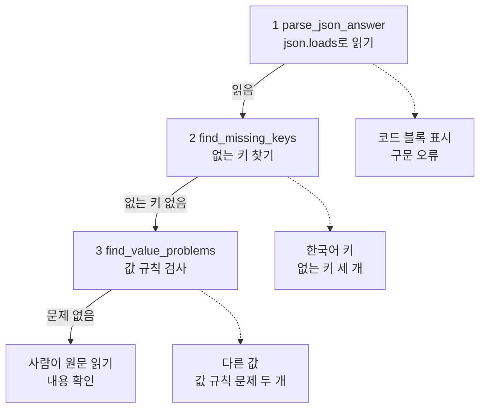
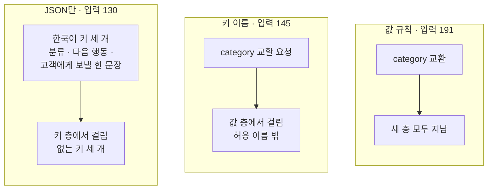
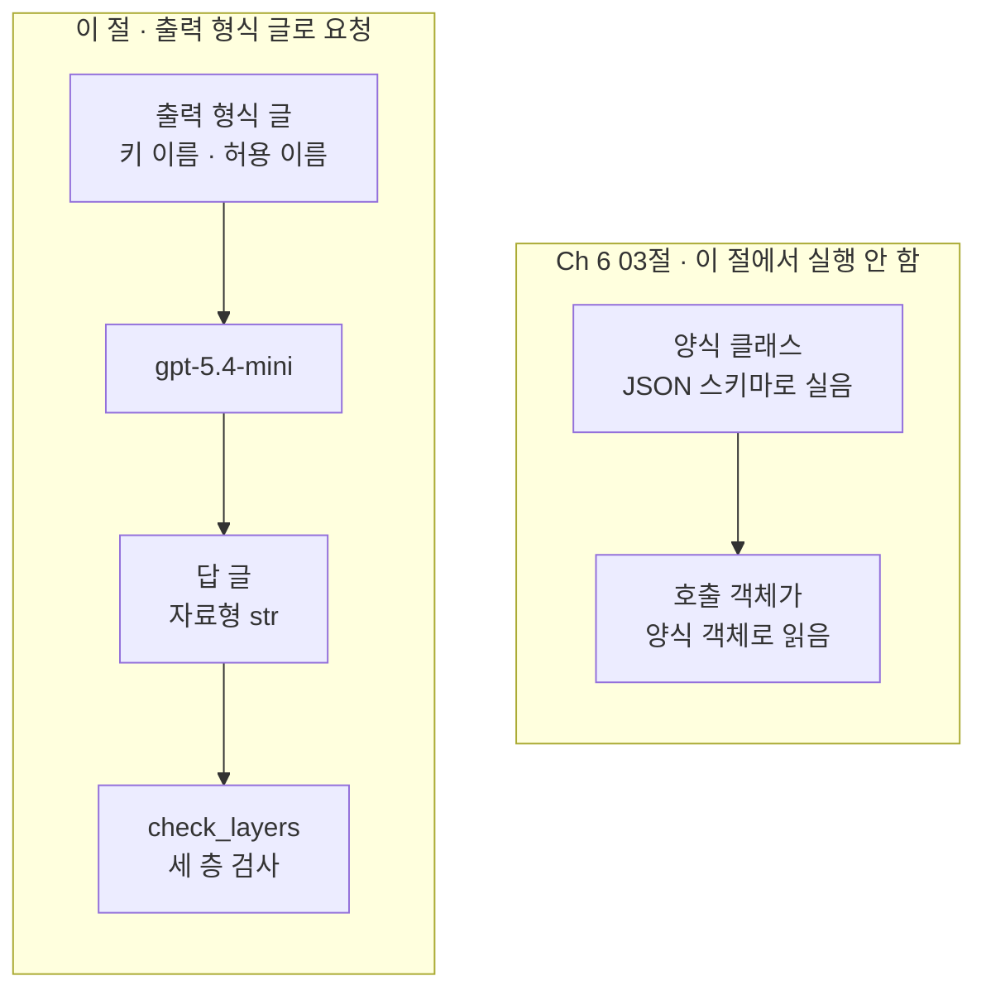
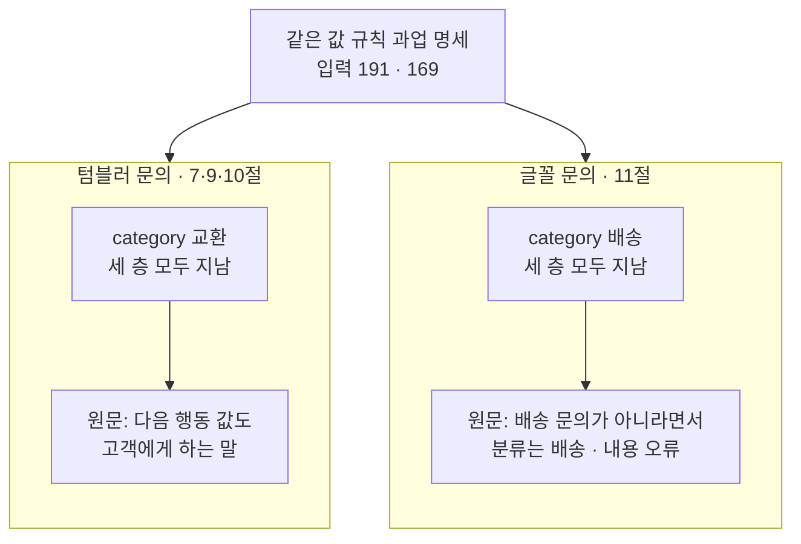

# 07-구조화-출력-프롬프트-진단

## _src 본문 (HTML 원본)

```html
<!--meta: 강의 0.5h | 실습 0.5h | 코드 Jupyter Notebook | 새 용어 6 -->
<h2 id="b1"><span class="no">1</span>학습 목표</h2>
<div class="goal"><p>이 절을 마치면 다음을 할 수 있습니다.</p><ul><li>과업 명세의 출력 형식 한 글만 바꿔, JSON으로 답하게 하는 요청을 만들 수 있습니다.</li><li>함수 <code>json.loads()</code>로 답 글을 읽고, 읽지 못한 답을 구문 오류로 기록할 수 있습니다.</li><li>없는 키와 값 규칙 문제를 찾는 함수로 답을 층마다 검사할 수 있습니다.</li><li>세 층을 지난 답도 내용을 원문으로 확인해야 하는 이유를 실행 결과로 설명할 수 있습니다.</li></ul></div>
<h2 id="b2"><span class="no">2</span>이 내용을 배우는 이유</h2>
<p>06절까지는 답을 사람이 읽거나, 첫 줄 한 줄만 코드로 검사했습니다. 답을 다른 프로그램이 이어 받아 쓰려면, 값마다 이름이 붙은 모양으로 받는 편이 좋습니다. 그래서 출력 형식에 「JSON으로 답하세요」라고 적는 경우가 많습니다.</p>
<p>그런데 답 글이 JSON으로 읽힌다고 프로그램이 그 답을 쓸 수 있는 것은 아닙니다. 프로그램이 찾는 키 이름이 없을 수 있고, 값이 정해 둔 이름 밖일 수도 있습니다. 모양이 모두 맞아도 내용이 업무와 맞지 않을 수 있습니다.</p>
<p><strong>이 절의 질문</strong> — 출력 형식 글로 JSON 답을 요청했을 때, 프로그램이 그 답을 쓸 수 있는지 어떤 순서로 확인해야 할까요?</p>
<h2 id="b3"><span class="no">3</span>앞에서 배운 내용</h2>
<table><thead><tr><th>앞 절</th><th>배운 것</th><th>이 절에서 이어지는 곳</th></tr></thead><tbody>
<tr><td>06절</td><td>허용 이름 <code>allowed_labels</code>, 허용 이름 밖의 답은 형식 오류로 기록, 반복문 안에서는 요청만 보내기</td><td>3절 category 허용 이름, 5절 값 규칙 검사, 7절 요청</td></tr>
<tr><td>05절</td><td>튜플 목록을 <code>for</code>로 풀어 조건마다 요청하기</td><td>7절 세 목록 보내기</td></tr>
<tr><td>03절</td><td>한 곳만 다르게 해 비교하기, 관련 없는 예시 「뉴스레터 글꼴을 바꾸고 싶습니다.」</td><td>3절 출력 형식 한 글만 바꾸기, 11절 글꼴 문의</td></tr>
<tr><td>02절</td><td>과업 명세 네 글(목표·필수 정보·금지 사항·출력 형식)</td><td>2·3절 목록</td></tr>
<tr><td>01절</td><td><code>timed_invoke()</code>·<code>make_prompt_record()</code>, 확인 단어 표시는 품질 점수가 아님</td><td>6·7절 기록, 10절 표시</td></tr>
<tr><td>Ch 6 06절</td><td><code>json</code> 모듈로 기록 파일 읽기</td><td>4절 <code>json.loads()</code></td></tr>
<tr><td>Ch 6 03절</td><td>양식 클래스와 <code>with_structured_output()</code>, 파싱, JSON 스키마</td><td>핵심 개념 「Ch 6 03절 양식 클래스와 다른 점」</td></tr>
<tr><td>Ch 6 01절</td><td><code>type(값).__name__</code>, 오류를 받아 이름과 메시지 출력하기</td><td>4·5절 자료형 이름과 구문 오류</td></tr>
</tbody></table>
<p>06절은 답의 첫 줄에서 분류 이름을 꺼내, 허용 이름이 아니면 형식 오류로 기록했습니다. 이 절은 같은 생각을 JSON 답 전체로 넓힙니다. 목록은 05·06절처럼 튜플 목록이고, 과업 명세의 출력 형식 한 글만 바꿉니다.</p>
<p>개선 전 이 절의 system에는 「고객 지원 데이터를 만듭니다.」가 있었습니다. user에는 JSON 지시와 옛 고객 문의 글을 한 덩어리로 넣었습니다. 키 검사는 한 줄 내포식으로 썼고, 결과는 영어 키로 한꺼번에 출력했습니다. 이 절은 01~06절 목록 모양을 그대로 두고, 검사를 층마다 함수 하나로 나눕니다. 개선 전 본문이 말로만 적은 코드 블록 표시와 배열도 직접 적은 글로 실행합니다.</p>
<h2 id="b4"><span class="no">4</span>핵심 개념</h2>
<h3>비유로 시작하기</h3>
<p>02~06절 그림의 나무 책상이 이번에도 한 개입니다. 책상 뒤에는 파란 명찰, 주황 클립보드, 금 간 컵이 그려진 노란 메모지가 있습니다. 책상 앞쪽에는 회색 길이 놓여 있고, 길을 가로질러 나무 문 세 개가 서 있습니다.</p>
<p>택배 접수대에서는 먼저 상자가 잘 봉해졌는지 봅니다. 다음에는 송장에 받는 사람과 주소가 적혔는지 보고, 그다음에는 배달하는 지역인지 봅니다. 그래도 상자 안 물건이 주문한 것인지는 열어 봐야 압니다. 이 절의 세 층 검사와 원문 읽기도 같은 순서입니다.</p>
{{img:07-5-세-문과-카드|흰 바탕에 나무 책상 하나가 있고, 책상 뒤 위쪽에 파란 명찰, 주황 클립보드, 금 간 컵이 그려진 노란 메모지가 있으며, 책상 앞쪽 회색 길을 나무 문 세 개가 가로지르고, 첫째 문 앞에는 카드가 없고, 첫째와 둘째 문 사이와 둘째와 셋째 문 사이에 연보라 카드가 한 장씩 누워 있고, 셋째 문을 지난 연보라 카드 위에 돋보기가 놓인 삽화|연보라 답 카드 세 장은 지난 문의 수가 다르고, 셋째 문까지 지난 카드만 돋보기로 내용을 읽습니다.}}
<p><strong>그림 읽기</strong> — 파란 명찰은 페르소나(system), 주황 클립보드는 과업 명세(developer)입니다. 노란 컵 메모지는 고객 문의(user)입니다. 세 물건은 책상 위가 아니라 책상 뒤 위쪽에 그려졌습니다. 길 위의 나무 문 세 개는 왼쪽부터 JSON 읽기, 키, 값 규칙 층입니다.</p>
<p>연보라 카드 세 장은 노트북 7절에서 받은 세 답입니다. 첫째 문 앞에는 카드가 없습니다. 세 답 모두 JSON으로 읽혔기 때문입니다.</p>
<p>첫째와 둘째 문 사이에 누운 카드는 키 층에서 걸린 「JSON만」 답입니다. 둘째와 셋째 문 사이 카드는 값 층에서 걸린 「키 이름」 답입니다. 셋째 문을 지난 카드는 「값 규칙」 답이고, 그 위의 돋보기는 사람이 원문을 읽는 단계입니다.</p>
<h3>JSON 답과 세 층 검사</h3>
<p>이 절에서 요청하는 JSON 글은 딕셔너리와 비슷한 모양으로 값을 적은 글입니다. 함수 <code>json.loads()</code>는 JSON 글을 받아 Python 값을 반환합니다. JSON 객체는 딕셔너리, JSON 배열은 목록이 됩니다. 읽지 못하면 오류 <code>json.JSONDecodeError</code>가 납니다.</p>
<p>노트북 4절은 키 세 개가 맞는 글 앞뒤에 코드 블록 표시(백틱 세 개)를 붙여 읽습니다. 결과는 <code>Expecting value: line 1 column 1 (char 0)</code>였습니다. 첫 글자가 JSON 값의 시작이 아니어서 읽지 못한 것입니다. 뜻이 같은 답이어도 글 모양이 조금 다르면 프로그램은 읽지 못합니다.</p>
<p>그래서 답을 세 층으로 나눠 차례로 봅니다. 첫 층은 JSON으로 읽을 수 있는지, 둘째 층은 필요한 키가 모두 있는지입니다. 셋째 층은 값이 정한 규칙을 지키는지입니다. 이 절의 값 규칙은 필요한 키의 값이 글인지와, category 값이 허용 이름인지 두 가지입니다.</p>
<p>세 층을 지나도 끝이 아닙니다. 코드는 모양만 봤으므로, 답 내용이 업무와 맞는지는 사람이 원문을 읽고 판단합니다. 모양은 맞지만 업무와 맞지 않는 답을 이 절에서는 내용 오류라고 부릅니다.</p>
{{mermaid:07-1-네-층-검사|위에서 아래로 파란 상자 1 parse_json_answer json.loads로 읽기, 2 find_missing_keys 없는 키 찾기, 3 find_value_problems 값 규칙 검사, 사람이 원문 읽기 내용 확인이 읽음, 없는 키 없음, 문제 없음 화살표로 계단처럼 이어지고, 앞 세 파란 상자에서 점선이 노란 상자 코드 블록 표시 구문 오류, 한국어 키 없는 키 세 개, 다른 값 값 규칙 문제 두 개로 갈라지는 그림|직접 적은 글은 코드 블록 표시가 첫 층, 한국어 키가 둘째 층, 다른 값이 셋째 층에서 걸리고, 세 층을 지난 답만 원문 읽기로 갑니다.}}
<p><strong>도식 읽기</strong> — 위에서 아래로 읽습니다. 파란 상자 셋은 노트북 5절에서 정의한 검사 함수이고, 화살표 글자는 다음 층으로 내려가는 조건입니다. 맨 아래 파란 상자는 세 층을 지난 답을 사람이 읽는 단계입니다.</p>
<p>점선 끝의 노란 상자는 노트북 5절에서 직접 적은 글이 걸린 층입니다. 코드 블록 표시 글은 구문 오류로 첫 층에서 걸렸습니다. 한국어 키 글은 없는 키 세 개로 둘째 층에서, 다른 값 글은 값 규칙 문제 두 개로 셋째 층에서 걸렸습니다. 그림에 없는 배열 글은 읽었지만 딕셔너리가 아니라서 키 검사를 하지 않았습니다.</p>
<h3>출력 형식 글 세 단계</h3>
<p>노트북 3절은 06절 과업 명세의 출력 형식 한 글만 세 가지로 바꿉니다. 「JSON만」은 분류·다음 행동·고객 문장을 JSON으로 답하라고만 적습니다. 「키 이름」은 키 이름 category·next_action·customer_message를 더합니다.</p>
<p>「값 규칙」은 여기에 두 문장을 더합니다. 첫 문장은 category 값의 허용 이름과 값의 자료형입니다. 둘째 문장은 코드 블록 표시나 설명 글 없이 JSON 객체 하나만 적으라는 문장입니다. 허용 이름 배송·교환·환불은 06절과 같습니다.</p>
<h3>Ch 6 03절 양식 클래스와 다른 점</h3>
<p>Ch 6 03절은 양식 클래스를 <code>with_structured_output()</code>에 넘겼습니다. 이때 양식은 JSON 스키마 모양으로 요청에 함께 실리고, 호출 객체가 답을 양식 객체로 읽었습니다. 이 절은 양식 없이 출력 형식 글로만 요청하고, 읽기와 검사는 노트북 함수가 합니다.</p>
<p>제공자 OpenAI의 Structured Outputs 안내서는 JSON 모드와 Structured Outputs를 구분합니다. 두 기능 모두 올바른 JSON이 나오게 하지만, 스키마를 따르게 하는 것은 Structured Outputs뿐이라고 적습니다. 이 절의 요청은 두 기능을 모두 켜지 않은 보통 요청입니다. 그래서 JSON 글이 온다는 보장부터 없습니다.</p>
{{mermaid:07-3-글로-요청과-양식-클래스|왼쪽 큰 상자 이 절 출력 형식 글로 요청 안에 초록 상자 출력 형식 글 키 이름 허용 이름, 보라 상자 gpt-5.4-mini, 노란 상자 답 글 자료형 str, 파란 상자 check_layers 세 층 검사가 위에서 아래로 이어지고, 오른쪽 큰 상자 Ch 6 03절 이 절에서 실행 안 함 안에 회색 상자 양식 클래스 JSON 스키마로 실음과 회색 상자 호출 객체가 양식 객체로 읽음이 이어지는 그림|이 절은 출력 형식 글로 요청해 답 글을 노트북 함수가 검사하고, Ch 6 03절 양식 클래스 경로는 이 절에서 실행하지 않았습니다.}}
<p><strong>도식 읽기</strong> — 왼쪽 큰 상자는 이 절의 경로이고, 위에서 아래로 읽습니다. 초록 상자의 출력 형식 글이 과업 명세에 들어가 보라 상자 모델로 갑니다. 노란 상자는 받은 답이 글(<code>str</code>)이라는 뜻이고, 파란 상자에서 노트북 함수가 세 층을 검사합니다.</p>
<p>오른쪽 큰 상자는 Ch 6 03절의 경로라 회색입니다. 양식 클래스가 JSON 스키마로 요청에 실리고, 호출 객체가 답을 양식 객체로 읽습니다. 이 절에서는 이 경로로 요청을 보내지 않았고, 두 경로를 같은 문의로 비교하지도 않았습니다.</p>
<h3>이 절에서 쓰는 말</h3>
<table><thead><tr><th>용어</th><th>뜻</th><th>이 절에서 보이는 모습</th></tr></thead><tbody>
<tr><td>구문 오류</td><td>글이 JSON 문법대로 적히지 않아 읽지 못한 경우. 봉하지 않아 받지 못한 택배 상자와 비슷함</td><td><code>코드 블록 표시 | 구문 오류</code></td></tr>
<tr><td>필요한 키</td><td>프로그램이 답에서 값을 꺼낼 때 찾는 키 이름 목록</td><td><code>required_keys</code></td></tr>
<tr><td>값 규칙</td><td>값이 지켜야 할 약속. 이 절에서는 값이 글인지, category 값이 허용 이름인지 두 가지</td><td><code>['category 값이 허용 이름 밖']</code></td></tr>
<tr><td>코드 블록 표시</td><td>백틱 세 개로 글을 감싸는 마크다운 표시. 채팅 화면은 코드 상자로 그리지만 JSON 글은 아님</td><td><code>```json</code></td></tr>
<tr><td>세 층 검사</td><td>JSON 읽기 → 필요한 키 → 값 규칙을 차례로 보고, 앞 층을 지난 답만 다음 층을 보는 방법</td><td><code>check_layers()</code></td></tr>
<tr><td>내용 오류</td><td>세 층을 모두 지났지만 업무와 맞지 않는 답. 사람이 원문을 읽어야 찾음</td><td>글꼴 문의에 <code>category 값: 배송</code></td></tr>
</tbody></table>
<h2 id="b5"><span class="no">5</span>실행 예제</h2>
<p>노트북은 06절 글로 과업 명세를 다시 만들고, 출력 형식만 다른 목록 세 개를 만듭니다. 직접 적은 글로 JSON 읽기와 오류를 확인한 뒤, 세 층 검사 함수를 정의하고 직접 적은 글 다섯 개로 확인합니다. 그다음 세 목록을 한 번씩 보내 층마다 검사하고, 세 층을 지난 답의 내용을 읽습니다. 마지막으로 고객 문의만 글꼴 문의로 바꿔 한 번 더 보냅니다.</p>
<p>실제 OpenAI 모델을 temperature 0으로 부릅니다. 이 페이지의 출력은 2026-09-17에 실행한 결과입니다. 요청은 모두 4번이고, 예상 비용은 0.01달러 미만입니다. 답 문장은 실행마다 달라질 수 있습니다.</p>
{{notebook:07-구조화-출력-프롬프트-진단}}
<p class="look"><b>확인할 점</b> — 5절 표에서 다섯 글이 각각 어느 층에서 걸렸는지 봅니다. 9절 표에서 「JSON만」과 「키 이름」 답이 걸린 층을 찾습니다. 11절 <code>category 값: 배송</code>이 문의와 맞는지 원문으로 판단합니다.</p>
<h3>세 답이 걸린 층</h3>
<p>노트북 7절 답과 9절 검사 결과를 조건마다 한 칸씩 모았습니다.</p>
{{mermaid:07-2-세-답의-층별-결과|왼쪽부터 큰 상자 셋이 나란히 있고, JSON만 입력 130 안에는 노란 상자 한국어 키 세 개 분류 다음 행동 고객에게 보낼 한 문장이 노란 상자 키 층에서 걸림 없는 키 세 개로, 키 이름 입력 145 안에는 노란 상자 category 교환 요청이 노란 상자 값 층에서 걸림 허용 이름 밖으로, 값 규칙 입력 191 안에는 노란 상자 category 교환이 노란 상자 세 층 모두 지남으로 이어지는 그림|키 이름을 적지 않은 답은 키 층에서, 허용 이름을 적지 않은 답은 값 층에서 걸리고, 둘 다 적은 「값 규칙」 답만 세 층을 지났습니다.}}
<p><strong>도식 읽기</strong> — 큰 상자 셋은 왼쪽부터 「JSON만」, 「키 이름」, 「값 규칙」 조건입니다. 제목의 숫자는 8절 기록표의 입력 토큰 수입니다. 큰 상자마다 위 노란 상자가 7절 답에서 본 값, 아래 노란 상자가 9절 검사 결과입니다.</p>
<p>「JSON만」 답은 JSON으로 읽혔지만 키가 한국어라, 필요한 키 세 개가 모두 없었습니다. 「키 이름」 답은 키가 모두 있었지만 category 값 「교환 요청」이 허용 이름 밖이었습니다. 「값 규칙」 답만 category 값이 교환이라 세 층을 지났습니다. 세 답 모두 구문 오류는 없었습니다.</p>
<h2 id="b6"><span class="no">6</span>실험 결과 해석</h2>
<p>출력 형식 한 글만 바꾼 세 답은 모두 JSON으로 읽혔습니다. 그러나 프로그램이 쓸 수 있는 모양은 「값 규칙」 답 하나였습니다. 키 이름과 허용 이름을 출력 형식에 적은 목록에서만 세 층을 지났고, 그만큼 입력은 130에서 191토큰으로 늘었습니다.</p>
<p>탐색 실행과 앞선 새 커널 실행에서도 층별 결과는 이번과 같았습니다. 그래도 모델 답에서 구문 오류가 나지 않는다고 말하지는 않습니다. 구문 오류 층은 직접 적은 글로만 확인했고, 목록마다 한 번씩 보낸 결과이기 때문입니다.</p>
<p>세 층을 지난 「값 규칙」 답도 원문을 읽으면 아쉬운 점이 있었습니다. 다음 행동 값이 「사진을 보내주시면 확인 후 진행하겠습니다」처럼 고객에게 하는 말이었습니다. 「키 이름」 답의 다음 행동 값은 「파손 사진을 요청한 뒤 교환 접수를 진행하세요」처럼 상담원이 할 일이었습니다. 코드는 값이 글인지만 보므로 이 차이를 잡지 못합니다.</p>
<h3>고객 문의만 바꾸면</h3>
<p>노트북 11절은 「값 규칙」 과업 명세를 그대로 두고, 고객 문의만 03절의 글꼴 문의로 바꿨습니다. 배송·교환·환불 가운데 이 문의에 맞는 분류는 없습니다.</p>
{{mermaid:07-4-고객-문의만-바꾸기|위 초록 상자 같은 값 규칙 과업 명세 입력 191 169에서 두 화살표가 내려가, 왼쪽 큰 상자 텀블러 문의 7 9 10절 안에는 노란 상자 category 교환 세 층 모두 지남이 노란 상자 원문 다음 행동 값도 고객에게 하는 말로, 오른쪽 큰 상자 글꼴 문의 11절 안에는 노란 상자 category 배송 세 층 모두 지남이 노란 상자 원문 배송 문의가 아니라면서 분류는 배송 내용 오류로 이어지는 그림|같은 과업 명세로 보낸 두 문의의 답은 모두 세 층을 지났지만, 글꼴 문의 답은 분류가 배송이라 내용 오류였습니다.}}
<p><strong>도식 읽기</strong> — 맨 위 초록 상자는 두 요청이 함께 쓴 「값 규칙」 과업 명세이고, 숫자는 두 요청의 입력 토큰 수입니다. 아래 큰 상자 둘은 고객 문의만 다른 두 답입니다. 큰 상자마다 위 노란 상자가 코드 검사 결과, 아래 노란 상자가 원문을 읽고 한 판단입니다.</p>
<p>두 답 모두 세 층을 지났습니다. 글꼴 문의 답은 다음 행동 값에 「주문 배송 관련 문의가 아니므로」라고 적으면서, category 값에는 배송을 적었습니다. 코드로는 문제가 없지만, 사람이 읽으면 문의와 맞지 않는 분류라 내용 오류입니다. 내용 오류는 코드가 받아 기록한 결과가 아니라 사람의 판단이라 노란 상자로 그렸습니다.</p>
<p>탐색 실행에서는 같은 목록의 category 값이 환불이었고, 앞선 새 커널 실행에서는 배송이었습니다. 세 번 모두 세 층을 지났고, 세 번 모두 문의와 맞지 않는 분류였습니다. 출력 형식이 세 이름 가운데 하나만 적게 했지만, 원인은 단정하지 않습니다. 이 결론은 고객 문의 두 개·모델 하나·목록마다 한 번 실행한 범위입니다.</p>
<h2 id="b7"><span class="no">7</span>주의할 점과 실무 메모</h2>
<ul><li>코드 블록 표시를 지우고 읽는 코드를 따로 두면 읽기는 됩니다. 그러면 형식을 지키지 못한 답이 기록에서 사라지므로, 지우기 전 원문과 지운 사실을 함께 남깁니다. 이 절에서는 지우는 코드를 실행하지 않았습니다.</li>
<li>허용 이름에 맞는 분류가 없는 문의가 올 수 있습니다. 「기타」 같은 이름을 더할지는 표를 세기 전에 정합니다. 이 절에서는 더한 목록을 실행하지 않았습니다.</li>
<li>이 절의 값 규칙은 두 가지뿐입니다. 키가 더 있는 답, 빈 글 값, 글 길이는 검사하지 않았습니다.</li>
<li>답을 프로그램이 받아 쓰는 기능이라면 Ch 6 03절 구조화 출력을 먼저 검토합니다. OpenAI 안내서는 가능하면 JSON 모드 대신 Structured Outputs를 쓰라고 권합니다. 구조화 출력을 써도 내용 오류는 원문으로 확인합니다.</li>
<li>기록의 한국어 키(<code>조건</code>·<code>JSON 읽기</code> 등)와 모델 답 JSON의 영어 키(<code>category</code> 등)는 다른 것입니다. 앞은 노트북이 만든 기록, 뒤는 모델에게 요청한 답 모양입니다.</li>
<li>답 원문에는 고객 정보가 들어갈 수 있습니다. 원문을 기록에 남기기 전에 남길 범위와 가릴 정보를 정합니다.</li>
<li>출력 형식 문장 세 개와 글꼴 문의는 흐름을 보여 주려고 정한 예입니다. 교재를 만들 때 기기에서 먼저 세 목록과 글꼴 문의 두 목록, 모두 5번 보냈습니다. 탐색에서도 세 답이 걸린 층이 이번과 같아 문구를 바꾸지 않았습니다.</li>
<li>교재 출력은 Linux의 Python 3.12.13으로 만들었습니다. 패키지는 langchain 1.4.0, langchain-core 1.6.2입니다. langchain-openai 1.6.0, openai 3.10.0도 함께 썼습니다. 다른 버전과 Windows·macOS에서는 실행하지 않았습니다.</li></ul>
<h2 id="b8"><span class="no">8</span>정리와 다음 절</h2>
<ul><li>직접 적은 글 다섯 개로, JSON 읽기·없는 키·값 규칙 세 층의 검사 함수를 확인했습니다.</li><li>출력 형식만 바꾼 세 답은 모두 JSON으로 읽혔고, 「값 규칙」 답만 세 층을 지났습니다.</li><li>세 층을 지난 답에도 역할이 겹친 값과 문의에 맞지 않는 분류가 있어, 내용은 원문으로 확인했습니다.</li></ul>
<p><strong>다음 학습과 이어지는 지점</strong> — 01~07절은 조건마다 프롬프트 한 곳을 바꿔 비교했습니다. 08절에서는 프롬프트 문구와 바꾼 이유를 버전으로 기록하고, 세 버전을 같은 항목으로 비교합니다.</p>
<h2 id="b9"><span class="no">9</span>복습 문제</h2>
<details class="quiz"><summary>문제 1 · 읽기와 쓰기</summary><p class="quiz-q">「JSON만」 답은 <code>json.loads()</code>로 읽혔습니다. 그런데도 프로그램이 이 답을 쓸 수 없었던 이유는 무엇인가요?</p><p class="quiz-a"><b>해설</b> — 답의 키가 「분류」「다음 행동」 같은 한국어였습니다. 그래서 프로그램이 찾는 키 세 개가 모두 없었습니다. 읽기와 필요한 키는 다른 층입니다.</p></details>
<details class="quiz"><summary>문제 2 · 구문 오류</summary><p class="quiz-q">키가 모두 맞는 JSON 글 앞뒤에 코드 블록 표시를 붙이면 <code>json.loads()</code>는 어떻게 되나요?</p><p class="quiz-a"><b>해설</b> — 첫 글자가 JSON 값의 시작이 아니어서 <code>json.JSONDecodeError</code>가 납니다. 노트북 4절 메시지는 <code>Expecting value: line 1 column 1 (char 0)</code>였습니다.</p></details>
<details class="quiz"><summary>문제 3 · 값 규칙</summary><p class="quiz-q">「키 이름」 답은 키가 모두 있었는데 값 층에서 걸렸습니다. 어떤 값이 어떤 규칙에 어긋났나요?</p><p class="quiz-a"><b>해설</b> — category 값이 「교환 요청」이었습니다. 허용 이름 배송·교환·환불 가운데 하나가 아니라서 <code>category 값이 허용 이름 밖</code>으로 기록했습니다.</p></details>
<details class="quiz"><summary>문제 4 · 층을 건너뛰지 않기</summary><p class="quiz-q">함수 <code>check_layers()</code>는 왜 읽은 값이 딕셔너리일 때만 키와 값을 검사하나요?</p><p class="quiz-a"><b>해설</b> — 읽지 못하면 검사할 값이 <code>None</code>이고, JSON 배열이면 목록이라 키 이름으로 값을 꺼낼 수 없기 때문입니다. 앞 층을 지나지 못한 답은 「검사 안 함」으로 남깁니다.</p></details>
<details class="quiz"><summary>문제 5 · 내용 오류</summary><p class="quiz-q">글꼴 문의 답은 세 층을 모두 지났습니다. 그래도 이 답을 그대로 쓰면 안 되는 이유는 무엇인가요?</p><p class="quiz-a"><b>해설</b> — category 값이 배송이었지만, 뉴스레터 글꼴 문의는 배송 문의가 아닙니다. 답 스스로도 배송 관련 문의가 아니라고 적었습니다. 코드는 모양만 보므로, 내용은 사람이 원문을 읽고 판단합니다.</p></details>
<h2 id="b10"><span class="no">10</span>참고 자료</h2>
<p>문서는 2026-09-17에 다시 열어 확인했습니다. 코드는 실습 가상환경에 설치한 <code>langchain 1.4.0</code>, <code>langchain-core 1.6.2</code>, <code>langchain-openai 1.6.0</code>으로 실행했습니다.</p>
<ul><li><div><a href="https://docs.python.org/3.12/library/json.html">Python 3.12 json — JSON encoder and decoder</a></div>함수 <code>json.loads()</code>의 변환표와 <code>JSONDecodeError</code>(ValueError의 한 종류) · 확인 2026-09-17</li><li><div><a href="https://developers.openai.com/api/docs/guides/structured-outputs">OpenAI Structured Outputs</a></div>JSON 모드와 Structured Outputs의 차이, Structured Outputs 권장 · 확인 2026-09-17</li><li><div><a href="https://github.com/langchain-ai/langchain/blob/master/LICENSE">LangChain MIT License</a></div>예제의 고객 문의·출력 형식과 설명은 이 교재에 맞게 새로 썼습니다</li></ul>
```

## 노트북 셀 (순서대로)

### [0] markdown {'html': 'skip'}

# 구조화 출력 프롬프트 진단

**이 노트북에서 할 일**

1. 06절 목록의 출력 형식 한 글만 JSON 요청으로 바꾼 목록 세 개를 만듭니다.
2. 답 글을 JSON으로 읽기, 없는 키 찾기, 값 규칙 검사를 차례로 하는 함수를 만들고 직접 적은 글로 확인합니다.
3. 세 목록의 답을 층마다 검사하고, 고객 문의만 바꾼 요청으로 검사를 모두 지난 답의 내용도 읽습니다.

**준비물** — 프로젝트 폴더 `.env` 파일의 `OPENAI_API_KEY`가 필요합니다. 데이터 파일은 없습니다.

인터넷 서비스에 요청을 모두 4번 보냅니다. 모두 `gpt-5.4-mini`입니다.
실행 시간은 1분 안팎이고, 예상 비용은 0.01달러 미만으로 잡았습니다.
요금은 Ch 6 06절에서 2026-09-17에 확인한 mini 공식 요금 기준입니다.

**기준 버전** — 실습 폴더에 고정한 패키지 판을 씁니다. langchain 1.4.0, langchain-core 1.6.2, langchain-openai 1.6.0입니다.
openai 3.10.0, python-dotenv 1.2.3도 함께 씁니다.

교재 출력은 Linux의 Python 3.12.13으로 만들었습니다. 다른 버전과 Windows·macOS에서는 이번에 실행하지 않았습니다.

실습 폴더 `labs/part2/ch07-prompt-engineering`에서 `uv sync --locked`를 실행합니다.
그다음 이 폴더의 `.venv` 커널을 고르고 첫 셀부터 순서대로 실행합니다.

### [1] markdown {'html': 'skip'}

## 오늘 볼 그림


위에서 아래로 읽습니다. 파란 상자 셋은 5절에서 정의하는 검사 함수이고, 앞 층을 지난 답만 다음 층으로 내려갑니다.
세 층을 모두 지난 답은 맨 아래 파란 상자에서 사람이 원문을 읽습니다.

점선 끝의 노란 상자는 5절에서 직접 적은 글이 걸리는 층입니다.
코드 블록 표시 글은 첫 층, 한국어 키 글은 둘째 층, 다른 값 글은 셋째 층에서 걸립니다.

### [2] markdown {}

## 1. 준비

첫 셀은 패키지를 설치하고 설치된 버전을 출력합니다. 설치에는 몇십 초가 걸릴 수 있습니다.
01~06절과 같은 실습 폴더와 같은 판입니다. 노트북은 앞 절 없이 새 커널에서 시작하므로 다시 확인합니다.

### [3] code {'execution': {'iopub.execute_input': '2026-09-17T06:30:10.801356Z', 'iopub.status.busy': '2026-09-17T06:30:10.801186Z', 'iopub.status.idle': '2026-09-17T06:30:11.451665Z', 'shell.execute_reply': '2026-09-17T06:30:11.451238Z'}, 'lesson_role': 'setup'}

```python
# 이 절에서 쓰는 패키지를 설치하고 버전을 확인합니다
%pip install -q "langchain==1.4.0" "langchain-openai==1.6.0" "python-dotenv==1.2.3"
from importlib.metadata import version

print("langchain:", version("langchain"))
print("langchain-core:", version("langchain-core"))
print("langchain-openai:", version("langchain-openai"))
print("openai:", version("openai"))
print("python-dotenv:", version("python-dotenv"))
```

출력:
```
Note: you may need to restart the kernel to use updated packages.
langchain: 1.4.0
langchain-core: 1.6.2
langchain-openai: 1.6.0
openai: 3.10.0
python-dotenv: 1.2.3

```

### [4] markdown {}

**결과 읽기** — 출력 줄은 `langchain: 1.4.0`, `langchain-core: 1.6.2`, `langchain-openai: 1.6.0` 등 다섯 줄입니다.
준비물에 적은 기준 버전과 같습니다.

세 가지를 불러옵니다. 걸린 시간을 재는 모듈 `time`(Ch 6 05절)과 JSON 글을 읽는 모듈 `json`(Ch 6 06절)입니다.
마지막 줄은 모델 객체를 만드는 함수를 불러옵니다.

### [5] code {'execution': {'iopub.execute_input': '2026-09-17T06:30:11.452831Z', 'iopub.status.busy': '2026-09-17T06:30:11.452728Z', 'iopub.status.idle': '2026-09-17T06:30:11.801787Z', 'shell.execute_reply': '2026-09-17T06:30:11.801413Z'}, 'lesson_role': 'setup'}

```python
# 시간을 재는 모듈, JSON 글을 읽는 모듈, 모델 객체를 만드는 함수를 불러옵니다
import json
import time

from langchain.chat_models import init_chat_model
```

출력:
```

```

### [6] markdown {}

01~06절과 같은 셀로 API 키가 있는지 확인합니다. 키 값은 출력하지 않고, 있는지만 봅니다.
`True` 값이 나오면 다음으로 넘어갑니다.

### [7] code {'execution': {'iopub.execute_input': '2026-09-17T06:30:11.802544Z', 'iopub.status.busy': '2026-09-17T06:30:11.802486Z', 'iopub.status.idle': '2026-09-17T06:30:11.807038Z', 'shell.execute_reply': '2026-09-17T06:30:11.806732Z'}, 'lesson_role': 'setup'}

```python
# .env 파일에서 OpenAI API 키를 읽습니다(키 값은 출력하지 않습니다)
import os
from dotenv import find_dotenv, load_dotenv

env_path = find_dotenv(usecwd=True)
load_dotenv(env_path)
has_key = os.getenv("OPENAI_API_KEY") is not None
print("OPENAI_API_KEY 설정 여부:", has_key)
assert has_key, "프로젝트 폴더의 .env 파일에 OPENAI_API_KEY를 적어 주세요."
```

출력:
```
OPENAI_API_KEY 설정 여부: True

```

### [8] markdown {}

실습에 쓸 모델을 준비합니다.
01~06절과 같은 설정으로 모델 객체를 만듭니다. 이 셀은 요청을 보내지 않습니다.

### [9] code {'execution': {'iopub.execute_input': '2026-09-17T06:30:11.807525Z', 'iopub.status.busy': '2026-09-17T06:30:11.807477Z', 'iopub.status.idle': '2026-09-17T06:30:12.624253Z', 'shell.execute_reply': '2026-09-17T06:30:12.623848Z'}}

```python
# 실습에 쓸 모델을 준비합니다
model = init_chat_model(
    "openai:gpt-5.4-mini",
    temperature=0,
    reasoning_effort="none",
)
print("모델 이름:", model.model_name)
print("temperature:", model.temperature)
```

출력:
```
모델 이름: gpt-5.4-mini
temperature: 0.0

```

### [10] markdown {}

**결과 읽기** — 출력 줄은 `모델 이름: gpt-5.4-mini`와 `temperature: 0.0`입니다. 이것으로 준비가 끝났습니다.
이 노트북의 출력은 2026-09-17에 이 모델로 실행한 결과입니다. 실행마다 답 문장이 달라질 수 있습니다.
Ch 6 01절에서 본 것처럼 temperature 0은 Ch 5 06절의 뽑기를 끈 설정(`do_sample=False`)과 같은 것이 아닙니다.

인자 `reasoning_effort="none"`도 01~06절과 같습니다. 이 절도 모델 호출 설정은 바꾸지 않습니다.

### [11] markdown {}

## 2. 06절 글 다시 만들기

05·06절 목록은 system 페르소나, developer 과업 명세, user 고객 문의 세 메시지였습니다.
과업 명세는 목표·필수 정보·금지 사항·출력 형식 네 글을 줄바꿈으로 이은 글입니다.

이 절은 네 글 가운데 출력 형식 한 글만 바꿉니다. 먼저 06절과 같은 글을 다시 만들고, 바꿀 출력 형식을 출력합니다.

### [12] code {'execution': {'iopub.execute_input': '2026-09-17T06:30:12.624988Z', 'iopub.status.busy': '2026-09-17T06:30:12.624930Z', 'iopub.status.idle': '2026-09-17T06:30:12.626678Z', 'shell.execute_reply': '2026-09-17T06:30:12.626387Z'}}

```python
# 06절과 같은 페르소나·고객 문의·과업 명세 글을 다시 만듭니다
persona_text = "당신은 친절한 고객 상담원입니다."
inquiry_text = "어제 받은 텀블러 뚜껑이 깨졌습니다. 주문번호는 A-1042입니다. 새 상품으로 바꾸고 싶습니다."
goal_text = "고객 문의를 분류하고 필요한 다음 행동을 안내하세요."
required_text = "회사 규정상 교환 접수에는 파손 사진이 필요합니다. 주문번호는 답에 그대로 적으세요."
forbidden_text = "근거 없는 보상은 약속하지 마세요."
format_text = "분류, 다음 행동, 고객에게 보낼 한 문장을 한 줄씩 세 줄로 답하세요."
print("바꿀 출력 형식:", format_text)
```

출력:
```
바꿀 출력 형식: 분류, 다음 행동, 고객에게 보낼 한 문장을 한 줄씩 세 줄로 답하세요.

```

### [13] markdown {}

**결과 읽기** — 출력은 `바꿀 출력 형식: 분류, 다음 행동, 고객에게 보낼 한 문장을 한 줄씩 세 줄로 답하세요.` 한 줄입니다.
05·06절 답만 받는 목록의 출력 형식과 같은 글입니다.

## 3. JSON으로 답하게 하는 출력 형식 세 개

이 절에서 요청할 JSON은 딕셔너리와 비슷한 모양으로 값을 적는 글입니다. Ch 4 04절에서 받은 응답과 Ch 6 06절에서 저장한 기록 파일이 이 모양이었습니다.
프로그램이 모델 답을 이어 받아 쓰려면 답을 이런 모양으로 받는 편이 좋습니다.

출력 형식 글을 세 단계로 만듭니다. 「JSON만」은 JSON으로 답하라고만 적습니다. 「키 이름」은 키 세 개의 이름을 더합니다.

「값 규칙」은 category 값의 허용 이름, 값의 자료형, 코드 블록 표시를 붙이지 말라는 문장을 더합니다.
허용 이름 세 개는 06절 `allowed_labels`와 같습니다. 프로그램이 찾을 키 이름은 `required_keys` 목록에 담습니다.

### [14] code {'execution': {'iopub.execute_input': '2026-09-17T06:30:12.627270Z', 'iopub.status.busy': '2026-09-17T06:30:12.627213Z', 'iopub.status.idle': '2026-09-17T06:30:12.629305Z', 'shell.execute_reply': '2026-09-17T06:30:12.628974Z'}}

```python
# JSON 요청 출력 형식 세 개와, 검사에 쓸 키 이름·허용 이름 목록을 만듭니다
json_format_text = "분류, 다음 행동, 고객에게 보낼 한 문장을 JSON으로 답하세요."
keys_format_text = json_format_text + " 키 이름은 category, next_action, customer_message로 적으세요."
rules_format_text = keys_format_text + " category 값은 배송, 교환, 환불 가운데 한 낱말이고, 세 값은 모두 글로 적으세요."
rules_format_text = rules_format_text + " 코드 블록 표시(```)나 설명 글 없이 JSON 객체 하나만 적으세요."
required_keys = ["category", "next_action", "customer_message"]
allowed_labels = ["배송", "교환", "환불"]
print("JSON만:", json_format_text)
print("키 이름:", keys_format_text)
print("값 규칙:", rules_format_text)
```

출력:
```
JSON만: 분류, 다음 행동, 고객에게 보낼 한 문장을 JSON으로 답하세요.
키 이름: 분류, 다음 행동, 고객에게 보낼 한 문장을 JSON으로 답하세요. 키 이름은 category, next_action, customer_message로 적으세요.
값 규칙: 분류, 다음 행동, 고객에게 보낼 한 문장을 JSON으로 답하세요. 키 이름은 category, next_action, customer_message로 적으세요. category 값은 배송, 교환, 환불 가운데 한 낱말이고, 세 값은 모두 글로 적으세요. 코드 블록 표시(```)나 설명 글 없이 JSON 객체 하나만 적으세요.

```

### [15] markdown {}

**결과 읽기** — 첫 줄은 `JSON만: 분류, 다음 행동, 고객에게 보낼 한 문장을 JSON으로 답하세요.`입니다.
둘째 줄은 같은 글 뒤에 `키 이름은 category, next_action, customer_message로 적으세요.`가 붙습니다.
셋째 줄은 둘째 줄 글 뒤에 허용 이름·자료형 문장과 코드 블록 표시 문장이 붙습니다.

코드 블록 표시는 백틱 세 개(```)로 글을 감싸는 마크다운 표시입니다. 채팅 화면은 이 표시를 코드 상자로 그려 줍니다.
그러나 이 표시가 붙은 글은 JSON 글이 아니어서, 4절에서 보듯 프로그램이 바로 읽지 못합니다.

세 출력 형식으로 과업 명세와 목록을 만듭니다. 목표·필수 정보·금지 사항은 세 목록 모두 같습니다.
마지막 줄은 세 목록의 system·user 메시지가 같은지 확인합니다.

### [16] code {'execution': {'iopub.execute_input': '2026-09-17T06:30:12.629869Z', 'iopub.status.busy': '2026-09-17T06:30:12.629810Z', 'iopub.status.idle': '2026-09-17T06:30:12.632137Z', 'shell.execute_reply': '2026-09-17T06:30:12.631874Z'}}

```python
# 출력 형식만 다른 과업 명세 세 개로 메시지 목록 세 개를 만듭니다
task_start_text = goal_text + "\n" + required_text + "\n" + forbidden_text + "\n"
json_messages = [("system", persona_text), ("developer", task_start_text + json_format_text), ("user", inquiry_text)]
keys_messages = [("system", persona_text), ("developer", task_start_text + keys_format_text), ("user", inquiry_text)]
rules_messages = [("system", persona_text), ("developer", task_start_text + rules_format_text), ("user", inquiry_text)]
print("값 규칙 목록의 과업 명세:")
print(rules_messages[1][1])
same_system = json_messages[0] == keys_messages[0] and keys_messages[0] == rules_messages[0]
same_user = json_messages[2] == keys_messages[2] and keys_messages[2] == rules_messages[2]
print("세 목록의 system과 user 메시지가 같은가:", same_system and same_user)
assert same_system and same_user
```

출력:
```
값 규칙 목록의 과업 명세:
고객 문의를 분류하고 필요한 다음 행동을 안내하세요.
회사 규정상 교환 접수에는 파손 사진이 필요합니다. 주문번호는 답에 그대로 적으세요.
근거 없는 보상은 약속하지 마세요.
분류, 다음 행동, 고객에게 보낼 한 문장을 JSON으로 답하세요. 키 이름은 category, next_action, customer_message로 적으세요. category 값은 배송, 교환, 환불 가운데 한 낱말이고, 세 값은 모두 글로 적으세요. 코드 블록 표시(```)나 설명 글 없이 JSON 객체 하나만 적으세요.
세 목록의 system과 user 메시지가 같은가: True

```

### [17] markdown {}

**결과 읽기** — 라벨 줄 `값 규칙 목록의 과업 명세:` 아래 네 줄이 과업 명세입니다. 앞 세 줄은 06절과 같고, 넷째 줄만 JSON 요청입니다.
마지막 줄은 `세 목록의 system과 user 메시지가 같은가: True`입니다.

이름 `task_start_text`는 앞 세 글을 이은 뒤 끝에 줄바꿈 하나를 붙인 글입니다. 여기에 출력 형식 글을 이으면 06절과 같은 네 줄 모양이 됩니다.

## 4. 직접 적은 글을 JSON으로 읽어 보기

요청을 보내기 전에, 직접 적은 글로 JSON 읽기를 확인합니다. 이 셀은 요청을 보내지 않습니다.
함수 `json.loads()`는 JSON 글을 받아 Python 값을 반환합니다. JSON 객체는 딕셔너리, JSON 배열은 목록이 됩니다.

글 안에 큰따옴표가 있어서, 바깥은 작은따옴표로 감쌌습니다. 키 목록은 딕셔너리 메서드 `keys()`의 결과를 `list()`로 바꿔 출력합니다.

### [18] code {'execution': {'iopub.execute_input': '2026-09-17T06:30:12.632649Z', 'iopub.status.busy': '2026-09-17T06:30:12.632604Z', 'iopub.status.idle': '2026-09-17T06:30:12.634348Z', 'shell.execute_reply': '2026-09-17T06:30:12.634126Z'}}

```python
# 키 세 개가 모두 맞는 JSON 글을 직접 적고, json.loads()로 읽습니다(요청 없음)
plain_text = '{"category": "교환", "next_action": "파손 사진을 받습니다.", "customer_message": "파손 사진을 보내 주세요."}'
plain_value = json.loads(plain_text)
key_names = list(plain_value.keys())
print("읽은 값 종류:", type(plain_value).__name__)
print("키 목록:", key_names)
print("category 값:", plain_value["category"])
```

출력:
```
읽은 값 종류: dict
키 목록: ['category', 'next_action', 'customer_message']
category 값: 교환

```

### [19] markdown {}

**결과 읽기** — 세 줄은 `읽은 값 종류: dict`, `키 목록: ['category', 'next_action', 'customer_message']`, `category 값: 교환`입니다.
글이었던 답이 딕셔너리로 바뀌어, 키 이름으로 값을 꺼낼 수 있습니다.

이번에는 같은 글 앞뒤에 코드 블록 표시를 붙여 읽습니다. 읽지 못하면 오류 `json.JSONDecodeError`가 납니다.
오류 이름 가운데 점 앞의 `json`은 이 오류가 `json` 모듈에 있다는 뜻입니다. Python 문서는 이 오류가 `ValueError`의 한 종류라고 적습니다.
Ch 6 01절처럼 오류를 받아 이름과 메시지를 출력하고, 셀은 끝까지 실행합니다.

### [20] code {'execution': {'iopub.execute_input': '2026-09-17T06:30:12.634899Z', 'iopub.status.busy': '2026-09-17T06:30:12.634850Z', 'iopub.status.idle': '2026-09-17T06:30:12.636546Z', 'shell.execute_reply': '2026-09-17T06:30:12.636247Z'}}

```python
# 코드 블록 표시를 붙인 글을 읽고, 읽지 못하면 오류 이름과 메시지를 출력합니다(요청 없음)
fenced_text = "```json\n" + plain_text + "\n```"
print("코드 블록 표시를 붙인 글:")
print(fenced_text)
try:
    json.loads(fenced_text)
except json.JSONDecodeError as error:
    print("오류 종류:", type(error).__name__)
    print("오류 메시지:")
    print(error)
```

출력:
```
코드 블록 표시를 붙인 글:
```json
{"category": "교환", "next_action": "파손 사진을 받습니다.", "customer_message": "파손 사진을 보내 주세요."}
```
오류 종류: JSONDecodeError
오류 메시지:
Expecting value: line 1 column 1 (char 0)

```

### [21] markdown {}

**결과 읽기** — 라벨 줄 아래 세 줄이 코드 블록 표시를 붙인 글입니다. 가운데 줄은 앞 셀의 JSON 글과 같습니다.
그 아래는 `오류 종류: JSONDecodeError`이고, 라벨 줄 `오류 메시지:` 아래는 `Expecting value: line 1 column 1 (char 0)`입니다.

메시지는 첫 줄 첫 글자에서 값이 올 자리를 기대했다는 뜻입니다. 첫 글자가 JSON 값의 시작이 아닌 백틱이라 읽지 못했습니다.
뜻은 같은 답이어도, 글 모양이 조금만 달라지면 프로그램은 읽지 못합니다.

## 5. 층마다 검사하는 함수

답을 이어 받아 쓰려면 세 가지를 차례로 확인합니다. 첫째는 답 글을 JSON으로 읽을 수 있는지입니다.
둘째는 필요한 키가 모두 있는지, 셋째는 값이 정한 규칙을 지키는지입니다. 앞 층을 지나지 못하면 뒤 층은 검사할 수 없습니다.

첫 함수 `parse_json_answer()`는 답 글을 읽어, 읽은 값과 읽기 결과를 튜플로 반환합니다. 읽기 결과는 「읽음」이나 「구문 오류」입니다.
구문 오류는 JSON 글의 문법대로 적히지 않아 읽지 못한 경우입니다. 읽지 못하면 읽은 값은 처음 담은 `None`으로 남습니다.
이 셀은 함수를 정의만 하므로 출력이 없습니다.

### [22] code {'execution': {'iopub.execute_input': '2026-09-17T06:30:12.637115Z', 'iopub.status.busy': '2026-09-17T06:30:12.637072Z', 'iopub.status.idle': '2026-09-17T06:30:12.638655Z', 'shell.execute_reply': '2026-09-17T06:30:12.638339Z'}}

```python
# 답 글을 JSON으로 읽어, 읽은 값과 읽기 결과(읽음·구문 오류)를 튜플로 반환하는 함수를 정의합니다
def parse_json_answer(answer_text):
    parsed_value = None
    parse_result = "읽음"
    try:
        parsed_value = json.loads(answer_text)
    except json.JSONDecodeError:
        parse_result = "구문 오류"
    return parsed_value, parse_result
```

출력:
```

```

### [23] markdown {}

**결과 읽기** — 정의만 하는 셀이라 출력이 없습니다.

둘째 함수 `find_missing_keys()`는 읽은 딕셔너리에 없는 키 이름을 목록으로 반환합니다. 모든 키가 있으면 빈 목록 `[]`입니다.
Part 1에서 목록과 글에 쓴 `in`은 딕셔너리에도 씁니다. 딕셔너리에 쓰면 그 이름의 키가 있는지 봅니다.
이 셀도 함수를 정의만 하므로 출력이 없습니다.

### [24] code {'execution': {'iopub.execute_input': '2026-09-17T06:30:12.639166Z', 'iopub.status.busy': '2026-09-17T06:30:12.639123Z', 'iopub.status.idle': '2026-09-17T06:30:12.640678Z', 'shell.execute_reply': '2026-09-17T06:30:12.640359Z'}}

```python
# 읽은 딕셔너리에 없는 키 이름을 목록으로 반환하는 함수를 정의합니다
def find_missing_keys(parsed_value):
    missing_keys = []
    for key in required_keys:
        if key not in parsed_value:
            missing_keys.append(key)
    return missing_keys
```

출력:
```

```

### [25] markdown {}

**결과 읽기** — 정의만 하는 셀이라 출력이 없습니다.

셋째 함수 `find_value_problems()`는 값 규칙 두 가지를 봅니다. 필요한 키의 값이 글인지, category 값이 허용 이름인지입니다.
글의 자료형 이름은 `str`입니다. Ch 6 01절의 `type(값).__name__`으로 자료형 이름을 꺼내 비교합니다.

06절 `find_label()`처럼 허용 이름과 뜻이 비슷한 값도 고쳐 세지 않습니다. 이 셀도 함수를 정의만 하므로 출력이 없습니다.

### [26] code {'execution': {'iopub.execute_input': '2026-09-17T06:30:12.641323Z', 'iopub.status.busy': '2026-09-17T06:30:12.641275Z', 'iopub.status.idle': '2026-09-17T06:30:12.643228Z', 'shell.execute_reply': '2026-09-17T06:30:12.642891Z'}}

```python
# 필요한 키의 값이 글인지, category 값이 허용 이름인지 보고 문제 목록을 반환하는 함수를 정의합니다
def find_value_problems(parsed_value):
    value_problems = []
    for key, key_value in parsed_value.items():
        if key in required_keys and type(key_value).__name__ != "str":
            value_problems.append(key + " 값이 글이 아님")
    if "category" in parsed_value and parsed_value["category"] not in allowed_labels:
        value_problems.append("category 값이 허용 이름 밖")
    return value_problems
```

출력:
```

```

### [27] markdown {}

**결과 읽기** — 정의만 하는 셀이라 출력이 없습니다.

마지막 함수 `check_layers()`는 앞 세 함수를 차례로 불러 검사 결과를 딕셔너리 한 줄로 만듭니다. 키는 한국어 네 개입니다.
읽은 값이 딕셔너리일 때만 키와 값을 검사합니다. 읽지 못했거나 JSON 배열처럼 다른 값이면 「검사 안 함」으로 남깁니다.

기록의 한국어 키(`JSON 읽기` 등)는 모델 답 JSON의 영어 키(`category` 등)와 다른 것입니다. 이 셀도 출력이 없습니다.

### [28] code {'execution': {'iopub.execute_input': '2026-09-17T06:30:12.643725Z', 'iopub.status.busy': '2026-09-17T06:30:12.643683Z', 'iopub.status.idle': '2026-09-17T06:30:12.645419Z', 'shell.execute_reply': '2026-09-17T06:30:12.645092Z'}}

```python
# 세 함수로 답 글을 층마다 검사하고, 결과를 딕셔너리 한 줄로 반환하는 함수를 정의합니다
def check_layers(answer_text):
    parsed_value, parse_result = parse_json_answer(answer_text)
    layer_record = {
        "JSON 읽기": parse_result,
        "값 종류": type(parsed_value).__name__,
        "없는 키": "검사 안 함",
        "값 규칙 문제": "검사 안 함",
    }
    if layer_record["값 종류"] == "dict":
        layer_record["없는 키"] = find_missing_keys(parsed_value)
        layer_record["값 규칙 문제"] = find_value_problems(parsed_value)
    return layer_record
```

출력:
```

```

### [29] markdown {}

**결과 읽기** — 정의만 하는 셀이라 출력이 없습니다.

직접 적은 답 글 다섯 개로 함수를 확인합니다. 이 셀은 요청을 보내지 않습니다.
「한국어 키」는 키 이름만 한국어입니다. 「다른 값」은 next_action 값이 목록이고 category 값이 「기타」입니다. 「배열」은 JSON 배열입니다.

실행 전에 예상합니다. 코드 블록 표시는 구문 오류, 한국어 키는 없는 키 세 개일 것입니다.
다른 값은 값 규칙 문제 두 개, 배열은 키 검사를 하지 않고, 모두 맞음은 문제가 없을 것입니다.

### [30] code {'execution': {'iopub.execute_input': '2026-09-17T06:30:12.645975Z', 'iopub.status.busy': '2026-09-17T06:30:12.645922Z', 'iopub.status.idle': '2026-09-17T06:30:12.648164Z', 'shell.execute_reply': '2026-09-17T06:30:12.647851Z'}}

```python
# 직접 적은 답 글 다섯 개를 층마다 검사합니다(요청 없음)
korean_text = '{"분류": "교환", "다음 행동": "파손 사진을 받습니다.", "고객에게 보낼 한 문장": "파손 사진을 보내 주세요."}'
odd_text = '{"category": "기타", "next_action": ["사진 받기", "접수"], "customer_message": "파손 사진을 보내 주세요."}'
array_text = '["교환", "파손 사진을 받습니다."]'
example_texts = [("코드 블록 표시", fenced_text), ("한국어 키", korean_text), ("다른 값", odd_text), ("배열", array_text), ("모두 맞음", plain_text)]
example_layers = []
print("이름 | JSON 읽기 | 값 종류 | 없는 키 | 값 규칙 문제")
for example_name, example_text in example_texts:
    layer_record = check_layers(example_text)
    example_layers.append(layer_record)
    print(example_name, "|", layer_record["JSON 읽기"], "|", layer_record["값 종류"], "|", layer_record["없는 키"], "|", layer_record["값 규칙 문제"])
assert example_layers[0]["JSON 읽기"] == "구문 오류" and example_layers[4]["값 규칙 문제"] == []
```

출력:
```
이름 | JSON 읽기 | 값 종류 | 없는 키 | 값 규칙 문제
코드 블록 표시 | 구문 오류 | NoneType | 검사 안 함 | 검사 안 함
한국어 키 | 읽음 | dict | ['category', 'next_action', 'customer_message'] | []
다른 값 | 읽음 | dict | [] | ['next_action 값이 글이 아님', 'category 값이 허용 이름 밖']
배열 | 읽음 | list | 검사 안 함 | 검사 안 함
모두 맞음 | 읽음 | dict | [] | []

```

### [31] markdown {}

**결과 읽기** — 라벨 줄 아래 첫 줄은 `코드 블록 표시 | 구문 오류 | NoneType | 검사 안 함 | 검사 안 함`입니다.
둘째 줄 한국어 키는 `['category', 'next_action', 'customer_message'] | []`로 끝납니다. 키 세 개가 모두 없고, 검사할 값도 없습니다.
셋째 줄 다른 값은 `['next_action 값이 글이 아님', 'category 값이 허용 이름 밖']`으로 끝납니다.

넷째 줄 배열은 `읽음 | list | 검사 안 함 | 검사 안 함`입니다. 답 글을 읽었다고 늘 딕셔너리가 되는 것은 아닙니다.
다섯째 줄 모두 맞음은 `모두 맞음 | 읽음 | dict | [] | []`입니다. 예상과 같고, `assert`도 통과했습니다.

## 6. 기록을 만드는 함수 두 개

01~06절과 같은 함수 두 개로 요청마다 기록 한 줄을 만듭니다. 먼저 `timed_invoke()` 함수를 정의합니다.
Ch 6 06절과 같은 코드입니다. 요청을 보내면서 걸린 시간을 재고, 응답 객체와 걸린 초를 튜플로 반환합니다.
이 셀은 함수를 정의만 하므로 출력이 없습니다.

### [32] code {'execution': {'iopub.execute_input': '2026-09-17T06:30:12.648625Z', 'iopub.status.busy': '2026-09-17T06:30:12.648581Z', 'iopub.status.idle': '2026-09-17T06:30:12.650432Z', 'shell.execute_reply': '2026-09-17T06:30:12.650083Z'}}

```python
# 모델 객체로 메시지 목록을 보내고, 응답 객체와 걸린 초를 튜플로 반환하는 함수를 정의합니다
def timed_invoke(run_model, input_messages):
    start_time = time.perf_counter()
    run_response = run_model.invoke(input_messages)
    run_elapsed = time.perf_counter() - start_time
    return run_response, run_elapsed
```

출력:
```

```

### [33] markdown {}

**결과 읽기** — 정의만 하는 셀이라 출력이 없습니다.

둘째 함수 `make_prompt_record()`는 01~06절과 같은 코드입니다. 조건 이름·응답 객체·걸린 초로 딕셔너리 한 줄을 만듭니다.
키는 `조건`·`답`·`입력 토큰 수`·`출력 토큰 수`·`끝난 이유`·`걸린 초` 여섯 개입니다.
이 셀도 함수를 정의만 하므로 출력이 없습니다.

### [34] code {'execution': {'iopub.execute_input': '2026-09-17T06:30:12.650987Z', 'iopub.status.busy': '2026-09-17T06:30:12.650940Z', 'iopub.status.idle': '2026-09-17T06:30:12.652526Z', 'shell.execute_reply': '2026-09-17T06:30:12.652216Z'}}

```python
# 조건 이름·응답 객체·걸린 초로 기록 한 줄(딕셔너리)을 만드는 함수를 정의합니다
def make_prompt_record(condition, run_response, run_elapsed):
    run_usage = run_response.usage_metadata
    record = {
        "조건": condition,
        "답": run_response.text,
        "입력 토큰 수": run_usage["input_tokens"],
        "출력 토큰 수": run_usage["output_tokens"],
        "끝난 이유": run_response.response_metadata["finish_reason"],
        "걸린 초": round(run_elapsed, 2),
    }
    return record
```

출력:
```

```

### [35] markdown {}

**결과 읽기** — 정의만 하는 셀이라 출력이 없습니다.

## 7. 세 목록을 한 번씩 보내기

조건 이름과 목록을 튜플로 묶은 목록을 만들고, 05절처럼 `for`로 풀어 한 번씩 보냅니다.
반복문 안에서는 요청을 보내고 기록을 목록에 모으기만 합니다. 답은 요청이 모두 끝난 뒤 다음 셀에서 출력합니다.

실행 전에 예상합니다. 「JSON만」 답은 키 이름이 영어가 아닐 수 있습니다. 「키 이름」과 「값 규칙」 답에는 세 키가 있을 것입니다.

### [36] code {'execution': {'iopub.execute_input': '2026-09-17T06:30:12.653009Z', 'iopub.status.busy': '2026-09-17T06:30:12.652969Z', 'iopub.status.idle': '2026-09-17T06:30:16.896142Z', 'shell.execute_reply': '2026-09-17T06:30:16.895161Z'}}

```python
# 세 목록을 한 번씩 보내고, 기록을 목록에 모읍니다(요청 3번)
condition_lists = [("JSON만", json_messages), ("키 이름", keys_messages), ("값 규칙", rules_messages)]
json_records = []
for condition, input_messages in condition_lists:
    run_response, run_elapsed = timed_invoke(model, input_messages)
    record = make_prompt_record(condition, run_response, run_elapsed)
    json_records.append(record)
print("모은 기록 수:", len(json_records))
```

출력:
```
모은 기록 수: 3

```

### [37] markdown {}

**결과 읽기** — 출력은 `모은 기록 수: 3` 한 줄입니다. 요청 3번이 모두 끝난 뒤에 출력했습니다.

세 답을 차례로 출력합니다. 조건마다 이름 줄을 먼저 출력하고, 그 아래에 답 글을 그대로 출력합니다.

### [38] code {'execution': {'iopub.execute_input': '2026-09-17T06:30:16.898145Z', 'iopub.status.busy': '2026-09-17T06:30:16.897941Z', 'iopub.status.idle': '2026-09-17T06:30:16.901810Z', 'shell.execute_reply': '2026-09-17T06:30:16.901114Z'}}

```python
# 세 조건의 답 글을 그대로 출력합니다
for record in json_records:
    print(record["조건"], "답:")
    print(record["답"])
```

출력:
```
JSON만 답:
{"분류":"교환 접수","다음 행동":"파손 상태가 확인되는 사진을 요청한 뒤 교환 접수를 진행하세요. 주문번호 A-1042를 기준으로 확인합니다.","고객에게 보낼 한 문장":"주문번호 A-1042 확인했습니다. 교환 접수를 위해 깨진 뚜껑의 파손 사진을 보내주시면 바로 확인해드리겠습니다."}
키 이름 답:
{"category":"교환 요청","next_action":"파손 사진을 요청한 뒤 교환 접수를 진행하세요. 주문번호 A-1042를 확인하고, 사진 수신 후 교환 가능 여부를 안내하세요.","customer_message":"주문번호 A-1042 확인했습니다. 교환 접수를 위해 깨진 뚜껑의 파손 사진을 보내주시면 확인 후 안내드리겠습니다."}
값 규칙 답:
{"category":"교환","next_action":"주문번호 A-1042의 교환 접수를 도와드릴 수 있으며, 회사 규정상 파손 사진이 필요하니 깨진 뚜껑 사진을 보내주시면 확인 후 진행하겠습니다.","customer_message":"주문번호 A-1042로 교환 접수를 도와드리겠습니다. 깨진 뚜껑 사진을 보내주시면 확인 후 새 상품 교환 절차를 안내해 드리겠습니다."}

```

### [39] markdown {}

**결과 읽기** — 라벨 줄 `JSON만 답:` 아래 답은 `{"분류":"교환 접수"`로 시작합니다. 키 이름을 적지 않자 한국어 키 세 개로 답했습니다.
라벨 줄 `키 이름 답:` 아래 답은 `{"category":"교환 요청"`으로 시작합니다. `값 규칙 답:` 아래 답은 `{"category":"교환"`으로 시작합니다.

세 답 모두 코드 블록 표시 없이 중괄호로 시작하고 끝납니다. 세 답 모두 보상 약속은 없었습니다.

교재를 만들 때 탐색 실행과 앞선 새 커널 실행에서도 키 모양은 같았습니다. 「JSON만」은 한국어 키, 나머지 둘은 영어 키 세 개였습니다.

값 글은 실행마다 조금씩 달랐습니다. 「JSON만」 답의 분류 값은 탐색 실행에서 「교환 요청」이었습니다.

## 8. 기록표와 입력 토큰 차이

세 기록을 01~06절과 같은 기록표 모양으로 출력합니다. 마지막 두 줄은 출력 형식 문장을 더할 때마다 늘어난 입력 토큰 수입니다.
실행 전에 예상합니다. 문장을 더한 「키 이름」과 「값 규칙」 순서로 입력 토큰 수가 늘 것입니다.

### [40] code {'execution': {'iopub.execute_input': '2026-09-17T06:30:16.903008Z', 'iopub.status.busy': '2026-09-17T06:30:16.902895Z', 'iopub.status.idle': '2026-09-17T06:30:16.906252Z', 'shell.execute_reply': '2026-09-17T06:30:16.905737Z'}}

```python
# 세 기록을 기록표 모양으로 출력하고, 앞 조건보다 늘어난 입력 토큰 수를 계산합니다
print("기록표(조건 | 입력 토큰 수 | 출력 토큰 수 | 끝난 이유 | 걸린 초):")
for record in json_records:
    print(record["조건"], "|", record["입력 토큰 수"], "|", record["출력 토큰 수"], "|", record["끝난 이유"], "|", record["걸린 초"])
keys_added = json_records[1]["입력 토큰 수"] - json_records[0]["입력 토큰 수"]
rules_added = json_records[2]["입력 토큰 수"] - json_records[1]["입력 토큰 수"]
print("키 이름 문장이 더한 입력 토큰 수:", keys_added)
print("값 규칙 문장이 더한 입력 토큰 수:", rules_added)
```

출력:
```
기록표(조건 | 입력 토큰 수 | 출력 토큰 수 | 끝난 이유 | 걸린 초):
JSON만 | 130 | 93 | stop | 1.26
키 이름 | 145 | 90 | stop | 1.58
값 규칙 | 191 | 109 | stop | 1.4
키 이름 문장이 더한 입력 토큰 수: 15
값 규칙 문장이 더한 입력 토큰 수: 46

```

### [41] markdown {}

**결과 읽기** — 라벨 줄 아래 세 줄은 `JSON만 | 130 | 93 | stop | 1.26`, `키 이름 | 145 | 90 | stop | 1.58`, `값 규칙 | 191 | 109 | stop | 1.4`입니다.
마지막 두 줄은 `키 이름 문장이 더한 입력 토큰 수: 15`와 `값 규칙 문장이 더한 입력 토큰 수: 46`입니다.

예상대로 입력 토큰 수는 문장을 더한 순서로 늘었습니다. 06절의 세 줄 출력 형식 목록은 입력 134였으니, 「JSON만」 목록이 4 적습니다.
출력 토큰 수는 입력 순서와 같지 않았습니다. 앞선 새 커널 실행에서는 93·96·89였고, 이번에는 「값 규칙」 답이 가장 길었습니다.
걸린 초는 한 번 잰 값이라 속도 비교에 쓰지 않습니다.

Ch 6 07절에서는 양식 클래스를 붙이자 입력이 61에서 190토큰으로 늘었습니다. 양식이 요청에 함께 실리기 때문입니다.
이 절은 양식 대신 출력 형식 글로 요청했습니다. 질문이 달라 두 절의 토큰 수를 직접 비교하지는 않습니다.

## 9. 세 답을 층마다 검사하기

5절의 `check_layers()` 함수로 세 답을 검사합니다. 직접 적은 글과 같은 표 모양으로 출력합니다.
마지막 줄의 `assert`는 세 답을 모두 검사했는지만 확인합니다. 검사 결과가 무엇인지는 확인하지 않습니다.

### [42] code {'execution': {'iopub.execute_input': '2026-09-17T06:30:16.907240Z', 'iopub.status.busy': '2026-09-17T06:30:16.907150Z', 'iopub.status.idle': '2026-09-17T06:30:16.909889Z', 'shell.execute_reply': '2026-09-17T06:30:16.909277Z'}}

```python
# 세 답을 층마다 검사해 표로 출력합니다
answer_layers = []
print("조건 | JSON 읽기 | 값 종류 | 없는 키 | 값 규칙 문제")
for record in json_records:
    layer_record = check_layers(record["답"])
    answer_layers.append(layer_record)
    print(record["조건"], "|", layer_record["JSON 읽기"], "|", layer_record["값 종류"], "|", layer_record["없는 키"], "|", layer_record["값 규칙 문제"])
assert len(answer_layers) == len(json_records)
```

출력:
```
조건 | JSON 읽기 | 값 종류 | 없는 키 | 값 규칙 문제
JSON만 | 읽음 | dict | ['category', 'next_action', 'customer_message'] | []
키 이름 | 읽음 | dict | [] | ['category 값이 허용 이름 밖']
값 규칙 | 읽음 | dict | [] | []

```

### [43] markdown {}

**결과 읽기** — 라벨 줄 아래 첫 줄은 `JSON만 | 읽음 | dict | ['category', 'next_action', 'customer_message'] | []`입니다.
답 글은 JSON으로 읽었지만, 프로그램이 찾는 키가 세 개 모두 없습니다.
둘째 줄은 `키 이름 | 읽음 | dict | [] | ['category 값이 허용 이름 밖']`입니다. 키는 모두 있지만, category 값 「교환 요청」이 허용 이름이 아닙니다.
셋째 줄은 `값 규칙 | 읽음 | dict | [] | []`로, 세 층을 모두 지났습니다.

세 답 모두 구문 오류는 없었습니다. 탐색 실행과 앞선 새 커널 실행에서도 층별 결과는 이번과 같았습니다.
그래서 구문 오류 층은 4·5절의 직접 적은 글로만 확인했습니다. 모델 답에서 구문 오류가 나는 경우는 이번에 보지 못했습니다.

## 10. 검사를 모두 지난 답의 내용 읽기

세 층을 모두 지났다고 답 내용까지 맞는 것은 아닙니다. 코드는 키와 값의 모양만 봤기 때문입니다.
「값 규칙」 답을 다시 읽어, 키마다 값을 한 줄씩 출력합니다. 값이 여러 줄이 아니라서 라벨과 같은 줄에 출력합니다.

### [44] code {'execution': {'iopub.execute_input': '2026-09-17T06:30:16.911027Z', 'iopub.status.busy': '2026-09-17T06:30:16.910939Z', 'iopub.status.idle': '2026-09-17T06:30:16.913534Z', 'shell.execute_reply': '2026-09-17T06:30:16.913039Z'}}

```python
# 「값 규칙」 답을 읽어, 키마다 값을 한 줄씩 출력합니다
rules_value, rules_parse_result = parse_json_answer(json_records[2]["답"])
print("읽기 결과:", rules_parse_result)
for key in required_keys:
    print(key + ":", rules_value[key])
```

출력:
```
읽기 결과: 읽음
category: 교환
next_action: 주문번호 A-1042의 교환 접수를 도와드릴 수 있으며, 회사 규정상 파손 사진이 필요하니 깨진 뚜껑 사진을 보내주시면 확인 후 진행하겠습니다.
customer_message: 주문번호 A-1042로 교환 접수를 도와드리겠습니다. 깨진 뚜껑 사진을 보내주시면 확인 후 새 상품 교환 절차를 안내해 드리겠습니다.

```

### [45] markdown {}

**결과 읽기** — 첫 줄은 `읽기 결과: 읽음`, 둘째 줄은 `category: 교환`입니다.
셋째 줄은 `next_action: 주문번호 A-1042의 교환 접수를 도와드릴 수 있으며,`로 시작합니다.
넷째 줄은 `customer_message: 주문번호 A-1042로 교환 접수를 도와드리겠습니다.`로 시작합니다.

원문을 읽으면 두 값의 역할이 겹칩니다. 다음 행동 값도 「사진을 보내주시면 확인 후 진행하겠습니다」처럼 고객에게 하는 말입니다.
7절 「키 이름」 답의 다음 행동 값은 「파손 사진을 요청한 뒤 교환 접수를 진행하세요」처럼 상담원이 할 일이었습니다.

코드는 값이 글인지만 봤으므로 이 차이를 잡지 못합니다. 탐색·앞선 새 커널 실행에서도 두 답의 다음 행동 값은 이번과 같은 말투였습니다.
늘 그렇다고 하지 않고, 이번 세 실행에서 본 모양으로만 적습니다.

01절 확인 단어 세 개가 세 답에 있는지 표시합니다. 이 표시도 품질 점수가 아니라, 원문을 읽을 곳을 찾는 도구입니다.

### [46] code {'execution': {'iopub.execute_input': '2026-09-17T06:30:16.914404Z', 'iopub.status.busy': '2026-09-17T06:30:16.914322Z', 'iopub.status.idle': '2026-09-17T06:30:16.916485Z', 'shell.execute_reply': '2026-09-17T06:30:16.916070Z'}}

```python
# 확인 단어 세 개가 세 조건의 답에 있는지 표시합니다
check_words = ["교환", "A-1042", "사진"]
print("확인 단어 | JSON만 · 키 이름 · 값 규칙 답에 있는가")
for word in check_words:
    word_flags = []
    for record in json_records:
        word_flags.append(word in record["답"])
    print(word, "|", word_flags)
```

출력:
```
확인 단어 | JSON만 · 키 이름 · 값 규칙 답에 있는가
교환 | [True, True, True]
A-1042 | [True, True, True]
사진 | [True, True, True]

```

### [47] markdown {}

**결과 읽기** — 라벨 줄 아래 세 줄은 `교환 | [True, True, True]`, `A-1042 | [True, True, True]`, `사진 | [True, True, True]`입니다.
세 답 모두 세 단어가 있어, 표시로는 조건 사이의 차이가 보이지 않습니다.

「JSON만」 답은 키 층을 지나지 못했는데도 표시는 다른 두 답과 같습니다.
낱말이 답에 있는지와, 프로그램이 그 값을 키로 꺼낼 수 있는지는 다른 질문입니다.

## 11. 값 바꿔 보기 — 고객 문의만 바꾸기

바꾸는 값은 user 메시지의 고객 문의 하나입니다. 03절에서 관련 없는 예시로 쓴 「뉴스레터 글꼴을 바꾸고 싶습니다.」를 보냅니다.
system 페르소나와 「값 규칙」 과업 명세는 그대로 둡니다. 이 문의에는 배송·교환·환불 가운데 맞는 분류가 없습니다.

실행 전에 예상합니다. 출력 형식이 category를 세 이름 가운데 하나로 적게 했습니다. 그래서 답은 세 층을 지나도, 분류는 문의와 맞지 않을 것입니다.

### [48] code {'execution': {'iopub.execute_input': '2026-09-17T06:30:16.917355Z', 'iopub.status.busy': '2026-09-17T06:30:16.917279Z', 'iopub.status.idle': '2026-09-17T06:30:18.297881Z', 'shell.execute_reply': '2026-09-17T06:30:18.296994Z'}}

```python
# 고객 문의만 글꼴 문의로 바꾼 목록을 보내고, 답과 층별 검사 결과를 출력합니다(요청 1번)
font_inquiry_text = "뉴스레터 글꼴을 바꾸고 싶습니다."
font_messages = [("system", persona_text), ("developer", rules_messages[1][1]), ("user", font_inquiry_text)]
font_response, font_elapsed = timed_invoke(model, font_messages)
font_record = make_prompt_record("값 규칙 + 글꼴 문의", font_response, font_elapsed)
font_layer = check_layers(font_record["답"])
print("글꼴 문의 답:")
print(font_record["답"])
print("JSON 읽기 | 없는 키 | 값 규칙 문제:", font_layer["JSON 읽기"], "|", font_layer["없는 키"], "|", font_layer["값 규칙 문제"])
print("입력 토큰 수 | 출력 토큰 수:", font_record["입력 토큰 수"], "|", font_record["출력 토큰 수"])
```

출력:
```
글꼴 문의 답:
{"category":"배송","next_action":"뉴스레터 글꼴 변경은 주문 배송 관련 문의가 아니므로, 담당 부서로 연결하거나 웹사이트/뉴스레터 설정에서 글꼴 변경 가능 여부를 확인하도록 안내하세요.","customer_message":"뉴스레터 글꼴 변경은 주문 배송 문의와는 별개라서, 설정 메뉴에서 변경 가능 여부를 확인해 보시거나 담당 부서에 문의해 주세요."}
JSON 읽기 | 없는 키 | 값 규칙 문제: 읽음 | [] | []
입력 토큰 수 | 출력 토큰 수: 169 | 95

```

### [49] markdown {}

**결과 읽기** — 라벨 줄 `글꼴 문의 답:` 아래 답은 `{"category":"배송"`으로 시작합니다.
다음 줄은 `JSON 읽기 | 없는 키 | 값 규칙 문제: 읽음 | [] | []`이고, 마지막 줄은 `입력 토큰 수 | 출력 토큰 수: 169 | 95`입니다.
세 층을 모두 지났으므로, 코드 검사로는 문제가 없습니다.

입력 토큰 169는 「값 규칙」 목록의 191보다 22 적습니다. 바꾼 것은 고객 문의 글 하나라, 짧아진 문의 글의 몫입니다.

검사를 지난 답이므로 category 값을 꺼내 봅니다. 규칙은 지켰지만 문의와 맞는 분류인지는 원문을 읽고 판단합니다.

### [50] code {'execution': {'iopub.execute_input': '2026-09-17T06:30:18.300447Z', 'iopub.status.busy': '2026-09-17T06:30:18.300259Z', 'iopub.status.idle': '2026-09-17T06:30:18.303906Z', 'shell.execute_reply': '2026-09-17T06:30:18.303102Z'}}

```python
# 글꼴 문의 답의 category 값과 next_action 값을 꺼냅니다
font_value, font_parse_result = parse_json_answer(font_record["답"])
print("category 값:", font_value["category"])
print("category 값이 허용 이름인가:", font_value["category"] in allowed_labels)
print("next_action 값:", font_value["next_action"])
```

출력:
```
category 값: 배송
category 값이 허용 이름인가: True
next_action 값: 뉴스레터 글꼴 변경은 주문 배송 관련 문의가 아니므로, 담당 부서로 연결하거나 웹사이트/뉴스레터 설정에서 글꼴 변경 가능 여부를 확인하도록 안내하세요.

```

### [51] markdown {}

**결과 읽기** — 첫 두 줄은 `category 값: 배송`과 `category 값이 허용 이름인가: True`입니다.
셋째 줄은 `next_action 값: 뉴스레터 글꼴 변경은 주문 배송 관련 문의가 아니므로,`로 시작합니다.

답은 배송 문의가 아니라고 적으면서, 분류 값에는 배송을 적었습니다. 출력 형식이 세 이름 가운데 하나만 적게 했지만, 원인은 단정하지 않습니다.
탐색 실행에서는 같은 목록의 분류 값이 환불이었고, 앞선 새 커널 실행에서는 배송이었습니다.

세 번 모두 세 층을 지났지만, 글꼴 문의와 맞는 분류는 아니었습니다. 이것은 사람이 문의와 답을 읽고 한 판단입니다.
모양은 맞지만 업무와 맞지 않는 답을 이 절에서는 내용 오류라고 부릅니다.
허용 이름에 「기타」 같은 이름을 더할지는 표를 세기 전에 정할 일이고, 이번에 실행하지 않았습니다.

## 실험 결과 해석

출력 형식 한 글만 바꿔 세 목록을 보냈습니다. 세 답은 모두 JSON으로 읽혔고, 구문 오류는 없었습니다.
「JSON만」 답은 한국어 키라 키 층에서, 「키 이름」 답은 분류 값 「교환 요청」 때문에 값 층에서 걸렸습니다.
키 이름과 허용 이름까지 적은 「값 규칙」 답만 세 층을 지났고, 그만큼 입력은 130에서 191토큰으로 늘었습니다.

답이 JSON으로 읽힌다는 것과 프로그램이 그 답을 쓸 수 있다는 것은 다릅니다. 층을 나눠 보면 어느 문장을 더 적어야 할지 보입니다.

세 층을 지난 답도 내용은 따로 봐야 했습니다. 「값 규칙」 답의 다음 행동 값은 고객에게 하는 말이었습니다.
글꼴 문의에는 맞는 분류가 없는데도 분류 값에 배송을 적었습니다.

이 결론은 고객 문의 두 개·모델 하나·목록마다 한 번 실행한 범위입니다. 구문 오류는 모델 답에서 보지 못해 직접 적은 글로만 확인했습니다.
출력 형식 글로 요청한 JSON이 늘 이 모양이라고 하지 않습니다. 걸린 초도 한 번 잰 값이라 속도 비교에 쓰지 않습니다.

## 정리

- 직접 적은 글 다섯 개로, JSON 읽기·없는 키·값 규칙 세 층의 검사 함수를 확인했습니다.
- 출력 형식만 바꾼 세 답은 모두 JSON으로 읽혔고, 「값 규칙」 답만 세 층을 지났습니다.
- 세 층을 지난 답에도 역할이 겹친 값과 문의에 맞지 않는 분류가 있어, 내용은 원문으로 확인했습니다.

다음 08절에서는 프롬프트 문구와 바꾼 이유를 버전으로 기록하고, 세 버전을 같은 항목으로 비교합니다.

## 그림

### 07-1-네-층-검사.mmd



- 설명 대상 문장: 세 층 검사는 JSON 읽기 → 필요한 키 → 값 규칙 순서로 보고, 앞 층을 지난 답만 다음 층으로 내려갑니다.
- 캡션: 직접 적은 글은 코드 블록 표시가 첫 층, 한국어 키가 둘째 층, 다른 값이 셋째 층에서 걸리고, 세 층을 지난 답만 원문 읽기로 갑니다.
- 읽는 법: 위에서 아래로 파란 상자 셋 = 노트북 5절에서 정의한 `parse_json_answer`·`find_missing_keys`·`find_value_problems`, 화살표 글자 = 다음 층으로 내려가는 조건(`읽음`, `[]`, `[]`). 맨 아래 파란 상자 = 10절에서 사람이 원문을 읽는 단계. 점선 끝 노란 상자 = 5절 표 `코드 블록 표시 | 구문 오류 | NoneType`, `한국어 키 | 읽음 | dict | ['category', 'next_action', 'customer_message'] | []`, `다른 값 | 읽음 | dict | [] | ['next_action 값이 글이 아님', 'category 값이 허용 이름 밖']`. 배열 글(`list`)은 그림에 넣지 않고 본문 도식 읽기에만 적음. 방향 TB.
- alt: 위에서 아래로 파란 상자 1 parse_json_answer json.loads로 읽기, 2 find_missing_keys 없는 키 찾기, 3 find_value_problems 값 규칙 검사, 사람이 원문 읽기 내용 확인이 읽음, 없는 키 없음, 문제 없음 화살표로 계단처럼 이어지고, 앞 세 파란 상자에서 점선이 노란 상자 코드 블록 표시 구문 오류, 한국어 키 없는 키 세 개, 다른 값 값 규칙 문제 두 개로 갈라지는 그림

### 07-2-세-답의-층별-결과.mmd



- 설명 대상 문장: 「JSON만」 답은 한국어 키라 키 층에서, 「키 이름」 답은 category 「교환 요청」이라 값 층에서 걸렸고, 「값 규칙」 답만 세 층을 지났습니다.
- 캡션: 키 이름을 적지 않은 답은 키 층에서, 허용 이름을 적지 않은 답은 값 층에서 걸리고, 둘 다 적은 「값 규칙」 답만 세 층을 지났습니다.
- 읽는 법: 큰 상자 셋은 왼쪽부터 「JSON만」·「키 이름」·「값 규칙」(LR). 제목 숫자 = 8절 기록표 입력 토큰 `130`·`145`·`191`. 위 노란 상자 = 7절 답 `{"분류":"교환 접수"`(한국어 키 세 개)·`{"category":"교환 요청"`·`{"category":"교환"`. 아래 노란 상자 = 9절 표 `['category', 'next_action', 'customer_message'] | []`·`[] | ['category 값이 허용 이름 밖']`·`[] | []`. 모두 출력으로 확인한 값이라 노랑. 폭 846px.
- alt: 왼쪽부터 큰 상자 셋이 나란히 있고, JSON만 입력 130 안에는 노란 상자 한국어 키 세 개 분류 다음 행동 고객에게 보낼 한 문장이 노란 상자 키 층에서 걸림 없는 키 세 개로, 키 이름 입력 145 안에는 노란 상자 category 교환 요청이 노란 상자 값 층에서 걸림 허용 이름 밖으로, 값 규칙 입력 191 안에는 노란 상자 category 교환이 노란 상자 세 층 모두 지남으로 이어지는 그림

### 07-3-글로-요청과-양식-클래스.mmd



- 설명 대상 문장: 이 절은 양식 없이 출력 형식 글로 요청하고 노트북 함수가 답 글을 검사하며, Ch 6 03절 양식 클래스 경로는 실행하지 않았습니다.
- 캡션: 이 절은 출력 형식 글로 요청해 답 글을 노트북 함수가 검사하고, Ch 6 03절 양식 클래스 경로는 이 절에서 실행하지 않았습니다.
- 읽는 법: 왼쪽 큰 상자(이 절, 위에서 아래로) = 3절 출력 형식 글(넣은 글 초록) → 실행한 `gpt-5.4-mini`(보라) → 7절 답 글, 자료형 `str`(노랑) → 5·9절 `check_layers`(정의한 함수 파랑). 오른쪽 큰 상자 = Ch 6 03절 `with_structured_output()` 경로(양식 클래스가 JSON 스키마로 요청에 실림, 호출 객체가 양식 객체로 읽음 — Ch 6 03 본문·openai 3.10.0 소스 기준), 이 절에서 실행하지 않아 회색. 방향 LR(큰 상자 둘), 안쪽 TB. 처음 TB·안쪽 LR 967px → 920px → LR·안쪽 TB 567px.
- alt: 왼쪽 큰 상자 이 절 출력 형식 글로 요청 안에 초록 상자 출력 형식 글 키 이름 허용 이름, 보라 상자 gpt-5.4-mini, 노란 상자 답 글 자료형 str, 파란 상자 check_layers 세 층 검사가 위에서 아래로 이어지고, 오른쪽 큰 상자 Ch 6 03절 이 절에서 실행 안 함 안에 회색 상자 양식 클래스 JSON 스키마로 실음과 회색 상자 호출 객체가 양식 객체로 읽음이 이어지는 그림

### 07-4-고객-문의만-바꾸기.mmd



- 설명 대상 문장: 같은 「값 규칙」 과업 명세로 보낸 두 문의의 답은 모두 세 층을 지났지만, 글꼴 문의 답은 분류가 배송이라 내용 오류였습니다.
- 캡션: 같은 과업 명세로 보낸 두 문의의 답은 모두 세 층을 지났지만, 글꼴 문의 답은 분류가 배송이라 내용 오류였습니다.
- 읽는 법: 맨 위 초록 상자 = 「값 규칙」 과업 명세(넣은 글), 숫자 = 8절 `값 규칙 | 191`과 11절 `입력 토큰 수 | 출력 토큰 수: 169 | 95`. 왼쪽 큰 상자 텀블러 문의 = 9절 `값 규칙 | 읽음 | dict | [] | []`·10절 `category: 교환`, 원문 판단(다음 행동 값 `사진을 보내주시면 확인 후 진행하겠습니다`가 고객에게 하는 말). 오른쪽 큰 상자 글꼴 문의 = 11절 `읽음 | [] | []`·`category 값: 배송`, 원문 판단(`주문 배송 관련 문의가 아니므로`라고 적으면서 분류 배송 = 내용 오류). 내용 오류는 사람의 판단이고 프로그램을 멈춘 실패가 아니라 노랑(규격 §5-3, 빨강 아님). 방향 TB, 큰 상자 둘 나란히.
- alt: 위 초록 상자 같은 값 규칙 과업 명세 입력 191 169에서 두 화살표가 내려가, 왼쪽 큰 상자 텀블러 문의 7 9 10절 안에는 노란 상자 category 교환 세 층 모두 지남이 노란 상자 원문 다음 행동 값도 고객에게 하는 말로, 오른쪽 큰 상자 글꼴 문의 11절 안에는 노란 상자 category 배송 세 층 모두 지남이 노란 상자 원문 배송 문의가 아니라면서 분류는 배송 내용 오류로 이어지는 그림

### 07-5-세-문과-카드.prompt.md

# 삽화 — 07-5 세 문과 카드

- 상태: 2026-09-17 생성·검수 통과(1회 생성). 모델 nano_banana_pro(서버 표기 nano_banana_2), 16:9, 2k(2752×1536), 장당 2크레딧, 합계 2크레딧(생성 전 잔액 2854). 채택 job 35a358eb-1327-4eb6-9728-82abec251886. 클라우드 `/mnt/user-data/outputs` 대신 기기 셸 `curl`로 받아 `uv run --no-project --with pillow`(`/tmp/ch07-01/resize.py`)로 폭 1100px(1100×614) 저장. 원본 SHA-256 `ea624f5439a90b37ff12dca93c41879a748a0063d993423bea457381e7526245`. 채택 job 결과 원본을 같은 폭으로 줄여 저장 PNG와 픽셀 대조(`/tmp/ch07-01/cmp.py`), 차이 0(bbox 없음).
- 검수 메모(저장 파일 기준): 흰 바탕, 연한 나무 책상 하나. 파란 명찰(클립, 글자 없음)·주황 클립보드(물결 줄 네 줄)·금 간 컵 노란 메모지가 책상 위가 아니라 책상 뒤 위쪽에 떠 있는 것처럼 그려짐. 책상 앞쪽 연회색 길을 나무 문틀 세 개가 같은 간격으로 가로지름. 첫째 문 앞은 비어 있고, 첫째·둘째 문 사이와 둘째·셋째 문 사이에 연보라 카드가 한 장씩 누움. 셋째 문을 지난 카드 위에 돋보기. 글자·숫자·사람·손·화면·화살표·가위표 없음. 그림만 보고 「같은 카드 세 장이 지난 문의 수가 다르고, 끝까지 지난 카드만 돋보기로 본다」가 읽힘. 약점: 셋째 카드도 서 있지 않고 누워 있어 「멈춘 카드」와 모양 차이는 돋보기뿐 → 그림 읽기에서 문 사이 위치로 가리킴. 뒤쪽 물건이 책상에 놓이지 않고 떠 있음 → 그림 읽기에 「책상 뒤 위쪽」으로 적음. 문틀이 칸막이처럼 보이기도 함.
- 설명 대상 문장: 택배 접수대에서는 먼저 상자가 잘 봉해졌는지 봅니다. 이 절의 세 층 검사와 원문 읽기도 같은 순서입니다.
- 넣을 자리: 07절 핵심 개념 「비유로 시작하기」 둘째 단락 바로 아래
- 구성 요소와 배치: 책상 뒤 입력 물건 셋(한 목록) → 앞쪽 길과 문 셋(세 층) → 문 사이마다 걸린 카드(키 층·값 층) → 끝까지 지난 카드와 돋보기(원문 읽기)
- 시선 순서: 입력 물건 → 왼쪽 빈 첫째 문 앞 → 문 사이의 누운 카드 둘 → 오른쪽 돋보기 카드
- 앞 절·앞 챕터와 이어짐: 02-5~06-5 삽화의 나무 책상과 색 약속(파란 명찰 = system, 주황 클립보드 = developer, 노란 메모지 = user, 연보라 = 모델 답)을 이어 씀. 06-5 점선 실·조약돌 접시(표 세기)는 쓰지 않음. 택배 접수대는 Ch 6 01절 일상 예(주소 빈 송장을 받지 않는 접수대)를 층 순서로 넓힌 말. Ch 5·Ch 6 「쟁반」, Ch 4 「카드 꽂이」, Ch 6 02-5 「우편함」, Ch 6 03 「칸(필드)」, 04 「투명 봉투」는 쓰지 않음. 「양식」은 Ch 6 03 양식 클래스를 가리킬 때만. 값 바꿔 보기(글꼴 문의)는 그림에 넣지 않음(07-4 도식).
- 대응: 07-1 도식(세 층 검사), 07-2 도식(세 답이 걸린 층).

## 프롬프트 (채택본)

Simple flat educational illustration, white background, limited soft palette, clean outlines, plain everyday objects, no text, no letters, no numbers, no logos.
View from slightly above and in front of one small plain light wooden desk in the center of the image, with white space around it.
Along the back edge of the desk, in this order from left to right: one light blue rectangular badge with a small clip and a plain smooth face, one light orange clipboard holding a white sheet with four rows of short gray wavy lines, and one pale yellow sticky note showing a tiny simple drawing of a tumbler whose lid has a crack.
Across the front half of the desk runs one straight pale gray track from the left edge to the right edge.
Three identical small low light wooden gate frames stand across the track at equal distances, like three small doorways in a row.
There are exactly three identical pale lavender cards on the track. Each card has a few thin gray lines.
No card is anywhere before the first gate; the space before the first gate is empty.
The first lavender card lies fallen flat on the track just before the second gate, between the first and second gates.
The second lavender card lies fallen flat on the track just before the third gate, between the second and third gates.
The third lavender card stands upright on the track after the third gate, and one small round magnifying glass leans over this third card as if someone is reading it.
No people, no hands, no monitors, no screens, no computers, no arrows, no robots, no brains, no gears, no envelopes, no boxes, no trays, no labels, no signs, no writing, no check marks, no crosses, no other objects.

