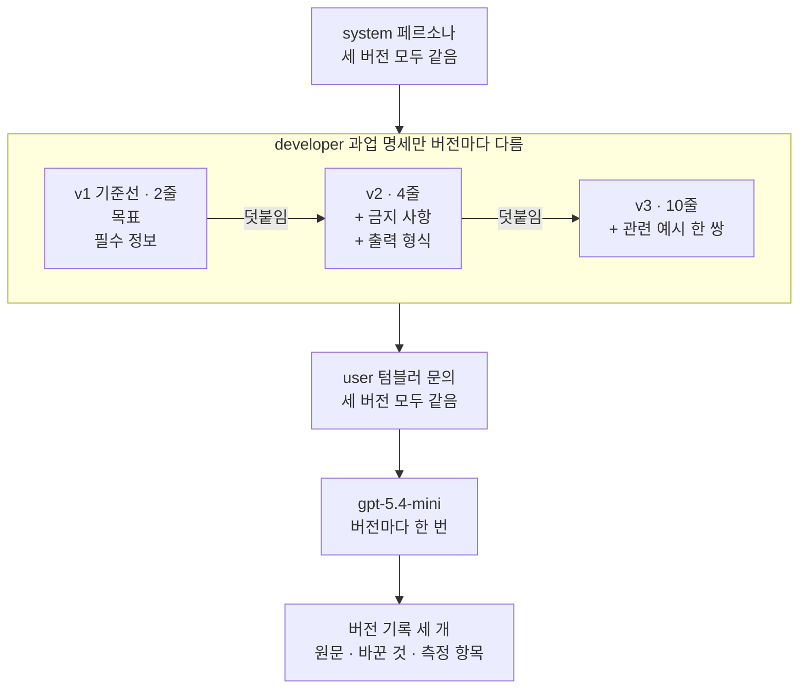
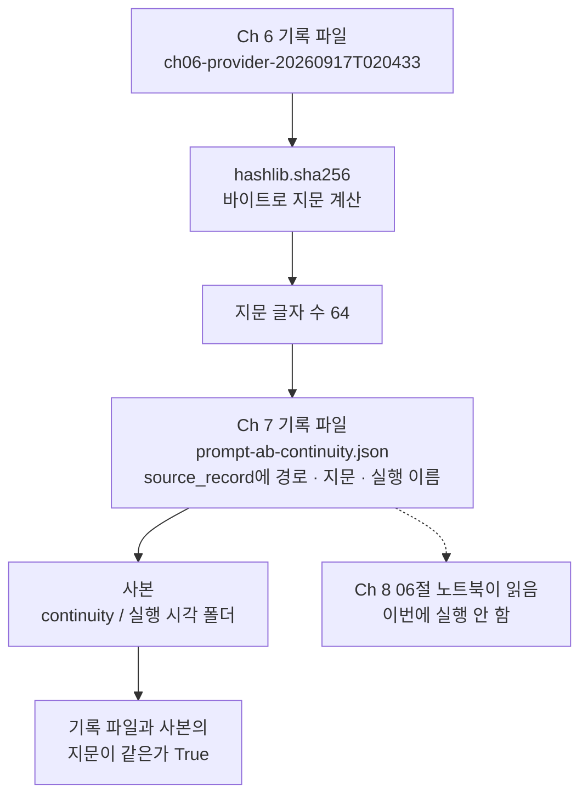
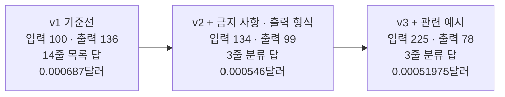
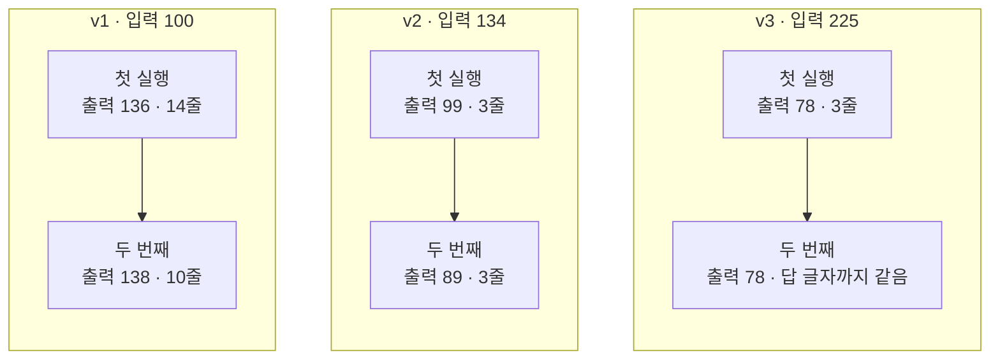

# 08-프롬프트-버전과-AB-비교

## _src 본문 (HTML 원본)

```html
<!--meta: 강의 0.5h | 실습 0.5h | 코드 Jupyter Notebook | 새 용어 7 -->
<h2 id="b1"><span class="no">1</span>학습 목표</h2>
<div class="goal"><p>이 절을 마치면 다음을 할 수 있습니다.</p><ul><li>프롬프트 버전마다 원문·바꾼 것·바꾼 이유를 함께 기록할 수 있습니다.</li><li>과업 명세만 다른 세 버전을 고정 조건 아래 보내, Ch 6 06절과 같은 측정 항목으로 비교할 수 있습니다.</li><li>파일 지문(SHA-256)으로 앞 실행 기록을 출처로 적고, 기록 파일과 사본이 같은지 확인할 수 있습니다.</li><li>한 번씩 보낸 A/B 비교로 정할 수 없는 차이를, 같은 버전을 다시 보낸 결과로 설명할 수 있습니다.</li></ul></div>
<h2 id="b2"><span class="no">2</span>이 내용을 배우는 이유</h2>
<p>01~07절은 조건마다 프롬프트 한 곳을 바꿔 답을 비교했습니다. 이렇게 고치다 보면 마지막 문구만 남고, 어떤 문장을 왜 바꿨는지는 사라지기 쉽습니다. 이름을 v2라고 붙여 두는 것만으로는 나중에 어떤 문장을 보냈는지 알 수 없습니다.</p>
<p>결과도 마찬가지입니다. 원문·바꾼 이유·고정 조건·측정 항목을 함께 남겨야 다른 사람이 같은 비교를 다시 살필 수 있습니다. 또 한 번씩 보낸 결과의 차이가 버전 때문인지, 같은 버전을 다시 보내도 생기는 차이인지 따로 확인해야 합니다.</p>
<p><strong>이 절의 질문</strong> — 프롬프트 버전을 어떻게 기록해야, 세 버전의 비교를 나중에 다시 확인할 수 있을까요?</p>
<h2 id="b3"><span class="no">3</span>앞에서 배운 내용</h2>
<table><thead><tr><th>앞 절</th><th>배운 것</th><th>이 절에서 이어지는 곳</th></tr></thead><tbody>
<tr><td>07절</td><td>기록의 한국어 키와 모델 답 JSON의 영어 키는 다른 것</td><td>8절 영어 최상위 키와 한국어 버전 기록</td></tr>
<tr><td>06절</td><td>반복문 안에서는 요청만 보내고 출력은 끝난 뒤, 같은 목록도 답이 달라짐</td><td>6·10절 요청, 10절 두 번째 실행</td></tr>
<tr><td>03절</td><td>관련 예시 한 쌍(셔츠 단추·B-203)을 developer 글에 붙이기</td><td>4절 <code>v3</code></td></tr>
<tr><td>02절</td><td>과업 명세 네 글(목표·필수 정보·금지 사항·출력 형식), 줄 수 세기</td><td>4절 <code>v1</code>·<code>v2</code>, 7절 줄 수</td></tr>
<tr><td>01절</td><td><code>timed_invoke()</code>·<code>make_prompt_record()</code>, 확인 단어 표시는 품질 점수가 아님</td><td>5·7절 기록과 표시</td></tr>
<tr><td>Ch 6 06절</td><td><code>estimate_cost()</code>, 한국어 기록 키와 초 단위 걸린 초, 기록 파일 저장, <code>../runs</code>로 경로 고르기</td><td>2·5·8절</td></tr>
<tr><td>Ch 2 04절</td><td>기본값을 둔 매개변수</td><td>5절 <code>estimate_openai_cost()</code></td></tr>
</tbody></table>
<p>이번 챕터는 역할별 메시지(01), 페르소나와 과업 명세(02), 예시(03), 메시지 틀(04)을 확인했습니다. 이어서 짧은 근거(05), 표본 합의(06), JSON 답 세 층 검사(07)를 차례로 봤습니다. 이 절은 새 프롬프트 기법을 더하지 않고, 앞 절의 과업 명세를 세 버전으로 묶어 기록하는 방법을 배웁니다.</p>
<p>Ch 6 06절 기록 줄의 키는 한국어였고, 걸린 초는 초 단위였습니다. 이 절은 그 기록과 같은 측정 항목을 씁니다. 다만 Ch 6 질문은 이 절의 고객 문의와 달라, 두 기록의 토큰 수는 비교하지 않습니다.</p>
<p>개선 전 이 절은 system에 「고객 지원 요청을 처리하세요.」를, user에 버전 글과 옛 고객 문의 글을 넣었습니다. 기록은 영어 키와 밀리초 지연으로 한꺼번에 출력했고, 경로 찾기와 지문 계산은 한 줄 식으로 썼습니다. 이 절은 01~07절 목록 모양을 그대로 두고 과업 명세만 버전으로 바꿉니다. 경로 고르기·지문 계산·파일 쓰기도 셀마다 한 가지씩 나눴습니다.</p>
<h2 id="b4"><span class="no">4</span>핵심 개념</h2>
<h3>비유로 시작하기</h3>
<p>02~07절 그림의 나무 책상이 이번에도 한 개입니다. 책상 뒤에는 파란 명찰과 금 간 컵이 그려진 노란 메모지가 그대로 있습니다. 가운데에는 주황 클립보드가 세 장 나란히 서 있고, 클립보드마다 앞에 연보라 답 카드가 한 장씩 있습니다.</p>
<p>문서를 고칠 때마다 날짜를 붙여 따로 저장해 두면, 나중에 어느 판을 보냈는지 찾을 수 있습니다. 새 서류철에 옛 서류철을 가리키는 표시를 남기면, 어느 자료에서 이어졌는지도 알 수 있습니다. 이 절의 버전 기록과 파일 지문이 이 두 가지 일을 합니다.</p>
{{img:08-5-버전-클립보드와-서류철|흰 바탕에 나무 책상 하나가 있고, 책상 뒤 왼쪽에 파란 명찰, 뒤 오른쪽에 금 간 컵이 그려진 노란 메모지가 있으며, 가운데에 물결 줄이 두 줄, 네 줄, 네 줄인 주황 클립보드 세 장이 나란히 서 있고 오른쪽 클립보드에는 흰 견본 카드가 반쯤 나와 있으며, 클립보드마다 앞에 연보라 카드가 있어 왼쪽 카드만 길고 나머지 둘은 세 줄로 짧고, 책상 앞 오른쪽에 동그란 초록 스티커가 붙은 연초록 서류철이 회색 실로 바닥의 회색 서류철과 이어진 삽화|명찰과 컵 메모지는 그대로 두고 클립보드만 바꾼 세 버전의 답 카드를, 옛 서류철과 실로 이어진 초록 서류철에 함께 남깁니다.}}
<p><strong>그림 읽기</strong> — 파란 명찰은 페르소나(system), 노란 컵 메모지는 고객 문의(user)이고 세 버전 모두 같습니다. 주황 클립보드 셋은 과업 명세(developer) 세 버전입니다. 왼쪽부터 물결 줄이 두 줄, 네 줄, 네 줄이고, 오른쪽 클립보드에만 흰 견본 카드가 반쯤 나와 있습니다. 03절 그림의 견본 카드처럼 관련 예시를 뜻합니다.</p>
<p>클립보드 앞 연보라 카드는 버전마다 받은 답입니다. 왼쪽 카드만 길고 줄이 많습니다. 노트북 6절에서 기준선 답이 여러 줄 목록이었고, 나머지 두 답은 세 줄이었던 모습입니다.</p>
<p>오른쪽 초록 서류철은 이 절의 기록 파일이고, 표지의 동그란 스티커는 파일 지문입니다. 서류철에서 나온 회색 실은 바닥의 회색 서류철, 곧 출처로 적은 Ch 6 기록 파일로 이어집니다. 06절 그림의 점선 실은 표를 세는 모습이었지만, 이 그림의 실은 출처 기록입니다. 답 카드가 서류철 안에 들어간 모습은 그려지지 않았으니, 서류철을 세 버전 기록을 모은 파일로 읽습니다.</p>
<h3>버전 기록과 고정 조건</h3>
<p>프롬프트 버전(prompt version)은 어느 때의 프롬프트 원문에 이름을 붙인 것입니다. 이 절에서는 과업 명세 원문 하나가 버전 하나이고, 이름은 <code>v1</code>·<code>v2</code>·<code>v3</code>입니다. 버전 기록은 이름·바꾼 것·바꾼 이유·과업 명세 원문을 함께 적은 딕셔너리입니다. 이름만 남기면 어떤 문장을 보냈는지, 왜 바꿨는지 알 수 없기 때문입니다.</p>
<p>기준선(baseline)은 뒤 버전과 비교할 출발점입니다. 이 절의 기준선 <code>v1</code>은 목표와 필수 정보 두 글만 이은 과업 명세입니다. 버전 <code>v2</code>는 금지 사항과 출력 형식을 더한 02절 과업 명세이고, <code>v3</code>는 여기에 03절 관련 예시를 더한 글입니다.</p>
<p>비교하는 동안 그대로 두는 값을 고정 조건이라고 부릅니다. 이 절의 고정 조건은 모델 <code>gpt-5.4-mini</code>와 설정, system 페르소나, user 고객 문의, 확인 단어입니다. 같은 대상을 두 조건으로 보내 결과를 견주는 방법은 A/B 비교(A/B comparison)라고 부릅니다. 가게 안내문 두 가지를 번갈아 붙이고 손님 반응을 비교하는 것과 비슷합니다. 이 절은 버전이 셋이라, 이웃한 두 버전씩 짝지어 비교합니다.</p>
{{mermaid:08-1-세-버전|맨 위 초록 상자 system 페르소나 세 버전 모두 같음 아래에 큰 상자 developer 과업 명세만 버전마다 다름이 있고, 그 안에서 초록 상자 v1 기준선 2줄 목표 필수 정보, v2 4줄 금지 사항 출력 형식 더함, v3 10줄 관련 예시 한 쌍 더함이 덧붙임 화살표로 왼쪽에서 오른쪽으로 이어지며, 아래로 초록 상자 user 텀블러 문의 세 버전 모두 같음, 보라 상자 gpt-5.4-mini 버전마다 한 번, 노란 상자 버전 기록 세 개 원문 바꾼 것 측정 항목이 차례로 이어지는 그림|기준선 과업 명세 2줄에 글을 덧붙여 4줄·10줄 버전을 만들고, 나머지 메시지와 모델은 그대로 두어 버전마다 한 번씩 보냅니다.}}
<p><strong>도식 읽기</strong> — 위에서 아래로 메시지 목록 순서대로 읽습니다. 초록 상자는 넣은 글이고, 맨 위 system 페르소나와 아래 user 고객 문의는 세 버전 모두 같습니다. 가운데 큰 상자 안의 과업 명세만 버전마다 다릅니다. 큰 상자 안에서는 왼쪽 기준선 글에 덧붙여 오른쪽 버전을 만듭니다.</p>
<p>상자 속 줄 수 2·4·10은 노트북 4절 표의 과업 명세 줄 수입니다. 버전 <code>v3</code>의 10줄은 과업 명세 네 줄, 빈 줄 하나, 예시 다섯 줄입니다. 보라 상자는 실행한 모델이고, 맨 아래 노란 상자는 요청 뒤에 남긴 버전 기록 세 개입니다.</p>
<p>기준선에서 <code>v2</code>로 갈 때는 글 두 개를 함께 더했습니다. 그래서 두 버전의 차이가 금지 사항 때문인지 출력 형식 때문인지는 나눌 수 없습니다. 버전 기록의 바꾼 것에 두 가지를 그대로 적은 이유입니다. <code>v2</code>에서 <code>v3</code>로 갈 때는 관련 예시 하나만 더했습니다.</p>
<h3>같은 측정 항목</h3>
<p>버전마다 기록 한 줄을 Ch 6 06절 기록과 같은 항목으로 남깁니다. 01절 함수 <code>make_prompt_record()</code>가 만든 키 여섯 개에, Ch 6 06절 기록에만 있던 키 세 개를 더합니다. 더하는 키는 <code>응답한 모델</code>, <code>캐시 입력 토큰 수</code>, <code>예상 비용(달러)</code>이고, 함수 <code>add_cost_items()</code>가 더합니다.</p>
<p>예상 비용은 Ch 6 06절 <code>estimate_cost()</code>와 같은 계산입니다. 이 절은 mini 모델만 부르므로, 함수 <code>estimate_openai_cost()</code>의 세 요금 인자에 mini 요금을 기본값으로 둡니다. 노트북 5절은 이 기본값과 Ch 6 기록 파일의 요금으로 교재 예를 계산해, 두 값이 모두 <code>9.3e-05</code>인지 확인합니다.</p>
<p>Ch 6 06절처럼 걸린 초는 초 단위로, 소수 둘째 자리까지 적습니다. 개선 전 이 절의 표는 영어 키와 밀리초 지연이었습니다. 이 절은 키 이름까지 Ch 6 06절 기록에 맞췄습니다.</p>
<h3>파일 지문과 기록 사슬</h3>
<p>파일 지문(hash)은 파일 안의 바이트 전체로 계산한, 길이가 정해진 글입니다. 사람 지문을 대 보면 같은 사람인지 알 수 있듯, 두 지문을 비교하면 두 파일의 내용이 같은지 알 수 있습니다. 노트북 3절은 함수 <code>hashlib.sha256(바이트)</code>로 계산하고, 메서드 <code>hexdigest()</code>로 64글자 16진수 글을 얻습니다.</p>
<p>바이트는 글자로 바꾸기 전에 파일에 저장된 값 그대로입니다. 파일을 모드 <code>"rb"</code>로 열면 글로 바꾸지 않고 바이트를 읽습니다. 주문번호 끝 숫자만 다른 두 글의 지문은 <code>0ff2abab</code>와 <code>6099ca9b</code>로 첫 글자부터 달랐습니다. 지문이 같다는 것은 내용이 같다는 뜻일 뿐, 그 내용이 맞거나 믿을 만하다는 뜻은 아닙니다.</p>
<p>노트북 8절은 기록 파일의 키 <code>source_record</code>에 Ch 6 기록 파일의 경로·지문·실행 이름을 출처로 적습니다. 앞 파일의 지문을 뒤 파일이 적어 두는 이런 연결을 이 절에서는 기록 사슬이라고 부릅니다. Ch 6 06절 노트북을 다시 실행하면 그 파일의 지문이 바뀌어, 이 기록의 출처 지문과 맞지 않게 됩니다. 그러면 이 노트북도 다시 실행해 출처를 새로 적습니다.</p>
<p>기록 파일의 최상위 키 여섯 개는 영어로 둡니다. Ch 8 06절 노트북이 이 이름으로 이 파일을 읽기 때문입니다. 같은 내용의 사본은 <code>runs/continuity</code> 아래 실행 시각 폴더에 새로 씁니다. 기록 파일은 실행할 때마다 덮어쓰지만, 사본은 실행마다 남습니다.</p>
{{mermaid:08-2-기록-사슬|위에서 아래로 초록 상자 Ch 6 기록 파일 ch06-provider-20260917T020433이 파란 상자 hashlib.sha256 바이트로 지문 계산, 노란 상자 지문 글자 수 64를 거쳐 초록 상자 Ch 7 기록 파일 prompt-ab-continuity.json source_record에 경로 지문 실행 이름으로 이어지고, 그 아래 왼쪽 초록 상자 사본 continuity 실행 시각 폴더가 노란 상자 기록 파일과 사본의 지문이 같은가 True로, 오른쪽 점선이 회색 상자 Ch 8 06절 노트북이 읽음 이번에 실행 안 함으로 이어지는 그림|Ch 6 기록 파일의 지문을 계산해 Ch 7 기록 파일의 출처에 적고, 같은 내용의 사본과 지문이 같은지 확인합니다.}}
<p><strong>도식 읽기</strong> — 위에서 아래로 읽습니다. 맨 위 초록 상자는 Ch 6 06절이 쓴 기록 파일이고, 이름은 실행 이름입니다. 파란 상자는 노트북 3절에서 바이트로 지문을 계산하는 코드 단계이고, 노란 상자는 출력으로 확인한 지문 글자 수입니다.</p>
<p>그 지문이 가운데 초록 상자인 이 절의 기록 파일에 출처로 들어갑니다. 왼쪽 아래 초록 상자는 실행 시각 폴더의 사본입니다. 맨 아래 노란 상자는 노트북 9절에서 기록 파일과 사본의 지문이 같다고 확인한 결과입니다. 오른쪽 회색 점선 상자는 이 파일을 읽는 Ch 8 06절 노트북이고, 이 절에서는 실행하지 않았습니다.</p>
<h3>이 절에서 쓰는 말</h3>
<table><thead><tr><th>용어</th><th>뜻</th><th>이 절에서 보이는 모습</th></tr></thead><tbody>
<tr><td>프롬프트 버전</td><td>어느 때의 프롬프트 원문에 붙인 이름. 날짜를 붙여 따로 저장한 문서 판과 비슷함</td><td><code>v1</code>·<code>v2</code>·<code>v3</code></td></tr>
<tr><td>버전 기록</td><td>버전마다 이름·바꾼 것·바꾼 이유·원문과 측정 결과를 함께 적은 딕셔너리</td><td><code>prompt_versions</code></td></tr>
<tr><td>기준선</td><td>뒤 버전과 비교할 출발점</td><td><code>v1 | 기준선 | 2</code></td></tr>
<tr><td>고정 조건</td><td>비교하는 동안 그대로 두는 값</td><td>키 <code>settings</code>의 모델·페르소나·고객 문의</td></tr>
<tr><td>A/B 비교</td><td>같은 대상을 두 조건으로 보내 결과를 견주는 방법. 한 번씩 보낸 비교는 같은 조건 안의 차이와 나누지 못함</td><td>7절 기록표, 10절 두 번째 실행</td></tr>
<tr><td>파일 지문</td><td>파일 바이트 전체로 계산한 정해진 길이의 글. 내용이 조금만 달라도 다른 글이 됨</td><td><code>지문 글자 수: 64</code></td></tr>
<tr><td>기록 사슬</td><td>앞 기록 파일의 경로·지문·실행 이름을 뒤 기록 파일이 출처로 적어 두는 연결</td><td><code>source_record</code></td></tr>
</tbody></table>
<h2 id="b5"><span class="no">5</span>실행 예제</h2>
<p>노트북은 Ch 6 기록 파일을 읽어 요금을 확인하고, 파일 지문을 계산합니다. 02·03절 글로 과업 명세 세 버전과 버전 기록을 만든 뒤, 비용 함수와 기록 함수를 준비합니다. 세 버전을 한 번씩 보내 같은 측정 항목으로 비교하고, 기록을 파일로 저장해 다시 읽습니다. 마지막으로 세 버전을 한 번 더 보내 두 실행을 나란히 봅니다.</p>
<p>실제 OpenAI 모델을 temperature 0으로 부릅니다. 이 페이지의 출력은 2026-09-17에 실행한 결과입니다. 요청은 모두 6번이고, 예상 비용은 0.01달러 미만입니다. 답 문장은 실행마다 달라질 수 있습니다. 노트북 8절은 실습 폴더의 <code>runs/prompt-ab-continuity.json</code>을 덮어쓰고, 사본 폴더를 하나 새로 만듭니다.</p>
{{notebook:08-프롬프트-버전과-AB-비교}}
<p class="look"><b>확인할 점</b> — 7절 기록표에서 입력 토큰 수가 02·03절과 같은 134·225인지 봅니다. 9절 네 줄이 모두 확인 결과인지 봅니다. 10절 표에서 같은 버전의 두 실행이 얼마나 달랐는지 찾습니다.</p>
<h3>세 버전의 기록표</h3>
<p>노트북 7절 기록표와 줄 수 표를 버전마다 한 상자로 모았습니다.</p>
{{mermaid:08-3-세-버전-기록표|왼쪽부터 노란 상자 셋이 화살표로 이어지고, v1 기준선 입력 100 출력 136 14줄 목록 답 0.000687달러, v2 금지 사항 출력 형식 더함 입력 134 출력 99 3줄 분류 답 0.000546달러, v3 관련 예시 더함 입력 225 출력 78 3줄 분류 답 0.00051975달러가 적힌 그림|입력은 100·134·225로 늘었지만 출력은 136·99·78로 줄었고, 예상 비용은 출력이 가장 많은 기준선이 가장 컸습니다.}}
<p><strong>도식 읽기</strong> — 왼쪽부터 <code>v1</code>·<code>v2</code>·<code>v3</code> 기록이고, 노란 상자는 출력으로 확인한 값입니다. 입력 토큰 수는 글을 덧붙인 순서로 100·134·225로 늘었습니다. 134와 225는 같은 목록을 보낸 02·03절의 입력 토큰 수와 같습니다.</p>
<p>출력 토큰 수는 입력 순서와 반대로 136·99·78이었습니다. 기준선 답은 빈 줄을 포함해 14줄 목록이었고, 나머지 두 답은 분류 줄로 시작하는 세 줄이었습니다. 예상 비용은 기준선이 가장 컸습니다. 출력 요금이 입력 요금의 6배라, 출력 토큰 수의 차이가 비용을 더 크게 바꿨습니다. 캐시 입력은 세 기록 모두 0이라 그림에 넣지 않았습니다.</p>
<h2 id="b6"><span class="no">6</span>실험 결과 해석</h2>
<p>세 버전은 과업 명세만 달랐습니다. 출력 형식을 더한 <code>v2</code>부터 답이 세 줄 분류 모양이 됐고, 기준선 답은 굵은 글씨와 목록이 섞인 여러 줄이었습니다. 이 차이는 두 번 보낸 결과에서 모두 같았습니다. 확인 단어 표시는 세 답 모두 <code>[True, True, True]</code>라 이 차이를 보여 주지 못했습니다.</p>
<p>세 답 모두 보상 약속은 없었습니다. 기준선에는 금지 사항이 없었으므로, 금지 사항의 효과는 이번 실행에서 보이지 않았습니다. 이것만으로 금지 사항이 필요 없다고 말하지는 않습니다.</p>
<p>예상 비용 순서는 실행마다 바뀌었습니다. 교재 출력에서는 <code>v3</code>가 <code>v2</code>보다 작았지만, 앞선 새 커널 실행에서는 출력이 139·89·75라 <code>v2</code>가 더 작았습니다. 버전 <code>v3</code>는 입력이 91토큰 더 많습니다. 출력이 <code>v2</code>보다 약 15토큰 넘게 적어야 예상 비용이 더 작아집니다.</p>
<h3>같은 버전을 한 번 더 보내면</h3>
<p>노트북 10절은 세 버전을 한 번씩 더 보냈습니다. 바꾼 값은 버전마다 보낸 횟수 하나이고, 두 번째 기록은 파일에 넣지 않았습니다.</p>
{{mermaid:08-4-두-번-보낸-결과|왼쪽부터 큰 상자 셋 v1 입력 100, v2 입력 134, v3 입력 225가 나란히 있고, 각 큰 상자 안에서 노란 상자 첫 실행이 노란 상자 두 번째로 이어지며, v1은 출력 136 14줄에서 출력 138 10줄로, v2는 출력 99 3줄에서 출력 89 3줄로, v3는 출력 78 3줄에서 출력 78 답 글자까지 같음으로 이어지는 그림|입력 토큰 수는 두 번 모두 같았지만, v1은 줄 수가 14에서 10으로, v2는 출력이 99에서 89로 달라졌고 v3만 두 답이 글자까지 같았습니다.}}
<p><strong>도식 읽기</strong> — 큰 상자 셋은 왼쪽부터 <code>v1</code>·<code>v2</code>·<code>v3</code>이고, 제목의 입력 토큰 수는 두 실행 모두 같았습니다. 큰 상자마다 위 노란 상자가 첫 실행, 아래 노란 상자가 두 번째 실행입니다.</p>
<p>버전 <code>v1</code>은 출력 토큰 수가 2만 달랐지만 줄 수는 14에서 10으로 달랐습니다. 두 번째 답은 제목 없이 줄 목록으로 답했습니다. 버전 <code>v2</code>는 출력이 99에서 89로 10 줄었고, 고객에게 보낼 한 문장 줄만 달랐습니다. 버전 <code>v3</code>는 두 답이 글자까지 같았습니다.</p>
<p>첫 실행에서 <code>v2</code>와 <code>v3</code>의 출력 차이는 21이었습니다. 그런데 같은 <code>v2</code>를 다시 보내도 10만큼 달라졌습니다. 한 번 잰 차이 21을 모두 예시 때문이라고 볼 수 없는 이유입니다. 앞선 새 커널 실행에서는 <code>v3</code>의 두 답도 출력 75·78로 달랐습니다.</p>
<p>그래서 버전을 비교할 때는 버전마다 같은 횟수로 여러 번 보내고, 그 횟수를 <code>repetitions</code>처럼 기록에 적습니다. 이 결론은 고객 문의 하나·모델 하나·버전마다 두 번 보낸 범위입니다. 확인 단어 표시와 토큰 수로 답의 품질을 판정하지 않았고, 걸린 초는 속도 비교에 쓰지 않았습니다.</p>
<h2 id="b7"><span class="no">7</span>주의할 점과 실무 메모</h2>
<ul><li>한 버전에서 글 여러 개를 함께 바꾸면 어느 글이 차이를 만들었는지 나눌 수 없습니다. 바꾼 것에 묶어 바꾼 글을 그대로 적습니다.</li>
<li>이 절은 두 실행 모두 <code>v1</code>·<code>v2</code>·<code>v3</code> 순서로 보냈습니다. 보내는 순서를 바꾼 실행은 하지 않았습니다.</li>
<li>기록 파일에는 과업 명세와 답 원문이 들어갑니다. 이 절의 고객 문의는 교재용으로 지어낸 글입니다. 실제 고객 정보라면 남길 범위와 가릴 정보를 먼저 정합니다. API 키는 기록 파일에 넣지 않습니다.</li>
<li>기록 파일의 최상위 키 이름과 <code>source_record</code>·<code>settings</code> 모양은 Ch 8 06절 노트북이 읽으므로 바꾸지 않습니다. Ch 6 06절 노트북을 다시 실행했다면 이 노트북도 다시 실행해 출처 지문을 맞춥니다.</li>
<li>모델 이름 <code>openai:gpt-5.4-mini</code>는 여러 날짜판을 가리킬 수 있는 이름입니다. 그래서 기록에 응답한 모델 <code>gpt-5.4-mini-2026-03-17</code>도 함께 적었습니다.</li>
<li>세 버전 문구와 값 바꿔 보기(세 버전 한 번 더)는 흐름을 보여 주려고 정한 예입니다. 교재를 만들 때 기기에서 먼저 세 버전을 한 번씩, 모두 3번 보냈습니다. 탐색에서도 입력 토큰 수가 100·134·225이고 줄 모양이 같아 문구를 바꾸지 않았습니다.</li>
<li>프롬프트를 외부 서비스에 저장하고 버전을 관리하는 도구는 이 절에서 쓰지 않았습니다. 기본 실습은 실습 폴더의 JSON 파일만 씁니다.</li>
<li>교재 출력은 Linux의 Python 3.12.13으로 만들었습니다. 패키지는 langchain 1.4.0, langchain-core 1.6.2입니다. langchain-openai 1.6.0, openai 3.10.0도 함께 썼습니다. 다른 버전과 Windows·macOS에서는 실행하지 않았습니다.</li></ul>
<h2 id="b8"><span class="no">8</span>정리와 다음 절</h2>
<ul><li>Ch 6 기록 파일의 지문을 계산해, 이 절 기록 파일에 경로·지문·실행 이름을 출처로 적고 사본과 지문을 비교했습니다.</li><li>과업 명세만 다른 세 버전을 원문·바꾼 것·바꾼 이유와 함께 기록하고, Ch 6 06절과 같은 측정 항목으로 비교했습니다.</li><li>출력 형식을 더한 버전부터 답이 세 줄이 됐고, 같은 <code>v2</code>를 다시 보낸 출력 차이도 <code>v2</code>·<code>v3</code> 차이의 절반쯤이었습니다.</li></ul>
<p><strong>다음 학습과 이어지는 지점</strong> — 09절은 이 챕터의 실습입니다. 04절 틀에 07절 세 층 검사와 이 절의 버전 기록 모양을 붙이고, 허용 이름 하나만 바꾼 두 버전을 비교합니다. 09절은 이 절의 기록 파일을 읽거나 고치지 않습니다. 이 파일을 읽는 Ch 8 06절과 그 뒤 챕터 연결은 09절 끝에서 안내합니다.</p>
<h2 id="b9"><span class="no">9</span>복습 문제</h2>
<details class="quiz"><summary>문제 1 · 버전 기록</summary><p class="quiz-q">버전 이름 <code>v2</code>만 저장하면 버전 기록으로 부족한 이유는 무엇인가요?</p><p class="quiz-a"><b>해설</b> — 실제 과업 명세 원문과 바꾼 것·바꾼 이유가 없으면, 어떤 문장을 보냈는지 되살릴 수 없습니다. 결과 차이가 무엇 때문인지도 나중에 살필 수 없습니다.</p></details>
<details class="quiz"><summary>문제 2 · 묶어 바꾼 글</summary><p class="quiz-q">기준선에서 <code>v2</code>로 갈 때 답이 세 줄이 됐습니다. 이 차이를 출력 형식 글 때문이라고 말할 수 있나요?</p><p class="quiz-a"><b>해설</b> — 말할 수 없습니다. 금지 사항과 출력 형식을 함께 더했기 때문입니다. 둘을 나누려면 한 글만 더한 버전을 따로 보내야 하고, 이 절에서는 그 실행을 하지 않았습니다.</p></details>
<details class="quiz"><summary>문제 3 · 파일 지문</summary><p class="quiz-q">Ch 6 06절 노트북을 다시 실행한 뒤 이 절 기록 파일을 그대로 두면, 출처 지문은 어떻게 되나요?</p><p class="quiz-a"><b>해설</b> — Ch 6 기록 파일의 내용이 바뀌어 지문도 바뀝니다. 이 절 기록 파일에 적힌 옛 지문과 맞지 않게 되므로, 이 노트북을 다시 실행해 출처를 새로 적습니다.</p></details>
<details class="quiz"><summary>문제 4 · 한 번씩 보낸 비교</summary><p class="quiz-q">첫 실행에서 <code>v2</code> 출력은 99, <code>v3</code> 출력은 78이었습니다. 예시가 출력을 21토큰 줄였다고 말하기 어려운 이유는 무엇인가요?</p><p class="quiz-a"><b>해설</b> — 같은 <code>v2</code>를 다시 보냈더니 출력이 89로, 10만큼 달라졌습니다. 같은 버전 안에서도 이만큼 차이가 나므로, 버전마다 같은 횟수로 여러 번 보내 비교해야 합니다.</p></details>
<details class="quiz"><summary>문제 5 · 확인 단어 표시</summary><p class="quiz-q">세 버전의 확인 단어 표시가 모두 <code>[True, True, True]</code>였습니다. 세 답의 품질이 같다고 판정할 수 있나요?</p><p class="quiz-a"><b>해설</b> — 판정할 수 없습니다. 표시는 낱말이 있는지만 봅니다. 기준선 답이 여러 줄 목록이었다는 차이도 줄 수와 원문을 봐야 알았습니다.</p></details>
<h2 id="b10"><span class="no">10</span>참고 자료</h2>
<p>문서는 2026-09-17에 다시 열어 확인했습니다. 코드는 실습 가상환경에 설치한 <code>langchain 1.4.0</code>, <code>langchain-core 1.6.2</code>, <code>langchain-openai 1.6.0</code>으로 실행했습니다.</p>
<ul><li><div><a href="https://docs.python.org/3.12/library/hashlib.html">Python 3.12 hashlib — Secure hashes and message digests</a></div>함수 <code>hashlib.sha256()</code>은 바이트를 받고, 메서드 <code>hexdigest()</code>는 16진수 글자만 담은 글을 반환함 · 확인 2026-09-17</li><li><div><a href="https://docs.python.org/3.12/library/os.html#os.makedirs">Python 3.12 os.makedirs</a></div>중간 폴더까지 만들고, 이미 있으면 <code>FileExistsError</code>(설치한 Python 3.12.13에서도 실행해 확인) · 확인 2026-09-17</li><li><div><a href="https://docs.python.org/3.12/library/json.html">Python 3.12 json — JSON encoder and decoder</a></div>함수 <code>json.dumps()</code>·<code>json.loads()</code> · 확인 2026-09-17</li><li><div><a href="https://github.com/langchain-ai/langchain/blob/master/LICENSE">LangChain MIT License</a></div>예제의 고객 문의·버전 문구와 설명은 이 교재에 맞게 새로 썼습니다</li></ul>
```

## 노트북 셀 (순서대로)

### [0] markdown {'html': 'skip'}

# 프롬프트 버전과 AB 비교

**이 노트북에서 할 일**

1. Ch 6 06절이 저장한 기록 파일을 읽고, 파일 내용으로 지문(SHA-256)을 계산합니다.
2. 과업 명세만 다른 세 버전을 바꾼 것·바꾼 이유와 함께 적고, 한 번씩 보내 같은 항목으로 기록합니다.
3. 세 버전 기록을 출처와 함께 JSON 파일로 저장하고, 세 버전을 한 번 더 보내 두 실행을 비교합니다.

**준비물** — 프로젝트 폴더 `.env` 파일의 `OPENAI_API_KEY`가 필요합니다.
Ch 6 06절 노트북이 만든 기록 파일 `provider-comparison-continuity.json`을 읽습니다.

인터넷 서비스에 요청을 모두 6번 보냅니다. 모두 `gpt-5.4-mini`입니다.
실행 시간은 1분 안팎이고, 예상 비용은 0.01달러 미만으로 잡았습니다.
요금은 Ch 6 06절에서 2026-09-17에 확인한 mini 공식 요금 기준입니다.

8절은 실습 폴더의 `runs/prompt-ab-continuity.json` 파일을 새 기록으로 덮어씁니다.
같은 내용의 사본은 `runs/continuity` 아래에 실행 시각 이름의 폴더를 새로 만들어 씁니다.

**기준 버전** — 실습 폴더에 고정한 패키지 판을 씁니다. langchain 1.4.0, langchain-core 1.6.2, langchain-openai 1.6.0입니다.
openai 3.10.0, python-dotenv 1.2.3도 함께 씁니다.

교재 출력은 Linux의 Python 3.12.13으로 만들었습니다. 다른 버전과 Windows·macOS에서는 이번에 실행하지 않았습니다.

실습 폴더 `labs/part2/ch07-prompt-engineering`에서 `uv sync --locked`를 실행합니다.
그다음 이 폴더의 `.venv` 커널을 고르고 첫 셀부터 순서대로 실행합니다.

### [1] markdown {'html': 'skip'}

## 오늘 볼 그림


위에서 아래로 메시지 목록 순서대로 읽습니다. 초록 상자는 넣은 글이고, system 페르소나와 user 고객 문의는 세 버전 모두 같습니다.
가운데 큰 상자 안의 과업 명세만 버전마다 다릅니다. 왼쪽 기준선 글에 덧붙여 오른쪽 버전을 만듭니다.

보라 상자는 실행한 모델이고, 버전마다 한 번씩 보냅니다. 맨 아래 노란 상자는 요청 뒤에 남기는 버전 기록 세 개입니다.

### [2] markdown {}

## 1. 준비

첫 셀은 패키지를 설치하고 설치된 버전을 출력합니다. 설치에는 몇십 초가 걸릴 수 있습니다.
01~07절과 같은 실습 폴더와 같은 판입니다. 노트북은 앞 절 없이 새 커널에서 시작하므로 다시 확인합니다.

### [3] code {'execution': {'iopub.execute_input': '2026-09-17T07:06:56.201674Z', 'iopub.status.busy': '2026-09-17T07:06:56.201526Z', 'iopub.status.idle': '2026-09-17T07:06:56.819066Z', 'shell.execute_reply': '2026-09-17T07:06:56.818528Z'}, 'lesson_role': 'setup'}

```python
# 이 절에서 쓰는 패키지를 설치하고 버전을 확인합니다
%pip install -q "langchain==1.4.0" "langchain-openai==1.6.0" "python-dotenv==1.2.3"
from importlib.metadata import version

print("langchain:", version("langchain"))
print("langchain-core:", version("langchain-core"))
print("langchain-openai:", version("langchain-openai"))
print("openai:", version("openai"))
print("python-dotenv:", version("python-dotenv"))
```

출력:
```
Note: you may need to restart the kernel to use updated packages.
langchain: 1.4.0
langchain-core: 1.6.2
langchain-openai: 1.6.0
openai: 3.10.0
python-dotenv: 1.2.3

```

### [4] markdown {}

**결과 읽기** — 출력 줄은 `langchain: 1.4.0`, `langchain-core: 1.6.2`, `langchain-openai: 1.6.0` 등 다섯 줄입니다.
준비물에 적은 기준 버전과 같습니다.

네 가지를 불러옵니다. 시간을 재는 모듈 `time`과 JSON 글을 다루는 모듈 `json`은 07절과 같습니다.
모듈 `hashlib`은 파일 지문을 계산하는 모듈이고, 뜻은 3절에서 풉니다. 마지막 줄은 모델 객체를 만드는 함수를 불러옵니다.

### [5] code {'execution': {'iopub.execute_input': '2026-09-17T07:06:56.820131Z', 'iopub.status.busy': '2026-09-17T07:06:56.820037Z', 'iopub.status.idle': '2026-09-17T07:06:57.175830Z', 'shell.execute_reply': '2026-09-17T07:06:57.175434Z'}, 'lesson_role': 'setup'}

```python
# 시간을 재는 모듈, JSON 글을 다루는 모듈, 파일 지문을 계산하는 모듈, 모델 객체를 만드는 함수를 불러옵니다
import hashlib
import json
import time

from langchain.chat_models import init_chat_model
```

출력:
```

```

### [6] markdown {}

01~07절과 같은 셀로 API 키가 있는지 확인합니다. 키 값은 출력하지 않고, 있는지만 봅니다.
`True` 값이 나오면 다음으로 넘어갑니다.

### [7] code {'execution': {'iopub.execute_input': '2026-09-17T07:06:57.176643Z', 'iopub.status.busy': '2026-09-17T07:06:57.176590Z', 'iopub.status.idle': '2026-09-17T07:06:57.181366Z', 'shell.execute_reply': '2026-09-17T07:06:57.181049Z'}, 'lesson_role': 'setup'}

```python
# .env 파일에서 OpenAI API 키를 읽습니다(키 값은 출력하지 않습니다)
import os
from dotenv import find_dotenv, load_dotenv

env_path = find_dotenv(usecwd=True)
load_dotenv(env_path)
has_key = os.getenv("OPENAI_API_KEY") is not None
print("OPENAI_API_KEY 설정 여부:", has_key)
assert has_key, "프로젝트 폴더의 .env 파일에 OPENAI_API_KEY를 적어 주세요."
```

출력:
```
OPENAI_API_KEY 설정 여부: True

```

### [8] markdown {}

실습에 쓸 모델을 준비합니다.
01~07절과 같은 설정으로 모델 객체를 만듭니다. 이 셀은 요청을 보내지 않습니다.

### [9] code {'execution': {'iopub.execute_input': '2026-09-17T07:06:57.181903Z', 'iopub.status.busy': '2026-09-17T07:06:57.181856Z', 'iopub.status.idle': '2026-09-17T07:06:57.989095Z', 'shell.execute_reply': '2026-09-17T07:06:57.988695Z'}}

```python
# 실습에 쓸 모델을 준비합니다
model = init_chat_model(
    "openai:gpt-5.4-mini",
    temperature=0,
    reasoning_effort="none",
)
print("모델 이름:", model.model_name)
print("temperature:", model.temperature)
```

출력:
```
모델 이름: gpt-5.4-mini
temperature: 0.0

```

### [10] markdown {}

**결과 읽기** — 출력 줄은 `모델 이름: gpt-5.4-mini`와 `temperature: 0.0`입니다. 이것으로 준비가 끝났습니다.
이 노트북의 출력은 2026-09-17에 이 모델로 실행한 결과입니다. 실행마다 답 문장이 달라질 수 있습니다.
Ch 6 01절에서 본 것처럼 temperature 0은 Ch 5 06절의 뽑기를 끈 설정(`do_sample=False`)과 같은 것이 아닙니다.

## 2. Ch 6 기록 파일 읽기

Ch 6 06절은 두 모델의 측정 기록과 요금표를 JSON 파일 하나에 저장했습니다. 이 절은 그 파일을 읽어 앞 실행의 이름과 요금을 확인합니다.
파일 경로는 Ch 6 06절처럼 고릅니다. 노트북을 `notebooks` 폴더에서 열면 한 칸 위에 이 실습 폴더의 `runs` 폴더가 있습니다.

그러면 Ch 6 실습 폴더는 두 칸 위 폴더 안의 `ch06-langchain-start`입니다. `../runs` 폴더가 없으면 프로젝트 맨 위 폴더에서 연 경우로 보고 긴 경로를 씁니다.
이름 `ch06_relative`에는 프로젝트 맨 위 폴더에서 본 경로를 따로 담습니다. 8절에서 기록 파일에 출처로 적을 경로입니다.

실행 전에 예상합니다. Ch 6 06절 노트북을 실행한 적이 있으면 `True`가 나올 것입니다.

### [11] code {'execution': {'iopub.execute_input': '2026-09-17T07:06:57.989717Z', 'iopub.status.busy': '2026-09-17T07:06:57.989657Z', 'iopub.status.idle': '2026-09-17T07:06:57.991915Z', 'shell.execute_reply': '2026-09-17T07:06:57.991591Z'}}

```python
# Ch 6 06절 기록 파일의 경로를 고르고, 파일이 있는지 확인합니다
ch06_relative = "labs/part2/ch06-langchain-start/runs/provider-comparison-continuity.json"
ch06_path = "../../ch06-langchain-start/runs/provider-comparison-continuity.json"
if not os.path.exists("../runs"):
    ch06_path = ch06_relative
has_ch06_file = os.path.exists(ch06_path)
print("Ch 6 기록 파일이 있는가:", has_ch06_file)
assert has_ch06_file, "Ch 6 06절 노트북을 먼저 실행해 기록 파일을 만들어 주세요."
```

출력:
```
Ch 6 기록 파일이 있는가: True

```

### [12] markdown {}

**결과 읽기** — 출력은 `Ch 6 기록 파일이 있는가: True` 한 줄입니다. `assert`도 통과했습니다.
경로는 컴퓨터마다 달라서 출력하지 않았습니다.

파일을 읽어 JSON 글을 딕셔너리로 바꿉니다. Ch 6 06절 마지막 셀과 같은 `with open` + `json.loads(file.read())` 모양입니다.
최상위 키 목록과 실행 이름, 요금 확인 날짜, mini 요금을 출력합니다.
마지막 줄은 mini 요금이 Ch 6 06절 4절에서 적은 값과 같은지 확인합니다.

실행 전에 예상합니다. 최상위 키는 Ch 6 06절 10절에서 모은 여섯 개일 것입니다.

### [13] code {'execution': {'iopub.execute_input': '2026-09-17T07:06:57.992513Z', 'iopub.status.busy': '2026-09-17T07:06:57.992452Z', 'iopub.status.idle': '2026-09-17T07:06:57.994757Z', 'shell.execute_reply': '2026-09-17T07:06:57.994432Z'}}

```python
# 기록 파일을 읽어 최상위 키·실행 이름·요금 확인 날짜·mini 요금을 출력합니다
with open(ch06_path, encoding="utf-8") as file:
    ch06_record = json.loads(file.read())
mini_prices = ch06_record["pricing"]["openai"]
ch06_keys = list(ch06_record.keys())
print("최상위 키:", ch06_keys)
print("Ch 6 실행 이름:", ch06_record["run_id"])
print("요금 확인 날짜:", ch06_record["pricing"]["date"])
print("mini 요금:", mini_prices)
assert mini_prices == {"ordinary_input": 0.75, "cached_input": 0.075, "output": 4.50}
```

출력:
```
최상위 키: ['run_id', 'run_date', 'source_chapter', 'conditions', 'pricing', 'records']
Ch 6 실행 이름: ch06-provider-20260917T020433
요금 확인 날짜: 2026-09-17
mini 요금: {'ordinary_input': 0.75, 'cached_input': 0.075, 'output': 4.5}

```

### [14] markdown {}

**결과 읽기** — 첫 줄은 `최상위 키: ['run_id', 'run_date', 'source_chapter', 'conditions', 'pricing', 'records']`입니다.
둘째 줄은 `Ch 6 실행 이름: ch06-provider-20260917T020433`, 셋째 줄은 `요금 확인 날짜: 2026-09-17`입니다.
넷째 줄은 `mini 요금: {'ordinary_input': 0.75, 'cached_input': 0.075, 'output': 4.5}`이고, `assert`도 통과했습니다.

실행 이름 끝의 숫자는 Ch 6 06절을 실행한 시각입니다. 여러분이 그 노트북을 다시 실행했다면 다른 시각이 보입니다.
키 `records`의 기록 줄은 이 절에서 읽지 않습니다. Ch 6 질문은 이 절의 고객 문의와 달라, 토큰 수를 서로 비교하지 않기 때문입니다.

## 3. 파일 지문 만들기

파일 지문(hash)은 파일 안의 바이트 전체로 계산한, 길이가 정해진 글입니다. 내용이 한 글자만 달라져도 전혀 다른 글이 됩니다.
사람 지문을 대 보면 같은 사람인지 알 수 있듯, 두 지문을 비교하면 두 파일의 내용이 같은지 알 수 있습니다.
이 절은 계산 방법 SHA-256을 쓰는 함수 `hashlib.sha256(바이트)`로 계산합니다. 메서드 `hexdigest()`는 결과를 64글자 16진수 글로 반환합니다.

바이트는 글자로 바꾸기 전에 파일에 저장된 값 그대로입니다. 모드 `"rb"`로 열면 글로 바꾸지 않고 바이트를 읽습니다.
모드 글의 r은 읽기, b는 바이트라는 뜻입니다. Part 1에서 쓴 모드 `"w"`·`"a"`처럼 `open()`의 둘째 인자로 적습니다.

실행 전에 예상합니다. 지문 글자 수는 64일 것입니다.

### [15] code {'execution': {'iopub.execute_input': '2026-09-17T07:06:57.995282Z', 'iopub.status.busy': '2026-09-17T07:06:57.995237Z', 'iopub.status.idle': '2026-09-17T07:06:57.997282Z', 'shell.execute_reply': '2026-09-17T07:06:57.996978Z'}}

```python
# Ch 6 기록 파일을 바이트 그대로 읽어 SHA-256 지문을 계산합니다
with open(ch06_path, "rb") as file:
    ch06_bytes = file.read()
ch06_sha256 = hashlib.sha256(ch06_bytes).hexdigest()
print("Ch 6 파일 지문:", ch06_sha256)
print("지문 글자 수:", len(ch06_sha256))
```

출력:
```
Ch 6 파일 지문: f18920c63088bded645bc4712b8ee16436e46d394499bfeaa4cc081f76ef4f4c
지문 글자 수: 64

```

### [16] markdown {}

**결과 읽기** — 둘째 줄은 `지문 글자 수: 64`입니다. 첫 줄의 지문은 숫자 0~9와 영문자 a~f로만 된 64글자 글입니다.
이 지문은 Ch 6 06절 노트북을 다시 실행해 파일이 바뀌면 다른 글이 됩니다. 그래서 설명에서는 지문 글자를 옮겨 적지 않습니다.

내용이 조금 다르면 지문이 얼마나 달라지는지 짧은 글 두 개로 봅니다. 주문번호의 마지막 숫자만 다른 글입니다.
글 메서드 `encode("utf-8")`는 글을 UTF-8 바이트로 바꿔 반환합니다. 파일은 바꾸지 않고, 요청도 보내지 않습니다.

실행 전에 예상합니다. 두 지문은 같지 않을 것입니다.

### [17] code {'execution': {'iopub.execute_input': '2026-09-17T07:06:57.997777Z', 'iopub.status.busy': '2026-09-17T07:06:57.997727Z', 'iopub.status.idle': '2026-09-17T07:06:57.999268Z', 'shell.execute_reply': '2026-09-17T07:06:57.999009Z'}}

```python
# 마지막 숫자만 다른 글 두 개의 지문을 비교합니다(요청 없음)
first_bytes = "주문번호 A-1042".encode("utf-8")
second_bytes = "주문번호 A-1043".encode("utf-8")
first_sha256 = hashlib.sha256(first_bytes).hexdigest()
second_sha256 = hashlib.sha256(second_bytes).hexdigest()
print("A-1042 지문:", first_sha256)
print("A-1043 지문:", second_sha256)
print("두 지문이 같은가:", first_sha256 == second_sha256)
```

출력:
```
A-1042 지문: 0ff2abab6648151388144e8b4578a0f0a39e9b044b17f89fa9d034bbe5be4dec
A-1043 지문: 6099ca9bd296c1a9ecd904486b7ea47d403ca84fc7240b8bb0ca077aab78c8a0
두 지문이 같은가: False

```

### [18] markdown {}

**결과 읽기** — 마지막 줄은 `두 지문이 같은가: False`입니다.
첫 줄은 `A-1042 지문: 0ff2abab`로, 둘째 줄은 `A-1043 지문: 6099ca9b`로 시작해 첫 글자부터 다릅니다.

글자 하나만 달라도 지문 전체가 달라졌습니다. 반대로 내용이 같으면 지문도 같습니다. 9절에서 이 성질로 기록 파일과 사본을 비교합니다.
지문이 같다는 것은 내용이 같다는 뜻일 뿐, 그 내용이 맞다는 뜻은 아닙니다.

## 4. 과업 명세 세 버전 적기

프롬프트 버전(prompt version)은 어느 때의 프롬프트 원문에 이름을 붙인 것입니다. 문서를 고칠 때마다 날짜를 붙여 따로 저장해 두는 것과 비슷합니다.
이 절에서는 과업 명세 원문 하나가 버전 하나이고, 이름은 `v1`·`v2`·`v3`입니다.

01~07절 목록은 system 페르소나, developer 과업 명세, user 고객 문의 세 메시지였습니다.
세 버전은 과업 명세만 다르고, 나머지 두 메시지는 같습니다. 먼저 02절과 같은 글 여섯 개를 다시 만듭니다.

### [19] code {'execution': {'iopub.execute_input': '2026-09-17T07:06:57.999699Z', 'iopub.status.busy': '2026-09-17T07:06:57.999657Z', 'iopub.status.idle': '2026-09-17T07:06:58.001323Z', 'shell.execute_reply': '2026-09-17T07:06:58.001113Z'}}

```python
# 02절과 같은 페르소나·고객 문의·과업 명세 네 글을 다시 만듭니다
persona_text = "당신은 친절한 고객 상담원입니다."
inquiry_text = "어제 받은 텀블러 뚜껑이 깨졌습니다. 주문번호는 A-1042입니다. 새 상품으로 바꾸고 싶습니다."
goal_text = "고객 문의를 분류하고 필요한 다음 행동을 안내하세요."
required_text = "회사 규정상 교환 접수에는 파손 사진이 필요합니다. 주문번호는 답에 그대로 적으세요."
forbidden_text = "근거 없는 보상은 약속하지 마세요."
format_text = "분류, 다음 행동, 고객에게 보낼 한 문장을 한 줄씩 세 줄로 답하세요."
print("페르소나:", persona_text)
print("출력 형식:", format_text)
```

출력:
```
페르소나: 당신은 친절한 고객 상담원입니다.
출력 형식: 분류, 다음 행동, 고객에게 보낼 한 문장을 한 줄씩 세 줄로 답하세요.

```

### [20] markdown {}

**결과 읽기** — 두 줄은 `페르소나: 당신은 친절한 고객 상담원입니다.`와 `출력 형식: 분류, 다음 행동, 고객에게 보낼 한 문장을 한 줄씩 세 줄로 답하세요.`입니다.
02~07절에서 쓴 글과 같습니다.

이어서 03절 관련 예시를 다시 만듭니다. 셔츠 단추 문의(B-203)와 세 줄 답을 짝지은 글입니다.
03절은 함수 `make_example_text()`로 만들었습니다. 이 절은 예시를 한 번만 만들므로 같은 모양을 `+`로 바로 잇습니다.

### [21] code {'execution': {'iopub.execute_input': '2026-09-17T07:06:58.001813Z', 'iopub.status.busy': '2026-09-17T07:06:58.001764Z', 'iopub.status.idle': '2026-09-17T07:06:58.003566Z', 'shell.execute_reply': '2026-09-17T07:06:58.003231Z'}}

```python
# 03절과 같은 관련 예시 글을 만듭니다(03절 make_example_text()와 같은 모양)
relevant_inquiry = "셔츠 단추가 떨어졌습니다. 주문번호는 B-203입니다."
relevant_answer = "분류: 교환 요청(하자)\n"
relevant_answer = relevant_answer + "다음 행동: 떨어진 단추 사진을 받고 주문번호 B-203으로 교환 접수를 진행합니다.\n"
relevant_answer = relevant_answer + "고객에게 보낼 한 문장: 단추가 떨어진 부분의 사진을 보내 주시면 교환 접수를 도와드리겠습니다."
relevant_example = "예시 문의: " + relevant_inquiry + "\n" + "예시 답:" + "\n" + relevant_answer
print("관련 예시:")
print(relevant_example)
```

출력:
```
관련 예시:
예시 문의: 셔츠 단추가 떨어졌습니다. 주문번호는 B-203입니다.
예시 답:
분류: 교환 요청(하자)
다음 행동: 떨어진 단추 사진을 받고 주문번호 B-203으로 교환 접수를 진행합니다.
고객에게 보낼 한 문장: 단추가 떨어진 부분의 사진을 보내 주시면 교환 접수를 도와드리겠습니다.

```

### [22] markdown {}

**결과 읽기** — 라벨 줄 아래 다섯 줄이 관련 예시입니다. 첫 줄은 `예시 문의: 셔츠 단추가 떨어졌습니다. 주문번호는 B-203입니다.`입니다.
둘째 줄 `예시 답:` 아래 세 줄이 예시 답입니다.

세 버전을 만듭니다. 버전 `v1`은 목표와 필수 정보 두 글만 이은 기준선(baseline)입니다. 기준선은 뒤 버전과 비교할 출발점입니다.

버전 `v2`는 `v1` 글 뒤에 금지 사항과 출력 형식을 잇습니다. 02절 과업 명세와 같은 글입니다.
버전 `v3`는 `v2` 글 뒤에 빈 줄 하나와 관련 예시를 잇습니다. 03절 관련 예시 목록의 developer 글과 같습니다.

### [23] code {'execution': {'iopub.execute_input': '2026-09-17T07:06:58.004121Z', 'iopub.status.busy': '2026-09-17T07:06:58.004077Z', 'iopub.status.idle': '2026-09-17T07:06:58.005783Z', 'shell.execute_reply': '2026-09-17T07:06:58.005432Z'}}

```python
# 뒤 버전이 앞 버전 글에 덧붙이는 모양으로 과업 명세 세 버전을 만듭니다
v1_task = goal_text + "\n" + required_text
v2_task = v1_task + "\n" + forbidden_text + "\n" + format_text
v3_task = v2_task + "\n\n" + relevant_example
print("v1 과업 명세:")
print(v1_task)
```

출력:
```
v1 과업 명세:
고객 문의를 분류하고 필요한 다음 행동을 안내하세요.
회사 규정상 교환 접수에는 파손 사진이 필요합니다. 주문번호는 답에 그대로 적으세요.

```

### [24] markdown {}

**결과 읽기** — 라벨 줄 아래 두 줄이 기준선 과업 명세입니다. 첫 줄 `고객 문의를 분류하고 필요한 다음 행동을 안내하세요.`는 목표입니다.
둘째 줄은 필수 정보이고, 출력 형식과 금지 사항은 없습니다.

버전 기록은 버전마다 이름·바꾼 것·바꾼 이유·과업 명세 원문을 함께 적은 딕셔너리입니다.
이름만 남기면 나중에 어떤 문장을 보냈는지, 왜 바꿨는지 알 수 없기 때문입니다. 세 기록은 목록 `prompt_versions`에 모읍니다.

출력은 버전마다 이름·바꾼 것·과업 명세 줄 수입니다. 줄 수는 02절처럼 `split("\n")`으로 셉니다.

### [25] code {'execution': {'iopub.execute_input': '2026-09-17T07:06:58.006324Z', 'iopub.status.busy': '2026-09-17T07:06:58.006280Z', 'iopub.status.idle': '2026-09-17T07:06:58.008454Z', 'shell.execute_reply': '2026-09-17T07:06:58.007985Z'}}

```python
# 버전마다 이름·바꾼 것·바꾼 이유·과업 명세 원문을 딕셔너리에 적어 목록에 모읍니다
v1_version = {"버전": "v1", "바꾼 것": "기준선", "바꾼 이유": "목표와 필수 정보만 적은 출발점", "과업 명세": v1_task}
v2_version = {"버전": "v2", "바꾼 것": "금지 사항과 출력 형식을 더함", "바꾼 이유": "답 모양을 세 줄로 정하고 보상 약속을 막으려고", "과업 명세": v2_task}
v3_version = {"버전": "v3", "바꾼 것": "관련 예시 한 쌍을 더함", "바꾼 이유": "03절에서 관련 예시 답이 예시 문장 모양을 따름", "과업 명세": v3_task}
prompt_versions = [v1_version, v2_version, v3_version]
print("버전 | 바꾼 것 | 과업 명세 줄 수")
for version in prompt_versions:
    task_lines = version["과업 명세"].split("\n")
    print(version["버전"], "|", version["바꾼 것"], "|", len(task_lines))
```

출력:
```
버전 | 바꾼 것 | 과업 명세 줄 수
v1 | 기준선 | 2
v2 | 금지 사항과 출력 형식을 더함 | 4
v3 | 관련 예시 한 쌍을 더함 | 10

```

### [26] markdown {}

**결과 읽기** — 라벨 줄 아래 세 줄은 `v1 | 기준선 | 2`, `v2 | 금지 사항과 출력 형식을 더함 | 4`, `v3 | 관련 예시 한 쌍을 더함 | 10`입니다.
버전 `v3`의 10줄은 과업 명세 네 줄, 빈 줄 하나, 예시 다섯 줄입니다.

버전 `v1`에서 `v2`로 갈 때는 글 두 개를 함께 더했습니다. 그래서 두 버전의 차이가 금지 사항 때문인지 출력 형식 때문인지는 나눌 수 없습니다.
바꾼 것에 두 가지를 그대로 적은 이유입니다. 버전 `v2`에서 `v3`로 갈 때는 관련 예시 하나만 더했습니다.

## 5. 비용 함수와 기록 함수

요청마다 Ch 6 06절과 같은 항목을 기록하려고 함수 세 개를 준비합니다. 첫 함수는 예상 비용을 계산합니다.
계산은 Ch 6 06절 `estimate_cost()`와 같습니다. 이 절은 mini 모델만 부르므로 세 요금 인자에 mini 요금을 기본값으로 둡니다.

기본값을 둔 매개변수는 Ch 2 04절에서 배웠습니다. 부를 때 요금을 적지 않으면 기본값으로, 적으면 적은 값으로 계산합니다.
함수 이름에 openai를 붙인 것은 OpenAI mini 요금을 기본값으로 둔 함수라서입니다. 이 셀은 함수를 정의만 하므로 출력이 없습니다.

### [27] code {'execution': {'iopub.execute_input': '2026-09-17T07:06:58.008972Z', 'iopub.status.busy': '2026-09-17T07:06:58.008915Z', 'iopub.status.idle': '2026-09-17T07:06:58.010713Z', 'shell.execute_reply': '2026-09-17T07:06:58.010377Z'}}

```python
# 사용량과 세 요금(기본값 mini 요금)으로 요청 한 번의 예상 비용(달러)을 계산하는 함수를 정의합니다
def estimate_openai_cost(usage, input_rate=0.75, cached_input_rate=0.075, output_rate=4.50):
    if usage is None:
        return None
    # 캐시 입력 키가 없으면 할인 없이 모두 입력 요금으로 계산합니다
    details = usage.get("input_token_details", {})
    cache_read = details.get("cache_read", 0)
    normal_input = usage["input_tokens"] - cache_read
    input_cost = normal_input * input_rate + cache_read * cached_input_rate
    output_cost = usage["output_tokens"] * output_rate
    price_unit = 1000000
    return (input_cost + output_cost) / price_unit
```

출력:
```

```

### [28] markdown {}

**결과 읽기** — 정의만 하는 셀이라 출력이 없습니다.

Ch 6 06절 교재 예로 함수를 확인합니다. 입력 100토큰 가운데 캐시 입력이 40, 출력이 10토큰이면 mini 요금으로 0.000093달러였습니다.
한 번은 기본값으로, 한 번은 2절에서 파일로 읽은 `mini_prices` 요금을 적어 계산합니다.
두 값이 같으면 기본값이 Ch 6 기록 파일의 mini 요금과 같다는 뜻입니다.

실행 전에 예상합니다. 두 줄 모두 0.000093달러일 것입니다.

### [29] code {'execution': {'iopub.execute_input': '2026-09-17T07:06:58.011211Z', 'iopub.status.busy': '2026-09-17T07:06:58.011168Z', 'iopub.status.idle': '2026-09-17T07:06:58.013096Z', 'shell.execute_reply': '2026-09-17T07:06:58.012763Z'}}

```python
# Ch 6 06절 교재 예 사용량으로, 기본값과 파일 요금의 계산 결과가 같은지 확인합니다(요청 없음)
example_usage = {"input_tokens": 100, "output_tokens": 10, "input_token_details": {"cache_read": 40}}
default_cost = estimate_openai_cost(example_usage)
file_cost = estimate_openai_cost(
    example_usage, mini_prices["ordinary_input"], mini_prices["cached_input"], mini_prices["output"]
)
print("기본값으로 계산한 비용(달러):", default_cost)
print("파일 요금으로 계산한 비용(달러):", file_cost)
assert default_cost == file_cost and round(default_cost, 6) == 0.000093
```

출력:
```
기본값으로 계산한 비용(달러): 9.3e-05
파일 요금으로 계산한 비용(달러): 9.3e-05

```

### [30] markdown {}

**결과 읽기** — 두 줄은 `기본값으로 계산한 비용(달러): 9.3e-05`와 `파일 요금으로 계산한 비용(달러): 9.3e-05`입니다. `assert`도 통과했습니다.
출력의 `9.3e-05`는 Ch 6 06절에서 본 대로 0.000093을 짧게 적은 모양입니다.

둘째 함수 `timed_invoke()`는 01~07절과 같은 코드입니다. 요청을 보내면서 걸린 시간을 재고, 응답 객체와 걸린 초를 튜플로 반환합니다.
이 셀은 함수를 정의만 하므로 출력이 없습니다.

### [31] code {'execution': {'iopub.execute_input': '2026-09-17T07:06:58.013595Z', 'iopub.status.busy': '2026-09-17T07:06:58.013552Z', 'iopub.status.idle': '2026-09-17T07:06:58.015258Z', 'shell.execute_reply': '2026-09-17T07:06:58.014952Z'}}

```python
# 모델 객체로 메시지 목록을 보내고, 응답 객체와 걸린 초를 튜플로 반환하는 함수를 정의합니다
def timed_invoke(run_model, input_messages):
    start_time = time.perf_counter()
    run_response = run_model.invoke(input_messages)
    run_elapsed = time.perf_counter() - start_time
    return run_response, run_elapsed
```

출력:
```

```

### [32] markdown {}

**결과 읽기** — 정의만 하는 셀이라 출력이 없습니다.

셋째 함수 `make_prompt_record()`도 01~07절과 같은 코드입니다. 조건 이름·응답 객체·걸린 초로 딕셔너리 한 줄을 만듭니다.
키는 `조건`·`답`·`입력 토큰 수`·`출력 토큰 수`·`끝난 이유`·`걸린 초` 여섯 개입니다. 이 절에서는 조건 이름 자리에 버전 이름을 넣습니다.
이 셀도 함수를 정의만 하므로 출력이 없습니다.

### [33] code {'execution': {'iopub.execute_input': '2026-09-17T07:06:58.015798Z', 'iopub.status.busy': '2026-09-17T07:06:58.015750Z', 'iopub.status.idle': '2026-09-17T07:06:58.017360Z', 'shell.execute_reply': '2026-09-17T07:06:58.017024Z'}}

```python
# 조건 이름·응답 객체·걸린 초로 기록 한 줄(딕셔너리)을 만드는 함수를 정의합니다
def make_prompt_record(condition, run_response, run_elapsed):
    run_usage = run_response.usage_metadata
    record = {
        "조건": condition,
        "답": run_response.text,
        "입력 토큰 수": run_usage["input_tokens"],
        "출력 토큰 수": run_usage["output_tokens"],
        "끝난 이유": run_response.response_metadata["finish_reason"],
        "걸린 초": round(run_elapsed, 2),
    }
    return record
```

출력:
```

```

### [34] markdown {}

**결과 읽기** — 정의만 하는 셀이라 출력이 없습니다.

Ch 6 06절 기록 줄에는 01절 기록에 없는 키가 세 개 더 있었습니다. `응답한 모델`, `캐시 입력 토큰 수`, `예상 비용(달러)`입니다.
마지막 함수 `add_cost_items()`는 01절 모양 기록에 이 세 키를 더해 반환합니다. 그러면 기록 줄이 Ch 6 06절과 같은 측정 항목을 갖습니다.

캐시 입력 토큰 수는 `estimate_openai_cost()`처럼 `get(키, 기본값)`으로 꺼냅니다. 키가 없는 응답이면 0을 씁니다.
이 셀도 함수를 정의만 하므로 출력이 없습니다.

### [35] code {'execution': {'iopub.execute_input': '2026-09-17T07:06:58.017927Z', 'iopub.status.busy': '2026-09-17T07:06:58.017881Z', 'iopub.status.idle': '2026-09-17T07:06:58.019364Z', 'shell.execute_reply': '2026-09-17T07:06:58.019039Z'}}

```python
# 01절 모양 기록에 응답한 모델·캐시 입력 토큰 수·예상 비용을 더해 반환하는 함수를 정의합니다
def add_cost_items(record, run_response):
    run_usage = run_response.usage_metadata
    details = run_usage.get("input_token_details", {})
    record["응답한 모델"] = run_response.response_metadata["model_name"]
    record["캐시 입력 토큰 수"] = details.get("cache_read", 0)
    record["예상 비용(달러)"] = estimate_openai_cost(run_usage)
    return record
```

출력:
```

```

### [36] markdown {}

**결과 읽기** — 정의만 하는 셀이라 출력이 없습니다.

## 6. 세 버전을 한 번씩 보내기

모델·system 페르소나·user 고객 문의는 그대로 두고, developer 자리에 버전의 과업 명세를 넣어 보냅니다.
비교하는 동안 그대로 두는 값을 고정 조건이라고 부릅니다. 버전마다 달라지는 것은 과업 명세 하나입니다.

같은 대상을 두 조건으로 보내 결과를 견주는 방법을 A/B 비교(A/B comparison)라고 부릅니다.
가게 안내문 두 가지를 번갈아 붙이고 손님 반응을 비교하는 것과 비슷합니다. 이 절은 버전이 셋이라, 이웃한 두 버전씩 짝지어 비교합니다.

반복문 안에서는 요청을 보내고 기록을 만들기만 합니다. 만든 기록은 버전 딕셔너리의 새 키 `기록`에 담습니다.
답은 요청이 모두 끝난 뒤 다음 셀에서 출력합니다.

실행 전에 예상합니다. 출력 형식이 없는 기준선 답은 세 줄 모양이 아닐 수 있습니다.

### [37] code {'execution': {'iopub.execute_input': '2026-09-17T07:06:58.019895Z', 'iopub.status.busy': '2026-09-17T07:06:58.019853Z', 'iopub.status.idle': '2026-09-17T07:07:01.267337Z', 'shell.execute_reply': '2026-09-17T07:07:01.266565Z'}}

```python
# 세 버전의 과업 명세로 목록을 만들어 한 번씩 보내고, 기록을 버전 딕셔너리에 담습니다(요청 3번)
for version in prompt_versions:
    version_messages = [("system", persona_text), ("developer", version["과업 명세"]), ("user", inquiry_text)]
    run_response, run_elapsed = timed_invoke(model, version_messages)
    record = make_prompt_record(version["버전"], run_response, run_elapsed)
    version["기록"] = add_cost_items(record, run_response)
v3_record_keys = list(prompt_versions[2]["기록"].keys())
print("v3 기록의 키:", v3_record_keys)
```

출력:
```
v3 기록의 키: ['조건', '답', '입력 토큰 수', '출력 토큰 수', '끝난 이유', '걸린 초', '응답한 모델', '캐시 입력 토큰 수', '예상 비용(달러)']

```

### [38] markdown {}

**결과 읽기** — 출력은 `v3 기록의 키: ['조건', '답', '입력 토큰 수', '출력 토큰 수', '끝난 이유', '걸린 초', '응답한 모델', '캐시 입력 토큰 수', '예상 비용(달러)']` 한 줄입니다.
01절 키 여섯 개 뒤에 Ch 6 06절 키 세 개가 붙었습니다. 요청 3번이 모두 끝난 뒤에 출력했습니다.

세 버전의 답을 차례로 출력합니다. 버전마다 이름 줄을 먼저 출력하고, 그 아래에 답 글을 그대로 출력합니다.

### [39] code {'execution': {'iopub.execute_input': '2026-09-17T07:07:01.268846Z', 'iopub.status.busy': '2026-09-17T07:07:01.268696Z', 'iopub.status.idle': '2026-09-17T07:07:01.271783Z', 'shell.execute_reply': '2026-09-17T07:07:01.271182Z'}}

```python
# 세 버전의 답 글을 그대로 출력합니다
for version in prompt_versions:
    print(version["버전"], "답:")
    print(version["기록"]["답"])
```

출력:
```
v1 답:
안녕하세요. 불편을 드려 죄송합니다.

문의 내용은 **교환 접수**로 확인됩니다.  
다만 **회사 규정상 교환 접수에는 파손 사진이 필요**합니다.

### 다음 안내
1. **파손된 뚜껑 사진**을 보내주세요.  
   - 깨진 부분이 잘 보이도록 촬영해 주세요.
2. 사진 확인 후 **새 상품 교환 절차**를 안내드리겠습니다.

### 접수 정보
- **주문번호: A-1042**

사진을 보내주시면 바로 이어서 도와드리겠습니다.
v2 답:
분류: 교환 요청(파손)
다음 행동: 파손 사진을 보내주시면 교환 접수를 도와드리겠습니다. 주문번호 A-1042 확인했습니다.
고객에게 보낼 한 문장: 어제 받은 텀블러 뚜껑 파손으로 교환을 원하시면, 파손 사진을 보내주시면 주문번호 A-1042 기준으로 교환 접수를 진행해드리겠습니다.
v3 답:
분류: 교환 요청(파손)
다음 행동: 파손 사진을 먼저 받아 주문번호 A-1042로 교환 접수를 진행합니다.
고객에게 보낼 한 문장: 뚜껑이 깨진 부분의 사진을 보내 주시면 주문번호 A-1042로 교환 접수를 도와드리겠습니다.

```

### [40] markdown {}

**결과 읽기** — 라벨 줄 `v1 답:` 아래 답은 `안녕하세요. 불편을 드려 죄송합니다.`로 시작합니다.
굵은 글씨 표시(`**`)와 `### 다음 안내` 같은 제목, 번호 목록이 섞인 긴 답입니다.
라벨 줄 `v2 답:`과 `v3 답:` 아래 답은 모두 `분류: 교환 요청(파손)`으로 시작하는 세 줄입니다.
세 답 모두 주문번호 A-1042와 파손 사진을 적었고, 보상 약속은 없었습니다.

기준선 과업 명세에는 금지 사항이 없었지만, 이번 기준선 답도 보상을 약속하지 않았습니다. 이것만으로 금지 사항이 필요 없다고 말하지는 않습니다.
버전 `v3` 답의 다음 행동 줄 `파손 사진을 먼저 받아 주문번호 A-1042로 교환 접수를 진행합니다.`는 예시 답 문장 모양을 따랐습니다. 03절에서 본 모양과 비슷합니다.

교재를 만들 때 탐색 실행과 앞선 새 커널 실행에서도 기준선 답은 여러 줄 목록, 나머지 두 답은 세 줄이었습니다.

## 7. 같은 항목으로 비교하기

세 기록을 Ch 6 06절 기록표와 같은 항목으로 출력합니다. 첫 열은 01~07절처럼 키 `조건`의 값이고, 이 절에서는 버전 이름입니다.
마지막 줄은 응답 메타데이터에 적힌 응답한 모델 이름입니다.

실행 전에 예상합니다. 입력 토큰 수는 글을 덧붙인 순서로 늘 것입니다.
버전 `v2`와 `v3`는 02·03절과 같은 목록이라, 입력 토큰 수도 02·03절의 134·225와 같을 것입니다.

### [41] code {'execution': {'iopub.execute_input': '2026-09-17T07:07:01.272938Z', 'iopub.status.busy': '2026-09-17T07:07:01.272836Z', 'iopub.status.idle': '2026-09-17T07:07:01.275783Z', 'shell.execute_reply': '2026-09-17T07:07:01.275347Z'}}

```python
# 세 기록을 Ch 6 06절과 같은 측정 항목으로 한 줄씩 출력합니다
print("기록표(버전 | 입력 | 캐시 입력 | 출력 | 끝난 이유 | 걸린 초 | 예상 비용):")
for version in prompt_versions:
    record = version["기록"]
    print(
        record["조건"], "|", record["입력 토큰 수"], "|", record["캐시 입력 토큰 수"], "|", record["출력 토큰 수"], "|",
        record["끝난 이유"], "|", record["걸린 초"], "|", record["예상 비용(달러)"],
    )
print("응답한 모델:", prompt_versions[0]["기록"]["응답한 모델"])
```

출력:
```
기록표(버전 | 입력 | 캐시 입력 | 출력 | 끝난 이유 | 걸린 초 | 예상 비용):
v1 | 100 | 0 | 136 | stop | 1.38 | 0.000687
v2 | 134 | 0 | 99 | stop | 0.96 | 0.000546
v3 | 225 | 0 | 78 | stop | 0.9 | 0.00051975
응답한 모델: gpt-5.4-mini-2026-03-17

```

### [42] markdown {}

**결과 읽기** — 라벨 줄 아래 세 줄은 `v1 | 100 | 0 | 136 | stop | 1.38 | 0.000687`, `v2 | 134 | 0 | 99 | stop | 0.96 | 0.000546`, `v3 | 225 | 0 | 78 | stop | 0.9 | 0.00051975`입니다.
마지막 줄은 `응답한 모델: gpt-5.4-mini-2026-03-17`입니다.

예상대로 입력 토큰 수는 100·134·225로 늘었고, 134와 225는 02·03절과 같았습니다. 캐시 입력은 세 줄 모두 0이었습니다.
출력 토큰 수는 입력 순서와 반대로 136·99·78이었습니다. 긴 목록으로 답한 기준선의 출력이 가장 많았습니다.

예상 비용은 기준선이 가장 컸습니다. 출력 요금이 입력 요금의 6배라, 출력 토큰 수의 차이가 비용을 더 크게 바꿨습니다.
앞선 새 커널 실행에서는 출력이 139·89·75였고, 예상 비용은 `v2`가 `v3`보다 작았습니다. 한 번 실행한 비용 순서는 다음 실행에서 바뀔 수 있습니다.
걸린 초도 한 번 잰 값이라 속도 비교에 쓰지 않습니다.

답 모양은 02절처럼 줄 수와 첫 줄로 봅니다. 01절 확인 단어 세 개가 답에 있는지도 표시합니다.
이 표시는 품질 점수가 아니라, 원문을 읽을 곳을 찾는 도구입니다.

### [43] code {'execution': {'iopub.execute_input': '2026-09-17T07:07:01.276636Z', 'iopub.status.busy': '2026-09-17T07:07:01.276572Z', 'iopub.status.idle': '2026-09-17T07:07:01.278777Z', 'shell.execute_reply': '2026-09-17T07:07:01.278432Z'}}

```python
# 버전마다 답의 줄 수·첫 줄과, 확인 단어 세 개가 답에 있는지 출력합니다
check_words = ["교환", "A-1042", "사진"]
print("버전 | 줄 수 | 첫 줄 | 확인 단어 표시")
for version in prompt_versions:
    answer_lines = version["기록"]["답"].split("\n")
    word_flags = []
    for word in check_words:
        word_flags.append(word in version["기록"]["답"])
    print(version["버전"], "|", len(answer_lines), "|", answer_lines[0], "|", word_flags)
```

출력:
```
버전 | 줄 수 | 첫 줄 | 확인 단어 표시
v1 | 14 | 안녕하세요. 불편을 드려 죄송합니다. | [True, True, True]
v2 | 3 | 분류: 교환 요청(파손) | [True, True, True]
v3 | 3 | 분류: 교환 요청(파손) | [True, True, True]

```

### [44] markdown {}

**결과 읽기** — 라벨 줄 아래 첫 줄은 `v1 | 14 | 안녕하세요. 불편을 드려 죄송합니다. | [True, True, True]`입니다.
둘째·셋째 줄은 `v2 | 3 | 분류: 교환 요청(파손) | [True, True, True]`와 `v3 | 3 | 분류: 교환 요청(파손) | [True, True, True]`입니다.

출력 형식을 더한 두 버전만 세 줄로 답했고, 첫 줄도 분류 줄이었습니다. 기준선 답은 빈 줄을 포함해 14줄이었습니다.
확인 단어 표시는 세 버전 모두 같아, 답 모양의 차이를 보여 주지 못합니다. 01절에서 정한 대로 이 표시는 품질 점수가 아닙니다.
세 답이 업무에 맞는지는 6절 원문을 읽고 판단했습니다.

## 8. 기록 파일로 남기기

기록은 노트북을 닫으면 사라집니다. 그래서 세 버전 기록을 JSON 파일 하나에 저장합니다.
실행 조건과 결과를 나중에 다시 읽을 수 있게 남긴 파일을 이 절에서는 실행 기록 파일이라고 부릅니다.

최상위 키 여섯 개는 영어로 둡니다. Ch 8 06절 노트북이 이 이름으로 이 파일을 읽기 때문입니다. 버전 기록의 키는 한국어 그대로입니다.

키 `source_record`에는 출처를 적습니다. 2절 경로 `ch06_relative`, 3절 지문, Ch 6 실행 이름입니다.
키 `settings`에는 고정 조건과 요금을, 키 `versions`에는 버전 기록 목록을 담습니다.

실행 이름은 Ch 6 06절처럼 `ch07-prompt-ab-`에 지금 시각을 이어 만듭니다.
실행 전에 예상합니다. 최상위 키는 여섯 개이고, 출처의 실행 이름은 2절 Ch 6 실행 이름과 같을 것입니다.

### [45] code {'execution': {'iopub.execute_input': '2026-09-17T07:07:01.279401Z', 'iopub.status.busy': '2026-09-17T07:07:01.279346Z', 'iopub.status.idle': '2026-09-17T07:07:01.281460Z', 'shell.execute_reply': '2026-09-17T07:07:01.281104Z'}}

```python
# 실행 이름·출처·고정 조건·버전 기록을 딕셔너리 하나에 모읍니다
run_stamp = time.strftime("%Y%m%dT%H%M%S")
source_record = {"path": ch06_relative, "sha256": ch06_sha256, "run_id": ch06_record["run_id"]}
settings = {"model": "openai:gpt-5.4-mini", "temperature": 0, "reasoning_effort": "none", "repetitions": 1,
            "system": persona_text, "user": inquiry_text, "check_words": check_words,
            "pricing_date": ch06_record["pricing"]["date"], "pricing_usd_per_million": mini_prices}
run_record = {"run_id": "ch07-prompt-ab-" + run_stamp, "run_date": time.strftime("%Y-%m-%d"),
              "source_chapter": "ch07", "source_record": source_record, "settings": settings, "versions": prompt_versions}
run_keys = list(run_record.keys())
print("실행 이름:", run_record["run_id"])
print("최상위 키:", run_keys)
print("출처의 Ch 6 실행 이름:", run_record["source_record"]["run_id"])
```

출력:
```
실행 이름: ch07-prompt-ab-20260917T070701
최상위 키: ['run_id', 'run_date', 'source_chapter', 'source_record', 'settings', 'versions']
출처의 Ch 6 실행 이름: ch06-provider-20260917T020433

```

### [46] markdown {}

**결과 읽기** — 첫 줄은 `실행 이름: ch07-prompt-ab-`로 시작하고, 뒤에 이 셀을 실행한 시각이 붙습니다.
둘째 줄은 `최상위 키: ['run_id', 'run_date', 'source_chapter', 'source_record', 'settings', 'versions']`입니다.
셋째 줄은 `출처의 Ch 6 실행 이름: ch06-provider-20260917T020433`으로, 2절에서 읽은 이름과 같습니다.

파일은 이 실습 폴더의 `runs` 폴더에 씁니다. 경로는 2절처럼 `../runs` 폴더가 있는지로 고릅니다.
같은 내용의 사본은 `runs/continuity` 아래에 실행 시각 이름의 폴더를 새로 만들어 씁니다. 기록 파일은 실행할 때마다 덮어쓰지만, 사본은 실행마다 남습니다.

함수 `os.makedirs(경로)`는 경로의 폴더를 만듭니다. 중간 폴더가 없으면 함께 만들고, 이미 있는 폴더면 오류를 냅니다.
그래서 앞선 실행의 사본을 덮어쓰지 않습니다. 파일 쓰기는 Ch 6 06절과 같은 `json.dumps()` + `with open` 모양입니다.

실행 전에 예상합니다. 두 파일이 모두 있다는 `True` 두 줄이 나올 것입니다.

### [47] code {'execution': {'iopub.execute_input': '2026-09-17T07:07:01.282101Z', 'iopub.status.busy': '2026-09-17T07:07:01.282040Z', 'iopub.status.idle': '2026-09-17T07:07:01.287661Z', 'shell.execute_reply': '2026-09-17T07:07:01.287417Z'}}

```python
# runs 폴더에 기록 파일을 쓰고, 실행 시각 이름의 폴더를 새로 만들어 같은 내용의 사본도 씁니다
runs_folder = "../runs"
if not os.path.exists("../runs"):
    runs_folder = "labs/part2/ch07-prompt-engineering/runs"
record_path = runs_folder + "/prompt-ab-continuity.json"
copy_folder = runs_folder + "/continuity/" + run_stamp
os.makedirs(copy_folder)
copy_path = copy_folder + "/prompt-ab-continuity.json"
payload = json.dumps(run_record, ensure_ascii=False, indent=2)
with open(record_path, "w", encoding="utf-8") as file:
    file.write(payload)
with open(copy_path, "w", encoding="utf-8") as file:
    file.write(payload)
print("기록 파일이 있는가:", os.path.exists(record_path))
print("사본이 있는가:", os.path.exists(copy_path))
```

출력:
```
기록 파일이 있는가: True
사본이 있는가: True

```

### [48] markdown {}

**결과 읽기** — 두 줄은 `기록 파일이 있는가: True`와 `사본이 있는가: True`입니다.
파일 경로는 컴퓨터마다 달라서 출력하지 않았습니다. 이 셀을 다시 실행하면 기록 파일은 새 기록으로 바뀌고, 사본 폴더는 하나 더 생깁니다.

## 9. 다시 읽어 출처와 사본 확인하기

쓴 파일을 다시 읽어 세 가지를 확인합니다. 실행 이름이 같은지, 출처 지문이 3절 지문과 같은지, 버전이 세 개인지입니다.
기록 파일과 사본도 바이트로 읽어 지문을 비교합니다. 3절에서 본 대로, 지문이 같으면 두 파일의 내용이 같습니다.

실행 전에 예상합니다. 세 줄은 `True`이고, 버전 수는 3일 것입니다.

### [49] code {'execution': {'iopub.execute_input': '2026-09-17T07:07:01.288303Z', 'iopub.status.busy': '2026-09-17T07:07:01.288256Z', 'iopub.status.idle': '2026-09-17T07:07:01.291333Z', 'shell.execute_reply': '2026-09-17T07:07:01.291043Z'}}

```python
# 쓴 기록 파일을 다시 읽어 실행 이름·출처 지문·버전 수를 확인하고, 사본과 지문을 비교합니다
with open(record_path, encoding="utf-8") as file:
    saved = json.loads(file.read())
with open(record_path, "rb") as file:
    record_bytes = file.read()
with open(copy_path, "rb") as file:
    copy_bytes = file.read()
record_sha256 = hashlib.sha256(record_bytes).hexdigest()
copy_sha256 = hashlib.sha256(copy_bytes).hexdigest()
print("다시 읽은 실행 이름이 같은가:", saved["run_id"] == run_record["run_id"])
print("출처 지문이 Ch 6 파일 지문과 같은가:", saved["source_record"]["sha256"] == ch06_sha256)
print("버전 수:", len(saved["versions"]))
print("기록 파일과 사본의 지문이 같은가:", record_sha256 == copy_sha256)
assert saved["source_record"]["sha256"] == ch06_sha256 and record_sha256 == copy_sha256
```

출력:
```
다시 읽은 실행 이름이 같은가: True
출처 지문이 Ch 6 파일 지문과 같은가: True
버전 수: 3
기록 파일과 사본의 지문이 같은가: True

```

### [50] markdown {}

**결과 읽기** — 네 줄은 `다시 읽은 실행 이름이 같은가: True`, `출처 지문이 Ch 6 파일 지문과 같은가: True`, `버전 수: 3`, `기록 파일과 사본의 지문이 같은가: True`입니다.
`assert`도 통과했습니다.

이제 이 기록 파일은 Ch 6 기록 파일의 경로·지문·실행 이름을 출처로 품습니다. Ch 6 06절 노트북을 다시 실행하면 그 파일의 지문이 바뀝니다.
그러면 이 파일에 적힌 출처 지문과 맞지 않게 되므로, 이 노트북도 다시 실행해 출처를 새로 적습니다.

앞 파일의 지문을 뒤 파일이 적어 두는 이런 연결을 이 절에서는 기록 사슬이라고 부릅니다.
Ch 8 06절 노트북도 같은 세 키로 이 파일의 경로·지문·실행 이름을 적습니다.

## 10. 값 바꿔 보기 — 세 버전을 한 번 더 보내기

바꾸는 값은 버전마다 보내는 횟수 하나입니다. 8절 `settings`의 `repetitions`는 1이었고, 이번에는 세 버전을 한 번씩 더 보내 2로 만듭니다.
목록·모델·고정 조건은 6절과 같습니다. 두 번째 기록은 목록 `second_records`에 따로 모으고, 8절 파일에는 넣지 않습니다.

한 번씩만 보낸 비교로는 버전 사이의 차이와 같은 버전 안의 차이를 나누지 못합니다. 두 번째 실행으로 같은 버전 안에서 무엇이 달라지는지 봅니다.
실행 전에 예상합니다. 입력 토큰 수는 버전마다 같고, 출력 토큰 수와 답 문장은 달라질 수 있습니다.

### [51] code {'execution': {'iopub.execute_input': '2026-09-17T07:07:01.291846Z', 'iopub.status.busy': '2026-09-17T07:07:01.291796Z', 'iopub.status.idle': '2026-09-17T07:07:04.194663Z', 'shell.execute_reply': '2026-09-17T07:07:04.193590Z'}}

```python
# 세 버전을 한 번씩 더 보내고, 두 번째 기록을 따로 모읍니다(요청 3번, 파일에는 넣지 않습니다)
second_records = []
for version in prompt_versions:
    version_messages = [("system", persona_text), ("developer", version["과업 명세"]), ("user", inquiry_text)]
    run_response, run_elapsed = timed_invoke(model, version_messages)
    record = make_prompt_record(version["버전"], run_response, run_elapsed)
    second_records.append(add_cost_items(record, run_response))
print("두 번째 기록 수:", len(second_records))
```

출력:
```
두 번째 기록 수: 3

```

### [52] markdown {}

**결과 읽기** — 출력은 `두 번째 기록 수: 3` 한 줄입니다. 요청 3번이 모두 끝난 뒤에 출력했습니다.

버전마다 첫 실행과 두 번째 실행을 나란히 봅니다. 함수 `range(len(second_records))`는 번호 0·1·2를 차례로 만듭니다.
같은 번호로 `prompt_versions`와 `second_records`에서 같은 버전의 기록을 꺼냅니다. 마지막 열은 두 답이 글자까지 같은지입니다.

### [53] code {'execution': {'iopub.execute_input': '2026-09-17T07:07:04.197253Z', 'iopub.status.busy': '2026-09-17T07:07:04.197064Z', 'iopub.status.idle': '2026-09-17T07:07:04.201779Z', 'shell.execute_reply': '2026-09-17T07:07:04.201022Z'}}

```python
# 버전마다 첫 실행과 두 번째 실행의 입력·출력 토큰 수·줄 수와, 답이 글자까지 같은지 출력합니다
print("버전 | 입력(첫·둘째) | 출력(첫·둘째) | 줄 수(첫·둘째) | 답이 같은가")
for index in range(len(second_records)):
    first_record = prompt_versions[index]["기록"]
    second_record = second_records[index]
    first_lines = first_record["답"].split("\n")
    second_lines = second_record["답"].split("\n")
    same_answer = first_record["답"] == second_record["답"]
    print(
        first_record["조건"], "|", first_record["입력 토큰 수"], second_record["입력 토큰 수"], "|",
        first_record["출력 토큰 수"], second_record["출력 토큰 수"], "|", len(first_lines), len(second_lines), "|", same_answer,
    )
```

출력:
```
버전 | 입력(첫·둘째) | 출력(첫·둘째) | 줄 수(첫·둘째) | 답이 같은가
v1 | 100 100 | 136 138 | 14 10 | False
v2 | 134 134 | 99 89 | 3 3 | False
v3 | 225 225 | 78 78 | 3 3 | True

```

### [54] markdown {}

**결과 읽기** — 라벨 줄 아래 세 줄은 `v1 | 100 100 | 136 138 | 14 10 | False`, `v2 | 134 134 | 99 89 | 3 3 | False`, `v3 | 225 225 | 78 78 | 3 3 | True`입니다.
입력 토큰 수는 세 버전 모두 첫 실행과 같았습니다. 버전 `v3`만 두 답이 글자까지 같았습니다.

버전 `v1`은 출력 토큰 수가 2만 달랐지만, 줄 수는 14에서 10으로 달랐습니다. 목록 모양이 실행마다 달라진 것입니다.
버전 `v2`는 출력 토큰 수가 99에서 89로 10 줄었습니다. 첫 실행에서 `v2`와 `v3`의 출력 차이는 21이었습니다.
같은 버전 안에서도 10만큼 달라졌으므로, 한 번 잰 차이 21을 모두 예시 때문이라고 볼 수 없습니다.

앞선 새 커널 실행에서는 `v3`의 두 답도 출력 75·78로 달랐습니다. 두 번째 답 글을 출력해, 무엇이 달라졌는지 원문으로 봅니다.

### [55] code {'execution': {'iopub.execute_input': '2026-09-17T07:07:04.203198Z', 'iopub.status.busy': '2026-09-17T07:07:04.203076Z', 'iopub.status.idle': '2026-09-17T07:07:04.205658Z', 'shell.execute_reply': '2026-09-17T07:07:04.205023Z'}}

```python
# 두 번째 실행에서 받은 세 버전의 답 글을 그대로 출력합니다
for record in second_records:
    print(record["조건"], "두 번째 답:")
    print(record["답"])
```

출력:
```
v1 두 번째 답:
안녕하세요. 문의 주셔서 감사합니다.

말씀해주신 내용은 **교환 접수**로 안내드릴 수 있습니다.  
다만 **회사 규정상 교환 접수에는 파손 사진이 필요**합니다.

- **주문번호:** A-1042
- **요청 내용:** 텀블러 뚜껑 파손으로 인한 새 상품 교환

다음으로 **깨진 뚜껑 사진**을 보내주시면 교환 절차를 바로 도와드리겠습니다.  
사진 확인 후 새 상품 교환 가능 여부와 진행 방법을 안내드릴게요.
v2 두 번째 답:
분류: 교환 요청(파손)
다음 행동: 파손 사진을 보내주시면 교환 접수를 도와드리겠습니다. 주문번호 A-1042 확인했습니다.
고객에게 보낼 한 문장: 어제 받으신 텀블러 뚜껑 파손 건은 교환 접수를 위해 파손 사진을 보내주시면 바로 도와드리겠습니다.
v3 두 번째 답:
분류: 교환 요청(파손)
다음 행동: 파손 사진을 먼저 받아 주문번호 A-1042로 교환 접수를 진행합니다.
고객에게 보낼 한 문장: 뚜껑이 깨진 부분의 사진을 보내 주시면 주문번호 A-1042로 교환 접수를 도와드리겠습니다.

```

### [56] markdown {}

**결과 읽기** — 라벨 줄 `v1 두 번째 답:` 아래 답은 `안녕하세요. 문의 주셔서 감사합니다.`로 시작합니다.
첫 실행 답의 `### 다음 안내` 제목과 번호 목록 대신, `- **주문번호:** A-1042` 같은 줄 목록으로 답했습니다.

라벨 줄 `v2 두 번째 답:` 아래 답은 고객에게 보낼 한 문장 줄만 첫 실행과 다릅니다. 첫 줄은 두 실행 모두 `분류: 교환 요청(파손)`입니다.
라벨 줄 `v3 두 번째 답:` 아래 답은 첫 실행 답과 글자까지 같습니다.

## 실험 결과 해석

세 버전은 과업 명세만 달랐고, 기록 파일에 원문·바꾼 것·바꾼 이유와 같은 측정 항목을 함께 남겼습니다.
출력 형식을 더한 버전 `v2`부터 답이 세 줄 분류 모양이 됐고, 이 차이는 두 번 보낸 결과에서 모두 같았습니다.

반면 `v2`와 `v3`의 첫 실행 출력 차이는 21이었고, 같은 `v2`를 다시 보내도 10만큼 달라졌습니다.
한 번씩 보낸 A/B 비교로는 이런 작은 차이를 버전 탓으로 정할 수 없습니다. 버전마다 같은 횟수로 보내고, 그 횟수를 `repetitions`처럼 기록에 적습니다.

기준선에서 `v2`로 갈 때는 금지 사항과 출력 형식을 함께 더했습니다. 그래서 세 줄 모양이 두 글 가운데 어느 글 때문인지는 나누지 못합니다.
세 버전 모두 보상 약속이 없었으므로, 금지 사항의 효과도 이번 실행에서는 보이지 않았습니다.

이 결론은 고객 문의 하나·모델 하나·버전마다 두 번 보낸 범위입니다. 확인 단어 표시와 토큰 수로는 답의 품질을 판정하지 않았습니다.
걸린 초는 한 번 잰 값이라 속도 비교에 쓰지 않았습니다.

## 정리

- Ch 6 기록 파일의 지문을 계산해, 이 절 기록 파일에 경로·지문·실행 이름을 출처로 적고 사본과 지문을 비교했습니다.
- 과업 명세만 다른 세 버전을 원문·바꾼 것·바꾼 이유와 함께 기록하고, Ch 6 06절과 같은 측정 항목으로 비교했습니다.
- 출력 형식을 더한 버전부터 답이 세 줄이 됐고, 같은 `v2`를 다시 보낸 출력 차이도 `v2`·`v3` 차이의 절반쯤이었습니다.

다음 09절은 이 챕터의 실습입니다. 04절 틀에 07절 세 층 검사와 이 절의 버전 기록 모양을 붙여, 허용 이름 하나만 바꾼 두 버전을 비교합니다.
09절은 이 절의 기록 파일을 읽거나 고치지 않습니다. 이 파일을 읽는 Ch 8 06절 연결은 09절 끝에서 안내합니다.

## 그림

### 08-1-세-버전.mmd



- 설명 대상 문장: 세 버전은 과업 명세만 다르고, system 페르소나와 user 고객 문의는 세 버전 모두 같습니다.
- 캡션: 기준선 과업 명세 2줄에 글을 덧붙여 4줄·10줄 버전을 만들고, 나머지 메시지와 모델은 그대로 두어 버전마다 한 번씩 보냅니다.
- 읽는 법: 위에서 아래로 메시지 목록 순서. 초록 상자 = 넣은 글(system 페르소나, 가운데 큰 상자 안 과업 명세 세 버전, user 고객 문의), 큰 상자 안은 왼쪽 v1에서 오른쪽 v3로 「덧붙임」 화살표. 줄 수 2·4·10은 노트북 4절 `v1 | 기준선 | 2`·`v3 | 관련 예시 한 쌍을 더함 | 10`. 보라 = 실행한 `gpt-5.4-mini`, 노랑 = 6절에서 남긴 버전 기록 세 개. 방향 TB(큰 상자 안 LR).
- alt: 맨 위 초록 상자 system 페르소나 세 버전 모두 같음 아래에 큰 상자 developer 과업 명세만 버전마다 다름이 있고, 그 안에서 초록 상자 v1 기준선 2줄 목표 필수 정보, v2 4줄 금지 사항 출력 형식 더함, v3 10줄 관련 예시 한 쌍 더함이 덧붙임 화살표로 왼쪽에서 오른쪽으로 이어지며, 아래로 초록 상자 user 텀블러 문의 세 버전 모두 같음, 보라 상자 gpt-5.4-mini 버전마다 한 번, 노란 상자 버전 기록 세 개 원문 바꾼 것 측정 항목이 차례로 이어지는 그림

### 08-2-기록-사슬.mmd



- 설명 대상 문장: 앞 파일의 지문을 뒤 파일이 적어 두는 이런 연결을 이 절에서는 기록 사슬이라고 부릅니다.
- 캡션: Ch 6 기록 파일의 지문을 계산해 Ch 7 기록 파일의 출처에 적고, 같은 내용의 사본과 지문이 같은지 확인합니다.
- 읽는 법: 위에서 아래로. 초록 = 파일(Ch 6 기록 파일 `ch06-provider-20260917T020433`, Ch 7 기록 파일, 사본), 파랑 = 노트북 3절 코드 단계 `hashlib.sha256`, 노랑 = 출력으로 확인한 값(3절 `지문 글자 수: 64`, 9절 `기록 파일과 사본의 지문이 같은가: True`). 오른쪽 회색 점선 = 이 파일을 읽는 Ch 8 06절 노트북(이번에 실행 안 함). 방향 TB.
- alt: 위에서 아래로 초록 상자 Ch 6 기록 파일 ch06-provider-20260917T020433이 파란 상자 hashlib.sha256 바이트로 지문 계산, 노란 상자 지문 글자 수 64를 거쳐 초록 상자 Ch 7 기록 파일 prompt-ab-continuity.json source_record에 경로 지문 실행 이름으로 이어지고, 그 아래 왼쪽 초록 상자 사본 continuity 실행 시각 폴더가 노란 상자 기록 파일과 사본의 지문이 같은가 True로, 오른쪽 점선이 회색 상자 Ch 8 06절 노트북이 읽음 이번에 실행 안 함으로 이어지는 그림

### 08-3-세-버전-기록표.mmd



- 설명 대상 문장: 입력 토큰 수는 글을 덧붙인 순서로 늘었고, 출력 토큰 수와 예상 비용은 긴 목록으로 답한 기준선이 가장 컸습니다.
- 캡션: 입력은 100·134·225로 늘었지만 출력은 136·99·78로 줄었고, 예상 비용은 출력이 가장 많은 기준선이 가장 컸습니다.
- 읽는 법: 왼쪽부터 v1·v2·v3 기록. 노랑 = 노트북 7절 기록표와 줄 수 표에서 확인한 값(`v1 | 100 | 0 | 136 | stop | 1.38 | 0.000687`, `v1 | 14 | …`, `v2 | 134 | 0 | 99 | stop | 0.96 | 0.000546`, `v3 | 225 | 0 | 78 | stop | 0.9 | 0.00051975`). 캐시 입력(모두 0)과 걸린 초는 그림에 넣지 않음. 방향 LR.
- alt: 왼쪽부터 노란 상자 셋이 화살표로 이어지고, v1 기준선 입력 100 출력 136 14줄 목록 답 0.000687달러, v2 금지 사항 출력 형식 더함 입력 134 출력 99 3줄 분류 답 0.000546달러, v3 관련 예시 더함 입력 225 출력 78 3줄 분류 답 0.00051975달러가 적힌 그림

### 08-4-두-번-보낸-결과.mmd



- 설명 대상 문장: 첫 실행의 v2·v3 출력 차이는 21이었지만, 같은 v2를 다시 보내도 10만큼 달라졌습니다.
- 캡션: 입력 토큰 수는 두 번 모두 같았지만, v1은 줄 수가 14에서 10으로, v2는 출력이 99에서 89로 달라졌고 v3만 두 답이 글자까지 같았습니다.
- 읽는 법: 왼쪽부터 큰 상자 셋 = v1·v2·v3(제목의 입력 토큰 수는 두 실행 모두 같음). 큰 상자마다 위 노란 상자 = 6·7절 첫 실행, 아래 노란 상자 = 10절 두 번째 실행(`v1 | 100 100 | 136 138 | 14 10 | False`, `v2 | 134 134 | 99 89 | 3 3 | False`, `v3 | 225 225 | 78 78 | 3 3 | True`). 방향 LR(큰 상자 안 TB).
- alt: 왼쪽부터 큰 상자 셋 v1 입력 100, v2 입력 134, v3 입력 225가 나란히 있고, 각 큰 상자 안에서 노란 상자 첫 실행이 노란 상자 두 번째로 이어지며, v1은 출력 136 14줄에서 출력 138 10줄로, v2는 출력 99 3줄에서 출력 89 3줄로, v3는 출력 78 3줄에서 출력 78 답 글자까지 같음으로 이어지는 그림

### 08-5-버전-클립보드와-서류철.prompt.md

# 삽화 — 08-5 버전 클립보드와 서류철

- 상태: 2026-09-17 생성·검수 통과(1회 생성). 모델 nano_banana_pro(서버 표기 nano_banana_2), 16:9, 2k(2752×1536), 장당 2크레딧, 합계 2크레딧(생성 전 잔액 2852). 채택 job 3233704c-2b09-43f3-a61e-5732a61d1bd5. 기기 셸 `curl`로 받아 `uv run --no-project --with pillow`(`/tmp/ch07-01/resize.py`)로 폭 1100px(1100×614) 저장. 원본 SHA-256 `bbf072f83f4e757d448866914451a7333c3e4d9cc1c6b9b58ab485b7e20fcf83`. 채택 job 결과 원본을 같은 폭으로 줄여 저장 PNG와 픽셀 대조(`/tmp/ch07-01/cmp.py`), 차이 0(bbox 없음).
- 검수 메모(저장 파일 기준): 흰 바탕, 연한 살구색 나무 책상 하나(위에서 비스듬히 본 모습, 다리 넷). 책상 뒤 왼쪽에 클립 달린 파란 명찰(글자 없음), 뒤 오른쪽에 금 간 컵이 그려진 노란 메모지. 가운데에 주황 클립보드 세 장이 나란히: 왼쪽 물결 줄 두 줄, 가운데 네 줄, 오른쪽 네 줄 + 클립 위로 반쯤 나온 흰 견본 카드. 클립보드마다 앞에 연보라 카드 한 장: 왼쪽 카드는 길고 줄이 많아 책상 앞 모서리 밖으로 늘어짐, 가운데·오른쪽 카드는 짧고 세 줄. 책상 앞 오른쪽 모서리에 동그란 짙은 초록 스티커가 붙은 연초록 서류철이 비스듬히 걸쳐 있고, 회색 실이 책상 오른쪽 바닥의 연회색 서류철로 이어짐. 글자·숫자·사람·손·화면·화살표 없음. 그림만 보고 「같은 명찰·메모지 앞에서 클립보드만 조금씩 늘어나고, 첫 클립보드의 답 카드만 길며, 초록 서류철이 실로 옛 서류철에 이어진다」가 읽힘. 약점: 답 카드·클립보드가 초록 서류철 안에 들어간 모양이 아니라 가까이 놓였을 뿐임 → 그림 읽기에서 「기록 파일」로 이름 붙임. 책상 색이 클립보드 주황과 가까움.
- 설명 대상 문장: 문서를 고칠 때마다 날짜를 붙여 따로 저장해 두면 어느 판을 보냈는지 찾을 수 있습니다. 이 절의 버전 기록과 파일 지문이 그 일을 합니다.
- 넣을 자리: 08절 핵심 개념 「비유로 시작하기」 둘째 단락 바로 아래
- 구성 요소와 배치: 책상 뒤 고정 조건 둘(명찰·컵 메모지) → 가운데 버전 클립보드 셋(줄 2·4·4+견본 카드) → 앞 답 카드 셋(긴 목록 1·세 줄 2) → 오른쪽 기록 파일(초록 서류철·지문 스티커) → 실 → 옛 기록 파일(회색 서류철)
- 시선 순서: 명찰·메모지 → 왼쪽부터 클립보드 셋 → 답 카드 셋 → 초록 서류철 → 실 → 바닥 회색 서류철
- 앞 절·앞 챕터와 이어짐: 02-5~07-5 삽화의 나무 책상과 색 약속(파란 명찰 = system 페르소나, 주황 클립보드 = developer 과업 명세, 노란 컵 메모지 = user 고객 문의, 연보라 카드 = 모델 답, 03-5 반쯤 나온 흰 견본 카드 = 예시)을 이어 씀. 07-5 길과 문, 06-5 점선 실·조약돌 접시는 쓰지 않음(이 절의 회색 실은 06-5 근거 대조 실이 아니라 출처 기록 → 그림 읽기에 적음). 「쟁반」「카드 꽂이」「우편함」「투명 봉투」 안 씀. 「양식」 안 씀.
- 대응: 08-1 도식(세 버전), 08-2 도식(기록 사슬), 08-3 도식(세 버전 기록표).

## 프롬프트 (채택본)

Simple flat educational illustration, white background, limited soft palette, clean outlines, plain everyday objects, no text, no letters, no numbers, no logos.
View from slightly above and in front of one small plain light wooden desk in the center of the image, with white space around it.
At the back left corner of the desk lies one light blue rectangular badge with a small clip and a plain smooth face. At the back right corner of the desk lies one pale yellow sticky note showing a tiny simple drawing of a tumbler whose lid has a crack.
Across the middle of the desk, three identical light orange clipboards stand side by side in a row from left to right, each holding a white sheet.
The left clipboard sheet has only two short rows of gray wavy lines.
The middle clipboard sheet has four short rows of gray wavy lines.
The right clipboard sheet has the same four short rows of gray wavy lines, and one small white sample card is clearly sticking halfway out from under its clip.
In front of each clipboard lies exactly one pale lavender card. The card in front of the left clipboard is tall and covered with many rows of thin gray lines. The cards in front of the middle and right clipboards are short and have exactly three thin gray lines each.
On the front right edge of the desk lies one closed light green folder with one small round dark green seal sticker on its cover.
One thin gray string runs from the green folder to one smaller plain light gray folder placed on the floor just to the right of the desk.
No people, no hands, no monitors, no screens, no computers, no arrows, no robots, no brains, no gears, no envelopes, no boxes, no trays, no labels, no signs, no writing, no check marks, no crosses, no other objects.

