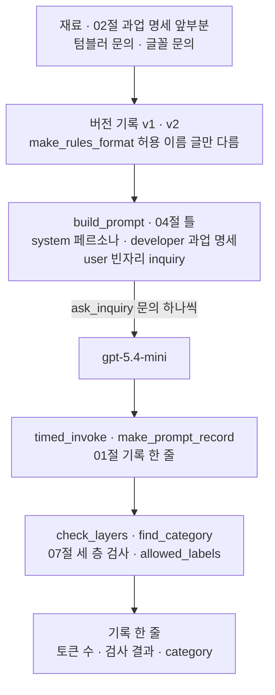
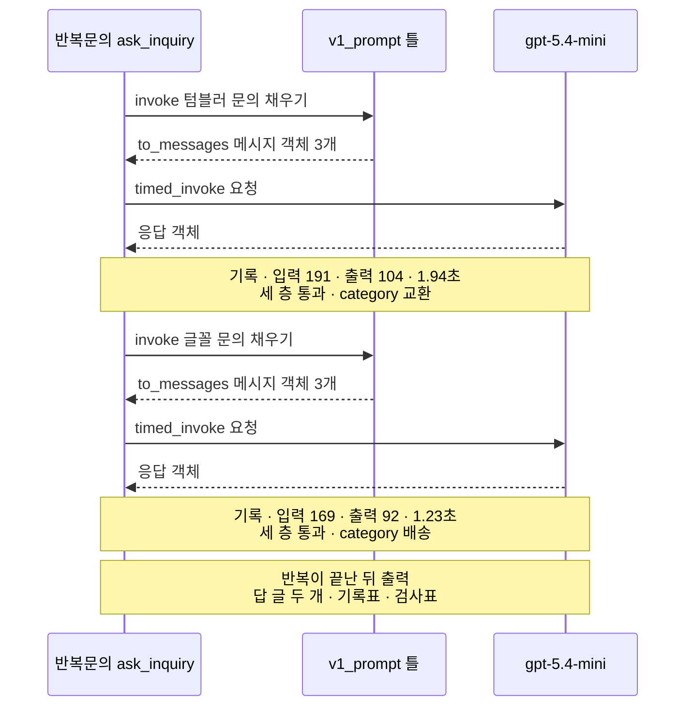
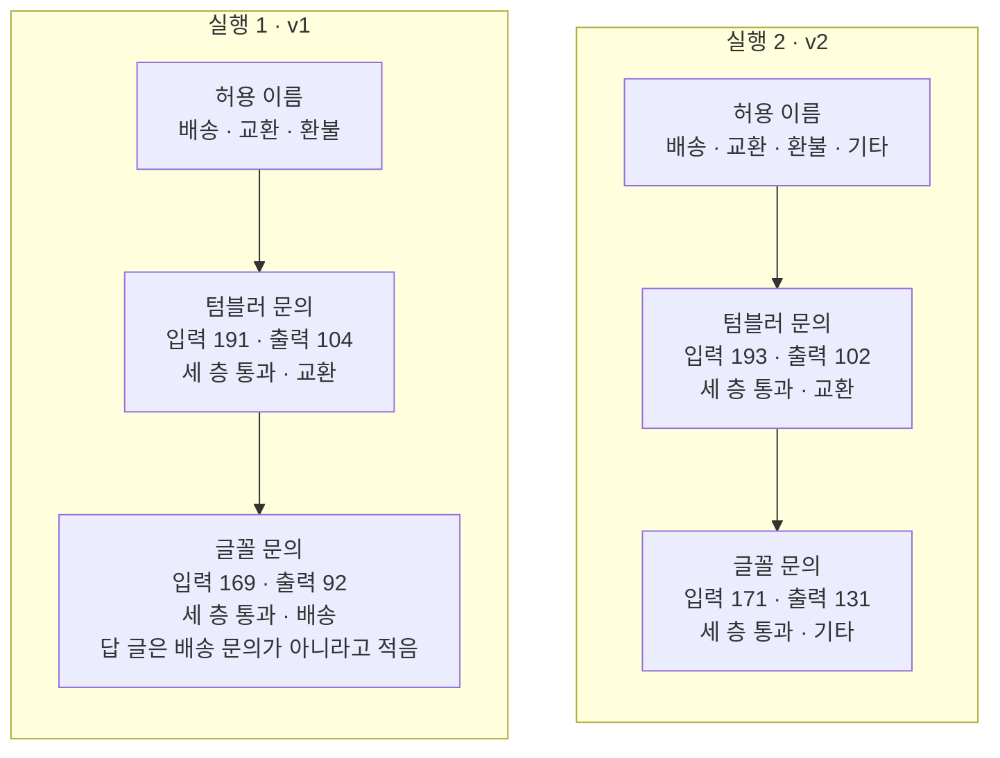

# 09-프롬프트-엔지니어링-실습

## _src 본문 (HTML 원본)

```html
<!--meta: 실습 30분 | 코드 Jupyter Notebook | 새 용어 0개 -->
<h2 id="b1"><span class="no">1</span>학습 목표</h2>
<div class="goal"><ul><li>02절 과업 명세, 04절 틀, 07절 세 층 검사, 01절 기록 함수를 조립 함수 하나로 이을 수 있습니다.</li><li>세 층 검사를 모두 지난 답에서 원문을 읽어 내용 오류를 찾을 수 있습니다.</li><li>허용 이름 한 낱말만 바꾼 두 버전을 비교하고, 버전 기록에 허용 이름 목록을 함께 적는 이유를 설명할 수 있습니다.</li></ul></div>
<h2 id="b2"><span class="no">2</span>이 내용을 배우는 이유</h2>
<p>01~08절에서는 프롬프트를 한 곳씩 바꿔 가며 기법을 따로 익혔습니다. 실제 분류기에서는 이 기법이 한 요청에 함께 붙습니다. 메시지는 틀로 만들고 답은 JSON으로 받아 검사합니다. 프롬프트를 바꾸면 그 판을 버전으로 남깁니다.</p>
<p>이번 절은 이 챕터의 실습입니다. 앞 절에서 쓴 함수와 글을 한 노트북에 모아 강사와 함께 실행해 봅니다. 01~08절에서 쓴 이름과 문법만 쓰고, 따로 내는 과제는 없습니다.</p>
<p>실습 주제는 고객 문의 분류 틀에 JSON 검사와 버전 기록 붙이기입니다. 07절에서 글꼴 문의의 답은 세 층을 모두 지났지만, category 값은 배송이었습니다. 이번에는 허용 이름에 「기타」를 더한 버전을 만들어 원래 버전과 비교합니다.</p>
<p><strong>이 절의 질문</strong> — 세 층 검사를 모두 지난 답에도 남는 문제는 무엇일까요? 허용 이름 하나를 바꾼 버전은 어떻게 기록하고 비교할까요?</p>
<h2 id="b3"><span class="no">3</span>앞에서 배운 내용</h2>
<p>이번 실습은 아래 절에서 배운 것을 그대로 가져옵니다.</p>
<table><thead><tr><th>절</th><th>배운 것</th><th>실습에서 쓰는 곳</th></tr></thead><tbody>
<tr><td>Ch 6 01절</td><td><code>init_chat_model(…, temperature=0, reasoning_effort="none")</code>, <code>usage_metadata</code></td><td>준비 셀의 모델, 기록의 토큰 수</td></tr>
<tr><td>01절</td><td>역할별 튜플, <code>convert_to_messages()</code>의 developer 표시, <code>timed_invoke()</code>·<code>make_prompt_record()</code></td><td>틀에 넣는 developer 객체, 요청마다 기록 한 줄</td></tr>
<tr><td>02절</td><td>페르소나와 과업 명세 네 글(목표·필수 정보·금지 사항·출력 형식)</td><td>system 페르소나, 과업 명세 앞부분</td></tr>
<tr><td>04절</td><td><code>ChatPromptTemplate.from_messages()</code>, 빈자리 <code>{inquiry}</code>, 틀의 <code>invoke()</code>·<code>to_messages()</code></td><td>함수 <code>build_prompt()</code>, 조립 함수의 틀 채우기</td></tr>
<tr><td>06절</td><td>허용 이름을 먼저 정하고, 밖의 이름은 형식 오류로 기록하기</td><td>두 버전의 허용 이름 목록</td></tr>
<tr><td>07절</td><td>값 규칙 출력 형식, 세 층 검사 함수 네 개, 내용 오류는 원문을 읽어 찾기</td><td>함수 <code>make_rules_format()</code>, 검사표, 글꼴 문의 원문 읽기</td></tr>
<tr><td>08절</td><td>버전 기록 딕셔너리(버전·바꾼 것·바꾼 이유·과업 명세), 기록에 새 키 더하기, 한 번씩 보낸 비교의 한계</td><td><code>v1_version</code>·<code>v2_version</code>, 기록의 키 <code>검사</code>·<code>category</code></td></tr>
</tbody></table>
<p>페르소나·과업 명세·텀블러 문의는 02~08절과 글자까지 같습니다. 글꼴 문의는 03·07절에서 쓴 글입니다.</p>
<p>함수 <code>make_rules_format()</code>·<code>find_category()</code>·<code>build_prompt()</code>·<code>ask_inquiry()</code>는 이 실습에서 새로 정의합니다. 나머지 함수 여섯 개는 01·07절과 같은 코드입니다.</p>
<p>03절 예시, 04절 대화 기록, 05절 근거 줄, 06절 표본 합의, 08절 비용 함수는 쓰지 않습니다. 이 실습은 파일에 쓰지 않으므로, 08절이 쓴 <code>runs/prompt-ab-continuity.json</code>도 그대로 둡니다.</p>
<h2 id="b4"><span class="no">4</span>핵심 개념</h2>
<h3>비유로 시작하기</h3>
<p>02~08절 그림의 나무 책상이 이번에는 두 개 나란히 있습니다. 두 책상 모두 뒤쪽에 파란 명찰과 주황 클립보드가 있고, 앞쪽에는 작은 나무 상자가 줄지어 있습니다.</p>
<p>우편물 분류 선반에 칸이 셋뿐이면, 어느 칸에도 맞지 않는 편지도 억지로 한 칸에 들어갑니다. 칸을 하나 더 만들면 그 편지가 갈 곳이 생깁니다. 대신 칸 목록이 바뀐 것을 적어 두어야, 나중에 어느 선반으로 나눈 결과인지 알 수 있습니다.</p>
{{img:09-4-분류함과-기타-상자|같은 모양 나무 책상 두 개가 나란히 있고, 두 책상 모두 뒤쪽에 파란 명찰과 주황 클립보드가 있으며, 왼쪽 책상 앞줄의 트럭·둥근 화살표·동전 그림 상자 셋 가운데 붓 메모지가 트럭 상자에 비스듬히 끼어 있고, 오른쪽 책상 앞줄에는 같은 세 상자와 회색 빈 상자가 있어 붓 메모지가 회색 상자에 바르게 들어가 있으며, 금 간 컵 메모지는 두 책상 모두 둥근 화살표 상자에 있는 삽화|상자가 셋인 책상에서는 붓 메모지가 트럭 상자에 억지로 끼고, 회색 상자를 더한 책상에서는 제자리를 찾습니다.}}
<p><strong>그림 읽기</strong> — 왼쪽 책상이 실행 1, 오른쪽 책상이 실행 2입니다. 두 책상의 파란 명찰은 페르소나(system), 주황 클립보드는 과업 명세(developer)입니다. 오른쪽 클립보드는 줄이 더 많아, 출력 형식 글이 조금 늘어난 모습입니다.</p>
<p>앞줄 상자의 트럭·둥근 화살표·동전 그림은 허용 이름 배송·교환·환불입니다. 오른쪽 책상 끝 회색 빈 상자는 새로 더한 기타입니다. 노란 메모지는 고객 문의입니다. 금 간 컵 메모지(텀블러 문의)는 두 책상 모두 둥근 화살표 상자, 곧 교환에 들어가 있습니다.</p>
<p>붓이 그려진 메모지는 글꼴 문의입니다. 왼쪽 책상에서는 트럭 상자에 비스듬히 반쯤 끼어 있고, 오른쪽 책상에서는 회색 상자에 바르게 들어가 있습니다. 02~08절 그림의 연보라 카드는 답이었지만, 이 그림은 답 카드 대신 메모지가 들어간 상자로 분류 결과를 보여 줍니다.</p>
<h3>실습 조립의 구성</h3>
{{mermaid:09-1-조립도|맨 위 초록 상자 재료 02절 과업 명세 앞부분과 텀블러 문의 글꼴 문의가 초록 상자 버전 기록 v1 v2 make_rules_format 허용 이름 글만 다름으로 이어지고, 파란 상자 build_prompt 04절 틀을 지나 ask_inquiry 문의 하나씩 화살표로 보라 상자 gpt-5.4-mini에 가며, 파란 상자 timed_invoke make_prompt_record 01절 기록 한 줄과 파란 상자 check_layers find_category 07절 세 층 검사를 거쳐 노란 상자 기록 한 줄 토큰 수 검사 결과 category로 가는 조립도|실습 조립 순서. 허용 이름 글만 다른 두 버전이 틀이 되고, 문의마다 요청 → 기록 한 줄 → 세 층 검사를 거칩니다.}}
<p><strong>도식 읽기</strong> — 위에서 아래로 읽습니다. 초록 상자 두 개는 노트북 3·4절에서 만든 재료와 버전 기록입니다. 파란 상자 세 개는 노트북에서 정의한 함수이고, 보라 상자는 요청을 받는 모델입니다. 맨 아래 노란 상자가 요청마다 남기는 기록 한 줄입니다.</p>
<p>두 버전은 함수 <code>make_rules_format()</code>에 넣은 허용 이름 글만 다릅니다. 과업 명세는 파란 상자 <code>build_prompt</code>에서 틀이 됩니다. 조립 함수 <code>ask_inquiry()</code>가 그 틀에 문의를 하나씩 채워 모델에 보냅니다. 받은 답은 기록 한 줄이 되고, 세 층 검사 결과와 꺼낸 category 값이 새 키로 더해집니다.</p>
<table><thead><tr><th>함수</th><th>하는 일</th><th>가져온 곳</th></tr></thead><tbody>
<tr><td><code>make_rules_format(label_text)</code></td><td>허용 이름 글을 받아 07절 값 규칙 출력 형식과 같은 모양의 글을 반환</td><td>07절 글(새로 정의)</td></tr>
<tr><td><code>build_prompt(task_text)</code></td><td>과업 명세 글로 system·developer·user 틀을 반환</td><td>01·04절(새로 정의)</td></tr>
<tr><td><code>check_layers(answer_text)</code></td><td>JSON 읽기·없는 키·값 규칙 문제를 딕셔너리 한 줄로 반환</td><td>07절과 같은 코드</td></tr>
<tr><td><code>find_category(answer_text)</code></td><td>답 글의 category 값을 반환하고, 꺼낼 수 없으면 「꺼내지 못함」을 반환</td><td>07절 11절(새로 정의)</td></tr>
<tr><td><code>ask_inquiry(prompt, version_name, inquiry_name, inquiry)</code></td><td>틀 채우기 → 요청 → 기록 한 줄 → 검사 결과·category 더하기</td><td>01·04·07·08절(새로 정의)</td></tr>
</tbody></table>
<h3>허용 이름이 들어가는 두 곳</h3>
<p>허용 이름은 프롬프트의 출력 형식 글에 들어갑니다. 그리고 07절 함수 <code>find_value_problems()</code>가 읽는 바깥 이름 <code>allowed_labels</code>에도 들어갑니다. 한 곳만 바꾸면 모델이 「기타」로 답해도 검사가 문제로 기록합니다.</p>
<p>노트북 5절 확인 셀에서 같은 「기타」 답 글을 두 번 검사했습니다. <code>v1</code> 목록으로는 <code>['category 값이 허용 이름 밖']</code>, <code>v2</code> 목록으로는 <code>[]</code>였습니다.</p>
<p>그래서 두 버전 딕셔너리에 키 <code>허용 이름</code>을 더하고, 같은 허용 이름 글에서 출력 형식과 목록을 함께 만듭니다. 글 메서드 <code>split(", ")</code>은 02절에서 쓴 <code>split("\n")</code>과 같은 메서드이고, 쉼표와 공백이 있는 자리에서 글을 자릅니다.</p>
<h3>두 번의 실행</h3>
<p>실행 1은 허용 이름이 배송·교환·환불인 <code>v1</code> 틀로 텀블러 문의와 글꼴 문의를 보냅니다. 실행 2는 허용 이름에 「기타」 한 낱말만 더한 <code>v2</code> 틀로 같은 두 문의를 보냅니다. 페르소나, 과업 명세 앞부분, 문의, 모델, 조립 함수는 두 실행이 같습니다.</p>
<h2 id="b5"><span class="no">5</span>실행 예제</h2>
<p>노트북은 재료와 두 버전 기록을 만든 뒤, 07절 검사 함수와 01절 기록 함수를 준비합니다. 요청 전에 직접 적은 답 글로 검사 장치를 확인하고, 틀을 채운 메시지 객체를 봅니다. 그다음 실행 1, 실행 2, 두 실행 비교를 차례로 합니다.</p>
<p>실제 OpenAI 모델을 temperature 0으로 부릅니다. 이 페이지의 출력은 2026-09-17에 실행한 결과입니다. 요청은 모두 4번이고, 예상 비용은 0.01달러 미만입니다. 답 문장과 토큰 수는 실행마다 달라질 수 있습니다.</p>
{{notebook:09-프롬프트-엔지니어링-실습}}
<p class="look"><b>확인할 점</b> — 8번 검사표에서 세 층을 지난 글꼴 문의의 category 값을 봅니다. 10번 비교 표에서는 두 버전의 입력 토큰 수와 category 값을 봅니다.</p>
<h3>실행 1의 실제 순서</h3>
{{mermaid:09-2-실행1-순서|반복문의 ask_inquiry, v1_prompt 틀, gpt-5.4-mini 세 세로줄 사이에서 텀블러 문의로 틀을 채워 메시지 객체 3개를 받고 모델에 요청해 응답 객체를 받은 뒤 노란 메모 기록 입력 191 출력 104 1.94초 세 층 통과 category 교환, 글꼴 문의도 같은 차례로 노란 메모 입력 169 출력 92 1.23초 세 층 통과 category 배송, 맨 아래 노란 메모 반복이 끝난 뒤 답 글 두 개 기록표 검사표 출력이 붙은 순서도|실행 1(v1)에서 조립 함수, 틀, 모델이 주고받은 차례. 두 답 모두 세 층을 지났고, 글꼴 문의는 배송으로 분류됐습니다.}}
<p><strong>도식 읽기</strong> — 위에서 아래로 시간이 흐릅니다. 세로줄은 왼쪽부터 반복문 안에서 불린 조립 함수 <code>ask_inquiry()</code>, 버전 <code>v1</code> 틀, 모델 <code>gpt-5.4-mini</code>입니다. 실선은 보낸 요청이고, 점선은 받은 결과입니다.</p>
<p>노란 메모 두 개는 응답을 받은 직후 만든 기록 한 줄과 검사 결과입니다. 「세 층 통과」는 검사표의 <code>읽음 | [] | []</code>를 줄여 적은 말입니다. 맨 아래 메모는 반복이 끝난 뒤 출력한 내용입니다.</p>
<h2 id="b6"><span class="no">6</span>실험 결과 해석</h2>
<p>실행 1에서 텀블러 문의 답은 <code>{"category":"교환"</code>으로 시작했고, 세 층을 모두 지났습니다. 글꼴 문의 답은 <code>{"category":"배송"</code>으로 시작했고, 역시 세 층을 모두 지났습니다. 입력 토큰 수 191과 169는 07절 「값 규칙」 목록, 글꼴 문의 목록의 입력 토큰 수와 같았습니다.</p>
<p>글꼴 문의 답의 next_action 값에는 <code>주문 배송 관련 문의가 아니어서</code>라는 말이 있었습니다. 답 글 스스로 배송 문의가 아니라고 말하면서, category 값은 배송을 고른 것입니다. 배송은 허용 이름 안의 값이라 코드 검사로는 문제가 보이지 않았고, 원문을 읽어서 찾았습니다.</p>
{{mermaid:09-3-두-실행-비교|왼쪽 실행 1 v1 큰 상자에서 초록 상자 허용 이름 배송 교환 환불이 노란 상자 텀블러 문의 입력 191 출력 104 세 층 통과 교환과 노란 상자 글꼴 문의 입력 169 출력 92 세 층 통과 배송 답 글은 배송 문의가 아니라고 적음으로 이어지고, 오른쪽 실행 2 v2 큰 상자에서 초록 상자 허용 이름 배송 교환 환불 기타가 노란 상자 텀블러 문의 입력 193 출력 102 세 층 통과 교환과 노란 상자 글꼴 문의 입력 171 출력 131 세 층 통과 기타로 이어지는 비교 그림|허용 이름 글만 바꾼 두 실행. 텀블러 문의는 두 버전 모두 교환이고, 글꼴 문의만 배송에서 기타로 바뀌었습니다.}}
<p><strong>도식 읽기</strong> — 왼쪽 큰 상자는 실행 1, 오른쪽 큰 상자는 실행 2이고, 큰 상자 안은 위에서 아래로 읽습니다. 맨 위 초록 상자는 그 버전의 허용 이름입니다. 노란 상자 두 개는 노트북 10번 비교 표에서 읽은 문의별 결과입니다.</p>
<p>두 큰 상자에서 분류가 달라진 곳은 글꼴 문의뿐입니다. 텀블러 문의는 두 버전 모두 교환이었습니다. 입력 토큰 수는 두 문의 모두 <code>v2</code>가 2개 많았습니다. 허용 이름 글에 더한 4글자 몫으로 보입니다.</p>
<p>출력 토큰 수는 글꼴 문의에서 92와 131로 크게 달랐습니다. 교재를 만들 때 같은 코드로 한 앞선 새 커널 실행에서는 93과 94였습니다. 그래서 이 출력 차이를 허용 이름 탓으로 보지 않습니다.</p>
<p>실행 2의 글꼴 문의 답은 next_action 값을 고객에게 하는 말로 적었습니다. 07절에서도 next_action 값의 말투는 조건마다 달랐고, 이번 실습은 말투를 검사하지 않았습니다.</p>
<p>결론은 이렇습니다. 세 층 검사를 모두 지난 답에도 내용 오류가 남았고, 그 오류는 원문을 읽어 찾았습니다. 허용 이름에 「기타」를 더한 버전에서는 글꼴 문의가 기타로 분류됐습니다. 허용 이름은 프롬프트와 검사 목록에 함께 들어가므로, 버전 기록에 목록도 함께 적습니다. 이 결과는 문의 두 개를 버전마다 한 번씩 보낸 범위입니다.</p>
<h2 id="b7"><span class="no">7</span>주의할 점과 실무 메모</h2>
<ul><li>두 문의와 「기타」 한 낱말은 흐름을 보여 주려고 정한 예입니다. 교재를 만들 때 기기 셸에서 네 요청을 먼저 세 번 보냈습니다. 분류를 출력한 두 번과 새 커널 실행 두 번 모두 <code>v1</code> 글꼴 문의는 배송, <code>v2</code>는 기타였지만 늘 그렇다고 말하지 않습니다.</li>
<li>「기타」는 맞는 이름이 없는 문의를 모아 두는 자리입니다. 기타로 모인 문의는 사람이 따로 읽어야 합니다. 맞는 이름이 있는 문의까지 기타로 가는 경우는 이번에 확인하지 않았습니다.</li>
<li>버전 <code>v1</code>의 출력 형식 글은 07절 「값 규칙」 출력 형식과 글자까지 같습니다. 작업 중 기기 셸에서 두 글을 비교해 확인했고, 노트북에서는 4번 출력으로 보여 줍니다.</li>
<li>이름 <code>allowed_labels</code>는 함수 바깥의 이름이라, 실행 1·2 셀마다 첫 줄에서 그 버전의 목록을 담습니다. 셀을 순서 없이 다시 실행하면 다른 버전의 목록으로 검사할 수 있습니다.</li>
<li>버전마다 한 번씩 보낸 비교입니다. 08절에서 같은 버전을 다시 보내도 출력이 달라졌으므로, 작은 토큰 차이를 버전 탓으로 정하지 않았습니다. 걸린 초로 속도도 비교하지 않았습니다.</li>
<li>이 실습은 기록을 파일로 남기지 않았습니다. 08절 기록 파일은 Ch 8 06절이 지문으로 확인하는 파일이라, 실습 결과를 그 파일에 덮어쓰지 않습니다.</li>
<li>교재 출력은 Linux의 Python 3.12.13으로 만들었습니다. 패키지는 langchain 1.4.0, langchain-core 1.6.2, langchain-openai 1.6.0입니다. openai 3.10.0, python-dotenv 1.2.3도 함께 썼습니다. 다른 버전과 Windows·macOS에서는 실행하지 않았습니다.</li></ul>
<h2 id="b8"><span class="no">8</span>정리와 다음 절</h2>
<ul><li>02절 과업 명세, 04절 틀, 07절 세 층 검사, 01절 기록 함수를 조립 함수 <code>ask_inquiry()</code>로 이었습니다.</li><li>실행 1에서 글꼴 문의는 세 층을 모두 지났지만 배송으로 분류됐고, 답 원문을 읽어 내용 오류를 찾았습니다.</li><li>실행 2에서 허용 이름에 「기타」만 더하자 글꼴 문의가 기타로 분류됐습니다. 허용 이름 목록은 버전 기록에 함께 적습니다.</li></ul>
<p><strong>다음 학습과 이어지는 지점</strong> — Ch 7은 이 절에서 끝납니다. Ch 8에서는 프롬프트 한 문장보다 넓은, 모델에 넣는 입력 전체를 다룹니다. Ch 8 06절 노트북이 08절의 기록 파일과 지문을 읽습니다. 그 절은 도서관 질문으로 입력 설계 세 가지(full·selected·compressed)를 비교합니다.</p>
<p>두 챕터의 실험은 질문이 달라 수치를 직접 비교하지 않습니다. 이 실습은 파일을 쓰지 않아, Ch 8이 읽는 파일은 그대로입니다. 검색된 문서 순위의 평가는 Ch 11, 생성한 답의 평가는 Ch 15에서 다룹니다.</p>
<h2 id="b9"><span class="no">9</span>복습 문제</h2>
<details class="quiz"><summary>문제 1 · 세 층을 지난 답</summary><p class="quiz-q">실행 1에서 글꼴 문의 답은 세 층 검사를 모두 지났습니다. 그래도 이 답에 문제가 있다고 본 근거는 무엇인가요?</p><p class="quiz-a"><b>해설</b> — next_action 값이 「주문 배송 관련 문의가 아니어서」라고 적어, 답 스스로 배송 문의가 아니라고 말했습니다. 그런데 category 값은 배송이었습니다. 배송은 허용 이름 안의 값이라 코드 검사는 문제를 기록하지 않았고, 원문을 읽어 찾았습니다.</p></details>
<details class="quiz"><summary>문제 2 · 한 곳만 바꾼 허용 이름</summary><p class="quiz-q">프롬프트에만 「기타」를 더하고 <code>allowed_labels</code>에는 <code>v1</code> 목록을 둔 채 실행하면, 기록에 무엇이 남을 수 있나요?</p><p class="quiz-a"><b>해설</b> — 모델이 기타로 답하면 값 규칙 문제에 「category 값이 허용 이름 밖」이 기록됩니다. 노트북 5절 확인 셀에서 같은 답 글을 <code>v1</code> 목록으로 검사한 결과가 그랬습니다. 그래서 버전 기록에 허용 이름 목록을 함께 적고, 실행 셀 첫 줄에서 그 목록을 담습니다.</p></details>
<details class="quiz"><summary>문제 3 · 같은 입력 토큰 수</summary><p class="quiz-q">실행 1의 입력 토큰 수 191과 169는 07절과 같았습니다. 이 값으로 알 수 있는 것과 알 수 없는 것은 무엇인가요?</p><p class="quiz-a"><b>해설</b> — 틀로 만든 목록이 07절 튜플 목록과 같은 양의 글을 보냈다는 것과 맞는 결과입니다. 04절에서도 틀로 만든 목록이 03절 목록을 바꾼 결과와 같았습니다. 다만 토큰 수가 같다는 것만으로 글자까지 같다고 증명하지는 않습니다.</p></details>
<details class="quiz"><summary>문제 4 · 출력 토큰 차이</summary><p class="quiz-q">글꼴 문의의 출력 토큰 수가 <code>v1</code> 92에서 <code>v2</code> 131로 늘었습니다. 「기타」를 더해서 답이 길어졌다고 말할 수 있나요?</p><p class="quiz-a"><b>해설</b> — 말할 수 없습니다. 앞선 새 커널 실행에서는 같은 코드로 93과 94였습니다. 08절처럼 같은 버전 안에서도 출력이 달라지므로, 버전마다 여러 번 보내 비교해야 합니다.</p></details>
<details class="quiz"><summary>문제 5 · 이 절의 질문</summary><p class="quiz-q">세 층 검사를 모두 지난 답에도 남는 문제는 무엇이고, 허용 이름 하나를 바꾼 버전은 어떻게 기록하고 비교하나요?</p><p class="quiz-a"><b>해설</b> — 허용 이름 안의 값이지만 문의와 맞지 않는 분류, 곧 내용 오류가 남았습니다. 허용 이름을 바꾼 버전은 바꾼 것·바꾼 이유와 함께 허용 이름 목록을 기록합니다. 같은 문의를 보내 category 값과 검사 결과를 나란히 비교하되, 한 번씩 보낸 결과로 일반화하지 않습니다.</p></details>
<h2 id="b10"><span class="no">10</span>참고 자료</h2>
<p>아래 문서는 04·07절 작업에서 2026-09-17에 확인했습니다. 코드는 실습 가상환경에 설치한 <code>langchain 1.4.0</code>, <code>langchain-core 1.6.2</code>, <code>langchain-openai 1.6.0</code>으로 실행했습니다.</p>
<ul><li><div><a href="https://reference.langchain.com/python/langchain-core/prompts/chat/ChatPromptTemplate">LangChain ChatPromptTemplate reference</a></div>메시지 틀 만들기와 채울 이름 · 확인 2026-09-17</li><li><div><a href="https://docs.python.org/3.12/library/json.html">Python 3.12 json — JSON encoder and decoder</a></div>함수 <code>json.loads()</code>와 <code>JSONDecodeError</code> · 확인 2026-09-17</li><li><div><a href="https://developers.openai.com/api/docs/guides/structured-outputs">OpenAI Structured Outputs</a></div>출력 형식 글로 JSON을 요청하는 방법과 Structured Outputs의 차이 · 확인 2026-09-17</li><li><div><a href="https://github.com/langchain-ai/langchain/blob/master/LICENSE">LangChain MIT License</a></div>예제의 고객 문의·출력 형식과 설명은 이 교재에 맞게 새로 썼습니다</li></ul>
```

## 노트북 셀 (순서대로)

### [0] markdown {'html': 'skip'}

# 프롬프트 엔지니어링 실습: 고객 문의 분류 틀에 JSON 검사와 버전 기록 붙이기

**이 노트북에서 할 일**

1. 04절 틀에 02절 과업 명세와 07절 JSON 출력 형식을 넣고, 07절 세 층 검사와 01절 기록 함수를 붙입니다.
2. 허용 이름이 셋인 버전 `v1` 틀에 텀블러 문의와 글꼴 문의를 채워 보내고, 결과를 봅니다(실행 1).
3. 허용 이름에 「기타」 한 낱말만 더한 `v2`로 같은 두 문의를 보내고, 두 실행을 비교합니다(실행 2).

**준비물** — 프로젝트 폴더 `.env` 파일의 `OPENAI_API_KEY`가 필요합니다. 읽는 데이터 파일은 없습니다.

인터넷 서비스에 요청을 모두 4번 보냅니다. 모두 `gpt-5.4-mini`이고, 실행 1과 실행 2에 2번씩입니다.
실행 시간은 1분 안팎이고, 예상 비용은 0.01달러 미만입니다.
요금은 Ch 6 06절에서 2026-09-17에 확인한 mini 공식 요금 기준입니다.

이 노트북은 파일을 만들거나 고치지 않습니다. 08절이 쓴 `runs` 폴더의 기록 파일도 건드리지 않습니다.

**기준 버전** — 실습 폴더에 고정한 패키지 판을 씁니다. langchain 1.4.0, langchain-core 1.6.2, langchain-openai 1.6.0입니다.
openai 3.10.0, python-dotenv 1.2.3도 함께 씁니다.

교재 출력은 Linux의 Python 3.12.13으로 만들었습니다. 다른 버전과 Windows·macOS에서는 이번에 실행하지 않았습니다.

실습 폴더 `labs/part2/ch07-prompt-engineering`에서 `uv sync --locked`를 실행합니다.
그다음 이 폴더의 `.venv` 커널을 고르고 첫 셀부터 순서대로 실행합니다.

01~08절에서 쓴 이름과 문법만 씁니다. 강사와 함께 셀을 차례로 실행하며, 따로 내는 과제는 없습니다.

### [1] markdown {'html': 'skip'}

## 오늘 볼 그림


위에서 아래로 읽습니다. 초록 상자는 노트북에서 만든 글과 버전 기록이고, 파란 상자는 노트북에서 정의한 함수입니다.
보라 상자는 요청을 받는 모델이고, 맨 아래 노란 상자가 요청마다 남기는 기록 한 줄입니다.
두 버전은 허용 이름 글만 다르고, 나머지 조립은 같습니다.

### [2] markdown {}

## 1. 준비

첫 셀은 패키지를 설치하고 설치된 버전을 출력합니다. 설치에는 몇십 초가 걸릴 수 있습니다.

### [3] code {'execution': {'iopub.execute_input': '2026-09-17T07:41:51.883271Z', 'iopub.status.busy': '2026-09-17T07:41:51.883072Z', 'iopub.status.idle': '2026-09-17T07:41:52.502607Z', 'shell.execute_reply': '2026-09-17T07:41:52.502016Z'}, 'lesson_role': 'setup'}

```python
# 이 절에서 쓰는 패키지를 설치하고 버전을 확인합니다
%pip install -q "langchain==1.4.0" "langchain-openai==1.6.0" "python-dotenv==1.2.3"
from importlib.metadata import version

print("langchain:", version("langchain"))
print("langchain-core:", version("langchain-core"))
print("langchain-openai:", version("langchain-openai"))
print("openai:", version("openai"))
print("python-dotenv:", version("python-dotenv"))
```

출력:
```
Note: you may need to restart the kernel to use updated packages.
langchain: 1.4.0
langchain-core: 1.6.2
langchain-openai: 1.6.0
openai: 3.10.0
python-dotenv: 1.2.3

```

### [4] markdown {}

**결과 읽기** — 출력 줄은 `langchain: 1.4.0`, `langchain-core: 1.6.2`, `openai: 3.10.0` 등 다섯 줄입니다.
준비물에 적은 기준 버전과 같습니다.

이번 실습에서 쓸 이름을 불러옵니다. 모듈 `json`은 07절, 모듈 `time`은 01절에서 불러왔습니다.
함수 `convert_to_messages`는 01절, 틀 클래스 `ChatPromptTemplate`은 04절에서 썼습니다.

### [5] code {'execution': {'iopub.execute_input': '2026-09-17T07:41:52.503766Z', 'iopub.status.busy': '2026-09-17T07:41:52.503672Z', 'iopub.status.idle': '2026-09-17T07:41:52.915099Z', 'shell.execute_reply': '2026-09-17T07:41:52.914654Z'}, 'lesson_role': 'setup'}

```python
# JSON 글을 읽는 모듈, 시간을 재는 모듈, 모델 객체·메시지 객체·틀을 만드는 도구를 불러옵니다
import json
import time

from langchain.chat_models import init_chat_model
from langchain_core.messages import convert_to_messages
from langchain_core.prompts import ChatPromptTemplate
```

출력:
```

```

### [6] markdown {}

01절과 같은 셀로 API 키가 있는지 확인합니다. 키 값은 출력하지 않고, 있는지만 봅니다.
`True` 값이 나오면 다음으로 넘어갑니다.

### [7] code {'execution': {'iopub.execute_input': '2026-09-17T07:41:52.915844Z', 'iopub.status.busy': '2026-09-17T07:41:52.915778Z', 'iopub.status.idle': '2026-09-17T07:41:52.920230Z', 'shell.execute_reply': '2026-09-17T07:41:52.919944Z'}, 'lesson_role': 'setup'}

```python
# .env 파일에서 OpenAI API 키를 읽습니다(키 값은 출력하지 않습니다)
import os
from dotenv import find_dotenv, load_dotenv

env_path = find_dotenv(usecwd=True)
load_dotenv(env_path)
has_key = os.getenv("OPENAI_API_KEY") is not None
print("OPENAI_API_KEY 설정 여부:", has_key)
assert has_key, "프로젝트 폴더의 .env 파일에 OPENAI_API_KEY를 적어 주세요."
```

출력:
```
OPENAI_API_KEY 설정 여부: True

```

### [8] markdown {}

실습에 쓸 모델을 준비합니다.
01절과 같은 설정으로 모델 객체를 만듭니다. 이 셀은 요청을 보내지 않습니다.

### [9] code {'execution': {'iopub.execute_input': '2026-09-17T07:41:52.920849Z', 'iopub.status.busy': '2026-09-17T07:41:52.920780Z', 'iopub.status.idle': '2026-09-17T07:41:53.749186Z', 'shell.execute_reply': '2026-09-17T07:41:53.748798Z'}}

```python
# 실습에 쓸 모델을 준비합니다
model = init_chat_model(
    "openai:gpt-5.4-mini",
    temperature=0,
    reasoning_effort="none",
)
print("모델 이름:", model.model_name)
print("temperature:", model.temperature)
```

출력:
```
모델 이름: gpt-5.4-mini
temperature: 0.0

```

### [10] markdown {}

**결과 읽기** — 출력 줄은 `모델 이름: gpt-5.4-mini`와 `temperature: 0.0`입니다. 이것으로 준비가 끝났습니다.
이 노트북의 출력은 2026-09-17에 이 모델로 실행한 결과입니다.
실행마다 답 문장, 토큰 수, 걸린 초가 달라질 수 있습니다.

### [11] markdown {}

## 2. 실습 주제 — 고객 문의 분류 틀에 JSON 검사와 버전 기록 붙이기

상담 창구에 들어온 고객 문의를 프로그램이 분류하는 작은 분류기를 떠올립니다. 답은 07절처럼 JSON으로 받아, 프로그램이 값을 꺼냅니다.
메시지 목록은 04절 틀로 만들고, 고객 문의만 빈자리에 채웁니다. 요청마다 01절 기록 한 줄과 07절 세 층 검사 결과를 남깁니다.

07절 11절에서는 글꼴 문의의 답이 세 층을 모두 지났지만, category 값은 `배송`이었습니다.
허용 이름이 배송·교환·환불 셋뿐이라, 맞는 이름이 없는데도 셋 가운데 하나를 고른 답입니다.
그래서 이번 실습은 허용 이름에 「기타」를 더한 버전을 08절처럼 기록하고, 원래 버전과 비교합니다.

실행 1은 허용 이름이 셋인 `v1`, 실행 2는 「기타」를 더한 `v2`로 같은 두 문의를 보냅니다. 두 실행에서 바꾸는 값은 허용 이름 글 하나입니다.
03절 예시, 04절 대화 기록, 05절 근거 줄, 06절 표본 합의는 이번 실습에서 쓰지 않습니다.

### [12] markdown {}

## 3. 재료 만들기 — 과업 명세 앞부분과 문의 두 개

페르소나와 과업 명세의 목표·필수 정보·금지 사항은 02절과 같은 글입니다. 07절처럼 세 글을 줄바꿈으로 이어 과업 명세 앞부분을 만듭니다.
출력 형식은 4절에서 버전마다 따로 붙입니다.

문의는 01~08절의 텀블러 문의와, 03·07절에서 쓴 글꼴 문의 두 개입니다. 문의 이름과 글을 튜플로 묶어 목록에 담습니다.

실행 전에 예상합니다. 문의 수는 2일 것입니다.

### [13] code {'execution': {'iopub.execute_input': '2026-09-17T07:41:53.749949Z', 'iopub.status.busy': '2026-09-17T07:41:53.749882Z', 'iopub.status.idle': '2026-09-17T07:41:53.751970Z', 'shell.execute_reply': '2026-09-17T07:41:53.751651Z'}}

```python
# 02절과 같은 글로 과업 명세 앞부분을 만들고, 문의 이름과 글을 튜플로 묶어 목록에 담습니다
persona_text = "당신은 친절한 고객 상담원입니다."
goal_text = "고객 문의를 분류하고 필요한 다음 행동을 안내하세요."
required_text = "회사 규정상 교환 접수에는 파손 사진이 필요합니다. 주문번호는 답에 그대로 적으세요."
forbidden_text = "근거 없는 보상은 약속하지 마세요."
task_start_text = goal_text + "\n" + required_text + "\n" + forbidden_text + "\n"
inquiry_text = "어제 받은 텀블러 뚜껑이 깨졌습니다. 주문번호는 A-1042입니다. 새 상품으로 바꾸고 싶습니다."
font_inquiry_text = "뉴스레터 글꼴을 바꾸고 싶습니다."
inquiries = [("텀블러 문의", inquiry_text), ("글꼴 문의", font_inquiry_text)]
print("페르소나:", persona_text)
print("과업 명세 앞부분:")
print(task_start_text)
print("문의 수:", len(inquiries))
```

출력:
```
페르소나: 당신은 친절한 고객 상담원입니다.
과업 명세 앞부분:
고객 문의를 분류하고 필요한 다음 행동을 안내하세요.
회사 규정상 교환 접수에는 파손 사진이 필요합니다. 주문번호는 답에 그대로 적으세요.
근거 없는 보상은 약속하지 마세요.

문의 수: 2

```

### [14] markdown {}

**결과 읽기** — 라벨 줄 `과업 명세 앞부분:` 아래에 목표·필수 정보·금지 사항 세 줄이 나옵니다.
글 끝에 줄바꿈을 하나 붙여 두어서 그 아래에 빈 줄이 하나 보입니다. 마지막 줄은 `문의 수: 2`입니다.

## 4. 재료 만들기 — 허용 이름만 다른 두 버전

출력 형식은 07절 「값 규칙」 출력 형식과 같은 네 문장입니다. 그 가운데 category 값의 허용 이름을 적는 자리만 인자로 받는 함수를 만듭니다.
인자 `label_text`에는 `"배송, 교환, 환불"`처럼 쉼표로 이은 글을 넣습니다. 이 셀은 함수를 정의만 합니다.

### [15] code {'execution': {'iopub.execute_input': '2026-09-17T07:41:53.752506Z', 'iopub.status.busy': '2026-09-17T07:41:53.752450Z', 'iopub.status.idle': '2026-09-17T07:41:53.754313Z', 'shell.execute_reply': '2026-09-17T07:41:53.753902Z'}}

```python
# 허용 이름 글 하나를 받아, 07절 값 규칙 출력 형식과 같은 모양의 글을 반환하는 함수를 정의합니다
def make_rules_format(label_text):
    rules_text = "분류, 다음 행동, 고객에게 보낼 한 문장을 JSON으로 답하세요."
    rules_text = rules_text + " 키 이름은 category, next_action, customer_message로 적으세요."
    # 버전마다 달라지는 곳은 이 문장의 허용 이름 글뿐입니다
    rules_text = rules_text + " category 값은 " + label_text + " 가운데 한 낱말이고, 세 값은 모두 글로 적으세요."
    rules_text = rules_text + " 코드 블록 표시(```)나 설명 글 없이 JSON 객체 하나만 적으세요."
    return rules_text
```

출력:
```

```

### [16] markdown {}

**결과 읽기** — 정의만 하는 셀이라 출력이 없습니다.

두 버전의 허용 이름 글을 정하고 출력 형식을 만듭니다. 07절 검사 함수가 읽는 필요한 키 목록 `required_keys`도 07절과 같이 담습니다.
두 출력 형식의 글자 수 차이는 변수에 먼저 담은 뒤 출력합니다.

실행 전에 예상합니다. `v2` 출력 형식은 쉼표·공백·「기타」만큼, 곧 4글자 많을 것입니다.

### [17] code {'execution': {'iopub.execute_input': '2026-09-17T07:41:53.754854Z', 'iopub.status.busy': '2026-09-17T07:41:53.754792Z', 'iopub.status.idle': '2026-09-17T07:41:53.756556Z', 'shell.execute_reply': '2026-09-17T07:41:53.756260Z'}}

```python
# 두 버전의 허용 이름 글로 출력 형식을 만들고, 07절 검사가 읽는 필요한 키 목록을 담습니다
required_keys = ["category", "next_action", "customer_message"]
v1_label_text = "배송, 교환, 환불"
v2_label_text = "배송, 교환, 환불, 기타"
v1_format_text = make_rules_format(v1_label_text)
v2_format_text = make_rules_format(v2_label_text)
added_characters = len(v2_format_text) - len(v1_format_text)
print("v1 출력 형식:")
print(v1_format_text)
print("v2 출력 형식에서 늘어난 글자 수:", added_characters)
```

출력:
```
v1 출력 형식:
분류, 다음 행동, 고객에게 보낼 한 문장을 JSON으로 답하세요. 키 이름은 category, next_action, customer_message로 적으세요. category 값은 배송, 교환, 환불 가운데 한 낱말이고, 세 값은 모두 글로 적으세요. 코드 블록 표시(```)나 설명 글 없이 JSON 객체 하나만 적으세요.
v2 출력 형식에서 늘어난 글자 수: 4

```

### [18] markdown {}

**결과 읽기** — 라벨 줄 `v1 출력 형식:` 아래 글은 07절 「값 규칙」 출력 형식과 같은 네 문장입니다.
마지막 줄은 `v2 출력 형식에서 늘어난 글자 수: 4`로, 예상과 같습니다.

이제 08절처럼 버전마다 이름·바꾼 것·바꾼 이유·과업 명세를 딕셔너리에 적습니다. 이번에는 검사할 허용 이름 목록도 키 `허용 이름`에 함께 적습니다.

글 메서드 `split(", ")`은 02절 `split("\n")`처럼 글을 잘라 목록을 만듭니다. 이번에는 쉼표와 공백이 있는 자리에서 자릅니다.
프롬프트에 넣는 글과 검사에 쓰는 목록을 같은 글 하나에서 만들어, 두 곳의 이름이 어긋나지 않게 합니다.

실행 전에 예상합니다. `v2` 줄의 허용 이름 목록만 이름이 4개일 것입니다.

### [19] code {'execution': {'iopub.execute_input': '2026-09-17T07:41:53.757065Z', 'iopub.status.busy': '2026-09-17T07:41:53.757016Z', 'iopub.status.idle': '2026-09-17T07:41:53.759051Z', 'shell.execute_reply': '2026-09-17T07:41:53.758693Z'}}

```python
# 08절처럼 버전마다 이름·바꾼 것·바꾼 이유·허용 이름·과업 명세를 딕셔너리에 적습니다
v1_version = {"버전": "v1", "바꾼 것": "기준선(07절 값 규칙 출력 형식)", "바꾼 이유": "07절에서 세 층 검사를 모두 지난 출력 형식",
              "허용 이름": v1_label_text.split(", "), "과업 명세": task_start_text + v1_format_text}
v2_version = {"버전": "v2", "바꾼 것": "허용 이름에 기타를 더함", "바꾼 이유": "07절에서 글꼴 문의가 배송으로 분류됨",
              "허용 이름": v2_label_text.split(", "), "과업 명세": task_start_text + v2_format_text}
prompt_versions = [v1_version, v2_version]
print("버전 | 바꾼 것 | 허용 이름")
for version in prompt_versions:
    print(version["버전"], "|", version["바꾼 것"], "|", version["허용 이름"])
```

출력:
```
버전 | 바꾼 것 | 허용 이름
v1 | 기준선(07절 값 규칙 출력 형식) | ['배송', '교환', '환불']
v2 | 허용 이름에 기타를 더함 | ['배송', '교환', '환불', '기타']

```

### [20] markdown {}

**결과 읽기** — 라벨 줄 아래 `v1` 줄의 허용 이름은 `['배송', '교환', '환불']`입니다.
`v2` 줄은 `['배송', '교환', '환불', '기타']`로, 예상대로 이름이 4개입니다. 두 버전의 과업 명세는 허용 이름 글 말고는 같습니다.

## 5. 기록 장치 — 07절 세 층 검사

답 글을 검사하는 함수 네 개는 07절과 같은 코드입니다. 첫 함수 `parse_json_answer()`는 답 글을 JSON으로 읽고, 읽은 값과 읽기 결과를 튜플로 반환합니다.
읽지 못하면 오류를 받아 결과 이름만 「구문 오류」로 바꿉니다. 이 셀은 함수를 정의만 합니다.

### [21] code {'execution': {'iopub.execute_input': '2026-09-17T07:41:53.759572Z', 'iopub.status.busy': '2026-09-17T07:41:53.759524Z', 'iopub.status.idle': '2026-09-17T07:41:53.761201Z', 'shell.execute_reply': '2026-09-17T07:41:53.760874Z'}}

```python
# 답 글을 JSON으로 읽어, 읽은 값과 읽기 결과(읽음·구문 오류)를 튜플로 반환하는 함수를 정의합니다(07절과 같은 코드)
def parse_json_answer(answer_text):
    parsed_value = None
    parse_result = "읽음"
    try:
        parsed_value = json.loads(answer_text)
    except json.JSONDecodeError:
        parse_result = "구문 오류"
    return parsed_value, parse_result
```

출력:
```

```

### [22] markdown {}

**결과 읽기** — 정의만 하는 셀이라 출력이 없습니다.

둘째 함수 `find_missing_keys()`는 읽은 딕셔너리에 없는 필요한 키 이름을 목록으로 반환합니다. 함수 바깥의 목록 `required_keys`를 읽습니다.

### [23] code {'execution': {'iopub.execute_input': '2026-09-17T07:41:53.761760Z', 'iopub.status.busy': '2026-09-17T07:41:53.761715Z', 'iopub.status.idle': '2026-09-17T07:41:53.763298Z', 'shell.execute_reply': '2026-09-17T07:41:53.762965Z'}}

```python
# 읽은 딕셔너리에 없는 키 이름을 목록으로 반환하는 함수를 정의합니다(07절과 같은 코드)
def find_missing_keys(parsed_value):
    missing_keys = []
    for key in required_keys:
        if key not in parsed_value:
            missing_keys.append(key)
    return missing_keys
```

출력:
```

```

### [24] markdown {}

**결과 읽기** — 정의만 하는 셀이라 출력이 없습니다.

셋째 함수 `find_value_problems()`는 필요한 키의 값이 글인지, category 값이 허용 이름인지 봅니다.
허용 이름은 함수 바깥의 이름 `allowed_labels`에서 읽습니다. 이 이름에 어느 버전의 목록을 담았는지는 7절 앞에서 확인합니다.

### [25] code {'execution': {'iopub.execute_input': '2026-09-17T07:41:53.763922Z', 'iopub.status.busy': '2026-09-17T07:41:53.763867Z', 'iopub.status.idle': '2026-09-17T07:41:53.765485Z', 'shell.execute_reply': '2026-09-17T07:41:53.765133Z'}}

```python
# 필요한 키의 값이 글인지, category 값이 허용 이름인지 보고 문제 목록을 반환하는 함수를 정의합니다(07절과 같은 코드)
def find_value_problems(parsed_value):
    value_problems = []
    for key, key_value in parsed_value.items():
        if key in required_keys and type(key_value).__name__ != "str":
            value_problems.append(key + " 값이 글이 아님")
    if "category" in parsed_value and parsed_value["category"] not in allowed_labels:
        value_problems.append("category 값이 허용 이름 밖")
    return value_problems
```

출력:
```

```

### [26] markdown {}

**결과 읽기** — 정의만 하는 셀이라 출력이 없습니다.

넷째 함수 `check_layers()`는 앞 세 함수로 답 글을 층마다 검사하고, 결과를 딕셔너리 한 줄로 반환합니다.
읽은 값이 딕셔너리일 때만 키와 값 규칙을 검사합니다. 아니면 두 층은 「검사 안 함」으로 남습니다.

### [27] code {'execution': {'iopub.execute_input': '2026-09-17T07:41:53.766054Z', 'iopub.status.busy': '2026-09-17T07:41:53.766000Z', 'iopub.status.idle': '2026-09-17T07:41:53.767673Z', 'shell.execute_reply': '2026-09-17T07:41:53.767319Z'}}

```python
# 세 함수로 답 글을 층마다 검사하고, 결과를 딕셔너리 한 줄로 반환하는 함수를 정의합니다(07절과 같은 코드)
def check_layers(answer_text):
    parsed_value, parse_result = parse_json_answer(answer_text)
    layer_record = {
        "JSON 읽기": parse_result,
        "값 종류": type(parsed_value).__name__,
        "없는 키": "검사 안 함",
        "값 규칙 문제": "검사 안 함",
    }
    if layer_record["값 종류"] == "dict":
        layer_record["없는 키"] = find_missing_keys(parsed_value)
        layer_record["값 규칙 문제"] = find_value_problems(parsed_value)
    return layer_record
```

출력:
```

```

### [28] markdown {}

**결과 읽기** — 정의만 하는 셀이라 출력이 없습니다.

마지막으로 답 글에서 category 값만 꺼내는 함수를 새로 만듭니다. 07절 11절에서는 읽은 딕셔너리에서 키로 값을 바로 꺼냈습니다.
이번에는 두 실행의 답을 같은 함수로 모아 보므로, 꺼낼 수 없는 답에서도 셀이 멈추지 않게 합니다.
읽은 값이 딕셔너리가 아니거나 category 키가 없으면, 처음 담은 글 「꺼내지 못함」이 남습니다. 이 셀은 함수를 정의만 합니다.

### [29] code {'execution': {'iopub.execute_input': '2026-09-17T07:41:53.768210Z', 'iopub.status.busy': '2026-09-17T07:41:53.768161Z', 'iopub.status.idle': '2026-09-17T07:41:53.769806Z', 'shell.execute_reply': '2026-09-17T07:41:53.769520Z'}}

```python
# 답 글을 JSON으로 읽어 category 값을 반환하고, 꺼낼 수 없으면 「꺼내지 못함」을 반환하는 함수를 정의합니다
def find_category(answer_text):
    parsed_value, parse_result = parse_json_answer(answer_text)
    category = "꺼내지 못함"
    # 07절 check_layers()처럼 읽은 값이 딕셔너리일 때만 키를 봅니다
    if type(parsed_value).__name__ == "dict" and "category" in parsed_value:
        category = parsed_value["category"]
    return category
```

출력:
```

```

### [30] markdown {}

**결과 읽기** — 정의만 하는 셀이라 출력이 없습니다.

요청을 보내기 전에, 직접 적은 답 글 하나로 검사 장치를 확인합니다. 답 글의 category 값은 「기타」입니다.
이름 `allowed_labels`에 `v1` 목록을 담고 한 번, `v2` 목록을 담고 한 번 검사합니다.

함수 `find_value_problems()`는 호출될 때 바깥 이름 `allowed_labels`에 담긴 목록을 읽습니다.
그래서 같은 답 글이라도 그때 담아 둔 목록에 따라 결과가 달라집니다.

실행 전에 예상합니다. `v1` 목록으로는 허용 이름 밖이라는 문제가 나오고, `v2` 목록으로는 문제가 없을 것입니다.

### [31] code {'execution': {'iopub.execute_input': '2026-09-17T07:41:53.770433Z', 'iopub.status.busy': '2026-09-17T07:41:53.770381Z', 'iopub.status.idle': '2026-09-17T07:41:53.772360Z', 'shell.execute_reply': '2026-09-17T07:41:53.772000Z'}}

```python
# category 값이 기타인 답 글을 v1 목록과 v2 목록으로 차례로 검사합니다(요청 없음)
other_text = '{"category": "기타", "next_action": "글꼴 설정 방법을 안내합니다.", "customer_message": "사용 중인 서비스를 알려 주세요."}'
allowed_labels = v1_version["허용 이름"]
v1_check = check_layers(other_text)
allowed_labels = v2_version["허용 이름"]
v2_check = check_layers(other_text)
other_category = find_category(other_text)
print("꺼낸 category:", other_category)
print("v1 목록으로 본 값 규칙 문제:", v1_check["값 규칙 문제"])
print("v2 목록으로 본 값 규칙 문제:", v2_check["값 규칙 문제"])
assert v1_check["값 규칙 문제"] == ["category 값이 허용 이름 밖"] and v2_check["값 규칙 문제"] == []
```

출력:
```
꺼낸 category: 기타
v1 목록으로 본 값 규칙 문제: ['category 값이 허용 이름 밖']
v2 목록으로 본 값 규칙 문제: []

```

### [32] markdown {}

**결과 읽기** — 출력 줄은 `꺼낸 category: 기타`, `v1 목록으로 본 값 규칙 문제: ['category 값이 허용 이름 밖']`입니다.
마지막 줄은 `v2 목록으로 본 값 규칙 문제: []`로, 예상과 같습니다.

프롬프트에 「기타」를 더하면 검사할 허용 이름 목록도 함께 바꿔야 합니다. 그래서 두 버전 딕셔너리에 허용 이름 목록을 함께 적었습니다.
실행 1·2 셀은 첫 줄에서 `allowed_labels`에 그 버전의 목록을 담습니다.

## 6. 기록 장치 — 01절 기록 함수

함수 `timed_invoke()`는 01절과 같은 코드입니다. 모델 객체로 메시지 목록을 보내고, 응답 객체와 걸린 초를 튜플로 반환합니다. 이 셀은 함수를 정의만 합니다.

### [33] code {'execution': {'iopub.execute_input': '2026-09-17T07:41:53.772929Z', 'iopub.status.busy': '2026-09-17T07:41:53.772883Z', 'iopub.status.idle': '2026-09-17T07:41:53.774329Z', 'shell.execute_reply': '2026-09-17T07:41:53.774008Z'}}

```python
# 모델 객체로 메시지 목록을 보내고, 응답 객체와 걸린 초를 튜플로 반환하는 함수를 정의합니다(01절과 같은 코드)
def timed_invoke(run_model, input_messages):
    start_time = time.perf_counter()
    run_response = run_model.invoke(input_messages)
    run_elapsed = time.perf_counter() - start_time
    return run_response, run_elapsed
```

출력:
```

```

### [34] markdown {}

**결과 읽기** — 정의만 하는 셀이라 출력이 없습니다.

함수 `make_prompt_record()`도 01절과 같은 코드입니다. 조건 이름·응답 객체·걸린 초로 키 여섯 개의 기록 딕셔너리를 만듭니다.
걸린 초는 소수 둘째 자리까지 적습니다.

### [35] code {'execution': {'iopub.execute_input': '2026-09-17T07:41:53.774876Z', 'iopub.status.busy': '2026-09-17T07:41:53.774827Z', 'iopub.status.idle': '2026-09-17T07:41:53.776424Z', 'shell.execute_reply': '2026-09-17T07:41:53.776083Z'}}

```python
# 조건 이름·응답 객체·걸린 초로 기록 한 줄(딕셔너리)을 만드는 함수를 정의합니다(01절과 같은 코드)
def make_prompt_record(condition, run_response, run_elapsed):
    run_usage = run_response.usage_metadata
    record = {
        "조건": condition,
        "답": run_response.text,
        "입력 토큰 수": run_usage["input_tokens"],
        "출력 토큰 수": run_usage["output_tokens"],
        "끝난 이유": run_response.response_metadata["finish_reason"],
        "걸린 초": round(run_elapsed, 2),
    }
    return record
```

출력:
```

```

### [36] markdown {}

**결과 읽기** — 정의만 하는 셀이라 출력이 없습니다.

## 7. 조립 — 버전 틀과 요청 함수

함수 `build_prompt()`는 과업 명세 글 하나로 04절 틀을 만듭니다.
04절 3절에서 틀은 developer 튜플을 받지 않았으므로, 01절 `convert_to_messages()`로 만든 메시지 객체를 넣습니다.

틀의 system 자리에는 페르소나 글, user 자리에는 빈자리 `{inquiry}`를 둡니다. 함수 안에서 바깥 이름 `persona_text`를 읽습니다.
이 셀은 함수를 정의만 합니다.

### [37] code {'execution': {'iopub.execute_input': '2026-09-17T07:41:53.776960Z', 'iopub.status.busy': '2026-09-17T07:41:53.776912Z', 'iopub.status.idle': '2026-09-17T07:41:53.778376Z', 'shell.execute_reply': '2026-09-17T07:41:53.778110Z'}}

```python
# 과업 명세 글 하나로 system·developer·user 틀을 만들어 반환하는 함수를 정의합니다
def build_prompt(task_text):
    # 01·04절: 틀은 developer 튜플을 받지 않으므로 메시지 객체로 바꿔 넣습니다
    developer_message = convert_to_messages([("developer", task_text)])[0]
    # 02·04절: 페르소나는 system 자리에, 고객 문의는 빈자리 inquiry로 둡니다
    prompt = ChatPromptTemplate.from_messages([("system", persona_text), developer_message, ("user", "{inquiry}")])
    return prompt
```

출력:
```

```

### [38] markdown {}

**결과 읽기** — 정의만 하는 셀이라 출력이 없습니다.

버전 `v1`의 과업 명세로 틀을 만들고, 글꼴 문의를 채워 메시지 객체를 봅니다.
04절 4절처럼 틀의 `invoke()`로 채우고 `to_messages()`로 메시지 객체 목록을 꺼냅니다. 이 셀은 요청을 보내지 않습니다.

실행 전에 예상합니다. 채울 이름은 `inquiry` 하나이고, 둘째 메시지에는 developer 표시가 붙어 있을 것입니다.

### [39] code {'execution': {'iopub.execute_input': '2026-09-17T07:41:53.778948Z', 'iopub.status.busy': '2026-09-17T07:41:53.778901Z', 'iopub.status.idle': '2026-09-17T07:41:53.785311Z', 'shell.execute_reply': '2026-09-17T07:41:53.785008Z'}}

```python
# v1 과업 명세로 틀을 만들고, 글꼴 문의를 채운 메시지 객체를 봅니다(요청 없음)
v1_prompt = build_prompt(v1_version["과업 명세"])
font_messages = v1_prompt.invoke({"inquiry": font_inquiry_text}).to_messages()
print("채울 이름:", v1_prompt.input_variables)
print("채운 메시지 객체(클래스 | 역할 이름 | 추가 정보):")
for message in font_messages:
    print(type(message).__name__, "|", message.type, "|", message.additional_kwargs)
print("user 메시지 내용:", font_messages[2].content)
```

출력:
```
채울 이름: ['inquiry']
채운 메시지 객체(클래스 | 역할 이름 | 추가 정보):
SystemMessage | system | {}
SystemMessage | system | {'__openai_role__': 'developer'}
HumanMessage | human | {}
user 메시지 내용: 뉴스레터 글꼴을 바꾸고 싶습니다.

```

### [40] markdown {}

**결과 읽기** — 출력 줄 `채울 이름: ['inquiry']`로 빈자리가 하나임을 확인합니다.
라벨 줄 아래 둘째 줄은 `SystemMessage | system | {'__openai_role__': 'developer'}`로, 01·04절과 같은 developer 표시입니다.
마지막 줄은 `user 메시지 내용: 뉴스레터 글꼴을 바꾸고 싶습니다.`입니다.

마지막으로 조립 함수 `ask_inquiry()`를 정의합니다. 틀 하나와 문의 하나로 요청을 보내고 기록 한 줄을 만듭니다.
줄마다 주석에 가져온 절을 적었습니다.

기록 딕셔너리에는 08절 `add_cost_items()`처럼 새 키를 더합니다. 키 `검사`에는 세 층 검사 결과, 키 `category`에는 꺼낸 값을 담습니다.
함수 안에서 바깥 이름 `model`을 읽습니다. 이 셀은 함수를 정의만 합니다.

### [41] code {'execution': {'iopub.execute_input': '2026-09-17T07:41:53.785795Z', 'iopub.status.busy': '2026-09-17T07:41:53.785751Z', 'iopub.status.idle': '2026-09-17T07:41:53.787354Z', 'shell.execute_reply': '2026-09-17T07:41:53.787129Z'}}

```python
# 틀 하나와 문의 하나로 요청을 보내고, 기록 한 줄에 검사 결과와 category 값을 더해 반환하는 함수를 정의합니다
def ask_inquiry(prompt, version_name, inquiry_name, inquiry):
    # 04절: 틀의 빈자리 inquiry를 채워 메시지 객체 목록을 만듭니다
    prompt_messages = prompt.invoke({"inquiry": inquiry}).to_messages()
    # 01절: 요청을 보내고, 걸린 초와 함께 기록 한 줄을 만듭니다
    run_response, run_elapsed = timed_invoke(model, prompt_messages)
    record = make_prompt_record(version_name + " · " + inquiry_name, run_response, run_elapsed)
    # 07절: 답 글을 세 층으로 검사하고, 08절처럼 기록에 새 키를 더합니다
    record["검사"] = check_layers(record["답"])
    record["category"] = find_category(record["답"])
    return record
```

출력:
```

```

### [42] markdown {}

**결과 읽기** — 정의만 하는 셀이라 출력이 없습니다.

## 8. 실행 1 — 허용 이름이 셋인 v1

실행 1은 버전 `v1` 틀에 텀블러 문의와 글꼴 문의를 차례로 채워 보냅니다. 셀 첫 줄에서 `allowed_labels`에 `v1` 목록을 담습니다.
요청은 반복문 안에서 보내고 기록만 목록에 모읍니다. 출력은 반복이 끝난 뒤 합니다.

실행 전에 예상합니다. 텀블러 문의 답의 category 값은 교환이고, 세 층을 모두 지날 것입니다.
글꼴 문의 답도 07절처럼 세 층은 지나겠지만, category 값은 배송·교환·환불 가운데 하나일 것입니다.

### [43] code {'execution': {'iopub.execute_input': '2026-09-17T07:41:53.787816Z', 'iopub.status.busy': '2026-09-17T07:41:53.787774Z', 'iopub.status.idle': '2026-09-17T07:41:56.961930Z', 'shell.execute_reply': '2026-09-17T07:41:56.960942Z'}}

```python
# 실행 1: 검사할 허용 이름을 v1 목록으로 두고, v1 틀에 두 문의를 차례로 채워 보냅니다(요청 2번)
allowed_labels = v1_version["허용 이름"]
run1_records = []
for inquiry_name, inquiry in inquiries:
    run1_record = ask_inquiry(v1_prompt, "v1", inquiry_name, inquiry)
    run1_records.append(run1_record)
v1_version["기록"] = run1_records
print("실행 1 기록 수:", len(run1_records))
```

출력:
```
실행 1 기록 수: 2

```

### [44] markdown {}

**결과 읽기** — 출력 줄은 `실행 1 기록 수: 2`입니다. 두 요청이 끝났고, 기록 두 줄은 실행 1 버전 딕셔너리의 키 `기록`에도 들어갔습니다.

두 답 글을 그대로 출력합니다. 07절처럼 JSON 글 한 줄이 나올 것입니다.

### [45] code {'execution': {'iopub.execute_input': '2026-09-17T07:41:56.964702Z', 'iopub.status.busy': '2026-09-17T07:41:56.964483Z', 'iopub.status.idle': '2026-09-17T07:41:56.968097Z', 'shell.execute_reply': '2026-09-17T07:41:56.967340Z'}}

```python
# 실행 1에서 받은 두 답 글을 그대로 출력합니다
for record in run1_records:
    print(record["조건"], "답:")
    print(record["답"])
```

출력:
```
v1 · 텀블러 문의 답:
{"category":"교환","next_action":"주문번호 A-1042의 교환 접수를 도와드릴 수 있으며, 파손 사진이 필요하니 깨진 뚜껑 사진을 보내주시면 확인 후 진행하겠습니다.","customer_message":"주문번호 A-1042 확인했습니다. 새 상품으로 교환을 원하시면 깨진 뚜껑의 파손 사진을 보내주시면 교환 접수를 도와드리겠습니다."}
v1 · 글꼴 문의 답:
{"category":"배송","next_action":"뉴스레터 글꼴 변경은 주문 배송 관련 문의가 아니어서 담당 부서 확인이 필요합니다. 주문번호가 있으면 함께 전달해 주세요.","customer_message":"문의 주셔서 감사합니다. 뉴스레터 글꼴 변경은 배송/교환/환불 처리와는 별도라 담당 부서 확인이 필요합니다. 주문번호가 있으면 함께 보내 주세요."}

```

### [46] markdown {}

**결과 읽기** — 라벨 줄 `v1 · 텀블러 문의 답:` 아래 답은 `{"category":"교환"`으로 시작하는 JSON 글 한 줄입니다. 주문번호 `A-1042`도 적었습니다.
라벨 줄 `v1 · 글꼴 문의 답:` 아래 답은 `{"category":"배송"`으로 시작합니다.

그런데 이 답의 next_action 값은 `주문 배송 관련 문의가 아니어서`라고 적었습니다. customer_message 값에도 `배송/교환/환불 처리와는 별도라`는 말이 있습니다.
답 글 스스로 배송 문의가 아니라고 말하면서, category 값은 배송을 골랐습니다. 07절 11절에서 본 내용 오류와 같은 모양입니다.

두 기록을 기록표와 검사표로 나눠 출력합니다. 검사표 끝 열은 `find_category()`로 꺼낸 category 값입니다.

### [47] code {'execution': {'iopub.execute_input': '2026-09-17T07:41:56.969587Z', 'iopub.status.busy': '2026-09-17T07:41:56.969471Z', 'iopub.status.idle': '2026-09-17T07:41:56.972791Z', 'shell.execute_reply': '2026-09-17T07:41:56.972297Z'}}

```python
# 실행 1 기록을 기록표와 검사표로 나눠 출력합니다
print("기록표(조건 | 입력 토큰 수 | 출력 토큰 수 | 끝난 이유 | 걸린 초):")
for record in run1_records:
    print(record["조건"], "|", record["입력 토큰 수"], "|", record["출력 토큰 수"], "|", record["끝난 이유"], "|", record["걸린 초"])
print("검사표(조건 | JSON 읽기 | 없는 키 | 값 규칙 문제 | category):")
for record in run1_records:
    layer_record = record["검사"]
    print(record["조건"], "|", layer_record["JSON 읽기"], "|", layer_record["없는 키"], "|", layer_record["값 규칙 문제"], "|", record["category"])
```

출력:
```
기록표(조건 | 입력 토큰 수 | 출력 토큰 수 | 끝난 이유 | 걸린 초):
v1 · 텀블러 문의 | 191 | 104 | stop | 1.94
v1 · 글꼴 문의 | 169 | 92 | stop | 1.23
검사표(조건 | JSON 읽기 | 없는 키 | 값 규칙 문제 | category):
v1 · 텀블러 문의 | 읽음 | [] | [] | 교환
v1 · 글꼴 문의 | 읽음 | [] | [] | 배송

```

### [48] markdown {}

**결과 읽기** — 기록표 라벨 줄 아래 두 줄은 `v1 · 텀블러 문의 | 191 | 104 | stop | 1.94`와 `v1 · 글꼴 문의 | 169 | 92 | stop | 1.23`입니다.
입력 토큰 수 191과 169는 07절의 「값 규칙」 목록, 글꼴 문의 목록의 입력 토큰 수와 같습니다. 04절에서 틀로 만든 목록이 튜플 목록과 같았던 것과 맞는 결과입니다.

검사표 라벨 줄 아래 두 줄은 `v1 · 텀블러 문의 | 읽음 | [] | [] | 교환`과 `v1 · 글꼴 문의 | 읽음 | [] | [] | 배송`입니다. 두 답 모두 세 층을 지났습니다.
글꼴 문의의 배송은 허용 이름 안의 값이라, 코드 검사로는 문제가 보이지 않습니다. 원문을 읽어야 찾는 내용 오류입니다.

## 9. 실행 2 — 허용 이름에 기타를 더한 v2

실행 2는 허용 이름 글 하나만 바꾼 버전 `v2`로 같은 두 문의를 보냅니다. 셀 첫 줄에서 `allowed_labels`에 `v2` 목록을 담고, `v2` 과업 명세로 틀을 만듭니다.
문의, 페르소나, 모델, 조립 함수는 실행 1과 같습니다.

실행 전에 예상합니다. 텀블러 문의 답의 category 값은 그대로 교환일 것입니다.
글꼴 문의 답의 category 값은 기타로 바뀔 것입니다. 입력 토큰 수는 허용 이름 글이 늘어난 만큼 조금 늘 것입니다.

### [49] code {'execution': {'iopub.execute_input': '2026-09-17T07:41:56.974304Z', 'iopub.status.busy': '2026-09-17T07:41:56.974174Z', 'iopub.status.idle': '2026-09-17T07:41:59.652325Z', 'shell.execute_reply': '2026-09-17T07:41:59.651360Z'}}

```python
# 실행 2: 검사할 허용 이름과 틀을 v2로 바꾸고, 같은 두 문의를 차례로 채워 보냅니다(요청 2번)
allowed_labels = v2_version["허용 이름"]
v2_prompt = build_prompt(v2_version["과업 명세"])
run2_records = []
for inquiry_name, inquiry in inquiries:
    run2_record = ask_inquiry(v2_prompt, "v2", inquiry_name, inquiry)
    run2_records.append(run2_record)
v2_version["기록"] = run2_records
print("실행 2 기록 수:", len(run2_records))
```

출력:
```
실행 2 기록 수: 2

```

### [50] markdown {}

**결과 읽기** — 출력 줄은 `실행 2 기록 수: 2`입니다. 기록 두 줄은 실행 2 버전 딕셔너리의 키 `기록`에도 들어갔습니다.

실행 2의 두 답 글을 그대로 출력합니다.

### [51] code {'execution': {'iopub.execute_input': '2026-09-17T07:41:59.654956Z', 'iopub.status.busy': '2026-09-17T07:41:59.654738Z', 'iopub.status.idle': '2026-09-17T07:41:59.658513Z', 'shell.execute_reply': '2026-09-17T07:41:59.657675Z'}}

```python
# 실행 2에서 받은 두 답 글을 그대로 출력합니다
for record in run2_records:
    print(record["조건"], "답:")
    print(record["답"])
```

출력:
```
v2 · 텀블러 문의 답:
{"category":"교환","next_action":"파손 상태를 확인할 수 있는 사진을 보내주시면 교환 접수를 도와드리겠습니다. 주문번호 A-1042로 확인하겠습니다.","customer_message":"어제 받은 텀블러 뚜껑 파손으로 교환을 원하시는군요. 주문번호 A-1042 확인되며, 교환 접수를 위해 파손 사진을 보내주시면 바로 안내드리겠습니다."}
v2 · 글꼴 문의 답:
{"category":"기타","next_action":"뉴스레터 글꼴 변경은 주문/배송/교환/환불 문의가 아니므로, 사용 중인 뉴스레터 서비스나 편집 화면에서 글꼴 설정을 확인해 보시고, 필요하면 서비스명과 현재 사용 중인 편집 방식(예: 웹 편집기, HTML 편집)을 알려 주세요.","customer_message":"뉴스레터 글꼴 변경은 사용 중인 편집 화면의 글꼴 설정에서 가능하니, 서비스명과 편집 방식을 알려 주시면 더 자세히 안내해 드리겠습니다."}

```

### [52] markdown {}

**결과 읽기** — 라벨 줄 `v2 · 텀블러 문의 답:` 아래 답은 실행 1처럼 `{"category":"교환"`으로 시작하고, 주문번호 `A-1042`를 적었습니다.
라벨 줄 `v2 · 글꼴 문의 답:` 아래 답은 `{"category":"기타"`로 시작합니다. 예상대로 글꼴 문의의 category 값이 바뀌었습니다.

글꼴 문의 답의 next_action 값은 `사용 중인 뉴스레터 서비스나 편집 화면에서 글꼴 설정을 확인해 보시고,`로 시작합니다. 상담원에게 시키는 말이 아니라 고객에게 하는 말입니다.
07절에서도 next_action 값은 조건에 따라 상담원에게 시키는 말이 되기도, 고객에게 하는 말이 되기도 했습니다. 이번 실습은 이 말투를 검사하지 않았습니다.

## 10. 두 실행 비교

문의마다 실행 1·2 기록을 한 줄에 나란히 출력합니다. 두 목록은 같은 순서로 문의를 보냈으므로, 08절처럼 `range(len(목록))`으로 같은 번호의 기록을 꺼냅니다.
값 두 개가 나란히 있으면 앞이 `v1`, 뒤가 `v2`입니다.

실행 전에 예상합니다. 두 문의 모두 세 층 검사 결과는 같고, 글꼴 문의 줄의 category 값만 다를 것입니다.

### [53] code {'execution': {'iopub.execute_input': '2026-09-17T07:41:59.659918Z', 'iopub.status.busy': '2026-09-17T07:41:59.659775Z', 'iopub.status.idle': '2026-09-17T07:41:59.663589Z', 'shell.execute_reply': '2026-09-17T07:41:59.662985Z'}}

```python
# 문의마다 v1·v2 기록의 토큰 수, 세 층 검사 결과, category 값을 나란히 출력합니다
print("문의 | 입력(v1 v2) | 출력(v1 v2) | JSON 읽기(v1 v2) | 없는 키(v1 v2) | 값 규칙 문제(v1 v2) | category(v1 v2)")
for index in range(len(inquiries)):
    first_record = run1_records[index]
    second_record = run2_records[index]
    first_check = first_record["검사"]
    second_check = second_record["검사"]
    print(
        inquiries[index][0], "|", first_record["입력 토큰 수"], second_record["입력 토큰 수"], "|",
        first_record["출력 토큰 수"], second_record["출력 토큰 수"], "|", first_check["JSON 읽기"], second_check["JSON 읽기"], "|",
        first_check["없는 키"], second_check["없는 키"], "|", first_check["값 규칙 문제"], second_check["값 규칙 문제"], "|",
        first_record["category"], second_record["category"],
    )
```

출력:
```
문의 | 입력(v1 v2) | 출력(v1 v2) | JSON 읽기(v1 v2) | 없는 키(v1 v2) | 값 규칙 문제(v1 v2) | category(v1 v2)
텀블러 문의 | 191 193 | 104 102 | 읽음 읽음 | [] [] | [] [] | 교환 교환
글꼴 문의 | 169 171 | 92 131 | 읽음 읽음 | [] [] | [] [] | 배송 기타

```

### [54] markdown {}

**결과 읽기** — 라벨 줄 아래 첫 줄은 `텀블러 문의 | 191 193 | 104 102 | 읽음 읽음 | [] [] | [] [] | 교환 교환`입니다.
둘째 줄은 `글꼴 문의 | 169 171 | 92 131 | 읽음 읽음 | [] [] | [] [] | 배송 기타`입니다. 예상대로 네 기록의 세 층 검사 결과는 같았고, 글꼴 문의의 category 값만 달랐습니다.

입력 토큰 수는 두 문의 모두 `v2`가 2개 많았습니다. 허용 이름 글에 쉼표·공백·「기타」 4글자를 더한 몫으로 보입니다.
출력 토큰 수는 글꼴 문의에서 92와 131로 차이가 컸습니다. 교재를 만들 때 같은 코드로 한 앞선 새 커널 실행에서는 93과 94였습니다.
그래서 이 출력 차이를 허용 이름 탓으로 보지 않습니다.

## 실험 결과 해석

두 실행은 허용 이름 글 하나만 달랐고, 네 답은 모두 세 층 검사를 지났습니다.
허용 이름이 셋인 `v1`에서 글꼴 문의는 배송으로 분류됐습니다. 답 글 스스로 배송 문의가 아니라고 적었지만, 코드 검사로는 이 내용 오류가 보이지 않았습니다.
「기타」를 더한 `v2`에서는 글꼴 문의가 기타로 분류됐고, 텀블러 문의는 두 버전 모두 교환이었습니다.

허용 이름을 바꿀 때는 프롬프트 글과 검사할 목록을 함께 바꿔야 했습니다. 5절 확인 셀에서 같은 「기타」 답이 `v1` 목록으로는 문제로 기록됐습니다.
그래서 버전 기록에 허용 이름 목록을 함께 적어 두면, 어느 목록으로 검사한 기록인지 나중에 확인할 수 있습니다.

이 결론은 문의 두 개·모델 하나·버전마다 한 번 보낸 범위입니다. 분류가 늘 이렇게 바뀐다고 말하지 않고, 걸린 초로 속도를 비교하지 않았습니다.

## 정리

- 02절 과업 명세와 07절 값 규칙 출력 형식을 04절 틀에 넣었습니다. 07절 세 층 검사와 01절 기록 함수는 조립 함수 `ask_inquiry()`로 이었습니다.
- 실행 1(허용 이름 셋)에서 글꼴 문의는 세 층을 모두 지났지만 배송으로 분류됐습니다. 원문을 읽어야 찾는 내용 오류였습니다.
- 실행 2에서 허용 이름에 「기타」만 더하자 글꼴 문의가 기타로 분류됐습니다. 허용 이름은 프롬프트와 검사 목록에 함께 들어가므로 버전 기록에 함께 적습니다.

이 절로 Ch 7이 끝납니다. Ch 8에서는 프롬프트 한 문장보다 넓은, 모델에 넣는 입력 전체를 다룹니다.
Ch 8 06절 노트북은 08절이 쓴 기록 파일과 지문을 읽습니다. 이 실습은 파일을 쓰지 않으므로 Ch 8이 읽는 파일은 그대로입니다.

## 그림

### 09-1-조립도.mmd



- 설명 대상 문장: 두 버전은 허용 이름 글만 다르고, build_prompt()로 만든 틀에 ask_inquiry()가 문의를 하나씩 채워 보낸 뒤 기록 한 줄에 세 층 검사 결과와 category 값을 더합니다.
- 캡션: 실습 조립 순서. 허용 이름 글만 다른 두 버전이 틀이 되고, 문의마다 요청 → 기록 한 줄 → 세 층 검사를 거칩니다.
- 읽는 법: 위에서 아래로. 초록 = 노트북에서 만든 재료(3번 과업 명세 앞부분·`문의 수: 2`)와 버전 기록(4번 `v1`·`v2` 줄), 파랑 = 노트북에서 정의한 함수(7번 `build_prompt`, 6번 `timed_invoke`·`make_prompt_record`, 5번 `check_layers`·`find_category`), 보라 = 요청을 받는 `gpt-5.4-mini`(모델 준비 셀), 노랑 = 8·9번 출력의 기록 한 줄. 화살표 라벨 `ask_inquiry`는 7번 조립 함수가 문의 하나씩 요청을 보내는 자리.
- alt: 맨 위 초록 상자 재료 02절 과업 명세 앞부분과 텀블러 문의 글꼴 문의가 초록 상자 버전 기록 v1 v2 make_rules_format 허용 이름 글만 다름으로 이어지고, 파란 상자 build_prompt 04절 틀을 지나 ask_inquiry 문의 하나씩 화살표로 보라 상자 gpt-5.4-mini에 가며, 파란 상자 timed_invoke make_prompt_record 01절 기록 한 줄과 파란 상자 check_layers find_category 07절 세 층 검사를 거쳐 노란 상자 기록 한 줄 토큰 수 검사 결과 category로 가는 조립도

### 09-2-실행1-순서.mmd



- 설명 대상 문장: 실행 1에서 조립 함수는 문의마다 v1 틀을 채우고 모델에 요청을 보냈으며, 응답을 받은 직후 기록 한 줄과 세 층 검사 결과를 만들었습니다.
- 캡션: 실행 1(v1)에서 조립 함수, 틀, 모델이 주고받은 차례. 두 답 모두 세 층을 지났고, 글꼴 문의는 배송으로 분류됐습니다.
- 읽는 법: 위에서 아래로 시간. 세로줄은 왼쪽부터 반복문 안에서 불린 `ask_inquiry`, `v1_prompt` 틀, `gpt-5.4-mini`. 실선 = 보낸 요청(틀 채우기·모델 요청), 점선 = 받은 결과. 노란 메모 = 응답 직후 만든 기록(8번 기록표 `v1 · 텀블러 문의 | 191 | 104 | stop | 1.94`, `v1 · 글꼴 문의 | 169 | 92 | stop | 1.23`)과 검사표(`읽음 | [] | [] | 교환`, `읽음 | [] | [] | 배송`), 맨 아래 메모 = 반복이 끝난 뒤 출력. 「세 층 통과」는 `읽음 | [] | []`를 줄인 말. 「메시지 객체 3개」는 7번 틀 확인 셀의 세 줄.
- alt: 반복문의 ask_inquiry, v1_prompt 틀, gpt-5.4-mini 세 세로줄 사이에서 텀블러 문의로 틀을 채워 메시지 객체 3개를 받고 모델에 요청해 응답 객체를 받은 뒤 노란 메모 기록 입력 191 출력 104 1.94초 세 층 통과 category 교환, 글꼴 문의도 같은 차례로 노란 메모 입력 169 출력 92 1.23초 세 층 통과 category 배송, 맨 아래 노란 메모 반복이 끝난 뒤 답 글 두 개 기록표 검사표 출력이 붙은 순서도

### 09-3-두-실행-비교.mmd



- 설명 대상 문장: 허용 이름에 기타만 더하자 글꼴 문의의 category 값이 배송에서 기타로 바뀌었고, 네 답 모두 세 층 검사를 지났습니다.
- 캡션: 허용 이름 글만 바꾼 두 실행. 텀블러 문의는 두 버전 모두 교환이고, 글꼴 문의만 배송에서 기타로 바뀌었습니다.
- 읽는 법: 왼쪽 큰 상자 실행 1, 오른쪽 큰 상자 실행 2, 큰 상자 안은 위에서 아래로. 초록 = 그 버전의 허용 이름(4번 `['배송', '교환', '환불']`·`['배송', '교환', '환불', '기타']`), 노랑 = 10번 비교 표(`텀블러 문의 | 191 193 | 104 102 | … | 교환 교환`, `글꼴 문의 | 169 171 | 92 131 | … | 배송 기타`)와 8번 답 원문(`주문 배송 관련 문의가 아니어서`). 내용 오류는 받아 기록한 관찰이라 빨강이 아님.
- alt: 왼쪽 실행 1 v1 큰 상자에서 초록 상자 허용 이름 배송 교환 환불이 노란 상자 텀블러 문의 입력 191 출력 104 세 층 통과 교환과 노란 상자 글꼴 문의 입력 169 출력 92 세 층 통과 배송 답 글은 배송 문의가 아니라고 적음으로 이어지고, 오른쪽 실행 2 v2 큰 상자에서 초록 상자 허용 이름 배송 교환 환불 기타가 노란 상자 텀블러 문의 입력 193 출력 102 세 층 통과 교환과 노란 상자 글꼴 문의 입력 171 출력 131 세 층 통과 기타로 이어지는 비교 그림

### 09-4-분류함과-기타-상자.prompt.md

# 삽화 — 09-4 분류함과 기타 상자

- 상태: 2026-09-17 생성·검수 통과(1회 생성). 모델 nano_banana_pro(서버 표기 nano_banana_2), 16:9, 2k(2752×1536), 장당 2크레딧, 합계 2크레딧(생성 전 잔액 2850). 채택 job eaa5c8fb-8383-4001-8c47-bab61c044dfa. 클라우드 `/mnt/user-data/outputs`가 입출력 오류라 기기 셸에서 job 결과 원본을 `curl`로 받아(SHA-256 `c883246877f89e22d9eade157cee5318323bd4faa9b8d8dc7ec503fc076bc99c`) `uv run --no-project --with pillow`(`/tmp/ch07-01/resize.py`)로 폭 1100px(1100×614) 저장. 같은 폭으로 줄인 원본과 저장 PNG를 픽셀 대조(`/tmp/ch07-01/cmp.py`), 차이 0(bbox 없음).
- 검수 메모(저장 파일 기준): 흰 바탕에 같은 모양의 연한 살구색 나무 책상 두 개가 나란히(정면에서 조금 위로 본 모습, 다리 넷). 두 책상 모두 뒤 왼쪽에 클립 달린 파란 명찰(글자 없음), 뒤 오른쪽에 주황 클립보드(흰 종이·회색 물결 줄). 왼쪽 책상 앞줄에 나무 상자 셋: 앞면 그림이 작은 트럭, 초록 둥근 화살표 둘, 금색 동전. 오른쪽 책상 앞줄에 같은 세 상자 + 오른쪽 끝 연회색 빈 상자. 두 책상 모두 금 간 컵(유리컵 모양) 노란 메모지가 둥근 화살표 상자에 바르게 서 있음. 왼쪽 책상에서는 붓 노란 메모지가 트럭 상자 위로 비스듬히 기울어 반쯤 나와 있고, 오른쪽 책상에서는 같은 붓 메모지가 회색 상자에 바르게 들어가 있음. 글자·숫자·사람·손·화면 없음. 그림만 보고 「상자가 셋이면 붓 메모지가 맞지 않는 트럭 상자에 억지로 끼고, 회색 상자를 더하면 제자리가 생긴다」가 읽혀 채택.
- 약점(채택 판단): 오른쪽 클립보드 물결 줄이 왼쪽보다 「한 줄 더」가 아니라 두 배쯤 많음(여섯 줄 대 세 줄) → 그림 읽기에서 「줄이 더 많음」으로만 적음. 컵이 텀블러보다 유리컵에 가깝게 그려짐(02~08절 금 간 컵 메모지와 같은 뜻으로 읽힘). 관계에 영향이 없어 재생성하지 않음.
- 설명 대상 문장: 분류 칸이 셋뿐이면 맞는 칸이 없는 문의도 셋 가운데 하나에 들어갑니다. 칸을 하나 더 만들면 그 문의가 갈 곳이 생기고, 칸 목록이 바뀐 것을 적어 둡니다.
- 넣을 자리: 09절 핵심 개념 「비유로 시작하기」 둘째 단락 바로 아래
- 구성 요소와 배치(왼쪽 → 오른쪽): 왼쪽 책상(명찰·클립보드, 상자 셋, 컵 메모지는 둥근 화살표 상자, 붓 메모지는 트럭 상자에 비스듬히) | 오른쪽 책상(명찰·줄 많은 클립보드, 상자 넷, 컵 메모지는 둥근 화살표 상자, 붓 메모지는 회색 상자에 바르게)
- 시선 순서: 왼쪽 책상 명찰·클립보드 → 상자 셋 → 비스듬한 붓 메모지 → 오른쪽 책상 클립보드 → 상자 넷 → 회색 상자 속 붓 메모지
- 대응: 두 책상 = 실행 1·2, 파란 명찰 = system 페르소나, 주황 클립보드 = developer 과업 명세, 트럭·둥근 화살표·동전 상자 = 허용 이름 배송·교환·환불, 회색 빈 상자 = 기타, 금 간 컵 메모지 = 텀블러 문의, 붓 메모지 = 글꼴 문의
- 앞 절과 이어짐: 02-5~08-5 삽화의 나무 책상과 색 약속(파란 명찰 = system 페르소나, 주황 클립보드 = developer 과업 명세, 노란 컵 메모지 = user 고객 문의)을 이어 씀. 06-5 조약돌 접시(표 세기)·07-5 나무 문(세 층 검사)·08-5 서류철(기록 파일)은 쓰지 않음. 연보라 답 카드 대신 문의 메모지를 상자에 넣어 「분류 결과」를 보임 → 그림 읽기에 적음. 「쟁반」「카드 꽂이」「우편함」「투명 봉투」「양식」 안 씀(본문 일상 예는 「우편물 분류 선반의 칸」이지만 그림은 상자)

## 프롬프트 (채택본)

Simple flat educational illustration, white background, limited soft palette, clean outlines, plain everyday objects, no text, no letters, no numbers, no logos.
View from slightly above and in front of two identical small plain light wooden desks standing side by side, with wide white space between them and around them.
On each desk, at the back left lies one light blue rectangular badge with a small clip and a plain smooth face, and at the back right stands one light orange clipboard holding a white sheet with short gray wavy lines.
The clipboard on the right desk has exactly one more short wavy line than the clipboard on the left desk.
Along the front edge of the left desk stand exactly three small open wooden boxes in a row. The first box has a tiny simple delivery truck drawn on its front, the second box has two small curved arrows forming a circle drawn on its front, and the third box has one small round coin drawn on its front.
Along the front edge of the right desk stand exactly four small open wooden boxes in a row: the same three boxes with the truck, the circular arrows and the coin, plus one plain light gray box with nothing drawn on it at the right end.
On both desks, one pale yellow note with a tiny drawing of a tumbler with a cracked lid sits neatly and upright inside the box with the circular arrows.
On the left desk, one pale yellow note with a tiny drawing of a small paintbrush is squeezed crookedly into the truck box, clearly sticking halfway out and tilted to the side.
On the right desk, the same kind of pale yellow paintbrush note sits neatly and upright inside the plain light gray box.
No people, no hands, no monitors, no screens, no computers, no robots, no labels, no signs, no writing, no check marks, no crosses, no extra arrows, no other objects.

