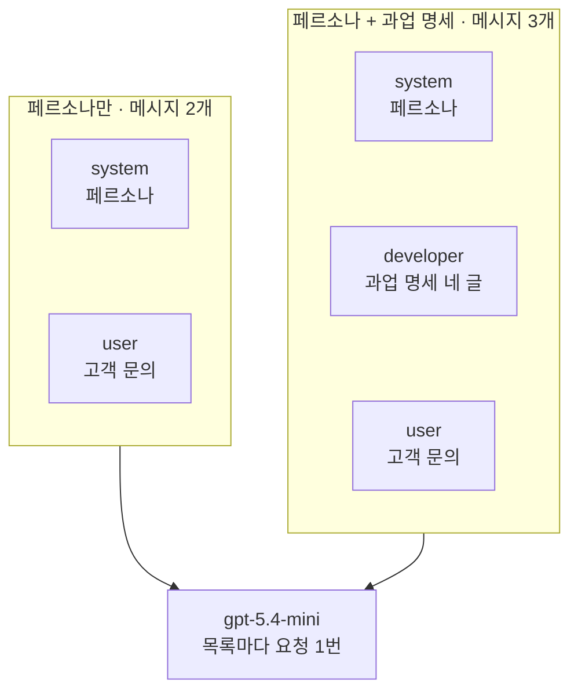
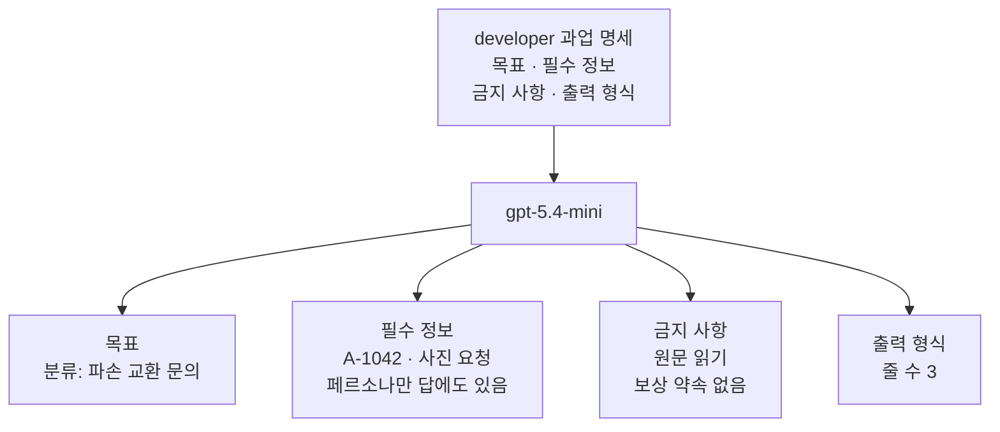
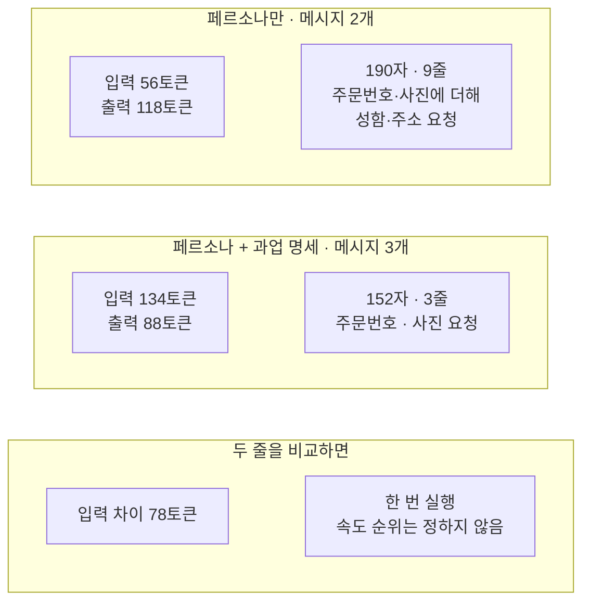
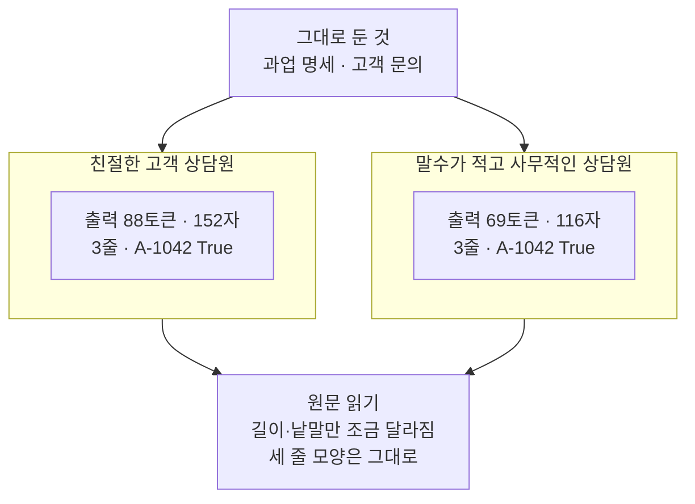

# 02-페르소나와-과업-제약

## _src 본문 (HTML 원본)

```html
<!--meta: 강의 1h | 실습 2h | 코드 Jupyter Notebook | 새 용어 6 -->
<h2 id="b1"><span class="no">1</span>학습 목표</h2>
<div class="goal"><p>이 절을 마치면 다음을 할 수 있습니다.</p><ul><li>누구로서 답할지를 적은 페르소나 글과, 이번에 할 일을 적은 과업 명세를 나눠 쓸 수 있습니다.</li><li>과업 명세를 목표·필수 정보·금지 사항·출력 형식 네 글로 나눠 적을 수 있습니다.</li><li>두 요청을 한 곳만 다르게 만들고, 답 원문·토큰 수·줄 수로 비교할 수 있습니다.</li><li>줄 수처럼 코드로 셀 수 있는 조건과, 원문을 읽어야 판단하는 조건을 구분할 수 있습니다.</li></ul></div>
<h2 id="b2"><span class="no">2</span>이 내용을 배우는 이유</h2>
<p>「친절한 상담원처럼 답하세요」 같은 글은 답의 말투와 관점을 알려 줍니다. 그러나 문의를 어떻게 분류할지, 교환 접수에 무엇이 필요한지는 알려 주지 않습니다. 고객 지원 답에서는 친절한 문장보다 회사 규정과 주문번호가 빠지지 않는 것이 먼저입니다.</p>
<p>01절에서는 글자를 그대로 두고 역할 배치만 바꿨습니다. 이 절은 글의 내용 쪽을 봅니다. 누구로서 답할지를 적은 글과 이번에 할 일을 적은 글을 나눕니다. 그리고 할 일을 적은 글이 있을 때와 없을 때를 같은 모델로 비교합니다.</p>
<p><strong>이 절의 질문</strong> — 페르소나만 적을 때와 할 일·금지 사항·출력 형식까지 적을 때, 답은 무엇이 달라질까요?</p>
<h2 id="b3"><span class="no">3</span>앞에서 배운 내용</h2>
<table><thead><tr><th>앞 절</th><th>배운 것</th><th>이 절에서 이어지는 곳</th></tr></thead><tbody>
<tr><td>01절</td><td>공통 지시·과업 제약·고객 문의 세 글, developer 역할에 과업 제약, 함수 <code>timed_invoke()</code>·<code>make_prompt_record()</code>, 확인 단어 표시는 품질 점수가 아님</td><td>같은 고객 문의와 두 함수, developer 자리의 과업 명세, 8절 확인 단어</td></tr>
<tr><td>Ch 6 01·02절</td><td>튜플 목록, system·user 역할, 응답의 <code>text</code>·<code>usage_metadata</code>·<code>finish_reason</code></td><td>두 목록을 같은 모델로 보내기</td></tr>
<tr><td>Ch 6 06절</td><td>한국어 키 기록표, 한 번 잰 시간으로 순위를 정하지 않음</td><td>6절 기록표</td></tr>
<tr><td>Ch 1·Ch 2 03절</td><td>연산자 <code>==</code>·<code>in</code>, 목록 길이 <code>len()</code>, 인덱싱</td><td>4절 튜플 비교, 7절 글자 수·줄 수</td></tr>
</tbody></table>
<p>01절 공통 지시 <code>policy_text</code>에는 역할 문장 「당신은 전자상거래 고객 지원 분류기입니다」와 회사 규정 문장이 함께 있었습니다. 이 절은 두 문장의 성격을 나눕니다. 역할 문장 자리에는 페르소나 글을 두고, 규정 문장은 과업 명세의 필수 정보로 옮깁니다. 고객 문의는 01절 <code>inquiry_text</code>와 글자까지 같습니다.</p>
<p>01절 과업 제약 <code>constraint_text</code>의 두 문장도 이어 씁니다. 「근거 없는 보상은 약속하지 마세요」는 금지 사항으로, 답의 세 부분은 출력 형식으로 옮깁니다. 01절에서 주문번호 표시가 실행마다 달랐으므로, 필수 정보에 「주문번호는 답에 그대로 적으세요」를 더했습니다.</p>
<h2 id="b4"><span class="no">4</span>핵심 개념</h2>
<h3>비유로 시작하기</h3>
<p>같은 모양의 책상 두 개가 나란히 있습니다. 두 책상에는 똑같은 파란 명찰과 노란 메모지가 놓여 있습니다. 오른쪽 책상에만 주황 클립보드가 하나 더 있고, 종이에는 네 줄이 적혀 있습니다.</p>
<p>명찰은 누가 응대하는지를 알려 줍니다. 명찰만 받은 직원은 친절하게 말할 수는 있어도 가게 규정은 알 수 없습니다. 클립보드 네 줄은 할 일, 꼭 받아야 할 것, 하면 안 되는 것, 답의 모양을 알려 줍니다.</p>
{{img:02-5-명찰과-요청서|흰 바탕에 같은 나무 책상 두 개가 나란히 있고, 왼쪽 책상에는 파란 명찰과 노란 메모지만, 오른쪽 책상에는 같은 파란 명찰과 노란 메모지 사이에 과녁·컵 사진·사선 그은 동전·짧은 막대 세 개로 시작하는 네 줄이 적힌 주황 클립보드가 놓인 삽화|명찰은 누가 응대하는지 알려 주고, 클립보드 네 줄은 할 일·필요한 것·하면 안 되는 것·답의 모양을 알려 줍니다.}}
<p><strong>그림 읽기</strong> — 왼쪽 책상에는 파란 명찰과 노란 메모지만 있습니다. 오른쪽 책상에는 같은 명찰과 메모지 사이에 주황 클립보드가 놓여 있습니다. 클립보드 종이의 네 줄은 위에서 아래로 과녁, 컵 사진, 사선을 그은 동전, 짧은 막대 세 개로 시작합니다.</p>
<p>파란 명찰은 페르소나(system), 노란 메모지는 고객 문의(user), 주황 클립보드는 과업 명세(developer)입니다. 네 줄은 차례로 목표, 필수 정보(사진), 금지 사항(보상 약속), 출력 형식(세 줄)입니다. 01절 그림에서도 파랑이 system, 주황이 developer, 노랑이 user였습니다. 다만 이 절은 system 자리에 공통 지시 대신 페르소나를 둡니다.</p>
<h3>페르소나와 과업 명세</h3>
<p>페르소나(persona)는 모델이 답할 때 맡을 사람의 역할·말투·관점을 적은 글입니다. 가게 직원 명찰에 적힌 「친절 상담」 문구와 비슷합니다. 노트북의 <code>persona_text</code>는 「당신은 친절한 고객 상담원입니다.」 한 문장입니다.</p>
<p>과업 명세(task specification)는 이번 답에서 할 일을 적은 글입니다. 새 직원에게 건네는 업무 요청서와 비슷합니다. 노트북의 <code>task_text</code>는 네 글을 줄바꿈으로 이어 만들었고, developer 메시지로 보냅니다.</p>
{{mermaid:02-1-페르소나와-과업-명세|왼쪽 칸 페르소나만 목록에는 초록 상자 system 페르소나와 user 고객 문의가 있고, 오른쪽 칸 페르소나 + 과업 명세 목록에는 초록 상자 system 페르소나, developer 과업 명세 네 글, user 고객 문의가 있으며, 두 칸이 아래 보라 상자 gpt-5.4-mini로 이어지는 그림|페르소나 글과 고객 문의는 두 목록이 같고, 오른쪽 목록에만 과업 명세 developer 메시지가 있습니다.}}
<p><strong>도식 읽기</strong> — 위에서 아래로 읽습니다. 왼쪽 칸은 노트북 4절의 페르소나만 목록으로, 초록 상자가 system 페르소나와 user 고객 문의 두 개입니다. 오른쪽 칸은 과업 명세 목록으로, 같은 두 상자 사이에 developer 과업 명세가 있습니다.</p>
<p>두 칸은 아래 보라 상자 <code>gpt-5.4-mini</code>로 이어지고, 노트북은 목록마다 요청을 한 번씩 보냈습니다. 두 목록의 system·user 메시지가 같다는 것은 4절 출력 <code>system 메시지가 같은가: True</code>와 <code>user 메시지가 같은가: True</code>로 확인했습니다.</p>
<p>LangChain 메시지 문서는 system 메시지로 말투·역할·답의 지침을 정할 수 있다고 설명합니다. OpenAI 프롬프트 안내서는 developer 메시지를 네 부분으로 나눠 쓰는 모양을 소개합니다. 네 부분은 정체성(Identity)·지시(Instructions)·예시·맥락입니다. 정체성에는 목적·말투·목표를, 지시에는 따를 규칙을 적습니다.</p>
<p>이 절은 01절 배치를 이어 페르소나는 system에, 과업 명세는 developer에 두었습니다. 예시 부분은 03절에서 다룹니다.</p>
<h3>과업 명세를 네 글로 나누기</h3>
<p>목표는 무엇을 할지입니다. 노트북에서는 「고객 문의를 분류하고 필요한 다음 행동을 안내하세요.」입니다. 필수 정보는 답에 꼭 들어가거나 답이 따라야 할 내용입니다. 파손 사진이 필요하다는 회사 규정과, 주문번호를 그대로 적으라는 조건이 여기에 들어갑니다.</p>
<p>금지 사항(negative constraint)은 하면 안 되는 행동입니다. 「근거 없는 보상은 약속하지 마세요.」가 그 예입니다. 출력 형식(output format)은 답을 늘어놓는 모양이고, 노트북에서는 「한 줄씩 세 줄로 답하세요」입니다. 01절의 과업 제약은 이 가운데 금지 사항과 출력 형식에 해당합니다.</p>
<p>네 글은 서로 다른 질문에 답합니다. 형식만 적은 글은 주문번호를 넣으라고 말하지 않습니다. 필수 정보만 적은 글은 답의 모양을 말하지 않습니다. 그래서 답이 기대와 다를 때, 네 글 가운데 어느 글을 고칠지 따로 찾을 수 있습니다.</p>
<h3>확인할 수 있는 조건</h3>
<p>「좋게 답하세요」는 사람마다 판단이 다릅니다. 「한 줄씩 세 줄로 답하세요」는 답의 줄 수를 세어 확인할 수 있습니다. 노트북 7절은 글의 메서드 <code>split("\n")</code>로 답을 줄마다 잘라 줄 수를 셉니다.</p>
<p>모든 조건을 코드로 셀 수 있는 것은 아닙니다. 보상을 약속하는 말은 여러 모양이라, 금지 사항은 원문을 읽어 판단합니다. 01절에서 본 것처럼 낱말 표시 <code>False</code>는 약속이 없다는 증거가 아니기 때문입니다.</p>
<h3>이 절에서 쓰는 말</h3>
<table><thead><tr><th>용어</th><th>뜻</th><th>이 절에서 보이는 모습</th></tr></thead><tbody>
<tr><td>페르소나(persona)</td><td>모델이 답할 때 맡을 사람의 역할·말투·관점을 적은 글. 직원 명찰의 「친절 상담」 문구와 비슷함</td><td><code>페르소나: 당신은 친절한 고객 상담원입니다.</code></td></tr>
<tr><td>과업 명세(task specification)</td><td>이번 답에서 할 일을 적은 글. 이 절은 목표·필수 정보·금지 사항·출력 형식 네 글로 나눔</td><td><code>과업 명세 목록의 메시지 수: 3</code></td></tr>
<tr><td>필수 정보</td><td>답에 꼭 들어가거나 답이 따라야 할 내용. 회사 규정도 여기에 적음</td><td><code>필수 정보: 회사 규정상 교환 접수에는</code></td></tr>
<tr><td>금지 사항(negative constraint)</td><td>답에서 하면 안 되는 행동을 적은 조건</td><td><code>금지 사항: 근거 없는 보상은 약속하지 마세요.</code></td></tr>
<tr><td>출력 형식(output format)</td><td>답을 늘어놓는 모양. 줄 수, 줄 이름, 순서 같은 것</td><td><code>페르소나 + 과업 명세 | 152 | 3</code></td></tr>
<tr><td>확인할 수 있는 조건</td><td>답을 보고 지켰는지 가릴 수 있게 적은 조건. 코드로 셀 수 있는 것과 원문을 읽어야 하는 것이 있음</td><td>7절 줄 수 세기, 5절 원문 읽기</td></tr>
</tbody></table>
<h2 id="b5"><span class="no">5</span>실행 예제</h2>
<p>노트북은 페르소나 글과 과업 명세 네 글을 만들고, 페르소나만 둔 목록과 과업 명세를 더한 목록을 만듭니다. 두 목록의 system·user 메시지가 같은지 먼저 확인합니다. 그다음 두 목록을 같은 모델로 보내 기록표, 글자 수·줄 수, 확인 단어 표시를 만듭니다. 마지막으로 페르소나 글만 바꿔 한 번 더 보냅니다.</p>
<p>실제 OpenAI 모델을 temperature 0으로 부릅니다. 이 페이지의 출력은 2026-09-21에 실행한 결과입니다. 요청은 모두 3번이고, 예상 비용은 0.01달러 미만입니다. 답 문장은 실행마다 달라질 수 있습니다.</p>
{{notebook:02-페르소나와-과업-제약}}
<p class="look"><b>확인할 점</b> — 6절 마지막 줄 <code>과업 명세가 더한 입력 토큰 수: 78</code>을 봅니다. 7절의 <code>페르소나만 | 190 | 9</code>와 <code>페르소나 + 과업 명세 | 152 | 3</code>을 봅니다. 8절 확인 단어 세 줄이 모두 <code>True | True</code>로 끝나는 것도 봅니다.</p>
<h3>과업 명세 네 글이 답에 보인 자리</h3>
<p>노트북 5절의 과업 명세 답은 세 줄이었습니다. 첫 줄은 <code>분류: 파손 교환 문의</code>이고, 다음 행동 줄에 사진 요청과 주문번호 <code>A-1042</code>가 있습니다. 네 글이 답의 어디에 나타났는지 그림으로 짝지어 봅니다.</p>
{{mermaid:02-2-네-글이-보인-자리|위 초록 상자 developer 과업 명세 목표 필수 정보 금지 사항 출력 형식이 가운데 보라 상자 gpt-5.4-mini로 이어지고, 보라 상자에서 노란 상자 네 개 목표 분류 파손 교환 문의, 필수 정보 A-1042 사진 요청 페르소나만 답에도 있음, 금지 사항 원문 읽기 보상 약속 없음, 출력 형식 줄 수 3으로 갈라지는 그림|목표는 분류 줄, 필수 정보는 주문번호와 사진 요청, 출력 형식은 줄 수 3으로 보였고, 금지 사항은 원문을 읽어 보상 약속이 없음을 확인했습니다. 주문번호와 사진 요청은 페르소나만 둔 답에도 있었습니다.}}
<p><strong>도식 읽기</strong> — 위에서 아래로 읽습니다. 초록 상자는 developer 메시지로 넣은 과업 명세이고, 보라 상자는 요청을 받은 모델입니다. 맨 아래 줄의 노란 상자 네 개는 과업 명세 답에서 확인한 목표·필수 정보·금지 사항·출력 형식입니다.</p>
<p>목표 상자와 필수 정보 상자는 5절 답 원문과 8절 표시에서 읽은 값입니다. 출력 형식 상자의 줄 수 3은 7절에서 코드로 센 값입니다. 금지 사항 상자만 「원문 읽기」라고 적었습니다. 보상 약속이 없다는 것은 표시가 아니라 답 원문을 읽고 내린 판단이기 때문입니다.</p>
<p>필수 정보 상자의 셋째 줄처럼, 주문번호와 사진 요청은 페르소나만 둔 답에도 있었습니다. 이 그림은 네 글이 답의 어디에 보였는지 짝지은 것이고, 각 글의 효과를 잰 것이 아닙니다.</p>
<h3>같은 고객 문의, 다른 답 모양</h3>
<p>페르소나만 둔 답은 번호 목록으로 사진, 주문자 성함, 받으신 주소 확인을 요청했습니다. 성함·주소는 이 절의 회사 규정에 적지 않은 정보입니다. 규정을 받지 못한 모델이 무엇을 요청할지 스스로 정한 것입니다.</p>
{{mermaid:02-3-두-답-모양|위 칸 페르소나만 목록에는 노란 상자 입력 56토큰 출력 118토큰과 190자 9줄 주문번호 사진에 더해 성함 주소 요청, 가운데 칸 페르소나 + 과업 명세 목록에는 노란 상자 입력 134토큰 출력 88토큰과 152자 3줄 주문번호 사진 요청, 아래 칸에는 노란 상자 입력 차이 78토큰과 회색 상자 한 번 실행 속도 순위는 정하지 않음이 있는 그림|과업 명세를 더하자 입력 토큰은 78개 늘고 출력 토큰은 118에서 88로 줄었으며, 답은 9줄에서 3줄이 됐습니다.}}
<p><strong>도식 읽기</strong> — 위에서 아래로 칸을 읽습니다. 노란 상자는 6·7절 출력과 5절 원문으로 확인한 값입니다. 위 칸은 페르소나만 목록으로 입력 56토큰·출력 118토큰, 190자·9줄이었습니다. 가운데 칸은 과업 명세 목록으로 입력 134토큰·출력 88토큰, 152자·3줄이었습니다. 위 칸 답에도 주문번호와 사진 요청은 있었고, 두 칸의 차이는 줄 수와 규정에 없는 요청입니다.</p>
<p>아래 칸의 노란 상자는 6절 마지막 줄의 입력 차이 78토큰입니다. 회색 상자는 이 표로 정하지 않는 것입니다. 걸린 초는 1.76초와 1.26초였지만 한 번씩 잰 값이라 속도 순위로 읽지 않습니다.</p>
<h2 id="b6"><span class="no">6</span>실험 결과 해석</h2>
<p>이번 실행에서 페르소나만 둔 답은 친절한 말투였지만, 세 줄 형식이 아니라 빈 줄이 든 9줄 목록이었습니다. 과업 명세를 더한 답은 세 줄에 분류·다음 행동·고객 문장을 담았습니다. 두 답 모두 보상 약속은 없었습니다.</p>
<p>확인 단어 표시는 <code>교환</code>·<code>A-1042</code>·<code>사진</code> 세 줄 모두 두 조건이 <code>True</code>였습니다. 페르소나만 둔 답의 사진 요청도 규정을 따른 결과가 아닙니다. 그 목록에는 회사 규정이 없었으므로, 모델이 스스로 고른 요청입니다. 두 조건의 차이는 표시가 아니라 줄 수와 원문에서 보였습니다.</p>
<p>입력 토큰은 과업 명세 네 글과 developer 메시지 하나만큼 78개 늘었습니다. 01절처럼 메시지가 늘어난 몫도 이 78개에 들어 있습니다. 출력 토큰은 118에서 88로 줄었습니다. 입력과 출력을 더하면 174에서 222로, 요청 전체로는 과업 명세 쪽이 많습니다. 짧은 답이 적은 토큰을 뜻하지 않는다는 점을 기록표에서 함께 읽습니다.</p>
<p>교재를 만들 때 앞선 새 커널 실행과 탐색 실행에서도 페르소나만 둔 답은 9~10줄 목록이었습니다. 두 번 모두 주소처럼 규정에 없는 정보를 요청했습니다. 과업 명세를 더한 답은 세 번 모두 세 줄이었습니다. 그래도 세 번의 실행이라, 과업 명세가 늘 세 줄을 지키게 한다고 말하지는 않습니다.</p>
<h3>페르소나 글만 바꾸면</h3>
<p>노트북 8절은 과업 명세와 고객 문의를 그대로 두었습니다. 페르소나 글만 「당신은 말수가 적고 사무적인 고객 상담원입니다.」로 바꿨습니다. 페르소나가 무엇을 바꾸고 무엇을 바꾸지 않는지 보려는 설정입니다.</p>
{{mermaid:02-4-페르소나만-바꾸기|위 초록 상자 그대로 둔 것 과업 명세 고객 문의가 친절한 고객 상담원 칸의 노란 상자 출력 88토큰 152자 3줄 A-1042 True와 말수가 적고 사무적인 상담원 칸의 노란 상자 출력 69토큰 116자 3줄 A-1042 True로 갈라지고, 두 칸이 아래 노란 상자 원문 읽기 길이 낱말만 조금 달라짐 세 줄 모양은 그대로로 모이는 그림|과업 명세를 그대로 두고 페르소나 글만 바꾸자 출력은 88토큰에서 69토큰으로 줄었지만, 두 답 모두 세 줄에 주문번호가 있었습니다.}}
<p><strong>도식 읽기</strong> — 위에서 아래로 읽습니다. 초록 상자는 두 요청에서 그대로 둔 과업 명세와 고객 문의입니다. 가운데 두 칸의 제목이 페르소나 글이고, 칸 안 노란 상자는 8절 마지막 셀의 출력입니다.</p>
<p>친절한 상담원은 출력 88토큰·152자, 사무적인 상담원은 69토큰·116자였습니다. 두 답 모두 3줄이고 주문번호 표시는 <code>True</code>였습니다. 맨 아래 노란 상자는 두 원문을 읽고 내린 판단입니다.</p>
<p>사무적 답은 다음 행동 줄을 「파손 사진과 함께 교환 접수를 진행해 주세요」 한 문장으로 짧게 끊었습니다. 고객 문장 줄은 두 답 모두 주문번호 확인과 사진 요청을 담아, 말투 차이는 크지 않았습니다. 앞선 새 커널 실행에서도 출력 토큰은 80과 73, 줄 수는 3과 3이었습니다.</p>
<p>정리하면, 이 입력과 이번 실행에서 답의 모양과 규정에 맞는 요청을 정한 것은 과업 명세였습니다. 페르소나 글은 길이와 낱말을 조금 바꿨고, 할 일을 적은 글을 대신하지 않았습니다. 페르소나가 답의 정확성을 높이는지는 이번에 확인하지 않았습니다.</p>
<h2 id="b7"><span class="no">7</span>주의할 점과 실무 메모</h2>
<ul><li>페르소나는 자격이나 회사 규정을 만들어 주지 않습니다. 「전문 상담원」이라고 적어도, 규정은 과업 명세에 따로 적습니다. 노트북 5절에서도 페르소나만 둔 답은 규정에 없는 정보를 요청했습니다.</li>
<li>금지 사항만 늘어놓지 않고, 원하는 행동도 함께 적습니다. 이 절은 「보상 약속 금지」와 함께 다음 행동 안내를 목표로 적었습니다.</li>
<li>과업 명세는 요청마다 입력에 실립니다. 이번에는 과업 명세 네 글과 developer 메시지 하나가 입력 토큰 78개였습니다. 같은 명세로 요청을 여러 번 보내면 요청 수만큼 늘어납니다.</li>
<li>한 번에 한 곳만 바꿉니다. 4절의 <code>assert</code>로 system·user 메시지가 같은지 확인했고, 8절도 페르소나 글 한 곳만 바꿨습니다.</li>
<li>줄 수는 빈 줄도 한 줄로 셉니다. 줄 끝 공백이나 굵은 글씨 표시 <code>**</code>는 줄 수에 드러나지 않습니다. 형식을 엄격하게 따져야 하면 원문도 함께 읽습니다.</li>
<li>페르소나 두 글, 과업 명세 네 글, 줄 수 세기는 흐름을 보여 주려고 정한 예입니다. 교재를 만들 때 기기에서 먼저 네 조건을 한 번씩 보내 답 모양을 봤습니다. 네 조건은 두 페르소나에 과업 명세가 있을 때와 없을 때입니다. 이 탐색 실행의 요청은 4번이고, 줄 수 세기는 그 답 모양을 본 뒤 넣었습니다. 노트북에는 그중 세 조건을 넣고 새 커널로 두 번 실행했습니다.</li>
<li>실제 고객 문의에 개인정보가 들어 있으면 실험 기록에 그대로 남기지 않습니다. 이 절의 문의는 교재용으로 만든 글입니다.</li>
<li>교재 출력은 Linux의 Python 3.12.13으로 만들었습니다. 패키지는 langchain 1.4.0, langchain-core 1.6.2입니다. langchain-openai 1.6.0, openai 3.10.0도 함께 썼습니다. 다른 버전과 Windows·macOS에서는 실행하지 않았습니다.</li></ul>
<h2 id="b8"><span class="no">8</span>정리와 다음 절</h2>
<ul><li>페르소나는 누구로서 답할지를 정하는 글이고, 할 일·규정·형식은 과업 명세 네 글로 따로 적었습니다.</li><li>과업 명세를 developer 메시지로 더하자 이번 실행의 답이 세 줄이 됐고, 입력 토큰은 78개 늘었습니다.</li><li>확인 단어 표시로는 차이가 보이지 않아, 줄 수 세기와 원문 읽기로 차이를 찾았습니다.</li></ul>
<p><strong>다음 학습과 이어지는 지점</strong> — 03절에서는 형식 지시는 그대로 두고, 다른 고객 문의와 답으로 된 예시를 더해 비교합니다. 고객 문의는 이 절과 같습니다.</p>
<h2 id="b9"><span class="no">9</span>복습 문제</h2>
<details class="quiz"><summary>문제 1 · 페르소나가 알려 주는 것</summary><p class="quiz-q">「당신은 친절한 고객 상담원입니다.」라는 페르소나 글은 모델에게 무엇을 알려 주고, 무엇을 알려 주지 않나요?</p><p class="quiz-a"><b>해설</b> — 답할 사람의 역할과 말투를 알려 줍니다. 교환 접수에 필요한 사진 같은 회사 규정과 답의 모양은 알려 주지 않습니다. 노트북 5절에서 페르소나만 둔 답은 규정에 없는 성함·주소를 요청했습니다.</p></details>
<details class="quiz"><summary>문제 2 · 확인할 수 있는 조건</summary><p class="quiz-q">「좋게 답하세요」 대신 쓸 수 있는, 답을 보고 지켰는지 가릴 수 있는 조건을 하나 적어 보세요.</p><p class="quiz-a"><b>해설</b> — 「분류, 다음 행동, 고객에게 보낼 한 문장을 한 줄씩 세 줄로 답하세요」처럼 씁니다. 노트북 7절처럼 줄 수를 세어 3인지 확인할 수 있습니다.</p></details>
<details class="quiz"><summary>문제 3 · 줄어든 출력, 늘어난 전체</summary><p class="quiz-q">과업 명세를 더하자 출력 토큰은 118에서 88로 줄었습니다. 그런데 요청 전체 토큰은 오히려 늘었습니다. 왜 그런가요?</p><p class="quiz-a"><b>해설</b> — 과업 명세 네 글과 developer 메시지 하나가 입력 토큰을 78개 더했기 때문입니다. 입력과 출력을 더하면 174에서 222가 되어, 출력이 30개 준 것보다 입력이 더 많이 늘었습니다.</p></details>
<details class="quiz"><summary>문제 4 · 모두 True인 확인 단어</summary><p class="quiz-q">확인 단어 세 개가 두 답에 모두 있었습니다. 그래도 두 답이 달랐다고 말할 수 있는 근거는 무엇인가요?</p><p class="quiz-a"><b>해설</b> — 줄 수(9줄과 3줄)와 원문입니다. 페르소나만 둔 답은 규정에 없는 정보를 요청했습니다. 확인 단어 표시는 원문에서 읽을 곳을 찾는 도구라서, 표시가 같다고 답이 같은 것은 아닙니다.</p></details>
<details class="quiz"><summary>문제 5 · 사무적인 페르소나</summary><p class="quiz-q">페르소나를 「말수가 적고 사무적인 고객 상담원」으로 바꾸자 출력 토큰이 88에서 69로 줄었습니다. 「사무적인 페르소나는 늘 더 짧은 답을 만든다」고 결론 내려도 되나요?</p><p class="quiz-a"><b>해설</b> — 안 됩니다. 고객 문의 하나를 두 번의 새 커널 실행에서 본 결과입니다. 같은 입력을 temperature 0으로 보내도 답은 달라질 수 있습니다. 이번에 말할 수 있는 것은 세 줄 모양과 주문번호가 그대로였다는 관찰까지입니다.</p></details>
<h2 id="b10"><span class="no">10</span>참고 자료</h2>
<p>문서는 2026-09-17에 다시 열어 확인했습니다. 코드는 실습 가상환경에 설치한 <code>langchain 1.4.0</code>, <code>langchain-openai 1.6.0</code>으로 실행했습니다.</p>
<ul><li><div><a href="https://developers.openai.com/api/docs/guides/prompt-engineering">OpenAI Prompt engineering</a></div>developer 메시지를 정체성·지시·예시·맥락으로 나눠 쓰는 모양 · 확인 2026-09-17</li><li><div><a href="https://developers.openai.com/api/docs/guides/text">OpenAI Text generation</a></div>developer 메시지와 user 메시지의 우선순위 · 확인 2026-09-17</li><li><div><a href="https://docs.langchain.com/oss/python/langchain/messages">LangChain Messages</a></div>system 메시지로 말투·역할·지침을 정하는 설명 · 확인 2026-09-17</li><li><div><a href="https://github.com/langchain-ai/langchain/blob/master/LICENSE">LangChain MIT License</a></div>예제의 고객 문의와 설명은 이 교재에 맞게 새로 썼습니다</li></ul>
```

## 노트북 셀 (순서대로)

### [0] markdown {'html': 'skip'}

# 페르소나와 과업 제약

**이 노트북에서 할 일**

1. 페르소나 글 하나와 과업 명세 네 글(목표·필수 정보·금지 사항·출력 형식)을 따로 만듭니다.
2. 페르소나만 둔 목록과 과업 명세를 더한 목록을 같은 모델에 보내, 답 원문·토큰 수·줄 수를 비교합니다.
3. 과업 명세는 그대로 두고 페르소나 글만 바꿔, 페르소나가 바꾸는 것과 바꾸지 않는 것을 봅니다.

**준비물** — 프로젝트 폴더 `.env` 파일의 `OPENAI_API_KEY`가 필요합니다. 데이터 파일은 없습니다.

인터넷 서비스에 요청을 모두 3번 보냅니다. 모두 `gpt-5.4-mini`입니다.
실행 시간은 1분 안팎이고, 예상 비용은 0.01달러 미만으로 잡았습니다.
요금은 Ch 6 06절에서 2026-09-17에 확인한 mini 공식 요금 기준입니다.

**기준 버전** — 실습 폴더에 고정한 패키지 판을 씁니다. langchain 1.4.0, langchain-core 1.6.2, langchain-openai 1.6.0입니다.
openai 3.10.0, python-dotenv 1.2.3도 함께 씁니다.

교재 출력은 Linux의 Python 3.12.13으로 만들었습니다. 다른 버전과 Windows·macOS에서는 이번에 실행하지 않았습니다.

실습 폴더 `labs/part2/ch07-prompt-engineering`에서 `uv sync --locked`를 실행합니다.
그다음 이 폴더의 `.venv` 커널을 고르고 첫 셀부터 순서대로 실행합니다.

### [1] markdown {'html': 'skip'}

## 오늘 볼 그림


위에서 아래로 읽습니다. 왼쪽 칸은 페르소나 글과 고객 문의만 넣은 목록입니다.
오른쪽 칸은 같은 두 메시지 사이에 과업 명세를 developer 메시지로 더한 목록입니다.
두 목록은 아래 보라 상자의 같은 모델로 한 번씩 보냅니다. 다른 것은 developer 메시지 하나입니다.

### [2] markdown {}

## 1. 준비

첫 셀은 패키지를 설치하고 설치된 버전을 출력합니다. 설치에는 몇십 초가 걸릴 수 있습니다.
01절과 같은 실습 폴더와 같은 판입니다. 노트북은 01절 없이 새 커널에서 시작하므로 다시 확인합니다.

### [3] code {'execution': {'iopub.execute_input': '2026-09-21T03:48:39.686808Z', 'iopub.status.busy': '2026-09-21T03:48:39.686625Z', 'iopub.status.idle': '2026-09-21T03:48:40.134442Z', 'shell.execute_reply': '2026-09-21T03:48:40.133731Z'}, 'lesson_role': 'setup'}

```python
# 이 절에서 쓰는 패키지를 설치하고 버전을 확인합니다
%pip install -q "langchain==1.4.0" "langchain-openai==1.6.0" "python-dotenv==1.2.3"
from importlib.metadata import version

print("langchain:", version("langchain"))
print("langchain-core:", version("langchain-core"))
print("langchain-openai:", version("langchain-openai"))
print("openai:", version("openai"))
print("python-dotenv:", version("python-dotenv"))
```

출력:
```
Note: you may need to restart the kernel to use updated packages.
langchain: 1.4.0
langchain-core: 1.6.2
langchain-openai: 1.6.0
openai: 3.10.0
python-dotenv: 1.2.3

```

### [4] markdown {}

**결과 읽기** — 출력 줄은 `langchain: 1.4.0`, `langchain-core: 1.6.2`, `langchain-openai: 1.6.0` 등 다섯 줄입니다.
준비물에 적은 기준 버전과 같습니다.

모델 객체를 만드는 함수를 불러오고, 앞에서 배운 기록 함수 두 개를 가져옵니다.

앞에서 배운 함수는 `llm_tools.py`에 모아 두었습니다. 파일을 열면 코드를 볼 수 있습니다. 노트북과 같은 폴더(`notebooks/`)에 있는 파일입니다.
이 노트북은 Ch 6 06절 `timed_invoke()`와 01절 `make_prompt_record()`를 가져옵니다.

### [5] code {'execution': {'iopub.execute_input': '2026-09-21T03:48:40.135782Z', 'iopub.status.busy': '2026-09-21T03:48:40.135675Z', 'iopub.status.idle': '2026-09-21T03:48:40.536697Z', 'shell.execute_reply': '2026-09-21T03:48:40.536258Z'}, 'lesson_role': 'setup'}

```python
# 모델 객체를 만드는 함수를 불러옵니다
from langchain.chat_models import init_chat_model
# Ch 6 06절·01절 기록 함수 두 개를 도구 파일에서 가져옵니다
from llm_tools import make_prompt_record, timed_invoke
```

출력:
```

```

### [6] markdown {}

01절과 같은 셀로 API 키가 있는지 확인합니다. 키 값은 출력하지 않고, 있는지만 봅니다.
`True` 값이 나오면 다음으로 넘어갑니다.

### [7] code {'execution': {'iopub.execute_input': '2026-09-21T03:48:40.537805Z', 'iopub.status.busy': '2026-09-21T03:48:40.537722Z', 'iopub.status.idle': '2026-09-21T03:48:40.542127Z', 'shell.execute_reply': '2026-09-21T03:48:40.541595Z'}, 'lesson_role': 'setup'}

```python
# .env 파일에서 OpenAI API 키를 읽습니다(키 값은 출력하지 않습니다)
import os
from dotenv import find_dotenv, load_dotenv

env_path = find_dotenv(usecwd=True)
load_dotenv(env_path)
has_key = os.getenv("OPENAI_API_KEY") is not None
print("OPENAI_API_KEY 설정 여부:", has_key)
assert has_key, "프로젝트 폴더의 .env 파일에 OPENAI_API_KEY를 적어 주세요."
```

출력:
```
OPENAI_API_KEY 설정 여부: True

```

### [8] markdown {}

실습에 쓸 모델을 준비합니다.
01절과 같은 설정으로 모델 객체를 만듭니다. 이 셀은 요청을 보내지 않습니다.

### [9] code {'execution': {'iopub.execute_input': '2026-09-21T03:48:40.542886Z', 'iopub.status.busy': '2026-09-21T03:48:40.542809Z', 'iopub.status.idle': '2026-09-21T03:48:41.521579Z', 'shell.execute_reply': '2026-09-21T03:48:41.521221Z'}}

```python
# 실습에 쓸 모델을 준비합니다
model = init_chat_model(
    "openai:gpt-5.4-mini",
    temperature=0,
    reasoning_effort="none",
)
print("모델 이름:", model.model_name)
print("temperature:", model.temperature)
```

출력:
```
모델 이름: gpt-5.4-mini
temperature: 0.0

```

### [10] markdown {}

**결과 읽기** — 출력 줄은 `모델 이름: gpt-5.4-mini`와 `temperature: 0.0`입니다. 이것으로 준비가 끝났습니다.
이 노트북의 출력은 2026-09-21에 이 모델로 실행한 결과입니다. 실행마다 답 문장이 달라질 수 있습니다.
Ch 6 01절에서 본 것처럼 temperature 0은 Ch 5 06절의 뽑기를 끈 설정(`do_sample=False`)과 같은 것이 아닙니다.

### [11] markdown {}

## 2. 페르소나 글과 고객 문의

페르소나(persona)는 모델이 답할 때 맡을 사람의 역할·말투·관점을 적은 글입니다.
가게 직원 명찰에 적힌 「친절 상담」 문구와 비슷합니다. 명찰은 태도를 알려 주지만, 교환 접수에 무엇이 필요한지는 알려 주지 않습니다.

이 셀은 페르소나 글과 고객 문의를 만듭니다. 고객 문의는 01절 `inquiry_text`와 글자까지 같습니다.

### [12] code {'execution': {'iopub.execute_input': '2026-09-21T03:48:41.522360Z', 'iopub.status.busy': '2026-09-21T03:48:41.522303Z', 'iopub.status.idle': '2026-09-21T03:48:41.524210Z', 'shell.execute_reply': '2026-09-21T03:48:41.523948Z'}}

```python
# 답할 사람의 역할과 말투를 적은 페르소나 글과, 01절과 같은 고객 문의를 만듭니다
persona_text = "당신은 친절한 고객 상담원입니다."
inquiry_text = "어제 받은 텀블러 뚜껑이 깨졌습니다. 주문번호는 A-1042입니다. 새 상품으로 바꾸고 싶습니다."
print("페르소나:", persona_text)
print("고객 문의:", inquiry_text)
```

출력:
```
페르소나: 당신은 친절한 고객 상담원입니다.
고객 문의: 어제 받은 텀블러 뚜껑이 깨졌습니다. 주문번호는 A-1042입니다. 새 상품으로 바꾸고 싶습니다.

```

### [13] markdown {}

**결과 읽기** — 두 줄은 `페르소나: 당신은 친절한 고객 상담원입니다.`와 `고객 문의:`로 시작하는 줄입니다.
페르소나 글에는 누구로서 답할지만 있고, 할 일이나 회사 규정은 없습니다.

## 3. 과업 명세 네 글 만들기

과업 명세(task specification)는 이번 답에서 할 일을 적은 글입니다. 이 절은 네 글로 나눠 적습니다.
목표는 무엇을 할지, 필수 정보는 답에 꼭 들어갈 내용, 금지 사항은 하면 안 되는 행동입니다. 출력 형식은 답을 늘어놓는 모양입니다.

01절 과업 제약은 금지 조건과 답의 세 부분이었습니다. 이 절은 거기에 목표와 필수 정보를 더합니다.
01절 공통 지시에 있던 규정 「회사 규정상 교환 접수에는 파손 사진이 필요합니다」는 필수 정보로 옮깁니다.

### [14] code {'execution': {'iopub.execute_input': '2026-09-21T03:48:41.524806Z', 'iopub.status.busy': '2026-09-21T03:48:41.524753Z', 'iopub.status.idle': '2026-09-21T03:48:41.526560Z', 'shell.execute_reply': '2026-09-21T03:48:41.526227Z'}}

```python
# 과업 명세를 목표·필수 정보·금지 사항·출력 형식 네 글로 나눠 만듭니다
goal_text = "고객 문의를 분류하고 필요한 다음 행동을 안내하세요."
required_text = "회사 규정상 교환 접수에는 파손 사진이 필요합니다. 주문번호는 답에 그대로 적으세요."
forbidden_text = "근거 없는 보상은 약속하지 마세요."
format_text = "분류, 다음 행동, 고객에게 보낼 한 문장을 한 줄씩 세 줄로 답하세요."
print("목표:", goal_text)
print("필수 정보:", required_text)
print("금지 사항:", forbidden_text)
print("출력 형식:", format_text)
```

출력:
```
목표: 고객 문의를 분류하고 필요한 다음 행동을 안내하세요.
필수 정보: 회사 규정상 교환 접수에는 파손 사진이 필요합니다. 주문번호는 답에 그대로 적으세요.
금지 사항: 근거 없는 보상은 약속하지 마세요.
출력 형식: 분류, 다음 행동, 고객에게 보낼 한 문장을 한 줄씩 세 줄로 답하세요.

```

### [15] markdown {}

**결과 읽기** — 네 줄은 `목표:`, `필수 정보:`, `금지 사항:`, `출력 형식:`으로 시작합니다.
필수 정보 줄에는 01절에 없던 조건 `주문번호는 답에 그대로 적으세요.`가 있습니다. 01절에서 주문번호 표시가 실행마다 달랐기 때문에 더한 조건입니다.
출력 형식 줄의 「한 줄씩 세 줄」은 답에서 줄 수를 세어 확인할 수 있는 조건입니다.

이제 네 글을 줄바꿈 `"\n"`으로 이어 과업 명세 글 하나로 만듭니다. 01절에서 세 글을 이은 방법과 같습니다.

### [16] code {'execution': {'iopub.execute_input': '2026-09-21T03:48:41.527155Z', 'iopub.status.busy': '2026-09-21T03:48:41.527100Z', 'iopub.status.idle': '2026-09-21T03:48:41.528911Z', 'shell.execute_reply': '2026-09-21T03:48:41.528555Z'}}

```python
# 네 글을 줄바꿈으로 이어 과업 명세 글 하나로 만듭니다(요청은 보내지 않습니다)
task_text = goal_text + "\n" + required_text + "\n" + forbidden_text + "\n" + format_text
print("과업 명세:")
print(task_text)
```

출력:
```
과업 명세:
고객 문의를 분류하고 필요한 다음 행동을 안내하세요.
회사 규정상 교환 접수에는 파손 사진이 필요합니다. 주문번호는 답에 그대로 적으세요.
근거 없는 보상은 약속하지 마세요.
분류, 다음 행동, 고객에게 보낼 한 문장을 한 줄씩 세 줄로 답하세요.

```

### [17] markdown {}

**결과 읽기** — 라벨 줄 `과업 명세:` 아래 네 줄이 과업 명세 글 하나의 내용입니다.
첫 줄은 `고객 문의를 분류하고 필요한 다음 행동을 안내하세요.`, 마지막 줄은 출력 형식 문장입니다.

## 4. 두 목록 만들기

첫째 목록은 페르소나(system)와 고객 문의(user)만 넣습니다. 둘째 목록은 두 메시지 사이에 과업 명세를 developer 메시지로 넣습니다.
01절에서 과업 제약을 넣은 역할과 같은 자리입니다.

실행 전에 예상합니다. 메시지 수는 2와 3일 것입니다.

### [18] code {'execution': {'iopub.execute_input': '2026-09-21T03:48:41.529430Z', 'iopub.status.busy': '2026-09-21T03:48:41.529383Z', 'iopub.status.idle': '2026-09-21T03:48:41.531415Z', 'shell.execute_reply': '2026-09-21T03:48:41.531020Z'}}

```python
# 페르소나만 둔 목록과, 과업 명세를 developer 메시지로 더한 목록을 만듭니다(요청은 보내지 않습니다)
persona_messages = [
    ("system", persona_text),
    ("user", inquiry_text),
]
task_messages = [
    ("system", persona_text),
    ("developer", task_text),
    ("user", inquiry_text),
]
print("페르소나만 목록의 메시지 수:", len(persona_messages))
print("과업 명세 목록의 메시지 수:", len(task_messages))
```

출력:
```
페르소나만 목록의 메시지 수: 2
과업 명세 목록의 메시지 수: 3

```

### [19] markdown {}

**결과 읽기** — 두 줄은 `페르소나만 목록의 메시지 수: 2`와 `과업 명세 목록의 메시지 수: 3`입니다.

두 목록에서 다른 것은 developer 메시지 하나뿐이어야 합니다. 그래야 답이 달라졌을 때 과업 명세 때문이라고 좁혀 읽을 수 있습니다.
튜플도 연산자 `==`로 비교합니다. 두 튜플의 값이 순서대로 모두 같으면 `True`입니다.
같아야 하는 값이라 마지막 두 줄의 `assert`로 확인합니다.

### [20] code {'execution': {'iopub.execute_input': '2026-09-21T03:48:41.532063Z', 'iopub.status.busy': '2026-09-21T03:48:41.532003Z', 'iopub.status.idle': '2026-09-21T03:48:41.533927Z', 'shell.execute_reply': '2026-09-21T03:48:41.533587Z'}}

```python
# 두 목록의 system 메시지와 user 메시지가 같은지 확인합니다
same_system = persona_messages[0] == task_messages[0]
same_user = persona_messages[1] == task_messages[2]
print("system 메시지가 같은가:", same_system)
print("user 메시지가 같은가:", same_user)
assert same_system
assert same_user
```

출력:
```
system 메시지가 같은가: True
user 메시지가 같은가: True

```

### [21] markdown {}

**결과 읽기** — 두 줄은 `system 메시지가 같은가: True`와 `user 메시지가 같은가: True`입니다. `assert`도 통과했습니다.
이제 두 목록은 과업 명세 developer 메시지가 있는지만 다릅니다.

## 5. 두 목록을 같은 모델로 보내기

준비 셀에서 가져온 함수 두 개로 요청마다 기록 한 줄을 만듭니다. 함수 `timed_invoke()`는 요청을 보내면서 걸린 시간을 재고, 응답 객체와 걸린 초를 튜플로 반환합니다.
함수 `make_prompt_record()`는 조건 이름·응답 객체·걸린 초로 딕셔너리 한 줄을 만듭니다.
키는 `조건`·`답`·`입력 토큰 수`·`출력 토큰 수`·`끝난 이유`·`걸린 초` 여섯 개입니다.

페르소나만 둔 목록을 먼저 보냅니다. 답은 여러 줄일 수 있어 라벨 줄 `답:`을 따로 출력합니다.
실행 전에 예상합니다. 모델은 회사 규정을 모릅니다. 사진을 요청할까요, 세 줄로 답할까요?

### [22] code {'execution': {'iopub.execute_input': '2026-09-21T03:48:41.534540Z', 'iopub.status.busy': '2026-09-21T03:48:41.534497Z', 'iopub.status.idle': '2026-09-21T03:48:43.298198Z', 'shell.execute_reply': '2026-09-21T03:48:43.297381Z'}}

```python
# 페르소나만 둔 목록을 보내고 기록 한 줄을 만듭니다(요청 1번)
persona_response, persona_elapsed = timed_invoke(model, persona_messages)
persona_record = make_prompt_record("페르소나만", persona_response, persona_elapsed)
print("답:")
print(persona_record["답"])
```

출력:
```
답:
불편을 드려 죄송합니다. 주문번호 **A-1042** 확인했습니다.  
깨진 뚜껑은 **새 상품으로 교환** 도와드릴게요.

진행을 위해 아래 중 하나를 보내주세요:
1. **파손된 뚜껑 사진**
2. **주문자 성함**
3. **받으신 주소 확인**(변경 없으면 “동일”이라고 답변)

사진을 보내주시면 바로 교환 절차 안내해드리겠습니다.

```

### [23] markdown {}

**결과 읽기** — 라벨 줄 아래 첫 줄은 `불편을 드려 죄송합니다.`로 시작하고, 주문번호를 `**A-1042**`처럼 굵은 글씨 표시로 적었습니다.
가운데에는 `진행을 위해 아래 중 하나를 보내주세요:` 아래로 번호 목록 세 줄이 있습니다.
목록은 `파손된 뚜껑 사진`, `주문자 성함`, 받으신 주소 확인입니다. 보상 약속은 없었습니다.

사진은 회사 규정을 받지 않고도 요청했습니다. 성함·주소는 이 절의 회사 규정에 적지 않은 정보입니다.
페르소나만으로는 무엇을 요청할지를 모델이 스스로 정했습니다. 답 모양도 세 줄이 아니라 빈 줄이 든 긴 목록이었습니다.

이번에는 과업 명세를 더한 목록을 같은 모델로 보냅니다. 바꾼 것은 넘기는 목록 하나입니다.
실행 전에 예상합니다. 출력 형식대로 분류·다음 행동·고객 문장 세 줄이 나올 것입니다.

### [24] code {'execution': {'iopub.execute_input': '2026-09-21T03:48:43.299813Z', 'iopub.status.busy': '2026-09-21T03:48:43.299654Z', 'iopub.status.idle': '2026-09-21T03:48:44.568953Z', 'shell.execute_reply': '2026-09-21T03:48:44.568147Z'}}

```python
# 과업 명세를 더한 목록을 같은 모델로 보내고 기록 한 줄을 만듭니다(요청 1번)
task_response, task_elapsed = timed_invoke(model, task_messages)
task_record = make_prompt_record("페르소나 + 과업 명세", task_response, task_elapsed)
print("답:")
print(task_record["답"])
```

출력:
```
답:
분류: 파손 교환 문의  
다음 행동: 교환 접수를 위해 파손된 뚜껑 사진을 보내주시면 확인 후 진행하겠습니다. 주문번호 A-1042  
고객에게 보낼 한 문장: 주문번호 A-1042 확인되었으며, 파손 사진을 보내주시면 새 상품 교환 가능 여부를 확인해 안내드리겠습니다.

```

### [25] markdown {}

**결과 읽기** — 라벨 줄 아래 세 줄은 `분류: 파손 교환 문의`, `다음 행동:`, `고객에게 보낼 한 문장:`으로 시작합니다.
다음 행동 줄과 고객 문장 줄에 `A-1042`가 있습니다. 다음 행동 줄은 `교환 접수를 위해 파손된 뚜껑 사진을 보내주시면`으로 시작합니다.
성함·주소 요청과 굵은 글씨 표시는 없었고, 보상 약속도 없었습니다.

## 6. 기록표로 비교하기

두 기록을 01절과 같은 기록표 모양으로 출력합니다. 마지막 줄은 과업 명세가 더한 입력 토큰 수입니다.
실행 전에 예상합니다. 과업 명세 네 글과 developer 메시지 하나만큼 입력 토큰이 늘 것입니다. 출력 토큰은 늘까요, 줄까요?

### [26] code {'execution': {'iopub.execute_input': '2026-09-21T03:48:44.570437Z', 'iopub.status.busy': '2026-09-21T03:48:44.570305Z', 'iopub.status.idle': '2026-09-21T03:48:44.574354Z', 'shell.execute_reply': '2026-09-21T03:48:44.573318Z'}}

```python
# 두 기록을 목록에 담고 한 줄에 한 조건씩 출력합니다
records = [persona_record, task_record]
print("기록표(조건 | 입력 토큰 수 | 출력 토큰 수 | 끝난 이유 | 걸린 초):")
for record in records:
    print(record["조건"], "|", record["입력 토큰 수"], "|", record["출력 토큰 수"], "|", record["끝난 이유"], "|", record["걸린 초"])
input_difference = task_record["입력 토큰 수"] - persona_record["입력 토큰 수"]
print("과업 명세가 더한 입력 토큰 수:", input_difference)
```

출력:
```
기록표(조건 | 입력 토큰 수 | 출력 토큰 수 | 끝난 이유 | 걸린 초):
페르소나만 | 56 | 118 | stop | 1.76
페르소나 + 과업 명세 | 134 | 88 | stop | 1.26
과업 명세가 더한 입력 토큰 수: 78

```

### [27] markdown {}

**결과 읽기** — 라벨 줄 아래 두 줄은 `페르소나만 | 56 | 118 | stop | 1.76`과 `페르소나 + 과업 명세 | 134 | 88 | stop | 1.26`입니다.
마지막 줄은 `과업 명세가 더한 입력 토큰 수: 78`입니다. 과업 명세 네 글과 developer 메시지 하나가 입력 토큰을 78개 더했습니다.

출력 토큰은 118에서 88로 줄었습니다. 입력과 출력을 더하면 페르소나만 174, 과업 명세 222라 요청 전체로는 과업 명세 쪽이 많습니다.
걸린 초 1.76과 1.26은 한 번씩 잰 값이라 속도 순위로 읽지 않습니다. 교재를 만들 때 앞선 새 커널 실행에서는 1.44초와 1.84초였습니다.

## 7. 확인할 수 있는 조건 세어 보기

출력 형식 「한 줄씩 세 줄」은 코드로 셀 수 있는 조건입니다. 글의 메서드 `split("\n")`은 줄바꿈 자리에서 글을 잘라 목록으로 반환합니다.
함수 `len()`은 Part 1에서 목록 길이를 셀 때 썼습니다. 글에 쓰면 글자 수를 셉니다.

빈 줄도 한 줄로 셉니다. 「세 줄로 답하세요」에는 빈 줄을 넣지 말라는 뜻도 들어 있다고 보기 때문입니다.
실행 전에 예상합니다. 과업 명세 답의 줄 수는 3일 것입니다.

### [28] code {'execution': {'iopub.execute_input': '2026-09-21T03:48:44.575761Z', 'iopub.status.busy': '2026-09-21T03:48:44.575645Z', 'iopub.status.idle': '2026-09-21T03:48:44.578829Z', 'shell.execute_reply': '2026-09-21T03:48:44.578120Z'}}

```python
# 두 답의 글자 수와 줄 수(빈 줄 포함)를 셉니다
print("조건 | 글자 수 | 줄 수(빈 줄 포함)")
for record in records:
    answer_length = len(record["답"])
    answer_lines = record["답"].split("\n")
    line_count = len(answer_lines)
    print(record["조건"], "|", answer_length, "|", line_count)
```

출력:
```
조건 | 글자 수 | 줄 수(빈 줄 포함)
페르소나만 | 190 | 9
페르소나 + 과업 명세 | 152 | 3

```

### [29] markdown {}

**결과 읽기** — 라벨 줄 아래 두 줄은 `페르소나만 | 190 | 9`와 `페르소나 + 과업 명세 | 152 | 3`입니다.
과업 명세 답은 출력 형식대로 세 줄이었습니다. 페르소나만 둔 답은 빈 줄 두 개를 포함해 9줄이었습니다.

줄 수는 원문을 읽지 않고도 코드로 확인할 수 있는 조건입니다. 다만 줄 수 3이 세 줄에 알맞은 내용이 들어갔다는 뜻은 아닙니다.
각 줄의 내용은 5절에서 원문을 읽어 확인했습니다.

필수 정보에 적은 주문번호와 사진, 분류 낱말 교환이 답에 있는지도 표시합니다. 01절과 같은 확인 단어 세 개입니다.
이 표시는 품질 점수가 아니라, 원문에서 읽을 곳을 찾는 도구입니다.

### [30] code {'execution': {'iopub.execute_input': '2026-09-21T03:48:44.580133Z', 'iopub.status.busy': '2026-09-21T03:48:44.579980Z', 'iopub.status.idle': '2026-09-21T03:48:44.583754Z', 'shell.execute_reply': '2026-09-21T03:48:44.582969Z'}}

```python
# 확인 단어 세 개가 두 답에 들어 있는지 표시합니다(품질 점수가 아니라, 원문에서 읽을 곳 표시)
check_words = ["교환", "A-1042", "사진"]
print("확인 단어 | 페르소나만 답에 있는가 | 과업 명세 답에 있는가")
for word in check_words:
    in_persona = word in persona_record["답"]
    in_task = word in task_record["답"]
    print(word, "|", in_persona, "|", in_task)
```

출력:
```
확인 단어 | 페르소나만 답에 있는가 | 과업 명세 답에 있는가
교환 | True | True
A-1042 | True | True
사진 | True | True

```

### [31] markdown {}

**결과 읽기** — 라벨 줄 아래 세 줄 `교환`, `A-1042`, `사진`은 모두 `True | True`로 끝납니다. 확인 단어 세 개가 두 답에 모두 있었습니다.
확인 단어 표시로는 두 조건의 차이를 찾지 못했습니다. 차이는 줄 수와, 규정에 없는 성함·주소 요청에서 보였습니다.

페르소나만 둔 답의 사진 표시 `True`도 규정을 따른 결과가 아닙니다. 그 목록에는 회사 규정이 없었으므로, 모델이 스스로 고른 요청입니다.

## 8. 값 바꿔 보기 — 페르소나 글만 바꾸기

바꾸는 값은 `persona_text` 자리의 글 하나입니다. 「친절한 고객 상담원」을 「말수가 적고 사무적인 고객 상담원」으로 바꿉니다.
과업 명세와 고객 문의는 그대로 둡니다. 이 셀은 목록만 만들고 요청을 보내지 않습니다.

실행 전에 예상합니다. 말투는 달라지고, 세 줄 모양과 주문번호는 그대로일까요?

### [32] code {'execution': {'iopub.execute_input': '2026-09-21T03:48:44.585020Z', 'iopub.status.busy': '2026-09-21T03:48:44.584887Z', 'iopub.status.idle': '2026-09-21T03:48:44.587688Z', 'shell.execute_reply': '2026-09-21T03:48:44.587103Z'}}

```python
# 페르소나 글만 바꾸고 과업 명세·고객 문의는 그대로 둔 목록을 만듭니다(요청은 보내지 않습니다)
plain_persona_text = "당신은 말수가 적고 사무적인 고객 상담원입니다."
plain_messages = [
    ("system", plain_persona_text),
    ("developer", task_text),
    ("user", inquiry_text),
]
print("바꾼 페르소나:", plain_messages[0][1])
```

출력:
```
바꾼 페르소나: 당신은 말수가 적고 사무적인 고객 상담원입니다.

```

### [33] markdown {}

**결과 읽기** — 출력 줄은 `바꾼 페르소나: 당신은 말수가 적고 사무적인 고객 상담원입니다.`입니다.
developer 메시지와 user 메시지는 5절에서 보낸 과업 명세 목록과 같은 변수를 썼습니다.

바꾼 목록을 보냅니다.

### [34] code {'execution': {'iopub.execute_input': '2026-09-21T03:48:44.588915Z', 'iopub.status.busy': '2026-09-21T03:48:44.588796Z', 'iopub.status.idle': '2026-09-21T03:48:45.703306Z', 'shell.execute_reply': '2026-09-21T03:48:45.702456Z'}}

```python
# 페르소나만 바꾼 목록을 보내고 기록 한 줄을 만듭니다(요청 1번)
plain_response, plain_elapsed = timed_invoke(model, plain_messages)
plain_record = make_prompt_record("사무적 페르소나 + 과업 명세", plain_response, plain_elapsed)
print("답:")
print(plain_record["답"])
```

출력:
```
답:
분류: 교환 요청  
다음 행동: 파손 사진과 함께 교환 접수를 진행해 주세요.  
고객에게 보낼 문장: 주문번호 A-1042 확인했습니다. 뚜껑 파손 사진을 보내주시면 새 상품 교환 접수를 도와드리겠습니다.

```

### [35] markdown {}

**결과 읽기** — 라벨 줄 아래 세 줄은 `분류: 교환 요청`, `다음 행동:`, `고객에게 보낼 문장:`으로 시작합니다.
다음 행동 줄은 `파손 사진과 함께 교환 접수를 진행해 주세요.` 한 문장입니다.

5절 과업 명세 답의 다음 행동 줄보다 짧게 끊은 말투입니다. 고객 문장 줄은 `주문번호 A-1042 확인했습니다.`로 시작합니다.
세 줄 모양, 주문번호, 사진 요청은 그대로였고 보상 약속도 없었습니다.

과업 명세를 둔 두 기록을 나란히 봅니다. 토큰 수와 글자 수, 줄 수, 주문번호 표시를 한 줄에 출력합니다.

### [36] code {'execution': {'iopub.execute_input': '2026-09-21T03:48:45.706122Z', 'iopub.status.busy': '2026-09-21T03:48:45.705913Z', 'iopub.status.idle': '2026-09-21T03:48:45.709949Z', 'shell.execute_reply': '2026-09-21T03:48:45.709224Z'}}

```python
# 과업 명세를 둔 두 기록을 토큰 수·글자 수·줄 수·주문번호 표시로 나란히 봅니다
persona_pair = [task_record, plain_record]
print("조건 | 입력 토큰 수 | 출력 토큰 수 | 글자 수 | 줄 수 | A-1042")
for record in persona_pair:
    answer_length = len(record["답"])
    answer_lines = record["답"].split("\n")
    has_order = "A-1042" in record["답"]
    print(record["조건"], "|", record["입력 토큰 수"], "|", record["출력 토큰 수"], "|", answer_length, "|", len(answer_lines), "|", has_order)
```

출력:
```
조건 | 입력 토큰 수 | 출력 토큰 수 | 글자 수 | 줄 수 | A-1042
페르소나 + 과업 명세 | 134 | 88 | 152 | 3 | True
사무적 페르소나 + 과업 명세 | 138 | 69 | 116 | 3 | True

```

### [37] markdown {}

**결과 읽기** — 라벨 줄 아래 두 줄은 `페르소나 + 과업 명세 | 134 | 88 | 152 | 3 | True`와 `사무적 페르소나 + 과업 명세 | 138 | 69 | 116 | 3 | True`입니다.
페르소나 글이 조금 길어져 입력 토큰은 4개 늘었고, 출력 토큰은 88에서 69로 줄었습니다.
두 답의 글자 수에는 첫 두 줄 끝에 붙은 보이지 않는 공백 두 칸씩도 들어 있습니다.

줄 수 3과 주문번호 표시 `True`는 두 페르소나가 같았습니다. 이번 실행에서 페르소나 글은 답의 길이와 낱말을 조금 바꿨습니다.
과업 명세가 정한 세 줄 모양과 필수 정보는 바꾸지 않았습니다. 앞선 새 커널 실행에서도 출력 토큰은 80과 73, 줄 수는 3과 3이었습니다.

## 실험 결과 해석

이번 실행에서 페르소나만 둔 답은 친절한 말투였지만 세 줄 형식이 아니었습니다. 회사 규정에 없는 성함·주소도 요청했습니다.
과업 명세를 더한 답은 세 줄에 주문번호와 사진 요청을 담았습니다. 두 답 모두 보상 약속은 없었습니다.

과업 명세는 입력 토큰을 78개 더했고, 답을 코드로 확인할 수 있는 모양(줄 수 3)으로 만들었습니다.
페르소나 글만 바꾸면 답의 길이와 낱말이 조금 달라졌고, 세 줄 모양과 주문번호는 그대로였습니다.
이 결론은 고객 문의 하나·모델 하나·설정마다 한 번 실행한 범위입니다. 페르소나가 답의 정확성을 높이는지는 이번에 확인하지 않았습니다.

## 정리

- 페르소나는 누구로서 답할지를 정하는 글이고, 할 일·규정·형식은 과업 명세 네 글로 따로 적었습니다.
- 과업 명세를 developer 메시지로 더하자 답이 세 줄이 됐고, 입력 토큰은 78개 늘었습니다.
- 확인 단어 표시로는 차이가 보이지 않아, 줄 수 세기와 원문 읽기로 차이를 찾았습니다.

다음 03절에서는 형식 지시는 그대로 두고, 다른 고객 문의와 답으로 된 예시를 더해 비교합니다. 고객 문의는 이 절과 같습니다.

## 그림

### 02-1-페르소나와-과업-명세.mmd



- 설명 대상 문장: 페르소나만 둔 목록과, 같은 두 메시지 사이에 과업 명세를 developer 메시지로 더한 목록을 같은 모델로 한 번씩 보냅니다.
- 캡션: 페르소나 글과 고객 문의는 두 목록이 같고, 오른쪽 목록에만 과업 명세 developer 메시지가 있습니다.
- 읽는 법: 위에서 아래로. 왼쪽 칸은 노트북 4절 `페르소나만 목록의 메시지 수: 2`, 초록 상자 system 페르소나·user 고객 문의. 오른쪽 칸은 `과업 명세 목록의 메시지 수: 3`, 같은 두 상자 사이에 초록 상자 developer 과업 명세 네 글. 두 목록의 system·user가 같다는 것은 4절 `system 메시지가 같은가: True`·`user 메시지가 같은가: True`. 보라 상자는 준비 셀 `모델 이름: gpt-5.4-mini`, 5절에서 목록마다 요청 1번.
- alt: 왼쪽 칸 페르소나만 목록에는 초록 상자 system 페르소나와 user 고객 문의가 있고, 오른쪽 칸 페르소나 + 과업 명세 목록에는 초록 상자 system 페르소나, developer 과업 명세 네 글, user 고객 문의가 있으며, 두 칸이 아래 보라 상자 gpt-5.4-mini로 이어지는 그림

### 02-2-네-글이-보인-자리.mmd



- 설명 대상 문장: 과업 명세 네 글이 과업 명세 답의 어디에 나타났는지 짝지어 봅니다.
- 캡션: 목표는 분류 줄, 필수 정보는 주문번호와 사진 요청, 출력 형식은 줄 수 3으로 보였고, 금지 사항은 원문을 읽어 보상 약속이 없음을 확인했습니다. 주문번호와 사진 요청은 페르소나만 둔 답에도 있었습니다.
- 읽는 법: 위에서 아래로. 초록 상자는 3절에서 만들어 developer 메시지로 넣은 `task_text`, 보라 상자는 5절에서 요청을 받은 모델. 아래 줄 노란 상자 넷은 과업 명세 답에서 확인한 것: 목표 = 5절 답 첫 줄 `분류: 파손 교환 문의`, 필수 정보 = 8절 `A-1042 | True | True`·5절 원문 사진 요청(페르소나만 답에도 있어 필수 정보의 효과로 읽지 않음, 검토 1차 02-1), 금지 사항 = 원문 읽기(보상 약속 없음, 표시 아님), 출력 형식 = 7절 `페르소나 + 과업 명세 | 152 | 3`. 방향 말은 쓰지 않고 상자 이름으로 가리킴(TB 그림).
- alt: 위 초록 상자 developer 과업 명세 목표 필수 정보 금지 사항 출력 형식이 가운데 보라 상자 gpt-5.4-mini로 이어지고, 보라 상자에서 노란 상자 네 개 목표 분류 교환 요청 파손, 필수 정보 A-1042 사진 요청 페르소나만 답에도 있음, 금지 사항 원문 읽기 보상 약속 없음, 출력 형식 줄 수 3으로 갈라지는 그림

### 02-3-두-답-모양.mmd



- 설명 대상 문장: 과업 명세는 입력 토큰을 78개 더했고, 답은 9줄 목록에서 세 줄로 바뀌었습니다.
- 캡션: 과업 명세를 더하자 입력 토큰은 78개 늘고 출력 토큰은 118에서 88로 줄었으며, 답은 9줄에서 3줄이 됐습니다.
- 읽는 법: 위에서 아래로 칸을 읽음. 노란 상자는 6절 기록표 `페르소나만 | 56 | 118 | stop | 1.76`·`페르소나 + 과업 명세 | 134 | 88 | stop | 1.26`과 7절 `페르소나만 | 190 | 9`·`페르소나 + 과업 명세 | 152 | 3`. 「주문번호·사진에 더해 성함·주소 요청」과 「주문번호 · 사진 요청」은 5절 원문을 읽어 적은 것(위 칸 답에도 주문번호·사진 요청이 있음, 검토 1차 02-1). 아래 칸 노란 상자는 6절 `과업 명세가 더한 입력 토큰 수: 78`, 회색 상자는 이 표로 정하지 않는 것(한 번 실행, 속도 순위). 앞선 새 커널 실행: 56·131토큰 231자·10줄 / 134·80토큰 139자·3줄, 1.44·1.84초(본문 b6·노트북 결과 읽기에 적음).
- alt: 위 칸 페르소나만 목록에는 노란 상자 입력 56토큰 출력 118토큰과 190자 9줄 주문번호 사진에 더해 성함 주소 요청, 가운데 칸 페르소나 + 과업 명세 목록에는 노란 상자 입력 134토큰 출력 88토큰과 152자 3줄 주문번호 사진 요청, 아래 칸에는 노란 상자 입력 차이 78토큰과 회색 상자 한 번 실행 속도 순위는 정하지 않음이 있는 그림

### 02-4-페르소나만-바꾸기.mmd



- 설명 대상 문장: 페르소나 글만 바꾸면 답의 길이와 낱말은 조금 달라졌고, 세 줄 모양과 주문번호는 그대로였습니다.
- 캡션: 과업 명세를 그대로 두고 페르소나 글만 바꾸자 출력은 88토큰에서 69토큰으로 줄었지만, 두 답 모두 세 줄에 주문번호가 있었습니다.
- 읽는 법: 위에서 아래로. 초록 상자는 두 요청에서 그대로 둔 `task_text`·`inquiry_text`. 가운데 두 칸 제목은 페르소나 글(친절한 고객 상담원 / 8절 `바꾼 페르소나: 당신은 말수가 적고 사무적인 고객 상담원입니다.`), 칸 안 노란 상자는 8절 마지막 셀 `페르소나 + 과업 명세 | 134 | 88 | 152 | 3 | True`·`사무적 페르소나 + 과업 명세 | 138 | 69 | 116 | 3 | True`. 맨 아래 노란 상자는 두 원문을 읽고 내린 판단(평가). 앞선 새 커널 실행: 출력 80·73토큰, 3줄·3줄.
- alt: 위 초록 상자 그대로 둔 것 과업 명세 고객 문의가 친절한 고객 상담원 칸의 노란 상자 출력 88토큰 152자 3줄 A-1042 True와 말수가 적고 사무적인 상담원 칸의 노란 상자 출력 69토큰 116자 3줄 A-1042 True로 갈라지고, 두 칸이 아래 노란 상자 원문 읽기 길이 낱말만 조금 달라짐 세 줄 모양은 그대로로 모이는 그림

### 02-5-명찰과-요청서.prompt.md

# 삽화 — 02-5 명찰과 요청서

- 상태: 2026-09-17 생성·검수 통과(1회 생성). 모델 nano_banana_pro(서버 표기 nano_banana_2), 16:9, 2k(2752×1536), 장당 2크레딧, 합계 2크레딧(생성 전 잔액 2864). 채택 job 896474ad-778e-43ba-b8d1-555f6e27dd6c. 기기 셸 `curl`로 받아 `uv run --no-project --with pillow`로 폭 1100px(1100×614) 저장. 원본 SHA-256 `fa005cdb34b1f8d81c058438bed5050e052ef485ea779d8f48aff05c1f1ae388`. 채택 job 결과를 다시 받아(해시 같음) 같은 폭으로 줄여 저장 PNG와 픽셀 대조, 차이 0(bbox 없음).
- 검수 메모(저장 파일 기준): 흰 바탕, 같은 모양 연한 나무 책상 두 개가 나란히 있음. 왼쪽 책상에 옷핀 달린 파란 사각 명찰(글자 없음)과 물결 줄 노란 메모지만 있음. 오른쪽 책상에 같은 명찰·같은 메모지가 같은 자리에 있고, 둘 사이에 주황 클립보드 한 개. 클립보드 흰 종이에 네 줄: 과녁, 컵이 든 작은 사진, 사선이 그어진 금색 동전, 작은 네모 옆 짧은 막대 세 개로 시작하고 뒤에 회색 물결 줄. 글자·숫자·사람·손·화면·화살표 없음. 그림만 보고 「두 책상은 같고 오른쪽에만 네 줄짜리 요청서가 더 있다」가 읽힘. 약점: 위쪽 약 40%가 빈 흰 바탕이라 물건이 작게 보임. 동전 사선이 금지 표시라는 뜻은 그림 읽기에서 이름을 붙여 줌.
- 설명 대상 문장: 파란 명찰은 페르소나(system), 노란 메모지는 고객 문의(user), 주황 클립보드는 과업 명세(developer)입니다. 네 줄은 차례로 목표, 필수 정보(사진), 금지 사항(보상 약속), 출력 형식(세 줄)입니다.
- 넣을 자리: 02절 핵심 개념 「비유로 시작하기」 둘째 단락 바로 아래
- 구성 요소와 배치: 왼쪽 책상(명찰 + 메모지 = 페르소나만 목록) → 오른쪽 책상(같은 명찰 + 메모지 + 주황 클립보드 = 과업 명세 목록) → 클립보드 네 줄(목표·필수 정보·금지 사항·출력 형식)
- 시선 순서: 왼쪽 책상의 두 물건 → 오른쪽 책상의 같은 두 물건 → 오른쪽에만 있는 클립보드 네 줄
- 앞 절·앞 챕터와 이어짐: 01-5 삽화의 색 약속(파랑 = system, 주황 = developer, 노랑 = user)을 그대로 씀. 01-5는 파랑이 공통 지시였고 이 절은 system 자리에 페르소나를 두므로 그림 읽기에 적음. Ch 5·Ch 6 「쟁반」, Ch 4 「카드 꽂이」, Ch 6 02-5 「우편함」은 쓰지 않음.
- 대응: 02-1 도식(페르소나만 목록 · 페르소나 + 과업 명세 목록), 02-2 도식(네 글). 8절 페르소나 바꾸기와 토큰 수는 그림에 넣지 않음.

## 프롬프트 (채택본)

Simple flat educational illustration, white background, limited soft palette, clean outlines, plain everyday objects, no text, no letters, no numbers, no logos.
View from slightly above and in front of two identical small plain light wooden desks placed side by side, with wide white space between the two desks.
On the left desk there are only two objects: one light blue rectangular pin badge with a plain smooth face, and one pale yellow sticky note with a few short wavy lines. Nothing else is on the left desk.
On the right desk there are the same light blue pin badge and the same pale yellow sticky note in the same positions as on the left desk, plus one light orange clipboard lying flat between them. The clipboard holds one white sheet with four clearly separate rows, one under another. Each row starts with a small plain symbol followed by short gray wavy lines: the top row starts with a small round target with a dot in the center, the second row starts with a tiny photo print showing a simple tumbler, the third row starts with a single gold coin with a dark gray diagonal line across it, the bottom row starts with three short stacked horizontal bars.
The two desks look exactly the same except for the orange clipboard on the right desk.
No people, no hands, no monitors, no screens, no computers, no arrows, no envelopes, no mailboxes, no trays, no labels, no signs, no writing, no other objects.

