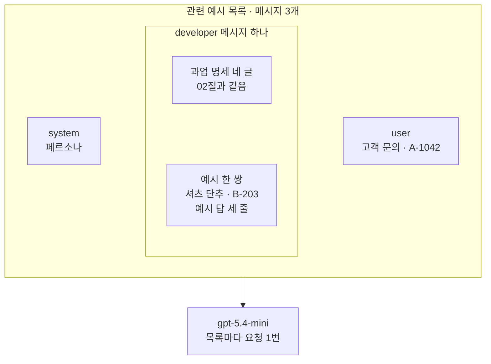
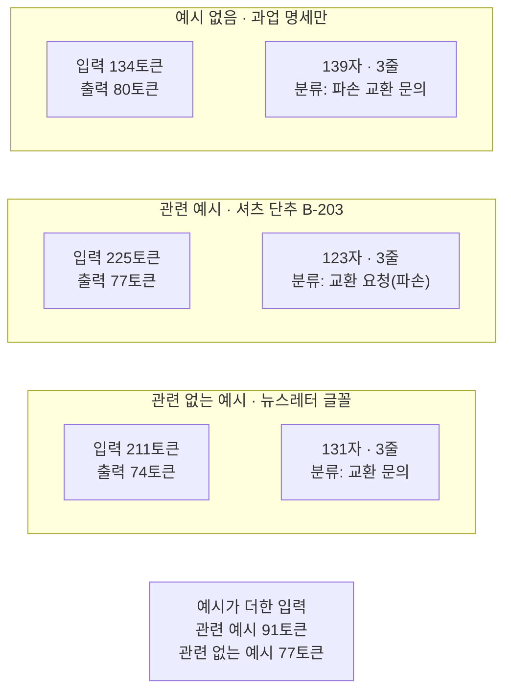
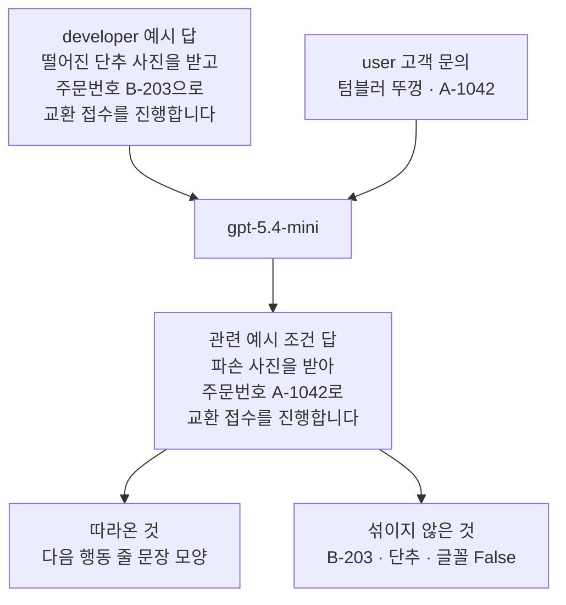
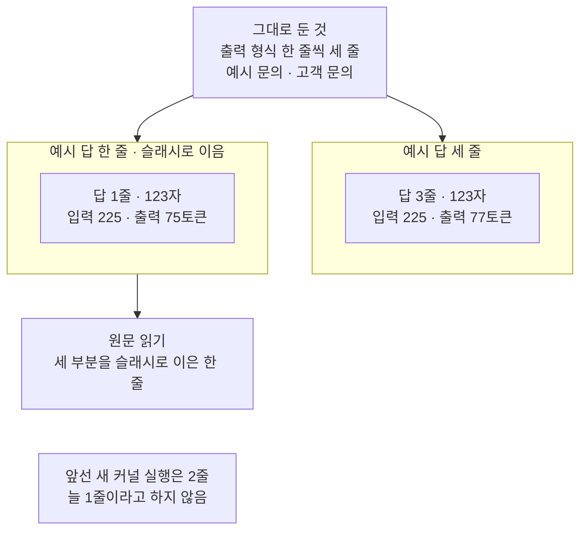

# 03-Few-shot-예시-선택

## _src 본문 (HTML 원본)

```html
<!--meta: 강의 1h | 실습 2h | 코드 Jupyter Notebook | 새 용어 6 -->
<h2 id="b1"><span class="no">1</span>학습 목표</h2>
<div class="goal"><p>이 절을 마치면 다음을 할 수 있습니다.</p><ul><li>다른 문의와 알맞은 답을 짝지은 예시 한 쌍을 만들어 developer 글에 붙일 수 있습니다.</li><li>예시 없음·관련 예시·관련 없는 예시 세 목록을 한 곳만 다르게 만들어 비교할 수 있습니다.</li><li>답이 예시를 따라 한 부분과 예시 값이 섞였는지를, 원문과 낱말 표시로 나눠 확인할 수 있습니다.</li><li>예시 답 모양이 출력 형식과 어긋나면 답 모양이 흔들릴 수 있음을 설명할 수 있습니다.</li></ul></div>
<h2 id="b2"><span class="no">2</span>이 내용을 배우는 이유</h2>
<p>02절에서는 출력 형식을 「한 줄씩 세 줄로 답하세요」라는 문장으로 적었습니다. 문장은 읽는 쪽에 따라 다르게 받아들여질 수 있습니다. 완성된 답 한 개를 함께 보여 주면 줄 이름·순서·문장 길이를 모양으로 알려 줄 수 있습니다.</p>
<p>예시를 넣는 데에도 값이 듭니다. 요청마다 입력 토큰이 늘고, 예시의 값이나 표현이 새 답에 섞일 수 있습니다. 그래서 어떤 예시를 넣을지와, 넣은 뒤 답에서 무엇이 달라졌는지를 함께 확인해야 합니다.</p>
<p><strong>이 절의 질문</strong> — 예시가 없을 때, 관련 예시가 있을 때, 주제가 다른 예시가 있을 때 답은 무엇이 달라질까요?</p>
<h2 id="b3"><span class="no">3</span>앞에서 배운 내용</h2>
<table><thead><tr><th>앞 절</th><th>배운 것</th><th>이 절에서 이어지는 곳</th></tr></thead><tbody>
<tr><td>02절</td><td>페르소나 글, 과업 명세 네 글(목표·필수 정보·금지 사항·출력 형식), developer 자리의 과업 명세, 글자 수 <code>len()</code>·줄 수 <code>split("\n")</code></td><td>2절 글 다시 만들기, 4절 예시를 붙일 developer 글, 7절 답 모양</td></tr>
<tr><td>01절</td><td>함수 <code>timed_invoke()</code>·<code>make_prompt_record()</code>, 확인 단어 표시는 품질 점수가 아님</td><td>5·6절 기록, 8절 확인 단어</td></tr>
<tr><td>Ch 6 01·06절</td><td>튜플 목록, <code>usage_metadata</code>, 한 번 잰 시간으로 순위를 정하지 않음</td><td>6절 기록표</td></tr>
<tr><td>Ch 2 04절</td><td>함수 정의 셀과 호출 셀 나누기</td><td>3절 <code>make_example_text()</code></td></tr>
<tr><td>Ch 1</td><td>연산자 <code>==</code>·<code>in</code>·<code>and</code></td><td>4절 목록 비교, 8절 낱말 표시</td></tr>
</tbody></table>
<p>이 절의 예시 없음 목록은 02절 과업 명세 목록과 같습니다. 목록의 system에는 페르소나, developer에는 과업 명세, user에는 고객 문의가 있습니다. 이 절은 그 목록을 바꾸지 않고, developer 글 끝에 예시만 붙입니다.</p>
<p>02절 본문은 OpenAI 안내서의 developer 메시지 네 부분 가운데 예시 부분을 이 절에서 다룬다고 했습니다. 안내서는 예시를 보통 developer 메시지의 한 부분으로 넣는다고 설명합니다. 그래서 이 절도 예시를 developer 글 안, 과업 명세 뒤에 둡니다.</p>
<p>01·02절이 회사 규정·답 형식·고객 말을 역할과 뜻에 따라 나눴으므로, 이 절도 나눈 글을 그대로 씁니다.</p>
<h2 id="b4"><span class="no">4</span>핵심 개념</h2>
<h3>비유로 시작하기</h3>
<p>02절 그림의 나무 책상이 이번에는 세 개입니다. 세 책상에는 같은 파란 명찰, 주황 클립보드, 노란 메모지가 놓여 있습니다. 가운데와 오른쪽 책상의 클립보드 집게에만 작은 흰 카드가 한 장씩 끼워져 있습니다.</p>
<p>흰 카드는 작성 견본입니다. 처음 쓰는 서류 옆에 붙은 견본 한 장은 규칙 설명보다 채운 모양을 먼저 보여 줍니다. 다만 견본이 다른 업무의 것이면, 모양은 보여 줘도 판단 근거는 보여 주지 못합니다.</p>
{{img:03-5-견본-카드|흰 바탕에 같은 나무 책상 세 개가 나란히 있고, 책상마다 파란 명찰·주황 클립보드·금 간 컵이 그려진 노란 메모지가 있으며, 가운데 클립보드 집게에는 셔츠와 떨어진 단추가 그려진 흰 카드, 오른쪽 클립보드 집게에는 회색 톱니바퀴가 그려진 흰 카드가 반쯤 나와 끼워진 삽화|세 책상은 같고, 가운데와 오른쪽 클립보드에만 견본 카드가 끼워져 있습니다.}}
<p><strong>그림 읽기</strong> — 세 책상은 같고, 다른 것은 클립보드 집게 위로 반쯤 나온 흰 카드뿐입니다. 왼쪽 책상에는 카드가 없습니다. 가운데 카드에는 셔츠와 그 옆에 떨어진 단추가, 오른쪽 카드에는 회색 톱니바퀴가 그려져 있습니다.</p>
<p>파란 명찰은 페르소나(system), 주황 클립보드는 과업 명세(developer)입니다. 금 간 컵이 그려진 노란 메모지는 이번 고객 문의(user)입니다. 흰 카드가 클립보드 집게에 끼워져 있는 것은 예시가 developer 글 안에 들어간다는 뜻입니다. 셔츠 카드는 컵처럼 물건이 망가진 문의라 관련 예시이고, 톱니바퀴 카드는 설정 문의라 관련 없는 예시입니다. 색 약속은 01·02절 그림과 같습니다.</p>
<h3>예시 없는 프롬프트와 예시를 넣은 프롬프트</h3>
<p>예시(example)는 다른 입력 하나와, 그 입력에 알맞은 출력 하나를 짝지은 글입니다. 이 절에서는 다른 고객 문의와 그 문의에 알맞은 세 줄 답입니다. 노트북의 <code>make_example_text()</code> 함수가 「예시 문의:」 줄과 「예시 답:」 줄을 붙여 예시 글 하나를 만듭니다.</p>
<p>예시 없이 지시만 주는 프롬프트를 Zero-shot, 예시 몇 개를 함께 주는 프롬프트를 Few-shot이라고 부릅니다. OpenAI 안내서는 이 방식을 모델을 더 학습시키는 대신 입출력 예시를 프롬프트에 넣는 것이라고 설명합니다. 예시는 요청마다 함께 보내는 글이고, 모델 자체는 바뀌지 않습니다.</p>
{{mermaid:03-1-예시가-들어가는-자리|큰 칸 관련 예시 목록 안에 왼쪽부터 초록 상자 system 페르소나, developer 메시지 하나 칸 안의 초록 상자 과업 명세 네 글과 예시 한 쌍 셔츠 단추 B-203, 초록 상자 user 고객 문의 A-1042가 있고, 큰 칸이 아래 보라 상자 gpt-5.4-mini로 이어지는 그림|관련 예시 목록은 02절과 같은 세 메시지이고, developer 메시지 안에서 과업 명세 뒤에 예시 한 쌍이 붙습니다.}}
<p><strong>도식 읽기</strong> — 위 큰 칸은 노트북 4절의 관련 예시 목록입니다. 칸 안은 왼쪽부터 system 페르소나, developer 메시지 하나, user 고객 문의 순서입니다. 가운데 developer 칸 안에는 위에 과업 명세 네 글, 아래에 예시 한 쌍이 있습니다.</p>
<p>초록 상자는 모두 노트북이 만든 글이고, 아래 보라 상자가 요청을 받는 모델입니다. 예시 없음 목록은 developer 칸에 과업 명세만 있습니다. 관련 없는 예시 목록은 예시 자리에 뉴스레터 글꼴 예시가 들어갑니다. 세 목록의 system·user가 같다는 것은 4절 출력 <code>세 목록의 system 메시지가 같은가: True</code>로 확인했습니다.</p>
<h3>관련 예시와 관련 없는 예시</h3>
<p>관련성(relevance)은 예시가 이번 입력과 같은 판단을 보여 주는지를 뜻합니다. 낱말이 비슷한지가 아니라, 무엇을 근거로 어떤 답을 내는지가 같은지를 봅니다. 셔츠 단추 예시는 상품 하자·사진 확인·교환 접수라는 판단이 텀블러 문의와 같습니다.</p>
<p>뉴스레터 글꼴 예시는 답이 같은 세 줄 모양이지만 판단이 다릅니다. 사진도 주문번호도 필요 없는 설정 안내이기 때문입니다. 이 절은 두 예시의 답을 똑같이 세 줄로 맞춰, 두 예시의 차이를 주제 하나로 좁혔습니다.</p>
<h3>예시의 값은 새 답에 들어가면 안 됩니다</h3>
<p>예시 답에는 따라 할 부분과 바꿔야 할 부분이 함께 있습니다. 줄 이름과 순서는 따라 할 부분입니다. 주문번호 B-203 같은 값은 이번 문의의 A-1042로 바꿔야 할 부분입니다. 그래서 예시의 주문번호를 일부러 이번 문의와 다르게 정했습니다.</p>
<p>반대로 평가하려는 입력과 정답을 그대로 예시에 넣으면, 모델은 풀지 않고 옮겨 적을 수 있습니다. 이런 문제를 데이터 누출(data leakage)이라고 합니다. 시험 문제와 답안을 미리 나눠 준 뒤 시험을 보는 것과 비슷합니다. 이 절은 이번 고객 문의를 예시에 넣지 않았습니다.</p>
<h3>이 절에서 쓰는 말</h3>
<table><thead><tr><th>용어</th><th>뜻</th><th>이 절에서 보이는 모습</th></tr></thead><tbody>
<tr><td>예시(example)</td><td>다른 입력과 그 입력에 알맞은 출력을 짝지은 글. 서류 옆 작성 견본과 비슷함</td><td><code>예시 문의: 셔츠 단추가 떨어졌습니다. 주문번호는 B-203입니다.</code></td></tr>
<tr><td>예시 없는 프롬프트(Zero-shot)</td><td>예시 없이 지시와 입력만 주는 프롬프트</td><td><code>예시 없음 | 134 | 80 | stop | 1.03</code></td></tr>
<tr><td>예시를 넣은 프롬프트(Few-shot)</td><td>예시 몇 개를 지시·입력과 함께 주는 프롬프트. 모델을 다시 학습시키지 않음</td><td><code>관련 예시 | 225 | 77 | stop | 0.92</code></td></tr>
<tr><td>관련성(relevance)</td><td>예시가 이번 입력과 같은 판단 근거를 보여 주는 정도</td><td>셔츠 단추(관련), 뉴스레터 글꼴(관련 없음)</td></tr>
<tr><td>예시 값 섞임</td><td>예시에만 있던 값이 새 답에 들어가는 일</td><td><code>B-203 | False | False | False</code></td></tr>
<tr><td>데이터 누출(data leakage)</td><td>평가할 입력이나 정답이 예시에 들어가 결과가 실제보다 좋아 보이는 문제</td><td>이번 고객 문의는 예시에 넣지 않음</td></tr>
</tbody></table>
<h2 id="b5"><span class="no">5</span>실행 예제</h2>
<p>노트북은 02절 글을 다시 만들고, 관련 예시와 관련 없는 예시를 만듭니다. 예시를 developer 글에 붙여 세 목록을 만들고, system·user가 같은지 확인합니다. 그다음 세 목록을 같은 모델로 보내 기록표, 답 모양, 확인 단어와 예시 낱말 표시를 만듭니다. 마지막으로 예시 답의 줄바꿈만 바꿔 한 번 더 보냅니다.</p>
<p>실제 OpenAI 모델을 temperature 0으로 부릅니다. 이 페이지의 출력은 2026-09-21에 실행한 결과입니다. 요청은 모두 4번이고, 예상 비용은 0.01달러 미만입니다. 답 문장은 실행마다 달라질 수 있습니다.</p>
<p>강의 시간에는 노트북 3~7절(예시 만들기와 붙이기, 세 목록 보내기, 기록표와 답 모양)을 설명합니다. 8·9절(확인 단어와 예시 낱말, 값 바꿔 보기)은 함께 실행하고 실습 시간에 읽습니다.</p>
{{notebook:03-Few-shot-예시-선택}}
<p class="look"><b>확인할 점</b> — 6절 마지막 두 줄 <code>관련 예시가 더한 입력 토큰 수: 91</code>과 <code>관련 없는 예시가 더한 입력 토큰 수: 77</code>을 봅니다. 5절 관련 예시 답의 다음 행동 줄을 3절 예시 답과 나란히 읽습니다. 8절 예시 낱말 세 줄이 모두 <code>False | False | False</code>로 끝나는 것도 봅니다.</p>
<h3>세 조건의 기록</h3>
<p>노트북 6·7절 출력을 한 그림에 모았습니다. 세 답은 모두 세 줄이었고, 입력 토큰은 예시가 붙은 두 조건만 늘었습니다.</p>
{{mermaid:03-2-세-조건-기록|위 칸 예시 없음에는 노란 상자 입력 134토큰 출력 80토큰과 139자 3줄 분류 파손 교환 문의, 둘째 칸 관련 예시에는 입력 225토큰 출력 77토큰과 123자 3줄 분류 교환 요청 파손, 셋째 칸 관련 없는 예시에는 입력 211토큰 출력 74토큰과 131자 3줄 분류 교환 문의가 있고, 맨 아래 노란 상자에 예시가 더한 입력 관련 예시 91토큰 관련 없는 예시 77토큰이 있는 그림|세 답은 모두 세 줄이었고, 예시 한 쌍은 입력 토큰을 관련 예시 91개, 관련 없는 예시 77개 더했습니다.}}
<p><strong>도식 읽기</strong> — 위에서 아래로 칸을 읽습니다. 칸 제목은 조건 이름이고, 칸 안 노란 상자는 6절 기록표와 7절 답 모양 출력입니다. 예시 없음은 입력 134토큰·출력 80토큰, 139자·3줄이었습니다. 관련 예시는 225·77토큰에 123자·3줄, 관련 없는 예시는 211·74토큰에 131자·3줄이었습니다.</p>
<p>맨 아래 노란 상자는 6절 마지막 두 줄의 값으로, 예시가 더한 입력 91토큰과 77토큰입니다. 각 칸 오른쪽 상자의 분류 이름은 7절 첫 줄 출력입니다. 걸린 초는 그림에 넣지 않았습니다. 한 번씩 잰 값이라 속도 순위로 읽지 않기 때문입니다.</p>
<h2 id="b6"><span class="no">6</span>실험 결과 해석</h2>
<p>이번 실행에서 세 답은 모두 출력 형식대로 세 줄이었습니다. 세 답 모두 주문번호 A-1042와 사진 요청이 있었고, 보상 약속은 없었습니다. 확인 단어 세 줄도 모두 <code>True | True | True</code>여서, 표시로는 조건의 차이가 보이지 않았습니다.</p>
<p>차이는 원문에서 보였습니다. 관련 예시 답의 다음 행동 줄은 <code>파손 사진을 받아 주문번호 A-1042로 교환 접수를 진행합니다.</code>였습니다. 예시 답 「떨어진 단추 사진을 받고 주문번호 B-203으로 교환 접수를 진행합니다」와 문장 모양이 같습니다. 값만 이번 문의의 것으로 바뀌었고, 고객 문장 줄도 예시처럼 「사진을 보내 주시면 … 도와드리겠습니다」 모양이었습니다.</p>
{{mermaid:03-3-예시에서-따라온-것|위 초록 상자 developer 예시 답 떨어진 단추 사진을 받고 주문번호 B-203으로 교환 접수를 진행합니다와 초록 상자 user 고객 문의 텀블러 뚜껑 A-1042가 보라 상자 gpt-5.4-mini로 들어가고, 노란 상자 관련 예시 조건 답 파손 사진을 받아 주문번호 A-1042로 교환 접수를 진행합니다에서 노란 상자 따라온 것 다음 행동 줄 문장 모양과 섞이지 않은 것 B-203 단추 글꼴 False로 갈라지는 그림|관련 예시 답은 예시 답과 같은 문장 모양에 이번 문의의 주문번호를 넣었고, 예시에만 있던 낱말은 섞이지 않았습니다.}}
<p><strong>도식 읽기</strong> — 위에서 아래로 읽습니다. 위 초록 상자 두 개는 developer 글에 넣은 예시 답의 다음 행동 줄과, user 고객 문의입니다. 둘은 보라 상자의 같은 모델로 들어갑니다. 가운데 노란 상자는 관련 예시 조건 답의 다음 행동 줄로, 노트북 5절 원문입니다.</p>
<p>맨 아래 노란 상자 두 개는 답을 읽고 확인한 것입니다. 「따라온 것」은 원문을 읽어 찾은 다음 행동 줄의 문장 모양입니다. 줄 수 3은 예시 없음 답도 같아서 예시에서 왔다고 하지 않습니다. 「섞이지 않은 것」은 8절 예시 낱말 표시로, 세 낱말이 세 답에서 모두 <code>False</code>였습니다.</p>
<p>분류 이름은 예시에서 왔다고 말하기 어렵습니다. 관련 예시 답의 「교환 요청(파손)」은 예시 「교환 요청(하자)」와 괄호 모양이 같습니다. 그러나 예시가 없던 01절 역할별 답에서도 같은 이름이 나왔습니다. 관련 없는 예시 답의 「교환 문의」도 예시 「설정 문의」와 끝말이 같지만, 이 실행만으로 원인을 가리지 않습니다.</p>
<p>예시 한 쌍은 입력 토큰을 77~91개 더했습니다. 요청마다 붙는 글이라, 같은 예시로 요청을 여러 번 보내면 요청 수만큼 늘어납니다. 출력 토큰은 80·77·74였습니다. 앞선 새 커널 실행에서는 92·77·82여서, 출력 토큰 차이를 예시의 효과로 읽지 않습니다.</p>
<p>교재를 만들 때 탐색 실행과 두 번의 새 커널 실행에서 관련 예시 답을 세 번 받았습니다. 다음 행동 줄은 세 번 모두 「사진을 받고(받아) 주문번호 A-1042로 교환 접수를 진행합니다」 모양이었습니다. 관련 없는 예시 답에 글꼴 이야기가 섞인 적도 없었습니다. 그래도 세 번의 실행이라, 관련 예시가 늘 문장 모양을 따르게 한다고 말하지는 않습니다.</p>
<h3>예시 답 모양만 바꾸면</h3>
<p>노트북 9절은 예시 문의·과업 명세·고객 문의를 그대로 두었습니다. 관련 예시 답의 낱말도 그대로 두고, 줄바꿈 두 곳만 <code> / </code>로 바꿨습니다. 출력 형식 「한 줄씩 세 줄로」와 예시 답 모양을 일부러 어긋나게 한 설정입니다.</p>
{{mermaid:03-4-예시-답-모양만-바꾸기|위 초록 상자 그대로 둔 것 출력 형식 한 줄씩 세 줄 예시 문의 고객 문의가 예시 답 세 줄 칸의 노란 상자 답 3줄 123자 입력 225 출력 77토큰과 예시 답 한 줄 슬래시로 이음 칸의 노란 상자 답 1줄 123자 입력 225 출력 75토큰으로 갈라지고, 한 줄 칸 아래 노란 상자 원문 읽기 세 부분을 슬래시로 이은 한 줄, 맨 아래 회색 상자 앞선 새 커널 실행은 2줄 늘 1줄이라고 하지 않음이 있는 그림|예시 답의 줄바꿈만 슬래시로 바꾸자, 세 줄 형식 지시가 그대로여도 답은 한 줄이 됐습니다.}}
<p><strong>도식 읽기</strong> — 위 초록 상자는 두 요청에서 그대로 둔 것입니다. 아래 두 칸의 제목이 예시 답 모양이고, 칸 안 노란 상자는 9절 마지막 셀 출력입니다. 세 줄 칸은 답 3줄·123자, 한 줄 칸은 답 1줄·123자였고 입력은 둘 다 225토큰이었습니다.</p>
<p>한 줄 칸 아래 노란 상자는 답 원문을 읽은 판단입니다. 분류, 다음 행동, 고객 문장을 예시처럼 <code> / </code>로 이어 한 줄에 썼습니다. 맨 아래 회색 상자는 이 결과로 정하지 않는 것입니다. 앞선 새 커널 실행과 탐색 실행에서는 분류와 다음 행동만 <code> / </code>로 이은 두 줄이었습니다.</p>
<p>정리하면, 이번 실행에서 출력 형식 문장이 그대로여도 예시 답 모양을 바꾸자 답 모양이 달라졌습니다. 탐색 실행·앞선 새 커널 실행·이번 실행의 줄 수는 2·2·1로, 한 번도 세 줄이 되지 않았습니다. 예시를 넣을 때는 예시 답을 출력 형식과 같은 모양으로 씁니다. 예시가 답의 정확성을 높이는지는 이번에 확인하지 않았습니다.</p>
<h2 id="b7"><span class="no">7</span>주의할 점과 실무 메모</h2>
<ul><li>예시 답은 출력 형식과 같은 모양으로 씁니다. 노트북 9절에서 예시 답을 한 줄로 바꾸자, 세 줄 형식 지시가 있어도 답이 한 줄이 됐습니다.</li>
<li>예시의 값(주문번호·이름)은 이번 입력과 다르게 두고, 답에 섞였는지 확인합니다. 8절처럼 낱말 표시로 찾고, 목록에 없는 낱말은 원문을 읽어 찾습니다.</li>
<li>평가할 입력과 정답은 예시에 넣지 않습니다. 넣으면 결과가 실제보다 좋아 보이는 데이터 누출이 생깁니다.</li>
<li>예시는 요청마다 입력에 실립니다. 이번 예시 한 쌍은 입력 토큰 77~91개였습니다. 예시를 여러 개 넣는 설정은 이번에 실행하지 않았습니다.</li>
<li>예시를 여러 개 넣는다면 서로 다른 입력을 고릅니다. OpenAI 안내서는 가능한 입력을 고루 보여 주라고 권합니다. 이 절은 예시 한 쌍씩만 보냈습니다.</li>
<li>예시를 user 메시지와 assistant 메시지의 쌍으로 넣는 방법도 있습니다. 설치한 langchain-core 1.6.2 소스에는 이런 쌍을 만드는 틀 <code>FewShotChatMessagePromptTemplate</code>이 있습니다. 예시를 골라 넣는 도구(example selector)도 들어 있습니다. 이 절은 둘 다 실행하지 않았고, 메시지 틀은 04절에서 다룹니다.</li>
<li>예시 두 개, 한 줄 모양 예시, 7절 첫 줄 출력은 흐름을 보여 주려고 정한 예입니다. 교재를 만들 때 기기에서 먼저 네 조건을 한 번씩 보내 답 모양을 봤습니다. 네 조건은 예시 없음, 관련 예시, 관련 없는 예시, 낱말도 조금 다른 한 줄 예시 답입니다. 이 한 줄 예시는 낱말까지 달라, 낱말은 두고 줄바꿈만 바꾼 예시로 한 번 더 보냈습니다. 탐색 요청은 모두 5번이고, 7절에서 첫 줄을 가운데 둔 출력은 탐색 답의 줄 끝 공백을 본 뒤 정했습니다.</li>
<li>실제 고객 문의를 예시로 쓸 때는 이름·연락처 같은 개인정보를 지우고 넣습니다. 예시 글은 요청마다 서비스로 함께 보내지기 때문입니다. 이 절의 문의와 예시는 교재용으로 만든 글입니다.</li>
<li>교재 출력은 Linux의 Python 3.12.13으로 만들었습니다. 패키지는 langchain 1.4.0, langchain-core 1.6.2입니다. langchain-openai 1.6.0, openai 3.10.0도 함께 썼습니다. 다른 버전과 Windows·macOS에서는 실행하지 않았습니다.</li></ul>
<h2 id="b8"><span class="no">8</span>정리와 다음 절</h2>
<ul><li>예시는 다른 문의와 알맞은 답을 짝지은 글이고, 이 절은 developer 글의 과업 명세 뒤에 붙였습니다.</li><li>이번 실행에서 관련 예시 답은 예시의 문장 모양을 따랐고, 예시 값 B-203은 섞이지 않았습니다.</li><li>예시 답을 한 줄로 바꾸자 세 줄 형식 지시가 있어도 답이 한 줄이 됐으므로, 예시 답은 출력 형식과 같은 모양으로 씁니다.</li></ul>
<p><strong>다음 학습과 이어지는 지점</strong> — 04절에서는 튜플로 적은 메시지 목록을, 고객 문의 자리를 비워 둔 틀(<code>ChatPromptTemplate</code>)로 만듭니다.</p>
<h2 id="b9"><span class="no">9</span>복습 문제</h2>
<details class="quiz"><summary>문제 1 · 예시 한 쌍</summary><p class="quiz-q">이 절의 관련 예시는 무엇과 무엇을 짝지은 글인가요? 예시를 넣으면 모델이 다시 학습되나요?</p><p class="quiz-a"><b>해설</b> — 다른 고객 문의(셔츠 단추, B-203)와 그 문의에 알맞은 세 줄 답을 짝지은 글입니다. 예시는 요청 글에 함께 실어 보내는 글이라 모델은 다시 학습되지 않습니다.</p></details>
<details class="quiz"><summary>문제 2 · 관련성</summary><p class="quiz-q">뉴스레터 글꼴 예시도 답이 세 줄 모양입니다. 그런데 텀블러 파손 문의에는 왜 관련 없는 예시인가요?</p><p class="quiz-a"><b>해설</b> — 판단 근거가 다르기 때문입니다. 글꼴 예시는 사진·주문번호·교환 접수가 필요 없는 설정 안내입니다. 관련성은 낱말이나 줄 모양이 아니라 판단 근거로 봅니다.</p></details>
<details class="quiz"><summary>문제 3 · 다른 주문번호</summary><p class="quiz-q">예시 주문번호를 이번 문의와 다른 B-203으로 둔 이유는 무엇인가요?</p><p class="quiz-a"><b>해설</b> — 예시 값이 새 답에 섞였는지 가리려는 것입니다. 같은 번호를 쓰면 답의 번호가 이번 문의에서 왔는지 예시에서 왔는지 가릴 수 없습니다. 노트북 8절에서 <code>B-203</code> 표시는 세 답 모두 <code>False</code>였습니다.</p></details>
<details class="quiz"><summary>문제 4 · 모두 True인 확인 단어</summary><p class="quiz-q">확인 단어 세 개가 세 답에 모두 있었습니다. 관련 예시가 답에 영향을 줬다는 것은 어디에서 보았나요?</p><p class="quiz-a"><b>해설</b> — 답 원문에서 보았습니다. 관련 예시 답의 다음 행동 줄이 예시 답과 같은 문장 모양이었습니다. 확인 단어 표시는 원문에서 읽을 곳을 찾는 도구라서, 표시가 같다고 답이 같은 것은 아닙니다.</p></details>
<details class="quiz"><summary>문제 5 · 한 줄 모양 예시</summary><p class="quiz-q">예시 답을 한 줄로 바꾸자 답도 한 줄이 됐습니다. 「예시 답이 한 줄이면 답도 늘 한 줄이 된다」고 결론 내려도 되나요?</p><p class="quiz-a"><b>해설</b> — 안 됩니다. 앞선 새 커널 실행과 탐색 실행에서는 두 줄이었습니다. 말할 수 있는 것은 세 번 모두 세 줄이 아니었다는 관찰까지입니다. 그래서 예시 답은 출력 형식과 같은 모양으로 쓰는 편이 안전합니다.</p></details>
<h2 id="b10"><span class="no">10</span>참고 자료</h2>
<p>문서는 2026-09-17에 다시 열어 확인했습니다. 코드는 실습 가상환경에 설치한 <code>langchain 1.4.0</code>, <code>langchain-core 1.6.2</code>, <code>langchain-openai 1.6.0</code>으로 실행했습니다.</p>
<ul><li><div><a href="https://developers.openai.com/api/docs/guides/prompt-engineering">OpenAI Prompt engineering</a></div>입출력 예시를 넣는 방식과, 예시를 developer 메시지에 넣는 모양 · 확인 2026-09-17</li><li><div><a href="https://github.com/langchain-ai/langchain/blob/master/libs/core/langchain_core/prompts/few_shot.py">LangChain few_shot.py</a></div>예시를 메시지 쌍으로 만드는 틀. 설치한 langchain-core 1.6.2 소스로 확인 · 확인 2026-09-17</li><li><div><a href="https://github.com/langchain-ai/langchain/blob/master/LICENSE">LangChain MIT License</a></div>예제의 고객 문의·예시와 설명은 이 교재에 맞게 새로 썼습니다</li></ul>
```

## 노트북 셀 (순서대로)

### [0] markdown {'html': 'skip'}

# Few shot 예시 선택

**이 노트북에서 할 일**

1. 02절 과업 명세 목록에, 다른 고객 문의와 그 답으로 된 예시 한 쌍을 더합니다.
2. 예시 없음·관련 예시·관련 없는 예시 세 목록을 같은 모델로 보내, 답 원문·토큰 수·줄 수를 비교합니다.
3. 예시 답의 줄바꿈만 ` / `로 바꿔, 예시 모양과 형식 지시가 어긋날 때 답이 어떻게 되는지 봅니다.

**준비물** — 프로젝트 폴더 `.env` 파일의 `OPENAI_API_KEY`가 필요합니다. 데이터 파일은 없습니다.

인터넷 서비스에 요청을 모두 4번 보냅니다. 모두 `gpt-5.4-mini`입니다.
실행 시간은 1분 안팎이고, 예상 비용은 0.01달러 미만으로 잡았습니다.
요금은 Ch 6 06절에서 2026-09-17에 확인한 mini 공식 요금 기준입니다.

**강의와 실습 범위** — 강의 시간에는 3~7절(예시 만들기와 붙이기, 세 목록 보내기, 기록표와 답 모양)을 설명합니다.
8·9절(확인 단어와 예시 낱말, 값 바꿔 보기)은 함께 실행하고 실습 시간에 읽습니다.

**기준 버전** — 실습 폴더에 고정한 패키지 판을 씁니다. langchain 1.4.0, langchain-core 1.6.2, langchain-openai 1.6.0입니다.
openai 3.10.0, python-dotenv 1.2.3도 함께 씁니다.

교재 출력은 Linux의 Python 3.12.13으로 만들었습니다. 다른 버전과 Windows·macOS에서는 이번에 실행하지 않았습니다.

실습 폴더 `labs/part2/ch07-prompt-engineering`에서 `uv sync --locked`를 실행합니다.
그다음 이 폴더의 `.venv` 커널을 고르고 첫 셀부터 순서대로 실행합니다.

### [1] markdown {'html': 'skip'}

## 오늘 볼 그림


위에서 아래로 읽습니다. 큰 칸은 이 노트북의 관련 예시 목록이고, 메시지는 02절과 같은 세 개입니다.
가운데 developer 메시지 칸 안에서 02절 과업 명세 뒤에 예시 한 쌍이 붙습니다.
예시 없음 목록은 이 칸에 과업 명세만 있고, 관련 없는 예시 목록은 예시 자리에 다른 주제의 예시가 들어갑니다.

### [2] markdown {}

## 1. 준비

첫 셀은 패키지를 설치하고 설치된 버전을 출력합니다. 설치에는 몇십 초가 걸릴 수 있습니다.
01·02절과 같은 실습 폴더와 같은 판입니다. 노트북은 앞 절 없이 새 커널에서 시작하므로 다시 확인합니다.

### [3] code {'execution': {'iopub.execute_input': '2026-09-21T03:48:47.181277Z', 'iopub.status.busy': '2026-09-21T03:48:47.181107Z', 'iopub.status.idle': '2026-09-21T03:48:47.637099Z', 'shell.execute_reply': '2026-09-21T03:48:47.636531Z'}, 'lesson_role': 'setup'}

```python
# 이 절에서 쓰는 패키지를 설치하고 버전을 확인합니다
%pip install -q "langchain==1.4.0" "langchain-openai==1.6.0" "python-dotenv==1.2.3"
from importlib.metadata import version

print("langchain:", version("langchain"))
print("langchain-core:", version("langchain-core"))
print("langchain-openai:", version("langchain-openai"))
print("openai:", version("openai"))
print("python-dotenv:", version("python-dotenv"))
```

출력:
```
Note: you may need to restart the kernel to use updated packages.
langchain: 1.4.0
langchain-core: 1.6.2
langchain-openai: 1.6.0
openai: 3.10.0
python-dotenv: 1.2.3

```

### [4] markdown {}

**결과 읽기** — 출력 줄은 `langchain: 1.4.0`, `langchain-core: 1.6.2`, `langchain-openai: 1.6.0` 등 다섯 줄입니다.
준비물에 적은 기준 버전과 같습니다.

모델 객체를 만드는 함수를 불러오고, 앞에서 배운 기록 함수 두 개를 가져옵니다.

앞에서 배운 함수는 `llm_tools.py`에 모아 두었습니다. 파일을 열면 코드를 볼 수 있습니다. 노트북과 같은 폴더(`notebooks/`)에 있는 파일입니다.
이 노트북은 Ch 6 06절 `timed_invoke()`와 01절 `make_prompt_record()`를 가져옵니다.

### [5] code {'execution': {'iopub.execute_input': '2026-09-21T03:48:47.638256Z', 'iopub.status.busy': '2026-09-21T03:48:47.638170Z', 'iopub.status.idle': '2026-09-21T03:48:47.995231Z', 'shell.execute_reply': '2026-09-21T03:48:47.994867Z'}, 'lesson_role': 'setup'}

```python
# 모델 객체를 만드는 함수를 불러옵니다
from langchain.chat_models import init_chat_model
# Ch 6 06절·01절 기록 함수 두 개를 도구 파일에서 가져옵니다
from llm_tools import make_prompt_record, timed_invoke
```

출력:
```

```

### [6] markdown {}

01·02절과 같은 셀로 API 키가 있는지 확인합니다. 키 값은 출력하지 않고, 있는지만 봅니다.
`True` 값이 나오면 다음으로 넘어갑니다.

### [7] code {'execution': {'iopub.execute_input': '2026-09-21T03:48:47.996019Z', 'iopub.status.busy': '2026-09-21T03:48:47.995954Z', 'iopub.status.idle': '2026-09-21T03:48:47.999454Z', 'shell.execute_reply': '2026-09-21T03:48:47.999083Z'}, 'lesson_role': 'setup'}

```python
# .env 파일에서 OpenAI API 키를 읽습니다(키 값은 출력하지 않습니다)
import os
from dotenv import find_dotenv, load_dotenv

env_path = find_dotenv(usecwd=True)
load_dotenv(env_path)
has_key = os.getenv("OPENAI_API_KEY") is not None
print("OPENAI_API_KEY 설정 여부:", has_key)
assert has_key, "프로젝트 폴더의 .env 파일에 OPENAI_API_KEY를 적어 주세요."
```

출력:
```
OPENAI_API_KEY 설정 여부: True

```

### [8] markdown {}

실습에 쓸 모델을 준비합니다.
01·02절과 같은 설정으로 모델 객체를 만듭니다. 이 셀은 요청을 보내지 않습니다.

### [9] code {'execution': {'iopub.execute_input': '2026-09-21T03:48:48.000040Z', 'iopub.status.busy': '2026-09-21T03:48:47.999988Z', 'iopub.status.idle': '2026-09-21T03:48:48.998533Z', 'shell.execute_reply': '2026-09-21T03:48:48.998099Z'}}

```python
# 실습에 쓸 모델을 준비합니다
model = init_chat_model(
    "openai:gpt-5.4-mini",
    temperature=0,
    reasoning_effort="none",
)
print("모델 이름:", model.model_name)
print("temperature:", model.temperature)
```

출력:
```
모델 이름: gpt-5.4-mini
temperature: 0.0

```

### [10] markdown {}

**결과 읽기** — 출력 줄은 `모델 이름: gpt-5.4-mini`와 `temperature: 0.0`입니다. 이것으로 준비가 끝났습니다.
이 노트북의 출력은 2026-09-21에 이 모델로 실행한 결과입니다. 실행마다 답 문장이 달라질 수 있습니다.
Ch 6 01절에서 본 것처럼 temperature 0은 Ch 5 06절의 뽑기를 끈 설정(`do_sample=False`)과 같은 것이 아닙니다.

### [11] markdown {}

## 2. 02절 과업 명세 다시 만들기

이 절은 02절의 과업 명세 목록에 예시만 더합니다. 그래서 02절의 글을 글자까지 같게 다시 만듭니다.
페르소나 글, 고객 문의, 과업 명세 네 글(목표·필수 정보·금지 사항·출력 형식)입니다.
네 글은 02절처럼 줄바꿈 `"\n"`으로 이어 과업 명세 글 하나로 만듭니다.

### [12] code {'execution': {'iopub.execute_input': '2026-09-21T03:48:48.999284Z', 'iopub.status.busy': '2026-09-21T03:48:48.999214Z', 'iopub.status.idle': '2026-09-21T03:48:49.001555Z', 'shell.execute_reply': '2026-09-21T03:48:49.001118Z'}}

```python
# 02절과 같은 페르소나 글·고객 문의·과업 명세 네 글을 만들고, 네 글을 줄바꿈으로 잇습니다
persona_text = "당신은 친절한 고객 상담원입니다."
inquiry_text = "어제 받은 텀블러 뚜껑이 깨졌습니다. 주문번호는 A-1042입니다. 새 상품으로 바꾸고 싶습니다."
goal_text = "고객 문의를 분류하고 필요한 다음 행동을 안내하세요."
required_text = "회사 규정상 교환 접수에는 파손 사진이 필요합니다. 주문번호는 답에 그대로 적으세요."
forbidden_text = "근거 없는 보상은 약속하지 마세요."
format_text = "분류, 다음 행동, 고객에게 보낼 한 문장을 한 줄씩 세 줄로 답하세요."
task_text = goal_text + "\n" + required_text + "\n" + forbidden_text + "\n" + format_text
print("페르소나:", persona_text)
print("고객 문의:", inquiry_text)
print("과업 명세:")
print(task_text)
```

출력:
```
페르소나: 당신은 친절한 고객 상담원입니다.
고객 문의: 어제 받은 텀블러 뚜껑이 깨졌습니다. 주문번호는 A-1042입니다. 새 상품으로 바꾸고 싶습니다.
과업 명세:
고객 문의를 분류하고 필요한 다음 행동을 안내하세요.
회사 규정상 교환 접수에는 파손 사진이 필요합니다. 주문번호는 답에 그대로 적으세요.
근거 없는 보상은 약속하지 마세요.
분류, 다음 행동, 고객에게 보낼 한 문장을 한 줄씩 세 줄로 답하세요.

```

### [13] markdown {}

**결과 읽기** — 첫 두 줄은 `페르소나: 당신은 친절한 고객 상담원입니다.`와 `고객 문의:`로 시작하는 줄입니다.
라벨 줄 `과업 명세:` 아래 네 줄이 과업 명세 글이고, 마지막 줄은 `분류, 다음 행동, 고객에게 보낼 한 문장을 한 줄씩 세 줄로 답하세요.`입니다.
세 글 모두 02절과 같은 글자입니다.

## 3. 예시 한 쌍 만들기

예시(example)는 다른 고객 문의 하나와, 그 문의에 알맞은 답 하나를 짝지은 글입니다.
처음 쓰는 서류 옆에 붙은 작성 견본 한 장과 비슷합니다. 규칙 설명 대신 채운 모양을 보여 줍니다.
예시는 요청 글에 함께 실어 보내는 글일 뿐, 모델을 다시 학습시키지 않습니다.
예시 없이 지시만 주는 방식을 Zero-shot, 예시 몇 개를 함께 주는 방식을 Few-shot이라고 부릅니다.

예시 글은 이 노트북에서 세 번 만듭니다. 같은 모양으로 만들려고 함수 `make_example_text()`를 정의합니다.
예시 문의와 예시 답을 받아, 「예시 문의:」 줄과 「예시 답:」 줄을 붙인 글 하나를 반환합니다.
이 셀은 함수를 정의만 하므로 출력이 없습니다.

### [14] code {'execution': {'iopub.execute_input': '2026-09-21T03:48:49.002185Z', 'iopub.status.busy': '2026-09-21T03:48:49.002119Z', 'iopub.status.idle': '2026-09-21T03:48:49.003665Z', 'shell.execute_reply': '2026-09-21T03:48:49.003410Z'}}

```python
# 예시 문의와 예시 답을 받아, 두 이름표 줄을 붙인 예시 글 하나를 반환하는 함수를 정의합니다
def make_example_text(example_inquiry, example_answer):
    example_text = "예시 문의: " + example_inquiry + "\n" + "예시 답:" + "\n" + example_answer
    return example_text
```

출력:
```

```

### [15] markdown {}

**결과 읽기** — 정의만 하는 셀이라 출력이 없습니다.

첫째 예시는 관련 예시입니다. 셔츠 단추가 떨어진 문의라서, 상품에 하자가 있어 교환하려는 점이 텀블러 문의와 같습니다.
예시 답은 02절 출력 형식대로 분류·다음 행동·고객 문장 세 줄로 씁니다.
주문번호는 일부러 현재 문의의 `A-1042`와 다른 `B-203`을 씁니다. 예시의 값이 새 답에 섞이는지 나중에 확인하려는 것입니다.

글을 세 번에 나눠 `+`로 이어 붙이는 것은 긴 줄을 읽기 좋게 나누려는 것입니다.

### [16] code {'execution': {'iopub.execute_input': '2026-09-21T03:48:49.004275Z', 'iopub.status.busy': '2026-09-21T03:48:49.004232Z', 'iopub.status.idle': '2026-09-21T03:48:49.006059Z', 'shell.execute_reply': '2026-09-21T03:48:49.005797Z'}}

```python
# 같은 종류의 다른 문의(셔츠 단추·B-203)와 세 줄 답으로 관련 예시를 만듭니다
relevant_inquiry = "셔츠 단추가 떨어졌습니다. 주문번호는 B-203입니다."
relevant_answer = "분류: 교환 요청(하자)\n"
relevant_answer = relevant_answer + "다음 행동: 떨어진 단추 사진을 받고 주문번호 B-203으로 교환 접수를 진행합니다.\n"
relevant_answer = relevant_answer + "고객에게 보낼 한 문장: 단추가 떨어진 부분의 사진을 보내 주시면 교환 접수를 도와드리겠습니다."
relevant_example = make_example_text(relevant_inquiry, relevant_answer)
print("관련 예시:")
print(relevant_example)
```

출력:
```
관련 예시:
예시 문의: 셔츠 단추가 떨어졌습니다. 주문번호는 B-203입니다.
예시 답:
분류: 교환 요청(하자)
다음 행동: 떨어진 단추 사진을 받고 주문번호 B-203으로 교환 접수를 진행합니다.
고객에게 보낼 한 문장: 단추가 떨어진 부분의 사진을 보내 주시면 교환 접수를 도와드리겠습니다.

```

### [17] markdown {}

**결과 읽기** — 라벨 줄 `관련 예시:` 아래 첫 줄은 `예시 문의: 셔츠 단추가 떨어졌습니다. 주문번호는 B-203입니다.`입니다.
그 아래 `예시 답:` 줄이 있고, 세 줄 답이 `분류: 교환 요청(하자)`부터 이어집니다.

둘째 예시는 관련 없는 예시입니다. 뉴스레터 글꼴을 바꾸고 싶다는 문의라서, 파손·사진·교환과 관계가 없습니다.
답 모양은 관련 예시와 같은 세 줄로 맞춥니다. 두 예시의 차이를 주제 하나로 좁히려는 것입니다.

### [18] code {'execution': {'iopub.execute_input': '2026-09-21T03:48:49.006658Z', 'iopub.status.busy': '2026-09-21T03:48:49.006608Z', 'iopub.status.idle': '2026-09-21T03:48:49.008331Z', 'shell.execute_reply': '2026-09-21T03:48:49.008083Z'}}

```python
# 답 모양(세 줄)은 같고 주제가 다른 문의(뉴스레터 글꼴)로 관련 없는 예시를 만듭니다
unrelated_inquiry = "뉴스레터 글꼴을 바꾸고 싶습니다."
unrelated_answer = "분류: 설정 문의\n"
unrelated_answer = unrelated_answer + "다음 행동: 계정 설정 메뉴의 글꼴 항목 위치를 안내합니다.\n"
unrelated_answer = unrelated_answer + "고객에게 보낼 한 문장: 계정 설정 메뉴의 글꼴 항목에서 원하는 글꼴을 고르실 수 있습니다."
unrelated_example = make_example_text(unrelated_inquiry, unrelated_answer)
print("관련 없는 예시:")
print(unrelated_example)
```

출력:
```
관련 없는 예시:
예시 문의: 뉴스레터 글꼴을 바꾸고 싶습니다.
예시 답:
분류: 설정 문의
다음 행동: 계정 설정 메뉴의 글꼴 항목 위치를 안내합니다.
고객에게 보낼 한 문장: 계정 설정 메뉴의 글꼴 항목에서 원하는 글꼴을 고르실 수 있습니다.

```

### [19] markdown {}

**결과 읽기** — 라벨 줄 `관련 없는 예시:` 아래 첫 줄은 `예시 문의: 뉴스레터 글꼴을 바꾸고 싶습니다.`입니다.
세 줄 답은 `분류: 설정 문의`부터 이어집니다. 사진·주문번호·교환이라는 낱말은 없습니다.

## 4. 예시를 developer 글에 붙이기

예시는 developer 메시지 안, 과업 명세 뒤에 붙입니다. OpenAI 프롬프트 안내서는 예시를 보통 developer 메시지의 한 부분으로 넣는다고 설명합니다.
글 `"\n\n"`은 줄바꿈 두 번이라, 과업 명세와 예시 사이에 빈 줄 하나가 생깁니다.
실행 전에 예상합니다. 과업 명세 네 줄, 빈 줄 하나, 예시 다섯 줄이라 줄 수는 10일 것입니다.

### [20] code {'execution': {'iopub.execute_input': '2026-09-21T03:48:49.008942Z', 'iopub.status.busy': '2026-09-21T03:48:49.008885Z', 'iopub.status.idle': '2026-09-21T03:48:49.010546Z', 'shell.execute_reply': '2026-09-21T03:48:49.010329Z'}}

```python
# 과업 명세 뒤에 빈 줄 하나를 두고 예시를 붙여 developer 글 두 개를 만듭니다(요청은 보내지 않습니다)
relevant_developer = task_text + "\n\n" + relevant_example
unrelated_developer = task_text + "\n\n" + unrelated_example
relevant_developer_lines = relevant_developer.split("\n")
print("관련 예시를 더한 developer 글:")
print(relevant_developer)
print("줄 수(빈 줄 포함):", len(relevant_developer_lines))
```

출력:
```
관련 예시를 더한 developer 글:
고객 문의를 분류하고 필요한 다음 행동을 안내하세요.
회사 규정상 교환 접수에는 파손 사진이 필요합니다. 주문번호는 답에 그대로 적으세요.
근거 없는 보상은 약속하지 마세요.
분류, 다음 행동, 고객에게 보낼 한 문장을 한 줄씩 세 줄로 답하세요.

예시 문의: 셔츠 단추가 떨어졌습니다. 주문번호는 B-203입니다.
예시 답:
분류: 교환 요청(하자)
다음 행동: 떨어진 단추 사진을 받고 주문번호 B-203으로 교환 접수를 진행합니다.
고객에게 보낼 한 문장: 단추가 떨어진 부분의 사진을 보내 주시면 교환 접수를 도와드리겠습니다.
줄 수(빈 줄 포함): 10

```

### [21] markdown {}

**결과 읽기** — 라벨 줄 아래 처음 네 줄은 과업 명세이고, 그다음 빈 줄 하나 뒤에 `예시 문의:` 줄이 있습니다.
마지막 줄은 `줄 수(빈 줄 포함): 10`입니다. 예상과 같습니다.

이제 세 목록을 만듭니다. system에는 페르소나, user에는 고객 문의를 둡니다. developer 글만 조건마다 다릅니다.
예시 없음 목록은 02절 과업 명세 목록과 같은 목록입니다.
세 목록의 system·user 메시지는 같아야 하므로 연산자 `and`로 두 비교를 묶어 `assert`로 확인합니다.

### [22] code {'execution': {'iopub.execute_input': '2026-09-21T03:48:49.011171Z', 'iopub.status.busy': '2026-09-21T03:48:49.011124Z', 'iopub.status.idle': '2026-09-21T03:48:49.013226Z', 'shell.execute_reply': '2026-09-21T03:48:49.012929Z'}}

```python
# 세 목록을 만들고 system·user 메시지가 모두 같은지 확인합니다(요청은 보내지 않습니다)
zero_messages = [("system", persona_text), ("developer", task_text), ("user", inquiry_text)]
relevant_messages = [("system", persona_text), ("developer", relevant_developer), ("user", inquiry_text)]
unrelated_messages = [("system", persona_text), ("developer", unrelated_developer), ("user", inquiry_text)]
same_system = zero_messages[0] == relevant_messages[0] and zero_messages[0] == unrelated_messages[0]
same_user = zero_messages[2] == relevant_messages[2] and zero_messages[2] == unrelated_messages[2]
print("세 목록의 system 메시지가 같은가:", same_system)
print("세 목록의 user 메시지가 같은가:", same_user)
assert same_system
assert same_user
```

출력:
```
세 목록의 system 메시지가 같은가: True
세 목록의 user 메시지가 같은가: True

```

### [23] markdown {}

**결과 읽기** — 두 줄은 `세 목록의 system 메시지가 같은가: True`와 `세 목록의 user 메시지가 같은가: True`입니다. `assert`도 통과했습니다.
세 목록은 developer 글 뒤쪽의 예시만 다릅니다.

## 5. 세 목록을 같은 모델로 보내기

준비 셀에서 가져온 함수 두 개로 요청마다 기록 한 줄을 만듭니다. 함수 `timed_invoke()`는 요청을 보내면서 걸린 시간을 재고, 응답 객체와 걸린 초를 튜플로 반환합니다.
함수 `make_prompt_record()`는 조건 이름·응답 객체·걸린 초로 딕셔너리 한 줄을 만듭니다.
키는 `조건`·`답`·`입력 토큰 수`·`출력 토큰 수`·`끝난 이유`·`걸린 초` 여섯 개입니다.

예시 없음 목록을 먼저 보냅니다. 02절 과업 명세 목록과 같은 목록이라 비교의 기준이 됩니다.
실행 전에 예상합니다. 02절처럼 세 줄 답에 주문번호와 사진 요청이 있을 것입니다. 글자까지 같을까요?

### [24] code {'execution': {'iopub.execute_input': '2026-09-21T03:48:49.013779Z', 'iopub.status.busy': '2026-09-21T03:48:49.013734Z', 'iopub.status.idle': '2026-09-21T03:48:50.048744Z', 'shell.execute_reply': '2026-09-21T03:48:50.047994Z'}}

```python
# 예시 없음 목록을 보내고 기록 한 줄을 만듭니다(요청 1번)
zero_response, zero_elapsed = timed_invoke(model, zero_messages)
zero_record = make_prompt_record("예시 없음", zero_response, zero_elapsed)
print("답:")
print(zero_record["답"])
```

출력:
```
답:
분류: 파손 교환 문의  
다음 행동: 교환 접수를 위해 파손된 뚜껑 사진을 보내주세요. 주문번호 A-1042 확인했습니다.  
고객에게 보낼 한 문장: 파손 사진을 보내주시면 주문번호 A-1042 기준으로 교환 가능 여부를 확인해 안내드리겠습니다.

```

### [25] markdown {}

**결과 읽기** — 라벨 줄 아래 세 줄은 `분류: 파손 교환 문의`, `다음 행동:`, `고객에게 보낼 한 문장:`으로 시작합니다.
다음 행동 줄에 `주문번호 A-1042 확인했습니다.`가 있고, 두 줄에 사진 요청이 있습니다. 보상 약속은 없었습니다.

02절에서 같은 목록을 보냈을 때도 첫 줄은 같았지만, 다음 행동 줄의 끝맺음은 달랐습니다. 교재를 만들 때 앞선 새 커널 실행에서는 이 답의 첫 줄이 「분류: 교환 요청(파손)」이었습니다.
목록이 같아도 실행마다 낱말이 달라집니다. 그래서 이 절은 02절 답이 아니라, 이 노트북에서 방금 받은 예시 없음 답을 기준으로 비교합니다.

이번에는 관련 예시 목록을 보냅니다. 바꾼 것은 넘기는 목록 하나입니다.
실행 전에 예상합니다. 답이 예시 답의 낱말과 문장 모양을 따라 할까요? 예시의 `B-203`이 섞일까요?

### [26] code {'execution': {'iopub.execute_input': '2026-09-21T03:48:50.050150Z', 'iopub.status.busy': '2026-09-21T03:48:50.050042Z', 'iopub.status.idle': '2026-09-21T03:48:50.970501Z', 'shell.execute_reply': '2026-09-21T03:48:50.969173Z'}}

```python
# 관련 예시 목록을 같은 모델로 보내고 기록 한 줄을 만듭니다(요청 1번)
relevant_response, relevant_elapsed = timed_invoke(model, relevant_messages)
relevant_record = make_prompt_record("관련 예시", relevant_response, relevant_elapsed)
print("답:")
print(relevant_record["답"])
```

출력:
```
답:
분류: 교환 요청(파손)
다음 행동: 파손 사진을 받아 주문번호 A-1042로 교환 접수를 진행합니다.
고객에게 보낼 한 문장: 뚜껑이 깨진 부분의 사진을 보내 주시면 주문번호 A-1042로 교환 접수를 도와드리겠습니다.

```

### [27] markdown {}

**결과 읽기** — 라벨 줄 아래 세 줄은 `분류: 교환 요청(파손)`, `다음 행동:`, `고객에게 보낼 한 문장:`으로 시작합니다.
다음 행동 줄은 `다음 행동: 파손 사진을 받아 주문번호 A-1042로 교환 접수를 진행합니다.`입니다.
예시 답은 「떨어진 단추 사진을 받고 주문번호 B-203으로 교환 접수를 진행합니다」였습니다. 문장 모양은 같고 값만 이번 문의의 것입니다.

고객 문장 줄도 예시처럼 「사진을 보내 주시면 … 교환 접수를 도와드리겠습니다」 모양이었습니다. 보상 약속은 없었습니다.
분류 이름은 예시 「교환 요청(하자)」와 괄호 모양이 같습니다. 다만 예시가 없던 01절 역할별 답도 같은 이름이라, 예시에서만 온 이름은 아닙니다.

마지막으로 관련 없는 예시 목록을 보냅니다.
실행 전에 예상합니다. 글꼴 이야기는 섞이지 않고, 세 줄 모양은 따를 것입니다.

### [28] code {'execution': {'iopub.execute_input': '2026-09-21T03:48:50.972824Z', 'iopub.status.busy': '2026-09-21T03:48:50.972640Z', 'iopub.status.idle': '2026-09-21T03:48:52.167237Z', 'shell.execute_reply': '2026-09-21T03:48:52.166186Z'}}

```python
# 관련 없는 예시 목록을 같은 모델로 보내고 기록 한 줄을 만듭니다(요청 1번)
unrelated_response, unrelated_elapsed = timed_invoke(model, unrelated_messages)
unrelated_record = make_prompt_record("관련 없는 예시", unrelated_response, unrelated_elapsed)
print("답:")
print(unrelated_record["답"])
```

출력:
```
답:
분류: 교환 문의  
다음 행동: 교환 접수를 위해 파손 사진과 함께 주문번호 A-1042를 확인해 주세요.  
고객에게 보낼 한 문장: 주문번호 A-1042의 파손 사진을 보내주시면 새 상품 교환 가능 여부를 확인해 도와드리겠습니다.

```

### [29] markdown {}

**결과 읽기** — 라벨 줄 아래 세 줄은 `분류: 교환 문의`, `다음 행동:`, `고객에게 보낼 한 문장:`으로 시작합니다.
두 줄에 `A-1042`와 사진 요청이 있고, 글꼴이나 설정 이야기는 없습니다. 보상 약속도 없었습니다.

다음 행동 줄은 `교환 접수를 위해`로 시작해, 관련 예시 답보다 예시 없음 답과 모양이 가깝습니다.
분류 이름 「교환 문의」는 관련 없는 예시의 「설정 문의」와 끝말이 같습니다. 예시 때문인지는 이 실행으로 가릴 수 없습니다.

## 6. 기록표로 비교하기

세 기록을 01·02절과 같은 기록표 모양으로 출력합니다. 마지막 두 줄은 예시가 더한 입력 토큰 수입니다.
실행 전에 예상합니다. 예시 글이 붙은 두 조건만 입력 토큰이 늘고, 줄이 더 긴 관련 예시가 조금 더 많을 것입니다.

### [30] code {'execution': {'iopub.execute_input': '2026-09-21T03:48:52.169750Z', 'iopub.status.busy': '2026-09-21T03:48:52.169538Z', 'iopub.status.idle': '2026-09-21T03:48:52.174944Z', 'shell.execute_reply': '2026-09-21T03:48:52.173991Z'}}

```python
# 세 기록을 목록에 담고 한 줄에 한 조건씩 출력한 뒤, 예시가 더한 입력 토큰 수를 계산합니다
records = [zero_record, relevant_record, unrelated_record]
print("기록표(조건 | 입력 토큰 수 | 출력 토큰 수 | 끝난 이유 | 걸린 초):")
for record in records:
    print(record["조건"], "|", record["입력 토큰 수"], "|", record["출력 토큰 수"], "|", record["끝난 이유"], "|", record["걸린 초"])
relevant_added = relevant_record["입력 토큰 수"] - zero_record["입력 토큰 수"]
unrelated_added = unrelated_record["입력 토큰 수"] - zero_record["입력 토큰 수"]
print("관련 예시가 더한 입력 토큰 수:", relevant_added)
print("관련 없는 예시가 더한 입력 토큰 수:", unrelated_added)
```

출력:
```
기록표(조건 | 입력 토큰 수 | 출력 토큰 수 | 끝난 이유 | 걸린 초):
예시 없음 | 134 | 80 | stop | 1.03
관련 예시 | 225 | 77 | stop | 0.92
관련 없는 예시 | 211 | 74 | stop | 1.19
관련 예시가 더한 입력 토큰 수: 91
관련 없는 예시가 더한 입력 토큰 수: 77

```

### [31] markdown {}

**결과 읽기** — 라벨 줄 아래 세 줄은 `예시 없음 | 134 | 80 | stop | 1.03`, `관련 예시 | 225 | 77 | stop | 0.92`, `관련 없는 예시 | 211 | 74 | stop | 1.19`입니다.
마지막 두 줄은 `관련 예시가 더한 입력 토큰 수: 91`과 `관련 없는 예시가 더한 입력 토큰 수: 77`입니다.

예시 없음의 입력 134는 02절 과업 명세 목록의 입력 토큰 수와 같습니다. 예시 한 쌍이 입력 토큰을 77~91개 더했습니다.
출력 토큰은 80·77·74였습니다. 교재를 만들 때 앞선 새 커널 실행에서는 92·77·82라, 출력 차이는 실행마다 달랐습니다.
걸린 초도 한 번씩 잰 값이라 속도 순위로 읽지 않습니다.

## 7. 답 모양 비교하기

02절에서 쓴 글자 수 `len()`과 줄 수 `split("\n")`으로 세 답의 모양을 봅니다. 줄 수는 빈 줄도 한 줄로 셉니다.
첫 줄은 분류 줄입니다. 예시 답의 분류 이름을 따라 했는지 보려고 함께 출력합니다.
첫 줄을 가운데 두어, 줄 끝에 공백이 있으면 ` |` 앞의 빈칸으로 보이게 했습니다.

### [32] code {'execution': {'iopub.execute_input': '2026-09-21T03:48:52.176472Z', 'iopub.status.busy': '2026-09-21T03:48:52.176341Z', 'iopub.status.idle': '2026-09-21T03:48:52.179757Z', 'shell.execute_reply': '2026-09-21T03:48:52.179092Z'}}

```python
# 세 답의 첫 줄(분류 줄), 글자 수, 줄 수(빈 줄 포함)를 나란히 봅니다
print("조건 | 첫 줄 | 글자 수 | 줄 수")
for record in records:
    answer_length = len(record["답"])
    answer_lines = record["답"].split("\n")
    line_count = len(answer_lines)
    print(record["조건"], "|", answer_lines[0], "|", answer_length, "|", line_count)
```

출력:
```
조건 | 첫 줄 | 글자 수 | 줄 수
예시 없음 | 분류: 파손 교환 문의   | 139 | 3
관련 예시 | 분류: 교환 요청(파손) | 123 | 3
관련 없는 예시 | 분류: 교환 문의   | 131 | 3

```

### [33] markdown {}

**결과 읽기** — 라벨 줄 아래 가운데 줄은 `관련 예시 | 분류: 교환 요청(파손) | 123 | 3`입니다.
예시 없음 줄은 `| 139 | 3`, 관련 없는 예시 줄은 `| 131 | 3`으로 끝납니다. 세 답 모두 출력 형식대로 세 줄이었습니다.

예시 없음과 관련 없는 예시의 첫 줄은 ` |` 앞 빈칸이 넓습니다. 줄 끝에 보이지 않는 공백이 붙어 있다는 뜻이고, 글자 수에도 들어갑니다.
관련 예시 답만 줄 끝 공백이 없었습니다. 앞선 새 커널 실행에서는 예시 없음 답에도 공백이 없었고, 왜 그런지는 이번에 확인하지 않았습니다.

## 8. 확인 단어와 예시 낱말

먼저 01·02절과 같은 확인 단어 세 개가 세 답에 있는지 표시합니다.
이 표시는 품질 점수가 아니라, 원문에서 읽을 곳을 찾는 도구입니다.

### [34] code {'execution': {'iopub.execute_input': '2026-09-21T03:48:52.181226Z', 'iopub.status.busy': '2026-09-21T03:48:52.181110Z', 'iopub.status.idle': '2026-09-21T03:48:52.184410Z', 'shell.execute_reply': '2026-09-21T03:48:52.183897Z'}}

```python
# 확인 단어 세 개가 세 답에 들어 있는지 표시합니다(품질 점수가 아니라, 원문에서 읽을 곳 표시)
check_words = ["교환", "A-1042", "사진"]
print("확인 단어 | 예시 없음 | 관련 예시 | 관련 없는 예시")
for word in check_words:
    in_zero = word in zero_record["답"]
    in_relevant = word in relevant_record["답"]
    in_unrelated = word in unrelated_record["답"]
    print(word, "|", in_zero, "|", in_relevant, "|", in_unrelated)
```

출력:
```
확인 단어 | 예시 없음 | 관련 예시 | 관련 없는 예시
교환 | True | True | True
A-1042 | True | True | True
사진 | True | True | True

```

### [35] markdown {}

**결과 읽기** — 라벨 줄 아래 세 줄 `교환`, `A-1042`, `사진`은 모두 `True | True | True`로 끝납니다.
확인 단어 표시로는 세 조건의 차이를 찾지 못했습니다.

세 목록 모두 02절 필수 정보 「주문번호는 답에 그대로 적으세요」를 담고 있었습니다.

이번에는 예시에만 있던 낱말이 답에 섞였는지 봅니다. 예시 주문번호 `B-203`, 관련 예시의 `단추`, 관련 없는 예시의 `글꼴`입니다.
현재 문의와 관계없는 값이 답에 들어가면, 예시를 견본이 아니라 답의 재료로 쓴 것입니다.
실행 전에 예상합니다. 세 낱말 모두 세 답에서 `False`일 것입니다.

### [36] code {'execution': {'iopub.execute_input': '2026-09-21T03:48:52.185552Z', 'iopub.status.busy': '2026-09-21T03:48:52.185441Z', 'iopub.status.idle': '2026-09-21T03:48:52.188452Z', 'shell.execute_reply': '2026-09-21T03:48:52.187940Z'}}

```python
# 예시에만 있던 낱말 세 개가 세 답에 섞였는지 표시합니다
example_words = ["B-203", "단추", "글꼴"]
print("예시 낱말 | 예시 없음 | 관련 예시 | 관련 없는 예시")
for word in example_words:
    in_zero = word in zero_record["답"]
    in_relevant = word in relevant_record["답"]
    in_unrelated = word in unrelated_record["답"]
    print(word, "|", in_zero, "|", in_relevant, "|", in_unrelated)
```

출력:
```
예시 낱말 | 예시 없음 | 관련 예시 | 관련 없는 예시
B-203 | False | False | False
단추 | False | False | False
글꼴 | False | False | False

```

### [37] markdown {}

**결과 읽기** — 라벨 줄 아래 세 줄 `B-203`, `단추`, `글꼴`은 모두 `False | False | False`로 끝납니다.
예시에만 있던 세 낱말은 세 답 어디에도 섞이지 않았습니다.

이 표시는 목록에 적은 세 낱말만 봅니다. 「셔츠」처럼 목록에 없는 낱말은 원문을 읽어 확인하고, 세 원문에 「셔츠」도 없었습니다.
5절에서 읽은 것처럼 관련 예시 답은 예시의 문장 모양을 따랐지만, 값은 이번 문의의 것으로 썼습니다.

## 9. 값 바꿔 보기 — 예시 답의 줄바꿈만 바꾸기

바꾸는 값은 관련 예시의 답 글 하나입니다. 낱말은 그대로 두고, 줄바꿈 두 곳만 ` / `로 바꿔 한 줄로 만듭니다.
과업 명세의 출력 형식 「한 줄씩 세 줄로 답하세요」와 예시 답 모양이 서로 어긋나게 됩니다.
이 셀은 목록만 만들고 요청을 보내지 않습니다.

### [38] code {'execution': {'iopub.execute_input': '2026-09-21T03:48:52.189479Z', 'iopub.status.busy': '2026-09-21T03:48:52.189392Z', 'iopub.status.idle': '2026-09-21T03:48:52.192435Z', 'shell.execute_reply': '2026-09-21T03:48:52.191782Z'}}

```python
# 관련 예시 답의 줄바꿈만 " / "로 바꾼 목록을 만듭니다. 예시 문의·과업 명세·고객 문의는 그대로입니다
oneline_answer = "분류: 교환 요청(하자) / "
oneline_answer = oneline_answer + "다음 행동: 떨어진 단추 사진을 받고 주문번호 B-203으로 교환 접수를 진행합니다. / "
oneline_answer = oneline_answer + "고객에게 보낼 한 문장: 단추가 떨어진 부분의 사진을 보내 주시면 교환 접수를 도와드리겠습니다."
oneline_example = make_example_text(relevant_inquiry, oneline_answer)
oneline_developer = task_text + "\n\n" + oneline_example
oneline_messages = [("system", persona_text), ("developer", oneline_developer), ("user", inquiry_text)]
print("바꾼 예시:")
print(oneline_example)
```

출력:
```
바꾼 예시:
예시 문의: 셔츠 단추가 떨어졌습니다. 주문번호는 B-203입니다.
예시 답:
분류: 교환 요청(하자) / 다음 행동: 떨어진 단추 사진을 받고 주문번호 B-203으로 교환 접수를 진행합니다. / 고객에게 보낼 한 문장: 단추가 떨어진 부분의 사진을 보내 주시면 교환 접수를 도와드리겠습니다.

```

### [39] markdown {}

**결과 읽기** — 라벨 줄 `바꾼 예시:` 아래 첫 줄은 관련 예시와 같은 `예시 문의: 셔츠 단추가 떨어졌습니다. 주문번호는 B-203입니다.`입니다.
`예시 답:` 줄 아래 답이 `분류: 교환 요청(하자) / 다음 행동:`으로 시작하는 한 줄입니다.

바꾼 목록을 보냅니다. 실행 전에 예상합니다. 답은 과업 명세의 세 줄을 따를까요, 예시의 한 줄을 따를까요?

### [40] code {'execution': {'iopub.execute_input': '2026-09-21T03:48:52.193497Z', 'iopub.status.busy': '2026-09-21T03:48:52.193398Z', 'iopub.status.idle': '2026-09-21T03:48:53.042545Z', 'shell.execute_reply': '2026-09-21T03:48:53.041339Z'}}

```python
# 예시 답 모양만 바꾼 목록을 보내고 기록 한 줄을 만듭니다(요청 1번)
oneline_response, oneline_elapsed = timed_invoke(model, oneline_messages)
oneline_record = make_prompt_record("한 줄 모양 관련 예시", oneline_response, oneline_elapsed)
print("답:")
print(oneline_record["답"])
```

출력:
```
답:
분류: 교환 요청(파손) / 다음 행동: 파손 사진을 받아 주문번호 A-1042로 교환 접수를 진행합니다. / 고객에게 보낼 한 문장: 깨진 뚜껑의 사진을 보내 주시면 주문번호 A-1042로 교환 접수를 도와드리겠습니다.

```

### [41] markdown {}

**결과 읽기** — 라벨 줄 아래 답은 한 줄이고, `분류: 교환 요청(파손) / 다음 행동:`으로 시작합니다.
분류, 다음 행동, `고객에게 보낼 한 문장:`을 예시처럼 ` / `로 이어 한 줄에 썼습니다.

답은 과업 명세의 세 줄이 아니라 예시 답의 한 줄 모양을 따랐습니다.
주문번호 A-1042와 사진 요청은 답에 있었고, 보상 약속은 없었습니다.
교재를 만들 때 탐색 실행과 앞선 새 커널 실행은 분류와 다음 행동만 ` / `로 이은 두 줄이었습니다.

세 줄 예시와 한 줄 예시의 결과를 나란히 봅니다. 토큰 수와 글자 수, 줄 수, 주문번호 표시를 한 줄에 출력합니다.

### [42] code {'execution': {'iopub.execute_input': '2026-09-21T03:48:53.044511Z', 'iopub.status.busy': '2026-09-21T03:48:53.044353Z', 'iopub.status.idle': '2026-09-21T03:48:53.048576Z', 'shell.execute_reply': '2026-09-21T03:48:53.047890Z'}}

```python
# 세 줄 예시와 한 줄 예시의 결과를 토큰 수·글자 수·줄 수·주문번호 표시로 나란히 봅니다
example_pair = [relevant_record, oneline_record]
print("조건 | 입력 토큰 수 | 출력 토큰 수 | 글자 수 | 줄 수 | A-1042")
for record in example_pair:
    answer_length = len(record["답"])
    answer_lines = record["답"].split("\n")
    has_order = "A-1042" in record["답"]
    print(record["조건"], "|", record["입력 토큰 수"], "|", record["출력 토큰 수"], "|", answer_length, "|", len(answer_lines), "|", has_order)
```

출력:
```
조건 | 입력 토큰 수 | 출력 토큰 수 | 글자 수 | 줄 수 | A-1042
관련 예시 | 225 | 77 | 123 | 3 | True
한 줄 모양 관련 예시 | 225 | 75 | 123 | 1 | True

```

### [43] markdown {}

**결과 읽기** — 라벨 줄 아래 두 줄은 `관련 예시 | 225 | 77 | 123 | 3 | True`와 `한 줄 모양 관련 예시 | 225 | 75 | 123 | 1 | True`입니다.
줄바꿈을 ` / `로 바꿔도 입력 토큰 수는 225로 같았습니다. 달라진 것은 줄 수 3과 1입니다.

과업 명세의 출력 형식 문장은 그대로였는데, 예시 답 모양을 바꾸자 답의 줄 수가 달라졌습니다.
예시 답도 모델이 따라 하는 모양이라서, 예시를 넣을 때는 예시 답을 출력 형식과 같은 모양으로 씁니다.

## 실험 결과 해석

이번 실행에서 세 조건의 답은 모두 세 줄이었고, 주문번호와 사진 요청이 있었습니다. 보상 약속은 세 답 모두 없었습니다.
관련 예시 답은 예시의 문장 모양을 따르면서 값은 이번 문의의 것으로 썼습니다. 예시 값 B-203은 섞이지 않았습니다.
관련 없는 예시 답에는 글꼴 이야기가 없었고, 문장 모양은 예시 없음 답과 가까웠습니다.

예시 한 쌍은 입력 토큰을 77~91개 더했습니다. 확인 단어 표시로는 세 조건의 차이가 보이지 않았습니다.
예시 답을 한 줄 모양으로 바꾸자 이번 답도 한 줄이 됐습니다. 형식 지시와 예시 모양이 어긋나면 답 모양이 흔들렸습니다.

이 결론은 고객 문의 하나·예시 한 쌍·모델 하나·설정마다 한 번 실행한 범위입니다. 예시가 답의 정확성을 높이는지는 확인하지 않았습니다.

## 정리

- 예시는 다른 문의와 알맞은 답을 짝지은 글이고, 이 절은 developer 글의 과업 명세 뒤에 붙였습니다.
- 관련 예시 답은 예시의 문장 모양을 따랐고 입력 토큰은 91개 늘었으며, 예시 값은 섞이지 않았습니다.
- 예시 답 모양이 출력 형식과 어긋나면 답 모양도 흔들렸으므로, 예시 답은 출력 형식과 같은 모양으로 씁니다.

다음 04절에서는 튜플로 적은 메시지 목록을, 고객 문의 자리를 비워 둔 틀(`ChatPromptTemplate`)로 만듭니다.

## 그림

### 03-1-예시가-들어가는-자리.mmd



- 설명 대상 문장: 관련 예시 목록은 02절과 같은 세 메시지이고, developer 메시지 안에서 과업 명세 뒤에 예시 한 쌍이 붙습니다.
- 캡션: 관련 예시 목록은 02절과 같은 세 메시지이고, developer 메시지 안에서 과업 명세 뒤에 예시 한 쌍이 붙습니다.
- 읽는 법: 큰 칸(노트북 4절 `relevant_messages`) 안은 왼쪽부터 초록 상자 system 페르소나 → developer 메시지 하나 칸(위 과업 명세 네 글 = 2절 `task_text`, 아래 예시 한 쌍 = 3절 `relevant_example`, 4절 `줄 수(빈 줄 포함): 10`) → user 고객 문의(A-1042). 큰 칸 아래 보라 상자는 준비 셀 `모델 이름: gpt-5.4-mini`, 5절에서 목록마다 요청 1번. 예시 없음 목록은 developer 칸에 과업 명세만, 관련 없는 예시 목록은 예시 자리에 뉴스레터 글꼴 예시. 세 목록 system·user 같음은 4절 `세 목록의 system 메시지가 같은가: True`·`세 목록의 user 메시지가 같은가: True`. 큰 칸 방향은 TB(칸 → 모델), 칸 안은 LR.
- alt: 큰 칸 관련 예시 목록 안에 왼쪽부터 초록 상자 system 페르소나, developer 메시지 하나 칸 안의 초록 상자 과업 명세 네 글과 예시 한 쌍 셔츠 단추 B-203, 초록 상자 user 고객 문의 A-1042가 있고, 큰 칸이 아래 보라 상자 gpt-5.4-mini로 이어지는 그림

### 03-2-세-조건-기록.mmd



- 설명 대상 문장: 세 답은 모두 세 줄이었고, 입력 토큰은 예시가 붙은 두 조건만 늘었습니다.
- 캡션: 세 답은 모두 세 줄이었고, 예시 한 쌍은 입력 토큰을 관련 예시 91개, 관련 없는 예시 77개 더했습니다.
- 읽는 법: 위에서 아래로 칸을 읽음. 칸마다 왼쪽 노란 상자는 6절 기록표(`예시 없음 | 134 | 80 | stop | 1.03`, `관련 예시 | 225 | 77 | stop | 0.92`, `관련 없는 예시 | 211 | 74 | stop | 1.19`)의 입력·출력 토큰, 오른쪽 노란 상자는 7절 답 모양(`| 139 | 3`, `관련 예시 | 분류: 교환 요청(파손) | 123 | 3`, `| 131 | 3`)의 글자 수·줄 수·첫 줄. 맨 아래 노란 상자는 6절 `관련 예시가 더한 입력 토큰 수: 91`·`관련 없는 예시가 더한 입력 토큰 수: 77`. 걸린 초는 한 번 잰 값이라 그림에 넣지 않음. 앞선 새 커널 실행: 출력 92·77·82토큰, 145·123·138자(본문 b6·노트북 결과 읽기에 적음).
- alt: 위 칸 예시 없음에는 노란 상자 입력 134토큰 출력 80토큰과 139자 3줄 분류 파손 교환 문의, 둘째 칸 관련 예시에는 입력 225토큰 출력 77토큰과 123자 3줄 분류 교환 요청 파손, 셋째 칸 관련 없는 예시에는 입력 211토큰 출력 74토큰과 131자 3줄 분류 교환 문의가 있고, 맨 아래 노란 상자에 예시가 더한 입력 관련 예시 91토큰 관련 없는 예시 77토큰이 있는 그림

### 03-3-예시에서-따라온-것.mmd



- 설명 대상 문장: 관련 예시 답의 다음 행동 줄은 예시 답과 문장 모양이 같고, 값만 이번 문의의 것으로 바뀌었습니다.
- 캡션: 관련 예시 답은 예시 답과 같은 문장 모양에 이번 문의의 주문번호를 넣었고, 예시에만 있던 낱말은 섞이지 않았습니다.
- 읽는 법: 위에서 아래로. 위 초록 상자 둘 = 3절 `relevant_answer`의 다음 행동 줄(developer 글에 넣은 예시 답)과 2절 `inquiry_text`(user). 보라 상자 = 요청을 받은 `gpt-5.4-mini`. 가운데 노란 상자 = 5절 관련 예시 답 원문 `다음 행동: 파손 사진을 받아 주문번호 A-1042로 교환 접수를 진행합니다.`. 아래 노란 상자 「따라온 것」 = 원문을 읽어 찾은 다음 행동 줄 문장 모양(줄 수 3은 예시 없음 답도 같아 넣지 않음, 검토 1차 03-1), 「섞이지 않은 것」 = 8절 `B-203 | False | False | False`·`단추 | False | False | False`·`글꼴 | False | False | False`. 분류 이름은 예시가 없던 01절 역할별 답에서도 같은 이름이 나와 「따라온 것」에 넣지 않음. 방향 말은 쓰지 않고 상자 이름으로 가리킴(TB 그림).
- alt: 위 초록 상자 developer 예시 답 떨어진 단추 사진을 받고 주문번호 B-203으로 교환 접수를 진행합니다와 초록 상자 user 고객 문의 텀블러 뚜껑 A-1042가 보라 상자 gpt-5.4-mini로 들어가고, 노란 상자 관련 예시 조건 답 파손 사진을 받아 주문번호 A-1042로 교환 접수를 진행합니다에서 노란 상자 따라온 것 다음 행동 줄 문장 모양과 섞이지 않은 것 B-203 단추 글꼴 False로 갈라지는 그림

### 03-4-예시-답-모양만-바꾸기.mmd



- 설명 대상 문장: 출력 형식 문장이 그대로여도 예시 답 모양을 바꾸자 답 모양이 달라졌습니다.
- 캡션: 예시 답의 줄바꿈만 슬래시로 바꾸자, 세 줄 형식 지시가 그대로여도 답은 한 줄이 됐습니다.
- 읽는 법: 위 초록 상자 = 두 요청에서 그대로 둔 `format_text`(한 줄씩 세 줄)·`relevant_inquiry`·`inquiry_text`. 두 칸 제목 = 예시 답 모양(세 줄 = 3절 `relevant_answer`, 한 줄 = 9절 `oneline_answer`). 칸 안 노란 상자 = 9절 마지막 셀 `관련 예시 | 225 | 77 | 123 | 3 | True`·`한 줄 모양 관련 예시 | 225 | 75 | 123 | 1 | True`. 한 줄 칸 아래 노란 상자 = 9절 답 원문을 읽은 판단(한 줄 `분류: 교환 요청(파손) / 다음 행동: … / 고객에게 보낼 한 문장: …`). 회색 상자 = 정하지 않는 것(앞선 새 커널 실행과 탐색 실행은 두 줄 → 줄 수 2·2·1). 렌더 결과 한 줄 칸이 왼쪽, 세 줄 칸이 오른쪽이라 본문은 칸 이름으로 가리킴.
- alt: 위 초록 상자 그대로 둔 것 출력 형식 한 줄씩 세 줄 예시 문의 고객 문의가 예시 답 세 줄 칸의 노란 상자 답 3줄 123자 입력 225 출력 77토큰과 예시 답 한 줄 슬래시로 이음 칸의 노란 상자 답 1줄 123자 입력 225 출력 75토큰으로 갈라지고, 한 줄 칸 아래 노란 상자 원문 읽기 세 부분을 슬래시로 이은 한 줄, 맨 아래 회색 상자 앞선 새 커널 실행은 2줄 늘 1줄이라고 하지 않음이 있는 그림

### 03-5-견본-카드.prompt.md

# 삽화 — 03-5 견본 카드

- 상태: 2026-09-17 생성·검수 통과(1회 생성). 모델 nano_banana_pro(서버 표기 nano_banana_2), 16:9, 2k(2752×1536), 장당 2크레딧, 합계 2크레딧(생성 전 잔액 2862). 채택 job a08db0f8-7878-4715-abb8-c1e9368cd995. 기기 셸 `curl`로 받아 `uv run --no-project --with pillow`로 폭 1100px(1100×614) 저장. 원본 SHA-256 `1b99b0b7857e929fceaf626279eab7764b2a13b751bd04b14aa22ffe6bed841c`. 채택 job 결과를 다시 받아(해시 같음) 같은 폭으로 줄여 저장 PNG와 픽셀 대조, 차이 0(bbox 없음).
- 검수 메모(저장 파일 기준): 흰 바탕, 같은 모양 연한 나무 책상 세 개가 한 줄로 있음. 책상마다 같은 자리에 파란 명찰(윗부분에 짧은 고리, 글자 없음), 주황 클립보드(흰 종이에 회색 물결 줄 네 줄), 금 간 컵이 그려진 노란 메모지. 왼쪽 책상은 그것뿐. 가운데·오른쪽 클립보드 집게에 흰 카드가 클립보드 위로 반쯤 나와 끼워져 있고, 가운데 카드는 셔츠와 그 옆 작은 단추, 오른쪽 카드는 회색 톱니바퀴. 글자·숫자·사람·손·화면·화살표 없음. 그림만 보고 「세 책상은 같고 두 책상에만 견본 카드가 클립보드 안에 끼워져 있으며, 셔츠 카드는 컵처럼 물건 이야기, 톱니바퀴 카드는 다른 이야기」가 읽힘. 약점: 명찰이 도장처럼도 보이고, 셔츠 옆 단추가 작아 「떨어진 단추」는 그림 읽기에서 이름을 붙여 줌. 02-5의 명찰 모양(옷핀 달린 사각)과 조금 다름.
- 설명 대상 문장: 흰 카드가 클립보드 집게에 끼워져 있는 것은 예시가 developer 글 안에 들어간다는 뜻입니다. 셔츠 카드는 컵처럼 물건이 망가진 문의라 관련 예시이고, 톱니바퀴 카드는 설정 문의라 관련 없는 예시입니다.
- 넣을 자리: 03절 핵심 개념 「비유로 시작하기」 둘째 단락 바로 아래
- 구성 요소와 배치: 왼쪽 책상(명찰 + 클립보드 + 메모지 = 예시 없음 목록) → 가운데 책상(같은 세 물건 + 집게에 셔츠 카드 = 관련 예시 목록) → 오른쪽 책상(같은 세 물건 + 집게에 톱니바퀴 카드 = 관련 없는 예시 목록)
- 시선 순서: 세 책상이 같다는 것 → 가운데·오른쪽 클립보드 위로 나온 흰 카드 → 카드 그림(셔츠·톱니바퀴)과 메모지 그림(금 간 컵) 비교
- 앞 절·앞 챕터와 이어짐: 02-5 삽화(책상 두 개, 파란 명찰 = system, 주황 클립보드 = developer, 노란 메모지 = user)를 세 책상으로 늘려 이어 씀. Ch 5·Ch 6 「쟁반」, Ch 4 「카드 꽂이」, Ch 6 02-5 「우편함」은 쓰지 않음. Ch 6 03 「신청서 양식」은 빈 양식이라, 이 절은 채운 「작성 견본」으로 구분.
- 대응: 03-1 도식(developer 메시지 안 예시 한 쌍), 03-2 도식(세 조건). 9절 한 줄 모양 예시와 토큰 수는 그림에 넣지 않음.

## 프롬프트 (채택본)

Simple flat educational illustration, white background, limited soft palette, clean outlines, plain everyday objects, no text, no letters, no numbers, no logos.
View from slightly above and in front of three identical small plain light wooden desks placed side by side in one row, with white space between the desks.
Every desk holds the same three objects in the same positions: one light blue rectangular pin badge with a plain smooth face on the left, one light orange clipboard in the middle holding a white sheet with four rows of short gray wavy lines, and one pale yellow sticky note on the right showing a tiny simple drawing of a tumbler whose lid has a crack.
The left desk has nothing else.
On the middle desk, one small white sample card is held under the metal clip of the orange clipboard, clearly sticking halfway out above the top of the clipboard. The card shows a tiny simple drawing of a shirt with one button fallen off below it.
On the right desk, one small white sample card of the same size is held under the metal clip of the orange clipboard in exactly the same way, clearly sticking halfway out above the top of the clipboard. The card shows a single plain gray gear.
The three desks look exactly the same except for the small sample card on the middle and right clipboards.
No people, no hands, no monitors, no screens, no computers, no arrows, no envelopes, no mailboxes, no trays, no labels, no signs, no writing, no other objects.

