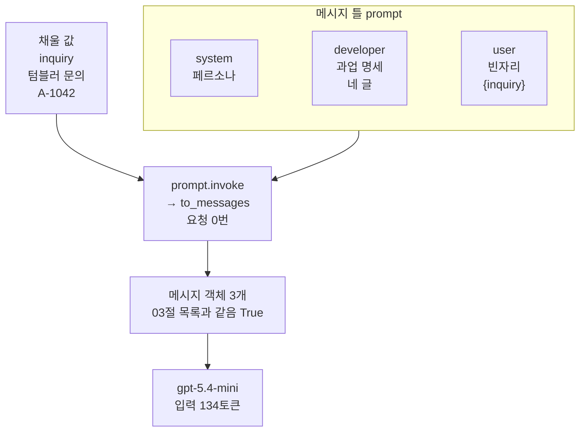
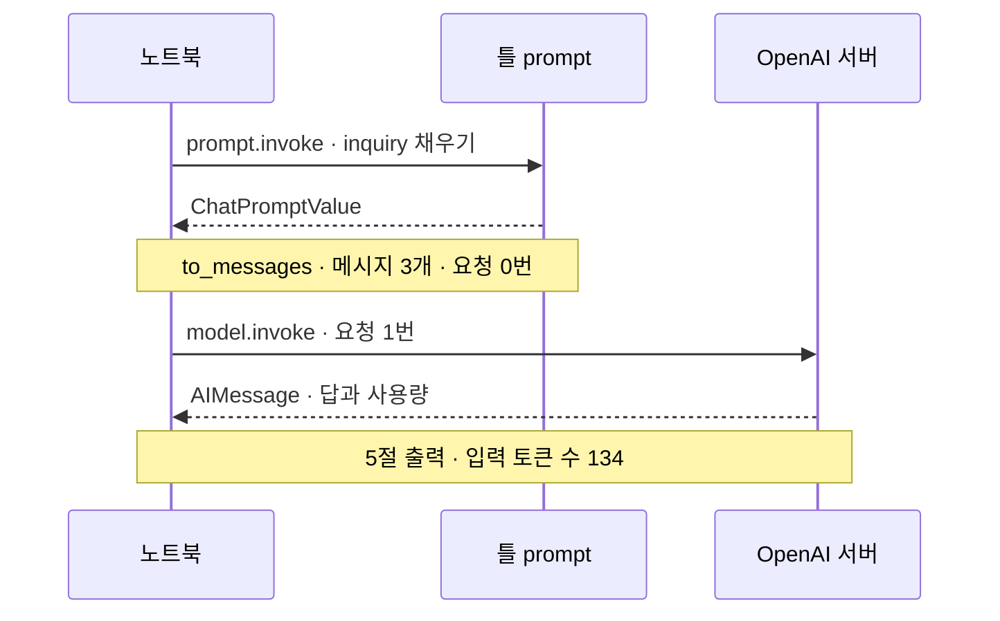
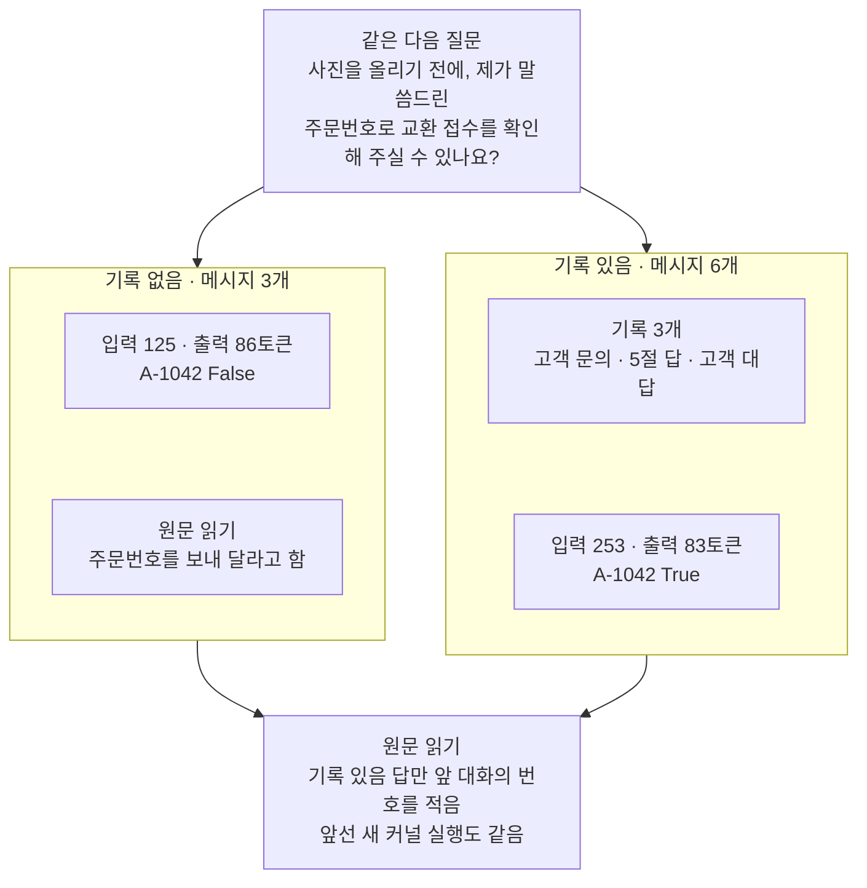
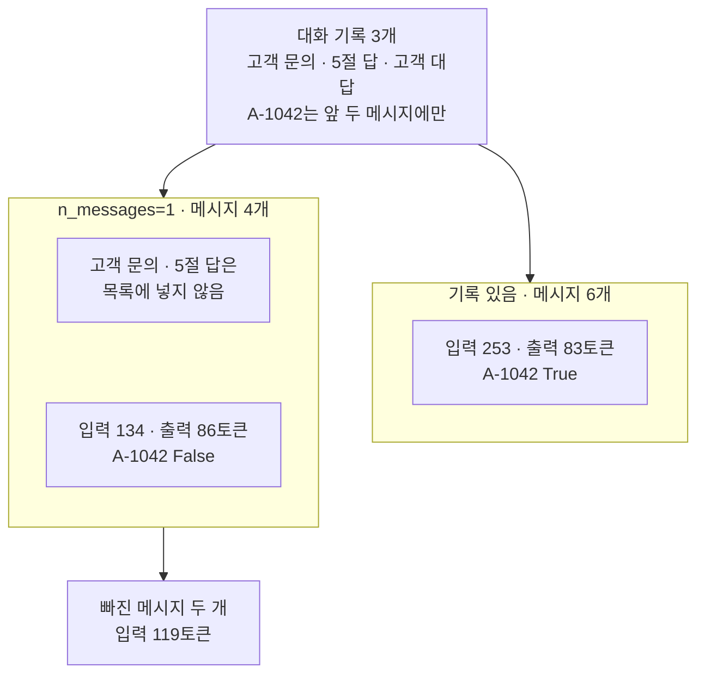

# 04-ChatPromptTemplate과-MessagesPlaceholder

## _src 본문 (HTML 원본)

```html
<!--meta: 강의 1h | 실습 2h | 코드 Jupyter Notebook | 새 용어 6 -->
<h2 id="b1"><span class="no">1</span>학습 목표</h2>
<div class="goal"><p>이 절을 마치면 다음을 할 수 있습니다.</p><ul><li>바뀌지 않는 메시지는 고정하고 고객 문의 자리만 비워 둔 메시지 틀을 만들 수 있습니다.</li><li>틀의 <code>invoke()</code>와 모델의 <code>invoke()</code>를 구분하고, 채운 목록이 03절 목록과 같은지 확인할 수 있습니다.</li><li>대화 기록 자리를 비워 두거나 채워, 기록 없음·기록 있음 목록을 만들 수 있습니다.</li><li>최근 메시지만 넣으면 빠진 메시지의 내용은 모델에 가지 않는다는 점을 설명할 수 있습니다.</li></ul></div>
<h2 id="b2"><span class="no">2</span>이 내용을 배우는 이유</h2>
<p>03절까지는 고객 문의가 바뀔 때마다 세 메시지 목록을 새로 만들었습니다. 페르소나와 과업 명세는 그대로인데도 목록 전체를 다시 적어야 했습니다. 같은 글을 여러 곳에 적어 두면, 과업 명세를 고칠 때 한 곳을 빠뜨리기 쉽습니다.</p>
<p>고객과 대화가 이어지면 앞에서 주고받은 메시지도 함께 보내야 합니다. 첫 질문에는 그런 메시지가 없고, 다음 질문에는 있습니다. 이 절은 두 경우를 틀 하나로 처리하고, 기록을 넣고 뺄 때 답과 토큰 수가 어떻게 달라지는지 봅니다.</p>
<p><strong>이 절의 질문</strong> — 고정한 메시지에 고객 문의와 대화 기록만 채우면, 받는 메시지와 답은 무엇이 달라질까요?</p>
<h2 id="b3"><span class="no">3</span>앞에서 배운 내용</h2>
<table><thead><tr><th>앞 절</th><th>배운 것</th><th>이 절에서 이어지는 곳</th></tr></thead><tbody>
<tr><td>03절</td><td>예시 없음 목록(system 페르소나 · developer 과업 명세 · user 고객 문의), 입력 134토큰, 같은 목록도 실행마다 낱말이 달라짐</td><td>2절 목록 다시 만들기, 4절 같은지 확인, 5절 입력 토큰 비교</td></tr>
<tr><td>02절</td><td>과업 명세 네 글(목표·필수 정보·금지 사항·출력 형식)</td><td>실험 해석의 「필수 정보에 적어야 할 내용」</td></tr>
<tr><td>01절</td><td>튜플 역할 developer, <code>convert_to_messages()</code>, <code>additional_kwargs</code>, <code>timed_invoke()</code>·<code>make_prompt_record()</code>, 확인 단어 표시</td><td>3절 developer 메시지 객체, 5·7·8절 기록, 7절 확인 단어</td></tr>
<tr><td>Ch 6 01·02절</td><td>응답 객체 <code>AIMessage</code>, 메시지 객체 <code>.type</code>, 역할 이름 user ↔ human, 앞 답을 넣지 않으면 이어진 대화가 아님</td><td>6절 대화 기록과 assistant 튜플</td></tr>
<tr><td>Ch 2 05절</td><td><code>try/except 오류이름 as error</code></td><td>3절 <code>ValueError</code>, 6절 <code>KeyError</code></td></tr>
</tbody></table>
<p>03절 본문은 메시지 틀을 이 절에서 다룬다고 적었습니다. 이 절은 03절 예시 없음 목록을 글자까지 같게 틀로 옮깁니다. 예시를 user·assistant 메시지 쌍으로 넣는 틀(<code>FewShotChatMessagePromptTemplate</code>)은 이번에도 실행하지 않습니다.</p>
<p>01~03절이 고객 지원 글을 역할과 뜻에 따라 나눴으므로, 이 절도 나눈 목록을 그대로 씁니다. 대화 기록은 5절에서 실제로 주고받은 두 메시지에 짧은 고객 대답 하나를 더해 씁니다.</p>
<h2 id="b4"><span class="no">4</span>핵심 개념</h2>
<h3>비유로 시작하기</h3>
<p>02·03절 그림의 나무 책상이 이번에는 틀이 됩니다. 두 책상에는 같은 파란 명찰과 주황 클립보드가 같은 모양으로 놓여 있습니다. 책상 앞쪽에는 메모지 크기의 점선 네모가 비어 있고, 책상마다 투명 비닐 봉투가 하나씩 있습니다.</p>
<p>문구점에서 파는 생일 카드를 떠올려 봅니다. 인사말은 인쇄돼 있고 받는 사람 이름 자리만 비어 있어서, 카드는 한 번 사 두고 이름만 적어 씁니다. 메시지 틀도 바뀌지 않는 메시지는 인쇄해 두고, 바뀌는 자리만 비워 둡니다.</p>
{{img:04-5-틀과-빈자리|흰 바탕에 같은 나무 책상 두 개가 나란히 있고, 책상마다 파란 명찰과 주황 클립보드와 앞쪽 점선 빈 네모가 있으며, 왼쪽 책상의 투명 봉투는 비어 있고 오른쪽 책상의 투명 봉투에는 금 간 컵이 그려진 노란 메모지와 연보라 메모지가 들어 있고, 바닥에 카메라가 그려진 노란 메모지 한 장이 놓인 삽화|두 책상의 명찰·클립보드·점선 빈자리는 같고, 투명 봉투에 든 앞선 메모만 다릅니다.}}
<p><strong>그림 읽기</strong> — 파란 명찰은 페르소나(system), 주황 클립보드는 과업 명세(developer)입니다. 01~03절 그림과 같은 색 약속입니다. 두 책상에서 이 둘은 틀에 고정된 메시지입니다.</p>
<p>점선 네모는 고객 질문이 들어갈 빈자리입니다. 바닥의 카메라가 그려진 노란 메모지가 다음에 채울 질문입니다. 사진을 올리기 전에 주문번호로 교환 접수를 확인해 달라는 질문입니다.</p>
<p>투명 봉투는 대화 기록이 들어갈 자리입니다. 왼쪽 봉투는 비어 있고, 오른쪽 봉투에는 금 간 컵이 그려진 노란 메모지와 연보라 메모지가 들어 있습니다. 노란 메모지는 앞선 고객 문의, 연보라 메모지는 모델이 한 앞선 답입니다. 노트북 기록에는 고객 대답 「네, 알겠습니다.」가 셋째 메시지로 더 있지만, 그림에는 앞 두 메시지만 그렸습니다.</p>
<p>봉투가 비어 있어도 책상은 그대로 씁니다. 카메라 메모지는 왼쪽 책상 아래에 놓였지만, 두 책상 모두의 빈자리에 채울 메모지입니다.</p>
<h3>메시지 틀과 빈자리</h3>
<p>메시지 틀(prompt template)은 바뀌지 않는 메시지는 그대로 적고, 바뀌는 자리만 비워 둔 메시지 목록입니다. 라이브러리 LangChain에서 채팅 메시지 틀을 만드는 클래스가 <code>ChatPromptTemplate</code>입니다. 노트북 3절은 메서드 <code>from_messages()</code>에 메시지 세 개를 넘겨 틀 객체 <code>prompt</code>를 만듭니다.</p>
<p>빈자리는 글 <code>"{inquiry}"</code>처럼 이름을 중괄호로 감싸 적습니다. Ch 2에서 본 f-string과 달리 글 앞에 f가 없어서, Python은 이 글을 그대로 둡니다. 틀이 나중에 같은 이름의 값을 찾아 넣습니다. 노트북 출력 <code>채울 이름: ['inquiry']</code>가 이 틀의 빈자리 목록입니다.</p>
{{mermaid:04-1-틀에-문의-채우기|큰 상자 메시지 틀 prompt 안에 초록 상자 system 페르소나, developer 과업 명세 네 글, user 빈자리 inquiry가 있고, 초록 상자 채울 값 inquiry 텀블러 문의 A-1042와 함께 파란 상자 prompt.invoke와 to_messages 요청 0번으로 들어가 노란 상자 메시지 객체 3개 03절 목록과 같음 True가 되고, 보라 상자 gpt-5.4-mini 입력 134토큰으로 이어지는 그림|틀에 고객 문의를 채우면 03절 목록과 같은 메시지 객체 세 개가 나오고, 요청은 그 목록을 모델로 보낼 때 한 번 나갑니다.}}
<p><strong>도식 읽기</strong> — 위에서 아래로 읽습니다. 「메시지 틀 prompt」 큰 상자 안 초록 상자 셋 가운데 user 상자만 빈자리 <code>{inquiry}</code>입니다. 「채울 값」 초록 상자는 텀블러 고객 문의 글입니다. 두 상자가 파란 상자 <code>prompt.invoke → to_messages</code>로 들어가고, 이 단계는 요청을 보내지 않습니다.</p>
<p>노란 상자는 노트북 4절 출력입니다. 채운 메시지 객체 세 개가 03절 목록을 바꾼 결과와 같았습니다. 보라 상자에서 요청이 한 번 나가고, 입력 토큰 수는 03절 예시 없음과 같은 134였습니다.</p>
<h3>틀은 developer 튜플을 받지 않습니다</h3>
<p>03절 목록 모양 그대로 developer 튜플을 넘기면 틀을 만들 때 <code>ValueError</code>가 납니다. 오류 메시지는 역할 이름으로 human·user·ai·assistant·system만 받는다고 알려 줍니다. 설치한 langchain-core 1.6.2 소스를 보면, 튜플을 틀의 메시지로 바꾸는 함수는 다섯 이름과 <code>placeholder</code>를 처리합니다. 역할 이름 <code>placeholder</code>는 메시지 목록 자리를 뜻하고, 이 튜플은 이번에 실행하지 않았습니다. 6절은 같은 자리를 클래스 <code>MessagesPlaceholder</code>로 만듭니다.</p>
<p>대신 틀은 이미 만든 메시지 객체를 받습니다. 그래서 01절 함수 <code>convert_to_messages()</code>로 developer 튜플을 메시지 객체로 바꿔 넣었습니다. 객체의 추가 정보에는 OpenAI 역할 표시 <code>{'__openai_role__': 'developer'}</code>가 그대로 남습니다. 메시지 객체로 넣은 글은 틀이 빈자리를 찾지 않고 글 그대로 씁니다.</p>
<h3>틀의 invoke와 모델의 invoke</h3>
<p>틀 객체에도 메서드 <code>invoke()</code>가 있습니다. 틀의 <code>invoke()</code>는 딕셔너리로 받은 값을 빈자리에 채워, 채운 값(<code>ChatPromptValue</code>)을 반환합니다. 메서드 <code>to_messages()</code>가 그 안의 메시지 객체 목록을 꺼냅니다. 여기까지는 요청을 보내지 않습니다.</p>
<p>요청은 그 목록을 모델 객체의 <code>invoke()</code>에 넘길 때 나갑니다. 두 메서드는 이름이 같으므로, 점 앞의 객체가 틀인지 모델인지로 구분합니다.</p>
<h3>대화 기록 자리</h3>
<p>대화 기록(history)은 앞에서 주고받은 메시지 목록입니다. 전화 상담을 다른 직원이 이어받을 때 앞선 통화 메모를 함께 넘기는 것과 비슷합니다. 노트북 6절의 기록은 고객 문의, 5절 답, 고객 대답 「네, 알겠습니다.」 세 메시지입니다.</p>
<p>기록은 메시지 여러 개라서 글 빈자리에 넣을 수 없습니다. 클래스 <code>MessagesPlaceholder</code>는 틀 안에 메시지 목록이 통째로 들어갈 자리를 만듭니다. 인자 <code>optional=True</code>를 주면 그 자리를 비워 둘 수 있습니다. 비워 두면 그 자리는 목록에서 빠지고, 채우면 넘긴 순서대로 메시지가 들어갑니다.</p>
<p>튜플 역할 이름 assistant는 모델이 한 말이라는 뜻입니다. 라이브러리 LangChain은 이 튜플을 Ch 6 01절 응답 객체와 같은 클래스인 <code>AIMessage</code>로 바꿉니다. 노트북 6절 출력에서 기록 있음 목록의 넷째 메시지가 <code>AIMessage | ai</code>였습니다.</p>
<h3>이 절에서 쓰는 말</h3>
<table><thead><tr><th>용어</th><th>뜻</th><th>이 절에서 보이는 모습</th></tr></thead><tbody>
<tr><td>메시지 틀(prompt template)</td><td>바뀌지 않는 메시지는 고정하고 바뀌는 자리만 비워 둔 메시지 목록. 이름 자리만 빈 생일 카드와 비슷함</td><td><code>틀 객체 종류: ChatPromptTemplate</code></td></tr>
<tr><td>빈자리 이름</td><td>틀 안 글에 중괄호로 감싸 적은 이름. 같은 이름의 키로 값을 채움</td><td><code>채울 이름: ['inquiry']</code></td></tr>
<tr><td>채운 값</td><td>틀의 <code>invoke()</code>가 빈자리를 채워 반환한 객체. 요청을 보내지 않음</td><td><code>채운 값 종류: ChatPromptValue</code></td></tr>
<tr><td>대화 기록(history)</td><td>앞에서 주고받은 메시지 목록. 앞선 통화 메모와 비슷함</td><td><code>대화 기록의 메시지 수: 3</code></td></tr>
<tr><td>메시지 목록 자리</td><td>메시지 여러 개가 통째로 들어갈 틀 안 자리(<code>MessagesPlaceholder</code>)</td><td><code>기록 있음 메시지 수: 6</code></td></tr>
<tr><td>비워 둘 수 있는 자리</td><td><code>optional=True</code>를 준 메시지 목록 자리. 비워 두면 목록에서 빠짐</td><td><code>비워 둘 수 있는 이름: ['history']</code></td></tr>
</tbody></table>
<h2 id="b5"><span class="no">5</span>실행 예제</h2>
<p>노트북은 03절 예시 없음 목록을 다시 만들고, 같은 내용의 틀을 만듭니다. 틀에 고객 문의를 채워 03절 목록과 같은지 확인한 뒤 모델로 보냅니다. 그다음 틀에 대화 기록 자리를 더해, 다음 질문을 기록 없이 한 번, 기록을 넣어 한 번 보냅니다. 마지막으로 기록 자리에 최근 메시지 하나만 넣어 한 번 더 보냅니다.</p>
<p>실제 OpenAI 모델을 temperature 0으로 부릅니다. 이 페이지의 출력은 2026-09-21에 실행한 결과입니다. 요청은 모두 4번이고, 예상 비용은 0.01달러 미만입니다. 답 문장은 실행마다 달라질 수 있습니다.</p>
<p>강의 시간에는 노트북 3~6절(틀 만들기·채우기·보내기, 대화 기록 자리)을 설명합니다. 7·8절(기록 없음과 기록 있음 보내기, 값 바꿔 보기)은 함께 실행하고 실습 시간에 읽습니다.</p>
{{notebook:04-ChatPromptTemplate과-MessagesPlaceholder}}
<p class="look"><b>확인할 점</b> — 4절 <code>03절 목록을 바꾼 결과와 같은가: True</code>와 5절 <code>입력 토큰 수: 134</code>를 봅니다. 7절 확인 단어 표에서 <code>A-1042</code> 줄이 <code>False | True</code>인 것도 봅니다. 8절 표에서 최근 메시지 하나 줄의 A-1042가 <code>False</code>인 것과 마지막 줄 <code>빠진 두 메시지가 차지하던 입력 토큰 수: 119</code>를 함께 읽습니다.</p>
<h3>두 invoke의 순서</h3>
<p>노트북 4·5절에서 부른 두 <code>invoke()</code>를 요청 순서로 모았습니다.</p>
{{mermaid:04-2-두-invoke-순서|노트북 틀 prompt OpenAI 서버 세로선 셋이 있고, 노트북에서 틀로 prompt.invoke inquiry 채우기 실선, 틀에서 노트북으로 ChatPromptValue 점선, 노란 메모 to_messages 메시지 3개 요청 0번, 노트북에서 서버로 model.invoke 요청 1번 실선, 서버에서 노트북으로 AIMessage 답과 사용량 점선, 노란 메모 5절 출력 입력 토큰 수 134가 차례로 있는 순서 그림|틀의 invoke에서는 요청이 0번이고, 모델의 invoke에서 요청이 한 번 나갑니다.}}
<p><strong>도식 읽기</strong> — 위에서 아래로 읽습니다. 첫 실선 화살표는 노트북이 틀에 고객 문의를 채우는 <code>prompt.invoke</code>이고, 점선으로 채운 값이 옵니다. 첫 노란 메모에서 메시지 객체 세 개를 꺼냈지만 요청은 0번입니다.</p>
<p>둘째 실선 화살표에서 모델 객체의 <code>invoke</code>가 OpenAI 서버로 요청을 한 번 보냅니다. 점선으로 답과 사용량이 담긴 <code>AIMessage</code>가 오고, 마지막 노란 메모가 5절 출력의 입력 토큰 수 134입니다. 그림은 모델 객체를 따로 그리지 않고, 요청이 가는 곳만 그렸습니다.</p>
<h2 id="b6"><span class="no">6</span>실험 결과 해석</h2>
<p>틀을 채운 목록은 03절 예시 없음 목록을 바꾼 메시지 객체와 같았고, 입력 토큰 수도 134로 같았습니다. 틀은 모델이 받는 내용을 바꾸지 않았습니다. 바뀐 것은 목록을 만드는 코드입니다. 고객 문의만 바꿔 채운 머그컵 목록도 앞 두 메시지가 같았습니다.</p>
<p>답의 다음 행동 줄은 03절 예시 없음 답과 글자까지 같았고, 분류 이름과 고객 문장 줄은 달랐습니다. 받은 메시지가 같아도 실행마다 낱말이 달라질 수 있다는 03절 관찰과 같습니다.</p>
<h3>기록 없음과 기록 있음</h3>
<p>노트북 7절은 같은 다음 질문을 기록 없이 한 번, 기록을 넣어 한 번 보냈습니다. 질문은 「사진을 올리기 전에, 제가 말씀드린 주문번호로 교환 접수를 확인해 주실 수 있나요?」입니다. 질문 글에는 주문번호가 없어서, 번호를 적어 답하려면 앞 대화가 필요합니다.</p>
{{mermaid:04-3-기록-없음과-있음|위 초록 상자 같은 다음 질문 사진을 올리기 전에 제가 말씀드린 주문번호로 교환 접수를 확인해 주실 수 있나요가 기록 없음 메시지 3개 큰 상자의 노란 상자 입력 125 출력 86토큰 A-1042 False와 원문 읽기 주문번호를 보내 달라고 함, 기록 있음 메시지 6개 큰 상자의 초록 상자 기록 3개 고객 문의 5절 답 고객 대답과 노란 상자 입력 253 출력 83토큰 A-1042 True로 갈라지고, 두 큰 상자가 맨 아래 노란 상자 원문 읽기 기록 있음 답만 앞 대화의 번호를 적음 앞선 새 커널 실행도 같음으로 모이는 그림|같은 다음 질문에 기록 세 메시지를 넣자 입력 토큰이 늘고, 기록 있음 답만 A-1042를 적었습니다.}}
<p><strong>도식 읽기</strong> — 위 초록 상자가 두 요청에 같이 넣은 다음 질문입니다. 아래 두 큰 상자의 제목이 조건과 메시지 수이고, 큰 상자 안 노란 상자의 수는 7절 기록표와 확인 단어 표입니다. 기록 없음은 입력 125·출력 86토큰에 A-1042가 없었습니다. 기록 있음은 입력 253·출력 83토큰에 A-1042가 있었습니다.</p>
<p>「기록 있음」 큰 상자 안 초록 상자는 넣은 기록 세 메시지입니다. 「기록 없음」 큰 상자 안 둘째 노란 상자와 맨 아래 노란 상자는 답 원문을 읽고 확인한 것입니다.</p>
<p>기록 없음 답은 번호를 알 수 없어, 주문번호를 보내 주면 확인하겠다고 했습니다. 기록 있음 답은 번호를 묻지 않고 <code>주문번호 A-1042로</code> 접수를 확인하려면 사진이 먼저 필요하다고 안내했습니다. 기록 세 메시지는 입력 토큰을 128개 더했습니다.</p>
<p>교재를 만들 때 앞선 새 커널 실행에서도 A-1042는 기록 있음 답에만 있었습니다. 두 번 모두 같았으므로, 이 질문에서는 기록을 넣은 답만 앞 대화의 번호를 이어 받았다고 적습니다. 늘 그렇다고는 말하지 않습니다.</p>
<h3>기록 자리에 최근 메시지 하나만 넣으면</h3>
<p>노트북 8절은 기록 자리에 인자 <code>n_messages=1</code>만 더했습니다. 넘긴 기록은 7절 기록 있음과 같은 세 메시지입니다. 인자 <code>n_messages</code>는 기록 목록의 뒤쪽에서 몇 개의 메시지만 넣을지 정하므로, 뒤쪽 고객 대답만 남았습니다. 앞쪽의 고객 문의와 5절 답은 빠졌습니다.</p>
{{mermaid:04-4-최근-메시지-하나|위 초록 상자 대화 기록 3개 고객 문의 5절 답 고객 대답 A-1042는 앞 두 메시지에만이 n_messages=1 메시지 4개 큰 상자와 기록 있음 메시지 6개 큰 상자로 갈라지고, n_messages 상자 안에는 회색 상자 고객 문의 5절 답은 목록에 넣지 않음과 노란 상자 입력 134 출력 86토큰 A-1042 False, 기록 있음 상자 안에는 노란 상자 입력 253 출력 83토큰 A-1042 True가 있으며, n_messages 상자 아래 노란 상자 빠진 메시지 두 개 입력 119토큰이 있는 그림|n_messages=1은 기록의 뒤쪽 고객 대답 하나만 넣어, 번호가 든 앞 두 메시지와 입력 토큰 119개가 빠졌습니다.}}
<p><strong>도식 읽기</strong> — 위 초록 상자는 두 요청에 넘긴 대화 기록입니다. 6절 출력에서 A-1042는 앞 두 메시지에만 있었습니다. 「n_messages=1 · 메시지 4개」 큰 상자 안 회색 상자는 목록에 넣지 않은 두 메시지입니다. 그 아래 노란 상자가 8절 출력으로, 입력 134·출력 86토큰에 A-1042가 없었습니다.</p>
<p>「기록 있음 · 메시지 6개」 큰 상자는 7절 결과로, 입력 253·출력 83토큰에 A-1042가 있었습니다. 맨 아래 노란 상자는 8절 마지막 줄의 값으로, 빠진 두 메시지가 입력 토큰 119개였습니다.</p>
<p>번호가 든 메시지가 빠지자 답은 다시 주문번호를 보내 달라고 했습니다. 다음 행동 줄은 7절 기록 없음 답과 글자까지 같았습니다. 8절 첫 줄 <code>남은 기록 메시지에 A-1042가 있는가: False</code>가 남은 메시지에 번호가 없었음을 보여 줍니다. 앞선 새 커널 실행도 세 조건의 A-1042 표시가 같았습니다.</p>
<p>정리하면, 메시지 수를 줄이면 입력 토큰은 줄지만 빠진 메시지에만 있던 내용은 모델에 가지 않습니다. 기록에서 무엇을 고르고 줄일지는 Ch 8 02·03절에서 다룹니다. 이 결론은 고객 문의 하나·다음 질문 하나·모델 하나로, 조건마다 한 번 보낸 실행을 새 커널로 두 번 한 범위입니다.</p>
<h2 id="b7"><span class="no">7</span>주의할 점과 실무 메모</h2>
<ul><li>튜플로 틀에 넣은 글의 중괄호는 모두 빈자리로 읽힙니다. 6절 <code>KeyError</code> 메시지는 중괄호를 글자로 쓰려면 두 번 겹쳐 쓰라고 안내합니다. 겹쳐 쓴 글은 이번에 실행하지 않았습니다.</li>
<li>설치한 langchain-core 1.6.2의 틀은 역할 이름 developer를 튜플로 받지 않습니다. 01절 <code>convert_to_messages()</code>로 만든 메시지 객체를 넣습니다. 다른 판에서는 실행하지 않았습니다.</li>
<li>기록 자리를 꼭 채워야 하는 경우만 <code>optional=True</code>를 뺍니다. 뺀 틀에 기록 없이 값을 채우면 6절처럼 <code>KeyError</code>가 납니다.</li>
<li>인자 <code>n_messages</code>는 메시지 개수로 셉니다. 고객 한 번·답 한 번의 주고받기가 두 메시지입니다. 이 절의 기록 세 메시지에서 <code>n_messages=1</code>은 고객 대답만 남겼습니다.</li>
<li>주문번호처럼 답에 꼭 필요한 정보가 앞쪽 메시지에만 있으면, 기록을 줄일 때 그 메시지가 빠지지 않는지 확인합니다. 이 절의 8절에서는 번호가 든 두 메시지가 빠졌습니다.</li>
<li>대화 기록에는 앞 대화의 개인정보가 함께 실립니다. 기록은 요청마다 서비스로 함께 보내지므로, 넣기 전에 필요한 메시지인지 확인합니다. 이 절의 문의와 기록은 교재용으로 만든 글입니다.</li>
<li>다음 질문 글, 고객 대답, 머그컵 문의, <code>n_messages=1</code>은 흐름을 보여 주려고 정한 예입니다. 리팩터 뒤 다시 실행에서 처음 질문으로는 관찰이 흔들려, 기록이 있어야 답할 수 있는 질문으로 바꿨습니다. 리팩터는 앞에서 배운 함수를 도구 파일로 옮긴 코드 정리입니다. 처음 질문은 「사진은 어디로 보내면 되나요?」였고, 기록 있음 답에 주문번호가 있는 실행과 없는 실행이 섞였습니다. 지금 질문과 고객 대답은 탐색 없이 새 커널로 두 번 실행했고, 세 조건의 A-1042 표시가 두 번 모두 같았습니다.</li>
<li>틀의 동작은 설치한 소스로 확인했습니다. 역할 이름 처리는 <code>_create_template_from_message_type</code>, 메시지 객체 처리는 <code>_convert_to_message_template</code>입니다. 기록 자리는 <code>MessagesPlaceholder.format_messages</code>가 처리합니다. 틀과 모델을 <code>|</code>로 이어 한 번에 부르는 방법은 이번에 실행하지 않았습니다.</li>
<li>교재 출력은 Linux의 Python 3.12.13으로 만들었습니다. 패키지는 langchain 1.4.0, langchain-core 1.6.2입니다. langchain-openai 1.6.0, openai 3.10.0도 함께 썼습니다. 다른 버전과 Windows·macOS에서는 실행하지 않았습니다.</li></ul>
<h2 id="b8"><span class="no">8</span>정리와 다음 절</h2>
<ul><li>메시지 틀은 바뀌지 않는 메시지를 고정하고 빈자리만 남깁니다. 틀을 채운 목록은 03절 목록과 같은 메시지 객체였고, 입력 토큰도 134로 같았습니다.</li><li>틀의 <code>invoke()</code>는 요청 없이 빈자리만 채우고, 요청은 모델의 <code>invoke()</code>에서 나갑니다.</li><li>대화 기록 자리에는 메시지 목록을 통째로 넣고 비워 둘 수도 있습니다. 번호가 든 기록을 넣은 답만 주문번호를 적었고, <code>n_messages=1</code>로 번호가 든 메시지가 빠지자 답은 다시 번호를 물었습니다.</li></ul>
<p><strong>다음 학습과 이어지는 지점</strong> — 05절에서는 답만 받는 요청과, 다시 확인할 수 있는 짧은 근거도 받는 요청을 비교합니다.</p>
<h2 id="b9"><span class="no">9</span>복습 문제</h2>
<details class="quiz"><summary>문제 1 · 틀의 빈자리</summary><p class="quiz-q">노트북 3절 틀에서 채울 이름은 무엇이고, 어디에 적었나요?</p><p class="quiz-a"><b>해설</b> — 이름은 <code>inquiry</code>이고, user 튜플의 글 <code>"{inquiry}"</code>에 적었습니다. 글 앞에 f가 없어 Python은 그대로 둡니다. 틀의 <code>invoke()</code>가 딕셔너리 키 <code>inquiry</code>의 값을 넣습니다.</p></details>
<details class="quiz"><summary>문제 2 · 두 invoke</summary><p class="quiz-q">코드 <code>prompt.invoke(fill_values)</code>를 실행하면 서비스로 요청이 나가나요?</p><p class="quiz-a"><b>해설</b> — 나가지 않습니다. 틀의 <code>invoke()</code>는 빈자리를 채운 <code>ChatPromptValue</code>를 반환할 뿐입니다. 요청은 꺼낸 메시지 목록을 모델 객체의 <code>invoke()</code>에 넘길 때 나갑니다.</p></details>
<details class="quiz"><summary>문제 3 · developer 메시지</summary><p class="quiz-q">03절 목록처럼 <code>("developer", task_text)</code> 튜플을 틀에 넣지 않고, <code>convert_to_messages()</code>로 바꿔 넣은 이유는 무엇인가요?</p><p class="quiz-a"><b>해설</b> — 설치한 판의 틀은 튜플 역할 이름으로 developer를 받지 않습니다. 오류 메시지는 human·user·ai·assistant·system을 쓰라고 안내합니다. 그래서 developer 튜플에서 <code>ValueError</code>가 났습니다. 틀은 메시지 객체를 그대로 받으므로, 01절 함수로 OpenAI 역할 표시가 붙은 객체를 만들어 넣었습니다.</p></details>
<details class="quiz"><summary>문제 4 · 비워 둘 수 있는 자리</summary><p class="quiz-q">기록 자리에서 <code>optional=True</code>를 빼고, 기록 없이 다음 질문만 채우면 어떻게 되나요?</p><p class="quiz-a"><b>해설</b> — 채울 이름에 <code>history</code>가 들어가, 값을 채울 때 <code>KeyError</code>가 납니다. 메시지에는 <code>missing variables {'history'}</code>가 있습니다. 첫 질문처럼 기록이 없는 경우가 정상이면 <code>optional=True</code>를 둡니다.</p></details>
<details class="quiz"><summary>문제 5 · 최근 메시지 하나</summary><p class="quiz-q">인자 <code>n_messages=1</code>로 기록 세 메시지 중 고객 대답만 남기자, 답은 다시 주문번호를 보내 달라고 했습니다. 왜 그런가요?</p><p class="quiz-a"><b>해설</b> — 주문번호는 기록의 앞 두 메시지(고객 문의·5절 답)에만 있었습니다. 6절 출력 <code>user | True</code>, <code>assistant | True</code>, <code>user | False</code>가 번호의 자리를 보여 줍니다. 인자 <code>n_messages</code>는 뒤쪽에서 메시지 개수만큼만 넣으므로 앞 두 메시지가 빠졌고, 빠진 메시지에만 있던 번호는 모델에 가지 않았습니다.</p></details>
<h2 id="b10"><span class="no">10</span>참고 자료</h2>
<p>문서는 2026-09-17에 다시 열어 확인했습니다. 코드는 실습 가상환경에 설치한 <code>langchain 1.4.0</code>, <code>langchain-core 1.6.2</code>, <code>langchain-openai 1.6.0</code>으로 실행했습니다.</p>
<ul><li><div><a href="https://reference.langchain.com/python/langchain-core/prompts/chat/ChatPromptTemplate">LangChain ChatPromptTemplate reference</a></div>메시지 틀 만들기와 채울 이름·비워 둘 수 있는 이름 · 확인 2026-09-17</li><li><div><a href="https://reference.langchain.com/python/langchain-core/prompts/chat/MessagesPlaceholder">LangChain MessagesPlaceholder reference</a></div>메시지 목록 자리, <code>optional</code>과 <code>n_messages</code> · 확인 2026-09-17</li><li><div><a href="https://docs.langchain.com/oss/python/langchain/errors/INVALID_PROMPT_INPUT">LangChain INVALID_PROMPT_INPUT</a></div>6절 <code>KeyError</code> 메시지가 가리키는 오류 안내 · 확인 2026-09-17</li><li><div><a href="https://github.com/langchain-ai/langchain/blob/master/libs/core/langchain_core/prompts/chat.py">LangChain chat.py</a></div>역할 이름 처리와 메시지 목록 자리. 설치한 langchain-core 1.6.2 소스로 확인 · 확인 2026-09-17</li><li><div><a href="https://github.com/langchain-ai/langchain/blob/master/LICENSE">LangChain MIT License</a></div>예제의 고객 문의·대화 기록과 설명은 이 교재에 맞게 새로 썼습니다</li></ul>
```

## 노트북 셀 (순서대로)

### [0] markdown {'html': 'skip'}

# ChatPromptTemplate과 MessagesPlaceholder

**이 노트북에서 할 일**

1. 03절 예시 없음 목록을, 고객 문의 자리만 비워 둔 메시지 틀로 만듭니다.
2. 틀을 채운 목록이 03절 목록과 같은지 확인하고, 같은 모델로 보냅니다.
3. 틀에 대화 기록 자리를 더해, 기록 없음·기록 있음·최근 메시지 하나만 넣은 목록을 비교합니다.

**준비물** — 프로젝트 폴더 `.env` 파일의 `OPENAI_API_KEY`가 필요합니다. 데이터 파일은 없습니다.

인터넷 서비스에 요청을 모두 4번 보냅니다. 모두 `gpt-5.4-mini`입니다.
실행 시간은 1분 안팎이고, 예상 비용은 0.01달러 미만으로 잡았습니다.
요금은 Ch 6 06절에서 2026-09-17에 확인한 mini 공식 요금 기준입니다.

**강의와 실습 범위** — 강의 시간에는 3~6절(틀 만들기·채우기·보내기, 대화 기록 자리)을 설명합니다.
7·8절(기록 없음과 기록 있음 보내기, 값 바꿔 보기)은 함께 실행하고 실습 시간에 읽습니다.

**기준 버전** — 실습 폴더에 고정한 패키지 판을 씁니다. langchain 1.4.0, langchain-core 1.6.2, langchain-openai 1.6.0입니다.
openai 3.10.0, python-dotenv 1.2.3도 함께 씁니다.

교재 출력은 Linux의 Python 3.12.13으로 만들었습니다. 다른 버전과 Windows·macOS에서는 이번에 실행하지 않았습니다.

실습 폴더 `labs/part2/ch07-prompt-engineering`에서 `uv sync --locked`를 실행합니다.
그다음 이 폴더의 `.venv` 커널을 고르고 첫 셀부터 순서대로 실행합니다.

### [1] markdown {'html': 'skip'}

## 오늘 볼 그림


위에서 아래로 읽습니다. 큰 상자는 이 노트북 3절에서 만드는 메시지 틀이고, 셋째 메시지 자리만 비어 있습니다.
파란 상자에서 틀에 고객 문의를 채우면 메시지 객체 세 개가 나옵니다. 이 단계는 요청을 보내지 않습니다.

그 목록을 모델로 보낼 때 요청이 한 번 나갑니다. 6절부터는 틀에 대화 기록 자리를 하나 더 둡니다.

### [2] markdown {}

## 1. 준비

첫 셀은 패키지를 설치하고 설치된 버전을 출력합니다. 설치에는 몇십 초가 걸릴 수 있습니다.
01~03절과 같은 실습 폴더와 같은 판입니다. 노트북은 앞 절 없이 새 커널에서 시작하므로 다시 확인합니다.

### [3] code {'execution': {'iopub.execute_input': '2026-09-21T04:36:44.418346Z', 'iopub.status.busy': '2026-09-21T04:36:44.418166Z', 'iopub.status.idle': '2026-09-21T04:36:44.871167Z', 'shell.execute_reply': '2026-09-21T04:36:44.870588Z'}, 'lesson_role': 'setup'}

```python
# 이 절에서 쓰는 패키지를 설치하고 버전을 확인합니다
%pip install -q "langchain==1.4.0" "langchain-openai==1.6.0" "python-dotenv==1.2.3"
from importlib.metadata import version

print("langchain:", version("langchain"))
print("langchain-core:", version("langchain-core"))
print("langchain-openai:", version("langchain-openai"))
print("openai:", version("openai"))
print("python-dotenv:", version("python-dotenv"))
```

출력:
```
Note: you may need to restart the kernel to use updated packages.
langchain: 1.4.0
langchain-core: 1.6.2
langchain-openai: 1.6.0
openai: 3.10.0
python-dotenv: 1.2.3

```

### [4] markdown {}

**결과 읽기** — 출력 줄은 `langchain: 1.4.0`, `langchain-core: 1.6.2`, `langchain-openai: 1.6.0` 등 다섯 줄입니다.
준비물에 적은 기준 버전과 같습니다. 이 절의 틀 클래스는 langchain-core 패키지에 들어 있습니다.

모델 객체를 만드는 함수를 불러오고, 앞에서 배운 기록 함수 두 개를 가져옵니다.

앞에서 배운 함수는 `llm_tools.py`에 모아 두었습니다. 파일을 열면 코드를 볼 수 있습니다. 노트북과 같은 폴더(`notebooks/`)에 있는 파일입니다.
이 노트북은 Ch 6 06절 `timed_invoke()`와 01절 `make_prompt_record()`를 가져옵니다.

### [5] code {'execution': {'iopub.execute_input': '2026-09-21T04:36:44.872345Z', 'iopub.status.busy': '2026-09-21T04:36:44.872255Z', 'iopub.status.idle': '2026-09-21T04:36:45.250708Z', 'shell.execute_reply': '2026-09-21T04:36:45.250355Z'}, 'lesson_role': 'setup'}

```python
# 모델 객체를 만드는 함수를 불러옵니다
from langchain.chat_models import init_chat_model
# Ch 6 06절·01절 기록 함수 두 개를 도구 파일에서 가져옵니다
from llm_tools import make_prompt_record, timed_invoke
```

출력:
```

```

### [6] markdown {}

01~03절과 같은 셀로 API 키가 있는지 확인합니다. 키 값은 출력하지 않고, 있는지만 봅니다.
`True` 값이 나오면 다음으로 넘어갑니다.

### [7] code {'execution': {'iopub.execute_input': '2026-09-21T04:36:45.251617Z', 'iopub.status.busy': '2026-09-21T04:36:45.251548Z', 'iopub.status.idle': '2026-09-21T04:36:45.255372Z', 'shell.execute_reply': '2026-09-21T04:36:45.255082Z'}, 'lesson_role': 'setup'}

```python
# .env 파일에서 OpenAI API 키를 읽습니다(키 값은 출력하지 않습니다)
import os
from dotenv import find_dotenv, load_dotenv

env_path = find_dotenv(usecwd=True)
load_dotenv(env_path)
has_key = os.getenv("OPENAI_API_KEY") is not None
print("OPENAI_API_KEY 설정 여부:", has_key)
assert has_key, "프로젝트 폴더의 .env 파일에 OPENAI_API_KEY를 적어 주세요."
```

출력:
```
OPENAI_API_KEY 설정 여부: True

```

### [8] markdown {}

실습에 쓸 모델을 준비합니다.
01~03절과 같은 설정으로 모델 객체를 만듭니다. 이 셀은 요청을 보내지 않습니다.

### [9] code {'execution': {'iopub.execute_input': '2026-09-21T04:36:45.256001Z', 'iopub.status.busy': '2026-09-21T04:36:45.255946Z', 'iopub.status.idle': '2026-09-21T04:36:46.166467Z', 'shell.execute_reply': '2026-09-21T04:36:46.166106Z'}}

```python
# 실습에 쓸 모델을 준비합니다
model = init_chat_model(
    "openai:gpt-5.4-mini",
    temperature=0,
    reasoning_effort="none",
)
print("모델 이름:", model.model_name)
print("temperature:", model.temperature)
```

출력:
```
모델 이름: gpt-5.4-mini
temperature: 0.0

```

### [10] markdown {}

**결과 읽기** — 출력 줄은 `모델 이름: gpt-5.4-mini`와 `temperature: 0.0`입니다. 이것으로 준비가 끝났습니다.
이 노트북의 출력은 2026-09-21에 이 모델로 실행한 결과입니다. 실행마다 답 문장이 달라질 수 있습니다.
Ch 6 01절에서 본 것처럼 temperature 0은 Ch 5 06절의 뽑기를 끈 설정(`do_sample=False`)과 같은 것이 아닙니다.

### [11] markdown {}

## 2. 03절 예시 없음 목록 다시 만들기

03절 예시 없음 목록은 system 페르소나, developer 과업 명세, user 고객 문의 세 메시지였습니다.
이 절은 그 목록을 틀로 옮깁니다. 그래서 먼저 03절과 글자까지 같은 목록을 다시 만듭니다.
03절처럼 만들면 고객 문의가 바뀔 때마다 이 셀 전체를 다시 써야 합니다. 이 불편을 틀로 줄여 봅니다.

### [12] code {'execution': {'iopub.execute_input': '2026-09-21T04:36:46.167193Z', 'iopub.status.busy': '2026-09-21T04:36:46.167129Z', 'iopub.status.idle': '2026-09-21T04:36:46.169421Z', 'shell.execute_reply': '2026-09-21T04:36:46.169134Z'}}

```python
# 03절과 같은 페르소나 글·고객 문의·과업 명세로 예시 없음 목록을 만듭니다
persona_text = "당신은 친절한 고객 상담원입니다."
inquiry_text = "어제 받은 텀블러 뚜껑이 깨졌습니다. 주문번호는 A-1042입니다. 새 상품으로 바꾸고 싶습니다."
goal_text = "고객 문의를 분류하고 필요한 다음 행동을 안내하세요."
required_text = "회사 규정상 교환 접수에는 파손 사진이 필요합니다. 주문번호는 답에 그대로 적으세요."
forbidden_text = "근거 없는 보상은 약속하지 마세요."
format_text = "분류, 다음 행동, 고객에게 보낼 한 문장을 한 줄씩 세 줄로 답하세요."
task_text = goal_text + "\n" + required_text + "\n" + forbidden_text + "\n" + format_text
zero_messages = [("system", persona_text), ("developer", task_text), ("user", inquiry_text)]
print("고객 문의:", inquiry_text)
print("과업 명세:")
print(task_text)
print("예시 없음 목록의 메시지 수:", len(zero_messages))
```

출력:
```
고객 문의: 어제 받은 텀블러 뚜껑이 깨졌습니다. 주문번호는 A-1042입니다. 새 상품으로 바꾸고 싶습니다.
과업 명세:
고객 문의를 분류하고 필요한 다음 행동을 안내하세요.
회사 규정상 교환 접수에는 파손 사진이 필요합니다. 주문번호는 답에 그대로 적으세요.
근거 없는 보상은 약속하지 마세요.
분류, 다음 행동, 고객에게 보낼 한 문장을 한 줄씩 세 줄로 답하세요.
예시 없음 목록의 메시지 수: 3

```

### [13] markdown {}

**결과 읽기** — 첫 줄은 `고객 문의:`로 시작하고 `주문번호는 A-1042입니다.`가 들어 있습니다.
라벨 줄 `과업 명세:` 아래 네 줄은 03절과 같은 과업 명세입니다. 마지막 줄은 `예시 없음 목록의 메시지 수: 3`입니다.

## 3. 고객 문의 자리를 비워 둔 틀 만들기

메시지 틀(prompt template)은 바뀌지 않는 메시지는 그대로 적고, 바뀌는 자리만 비워 둔 메시지 목록입니다.
인사말이 인쇄돼 있고 받는 사람 이름 자리만 빈 생일 카드와 비슷합니다. 카드는 한 번 사 두고 이름만 적어 씁니다.
LangChain에서 채팅 메시지 틀을 만드는 클래스가 `ChatPromptTemplate`입니다. 메서드 `from_messages()`가 메시지 목록을 받아 틀 객체를 반환합니다.

비워 둘 자리는 글 `"{inquiry}"`처럼 이름을 중괄호로 감싸 적습니다.
Ch 2에서 본 f-string은 글 앞에 f를 붙여, 그 줄에서 바로 값을 넣었습니다. 이 글에는 f가 없어 Python은 그대로 두고, 틀이 나중에 값을 넣습니다.

먼저 03절 목록 모양 그대로 튜플 세 개를 넘겨 봅니다. 실행 전에 예상합니다. 01절 튜플 역할 developer도 받아 줄까요?
틀 만들기는 요청을 보내지 않습니다. 오류가 나면 받아서 종류와 메시지를 출력합니다.

### [14] code {'execution': {'iopub.execute_input': '2026-09-21T04:36:46.170055Z', 'iopub.status.busy': '2026-09-21T04:36:46.169995Z', 'iopub.status.idle': '2026-09-21T04:36:46.185309Z', 'shell.execute_reply': '2026-09-21T04:36:46.185004Z'}}

```python
# 03절 목록 모양 그대로 developer 튜플을 넣어 틀을 만들어 봅니다(요청은 보내지 않습니다)
from langchain_core.prompts import ChatPromptTemplate

tuple_parts = [("system", persona_text), ("developer", task_text), ("user", "{inquiry}")]
try:
    ChatPromptTemplate.from_messages(tuple_parts)
except ValueError as error:
    print("오류 종류:", type(error).__name__)
    print("오류 메시지:")
    print(error)
```

출력:
```
오류 종류: ValueError
오류 메시지:
Unexpected message type: developer. Use one of 'human', 'user', 'ai', 'assistant', or 'system'.

```

### [15] markdown {}

**결과 읽기** — 첫 줄은 `오류 종류: ValueError`입니다. 라벨 줄 `오류 메시지:` 아래 줄은 `Unexpected message type: developer.`로 시작합니다.
뒤이어 `Use one of 'human', 'user', 'ai', 'assistant', or 'system'.`이 있습니다. 오류 메시지가 안내하는 역할 이름은 이 다섯 가지이고, developer는 없습니다.

01절에서 `invoke()`는 developer 튜플을 받아 주었습니다. 요청 전에 함수 `convert_to_messages()`가 `SystemMessage`로 바꿔 주었기 때문입니다.
설치한 langchain-core 1.6.2의 틀은 튜플 대신 이미 만든 메시지 객체도 받습니다. 그래서 developer 튜플만 01절 함수로 먼저 객체로 바꿔 넣습니다.

메시지 객체로 넣은 글은 틀이 빈자리를 찾지 않고 글 그대로 씁니다. 속성 `input_variables`는 틀이 채워 달라는 이름 목록입니다.

### [16] code {'execution': {'iopub.execute_input': '2026-09-21T04:36:46.185962Z', 'iopub.status.busy': '2026-09-21T04:36:46.185906Z', 'iopub.status.idle': '2026-09-21T04:36:46.188092Z', 'shell.execute_reply': '2026-09-21T04:36:46.187790Z'}}

```python
# developer 튜플을 01절 함수로 메시지 객체로 바꾼 뒤, 고객 문의 자리만 비워 둔 틀을 만듭니다
from langchain_core.messages import convert_to_messages

developer_message = convert_to_messages([("developer", task_text)])[0]
template_parts = [("system", persona_text), developer_message, ("user", "{inquiry}")]
prompt = ChatPromptTemplate.from_messages(template_parts)
print("둘째 메시지 추가 정보:", developer_message.additional_kwargs)
print("틀 객체 종류:", type(prompt).__name__)
print("채울 이름:", prompt.input_variables)
```

출력:
```
둘째 메시지 추가 정보: {'__openai_role__': 'developer'}
틀 객체 종류: ChatPromptTemplate
채울 이름: ['inquiry']

```

### [17] markdown {}

**결과 읽기** — 첫 줄은 `둘째 메시지 추가 정보: {'__openai_role__': 'developer'}`입니다. 01절에서 본 OpenAI 역할 표시가 붙어 있습니다.
둘째 줄은 `틀 객체 종류: ChatPromptTemplate`, 셋째 줄은 `채울 이름: ['inquiry']`입니다.
틀에서 비어 있는 자리는 고객 문의 하나뿐입니다. 페르소나와 과업 명세는 틀 안에 고정됐습니다.

## 4. 틀에 고객 문의 채우기

틀 객체에도 메서드 `invoke()`가 있습니다. 모델 객체의 `invoke()`와 이름은 같지만, 틀의 `invoke()`는 빈자리를 채울 뿐 요청을 보내지 않습니다.
두 메서드는 점 앞의 객체가 틀인지 모델인지로 구분합니다. 채울 값은 빈자리 이름을 키로 한 딕셔너리로 넘깁니다.

틀의 `invoke()`가 반환하는 채운 값(`ChatPromptValue`)은 메시지를 담은 객체입니다. 메서드 `to_messages()`가 그 안의 메시지 객체 목록을 반환합니다.
실행 전에 예상합니다. 01절에서 본 것처럼 클래스는 `SystemMessage` 둘과 `HumanMessage` 하나일 것입니다.

### [18] code {'execution': {'iopub.execute_input': '2026-09-21T04:36:46.188656Z', 'iopub.status.busy': '2026-09-21T04:36:46.188611Z', 'iopub.status.idle': '2026-09-21T04:36:46.195091Z', 'shell.execute_reply': '2026-09-21T04:36:46.194794Z'}}

```python
# 틀에 고객 문의를 채워 메시지 객체 목록을 만듭니다(요청은 보내지 않습니다)
fill_values = {"inquiry": inquiry_text}
filled_prompt = prompt.invoke(fill_values)
print("채운 값 종류:", type(filled_prompt).__name__)
prompt_messages = filled_prompt.to_messages()
print("채운 메시지 객체(클래스 | 역할 이름 | 추가 정보):")
for message in prompt_messages:
    class_name = type(message).__name__
    print(class_name, "|", message.type, "|", message.additional_kwargs)
print("user 메시지 내용:", prompt_messages[2].content)
```

출력:
```
채운 값 종류: ChatPromptValue
채운 메시지 객체(클래스 | 역할 이름 | 추가 정보):
SystemMessage | system | {}
SystemMessage | system | {'__openai_role__': 'developer'}
HumanMessage | human | {}
user 메시지 내용: 어제 받은 텀블러 뚜껑이 깨졌습니다. 주문번호는 A-1042입니다. 새 상품으로 바꾸고 싶습니다.

```

### [19] markdown {}

**결과 읽기** — 첫 줄은 `채운 값 종류: ChatPromptValue`입니다.
라벨 줄 아래 세 줄은 `SystemMessage | system | {}`, `SystemMessage | system | {'__openai_role__': 'developer'}`, `HumanMessage | human | {}`입니다.
마지막 줄 `user 메시지 내용:` 뒤에 고객 문의 글이 그대로 들어갔습니다. 역할 이름 user는 Ch 6 02절처럼 `human`으로 보입니다.

01절에서는 `invoke()`에 넘기는 튜플 목록을 `convert_to_messages()`가 요청 전에 메시지 객체로 바꿨습니다.
틀로 만든 목록이 그 결과와 같은지 봅니다. 메시지 객체 목록끼리 `==`는 순서대로 클래스와 담긴 값이 모두 같으면 `True`입니다.
같다면 모델은 03절과 같은 메시지를 받습니다.

### [20] code {'execution': {'iopub.execute_input': '2026-09-21T04:36:46.195687Z', 'iopub.status.busy': '2026-09-21T04:36:46.195635Z', 'iopub.status.idle': '2026-09-21T04:36:46.197332Z', 'shell.execute_reply': '2026-09-21T04:36:46.197071Z'}}

```python
# 틀로 만든 목록이 03절 튜플 목록을 바꾼 메시지 객체 목록과 같은지 확인합니다
zero_converted = convert_to_messages(zero_messages)
same_as_zero = prompt_messages == zero_converted
print("03절 목록을 바꾼 결과와 같은가:", same_as_zero)
assert same_as_zero
```

출력:
```
03절 목록을 바꾼 결과와 같은가: True

```

### [21] markdown {}

**결과 읽기** — 출력 줄은 `03절 목록을 바꾼 결과와 같은가: True`이고, `assert`도 통과했습니다.
튜플로 적은 03절 목록과, 틀에 값을 채운 목록은 요청 전에 같은 메시지 객체가 됩니다.

틀의 쓸모는 같은 틀에 다른 값을 채울 때 보입니다. 다른 고객 문의 하나를 채워 봅니다.
실행 전에 예상합니다. 앞 두 메시지는 그대로이고, user 메시지만 바뀔 것입니다. 이 셀도 요청을 보내지 않습니다.

### [22] code {'execution': {'iopub.execute_input': '2026-09-21T04:36:46.197908Z', 'iopub.status.busy': '2026-09-21T04:36:46.197861Z', 'iopub.status.idle': '2026-09-21T04:36:46.200067Z', 'shell.execute_reply': '2026-09-21T04:36:46.199738Z'}}

```python
# 같은 틀에 다른 고객 문의를 채워, 앞 두 메시지는 그대로이고 user 메시지만 바뀌는지 봅니다
other_inquiry = "배송받은 머그컵 손잡이가 부러졌습니다. 주문번호는 A-1107입니다."
other_messages = prompt.invoke({"inquiry": other_inquiry}).to_messages()
same_front = other_messages[0] == prompt_messages[0] and other_messages[1] == prompt_messages[1]
print("앞 두 메시지가 같은가:", same_front)
print("바꾼 user 메시지 내용:", other_messages[2].content)
assert same_front
```

출력:
```
앞 두 메시지가 같은가: True
바꾼 user 메시지 내용: 배송받은 머그컵 손잡이가 부러졌습니다. 주문번호는 A-1107입니다.

```

### [23] markdown {}

**결과 읽기** — 첫 줄은 `앞 두 메시지가 같은가: True`입니다.
둘째 줄은 `바꾼 user 메시지 내용: 배송받은 머그컵 손잡이가 부러졌습니다. 주문번호는 A-1107입니다.`입니다.
페르소나와 과업 명세를 다시 쓰지 않고 고객 문의만 바꿨습니다. 머그컵 목록은 모델로 보내지 않습니다.

## 5. 틀로 만든 목록 보내기

준비 셀에서 가져온 함수 두 개로 요청마다 기록 한 줄을 만듭니다. 함수 `timed_invoke()`는 요청을 보내면서 걸린 시간을 재고, 응답 객체와 걸린 초를 튜플로 반환합니다.
함수 `make_prompt_record()`는 조건 이름·응답 객체·걸린 초로 딕셔너리 한 줄을 만듭니다.
키는 `조건`·`답`·`입력 토큰 수`·`출력 토큰 수`·`끝난 이유`·`걸린 초` 여섯 개입니다.

이제 틀로 만든 목록을 보냅니다. 모델 객체의 `invoke()`는 `timed_invoke()` 안에서 불립니다. 요청은 여기서 처음 나갑니다.
실행 전에 예상합니다. 메시지가 03절 목록과 같으므로 입력 토큰 수도 03절 예시 없음과 같은 134일 것입니다.

### [24] code {'execution': {'iopub.execute_input': '2026-09-21T04:36:46.200585Z', 'iopub.status.busy': '2026-09-21T04:36:46.200532Z', 'iopub.status.idle': '2026-09-21T04:36:47.171594Z', 'shell.execute_reply': '2026-09-21T04:36:47.170848Z'}}

```python
# 틀로 만든 목록을 보내고 기록 한 줄을 만듭니다(요청 1번)
template_response, template_elapsed = timed_invoke(model, prompt_messages)
template_record = make_prompt_record("틀로 만든 목록", template_response, template_elapsed)
print("답:")
print(template_record["답"])
print("입력 토큰 수:", template_record["입력 토큰 수"])
```

출력:
```
답:
분류: 교환 요청(파손)
다음 행동: 교환 접수를 위해 파손된 뚜껑 사진을 보내주세요. 주문번호 A-1042 확인했습니다.
고객에게 보낼 문장: 파손 사진을 보내주시면 주문번호 A-1042 기준으로 교환 접수를 도와드리겠습니다.
입력 토큰 수: 134

```

### [25] markdown {}

**결과 읽기** — 라벨 줄 아래 세 줄은 `분류: 교환 요청(파손)`, `다음 행동:`, `고객에게 보낼 문장:`으로 시작합니다.
다음 행동 줄에 `주문번호 A-1042 확인했습니다.`가 있고, 두 줄에 사진 요청이 있습니다. 보상 약속은 없었습니다.
마지막 줄은 `입력 토큰 수: 134`입니다. 03절 예시 없음 목록의 입력 토큰 수 134와 같습니다.

모델이 받은 메시지가 같아 입력 토큰 수도 같았습니다. 다음 행동 줄은 03절 예시 없음 답과 글자까지 같았습니다.
분류 이름은 03절 「파손 교환 문의」와 달랐고, 셋째 줄 이름에서는 「한」이 빠졌습니다.
03절에서 본 것처럼 같은 목록도 실행마다 낱말이 달라질 수 있습니다. 이 답은 6절에서 대화 기록의 둘째 메시지로 다시 씁니다.

## 6. 대화 기록이 들어갈 자리 만들기

고객이 5절 답에 「네, 알겠습니다.」라고 대답한 뒤, 다음 질문을 보냈다고 합시다.
질문은 「사진을 올리기 전에, 제가 말씀드린 주문번호로 교환 접수를 확인해 주실 수 있나요?」입니다.
이 질문에 답하려면 주문번호를 알아야 하는데, 질문 글에는 번호가 없습니다. 번호는 앞에서 주고받은 메시지에만 있습니다.
Ch 6 01절에서도 앞 답을 목록에 넣지 않으면 이어진 대화가 아니라고 했습니다.

앞에서 주고받은 메시지 목록을 대화 기록(history)이라고 부릅니다. 기록은 메시지 한 개가 아니라 여러 개라 글 빈자리에 넣을 수 없습니다.
클래스 `MessagesPlaceholder`는 틀 안에 메시지 목록이 통째로 들어갈 자리를 만듭니다. 첫 인자 `"history"`가 그 자리의 이름입니다.

인자 `optional=True`는 이 자리를 비워 둬도 된다는 뜻입니다. 첫 질문처럼 기록이 없는 경우에도 같은 틀을 씁니다.
기록 자리는 developer 메시지와 user 메시지 사이에 둡니다. user 빈자리 이름은 다음 질문이라 `question`으로 정합니다.

### [26] code {'execution': {'iopub.execute_input': '2026-09-21T04:36:47.173278Z', 'iopub.status.busy': '2026-09-21T04:36:47.173153Z', 'iopub.status.idle': '2026-09-21T04:36:47.176664Z', 'shell.execute_reply': '2026-09-21T04:36:47.176129Z'}}

```python
# 대화 기록이 들어갈 자리를 developer와 user 사이에 둔 틀을 만듭니다(요청은 보내지 않습니다)
from langchain_core.prompts import MessagesPlaceholder

history_slot = MessagesPlaceholder("history", optional=True)
history_parts = [("system", persona_text), developer_message, history_slot, ("user", "{question}")]
history_prompt = ChatPromptTemplate.from_messages(history_parts)
print("채울 이름:", history_prompt.input_variables)
print("비워 둘 수 있는 이름:", history_prompt.optional_variables)
```

출력:
```
채울 이름: ['question']
비워 둘 수 있는 이름: ['history']

```

### [27] markdown {}

**결과 읽기** — 두 줄은 `채울 이름: ['question']`과 `비워 둘 수 있는 이름: ['history']`입니다.
틀이 꼭 채워 달라는 이름은 `question` 하나이고, `history`는 비워 둬도 되는 이름으로 따로 분류됐습니다.

이번에는 다음 질문과 대화 기록을 만듭니다. 기록은 세 메시지입니다.
첫째는 고객 문의 `("user", inquiry_text)`, 둘째는 5절 답 `("assistant", template_record["답"])`입니다.
셋째는 고객 대답 `("user", reply_text)`입니다. 고객이 메시지 두 개를 잇달아 보낸 모양이라, 이 대답 뒤에 다음 질문이 이어집니다.

역할 이름 assistant는 모델이 한 말이라는 뜻이고, OpenAI 요청에서 모델 답의 역할 이름입니다.
라이브러리 LangChain은 이 튜플을 Ch 6 01절 응답 객체와 같은 클래스인 `AIMessage`로 바꿉니다.
기록 메시지마다 주문번호 `A-1042`가 들어 있는지도 함께 출력합니다.

### [28] code {'execution': {'iopub.execute_input': '2026-09-21T04:36:47.177849Z', 'iopub.status.busy': '2026-09-21T04:36:47.177730Z', 'iopub.status.idle': '2026-09-21T04:36:47.180583Z', 'shell.execute_reply': '2026-09-21T04:36:47.180040Z'}}

```python
# 고객의 대답·다음 질문과, 5절에서 주고받은 두 메시지로 대화 기록 목록을 만듭니다
reply_text = "네, 알겠습니다."
followup_text = "사진을 올리기 전에, 제가 말씀드린 주문번호로 교환 접수를 확인해 주실 수 있나요?"
history_messages = [("user", inquiry_text), ("assistant", template_record["답"]), ("user", reply_text)]
print("다음 질문:", followup_text)
print("대화 기록의 메시지 수:", len(history_messages))
print("기록 메시지마다 A-1042가 있는가(역할 | 있는가):")
for message in history_messages:
    print(message[0], "|", "A-1042" in message[1])
```

출력:
```
다음 질문: 사진을 올리기 전에, 제가 말씀드린 주문번호로 교환 접수를 확인해 주실 수 있나요?
대화 기록의 메시지 수: 3
기록 메시지마다 A-1042가 있는가(역할 | 있는가):
user | True
assistant | True
user | False

```

### [29] markdown {}

**결과 읽기** — 두 줄은 `다음 질문:`으로 시작하는 줄과 `대화 기록의 메시지 수: 3`입니다.
라벨 줄 아래 세 줄은 `user | True`, `assistant | True`, `user | False`입니다.
주문번호는 기록의 앞 두 메시지(고객 문의·5절 답)에만 있고, 뒤쪽 고객 대답에는 없습니다. 이 순서는 8절에서 다시 씁니다.

같은 틀을 두 번 채웁니다. 한 번은 기록 없이 `question`만, 한 번은 `history`까지 넣습니다.
실행 전에 예상합니다. 기록 없음은 system·developer·user 세 개, 기록 있음은 그 사이에 세 개가 더해져 여섯 개일 것입니다.

### [30] code {'execution': {'iopub.execute_input': '2026-09-21T04:36:47.181619Z', 'iopub.status.busy': '2026-09-21T04:36:47.181529Z', 'iopub.status.idle': '2026-09-21T04:36:47.185317Z', 'shell.execute_reply': '2026-09-21T04:36:47.184869Z'}}

```python
# 같은 틀을 기록 없이 한 번, 기록을 넣어 한 번 채웁니다(요청은 보내지 않습니다)
no_history_messages = history_prompt.invoke({"question": followup_text}).to_messages()
with_history_values = {"question": followup_text, "history": history_messages}
with_history_messages = history_prompt.invoke(with_history_values).to_messages()
print("기록 없음 메시지 수:", len(no_history_messages))
print("기록 있음 메시지 수:", len(with_history_messages))
print("기록 있음 메시지 객체(클래스 | 역할 이름):")
for message in with_history_messages:
    class_name = type(message).__name__
    print(class_name, "|", message.type)
```

출력:
```
기록 없음 메시지 수: 3
기록 있음 메시지 수: 6
기록 있음 메시지 객체(클래스 | 역할 이름):
SystemMessage | system
SystemMessage | system
HumanMessage | human
AIMessage | ai
HumanMessage | human
HumanMessage | human

```

### [31] markdown {}

**결과 읽기** — 첫 두 줄은 `기록 없음 메시지 수: 3`과 `기록 있음 메시지 수: 6`입니다. 예상과 같습니다.
라벨 줄 아래 여섯 줄은 `SystemMessage | system` 두 줄, `HumanMessage | human`, `AIMessage | ai`, `HumanMessage | human` 두 줄입니다.
기록의 세 메시지는 developer 메시지 뒤, 다음 질문 앞에 순서대로 들어갔습니다. 자리를 비워 두면 그 자리는 목록에서 빠집니다.

인자 `optional=True`를 빼면 어떻게 될까요? 기록 자리를 꼭 채워야 하는 틀을 만들고, 기록 없이 채워 봅니다.
실행 전에 예상합니다. 채울 이름에 `history`가 빠졌다는 오류가 날 것입니다. 이 셀도 요청을 보내지 않습니다.

### [32] code {'execution': {'iopub.execute_input': '2026-09-21T04:36:47.186350Z', 'iopub.status.busy': '2026-09-21T04:36:47.186259Z', 'iopub.status.idle': '2026-09-21T04:36:47.189531Z', 'shell.execute_reply': '2026-09-21T04:36:47.189047Z'}}

```python
# 기록 자리를 꼭 채워야 하는 틀을 만들고, 기록 없이 채워 봅니다(요청은 보내지 않습니다)
required_slot = MessagesPlaceholder("history")
required_parts = [("system", persona_text), developer_message, required_slot, ("user", "{question}")]
required_prompt = ChatPromptTemplate.from_messages(required_parts)
print("채울 이름:", required_prompt.input_variables)
try:
    required_prompt.invoke({"question": followup_text})
except KeyError as error:
    print("오류 종류:", type(error).__name__)
    print("오류 메시지:")
    print(error)
```

출력:
```
채울 이름: ['history', 'question']
오류 종류: KeyError
오류 메시지:
"Input to ChatPromptTemplate is missing variables {'history'}.  Expected: ['history', 'question'] Received: ['question']\nNote: if you intended {history} to be part of the string and not a variable, please escape it with double curly braces like: '{{history}}'.\nFor troubleshooting, visit: https://docs.langchain.com/oss/python/langchain/errors/INVALID_PROMPT_INPUT "

```

### [33] markdown {}

**결과 읽기** — 첫 줄은 `채울 이름: ['history', 'question']`입니다. 이번에는 `history`도 꼭 채울 이름에 들어갔습니다.
다음 줄은 `오류 종류: KeyError`입니다. 라벨 줄 아래 메시지에 `is missing variables {'history'}`가 있습니다.

메시지는 따옴표로 감싸여 한 줄로 보이고, 줄바꿈 자리는 `\n`으로 찍혔습니다. 오류 종류 `KeyError`가 메시지를 이렇게 보여 줍니다.
메시지 뒤쪽에는 중괄호를 글자로 쓰려면 두 번 겹쳐 쓰라는 안내도 있습니다. 틀 안 글의 `{이름}`은 모두 빈자리로 읽히기 때문입니다.
첫 질문처럼 기록이 없는 경우가 정상이라면 `optional=True`를 둡니다.

## 7. 기록 없음과 기록 있음 보내기

6절에서 채운 두 목록을 차례로 보냅니다. 두 목록의 다음 질문은 같고, 기록만 다릅니다.
먼저 기록 없음 목록입니다. 실행 전에 예상합니다. 모델은 주문번호를 모르니 답에 `A-1042`가 없고, 번호를 물을 것입니다.

### [34] code {'execution': {'iopub.execute_input': '2026-09-21T04:36:47.190534Z', 'iopub.status.busy': '2026-09-21T04:36:47.190450Z', 'iopub.status.idle': '2026-09-21T04:36:48.225635Z', 'shell.execute_reply': '2026-09-21T04:36:48.223919Z'}}

```python
# 기록 없음 목록을 보내고 기록 한 줄을 만듭니다(요청 1번)
no_history_response, no_history_elapsed = timed_invoke(model, no_history_messages)
no_history_record = make_prompt_record("기록 없음", no_history_response, no_history_elapsed)
print("답:")
print(no_history_record["답"])
```

출력:
```
답:
분류: 교환 접수 문의  
다음 행동: 주문번호를 확인해 교환 접수 가능 여부를 안내드리며, 교환 접수에는 파손 사진이 필요합니다.  
고객에게 보낼 한 문장: 주문번호를 보내주시면 교환 접수 가능 여부를 확인해 드리겠으며, 접수 시 파손 사진도 함께 필요합니다.

```

### [35] markdown {}

**결과 읽기** — 라벨 줄 아래 세 줄은 `분류: 교환 접수 문의`, `다음 행동:`, `고객에게 보낼 한 문장:`으로 시작합니다.
다음 행동 줄은 `주문번호를 확인해 교환 접수 가능 여부를 안내드리며`로 시작합니다. 고객 문장 줄은 `주문번호를 보내주시면`으로 시작합니다.
모델이 받은 목록에는 주문번호가 없었고, 답은 번호를 보내 달라고 했습니다.

이번에는 기록 있음 목록을 보냅니다. 바꾼 것은 넘기는 목록 하나입니다.
실행 전에 예상합니다. 앞 대화에 주문번호가 있으니, 답에 `A-1042`가 들어갈 것입니다.

### [36] code {'execution': {'iopub.execute_input': '2026-09-21T04:36:48.228334Z', 'iopub.status.busy': '2026-09-21T04:36:48.228143Z', 'iopub.status.idle': '2026-09-21T04:36:49.471181Z', 'shell.execute_reply': '2026-09-21T04:36:49.470313Z'}}

```python
# 기록 있음 목록을 같은 모델로 보내고 기록 한 줄을 만듭니다(요청 1번)
with_history_response, with_history_elapsed = timed_invoke(model, with_history_messages)
with_history_record = make_prompt_record("기록 있음", with_history_response, with_history_elapsed)
print("답:")
print(with_history_record["답"])
```

출력:
```
답:
분류: 교환 접수 문의
다음 행동: 주문번호 A-1042로 교환 접수 가능 여부를 확인하려면 파손 사진이 먼저 필요합니다.
고객에게 보낼 문장: 주문번호 A-1042의 교환 접수는 파손 사진 확인 후 진행 가능하니, 사진을 보내주시면 바로 확인해드리겠습니다.

```

### [37] markdown {}

**결과 읽기** — 라벨 줄 아래 세 줄은 `분류: 교환 접수 문의`, `다음 행동:`, `고객에게 보낼 문장:`으로 시작합니다.
다음 행동 줄은 `주문번호 A-1042로 교환 접수 가능 여부를 확인하려면`으로 시작합니다. 고객 문장 줄에도 A-1042가 있습니다.
번호를 묻지 않고 기록의 번호를 적었고, 사진이 먼저 필요하다고 안내했습니다. 보상 약속은 없었습니다.

기록 없음 답과 분류 이름은 같았지만, 번호를 묻는 대신 앞 대화의 번호를 이어 받았습니다.
교재를 만들 때 앞선 새 커널 실행에서도 기록 있음 답에만 A-1042가 있었습니다. 그때 분류 이름은 「교환 접수 확인 요청」이었습니다.

두 기록을 01~03절과 같은 기록표 모양으로 출력합니다. 마지막 줄은 기록이 더한 입력 토큰 수입니다.
실행 전에 예상합니다. 기록 세 메시지만큼 기록 있음의 입력 토큰이 많을 것입니다.

### [38] code {'execution': {'iopub.execute_input': '2026-09-21T04:36:49.473434Z', 'iopub.status.busy': '2026-09-21T04:36:49.473267Z', 'iopub.status.idle': '2026-09-21T04:36:49.478048Z', 'shell.execute_reply': '2026-09-21T04:36:49.477198Z'}}

```python
# 두 기록을 기록표 모양으로 출력하고, 기록이 더한 입력 토큰 수를 계산합니다
followup_records = [no_history_record, with_history_record]
print("기록표(조건 | 입력 토큰 수 | 출력 토큰 수 | 끝난 이유 | 걸린 초):")
for record in followup_records:
    print(record["조건"], "|", record["입력 토큰 수"], "|", record["출력 토큰 수"], "|", record["끝난 이유"], "|", record["걸린 초"])
history_added = with_history_record["입력 토큰 수"] - no_history_record["입력 토큰 수"]
print("기록이 더한 입력 토큰 수:", history_added)
```

출력:
```
기록표(조건 | 입력 토큰 수 | 출력 토큰 수 | 끝난 이유 | 걸린 초):
기록 없음 | 125 | 86 | stop | 1.03
기록 있음 | 253 | 83 | stop | 1.24
기록이 더한 입력 토큰 수: 128

```

### [39] markdown {}

**결과 읽기** — 라벨 줄 아래 두 줄은 `기록 없음 | 125 | 86 | stop | 1.03`과 `기록 있음 | 253 | 83 | stop | 1.24`입니다.
마지막 줄은 `기록이 더한 입력 토큰 수: 128`입니다. 기록 세 메시지가 입력 토큰 128개를 더했습니다.

기록의 둘째 메시지는 5절 답 글이라, 5절 답 길이에 따라 이 수가 달라집니다. 교재를 만들 때 앞선 새 커널 실행에서는 142였습니다.
출력 토큰은 앞선 실행에서 88·100이었습니다. 걸린 초도 한 번씩 잰 값이라 속도 순위로 읽지 않습니다.

01~03절과 같은 확인 단어 세 개가 두 답에 있는지 표시합니다.
이 표시는 품질 점수가 아니라, 원문에서 읽을 곳을 찾는 도구입니다.

### [40] code {'execution': {'iopub.execute_input': '2026-09-21T04:36:49.479578Z', 'iopub.status.busy': '2026-09-21T04:36:49.479454Z', 'iopub.status.idle': '2026-09-21T04:36:49.483367Z', 'shell.execute_reply': '2026-09-21T04:36:49.482551Z'}}

```python
# 확인 단어 세 개가 두 답에 들어 있는지 표시합니다(품질 점수가 아니라, 원문에서 읽을 곳 표시)
check_words = ["교환", "A-1042", "사진"]
print("확인 단어 | 기록 없음 | 기록 있음")
for word in check_words:
    in_no_history = word in no_history_record["답"]
    in_with_history = word in with_history_record["답"]
    print(word, "|", in_no_history, "|", in_with_history)
```

출력:
```
확인 단어 | 기록 없음 | 기록 있음
교환 | True | True
A-1042 | False | True
사진 | True | True

```

### [41] markdown {}

**결과 읽기** — 라벨 줄 아래 `교환`과 `사진` 줄은 `True | True`로 끝납니다. `A-1042` 줄만 `False | True`입니다.
주문번호는 기록을 넣은 답에만 있었습니다. 기록 없음 답은 번호 대신 주문번호를 보내 달라고 했습니다.

앞선 새 커널 실행에서도 A-1042 줄은 같았습니다. 두 번 모두 같았지만, 기록이 있으면 늘 번호를 적는다고 말하지는 않습니다.

## 8. 값 바꿔 보기 — 기록 자리에 최근 메시지 하나만 넣기

바꾸는 값은 기록 자리의 인자 하나입니다. 클래스 `MessagesPlaceholder`에 인자 `n_messages=1`을 더합니다.
인자 `n_messages`는 넘긴 기록 목록의 뒤쪽에서 몇 개의 메시지만 넣을지 정합니다. 대화 한 번 주고받기가 아니라 메시지 개수로 셉니다.

넘기는 값은 7절 기록 있음과 같은 `with_history_values`입니다.
실행 전에 예상합니다. 기록 세 메시지 중 뒤쪽 고객 대답 하나만 남아 메시지는 네 개일 것입니다.

### [42] code {'execution': {'iopub.execute_input': '2026-09-21T04:36:49.484565Z', 'iopub.status.busy': '2026-09-21T04:36:49.484466Z', 'iopub.status.idle': '2026-09-21T04:36:49.489230Z', 'shell.execute_reply': '2026-09-21T04:36:49.488643Z'}}

```python
# 기록 자리에 최근 메시지 하나만 넣는 틀을 만들어 채웁니다(요청은 보내지 않습니다)
last_slot = MessagesPlaceholder("history", optional=True, n_messages=1)
last_parts = [("system", persona_text), developer_message, last_slot, ("user", "{question}")]
last_prompt = ChatPromptTemplate.from_messages(last_parts)
last_messages = last_prompt.invoke(with_history_values).to_messages()
print("최근 메시지 하나 목록의 메시지 수:", len(last_messages))
print("메시지 객체(클래스 | 역할 이름):")
for message in last_messages:
    class_name = type(message).__name__
    print(class_name, "|", message.type)
```

출력:
```
최근 메시지 하나 목록의 메시지 수: 4
메시지 객체(클래스 | 역할 이름):
SystemMessage | system
SystemMessage | system
HumanMessage | human
HumanMessage | human

```

### [43] markdown {}

**결과 읽기** — 첫 줄은 `최근 메시지 하나 목록의 메시지 수: 4`입니다.
라벨 줄 아래 네 줄은 `SystemMessage | system` 두 줄과 `HumanMessage | human` 두 줄입니다.
기록의 앞 두 메시지인 고객 문의(user)와 5절 답(assistant)이 빠졌습니다. 고객 대답 「네, 알겠습니다.」만 남았습니다.

6절에서 본 것처럼 주문번호는 빠진 두 메시지에만 있었습니다. 남은 고객 대답에는 번호가 없습니다.
인자 `n_messages=1`은 뒤쪽에서 메시지 하나만 넣으므로, 번호가 앞쪽 메시지에만 있으면 번호가 목록에서 빠집니다.

이 목록을 보냅니다. 실행 전에 예상합니다. 기록 없음 답처럼 답에 `A-1042`가 없을 것입니다.

### [44] code {'execution': {'iopub.execute_input': '2026-09-21T04:36:49.490502Z', 'iopub.status.busy': '2026-09-21T04:36:49.490395Z', 'iopub.status.idle': '2026-09-21T04:36:50.756141Z', 'shell.execute_reply': '2026-09-21T04:36:50.754717Z'}}

```python
# 최근 메시지 하나만 넣은 목록을 보내고 기록 한 줄을 만듭니다(요청 1번)
last_response, last_elapsed = timed_invoke(model, last_messages)
last_record = make_prompt_record("최근 메시지 하나", last_response, last_elapsed)
print("답:")
print(last_record["답"])
```

출력:
```
답:
분류: 교환 접수 문의  
다음 행동: 주문번호를 확인해 교환 접수 가능 여부를 안내드리며, 교환 접수에는 파손 사진이 필요합니다.  
고객에게 보낼 한 문장: 주문번호를 보내주시면 교환 접수 가능 여부를 확인해 드리겠으며, 접수 시 파손 사진도 함께 부탁드립니다.

```

### [45] markdown {}

**결과 읽기** — 라벨 줄 아래 첫 줄은 `분류: 교환 접수 문의`입니다.
다음 행동 줄은 `주문번호를 확인해 교환 접수 가능 여부를 안내드리며`로 시작해, 7절 기록 없음 답과 글자까지 같았습니다.
고객 문장 줄도 `주문번호를 보내주시면`으로 시작합니다. 번호가 든 메시지가 빠지자, 답은 기록 없음 답처럼 번호를 보내 달라고 했습니다.
앞선 새 커널 실행에서도 이 답에는 A-1042가 없었고, 다음 행동 줄이 기록 없음 답과 같았습니다.

세 조건을 나란히 봅니다. 남은 기록 메시지에 주문번호가 있는지 먼저 출력합니다.
그다음 조건마다 메시지 수·토큰 수·주문번호 표시를 한 줄에 출력합니다. 빠진 두 메시지가 차지하던 입력 토큰 수도 계산합니다.

### [46] code {'execution': {'iopub.execute_input': '2026-09-21T04:36:50.758269Z', 'iopub.status.busy': '2026-09-21T04:36:50.758091Z', 'iopub.status.idle': '2026-09-21T04:36:50.762796Z', 'shell.execute_reply': '2026-09-21T04:36:50.762187Z'}}

```python
# 남은 기록 메시지와, 세 조건의 메시지 수·토큰 수·주문번호 표시를 나란히 봅니다
print("남은 기록 메시지에 A-1042가 있는가:", "A-1042" in last_messages[2].content)
print("조건 | 메시지 수 | 입력 토큰 수 | 출력 토큰 수 | A-1042")
print(no_history_record["조건"], "|", len(no_history_messages), "|", no_history_record["입력 토큰 수"], "|", no_history_record["출력 토큰 수"], "|", "A-1042" in no_history_record["답"])
print(with_history_record["조건"], "|", len(with_history_messages), "|", with_history_record["입력 토큰 수"], "|", with_history_record["출력 토큰 수"], "|", "A-1042" in with_history_record["답"])
print(last_record["조건"], "|", len(last_messages), "|", last_record["입력 토큰 수"], "|", last_record["출력 토큰 수"], "|", "A-1042" in last_record["답"])
dropped_tokens = with_history_record["입력 토큰 수"] - last_record["입력 토큰 수"]
print("빠진 두 메시지가 차지하던 입력 토큰 수:", dropped_tokens)
```

출력:
```
남은 기록 메시지에 A-1042가 있는가: False
조건 | 메시지 수 | 입력 토큰 수 | 출력 토큰 수 | A-1042
기록 없음 | 3 | 125 | 86 | False
기록 있음 | 6 | 253 | 83 | True
최근 메시지 하나 | 4 | 134 | 86 | False
빠진 두 메시지가 차지하던 입력 토큰 수: 119

```

### [47] markdown {}

**결과 읽기** — 첫 줄은 `남은 기록 메시지에 A-1042가 있는가: False`입니다.
라벨 줄 아래 세 줄은 `기록 없음 | 3 | 125 | 86 | False`, `기록 있음 | 6 | 253 | 83 | True`, `최근 메시지 하나 | 4 | 134 | 86 | False`입니다.
마지막 줄은 `빠진 두 메시지가 차지하던 입력 토큰 수: 119`입니다. 빠진 고객 문의와 5절 답이 입력 토큰 119개였습니다.

주문번호가 답에 있던 조건은 번호가 든 메시지를 넘긴 기록 있음뿐입니다.
메시지 수를 줄이면 입력 토큰은 줄지만, 빠진 메시지에만 있던 내용은 모델에 가지 않습니다.
앞선 새 커널 실행도 세 조건의 A-1042 표시가 같았고, 빠진 두 메시지는 입력 토큰 133개였습니다.

## 실험 결과 해석

틀을 채운 목록은 03절 예시 없음 목록과 같은 메시지 객체였고, 입력 토큰 수도 134로 같았습니다.
틀은 모델이 받는 내용을 바꾸지 않았고, 목록을 만드는 방법만 바꿨습니다.

세 목록에 같은 다음 질문을 넣어 보냈습니다. 주문번호를 알아야 답할 수 있는 질문입니다.
기록 없음 답은 주문번호를 보내 달라고 했고, 기록 있음 답은 기록의 A-1042를 적었습니다. 기록 세 메시지는 입력 토큰 128개를 더했습니다.

최근 메시지 하나만 넣자 번호가 든 앞 두 메시지가 빠져, 답은 다시 번호를 보내 달라고 했습니다. 새 커널 두 번 실행에서 세 조건의 A-1042 표시는 같았습니다.

대화 기록 자리는 질문 글에 없는 앞 대화의 내용을 모델에 넘기는 자리입니다. 기록을 줄이면 입력 토큰은 줄지만, 빠진 메시지에만 있던 내용도 함께 빠집니다.

이 결론은 고객 문의 하나·다음 질문 하나·모델 하나·조건마다 한 번 실행한 범위입니다. 답의 정확성은 판정하지 않았습니다.

## 정리

- 메시지 틀은 바뀌지 않는 메시지를 고정하고 빈자리만 남깁니다. 틀을 채운 목록은 03절 목록과 같은 메시지 객체였습니다.
- 틀의 `invoke()`는 요청 없이 빈자리만 채우고, 요청은 모델의 `invoke()`에서 나갑니다. developer 역할은 메시지 객체로 넣었습니다.
- 대화 기록 자리(`MessagesPlaceholder`)에는 메시지 목록을 통째로 넣고, 비워 둘 수도 있습니다. 번호가 든 기록을 넣은 답만 주문번호를 적었고, `n_messages=1`로 그 메시지가 빠지면 번호도 빠졌습니다.

다음 05절에서는 답만 받는 요청과, 답과 함께 다시 확인할 수 있는 짧은 근거를 받는 요청을 비교합니다.

## 그림

### 04-1-틀에-문의-채우기.mmd



- 설명 대상 문장: 틀은 바뀌지 않는 메시지를 고정하고 고객 문의 자리만 비워 두며, 채운 목록은 03절 목록과 같은 메시지 객체입니다.
- 캡션: 틀에 고객 문의를 채우면 03절 목록과 같은 메시지 객체 세 개가 나오고, 요청은 그 목록을 모델로 보낼 때 한 번 나갑니다.
- 읽는 법: 「메시지 틀 prompt」 큰 상자(노트북 3절 `prompt`) 안 초록 상자 셋은 system 페르소나, developer 과업 명세 네 글(01절 `convert_to_messages()`로 만든 객체), user 빈자리 `{inquiry}`(3절 `채울 이름: ['inquiry']`). 「채울 값」 초록 상자는 4절 `fill_values`(텀블러 문의, A-1042). 두 상자가 파란 상자 `prompt.invoke → to_messages`(요청 0번)로 들어감. 노란 상자는 4절 출력 `03절 목록을 바꾼 결과와 같은가: True`와 메시지 객체 3개. 보라 상자는 5절에서 요청 1번, `입력 토큰 수: 134`. 방향 TB, 렌더 결과 「채울 값」 상자가 틀 상자 왼쪽에 놓여 본문은 상자 이름으로 가리킴.
- alt: 큰 상자 메시지 틀 prompt 안에 초록 상자 system 페르소나, developer 과업 명세 네 글, user 빈자리 inquiry가 있고, 초록 상자 채울 값 inquiry 텀블러 문의 A-1042와 함께 파란 상자 prompt.invoke와 to_messages 요청 0번으로 들어가 노란 상자 메시지 객체 3개 03절 목록과 같음 True가 되고, 보라 상자 gpt-5.4-mini 입력 134토큰으로 이어지는 그림

### 04-2-두-invoke-순서.mmd



- 설명 대상 문장: 틀의 invoke는 빈자리만 채우고, 요청은 모델의 invoke에서 나갑니다.
- 캡션: 틀의 invoke에서는 요청이 0번이고, 모델의 invoke에서 요청이 한 번 나갑니다.
- 읽는 법: 세로선 셋은 노트북, 틀 `prompt`, OpenAI 서버. 첫 실선 = 4절 `prompt.invoke(fill_values)`, 점선 = `채운 값 종류: ChatPromptValue`. 첫 노란 메모 = 4절 `to_messages()`로 꺼낸 메시지 객체 3개, 요청 0번. 둘째 실선 = 5절 `timed_invoke()` 안 `model.invoke`, 요청 1번. 점선 = 응답 객체 `AIMessage`(답과 사용량). 마지막 노란 메모 = 5절 출력 `입력 토큰 수: 134`(응답 뒤 기록). 모델 객체는 따로 그리지 않고 요청이 가는 곳만 그림. 요청 실선·응답 점선, `messageAlign: left`.
- alt: 노트북 틀 prompt OpenAI 서버 세로선 셋이 있고, 노트북에서 틀로 prompt.invoke inquiry 채우기 실선, 틀에서 노트북으로 ChatPromptValue 점선, 노란 메모 to_messages 메시지 3개 요청 0번, 노트북에서 서버로 model.invoke 요청 1번 실선, 서버에서 노트북으로 AIMessage 답과 사용량 점선, 노란 메모 5절 출력 입력 토큰 수 134가 차례로 있는 순서 그림

### 04-3-기록-없음과-있음.mmd



- 설명 대상 문장: 같은 다음 질문에서 기록 없음 답은 주문번호를 보내 달라고 했고, 기록 있음 답은 기록의 A-1042를 적었습니다.
- 캡션: 같은 다음 질문에 기록 세 메시지를 넣자 입력 토큰이 늘고, 기록 있음 답만 A-1042를 적었습니다.
- 읽는 법: 위 초록 상자 = 6절 `다음 질문: 사진을 올리기 전에, …`. 「기록 없음 · 메시지 3개」 큰 상자(6절 `기록 없음 메시지 수: 3`) 안 노란 상자 = 7절 `기록 없음 | 125 | 86 | stop | 1.03`과 `A-1042 | False | True`의 기록 없음 쪽, 아래 노란 상자 = 7절 답 원문 고객 문장 줄 `주문번호를 보내주시면…`을 읽은 판단. 「기록 있음 · 메시지 6개」 큰 상자 안 초록 상자 = 6절 `history_messages`(고객 문의·5절 답·고객 대답), 노란 상자 = `기록 있음 | 253 | 83 | stop | 1.24`와 A-1042 True. 맨 아래 노란 상자 = 두 답 원문과 앞선 새 커널 실행(`False | True`) 대조. 방향 TB. 2026-09-21 §2-7 10항으로 다음 질문을 바꾼 뒤 새 커널 두 번(B 값).
- alt: 위 초록 상자 같은 다음 질문 사진을 올리기 전에 제가 말씀드린 주문번호로 교환 접수를 확인해 주실 수 있나요가 기록 없음 메시지 3개 큰 상자의 노란 상자 입력 125 출력 86토큰 A-1042 False와 원문 읽기 주문번호를 보내 달라고 함, 기록 있음 메시지 6개 큰 상자의 초록 상자 기록 3개 고객 문의 5절 답 고객 대답과 노란 상자 입력 253 출력 83토큰 A-1042 True로 갈라지고, 두 큰 상자가 맨 아래 노란 상자 원문 읽기 기록 있음 답만 앞 대화의 번호를 적음 앞선 새 커널 실행도 같음으로 모이는 그림

### 04-4-최근-메시지-하나.mmd



- 설명 대상 문장: 최근 메시지 하나만 넣자 번호가 든 고객 문의와 5절 답이 빠져 입력 토큰은 119개 줄었고, 답에도 번호가 없었습니다.
- 캡션: n_messages=1은 기록의 뒤쪽 고객 대답 하나만 넣어, 번호가 든 앞 두 메시지와 입력 토큰 119개가 빠졌습니다.
- 읽는 법: 위 초록 상자 = 6절 `history_messages` 세 메시지와 6절 `user | True`·`assistant | True`·`user | False`. 「n_messages=1 · 메시지 4개」 큰 상자(8절 `최근 메시지 하나 목록의 메시지 수: 4`) 안 회색 상자 = 목록에 넣지 않은 고객 문의·5절 답(모델에 가지 않음), 노란 상자 = `최근 메시지 하나 | 4 | 134 | 86 | False`. 「기록 있음 · 메시지 6개」 큰 상자 안 노란 상자 = `기록 있음 | 6 | 253 | 83 | True`. 맨 아래 노란 상자 = `빠진 두 메시지가 차지하던 입력 토큰 수: 119`. 렌더 결과 n_messages 상자가 왼쪽이면 본문은 상자 이름으로 가리킴. 방향 TB. 2026-09-21 §2-7 10항으로 기록에 고객 대답을 더한 뒤 새 커널 두 번(B 값).
- alt: 위 초록 상자 대화 기록 3개 고객 문의 5절 답 고객 대답 A-1042는 앞 두 메시지에만이 n_messages=1 메시지 4개 큰 상자와 기록 있음 메시지 6개 큰 상자로 갈라지고, n_messages 상자 안에는 회색 상자 고객 문의 5절 답은 목록에 넣지 않음과 노란 상자 입력 134 출력 86토큰 A-1042 False, 기록 있음 상자 안에는 노란 상자 입력 253 출력 83토큰 A-1042 True가 있으며, n_messages 상자 아래 노란 상자 빠진 메시지 두 개 입력 119토큰이 있는 그림

### 04-5-틀과-빈자리.prompt.md

# 삽화 — 04-5 틀과 빈자리

- 상태: 2026-09-17 생성·검수 통과(1회 생성). 모델 nano_banana_pro(서버 표기 nano_banana_2), 16:9, 2k(2752×1536), 장당 2크레딧, 합계 2크레딧(생성 전 잔액 2860). 채택 job 7d972a2c-9f60-4a51-a2b4-d6a77edd4344. 클라우드 `/mnt/user-data/outputs` 대신 기기 셸 `curl`로 받아 `uv run --no-project --with pillow`(`/tmp/ch07-01/resize.py`)로 폭 1100px(1100×614) 저장. 원본 SHA-256 `3365f6ae64e4f19162d3474275cff58a81c28bd014d50e409daf8fdac617b889`. 채택 job 결과를 다시 받아(해시 같음) 같은 폭으로 줄여 저장 PNG와 픽셀 대조, 차이 0(bbox 없음).
- 검수 메모(저장 파일 기준): 흰 바탕, 같은 모양 연한 나무 책상 두 개. 두 책상 모두 같은 자리에 파란 명찰(옷핀, 글자 없음)과 주황 클립보드(회색 물결 줄 네 줄), 앞쪽 오른편에 점선 빈 네모. 왼쪽 책상 투명 봉투는 비어 있음, 오른쪽 책상 투명 봉투에 금 간 컵 노란 메모지와 연보라 줄 메모지. 왼쪽 책상 아래 바닥에 카메라 노란 메모지. 글자·숫자·사람·손·화면·화살표 없음. 그림만 보고 「두 책상은 같은 고정 물건과 빈자리를 갖고, 봉투 안 메모만 다르다」가 읽힘. 약점: 왼쪽 봉투가 클립보드 앞에 겹쳐 놓여 두 책상의 봉투 자리가 다름, 카메라 메모지가 가운데가 아니라 왼쪽 책상 아래라 왼쪽 책상 것처럼 보일 수 있음 → 그림 읽기에서 「두 책상 모두에 채울 메모지」로 이름 붙임. 금 간 컵의 금은 번개 모양 선.
- 설명 대상 문장: 명찰과 클립보드는 틀에 고정된 메시지이고, 점선 네모는 질문 빈자리, 투명 봉투는 비워 둘 수 있는 대화 기록 자리입니다.
- 넣을 자리: 04절 핵심 개념 「비유로 시작하기」 둘째 단락 바로 아래
- 구성 요소와 배치: 왼쪽 책상(명찰 + 클립보드 + 빈 봉투 + 점선 빈자리 = 기록 없음 틀) → 오른쪽 책상(같은 물건 + 메모 두 장 든 봉투 = 기록 있음) → 바닥 카메라 메모지(다음 질문)
- 시선 순서: 두 책상이 같다는 것 → 점선 빈자리 → 두 봉투 비교 → 카메라 메모지
- 앞 절·앞 챕터와 이어짐: 02-5·03-5 삽화의 나무 책상과 색 약속(파란 명찰 = system, 주황 클립보드 = developer, 노란 메모지 = user)을 이어 씀. 03-5 금 간 컵 메모지를 봉투 안 앞선 고객 문의로 다시 씀. 연보라 메모지 = 모델 답(assistant, 도식의 모델 보라와 맞춤). Ch 5·Ch 6 「쟁반」, Ch 4 「카드 꽂이」, Ch 6 02-5 「우편함」, Ch 6 03 「양식」, Ch 6 03 「칸(필드)」은 쓰지 않음.
- 대응: 04-1 도식(틀과 빈자리), 04-3 도식(기록 없음·있음). n_messages와 토큰 수는 그림에 넣지 않음.

## 프롬프트 (채택본)

Simple flat educational illustration, white background, limited soft palette, clean outlines, plain everyday objects, no text, no letters, no numbers, no logos.
View from slightly above and in front of two identical small plain light wooden desks placed side by side in one row, with white space between the desks.
Every desk holds the same objects in the same positions: one light blue rectangular pin badge with a plain smooth face on the left, one light orange clipboard in the middle holding a white sheet with four rows of short gray wavy lines, and on the right front part of the desk one empty rectangle the size of a sticky note drawn with a dashed gray outline directly on the desk surface, with nothing inside it.
On every desk, between the orange clipboard and the dashed empty rectangle, one clear transparent plastic document sleeve lies flat.
On the left desk the clear sleeve is completely empty and flat.
On the right desk the clear sleeve holds two small notes, clearly visible through the plastic and slightly overlapping: one pale yellow note showing a tiny simple drawing of a tumbler whose lid has a crack, and one pale lavender note with three short gray lines.
Below the two desks, at the bottom center of the picture, one single pale yellow sticky note showing a tiny simple drawing of a camera lies alone on the white background, not on any desk.
The two desks look exactly the same except for what is inside the clear sleeve.
No people, no hands, no monitors, no screens, no computers, no arrows, no envelopes, no mailboxes, no trays, no labels, no signs, no writing, no other objects.

